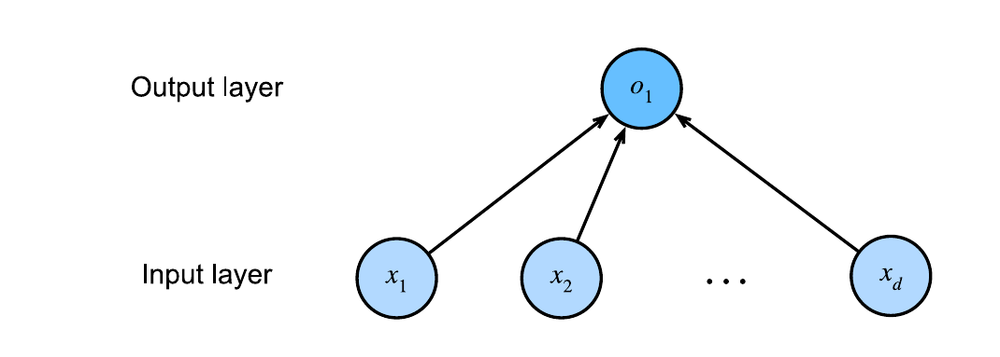
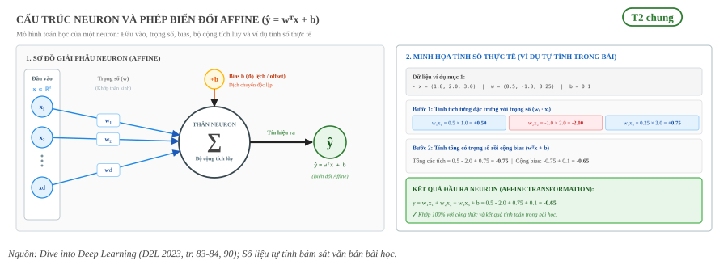
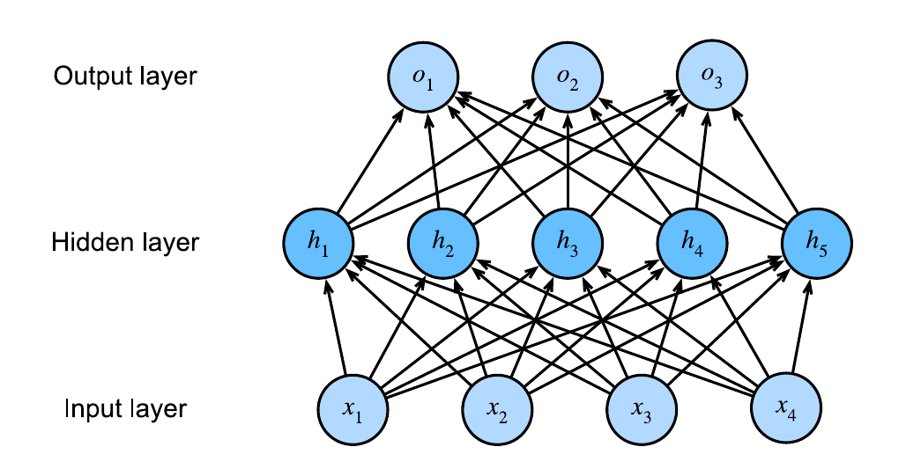
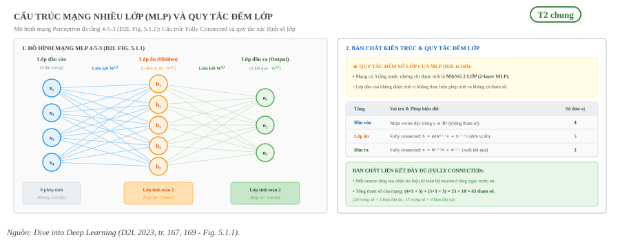
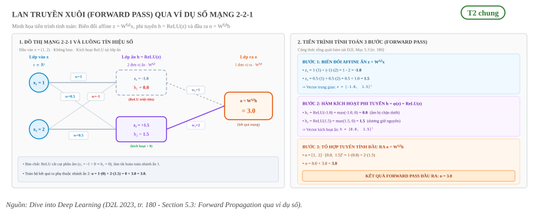
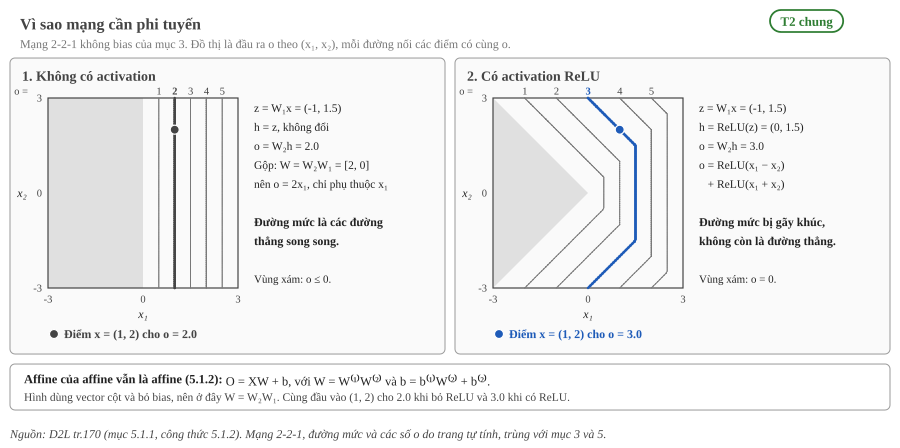

:tocdepth: 1

***********
Mạng nơ-ron
***********

.. admonition:: Trang này trả lời

   - Neuron, lớp và lan truyền xuôi hoạt động thế nào?

.. admonition:: Tóm tắt

   - Neuron tính tổng có trọng số của các đầu vào rồi cộng bias, ŷ = wᵀx + b [T2 D2L tr.84].
   - MLP là các lớp fully connected xếp chồng, lớp đầu vào không được tính vào số lớp [T2 D2L tr.169].
   - Lan truyền xuôi tính các biến trung gian và đầu ra theo thứ tự từ lớp đầu vào đến lớp đầu ra [T2 D2L tr.180].
   - Tham số của mạng là trọng số và bias. Ví dụ của sách: 4 đặc trưng và 3 đầu ra cần 12 trọng số và 3 bias [T2 D2L tr.127].
   - Công thức tổng quát ``d_in * d_out + d_out`` để đếm tham số là ``unknown`` trong sách, trang chỉ suy ra từ ví dụ.
   - Xếp chồng các lớp affine mà không có phi tuyến thì mạng vẫn chỉ là một phép affine [T2 D2L tr.170].
   - Nguồn duy nhất của trang là D2L (T2). Các ví dụ số do trang tự tính và được ghi rõ.

.. contents:: Trong trang này
   :local:
   :depth: 1

1. Neuron gồm đầu vào, trọng số, bias và tổng có trọng số
=========================================================

Neuron là đơn vị tính toán nhỏ nhất của mạng. Nó nhận một dãy số đầu vào, nhân mỗi số với một trọng số (weight) riêng, cộng các tích lại, rồi cộng thêm một số cố định gọi là bias. Bias (ký hiệu :math:`b`) còn được sách gọi là offset hay intercept, còn trọng số là hệ số nhân của từng đặc trưng đầu vào. [T2 D2L tr.83]

Với :math:`d` đầu vào gom thành vector :math:`\mathbf{x}` và :math:`d` trọng số gom thành vector :math:`\mathbf{w}`, đầu ra của neuron viết gọn bằng tích vô hướng. [T2 D2L tr.84]

.. math::

   \hat{y} = w_1 x_1 + \cdots + w_d x_d + b = \mathbf{w}^{\top}\mathbf{x} + b

Công thức này là (3.1.2) và (3.1.3) của sách. [T2 D2L tr.83, tr.84] Sách gọi phép tính đó là một phép biến đổi affine: biến đổi tuyến tính các đặc trưng bằng tổng có trọng số, rồi dịch chuyển bằng bias. [T2 D2L tr.83]

Sách coi hồi quy tuyến tính là mạng một lớp chỉ có một neuron. [T2 D2L tr.90] Trong phần mô tả sinh học, sách còn nói tổng có trọng số này có thể được xử lý thêm bởi một hàm phi tuyến :math:`\sigma(y)`. [T2 D2L tr.91] Mục 5 của trang này giải thích vì sao bước phi tuyến đó cần thiết.

   "Strictly speaking, (3.1.1) is an affine transformation of input features, which is characterized by a linear transformation of features via a weighted sum, combined with a translation via the added bias." [T2 D2L tr.83]

..

   "In summary, we can think of linear regression as a single-layer fully connected neural network." [T2 D2L tr.90]

.. _fig-d2l-hoi-quy-mot-lop:

   Hồi quy tuyến tính là mạng một lớp: d đầu vào nối trực tiếp với một đầu ra. Nguồn: [T2 D2L tr.90, Fig. 3.1.2]

.. _fig-cau-truc-neuron:

   Cấu trúc giải phẫu Neuron và phép biến đổi Affine: Sơ đồ toán học (trái) và ví dụ tính số thực nghiệm (phải).

**Ví dụ tự tính.** Neuron có ba đầu vào :math:`\mathbf{x} = (1.0, 2.0, 3.0)`, trọng số :math:`\mathbf{w} = (0.5, -1.0, 0.25)` và bias :math:`b = 0.1`. Ba tích là :math:`0.5`, :math:`-2.0` và :math:`0.75`. Cộng các tích rồi cộng bias:

.. math::

   y = 0.5 - 2.0 + 0.75 + 0.1 = -0.65

2. Lớp và mạng nhiều lớp (MLP)
==============================

Một lớp (layer) fully connected gồm nhiều neuron. Mỗi neuron nhận toàn bộ đầu ra của lớp phía dưới và có bộ trọng số cùng bias riêng. Các neuron trong lớp ẩn gọi là hidden unit (đơn vị ẩn). Xếp chồng nhiều lớp fully connected lên nhau, đầu ra của lớp này là đầu vào của lớp kế tiếp, ta được mạng nhiều lớp (multilayer perceptron, viết tắt MLP). [T2 D2L tr.167, tr.169]

   "The simplest deep networks are called multilayer perceptrons, and they consist of multiple layers of neurons each fully connected to those in the layer below (from which they receive input) and those above (which they, in turn, influence)." [T2 D2L tr.167]

..

   "Since the input layer does not involve any calculations, producing outputs with this network requires implementing the computations for both the hidden and output layers; thus, the number of layers in this MLP is two. Note that both layers are fully connected." [T2 D2L tr.169]

Như vậy khi đếm số lớp của MLP, lớp đầu vào không được tính vì nó không thực hiện phép tính nào. [T2 D2L tr.169]

Ví dụ trong Fig. 5.1.1 của sách: "This MLP has four inputs, three outputs, and its hidden layer contains five hidden units." [T2 D2L tr.169] Ta gọi cấu trúc này là mạng 4-5-3.

.. _fig-d2l-mlp-mot-lop-an:

   MLP có một lớp ẩn gồm năm hidden unit, bốn đầu vào và ba đầu ra. Nguồn: [T2 D2L tr.169, Fig. 5.1.1]

.. _fig-cau-truc-mang-mlp:

   Cấu trúc mạng nhiều lớp (MLP) 4-5-3: Đồ hình mạng Fully Connected (trái) và quy tắc đếm số lớp (phải).

.. list-table::
   :header-rows: 1
   :widths: 25 45 30

   * - Lớp
     - Vai trò
     - Số đơn vị
   * - Đầu vào
     - Nhận dữ liệu, không tính toán
     - 4
   * - Ẩn (hidden)
     - Fully connected, gồm các hidden unit
     - 5
   * - Đầu ra
     - Fully connected, cho kết quả của mạng
     - 3

Bảng tóm tắt cấu trúc mạng 4-5-3 theo mô tả của sách. [T2 D2L tr.169] Mạng này có hai lớp theo cách đếm ở trên.

3. Lan truyền xuôi (forward pass) qua ví dụ số
==============================================

Lan truyền xuôi (forward propagation hay forward pass) là quá trình tính và lưu các biến trung gian, kể cả đầu ra, theo thứ tự từ lớp đầu vào đến lớp đầu ra. [T2 D2L tr.180]

   "Forward propagation (or forward pass) refers to the calculation and storage of intermediate variables (including outputs) for a neural network in order from the input layer to the output layer." [T2 D2L tr.180]

..

   "For the sake of simplicity, let’s assume that the input example is x ∈ R𝑑 and that our hidden layer does not include a bias term. Here the intermediate variable is:" [T2 D2L tr.180]

Với một mạng một lớp ẩn không có bias, sách viết ba bước sau (5.3.1) đến (5.3.3). Ở đây :math:`\mathbf{x}` là đầu vào, :math:`W^{(1)}` là trọng số của lớp ẩn, :math:`\phi` là activation (hàm kích hoạt), :math:`\mathbf{h}` là vector hidden activation và :math:`W^{(2)}` là trọng số của lớp ra. [T2 D2L tr.180]

.. math::

   \mathbf{z} = W^{(1)} \mathbf{x}, \qquad
   \mathbf{h} = \phi(\mathbf{z}), \qquad
   \mathbf{o} = W^{(2)} \mathbf{h}

Trang này dùng vector cột (:math:`\mathbf{z} = W \mathbf{x}`) như mục 5.3 của sách. Mục 5.1.1 của sách viết dạng batch theo hàng (:math:`H = XW^{(1)} + b^{(1)}`), tức sách đổi ký hiệu giữa mục 5.1 và mục 5.3. [T2 D2L tr.169, tr.180] Ví dụ dưới đây bỏ bias để bám đúng sách.

Về activation, ví dụ dùng ReLU, định nghĩa :math:`\mathrm{ReLU}(v) = \max(v, 0)`. [T2 D2L tr.171]

**Ví dụ tự tính.** Mạng 2-2-1, không có bias, đầu vào :math:`\mathbf{x} = (1, 2)`. Trọng số lớp ẩn có hàng 1 là :math:`(1, -1)` và hàng 2 là :math:`(0.5, 0.5)`. Trọng số lớp ra là một hàng :math:`W^{(2)} = [1, 2]`.

.. list-table::
   :header-rows: 1
   :widths: 18 52 30

   * - Bước
     - Phép tính
     - Kết quả
   * - :math:`\mathbf{z}`
     - :math:`(1 \cdot 1 + (-1) \cdot 2,\ 0.5 \cdot 1 + 0.5 \cdot 2)`
     - :math:`(-1, 1.5)`
   * - :math:`\mathbf{h}`
     - ReLU áp dụng cho từng phần tử của :math:`\mathbf{z}`
     - :math:`(0, 1.5)`
   * - :math:`\mathbf{o}`
     - :math:`1 \cdot 0 + 2 \cdot 1.5`
     - :math:`3.0`

Phần tử đầu của :math:`\mathbf{z}` là :math:`-1` nên ReLU đưa nó về :math:`0`. Phần tử thứ hai giữ nguyên là :math:`1.5`. Đầu ra của mạng với đầu vào :math:`(1, 2)` là :math:`3.0`.

.. _fig-lan-truyen-xuoi-vi-du-so:

   Quá trình Lan truyền xuôi (Forward Pass) qua ví dụ số mạng 2-2-1: Đồ thị luồng tín hiệu số (trái) và tiến trình tính toán 3 bước (phải).

4. Tham số của mạng và cách đếm
===============================

Tham số (parameter) của mạng gồm hai loại: trọng số (weight) và bias. Đây là các giá trị mà quá trình huấn luyện đi tìm, sách gọi chung là "model parameters" [T2 D2L tr.84]. Trong ví dụ của sách, một lớp fully connected có hai nhóm tham số, một nhóm trọng số và một nhóm bias [T2 D2L tr.214].

   "We can see that this fully connected layer contains two parameters, corresponding to that layer’s weights and biases, respectively." [T2 D2L tr.214]

..

   "In our case, since we have 4 features and 3 possible output categories, we need 12 scalars to represent the weights (𝑤 with subscripts), and 3 scalars to represent the biases (𝑏 with subscripts)." [T2 D2L tr.127]

Ví dụ trên của sách cho thấy cách đếm: mỗi cặp (đầu vào, đầu ra) có một trọng số (4 × 3 = 12) và mỗi đầu ra có một bias (3). Sách cũng nêu rằng với một lớp fully connected có d đầu vào và q đầu ra thì số tham số và chi phí tính toán có bậc O(dq) [T2 D2L tr.132]. Từ các ví dụ này suy ra cách đếm cho một lớp, được viết dưới dạng công thức bên dưới.

.. math::

   \text{số tham số của một lớp} = d_{in} \cdot d_{out} + d_{out}

**unknown:** Công thức tổng quát ``d_in * d_out + d_out`` không được sách viết ra, đây chỉ là suy ra từ ví dụ tr.127. Truy vấn tìm nguồn: "number of learnable parameters fully connected layer d_in d_out bias".

**Ví dụ tự tính.** Mạng 4-5-3 ở Fig. 5.1.1 của sách (4 đầu vào, 5 hidden unit, 3 đầu ra) [T2 D2L tr.169]. Sách không nêu tổng số tham số của mạng này.

.. list-table::
   :header-rows: 1
   :widths: 20 40 20

   * - Lớp
     - Cách đếm
     - Số tham số
   * - Lớp ẩn (4 vào, 5 ra)
     - 4 × 5 trọng số + 5 bias
     - 25
   * - Lớp ra (5 vào, 3 ra)
     - 5 × 3 trọng số + 3 bias
     - 18
   * - Tổng
     - 25 + 18
     - 43

**Ví dụ tự tính từ shape do sách in ra.** Sách tạo mạng ``nn.Sequential(nn.LazyLinear(8), nn.ReLU(), nn.LazyLinear(1))`` với đầu vào có 4 đặc trưng và in shape của từng tham số [T2 D2L tr.214, tr.215]. Sách chỉ in shape, không nêu số tham số, các số bên dưới do trang này tính.

.. list-table::
   :header-rows: 1
   :widths: 14 22 22 22 20

   * - Lớp
     - Shape weight
     - Shape bias
     - Cách đếm
     - Số tham số
   * - ``0``
     - [8, 4]
     - [8]
     - 8 × 4 + 8
     - 40
   * - ``2``
     - [1, 8]
     - [1]
     - 1 × 8 + 1
     - 9
   * - Tổng
     -
     -
     - 40 + 9
     - 49

5. Vì sao mạng cần phi tuyến
============================

Nếu chỉ xếp chồng các lớp tuyến tính (đúng hơn là affine, tức tuyến tính cộng bias) thì mạng nhiều lớp không mạnh hơn mạng một lớp. Sách viết rằng đầu ra của lớp ẩn là một hàm affine của đầu vào, đầu ra của mạng lại là hàm affine của lớp ẩn, và hợp của hai hàm affine vẫn là một hàm affine [T2 D2L tr.170].

   "The hidden units above are given by an affine function of the inputs, and the outputs (pre-softmax) are just an affine function of the hidden units. An affine function of an affine function is itself an affine function." [T2 D2L tr.170]

Sách chứng minh bằng phép gộp (5.1.2) [T2 D2L tr.170]. Ở đây sách dùng dạng batch hàng, khác với dạng vector cột ``z = W x`` của mục 3 (sách đổi ký hiệu giữa mục 5.1 và 5.3).

.. math::

   O = (X W^{(1)} + b^{(1)}) W^{(2)} + b^{(2)} = X W^{(1)} W^{(2)} + b^{(1)} W^{(2)} + b^{(2)} = X W + b

Kết quả là một mô hình một lớp với tham số ``W = W(1) W(2)`` và ``b = b(1) W(2) + b(2)`` [T2 D2L tr.170]. Thêm lớp ẩn mà không có gì khác thì không thêm được khả năng biểu diễn nào.

Cách sửa là đặt một activation (hàm kích hoạt) phi tuyến σ lên từng hidden unit, ngay sau phép affine [T2 D2L tr.170]. Sách mô tả activation là các toán tử khả vi biến tín hiệu vào thành tín hiệu ra, và hầu hết chúng thêm tính phi tuyến [T2 D2L tr.171].

   "In general, with activation functions in place, it is no longer possible to collapse our MLP into a linear model:" [T2 D2L tr.170]

Một activation đơn giản là ReLU (5.1.4) [T2 D2L tr.171]:

.. math::

   \mathrm{ReLU}(x) = \max(x, 0)

**Ví dụ tự tính.** Dùng lại mạng 2-2-1 của mục 3, không có bias, đầu vào x = (1, 2), với W1 có hàng 1 là (1, -1) và hàng 2 là (0.5, 0.5), còn W2 = [1, 2].

.. list-table::
   :header-rows: 1
   :widths: 20 40 40

   * - Bước
     - Có ReLU
     - Bỏ ReLU
   * - Lớp ẩn: z = W1 x
     - z = (1·1 + (-1)·2, 0.5·1 + 0.5·2) = (-1, 1.5)
     - z = (-1, 1.5)
   * - Activation
     - h = ReLU(z) = (0, 1.5)
     - h = z = (-1, 1.5)
   * - Đầu ra: o = W2 h
     - o = 1·0 + 2·1.5 = 3.0
     - o = 1·(-1) + 2·1.5 = 2.0

Khi bỏ ReLU, hai lớp gộp được thành một phép nhân ma trận: W2 W1 = [1·1 + 2·0.5, 1·(-1) + 2·0.5] = [2, 0]. Đầu ra gộp là 2·1 + 0·2 = 2.0, đúng bằng cột "Bỏ ReLU". Mạng có ReLU cho 3.0, khác 2.0, nên ReLU làm mạng không còn gộp được thành một phép tuyến tính. Đây chỉ là một đầu vào làm phản ví dụ, không phải chứng minh tổng quát (chứng minh nằm ở (5.1.2) phía trên).

.. _fig-vi-sao-mang-can-phi-tuyen:

   Hiện tượng sụp đổ mô hình tuyến tính (Linear Collapse) và vai trò của hàm phi tuyến: Thiếu activation khiến mạng sụp đổ thành một lớp duy nhất (trái) so với bảo toàn kiến trúc đa tầng nhờ ReLU (phải).

Các activation cụ thể được trình bày ở trang :doc:`Chuẩn hóa và activation <04-chuan-hoa-va-activation>`.

Nguồn
=====

Các nhãn nguồn dùng trong trang này (tier, tệp, số lần trích).

.. list-table::
   :header-rows: 1
   :widths: 12 8 70 10

   * - Nhãn
     - Tier
     - Nguồn
     - Số lần
   * - ``D2L``
     - T2
     - :download:`dive_into_deep_learning_2023zhang.pdf <../../../_assets/pdf/papers/00_overview/dive_into_deep_learning_2023zhang.pdf>`
     - 42

Số trang trong nhãn là số trang in trong sách. Số trang PDF bằng số trang in cộng 40. Hai hình D2L ở mục 1 và mục 2 (Fig. 3.1.2 và Fig. 5.1.1) là hình gốc cắt từ trang PDF, lưu ở ``_assets/img/01-kien-thuc-nen/01-nen-tang-ai/mang-no-ron/``, nội dung giữ nguyên.
