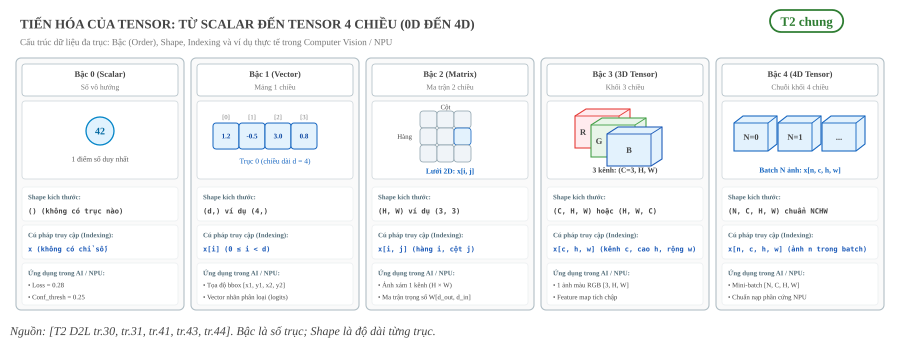
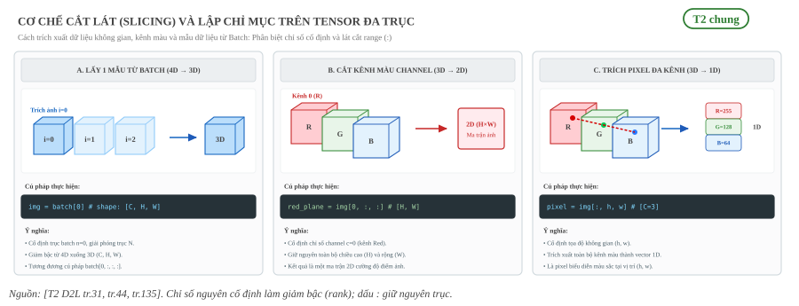
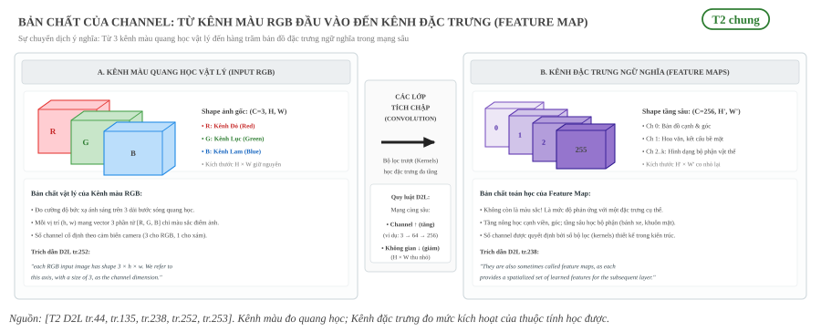
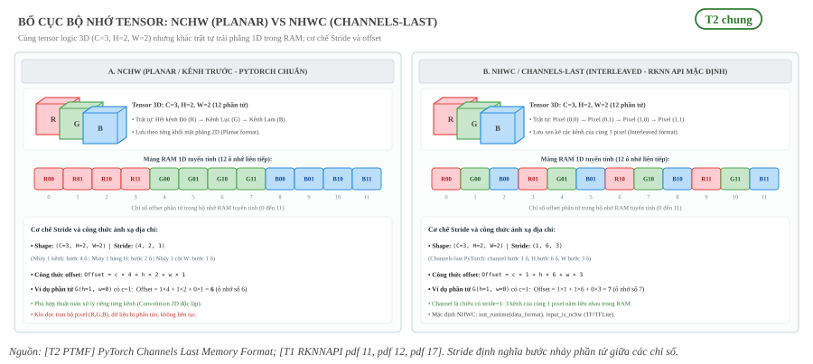
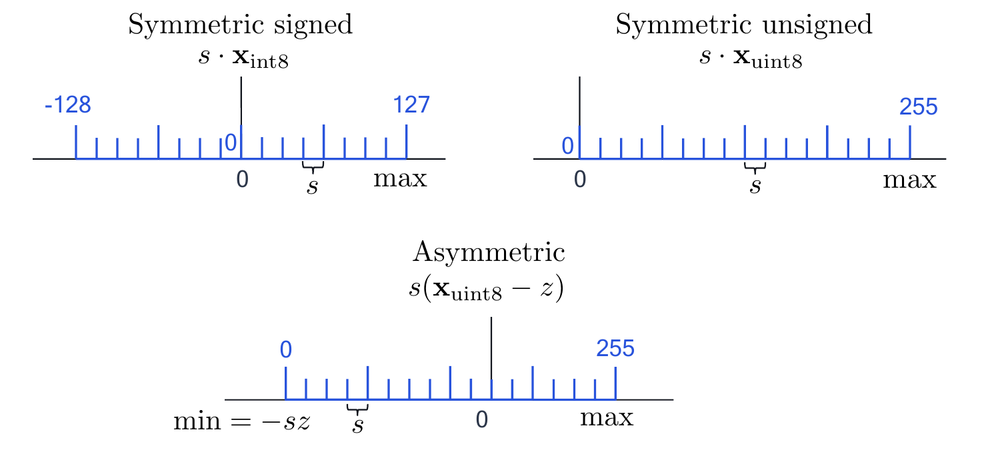
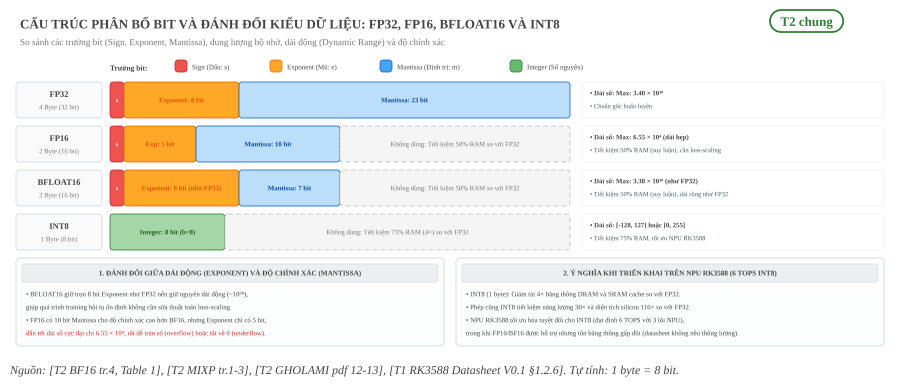
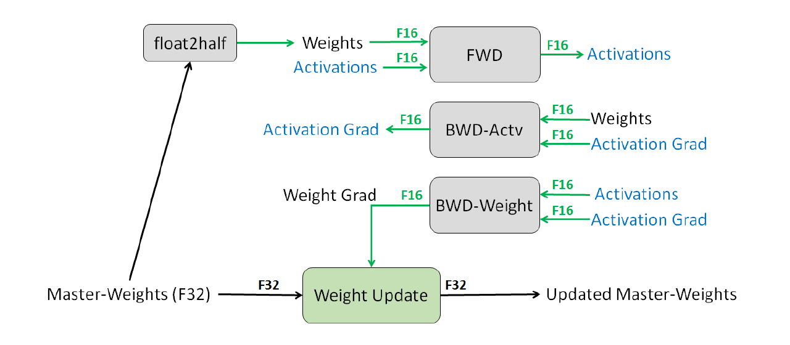
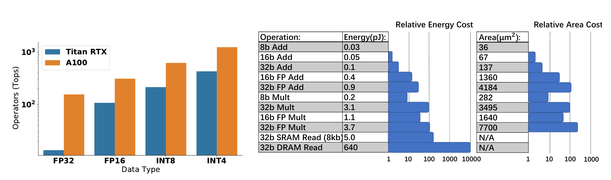

:tocdepth: 1

***********************
Tensor và kiểu dữ liệu
***********************

.. admonition:: Trang này trả lời

   - Tensor, channel và các kiểu số FP32, FP16, INT8 là gì?

.. admonition:: Tóm tắt

   - Tensor là mảng giá trị số có nhiều trục, bậc của tensor là số trục: scalar bậc 0, vector bậc 1, ma trận bậc 2 [T2 D2L tr.30] [T2 D2L tr.43].
   - D2L ghi thứ tự trục của ảnh theo nhiều cách (height, width, channel ở tr.44, channel, height, width ở tr.135, batch đứng đầu ở tr.137). Trang chọn quy ước NCHW.
   - Channel dùng cho hai việc: kênh màu của ảnh và kênh đặc trưng (feature map) của đầu ra lớp tích chập [T2 D2L tr.252] [T2 D2L tr.238].
   - NCHW và channels last cùng shape, khác stride: tensor 10×3×32×32 có stride (3072, 1024, 32, 1) và (3072, 1, 96, 3) [T1 PTMF]. Nguồn không nêu NHWC có phải là tên khác của channels last (``unknown``).
   - Số bit: FP32 là (1, 8, 23), FP16 là (1, 5, 10), BFLOAT16 là (1, 8, 7) [T2 BF16 tr.4]. Số byte mỗi phần tử không có trong nguồn đã kiểm (``unknown``), trang tự tính bằng số bit chia 8.
   - FP16 gần một nửa bộ nhớ nhưng dải hẹp hơn FP32 [T2 MIXP tr.1] [T2 MIXP tr.2]. BFLOAT16 giữ dải như FP32 [T2 BF16 tr.1].
   - Hai chỗ nguồn tự mâu thuẫn: mantissa của BFLOAT16 (8 bit trong văn bản, 7 trong Table 1) và INT8 "từ 1 đến 255" trong bài tập D2L khác với NAGEL.

.. contents:: Trong trang này
   :local:
   :depth: 1

1. Tensor từ vô hướng, vector, ma trận đến tensor nhiều chiều
=============================================================

Tensor là một mảng các giá trị số, có thể có nhiều trục (axis). Bậc của tensor (order hoặc rank) được định nghĩa chính xác bằng số lượng trục của nó. Khi dữ liệu chỉ cần một trục, tensor được gọi là vector. Khi có hai trục, tensor được gọi là ma trận. Từ ba trục trở lên thì không dùng tên riêng nữa, mà gọi chung là tensor bậc k (k-th order tensor) [T2 D2L tr.30] [T2 D2L tr.31].

Một giá trị số đơn lẻ gọi là scalar [T2 D2L tr.41]. D2L xếp scalar là tensor bậc 0, vector là tensor bậc 1 và ma trận là tensor bậc 2 [T2 D2L tr.43].

.. list-table::
   :header-rows: 1
   :widths: 18 16 26 22 18

   * - Tên gọi
     - Số trục (bậc)
     - Cấu trúc Shape mẫu
     - Cú pháp Indexing
     - Nguồn
   * - Scalar (Vô hướng)
     - Bậc 0
     - ``()`` hoặc ``[]``
     - ``x``
     - [T2 D2L tr.41] [T2 D2L tr.43]
   * - Vector (Véc-tơ)
     - Bậc 1
     - ``(d,)`` ví dụ ``(4,)``
     - ``x[i]``
     - [T2 D2L tr.30] [T2 D2L tr.43]
   * - Ma trận (Matrix)
     - Bậc 2
     - ``(H, W)`` ví dụ ``(3, 3)``
     - ``x[i, j]``
     - [T2 D2L tr.31] [T2 D2L tr.43]
   * - Tensor bậc 3
     - Bậc 3
     - ``(C, H, W)``
     - ``x[c, h, w]``
     - [T2 D2L tr.31] [T2 D2L tr.44]
   * - Tensor bậc 4
     - Bậc 4
     - ``(N, C, H, W)``
     - ``x[n, c, h, w]``
     - [T2 D2L tr.31] [T2 D2L tr.44]

Chữ "dimension" trong tiếng Anh dễ gây nhầm lẫn, vì nó vừa chỉ số trục vừa chỉ độ dài theo một trục cụ thể. Để tránh nhầm, D2L dùng "order" cho số trục và "dimensionality" cho số thành phần (components) theo một trục [T2 D2L tr.43]. Trang này quy ước dùng chữ "bậc" cho số trục và "kích thước trục" cho độ dài theo từng trục.

Shape của tensor là bộ số thể hiện độ dài theo từng trục tương ứng [T2 D2L tr.31]. Mỗi giá trị nằm tại một vị trí cụ thể trong tensor gọi là một phần tử (element). Tổng số phần tử trong tensor bằng tích các kích thước trong shape của nó.

   "With two axes, a tensor is called a matrix. With 𝑘 > 2 axes, we drop the specialized names and just refer to the object as a 𝑘 th -order tensor." [T2 D2L tr.31]

..

   "Each of these values is called an element of the tensor. The tensor x contains 12 elements." [T2 D2L tr.31]

.. _fig-tien-hoa-tensor-0d-den-4d:

   Tiến hóa cấu trúc Tensor từ Bậc 0 đến Bậc 4: Hình học không gian, Shape, cú pháp lập chỉ mục và ví dụ thực tế trong thị giác máy tính / NPU.

Ý nghĩa thực tế của từng bậc trong mô hình thị giác và phần cứng NPU:

* **Scalar (Bậc 0)**: Một đại lượng đo vô hướng, không có trục tọa độ không gian. Ví dụ: giá trị hàm mất mát (loss = 0.28), ngưỡng phân loại độ tin cậy (confidence threshold = 0.25).
* **Vector (Bậc 1)**: Dãy giá trị trải dọc theo 1 chiều. Ví dụ: tọa độ một hộp bao vật thể ``[x1, y1, x2, y2]`` gồm 4 phần tử, hoặc vector đặc trưng embedding của ảnh.
* **Ma trận (Bậc 2)**: Bảng số hai chiều gồm hàng và cột. Ví dụ: một bức ảnh xám 1 kênh độ phân giải 640×640 có shape ``(640, 640)``, hoặc ma trận trọng số của lớp fully connected.
* **Tensor 3 chiều (Bậc 3)**: Xếp chồng nhiều ma trận 2D theo trục kênh (channel). Ví dụ: một ảnh màu RGB có 3 kênh Đỏ, Lục, Lam với shape ``(3, 640, 640)``; hoặc bản đồ đặc trưng (feature map) ở đầu ra lớp tích chập.
* **Tensor 4 chiều (Bậc 4)**: Gom nhiều tensor 3 chiều theo trục batch. Ví dụ: một mini-batch gồm 4 ảnh đưa vào NPU RK3588 có shape ``(4, 3, 640, 640)`` theo chuẩn NCHW.

1.1 Cơ chế cắt lát (Slicing) và lập chỉ mục đa trục
---------------------------------------------------

Khi thao tác với tensor trong các framework lập trình và runtime biên dịch mô hình, việc trích xuất dữ liệu con tuân theo hai quy tắc nền tảng:

1. **Chỉ số nguyên cố định (Scalar index)**: Chọn một vị trí duy nhất trên một trục sẽ triệt tiêu trục đó, làm giảm bậc của tensor đi 1.
2. **Dấu lát cắt dải (Slice range ``:``)**: Giữ lại toàn bộ hoặc một khoảng các phần tử trên trục đó, bảo toàn bậc của tensor trên trục tương ứng.

.. _fig-co-che-cat-lat-va-chi-so-hoa:

   Cơ chế cắt lát (Slicing) và lập chỉ mục: Trích xuất một ảnh từ batch (4D sang 3D), cắt một kênh màu (3D sang 2D) và trích xuất vector pixel đa kênh (3D sang 1D).

Ba thao tác cắt lát thông dụng nhất:

* **Lấy một ảnh từ mini-batch**: Cú pháp ``batch[0]`` (hoặc ``batch[0, :, :, :]``) cố định trục đầu tiên tại chỉ số 0. Bậc giảm từ 4D ``(N, C, H, W)`` xuống 3D ``(C, H, W)``.
* **Tách riêng một kênh màu (Channel slice)**: Cú pháp ``img[0, :, :]`` cố định chỉ số channel tại kênh 0 (kênh Đỏ). Bậc giảm từ 3D ``(3, H, W)`` xuống ma trận 2D ``(H, W)``.
* **Trích xuất vector màu của một pixel**: Cú pháp ``img[:, h, w]`` cố định tọa độ không gian tại vị trí ``(h, w)`` và lấy toàn bộ các kênh. Bậc giảm từ 3D ``(3, H, W)`` xuống vector 1D ``(3,)`` biểu diễn vector màu sắc ``[R, G, B]`` của điểm ảnh đó.

2. Shape của ảnh gồm batch, channel, height và width
====================================================

Một ảnh là tensor bậc 3 với các trục ứng với height, width và channel. Một tập ảnh được biểu diễn bằng tensor bậc 4, trong đó các ảnh khác nhau được đánh chỉ số theo trục đầu tiên [T2 D2L tr.44]. Trục đầu tiên này là trục batch.

D2L ghi thứ tự các trục theo nhiều cách khác nhau, và sách không hòa giải chúng. Bảng sau liệt kê các cách ghi đã kiểm trong sách. Chưa đọc hết sách nên đây có thể chưa phải toàn bộ.

.. list-table::
   :header-rows: 1
   :widths: 30 45 25

   * - Vị trí trong D2L
     - Thứ tự trục
     - Nguồn
   * - Mục 2.3.4 (một ảnh)
     - height, width, channel
     - [T2 D2L tr.44]
   * - Mục 4.2 và mục 7.4 (một ảnh)
     - channel, height, width
     - [T2 D2L tr.135] [T2 D2L tr.252]
   * - Mục 4.2.4 và mục 7.6 (có batch)
     - batch, channel, height, width
     - [T2 D2L tr.137] [T2 D2L tr.263]

Quy ước của trang này: thứ tự trục là (batch, channel, height, width), viết tắt NCHW. Quy ước này khớp với D2L ở chỗ batch đứng trước [T2 D2L tr.137] [T2 D2L tr.263] và channel đứng trước height, width [T2 D2L tr.135] [T2 D2L tr.252]. Các mục sau đều theo quy ước này. Cấu trúc hình học của tensor 4 chiều theo chuẩn này được minh họa tại :ref:`Hình 1 <fig-tien-hoa-tensor-0d-den-4d>` (cột Bậc 4), và cách thức xếp phẳng các trục vào bộ nhớ RAM được đối chiếu tại :ref:`Hình 3 <fig-bo-cuc-bo-nho-nchw-va-nhwc>`.

   "By convention we store an image as a 𝑐 × ℎ × 𝑤 tensor, where 𝑐 is the number of color channels, ℎ is the height and 𝑤 is the width." [T2 D2L tr.135]

..

   "As we commonly do with images, we read them as a tensor of shape (batch size, number of channels, height, width). For now, we only have one channel as the images are grayscale" [T2 D2L tr.137]

Ví dụ trong D2L: một minibatch gồm 64 ảnh có shape ``torch.Size([64, 1, 32, 32])`` [T2 D2L tr.136]. Lưu ý trang tr.136 chỉ in ra con số này và không giải thích từng chiều. Phải sang tr.137 sách mới nêu rằng thứ tự đó là (batch size, number of channels, height, width) và chỉ có một channel vì ảnh xám.

Ví dụ tự tính:

* Một ảnh màu 3×32×32 (channel, height, width) có 3·32·32 = 3072 phần tử. Mỗi channel có 32·32 = 1024 phần tử.
* Batch ảnh xám ``[64, 1, 32, 32]`` có 64·1·32·32 = 65 536 phần tử.

3. Channel là gì (kênh màu RGB, kênh đặc trưng)
===============================================

Channel (kênh) là trục thể hiện nhiều lớp giá trị cùng nằm ở một vị trí không gian [T2 D2L tr.44]. Từ "channel" được dùng cho hai việc, và hai việc này không phải một.

* Kênh màu: ảnh màu có các channel RGB, chỉ lượng đỏ, lục và lam [T2 D2L tr.252]. Phần lớn dữ liệu ảnh hiện đại có ba channel (đỏ, lục, lam), còn ảnh siêu phổ (hyper-spectral) có thể vượt xa ba channel [T2 D2L tr.135]. Ảnh xám Fashion-MNIST chỉ có một channel, shape một ảnh là ``torch.Size([1, 32, 32])`` [T2 D2L tr.135].
* Kênh đặc trưng: đầu ra của lớp tích chập cũng có nhiều channel. Chúng còn được gọi là feature map, vì mỗi channel cho lớp kế tiếp một tập đặc trưng đã học, phân bố theo không gian [T2 D2L tr.238] [T2 D2L tr.245]. Cách lớp tích chập tạo ra các channel này được trình bày ở trang sau.

Khi mạng sâu hơn, số channel thường được tăng lên, đồng thời giảm độ phân giải không gian [T2 D2L tr.253].

   "For example, each RGB input image has shape 3 × ℎ × 𝑤. We refer to this axis, with a size of 3, as the channel dimension." [T2 D2L tr.252]

..

   "As in the inputs, these are sometimes called channels. They are also sometimes called feature maps, as each provides a spatialized set of learned features for the subsequent layer." [T2 D2L tr.238]

Ví dụ tự tính: với ảnh màu 3×32×32 ở mục 2, trục channel có độ dài 3 và mỗi channel màu là một mảng 32×32 gồm 1024 phần tử. Tổng cộng 3·1024 = 3072 phần tử, đúng bằng số phần tử đã tính ở mục 2.

.. _fig-ban-chat-channel-rgb-va-feature-map:

   Bản chất của Channel: So sánh Kênh màu quang học RGB đầu vào (đo phổ bức xạ ánh sáng, $C=3$) và Kênh đặc trưng Feature Map qua các lớp tích chập (đo mức độ kích hoạt thuộc tính đã học, $C$ tăng vọt lên 64, 128, 256... trong khi không gian $H \times W$ co nhỏ lại).

4. Bố cục bộ nhớ NCHW và NHWC
=============================

Một tensor có shape cố định vẫn có thể được lưu vào bộ nhớ theo nhiều thứ tự khác nhau [T1 PTMF]. Trang này dùng thứ tự trục (batch, channel, height, width), viết tắt NCHW, khớp cách D2L ghi ở tr.137 và tr.263 [T2 D2L tr.137] [T2 D2L tr.263]. Sách D2L còn ghi (height, width, channel) cho một ảnh ở tr.44 [T2 D2L tr.44] và (channel, height, width) ở tr.135, tr.252 [T2 D2L tr.135] [T2 D2L tr.252], nên cần nêu rõ quy ước khi đọc.

Tài liệu PyTorch định nghĩa bố cục channels last như một cách khác để xếp tensor NCHW vào bộ nhớ mà vẫn giữ thứ tự các trục [T1 PTMF]:

   "The channels last memory format is an alternative way of ordering NCHW tensors in memory preserving dimensions ordering. Channels last tensors ordered in such a way that channels become the densest dimension (aka storing images pixel-per-pixel)." [T1 PTMF]

..

   "For example, 10x3x16x16 batch in Channels last format will have strides equal to (768, 1, 48, 3)." [T1 PTMF]

Tài liệu PTMF chỉ dùng chữ "channels last" và "NCHW", không có chuỗi "NHWC" [T1 PTMF]. Vì vậy trang này không khẳng định PTMF gọi bố cục đó là NHWC.

**unknown:** NHWC có phải là tên gọi tương ứng của channels last trong PyTorch hay không, nguồn đã kiểm không nêu. Truy vấn tìm nguồn: "NHWC channels last memory format PyTorch".

Với tensor 10×3×32×32 (N, C, H, W), PTMF in ra stride của bố cục NCHW liên tục là (3072, 1024, 32, 1). Sau khi chuyển sang channels last, shape vẫn là (10, 3, 32, 32) và stride là (3072, 1, 96, 3) [T1 PTMF]. Shape không đổi, chỉ có stride đổi.

Ví dụ tự tính: vị trí của phần tử (n, c, h, w) trong bộ nhớ là tích vô hướng giữa chỉ số và stride. Với phần tử (0, 2, 1, 1):

.. math::

   \text{NCHW: } 0\cdot 3072 + 2\cdot 1024 + 1\cdot 32 + 1\cdot 1 = 2081

.. math::

   \text{channels last: } 0\cdot 3072 + 2\cdot 1 + 1\cdot 96 + 1\cdot 3 = 101

Cùng một phần tử nằm ở vị trí 2081 trong bố cục NCHW và ở vị trí 101 trong bố cục channels last. Công thức tích vô hướng là suy ra của trang này, không phải câu trích từ PTMF.

.. _fig-bo-cuc-bo-nho-nchw-va-nhwc:

   Bố cục bộ nhớ Tensor: So sánh NCHW (lưu theo từng mặt phẳng kênh) và NHWC (lưu xen kẽ pixel-per-pixel) trên mảng RAM 1D tuyến tính, cùng cơ chế Stride và công thức ánh xạ offset.

Hình trên trực quan hóa sự khác biệt giữa hai bố cục trên một mini-tensor mẫu 3D có shape ``(C=3, H=2, W=2)`` gồm 12 phần tử:

* Ở bố cục **NCHW (Planar)**: Toàn bộ ma trận của kênh Đỏ được xếp trước, tiếp đến kênh Lục, rồi đến kênh Lam. Nhảy giữa các kênh cần bước nhảy lớn (stride = 4).
* Ở bố cục **NHWC / Channels-last (Interleaved)**: Dữ liệu được lưu theo từng pixel; các kênh màu của cùng một điểm ảnh nằm kế tiếp nhau trong RAM (stride của kênh bằng 1). Cách sắp xếp này đặt toàn bộ các kênh của một pixel liền nhau trong RAM.

Chỉ riêng với RKNN-Toolkit2, tài liệu của hãng dùng tên "nchw" và "nhwc" cho layout của dữ liệu vào và đặt mặc định là NHWC. Đây là quy ước của công cụ này, nguồn không nói gì về framework khác:

   "input_is_nchw: Whether the input layout of the model is already NCHW. The default value is False, means the default input layout is NHWC." [T1 RKNNAPI pdf 11]

..

   "data_format: The layout list of input data. "nchw" or "nhwc" , only valid for 4-dims input. The default value is None, means all inputs layout is "nhwc"." [T1 RKNNAPI pdf 17]

Phần layout riêng của RKNN được trình bày ở trang :doc:`../../02-nen-tang-rk3588/03-toolchain-runtime/05-fusion-va-layout-nc1hwc2`.

5. Kiểu số FP32, FP16 và INT8, số byte mỗi phần tử
==================================================

Mỗi phần tử của tensor được lưu bằng một kiểu số. Các nguồn mô tả kiểu số bằng số bit. Với kiểu float, bảng so sánh của bài BFLOAT16 ghi bộ ba (s, e, m) là số bit dấu, số bit mũ và số bit mantissa [T2 BF16 tr.4]. Với INT8, các nguồn lượng tử hóa nêu bit-width b = 8 và lưới số nguyên tương ứng [T2 NAGEL tr.4] [T2 NAGEL tr.5] [T2 GHOLAMI tr.5].

**unknown:** số byte mỗi phần tử của FP32, FP16 và INT8, không có trong nguồn đã kiểm nào. Truy vấn tìm nguồn: "FP32 4 bytes FP16 2 bytes INT8 1 byte tensor element size". Trang này tự tính bằng số bit chia 8 (1 byte bằng 8 bit).

Bảng của bài BFLOAT16 ghi mantissa của FP16 là 10, trùng với bài Mixed Precision Training [T2 BF16 tr.4] [T2 MIXP tr.3]:

   "Since FP16 has 10 bits of mantissa, the implicit bit must be right-shifted by 11 or more positions to potentially create a zero (in some cases rounding can recover the value)." [T2 MIXP tr.3]

Với BFLOAT16, chính bài BF16 tự mâu thuẫn. Văn bản nói 8 bit mantissa, còn Table 1 ghi (1, 8, 7), tức m = 7. Nguồn không hòa giải hai con số này, và bảng dưới đây lấy theo Table 1:

   "The values are represented as truncated full precision floating point values with 8 bits of mantissa and the dynamic range comparable to FP32 (Table 1)." [T2 BF16 tr.3]

Với INT8, lưới có dấu của GHOLAMI trải từ -128 đến 127 khi dùng toàn dải:

   "Symmetric quantization with restricted range maps real values to [-127, 127], and full range maps to [-128, 127] for 8-bit quantization." [T2 GHOLAMI tr.5]

Hình 3 của NAGEL vẽ ba lưới số nguyên 8 bit: đối xứng có dấu với nhãn -128 và 127, đối xứng không dấu với nhãn 0 và 255, và bất đối xứng với nhãn 0 và 255 cùng zero-point z [T2 NAGEL tr.5].

.. _fig-nagel-luoi-int8:

   Ba lưới lượng tử đều với bit-width 8, lưới số nguyên màu xanh dương. Nguồn: [T2 NAGEL tr.5, Figure 3]

.. list-table::
   :header-rows: 1
   :widths: 14 24 10 12 40

   * - Kiểu
     - (s, e, m) hoặc số bit
     - Tổng bit
     - Byte mỗi phần tử
     - Dải
   * - FP32
     - (1, 8, 23) [T2 BF16 tr.4]
     - 32
     - 4
     - Max Normal 3.40e38 [T2 BF16 tr.4]
   * - FP16
     - (1, 5, 10) [T2 BF16 tr.4]
     - 16
     - 2
     - Max Normal 6.55e4 [T2 BF16 tr.4]
   * - BFLOAT16
     - (1, 8, 7) [T2 BF16 tr.4]
     - 16
     - 2
     - Max Normal 3.38e38 [T2 BF16 tr.4]
   * - INT8
     - b = 8 bit [T2 NAGEL tr.5]
     - 8
     - 1
     - Có dấu [-128, 127] [T2 GHOLAMI tr.5]. Không dấu {0, ..., 255}, nhãn 0 và 255 trong Hình 3 [T2 NAGEL tr.5]

Chú thích: các ô "Tổng bit" của ba kiểu float là phép cộng s + e + m do trang tự tính từ Table 1 (1 + 8 + 23 = 32, 1 + 5 + 10 = 16, 1 + 8 + 7 = 16). Ô "Tổng bit" của INT8 lấy từ b = 8. Mọi ô "Byte mỗi phần tử" là tự tính bằng số bit chia 8 (32 bit = 4 byte, 16 bit = 2 byte, 8 bit = 1 byte). Các ô tự tính không gắn tier. NAGEL không có câu nào định nghĩa INT8 là 1 byte [T2 NAGEL tr.5].

.. _fig-cau-truc-bit-va-kieu-du-lieu:

   Cấu trúc phân bổ bit và đánh đổi: So sánh các trường Sign, Exponent, Mantissa giữa FP32, FP16, BFLOAT16 và INT8; sự đánh đổi giữa dải động (Dynamic Range) và độ chính xác; ý nghĩa tối ưu phần cứng trên NPU RK3588.

Ví dụ tự tính: một batch ảnh xám theo D2L có shape [64, 1, 32, 32] [T2 D2L tr.136], gồm 64·1·32·32 = 65 536 phần tử. Bộ nhớ cần cho riêng phần tử:

.. list-table::
   :header-rows: 1
   :widths: 20 40 40

   * - Kiểu
     - Phép tính
     - Kết quả
   * - FP32
     - 65 536 · 4
     - 262 144 byte (256 KiB)
   * - FP16
     - 65 536 · 2
     - 131 072 byte (128 KiB)
   * - INT8
     - 65 536 · 1
     - 65 536 byte (64 KiB)

6. Phân loại kiểu số và đánh đổi
================================

Các kiểu số của trang chia thành hai họ. Họ số thực dấu phẩy động gồm FP32, FP16 và BF16, mô tả bằng bộ ba (s, e, m): FP32 là (1, 8, 23), FP16 là (1, 5, 10), BFLOAT16 là (1, 8, 7) [T2 BF16 tr.4]. Họ số nguyên gồm INT8, là số nguyên với bit-width b = 8 [T2 NAGEL tr.5]. Mỗi kiểu đổi một thứ lấy một thứ: bớt bit thì tiết kiệm bộ nhớ, nhưng dải giá trị hoặc độ chính xác có thể giảm. Bảng dưới liệt kê điều từng nguồn nêu, kèm điều kiện đo.

.. list-table::
   :header-rows: 1
   :widths: 14 46 40

   * - Kiểu
     - Điều nguồn nêu
     - Điều kiện và nguồn
   * - FP16
     - Gần một nửa yêu cầu bộ nhớ, và nhanh hơn về số học. Dải hẹp hơn FP32 nên cần ba kỹ thuật: giữ bản sao trọng số FP32, loss-scaling, tính FP16 với cộng dồn FP32.
     - Theo MIXP, trên GPU đời gần đây [T2 MIXP tr.1], [T2 MIXP tr.2].
   * - FP16
     - Thông lượng half-precision gấp 2× đến 8× single-precision.
     - Theo MIXP, trên GPU đời gần đây [T2 MIXP tr.1].
   * - FP16
     - Cập nhật trọng số FP16 làm mất 80% độ chính xác tương đối.
     - Ví dụ rủi ro trong mục 3.1 của MIXP [T2 MIXP tr.3]. Mô hình đo cụ thể: unknown.
   * - BF16
     - Dải giá trị biểu diễn giống FP32, và chuyển đổi qua lại với FP32 đơn giản.
     - Theo BF16, trong ngữ cảnh huấn luyện [T2 BF16 tr.1].
   * - INT8
     - Giảm lượng dữ liệu chuyển, giảm kích thước và năng lượng của phép MAC.
     - Theo NAGEL, nêu định tính, không kèm số [T2 NAGEL tr.2].
   * - INT8
     - Phép cộng INT8 tiết kiệm năng lượng gấp 30× và tiết kiệm diện tích gấp 116× so với phép cộng FP32.
     - Theo GHOLAMI trích từ [97], là phép cộng, không phải cả mô hình [T2 GHOLAMI pdf 13].
   * - Lượng tử hóa 4 bit (W4A8)
     - Độ chính xác giảm trong 1% so với số thực cho ResNet18/50 và InceptionV3. Giảm 2.5% với MobileNetV2 và 4.2% với EfficientNet lite.
     - Theo NAGEL, mức giảm 1% áp dụng cho cả per-tensor và per-channel, mức 2.5% và 4.2% áp dụng cho per-tensor [T2 NAGEL tr.17].

Hình dưới là Figure 1 của MIXP, minh họa cách giữ độ chính xác khi dùng FP16: trọng số chính (Master-Weights) được giữ ở F32, đổi sang FP16 để chạy forward và backward, còn bước cập nhật trọng số chạy ở F32 [T2 MIXP tr.3]. Các bước forward, backward và cập nhật trọng số được giải thích ở các trang :doc:`01-mang-no-ron` và :doc:`05-loss-va-backpropagation`.

.. _fig-mixp-vong-huan-luyen:

   Một vòng huấn luyện mixed precision cho một lớp, các phép tính F16 và Master-Weights F32. Nguồn: [T2 MIXP tr.3, Figure 1]

Ba câu trích dưới đây là bằng chứng cho FP16, BF16 và INT8 trong bảng.

   "This nearly halves memory requirements and, on recent GPUs, speeds up arithmetic. Weights, activations, and gradients are stored in IEEE half-precision format. Since this format has a narrower range than single-precision we propose three techniques for preventing the loss of critical information." [T2 MIXP tr.1]

..

   "BFLOAT16 is attractive for Deep Learning training for two reasons: the range of values it can represent is the same as that of IEEE 754 floating-point format (FP32) and conversion to/from FP32 is simple." [T2 BF16 tr.1]

..

   "Low-bit fixed-point representations, such as INT8, not only reduce the amount data transfer but also the size and energy consumption of the MAC operation (Horowitz, 2014)." [T2 NAGEL tr.2]

Với GHOLAMI, nguồn nêu số 30× và 116× theo [97] của chính GHOLAMI, và nêu hướng chung rằng chuyển từ số thực sang số nguyên ít bit có tiềm năng giảm bộ nhớ và độ trễ:

   "performing INT8 addition is 30× more energy efficient and 116× more area efficient as compared to FP32 addition [97]." [T2 GHOLAMI pdf 13]

..

   "Moving from floating-point representations to lowprecision fixed integer values represented in eight/four bits or less holds the potential to reduce the memory footprint and latency." [T2 GHOLAMI pdf 18]

Hình 7 của GHOLAMI gồm hai phần. Bên trái là thông lượng đỉnh (Tops) của logic tính ở các độ chính xác khác nhau trên GPU Titan RTX và A100. Bên phải là chi phí năng lượng và diện tích của từng phép tính ở công nghệ 45 nm, lấy từ [97] của GHOLAMI [T2 GHOLAMI pdf 12]. Một số ô đọc trực tiếp từ bảng trong hình: cộng 8 bit tốn 0.03 pJ, nhân số thực 32 bit tốn 3.7 pJ, đọc DRAM 32 bit tốn 640 pJ.

.. _fig-gholami-thong-luong-nang-luong:

   Thông lượng đỉnh theo kiểu số trên Titan RTX và A100 (trái), chi phí năng lượng và diện tích của từng phép tính ở 45 nm (phải). Nguồn: [T2 GHOLAMI pdf 12, Figure 7]

..

   "As one can see, lower precision provides exponentially better energy efficiency and higher throughput." [T2 GHOLAMI pdf 12]

7. Hiểu sai thường gặp
======================

Bảng dưới gom các hiểu sai dễ gặp khi đọc về kiểu số và bố cục tensor. Mỗi hàng chỉ nêu điều nguồn ghi.

.. list-table::
   :header-rows: 1
   :widths: 22 56 22

   * - Hiểu sai
     - Thực tế theo nguồn
     - Nguồn
   * - FP16 có dải giá trị như FP32
     - MIXP viết rằng FP16 có dải hẹp hơn FP32 và có giá trị bị về 0: "any value whose magnitude is smaller than 2−24 becomes zero in FP16." Max Normal của FP16 là 6.55e4, của FP32 là 3.40e38 (BF16 Table 1).
     - [T2 MIXP tr.2], [T2 MIXP tr.3], [T2 BF16 tr.4]
   * - BF16 và FP16 giống nhau vì cùng là kiểu 16 bit
     - Hai kiểu có bit format khác nhau: FP16 là (1, 5, 10), BFLOAT16 là (1, 8, 7). Max Normal của FP16 là 6.55e4, của BFLOAT16 là 3.38e38. BF16 viết: "the range of values it can represent is the same as that of IEEE 754 floating-point format (FP32)". Cả hai cộng ra 16 bit (trang tự tính từ Table 1).
     - [T2 BF16 tr.4], [T2 BF16 tr.1]
   * - NHWC và NCHW là hai dữ liệu khác nhau
     - Cùng một tensor, chỉ khác cách xếp trong bộ nhớ. PTMF in ra shape giữ nguyên (10, 3, 32, 32) cho cả hai, còn stride là (3072, 1024, 32, 1) với NCHW liên tục và (3072, 1, 96, 3) với channels last. PTMF dùng chữ "channels last" và không có chữ "NHWC". Việc coi NHWC là tên khác của channels last: unknown theo PTMF.
     - [T1 PTMF]
   * - INT8 không có số 0, chỉ từ 1 đến 255
     - Câu này là tiền đề của một bài tập trong D2L, không phải định nghĩa kỹ thuật: "INT8 is a very limited format consisting of nonzero numbers from 1 to 255." NAGEL định nghĩa lưới số nguyên không dấu là {0, …, 2^b − 1}, gồm số 0, và hình 3 vẽ nhãn 0 và 255 cho không dấu, nhãn -128 và 127 cho có dấu. Câu của D2L không khớp với định nghĩa của NAGEL.
     - [T2 D2L tr.147], [T2 NAGEL tr.4], [T2 NAGEL tr.5]
   * - "Half-precision" chỉ là FP16
     - BF16 viết: "There are at least three half-precision formats in the domain of mixed precision training of large neural networks: FP16 [28], 16-bit Integer based [9], and BFLOAT16 [10, 4, 3]."
     - [T2 BF16 tr.1]
   * - Mantissa của BFLOAT16 là 8 bit hay 7 bit
     - Chính BF16 ghi hai số khác nhau. Văn bản ghi "8 bits of mantissa", còn Table 1 ghi BFLOAT16 là (1, 8, 7), tức m = 7. Nguồn không hòa giải. Với FP16, MIXP ghi "10 bits of mantissa", khớp với Table 1 của BF16 (FP16 là (1, 5, 10)).
     - [T2 BF16 tr.3], [T2 BF16 tr.4], [T2 MIXP tr.3]

Nguồn
=====

Các nhãn nguồn dùng trong trang này (tier, tệp, số lần trích).

.. list-table::
   :header-rows: 1
   :widths: 12 8 70 10

   * - Nhãn
     - Tier
     - Nguồn
     - Số lần
   * - ``D2L``
     - T2
     - :download:`dive_into_deep_learning_2023zhang.pdf <../../../_assets/pdf/papers/00_overview/dive_into_deep_learning_2023zhang.pdf>`
     - 47
   * - ``MIXP``
     - T2
     - :download:`mixed_precision_training_2018micikevicius.pdf <../../../_assets/pdf/papers/02_quantization/mixed_precision_training_2018micikevicius.pdf>`
     - 14
   * - ``BF16``
     - T2
     - :download:`bfloat16_study_2019kalamkar.pdf <../../../_assets/pdf/papers/02_quantization/bfloat16_study_2019kalamkar.pdf>`
     - 20
   * - ``NAGEL``
     - T2
     - :download:`quant_whitepaper_2021nagel.pdf <../../../_assets/pdf/papers/02_quantization/quant_whitepaper_2021nagel.pdf>`
     - 13
   * - ``GHOLAMI``
     - T2
     - :download:`quantization_survey_2021gholami.pdf <../../../_assets/pdf/papers/02_quantization/quantization_survey_2021gholami.pdf>`
     - 9
   * - ``PTMF``
     - T2
     - :download:`pytorch_docs_channels_last_memory_format.html <../../../_assets/pdf/papers/04_memory/pytorch_docs_channels_last_memory_format.html>`
     - 8
   * - ``RKNNAPI``
     - T1
     - :download:`01_Rockchip_RKNPU_API_Reference_RKNN_Toolkit2_V2.3.2_EN.pdf <../../../_assets/pdf/rknn/01_Rockchip_RKNPU_API_Reference_RKNN_Toolkit2_V2.3.2_EN.pdf>`
     - 2

Số trang của D2L là số trang in, bằng số trang PDF trừ 40. Số trang của MIXP và BF16 theo thứ tự trang của PDF. Số trang của RKNNAPI là chỉ số trang PDF. PTMF là tài liệu PyTorch dạng trang web nên không có số trang. Ba hình trong trang là hình gốc của nguồn, cắt từ trang PDF và lưu ở ``_assets/img/01-kien-thuc-nen/01-nen-tang-ai/tensor-va-kieu-du-lieu/``: Figure 3 của NAGEL (trang 5, mục 5), Figure 7 của GHOLAMI (trang 12, mục 6) và Figure 1 của MIXP (trang 3, mục 6). Năm hình đồ họa ở các mục 1, 3, 4 và 5 được sinh bởi công cụ ``docs/tools/figure_gen/01-kien-thuc-nen/02-tensor-va-kieu-du-lieu/gen.py`` và lưu tại ``_assets/generated/01-kien-thuc-nen/01-nen-tang-ai/02-tensor-va-kieu-du-lieu/``.
