:tocdepth: 1

******************
Convolution và CNN
******************

.. admonition:: Trang này trả lời

   - Tích chập, pooling và các khối CNN gồm những gì, và ghép lại thành mạng thế nào?

.. admonition:: Tóm tắt

   - Tích chập trong học sâu thực chất là phép tương quan chéo (cross-correlation) trượt kernel trên ảnh rồi cộng bias [T2 D2L tr.240, tr.242].
   - Công thức kích thước đầu ra khi có padding :math:`p` và stride :math:`s` là :math:`\lfloor (n - k + p + s) / s \rfloor` [T2 D2L tr.250].
   - Receptive field (trường tiếp nhận) là tập hợp mọi phần tử ở các lớp trước ảnh hưởng đến một phần tử đầu ra [T2 D2L tr.245].
   - Lớp tích chập đa kênh có tensor trọng số kích thước :math:`c_o \times c_i \times k_h \times k_w`. Tích chập :math:`1 \times 1` tương đương một lớp fully connected áp dụng riêng tại từng vị trí không gian [T2 D2L tr.254, tr.255].
   - Hạ bậc tích chập về nhân ma trận (im2col / lowering) trải dữ liệu thành ma trận để tận dụng thư viện GEMM, nhưng nhân bản dữ liệu đầu vào lên đến :math:`R \times S` lần [T2 CUDNN tr.4, tr.5].
   - Depthwise separable convolution tách tích chập chuẩn thành depthwise (lọc không gian từng kênh) và pointwise (:math:`1 \times 1` kết hợp kênh), giúp giảm tính toán từ 8 đến 9 lần với kernel :math:`3 \times 3` [T2 MOBILENET tr.2, tr.3].
   - Group convolution chia kênh thành :math:`g` nhóm độc lập, giảm số tham số và chi phí tính toán :math:`g` lần [T2 D2L tr.309].
   - Pooling là toán tử trượt cửa sổ xác định không chứa tham số học, thực hiện độc lập trên từng kênh [T2 D2L tr.258, tr.261]. Tích chập chuyển vị (transposed convolution) hoán đổi vai trò qua ma trận trọng số chuyển vị :math:`W^{\top}` [T2 D2L tr.658].
   - Khối residual học ánh xạ phần dư :math:`g(\mathbf{x}) = f(\mathbf{x}) - \mathbf{x}` qua kết nối tắt (shortcut) cộng trực tiếp [T2 D2L tr.304].

.. contents:: Trong trang này
   :local:
   :depth: 1

1. Tích chập trực quan, kernel trượt trên ảnh
=============================================

Trong thị giác máy tính, việc dùng mạng kết nối đầy đủ (MLP) cho ảnh kích thước lớn gặp trở ngại lớn về số lượng tham số. Hai nguyên lý định hướng việc thiết kế mạng tích chập là tính bất biến dịch chuyển (translation invariance) và tính cục bộ (locality) [T2 D2L tr.234].

   "Invariance: In the earliest layers, our network should respond similarly to the same patch, regardless of where it appears in the image... Locality: The earliest layers should focus on local regions, without regard to what is going on in the image at great distances." [T2 D2L tr.234]

Sách chỉ ra rằng các lớp tích chập trong thực hành thực chất là phép tương quan chéo (cross-correlation) [T2 D2L tr.240].

   "Recall that strictly speaking, convolutional layers are a misnomer, since the operations they express are more accurately described as cross-correlations. Based on our descriptions of convolutional layers in Section 7.1, in such a layer, an input tensor and a kernel tensor are combined to produce an output tensor through a cross-correlation operation." [T2 D2L tr.240]

Trong phép tương quan chéo hai chiều, cửa sổ kernel trượt qua từng vị trí trên ảnh từ trái sang phải và từ trên xuống dưới. Tại mỗi vị trí, các phần tử tương ứng của vùng ảnh con và kernel được nhân với nhau rồi cộng lại để cho ra một số vô hướng [T2 D2L tr.240, tr.241].

   "In order to obtain the output of the strict convolution operation, we only need to flip the two-dimensional kernel tensor both horizontally and vertically, and then perform the cross-correlation operation with the input tensor. It is noteworthy that since kernels are learned from data in deep learning, the outputs of convolutional layers remain unaffected no matter such layers perform either the strict convolution operations or the cross-correlation operations." [T2 D2L tr.244]

.. _fig-d2l-cross-correlation:

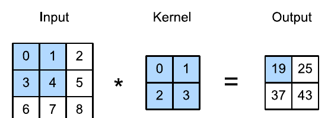

   Phép tương quan chéo hai chiều: Cửa sổ kernel 2x2 trượt trên ảnh 3x3 tạo ra đầu ra 2x2. Nguồn: [T2 D2L tr.241, Fig. 7.2.1]

Một lớp tích chập hoàn chỉnh bao gồm phép tương quan chéo cộng thêm một hệ số bias [T2 D2L tr.242].

   "A convolutional layer cross-correlates the input and kernel and adds a scalar bias to produce an output. The two parameters of a convolutional layer are the kernel and the scalar bias." [T2 D2L tr.242]

Về mặt trực giác thị giác, kernel đóng vai trò như một bộ lọc dò tìm đặc trưng cục bộ (như cạnh ngang, cạnh dọc hoặc tương phản sáng tối). Khi kernel quét qua vùng ảnh khớp với mẫu mà nó đại diện, kết quả nhân chập sinh ra một giá trị kích hoạt lớn, báo hiệu đặc trưng đó xuất hiện trên bản đồ đặc trưng [T2 D2L tr.242]. Sách lấy ví dụ bộ lọc vi phân bậc một kích thước :math:`1 \times 2` với trọng số :math:`[1, -1]`: khi trượt qua vùng ảnh có màu đồng nhất, kết quả bằng :math:`0`, còn khi chạm vào đường biên phân cách giữa hai mảng sáng tối, kết quả khác :math:`0`, giúp định vị chính xác đường viền của vật thể [T2 D2L tr.242, tr.243].

**Ví dụ tự tính theo Fig. 7.2.1 của sách.** Đầu vào kích thước :math:`3 \times 3`, kernel :math:`2 \times 2`, bias :math:`b = 0`:

.. math::

   X = \begin{bmatrix} 0 & 1 & 2 \\ 3 & 4 & 5 \\ 6 & 7 & 8 \end{bmatrix}, \qquad
   K = \begin{bmatrix} 0 & 1 \\ 2 & 3 \end{bmatrix}

Bốn giá trị đầu ra được tính tại từng vị trí cửa sổ [T2 D2L tr.241, Eq. 7.2.1]:

.. list-table::
   :header-rows: 1
   :widths: 20 50 30

   * - Vị trí đầu ra
     - Phép tính
     - Giá trị
   * - :math:`Y_{0,0}`
     - :math:`0 \cdot 0 + 1 \cdot 1 + 3 \cdot 2 + 4 \cdot 3`
     - :math:`19`
   * - :math:`Y_{0,1}`
     - :math:`1 \cdot 0 + 2 \cdot 1 + 4 \cdot 2 + 5 \cdot 3`
     - :math:`25`
   * - :math:`Y_{1,0}`
     - :math:`3 \cdot 0 + 4 \cdot 1 + 6 \cdot 2 + 7 \cdot 3`
     - :math:`37`
   * - :math:`Y_{1,1}`
     - :math:`4 \cdot 0 + 5 \cdot 1 + 7 \cdot 2 + 8 \cdot 3`
     - :math:`43`

Liên hệ RK3588: Mảng nhân cộng MAC array của NPU RK3588 tính toán song song các tích vô hướng của cửa sổ trượt này (xem :doc:`MAC và PE array </contents/01-kien-thuc-nen/02-npu/01-kien-truc-npu-va-mac>`).

2. Kernel, stride, padding, dilation và công thức kích thước đầu ra
===================================================================

Khi kernel trượt trên ảnh mà không đệm thêm viền, kích thước chiều cao và chiều rộng của đầu ra bị thu hẹp dần theo kích thước kernel [T2 D2L tr.241]:

.. math::

   (n_h - k_h + 1) \times (n_w - k_w + 1)

Để bảo toàn kích thước không gian hoặc kiểm soát tốc độ thu nhỏ qua nhiều lớp liên tiếp, kỹ thuật đệm (padding) bổ sung các hàng và cột giá trị 0 quanh viền ảnh [T2 D2L tr.248].

.. math::

   (n_h - k_h + p_h + 1) \times (n_w - k_w + p_w + 1)

Sách chỉ ra rằng khi chọn :math:`p_h = k_h - 1` và :math:`p_w = k_w - 1` với kernel có kích thước lẻ, đầu vào và đầu ra sẽ có cùng chiều cao và chiều rộng [T2 D2L tr.249].

Bước trượt (stride) xác định khoảng cách dịch chuyển của cửa sổ tích chập qua mỗi lần tính toán, thường dùng để giảm độ phân giải không gian thay cho pooling [T2 D2L tr.250]. Khi áp dụng đồng thời cả padding :math:`(p_h, p_w)` và stride :math:`(s_h, s_w)`, kích thước đầu ra tổng quát là (7.3.2) [T2 D2L tr.250]:

.. math::

   \lfloor (n_h - k_h + p_h + s_h) / s_h \rfloor \times \lfloor (n_w - k_w + p_w + s_w) / s_w \rfloor

Khi kernel có độ giãn nở (dilation hay atrous convolution), khoảng cách giữa các phần tử của kernel được mở rộng bằng cách chèn các khoảng trống [T2 CUDNN tr.3]. Kích thước hiệu dụng của kernel khi giãn nở với hệ số :math:`d` là :math:`k' = k + (k - 1)(d - 1)`.

**Ví dụ tự tính.** Đầu vào :math:`8 \times 8`, kernel :math:`3 \times 3`, padding :math:`p = 2` (:math:`p_h = p_w = 2`, tức đệm 1 hàng/cột mỗi phía), stride :math:`s = 2`:

.. math::

   \text{kích thước đầu ra} = \lfloor (8 - 3 + 2 + 2) / 2 \rfloor = \lfloor 9 / 2 \rfloor = 4

Đầu ra thu nhỏ thành :math:`4 \times 4`.

.. _fig-cv-stride-padding-dilation:

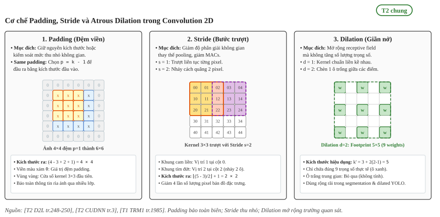

   Cơ chế Padding, Stride và Atrous Dilation trong Convolution 2D: (1) Padding đệm viền bảo toàn kích thước không gian; (2) Stride nhảy cách quãng thu nhỏ đặc trưng thay thế pooling; (3) Dilation mở rộng trường tiếp nhận mà không tăng số lượng trọng số.

Liên hệ RK3588: Bộ điều khiển tiền xử lý (pre-process controller) của NPU RK3588 hỗ trợ trực tiếp các chế độ stride, padding và atrous dilation ở cấp thanh ghi phần cứng [T1 TRM1 tr.1985]. NPU không cần ghi các hàng/cột padding số 0 ra ngoài DRAM mà tự động tiêm giá trị 0 trực tiếp vào mảng MAC, tiết kiệm tối đa dung lượng bộ nhớ và băng thông (xem :doc:`DPU và chế độ conv </contents/02-nen-tang-rk3588/01-phan-cung-npu/02-vi-kien-truc-va-khoi-tinh-toan-core>`).

3. Receptive field (Trường tiếp nhận)
=====================================

Trong mạng tích chập, đầu ra của mỗi lớp còn được gọi là bản đồ đặc trưng (feature map) [T2 D2L tr.245]. Trường tiếp nhận (receptive field) mô tả phạm vi không gian mà một nơ-ron có thể quan sát được từ các lớp trước đó.

   "In CNNs, for any element x of some layer, its receptive field refers to all the elements (from all the previous layers) that may affect the calculation of x during the forward propagation. Note that the receptive field may be larger than the actual size of the input." [T2 D2L tr.245]

Sách lấy ví dụ từ Fig. 7.2.1: một phần tử ở lớp đầu ra :math:`Y` có receptive field là vùng :math:`2 \times 2` trên ảnh đầu vào. Nếu xếp chồng thêm một lớp tích chập :math:`2 \times 2` thứ hai nhận :math:`Y` làm đầu vào để cho ra một giá trị :math:`z`, thì receptive field của :math:`z` trên :math:`Y` là :math:`2 \times 2` (4 phần tử), nhưng receptive field của :math:`z` trên ảnh gốc ban đầu bao phủ toàn bộ :math:`3 \times 3` (9 phần tử) [T2 D2L tr.245].

   "Thus, when any element in a feature map needs a larger receptive field to detect input features over a broader area, we can build a deeper network." [T2 D2L tr.245]

Việc xếp chồng nhiều lớp tích chập với kernel nhỏ (ví dụ hai lớp :math:`3 \times 3`) cho cùng receptive field với một kernel lớn (:math:`5 \times 5`), nhưng giảm số tham số và bổ sung thêm các hàm phi tuyến [T2 D2L tr.279].

.. _fig-cv-receptive-field:

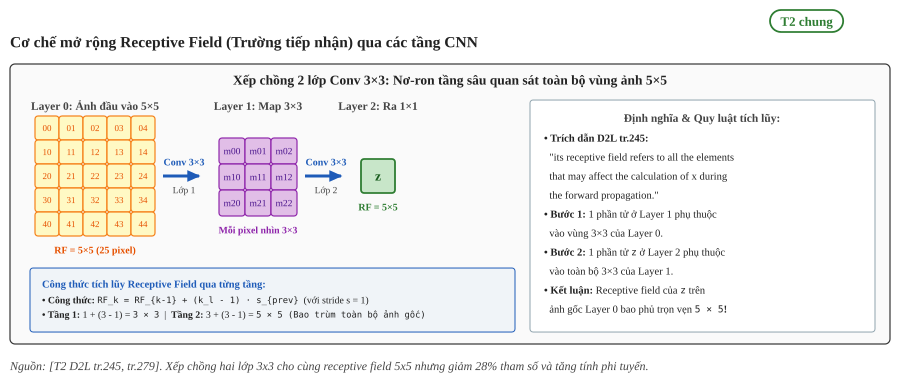

   Cơ chế mở rộng Receptive Field qua các tầng CNN: Xếp chồng hai lớp tích chập 3x3 liên tiếp đạt trường tiếp nhận 5x5 trên ảnh gốc nhưng giảm 28% số lượng tham số so với một lớp 5x5 đơn lẻ và tăng tính phi tuyến.

.. list-table:: So sánh kiến trúc: Hai lớp Conv 3×3 xếp chồng vs Một lớp Conv 5×5 đơn lẻ
   :widths: 20 28 26 26
   :header-rows: 1
   :align: center

   * - Tiêu chí so sánh
     - Hai lớp Conv 3×3 liên tiếp
     - Một lớp Conv 5×5 đơn lẻ
     - Đánh giá / Ưu thế
   * - Trường tiếp nhận (RF)
     - :math:`5 \times 5` pixel trên ảnh gốc
     - :math:`5 \times 5` pixel trên ảnh gốc
     - Tương đương nhau 100%, bao quát cùng một vùng
   * - Số lượng tham số (Weights)
     - :math:`2 \times (3 \times 3) = 18` trọng số (giả sử 1 kênh)
     - :math:`1 \times (5 \times 5) = 25` trọng số (giả sử 1 kênh)
     - Giảm 28% tham số, tiết kiệm bộ nhớ RAM
   * - Tính phi tuyến (Non-linearity)
     - 2 lớp hàm kích hoạt ReLU
     - Chỉ có 1 lớp kích hoạt ReLU
     - Mạng sâu hơn biểu diễn hàm phức tạp tốt hơn
   * - Ứng dụng trong YOLO / NPU
     - Chuẩn thiết kế VGG / CSPDarknet
     - Hiếm dùng trong CNN hiện đại
     - Dễ ánh xạ phần cứng NPU, tối ưu hóa bộ đệm CBUF

Liên hệ RK3588: Trong các mô hình phát hiện vật thể, receptive field quyết định khả năng nhận diện các vật thể có kích thước lớn ở các tầng đặc trưng sâu (xem :doc:`Các khối cấu thành của detector </contents/01-kien-thuc-nen/07-yolo/01-kien-truc-va-khoi-cau-thanh-yolo>`).

4. Nhiều kênh vào, nhiều kênh ra, đếm params và MACs
====================================================

Khi dữ liệu đầu vào chứa :math:`c_i` kênh, mỗi bộ lọc phải có :math:`c_i` kênh tương ứng để thực hiện tích chập trên từng kênh rồi cộng dồn lại theo chiều kênh [T2 D2L tr.252, tr.253].

.. _fig-d2l-multi-channel:

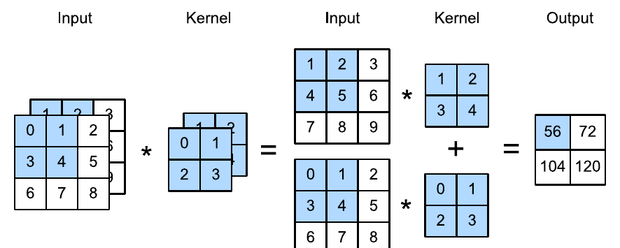

   Phép tính tương quan chéo với hai kênh đầu vào: Tích chập độc lập trên từng kênh rồi cộng dồn kết quả. Nguồn: [T2 D2L tr.253, Fig. 7.4.1]

Để tạo ra :math:`c_o` kênh đầu ra, ta ghép :math:`c_o` bộ lọc đa kênh lại với nhau, tạo thành tensor trọng số có shape :math:`c_o \times c_i \times k_h \times k_w` [T2 D2L tr.254].

Lớp tích chập :math:`1 \times 1` không liên kết các điểm ảnh lân cận trong không gian, mà chỉ tính tổ hợp tuyến tính dọc theo chiều kênh [T2 D2L tr.255].

   "You could think of the 1 × 1 convolutional layer as constituting a fully connected layer applied at every single pixel location to transform the c_i corresponding input values into c_o output values." [T2 D2L tr.255]

Số tham số của lớp tích chập gồm trọng số và bias [T2 D2L tr.254]:

.. math::

   \text{số tham số} = c_o \cdot c_i \cdot k_h \cdot k_w + c_o

Công thức trên suy trực tiếp từ cấu trúc tensor trọng số :math:`c_o \times c_i \times k_h \times k_w` và vector bias :math:`c_o` được định nghĩa trong [T2 D2L tr.254], đồng nhất với định nghĩa chuẩn của lớp Conv2d trong tài liệu PyTorch.

Về khối lượng tính toán, sách nêu độ phức tạp cho ảnh :math:`h \times w` với :math:`c_i` kênh vào và :math:`c_o` kênh ra là :math:`O(h \cdot w \cdot k^2 \cdot c_i \cdot c_o)` [T2 D2L tr.256]. Theo cách tính chuẩn của các kiến trúc thị giác [T2 MOBILENET tr.2, Eq. 2], số phép nhân tích lũy (MACs) cho một lớp tích chập với kích thước đầu ra :math:`h_{out} \times w_{out}` là:

.. math::

   \text{MACs} = h_{out} \cdot w_{out} \cdot c_o \cdot c_i \cdot k_h \cdot k_w

**Ví dụ tự tính.** Lớp tích chập nhận đầu vào :math:`c_i = 16`, đầu ra :math:`c_o = 32`, kernel :math:`3 \times 3`, có bias, kích thước đầu ra :math:`h_{out} = w_{out} = 28`:
- Số tham số: :math:`32 \cdot 16 \cdot 3 \cdot 3 + 32 = 4608 + 32 = 4640`.
- Số MACs: :math:`28 \cdot 28 \cdot 32 \cdot 16 \cdot 3 \cdot 3 = 3{,}612{,}672` (khoảng 3.61 MMACs).

Liên hệ RK3588: Tỷ lệ giữa số MACs và lượng byte dữ liệu nạp từ bộ nhớ quyết định vị trí của lớp trên mô hình Roofline của RK3588 (xem :doc:`Roofline và dataflow </contents/01-kien-thuc-nen/02-npu/02-dataflow-va-phan-cap-bo-nho>`).

5. Tích chập quy về nhân ma trận (im2col)
=========================================

Để tận dụng các thư viện nhân ma trận tối ưu (BLAS/GEMM) và mảng systolic của phần cứng, tích chập thường được hạ bậc (lowering) về phép nhân ma trận [T2 CUDNN tr.4].

   "One approach is to lower the convolutions into a matrix multiplication, following [6]. This can be implemented by creating a large data matrix by duplicating the original input data into a matrix D_m with dimensions CRS × NPQ... The filter matrix F_m has dimensions K × CRS = 2 × 12, while the data matrix D_m has dimensions CRS × NPQ = 12 × 4. Note that each element of D is duplicated up to RS = 4 times in D_m. The output matrix O_m has dimensions K × NPQ = 2 × 4." [T2 CUDNN tr.4]

.. _fig-cudnn-lowering:

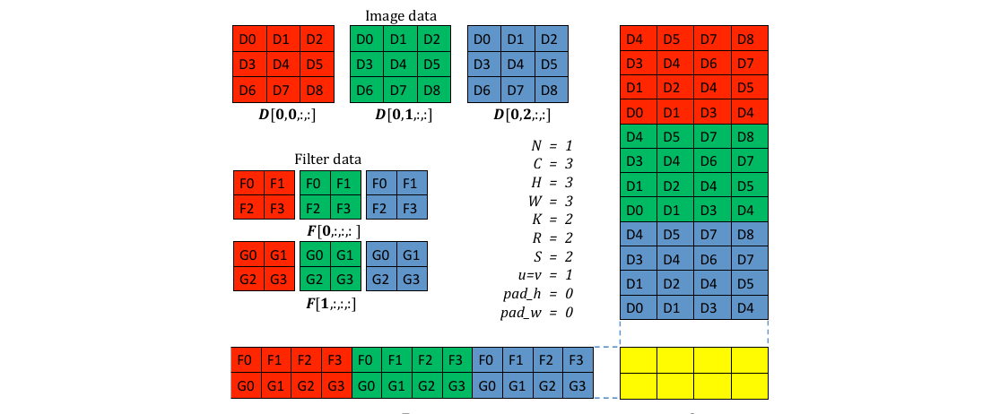

   Hạ bậc tích chập về nhân ma trận (im2col): Ma trận trọng số :math:`F_m` kích thước :math:`K \times CRS` nhân với ma trận dữ liệu trải phẳng :math:`D_m` kích thước :math:`CRS \times NPQ`. Nguồn: [T2 CUDNN tr.4, Figure 1]

Thao tác trải dữ liệu (thường gọi là im2col) chuyển mỗi vùng trượt :math:`k_h \times k_w \times c_i` thành một cột của ma trận :math:`D_m`. Phép tích chập được tính gọn bằng:

.. math::

   O_m = F_m \times D_m

Đánh đổi lớn nhất của im2col tường minh là việc chiếm dụng bộ nhớ đệm và băng thông, do mỗi điểm ảnh đầu vào bị sao chép lặp lại tới :math:`R \times S` lần [T2 CUDNN tr.5].

   "The disadvantage of this approach is that forming D_m involves duplicating the input data up to RS times, which can require a prohibitively large temporary allocation... This approach also lowers the computational intensity of the convolutions, because D_m must be written and read, in addition to reading D itself, requiring significantly more memory traffic as a more direct approach." [T2 CUDNN tr.5]

Sách D2L minh họa góc nhìn tương đương: viết lại kernel thành ma trận trọng số thưa :math:`W` kích thước :math:`4 \times 9` nhân với vector đầu vào trải phẳng :math:`X` độ dài :math:`9` để cho ra vector đầu ra độ dài :math:`4` [T2 D2L tr.658].

.. _fig-cv-im2col-gemm:

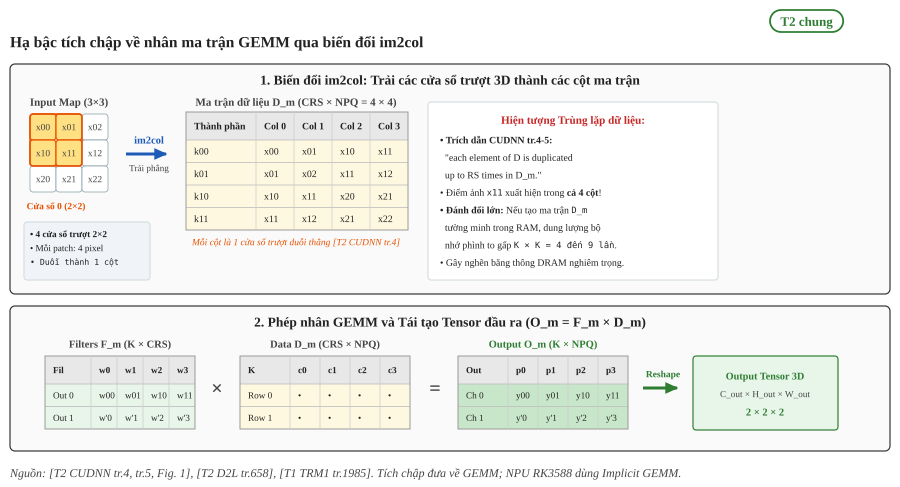

   Hạ bậc tích chập về nhân ma trận GEMM qua biến đổi im2col: Trải các cửa sổ trượt 3D thành các cột ma trận dữ liệu :math:`D_m` để nhân với ma trận bộ lọc :math:`F_m`; đánh đổi bộ nhớ do dữ liệu bị sao chép lặp lại tới :math:`R \times S` lần.

Liên hệ RK3588: Thay vì bung ma trận :math:`D_m` ra bộ nhớ ngoài DDR gây tốn dung lượng RAM khổng lồ, bộ điều khiển CNA của NPU RK3588 giải mã địa chỉ on-the-fly, nạp trực tiếp từng cửa sổ từ bộ đệm nội bộ CBUF vào mảng MAC theo cơ chế Implicit GEMM [T1 TRM1 tr.1985], đạt thông lượng tính toán GEMM cực đại mà không tốn chi phí bộ nhớ trung gian (xem :doc:`Layout NC1HWC2 và alignment </contents/02-nen-tang-rk3588/03-toolchain-runtime/05-fusion-va-layout-nc1hwc2>`).

6. Depthwise và pointwise
=========================

Kiến trúc MobileNet giới thiệu phép phân rã tích chập (factorized convolution), tách tích chập tiêu chuẩn thành hai bước riêng biệt: depthwise convolution và pointwise convolution [T2 MOBILENET tr.2].

   "The MobileNet model is based on depthwise separable convolutions which is a form of factorized convolutions which factorize a standard convolution into a depthwise convolution and a 1 × 1 convolution called a pointwise convolution. For MobileNets the depthwise convolution applies a single filter to each input channel. The pointwise convolution then applies a 1 × 1 convolution to combine the outputs the depthwise convolution." [T2 MOBILENET tr.2]

.. _fig-mobilenet-depthwise:

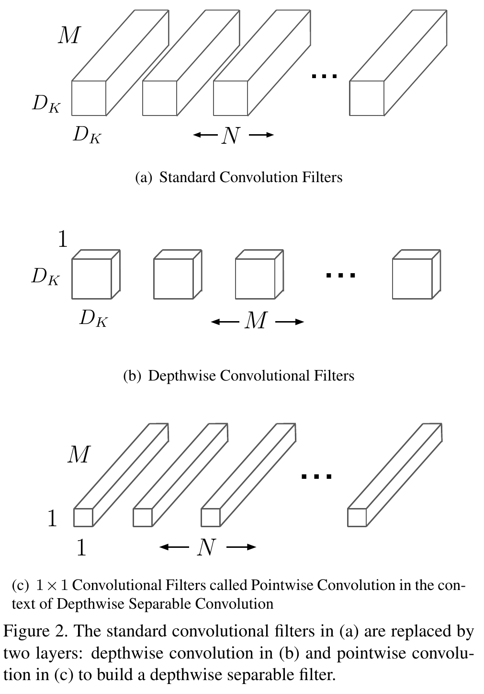

   Phân rã tích chập tiêu chuẩn (a) thành bộ lọc Depthwise (b) và bộ lọc Pointwise 1x1 (c). Nguồn: [T2 MOBILENET tr.3, Figure 2]

Depthwise convolution áp dụng một bộ lọc không gian duy nhất cho từng kênh đầu vào, không tạo ra đặc trưng kết hợp mới qua các kênh [T2 MOBILENET tr.3]:

.. math::

   \text{Chi phí Depthwise} = k_h \cdot k_w \cdot c_i \cdot h_{out} \cdot w_{out}

Sau đó, pointwise convolution (:math:`1 \times 1`) kết hợp tuyến tính các kênh lại với nhau:

.. math::

   \text{Chi phí Pointwise} = c_i \cdot c_o \cdot h_{out} \cdot w_{out}

Tổng chi phí của depthwise separable convolution và tỷ lệ cắt giảm so với tích chập tiêu chuẩn là (Eq. 5) [T2 MOBILENET tr.3]:

.. math::

   \frac{k_h \cdot k_w \cdot c_i \cdot h_{out} \cdot w_{out} + c_i \cdot c_o \cdot h_{out} \cdot w_{out}}{k_h \cdot k_w \cdot c_i \cdot c_o \cdot h_{out} \cdot w_{out}} = \frac{1}{c_o} + \frac{1}{k_h \cdot k_w}

Với kernel :math:`3 \times 3`, lượng tính toán giảm từ 8 đến 9 lần [T2 MOBILENET tr.3].

   "MobileNet uses 3 × 3 depthwise separable convolutions which uses between 8 to 9 times less computation than standard convolutions at only a small reduction in accuracy." [T2 MOBILENET tr.3]

Liên hệ RK3588: TRM của RK3588 có riêng chế độ phần cứng Depthwise convolution mode trong bộ điều khiển DPU (xem :doc:`Cấu trúc NPU core và DPU </contents/02-nen-tang-rk3588/01-phan-cung-npu/02-vi-kien-truc-va-khoi-tinh-toan-core>`).

7. Group convolution
====================

Group convolution (tích chập theo nhóm) chia :math:`c_i` kênh vào và :math:`c_o` kênh ra thành :math:`g` nhóm song song độc lập [T2 D2L tr.309].

   "Breaking up a convolution from c_i to c_o channels into one of g groups of size c_i/g generating g outputs of size c_o/g is called, quite fittingly, a grouped convolution. The computational cost (proportionally) is reduced from O(c_i · c_o) to O(g · (c_i/g) · (c_o/g)) = O(c_i · c_o / g), i.e., it is g times faster. Even better, the number of parameters needed to generate the output is also reduced from a c_i × c_o matrix to g smaller matrices of size (c_i/g) × (c_o/g), again a g times reduction." [T2 D2L tr.309]

.. list-table::
   :header-rows: 1
   :widths: 30 35 35

   * - Tiêu chí
     - Tích chập tiêu chuẩn (:math:`g = 1`)
     - Group convolution (:math:`g` nhóm)
   * - Trọng số
     - :math:`c_o \cdot c_i \cdot k_h \cdot k_w`
     - :math:`\frac{c_o \cdot c_i \cdot k_h \cdot k_w}{g}`
   * - Độ phức tạp tính toán
     - :math:`O(c_i \cdot c_o)`
     - :math:`O\left(\frac{c_i \cdot c_o}{g}\right)`
   * - Trao đổi thông tin giữa các kênh
     - Toàn bộ các kênh
     - Chỉ trong nội bộ từng nhóm

Một cách nhìn khác về group convolution là ma trận trọng số có dạng khối đường chéo (block-diagonal), trong đó mỗi khối có kích thước :math:`(c_i / g) \times (c_o / g)` [T2 D2L tr.309].

Phổ liên tục giữa các biến thể tích chập qua tham số nhóm :math:`g`:

- Khi :math:`g = 1`: Tích chập tiêu chuẩn (Standard Convolution), mọi kênh đầu vào kết nối dày đặc với mọi kênh đầu ra, chi phí tính toán cao nhất.
- Khi :math:`1 < g < c_i`: Tích chập nhóm (Group Convolution như trong ResNeXt), giảm số tham số và cô lập các nhóm biểu diễn song song.
- Khi :math:`g = c_i = c_o`: Tích chập Depthwise Convolution, mỗi kênh đầu vào được xử lý bởi một bộ lọc riêng biệt và không có sự trộn kênh.

Kiến trúc ResNeXt khắc phục nhược điểm thiếu liên kết giữa các nhóm bằng cách kẹp lớp group convolution ở giữa hai lớp tích chập :math:`1 \times 1` [T2 D2L tr.310].

.. _fig-cv-dwconv-group-conv:

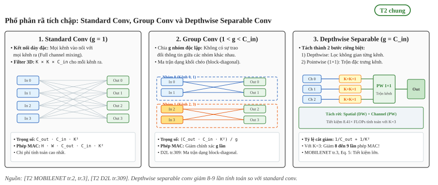

   Phổ phân rã tích chập: So sánh cơ chế luồng kênh giữa Standard Conv (kết nối dày đặc), Group Conv (khối đường chéo độc lập) và Depthwise Separable Conv (tách riêng lọc không gian và trộn kênh, giảm 8 đến 9 lần phép tính MAC).

.. list-table:: So sánh định lượng FLOPs và đặc tính phần cứng (Ví dụ: :math:`K=3, C_{in}=64, C_{out}=128, H=W=28`)
   :widths: 22 26 26 26
   :header-rows: 1
   :align: center

   * - Đặc tính
     - Standard Conv (:math:`3 \times 3`)
     - Group Conv (:math:`g = 4`)
     - Depthwise Separable (:math:`3 \times 3`)
   * - Số tham số (Weights)
     - :math:`128 \times 64 \times 9 = 73{,}728`
     - :math:`(128 \times 64 \times 9) / 4 = 18{,}432`
     - :math:`(64 \times 9) + (64 \times 128 \times 1) = 8{,}768` (giảm 8.4×)
   * - Số phép MAC toàn lớp
     - 57.8 MMACs
     - 14.4 MMACs (giảm 4×)
     - 6.87 MMACs (giảm 8.41×)
   * - Giao tiếp giữa các kênh
     - Toàn bộ mọi kênh
     - Chỉ trong nội bộ từng nhóm
     - Tách riêng: DW không trộn, PW trộn 100%
   * - Độ phù hợp phần cứng NPU
     - Tận dụng 100% mảng MAC, compute-bound, hiệu năng cao
     - Tốt nếu số nhóm chia đều trên các cụm MAC RK3588
     - DW dễ bị memory-bound (ít tính toán); PW chạy tối đa mảng MAC :math:`32 \times 32`

Liên hệ RK3588: Group convolution được hỗ trợ trực tiếp trong danh sách toán tử của bộ biên dịch RKNN Toolkit. Trên NPU RK3588, lớp Depthwise Conv (:math:`3 \times 3`) trong YOLO thường có hiệu suất sử dụng MAC (MacUsage) thấp (chỉ 0.3% - 1.2%) do nghẽn nạp bộ nhớ; trong khi lớp Pointwise Conv (:math:`1 \times 1`) và Group Conv là phép nhân ma trận thuần túy GEMM, lấp đầy mảng MAC :math:`32 \times 32` và đạt hiệu suất tính toán cao (xem :doc:`Operator List RKNN </contents/02-nen-tang-rk3588/03-toolchain-runtime/04-operator-list>`).

8. Pooling và upsample
======================

Pooling là toán tử thu nhỏ độ phân giải không gian bằng cách trượt một cửa sổ cố định trên đầu vào và trích xuất một giá trị thống kê duy nhất cho mỗi vị trí [T2 D2L tr.258].

   "However, unlike the cross-correlation computation of the inputs and kernels in the convolutional layer, the pooling layer contains no parameters (there is no kernel). Instead, pooling operators are deterministic, typically calculating either the maximum or the average value of the elements in the pooling window. These operations are called maximum pooling (max-pooling for short) and average pooling, respectively." [T2 D2L tr.258]

Khác với tích chập cộng dồn các kênh, pooling xử lý từng kênh một cách độc lập, do đó số lượng kênh đầu ra luôn bằng đúng số lượng kênh đầu vào [T2 D2L tr.261].

Ngược lại với quá trình giảm độ phân giải, mạng cần tăng kích thước không gian (upsample) trong các bài toán phân vùng ngữ nghĩa hoặc ghép đặc trưng đa tỷ lệ. Tích chập chuyển vị (transposed convolution) thực hiện tăng kích thước bằng cách nhân từng phần tử đầu vào với kernel để thế vào các vị trí trong vùng đệm trung gian rồi cộng dồn lại [T2 D2L tr.655].

   "In transposed convolution, each element in the input tensor is multiplied by the kernel so that the resulting k_h × k_w tensor replaces a portion in each intermediate tensor... In the end, all the intermediate results are summed over to produce the output." [T2 D2L tr.655]

Về mặt đại số tuyến tính, phép tính này tương đương với việc nhân vector đầu vào với ma trận chuyển vị :math:`W^{\top}` của ma trận trọng số thưa từ phép tích chập xuôi [T2 D2L tr.658]. Ngoài tích chập chuyển vị, các phương pháp upsample nội suy (nearest neighbor, bilinear) cũng thường được dùng để tránh sinh thêm tham số.
 
.. _fig-cv-pooling-upsample:

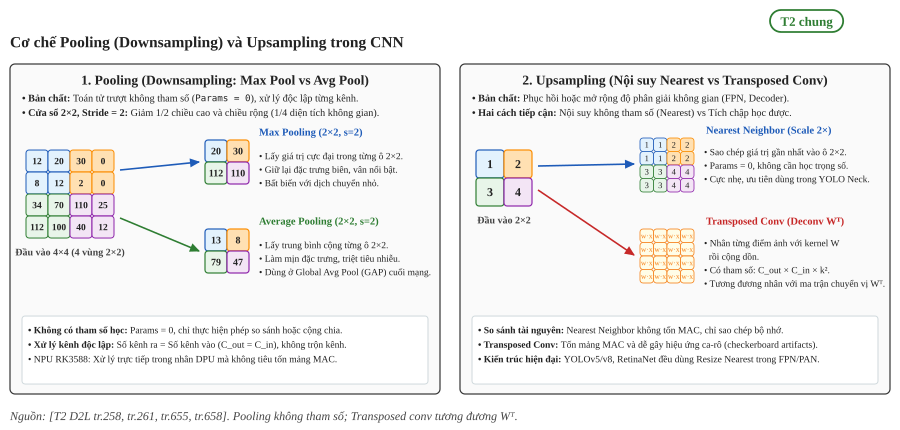

   Cơ chế Pooling (Downsampling) và Upsampling trong CNN: (1) Pooling trượt không tham số độc lập trên từng kênh gồm Max Pooling (giữ biên cạnh nổi bật) và Average Pooling (làm mịn tín hiệu); (2) Upsampling tăng độ phân giải gồm Nearest Neighbor (sao chép điểm ảnh, 0 MAC) và Transposed Conv (nhân ma trận trọng số chuyển vị :math:`W^{\top}`).

.. list-table:: So sánh các toán tử Pooling và Upsampling trong mạng CNN
   :widths: 18 24 16 22 20
   :header-rows: 1
   :align: center

   * - Toán tử
     - Cơ chế toán học
     - Tham số học
     - Đặc tính kiến trúc
     - Đánh giá trên NPU RK3588
   * - Max Pooling
     - Lấy giá trị lớn nhất trong cửa sổ :math:`k \times k`
     - 0 (không tham số)
     - Giữ biên cạnh sắc nét, bất biến dịch chuyển
     - Tăng tốc native trong DPU, không tốn mảng MAC
   * - Average Pooling
     - Trung bình cộng các phần tử
     - 0 (không tham số)
     - Làm mịn không gian, nén vector (GAP)
     - Tối ưu tốt trong DPU, thường dùng ở tầng cuối
   * - Nearest Upsample
     - Sao chép lặp giá trị điểm ảnh gần nhất
     - 0 (không tham số)
     - Phóng to không làm biến dạng giá trị gốc
     - Nhanh nhất, tối ưu băng thông cho YOLO Neck
   * - Transposed Conv
     - Nhân kernel :math:`W^{\top}` thế chỗ
     - :math:`c_o \times c_i \times k^2`
     - Tự học cách hoàn nguyên độ phân giải
     - Tốn nhiều chu kỳ MAC và băng thông SRAM

Liên hệ RK3588: Toán tử MaxPool, AvgPool và Resize Nearest được hỗ trợ tăng tốc native trong nhân DPU của RK3588, hoàn toàn không tiêu tốn mảng MAC nhân ma trận, giải phóng năng lực tính toán cho các lớp tích chập. Nhánh giải mã đặc trưng FPN/PAN của YOLOv5/v8 ưu tiên dùng Resize Nearest Neighbor để giảm tối đa lưu lượng bộ nhớ SRAM và đạt tốc độ khung hình (FPS) cao nhất trên SoC RK3588 (xem :doc:`Toán tử YOLO trên RK3588 </contents/02-nen-tang-rk3588/03-toolchain-runtime/04-operator-list>`).

9. Toán tử Add và khối residual
===============================

Khi mạng nơ-ron trở nên rất sâu, việc huấn luyện gặp khó khăn do vấn đề tiêu biến gradient. Kiến trúc ResNet giải quyết vấn đề này bằng khối residual [T2 D2L tr.304].

   "On the right, the portion within the dotted-line box needs to learn the residual mapping g(x) = f(x) − x, which is how the residual block derives its name. If the identity mapping f(x) = x is the desired underlying mapping, the residual mapping amounts to g(x) = 0 and it is thus easier to learn: we only need to push the weights and biases of the upper weight layer... to zero. The right figure illustrates the residual block of ResNet, where the solid line carrying the layer input x to the addition operator is called a residual connection (or shortcut connection)." [T2 D2L tr.304]

.. _fig-d2l-residual-block:

   Khối thông thường (trái) học trực tiếp :math:`f(\mathbf{x})` so với khối residual (phải) học ánh xạ phần dư :math:`g(\mathbf{x}) = f(\mathbf{x}) - \mathbf{x}` qua kết nối tắt identity. Nguồn: [T2 D2L tr.304, Fig. 8.6.2]

Nhánh tắt (shortcut connection) dẫn trực tiếp đầu vào :math:`\mathbf{x}` đến toán tử cộng phần tử (Add) trước khi đi qua hàm kích hoạt ReLU cuối cùng:

.. math::

   f(\mathbf{x}) = g(\mathbf{x}) + \mathbf{x}

Để thực hiện phép cộng Add, nhánh chính và nhánh tắt phải có kích thước không gian và số lượng kênh giống hệt nhau. Khi cần thay đổi số kênh hoặc giảm kích thước không gian, một lớp tích chập :math:`1 \times 1` được bổ sung trên nhánh tắt [T2 D2L tr.304].

.. _fig-cv-residual-add:

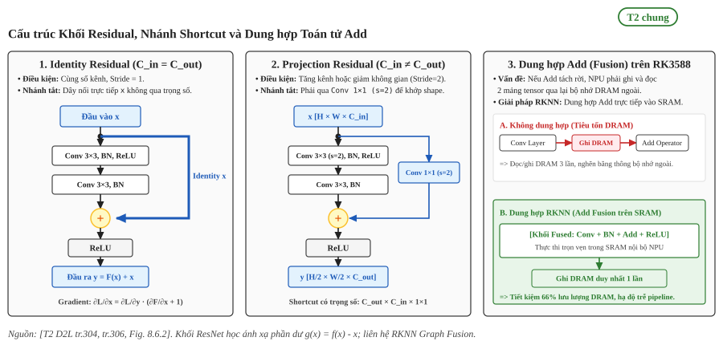

   Cấu trúc Khối Residual, Nhánh Shortcut và Dung hợp Toán tử Add: (1) Identity Shortcut nối trực tiếp khi giữ nguyên chiều; (2) Projection Shortcut đi qua Conv 1x1 khi đổi số kênh hoặc stride; (3) Cơ chế Add Fusion trên RK3588 dung hợp toán tử Add vào bộ đệm SRAM, giảm 66% lưu lượng truy xuất bộ nhớ DRAM ngoài.

.. list-table:: So sánh các cấu trúc nhánh Shortcut trong khối Residual
   :widths: 22 26 26 26
   :header-rows: 1
   :align: center

   * - Tiêu chí
     - Identity Shortcut (Cơ bản)
     - Projection Shortcut (Đổi kênh / Stride)
     - Dung hợp Add trên RK3588 NPU
   * - Điều kiện áp dụng
     - :math:`c_{in} = c_{out}` và :math:`\text{stride} = 1`
     - :math:`c_{in} \neq c_{out}` hoặc :math:`\text{stride} = 2`
     - Toán tử Add đứng ngay sau Conv / BN
   * - Tham số trên Shortcut
     - 0 (đường dây nối thuần túy)
     - :math:`c_{out} \times c_{in} \times (1 \times 1) + c_{out}`
     - 0 (tối ưu hóa ở cấp biên dịch đồ thị)
   * - Dòng chảy Gradient
     - Cộng trực tiếp hệ số :math:`+1` không suy giảm
     - Nhân qua ma trận trọng số :math:`1 \times 1`
     - Không đổi về mặt toán học, chuẩn xác 100%
   * - Ảnh hưởng bộ nhớ NPU
     - Giữ tensor :math:`\mathbf{x}` trong SRAM đệm
     - Tính thêm 1 lớp Conv :math:`1 \times 1` trên NPU
     - Ghép Add vào Conv, triệt tiêu đọc/ghi DRAM

Liên hệ RK3588: Trình biên dịch RKNN tự động nhận diện mẫu Conv + BN + Add + ReLU để tạo thành khối toán tử dung hợp (Fused Operator), chạy khép kín trọn vẹn trong 1 chu kỳ phần cứng của NPU Core. Khối Residual dung hợp giúp loại bỏ các lần cấp phát mảng trung gian ra ngoài DDR, tiết kiệm 66% lưu lượng bộ nhớ và giữ trọn băng thông cho các tác vụ xử lý video đa luồng song song (xem :doc:`Fusion và tối ưu đồ thị </contents/02-nen-tang-rk3588/03-toolchain-runtime/05-fusion-va-layout-nc1hwc2>`).

10. Ghép khối thành CNN từ ảnh đến đặc trưng
============================================

Các mạng CNN hiện đại được xây dựng bằng cách ghép nối nhiều khối chức năng cơ bản theo thứ tự từ trích xuất đặc trưng cục bộ ở các tầng nông đến biểu diễn ngữ nghĩa trừu tượng ở các tầng sâu [T2 D2L tr.263, tr.279].

LeNet-5 là ví dụ kinh điển gồm hai phần: phần mã hóa tích chập (convolutional encoder) gồm hai lớp tích chập đi kèm pooling để thu nhỏ không gian, theo sau là khối kết nối đầy đủ (dense block) gồm ba lớp tuyến tính để phân loại [T2 D2L tr.263].

.. list-table:: Kích thước đặc trưng qua các lớp của LeNet-5 (đầu vào 1x28x28) [T2 D2L tr.265]
   :header-rows: 1
   :widths: 25 35 40

   * - Tên lớp
     - Loại toán tử
     - Kích thước đầu ra (Output shape)
   * - ``conv1``
     - Conv2d (kernel :math:`5 \times 5`, out=6)
     - :math:`[1, 6, 28, 28]`
   * - ``pool1``
     - AvgPool2d (kernel :math:`2 \times 2`, stride=2)
     - :math:`[1, 6, 14, 14]`
   * - ``conv2``
     - Conv2d (kernel :math:`5 \times 5`, out=16)
     - :math:`[1, 16, 10, 10]`
   * - ``pool2``
     - AvgPool2d (kernel :math:`2 \times 2`, stride=2)
     - :math:`[1, 16, 5, 5]`
   * - ``flatten``
     - Trải phẳng không gian
     - :math:`[1, 400]`
   * - ``fc1``
     - Tuyến tính (Linear)
     - :math:`[1, 120]`
   * - ``fc2``
     - Tuyến tính (Linear)
     - :math:`[1, 84]`
   * - ``output``
     - Tuyến tính (Linear)
     - :math:`[1, 10]`

Kiến trúc VGG chuẩn hóa việc thiết kế mạng theo các khối đồng nhất: mỗi khối VGG gồm một chuỗi các lớp tích chập :math:`3 \times 3` có đệm :math:`p = 1` để giữ nguyên độ phân giải, theo sau là lớp max-pooling :math:`2 \times 2` với stride :math:`2` để giảm một nửa kích thước chiều cao và chiều rộng [T2 D2L tr.279].

Quy luật ghép khối phổ biến trong các mạng phát hiện vật thể (như backbone của YOLO) kế thừa cấu trúc này: giảm dần độ phân giải không gian qua các tầng để tăng số lượng kênh đặc trưng, sau đó kết hợp đặc trưng đa quy mô qua các nhánh FPN/PAN (xem :doc:`Kiến trúc và các khối cấu thành YOLO </contents/01-kien-thuc-nen/07-yolo/01-kien-truc-va-khoi-cau-thanh-yolo>`).

.. _fig-cv-feature-hierarchy:

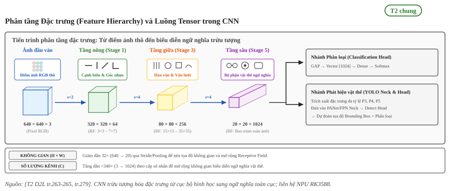

   Phân tầng Đặc trưng (Feature Hierarchy) và Luồng Tensor trong CNN: Tiến trình trừu tượng hóa từ đặc trưng hình học cục bộ (cạnh, góc) ở tầng nông sang ngữ nghĩa trừu tượng (bộ phận, vật thể) ở tầng sâu; quy luật giảm độ phân giải không gian để tăng số lượng kênh đặc trưng.

.. list-table:: Phân tầng đặc trưng và đánh đổi tài nguyên phần cứng NPU RK3588 qua các Stage CNN
   :widths: 20 18 20 22 20
   :header-rows: 1
   :align: center

   * - Tầng kiến trúc
     - Tensor Shape
     - Receptive Field
     - Bản chất đặc trưng
     - Hành vi trên NPU RK3588
   * - Tầng nông (Stage 1-2)
     - :math:`320 \times 320 \times 64`
     - Nhỏ (:math:`3 \times 3` đến :math:`7 \times 7`)
     - Cạnh biên, góc nhọn, tương phản viền
     - Memory-bound: Activation lớn, tốn đệm SRAM
   * - Tầng giữa (Stage 3)
     - :math:`80 \times 80 \times 256`
     - Trung bình (15 đến 35)
     - Vân bề mặt, hoa văn, hình khối
     - Cân bằng: Tỷ lệ Compute/Memory đạt mức tối ưu
   * - Tầng sâu (Stage 4-5)
     - :math:`20 \times 20 \times 1024`
     - Rất lớn (bao trùm toàn vật thể)
     - Ngữ nghĩa trừu tượng, bộ phận vật thể
     - Compute-bound: 1024 kênh lấp đầy mảng MAC :math:`32 \times 32`
   * - Tầng tác vụ (Heads)
     - Vector / P3-P5
     - Bao phủ toàn bộ ảnh gốc
     - Xác suất phân loại hoặc Bounding Box
     - GAP tốn ít MAC; YOLO Head cần NMS hậu xử lý CPU

Liên hệ RK3588: Trên SoC RK3588, tầng nông (Stage 1-2) có kích thước không gian lớn, chiếm dụng nhiều bộ nhớ SRAM và dễ nghẽn băng thông DRAM (cần chia mảnh layer tiling khi vượt quá dung lượng SRAM); trong khi tầng sâu (Stage 4-5) có số kênh lớn (512-1024) giúp khai thác 100% công suất mảng MAC :math:`32 \times 32` của NPU, đạt đỉnh hiệu năng tính toán cực đại. Cơ chế kết hợp đa tầng trong YOLO sử dụng Backbone trích xuất đặc trưng đa quy mô, sau đó nhánh Neck (FPN/PAN) kết hợp P3 (vật thể nhỏ), P4 (vật thể vừa) và P5 (vật thể lớn) để dung hòa độ phân giải với ngữ nghĩa (xem :doc:`Kiến trúc và các khối cấu thành YOLO </contents/01-kien-thuc-nen/07-yolo/01-kien-truc-va-khoi-cau-thanh-yolo>`).

Nguồn
=====

Các nhãn nguồn dùng trong trang này (tier, tệp tài liệu, số lần trích dẫn).

.. list-table::
   :header-rows: 1
   :widths: 15 10 65 10

   * - Nhãn
     - Tier
     - Nguồn
     - Số lần
   * - ``D2L``
     - T2
     - :download:`dive_into_deep_learning_2023zhang.pdf <../../../_assets/pdf/papers/00_overview/dive_into_deep_learning_2023zhang.pdf>`
     - 28
   * - ``MOBILENET``
     - T2
     - :download:`mobilenets_2017howard.pdf <../../../_assets/pdf/papers/00_overview/mobilenets_2017howard.pdf>`
     - 7
   * - ``CUDNN``
     - T2
     - :download:`cudnn_2014chetlur.pdf <../../../_assets/pdf/papers/00_overview/cudnn_2014chetlur.pdf>`
     - 4

Số trang trong nhãn D2L là số trang in trong sách (số trang PDF bằng số trang in cộng 40). Số trang trong nhãn MOBILENET và CUDNN là chỉ số trang PDF. Các hình trong trang được cắt trực tiếp từ tài liệu gốc tại các trang được ghi chú trong chú thích hình.
