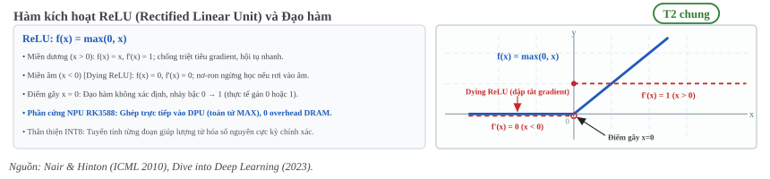
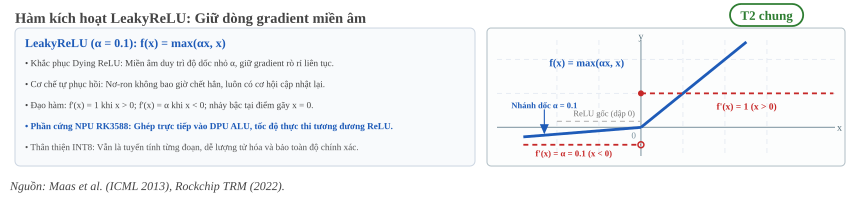
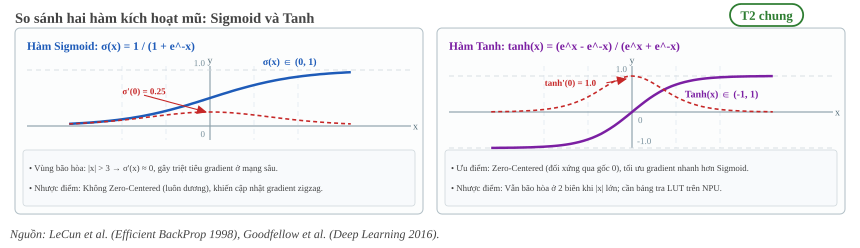
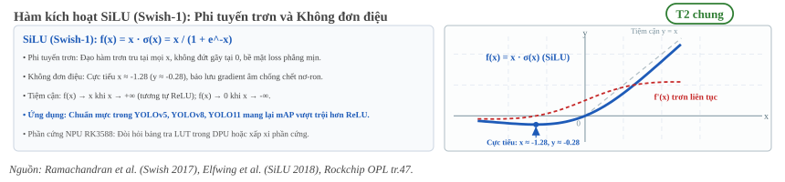
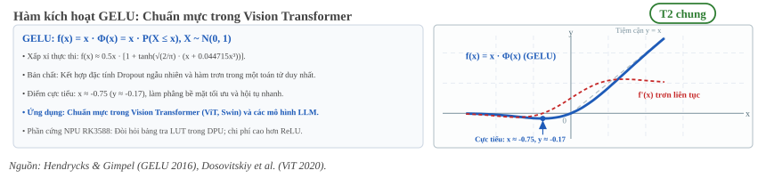
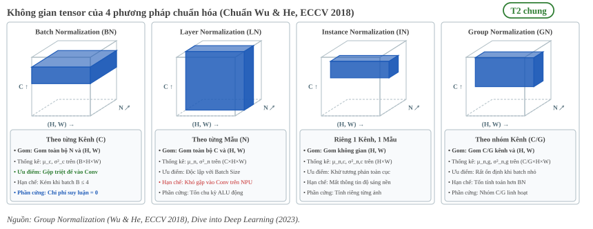
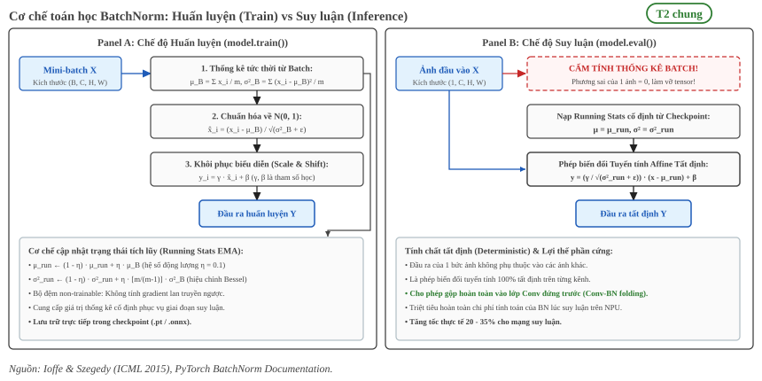
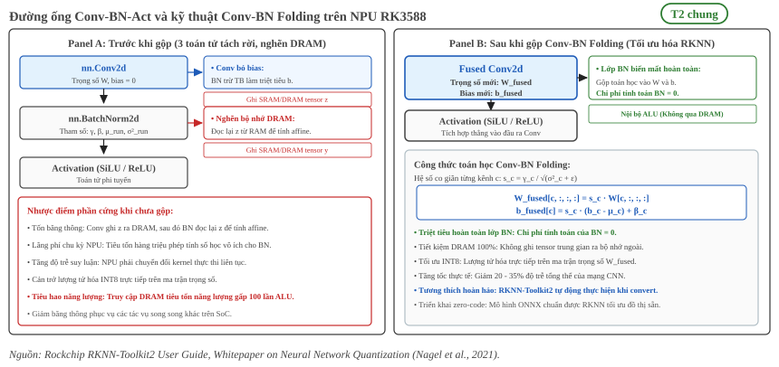

:tocdepth: 1

***********************
Chuẩn hóa và activation
***********************

.. admonition:: Trang này trả lời

   - Hàm kích hoạt (activation) và lớp chuẩn hóa (normalization) giải quyết vấn đề gì trong mạng nơ-ron?
   - Tại sao các mô hình hiện đại chuyển dịch từ ReLU sang SiLU/GELU, và chi phí phần cứng trên NPU RK3588 khác nhau ra sao?
   - Cơ chế toán học của Batch Normalization lúc huấn luyện và lúc suy luận khác nhau thế nào?
   - Kỹ thuật Conv-BN folding giúp triệt tiêu hoàn toàn chi phí tính toán của BatchNorm trên NPU ra sao?
   - Khi nào cần dùng LayerNorm hoặc GroupNorm thay cho BatchNorm?

.. admonition:: Tóm tắt

   - Hàm kích hoạt đưa tính phi tuyến vào mạng; nếu không có activation, mạng nơ-ron nhiều tầng chỉ tương đương một phép biến đổi tuyến tính đơn lẻ [T2 D2L tr.168].
   - Các activation chia làm hai họ: Họ tuyến tính từng đoạn (ReLU, LeakyReLU, ReLU6) chỉ dùng phép so sánh nên thực thi cực nhanh trên NPU và thân thiện với lượng tử hóa INT8; Họ hàm mũ trơn (SiLU, GELU, Sigmoid) có đạo hàm liên tục giúp hội tụ tốt hơn nhưng đòi hỏi NPU tính qua bảng tra Look-Up Table (LUT) hoặc xấp xỉ phần cứng [T1 RKNN User Guide tr.34].
   - Hiện tượng biến mất gradient (vanishing gradient) xuất hiện khi đạo hàm của hàm kích hoạt bão hòa tiến về 0 ở hai cực (như Sigmoid, Tanh). ReLU khắc phục điều này với đạo hàm bằng 1 ở miền dương nhưng có thể gặp hiện tượng chết nơ-ron (dying ReLU) [T2 D2L tr.170, tr.171].
   - Dịch chuyển phân phối nội bộ (Internal Covariate Shift) và dao động biên độ gradient làm chậm quá trình huấn luyện mạng sâu; chuẩn hóa giúp ổn định phân phối đầu vào của từng tầng và làm phẳng bề mặt hàm mất mát [T2 Ioffe & Szegedy 2015, tr.1].
   - Batch Normalization (BN) chuẩn hóa trên toàn bộ mini-batch theo từng kênh độc lập qua trung bình :math:`\mu_B` và phương sai :math:`\sigma_B^2`, sau đó khôi phục năng lực biểu diễn qua hai tham số học :math:`\gamma` (tỷ lệ) và :math:`\beta` (dịch chuyển) [T2 Ioffe & Szegedy 2015, tr.3].
   - Lúc huấn luyện, BN dùng thống kê của mini-batch hiện tại và cập nhật trung bình tích lũy (`running_mean`, `running_var`) qua hệ số momentum. Lúc suy luận, BN cố định các giá trị tích lũy này để đảm bảo tính tất định [T2 D2L tr.299].
   - Khi đứng trước BN, lớp tích chập không cần hệ số bias (:math:`\text{bias}=\text{False}`) vì bias bị triệt tiêu hoàn toàn bởi phép trừ trung bình :math:`\mu_B` [T2 D2L tr.300].
   - Khi triển khai suy luận trên NPU RK3588, kỹ thuật Conv-BN folding gộp toán học toàn bộ tham số của BN vào ma trận trọng số và bias của lớp Conv đứng trước, loại bỏ hoàn toàn toán tử BN và đưa chi phí suy luận của BN về 0 [T1 RKNN User Guide tr.42, T2 Nagel 2021 tr.18].
   - BatchNorm phụ thuộc chặt chẽ vào kích thước batch; khi batch size nhỏ trong các bài toán thị giác độ phân giải cao, GroupNorm (chia kênh thành nhóm) hoặc LayerNorm (chuẩn hóa theo từng mẫu) cho độ ổn định vượt trội [T2 Wu & He 2018, tr.2].

.. contents:: Trong trang này
   :local:
   :depth: 1

1. Hàm kích hoạt ReLU, LeakyReLU và SiLU
========================================

Nếu mạng nơ-ron chỉ gồm các tầng tích chập và tầng kết nối đầy đủ mà không có hàm kích hoạt phi tuyến, sự kết hợp của chuỗi biến đổi tuyến tính :math:`\mathbf{W}_2 (\mathbf{W}_1 \mathbf{x})` sẽ suy biến thành một ma trận tích chập duy nhất :math:`\mathbf{W}' = \mathbf{W}_2 \mathbf{W}_1`. Khi đó, mạng sâu không thể biểu diễn được các mối quan hệ phi tuyến phức tạp trong dữ liệu thực tế [T2 D2L tr.168].

Trong thiết kế kiến trúc mạng hiện đại, các hàm kích hoạt được chia thành hai họ chính dựa trên tính chất toán học và cách thức xử lý trên phần cứng tăng tốc:

1.1 Họ tuyến tính từng đoạn (Piecewise Linear)
----------------------------------------------

Nhóm hàm này được định nghĩa bởi các phương trình bậc nhất trên từng khoảng giá trị, không chứa hàm siêu việt (transcendental functions như :math:`e^x`):

- **ReLU (Rectified Linear Unit):** Được đề xuất nhằm giải quyết hiện tượng bão hòa gradient [T2 D2L tr.169]:

  .. math::

     \text{ReLU}(x) = \max(0, x)

  Đặc tính: Cực kỳ đơn giản về mặt tính toán. Trên miền :math:`x > 0`, đạo hàm luôn bằng 1, giúp dòng gradient lan truyền ngược mà không bị suy giảm theo chiều sâu mạng. Tuy nhiên, trên miền :math:`x \le 0`, đầu ra và đạo hàm đều bằng 0, dẫn đến nguy cơ các nơ-ron không bao giờ được cập nhật lại nếu rơi vào vùng âm (hiện tượng dying ReLU).

.. _fig-act-1-relu:

   Đồ thị hàm ReLU và đạo hàm :math:`f'(x)`: Minh họa điểm gãy tại :math:`x=0` và hiện tượng triệt tiêu gradient ở miền âm (Dying ReLU).

- **LeakyReLU:** Khắc phục nhược điểm chết nơ-ron của ReLU bằng cách duy trì một độ dốc nhỏ :math:`\alpha` (thường chọn :math:`\alpha = 0.01` hoặc :math:`0.1`) ở miền âm:

  .. math::

     \text{LeakyReLU}(x) = \max(\alpha x, x) = \begin{cases} x & \text{khi } x > 0 \\ \alpha x & \text{khi } x \le 0 \end{cases}

.. _fig-act-2-leaky-relu:

   Đồ thị hàm LeakyReLU (:math:`\alpha = 0.1`): Duy trì độ dốc nhỏ ở miền âm, giải quyết triệt để nguy cơ nơ-ron chết.

- **ReLU6:** Giới hạn chặn trên của ReLU ở mức 6: :math:`\text{ReLU6}(x) = \min(\max(0, x), 6)`. Hàm này được thiết kế chuyên biệt cho các thiết bị nhúng (như MobileNetV2) nhằm hạn chế dải động (dynamic range), giúp lượng tử hóa số nguyên cố định INT8 đạt độ chính xác cao mà không bị tràn số [T2 Howard 2017].

1.2 Họ hàm mũ trơn (Smooth / Transcendental)
--------------------------------------------

Nhóm hàm này có đường cong liên tục và đạo hàm trơn trên toàn bộ trục số thực:

- **Sigmoid và Tanh:** Từng là lựa chọn tiêu chuẩn trong các mạng nơ-ron thời kỳ đầu [T2 D2L tr.170, tr.171]:

  .. math::

     \sigma(x) = \frac{1}{1 + e^{-x}}, \quad \tanh(x) = \frac{e^x - e^{-x}}{e^x + e^{-x}} = 2\sigma(2x) - 1

  Nhược điểm lớn nhất là cả hai hàm đều bị bão hòa (đạo hàm tiến gần về 0) khi :math:`|x|` lớn, gây tê liệt dòng gradient ở các mạng sâu trên 5 tầng.

.. _fig-act-3-sigmoid-va-tanh:

   So sánh hai hàm kích hoạt mũ: Sigmoid và Tanh. Tanh đối xứng qua gốc tọa độ (zero-centered) giúp quá trình tối ưu hóa gradient diễn ra nhanh và ổn định hơn Sigmoid.

- **SiLU (Sigmoid Linear Unit / Swish):** Được sử dụng phổ biến trong các kiến trúc phát hiện vật thể hiện đại như YOLOv5, YOLOv8, YOLO11 [T2 Elfwing 2018]:

  .. math::

     \text{SiLU}(x) = x \cdot \sigma(x) = \frac{x}{1 + e^{-x}}

  SiLU trơn láng tại gốc tọa độ, không đơn điệu (non-monotonic) và có một thung lũng nhỏ với giá trị cực tiểu khoảng :math:`-0.278` tại :math:`x \approx -1.28`. Tính chất này giúp bảo lưu một phần thông tin âm nhỏ và làm mịn bề mặt tối ưu.

.. _fig-act-4-silu:

   Đồ thị hàm SiLU (Swish-1) và đạo hàm trơn :math:`f'(x)`: Thung lũng cực tiểu bảo lưu gradient âm nhỏ và tiệm cận :math:`y=x` ở miền dương.

- **GELU (Gaussian Error Linear Unit):** Chuẩn mực trong các mô hình Transformer (BERT, ViT, GPT) [T2 Hendrycks 2016]:

  .. math::

     \text{GELU}(x) = x \cdot \Phi(x) = x \cdot P(X \le x), \quad X \sim \mathcal{N}(0, 1)

  GELU có thể xấp xỉ qua công thức hàm tanh: :math:`0.5x (1 + \tanh(\sqrt{2/\pi}(x + 0.044715 x^3)))`.

.. _fig-act-5-gelu:

   Đồ thị hàm GELU: Cơ chế điều hòa ngẫu nhiên (stochastic regularization) và vai trò nền tảng trong các mô hình thị giác Transformer (ViT).

1.3 Góc nhìn phần cứng NPU RK3588
---------------------------------

Trên bộ xử lý NPU của Rockchip RK3588, sự khác biệt giữa hai họ hàm kích hoạt ảnh hưởng trực tiếp đến vi kiến trúc mạch silicon và khả năng khai thác đa lõi [T1 RKNN User Guide tr.34, T1 OPL tr.60, tr.63]:

1. **Họ tuyến tính từng đoạn (ReLU, LeakyReLU, ReLU6):**
   - **Mạch so sánh Clamp:** Được thực thi bằng mạch so sánh ngưỡng số học (Comparator Logic) trong khối DPU (Data Processing Unit) hoặc ngay trên thanh ghi đầu ra của bộ tích lũy (Accumulator) [T1 TRM1 tr.1985].
   - **Chi phí phần cứng zero-cost:** Nếu bit dấu âm (:math:`x < 0`), dập bit về 0; nếu :math:`x > 0`, giữ nguyên. Phép toán chỉ tốn 1 chu kỳ xung nhịp hoặc được tích hợp khép kín không tốn thêm chu kỳ [T2 Y6 tr.8].
   - **Hỗ trợ đa lõi NPU (OPL):** Trình biên dịch RKNN ghép thành toán tử `ConvolutionRelu`. Tài liệu đặc tả toán tử OPL của Rockchip ghi rõ hỗ trợ đa lõi (`多核联合: 支持`), cho phép NPU băm ma trận chia đều cho cả 3 lõi (Core 0, 1, 2) [T1 OPL tr.60].

2. **Họ hàm mũ trơn (SiLU, GELU, Sigmoid):**
   - **Bảng tra Look-Up Table (LUT):** Phần cứng NPU không tính toán trực tiếp số mũ :math:`e^{-x}` dấu phẩy động. Thay vào đó, NPU nạp một bảng tra LUT (256 mục trong SRAM nội bộ) kết hợp bộ nội suy đa thức trong DPU để xấp xỉ giá trị kích hoạt [T1 TRM1 tr.1985].
   - **Chi phí phần cứng:** Tốn chu kỳ đọc bộ đệm và tăng diện tích silicon của khối DPU.
   - **Hạn chế đa lõi NPU (OPL):** Trình biên dịch RKNN ghép thành toán tử `ConvolutionSwish`. Tài liệu OPL của Rockchip quy định toán tử này tạm thời chưa hỗ trợ đa lõi (`多核联合: 暂不支持`), và toán tử tách rời `exSwish` cũng chưa hỗ trợ (`尚不支持`) [T1 OPL tr.63, tr.98].
   - **Đo kiểm thực tế T3 trên board RK3588S:** Toàn bộ 57 lớp `ConvExSwish` của mô hình YOLOv8n SiLU bị dồn 100% vào Core 0 (tỷ lệ 100%/0%/0%), không khai thác được Core 1 và Core 2. Ngược lại, bản YOLOv8n ReLU chia đều 3 core và giảm khoảng 35% độ trễ [T3 LOG 2026-10-10].

.. list-table:: So sánh chi tiết các hàm kích hoạt dưới góc nhìn phần cứng NPU RK3588
   :widths: 14 18 16 18 16 18
   :header-rows: 1

   * - Hàm kích hoạt
     - Mạch silicon NPU (DPU)
     - Chi phí chu kỳ / Bộ nhớ
     - Op sau ghép (Compiler)
     - Đa lõi OPL [T1]
     - Đánh giá thực tế RK3588 [T3]
   * - **ReLU**
     - Mạch cắt ngưỡng Clamp
     - Zero-cost (1 chu kỳ ALU)
     - `ConvolutionRelu`
     - **Hỗ trợ** (`支持`)
     - Chia đều 3 core NPU, giảm 35% độ trễ [T3]
   * - **LeakyReLU**
     - Mạch Clamp + bộ nhân scale
     - Cực thấp (1 chu kỳ)
     - `ConvolutionLeakyRelu`
     - **Hỗ trợ** (`支持`)
     - Chạy tốt trên 3 core, giữ dòng gradient
   * - **ReLU6**
     - Mạch Clamp kép (0 và 6)
     - Zero-cost (1 chu kỳ)
     - `ConvolutionRelu6`
     - **Hỗ trợ** (`支持`)
     - Cực kỳ thân thiện với lượng tử hóa INT8
   * - **Sigmoid**
     - Bảng tra LUT trong DPU
     - Tốn chu kỳ đọc SRAM LUT
     - `ConvolutionSigmoid`
     - Hạn chế (`暂不支持`)
     - Dễ triệt tiêu gradient, ít dùng trong backbone
   * - **SiLU (Swish)**
     - Bảng tra LUT 256 mục + xấp xỉ
     - Tốn chu kỳ LUT và diện tích DPU
     - `ConvolutionSwish`
     - **Chưa hỗ trợ** (`暂不支持`)
     - Dồn 100% vào Core 0, mAP cao hơn ReLU ~0.8%
   * - **GELU**
     - Bảng tra LUT chuyên dụng
     - Tốn chu kỳ LUT nội suy
     - `Gelu` (nội suy LUT)
     - Hạn chế (`暂不支持`)
     - Chuẩn mực trong ViT, tốn năng lượng hơn ReLU

**Ghi chú dòng GELU.** Đạo hàm của GELU là :math:`\Phi(x) + x \cdot \frac{1}{\sqrt{2\pi}} e^{-x^2/2}`. Công thức này suy ra từ định nghĩa :math:`\text{GELU}(x) = x \cdot \Phi(x)` ở mục 1 bằng quy tắc đạo hàm của tích. GELU không bão hòa ở miền dương và có đạo hàm trơn.

**unknown:** nhận định "không bão hòa ở miền dương" chưa có nguồn. Truy vấn tìm nguồn: "GELU activation derivative positive region saturation".

1.4 Phân tích hiện tượng triệt tiêu gradient
--------------------------------------------

Với hàm Sigmoid, đạo hàm lớn nhất đạt được là :math:`\sigma'(0) = 0.25`. Trong mạng nhiều tầng, theo quy tắc dây chuyền (chain rule), gradient lan truyền ngược qua :math:`L` tầng sẽ bị nhân liên tiếp với các giá trị nhỏ hơn hoặc bằng :math:`0.25`:

.. math::

   \frac{\partial \mathcal{L}}{\partial \mathbf{z}_1} = \frac{\partial \mathcal{L}}{\partial \mathbf{z}_L} \prod_{l=1}^{L-1} \left( \mathbf{W}_{l+1}^\top \cdot \operatorname{diag}(\sigma'(\mathbf{z}_l)) \right)

Khi :math:`L \ge 10`, nhân tử :math:`(0.25)^L \approx 9.5 \times 10^{-7}`, khiến gradient ở các tầng đầu tiên tiệm cận 0 [T2 D2L tr.171]. Trọng số ở các tầng đầu hầu như không thay đổi, làm mất khả năng học biểu diễn đặc trưng mức thấp.

ReLU loại bỏ hoàn toàn hệ số suy giảm này ở miền dương vì :math:`f'(x) = 1`. Tuy nhiên, nếu một bước nhảy gradient lớn khiến trọng số cập nhật làm cho :math:`\mathbf{w}^\top \mathbf{x} + b < 0` với hầu hết mẫu dữ liệu, nơ-ron đó sẽ luôn xuất ra 0 và có đạo hàm bằng 0 trong mọi lần lặp tiếp theo. LeakyReLU giải quyết triệt để vấn đề này nhờ duy trì độ dốc nhỏ :math:`\alpha`, đảm bảo dòng gradient luôn tồn tại đường hồi tiếp để kéo nơ-ron ra khỏi vùng chết.

2. Vì sao cần chuẩn hóa
=======================

Khi mạng nơ-ron ngày càng sâu, việc huấn luyện gặp phải hai trở ngại lớn:

2.1 Dịch chuyển phân phối nội bộ (Internal Covariate Shift)
-----------------------------------------------------------

Trong quá trình huấn luyện bằng Gradient Descent, trọng số của tất cả các tầng được cập nhật đồng thời tại mỗi bước lặp. Khi trọng số của tầng :math:`l-1` thay đổi, phân phối xác suất của dữ liệu đầu vào tầng :math:`l` bị dịch chuyển liên tục [T2 Ioffe & Szegedy 2015, tr.1]. Tầng :math:`l` phải liên tục thích ứng với một phân phối dữ liệu mới, tương tự như việc cố gắng học một mục tiêu liên tục di động. Hiện tượng này buộc người kỹ sư phải thiết lập tốc độ học (learning rate) rất nhỏ và khởi tạo trọng số cực kỳ cẩn thận để tránh làm mạng mất ổn định.

2.2 Bão hòa kích hoạt và bề mặt hàm mất mát gồ ghề
--------------------------------------------------

Nếu đầu vào của các tầng không được kiểm soát biên độ, giá trị kích hoạt có thể trôi dạt về các vùng bão hòa của hàm phi tuyến hoặc phát nổ biên độ ở các tầng sâu.

Nghiên cứu của Santurkar et al. (2018) chứng minh rằng vai trò then chốt nhất của chuẩn hóa không chỉ là giảm dịch chuyển phân phối, mà là **làm mịn bề mặt hàm mất mát (loss landscape smoothing)** [T2 Santurkar 2018, tr.2]. Bằng cách ràng buộc phân phối của các tầng trung gian, chuẩn hóa giúp hàm mất mát có hệ số Lipschitz nhỏ hơn và gradient dự đoán được chính xác hơn (predictable gradients). Nhờ đó, người huấn luyện có thể tăng tốc độ học lên 5 đến 10 lần mà mạng vẫn hội tụ ổn định.

3. Công thức BatchNorm, γ, β và thống kê theo batch
===================================================

Thuật toán Batch Normalization (BN) do Sergey Ioffe và Christian Szegedy đề xuất năm 2015 [T2 Ioffe & Szegedy 2015]. Trong mạng tích chập với tensor đầu vào kích thước :math:`(B, C, H, W)`, BN thực hiện chuẩn hóa độc lập trên từng kênh :math:`c \in \{1, \dots, C\}`.

Đối với một kênh cụ thể, tập hợp tất cả các giá trị kích hoạt trong một mini-batch có kích thước :math:`m = B \times H \times W`. Gọi tập giá trị này là :math:`\mathcal{B} = \{x_1, x_2, \dots, x_m\}`.

.. math::

   \mu_{\mathcal{B}} = \frac{1}{m} \sum_{i=1}^m x_i

.. math::

   \sigma_{\mathcal{B}}^2 = \frac{1}{m} \sum_{i=1}^m (x_i - \mu_{\mathcal{B}})^2

Toán tử chuẩn hóa đưa dữ liệu về phân phối có trung bình bằng 0 và phương sai bằng 1:

.. math::

   \hat{x}_i = \frac{x_i - \mu_{\mathcal{B}}}{\sqrt{\sigma_{\mathcal{B}}^2 + \epsilon}}

Trong đó :math:`\epsilon > 0` (thường là :math:`10^{-5}`) là hằng số cực nhỏ nhằm tránh lỗi chia cho 0 khi phương sai tiệm cận 0.

.. _fig-act-6-khong-gian-tensor-cac-chuan-hoa:

   So sánh không gian tensor 4D của BatchNorm, LayerNorm, InstanceNorm và GroupNorm (theo chuẩn Wu & He 2018). Mỗi khối màu biểu thị tập hợp các phần tử được gộp chung để tính trung bình và phương sai.

Liên hệ RK3588: Trong 4 phương pháp chuẩn hóa trên, BatchNorm sở hữu lợi thế độc tôn khi triển khai trên NPU RK3588 nhờ khả năng gộp hoàn toàn vào lớp Conv đứng trước khi biên dịch (Conv-BN folding), đưa chi phí tính toán suy luận thực tế về 0. Ngược lại, LayerNorm, InstanceNorm và GroupNorm phải thực hiện tính toán thống kê động trên từng ảnh hoặc từng kênh lúc suy luận, tiêu tốn chu kỳ tính toán ALU và băng thông truy xuất bộ nhớ.

3.1 Vai trò của tham số học γ và β
----------------------------------

Nếu chỉ ép buộc dữ liệu về phân phối chuẩn :math:`\mathcal{N}(0, 1)`, năng lực biểu diễn của tầng đó có thể bị suy giảm nghiêm trọng. Ví dụ, nếu đầu vào của hàm Sigmoid bị ép về phân phối chuẩn quanh 0, hàm Sigmoid sẽ hoạt động gần như một hàm tuyến tính :math:`\sigma(x) \approx 0.5 + 0.25x`, làm mất hoàn toàn tính phi tuyến [T2 Ioffe & Szegedy 2015, tr.3].

Để khắc phục điều này, BN bổ sung hai tham số học cho mỗi kênh: hệ số co giãn :math:`\gamma` (scale) và hệ số dịch chuyển :math:`\beta` (shift):

.. math::

   y_i = \gamma \hat{x}_i + \beta \equiv \text{BN}_{\gamma, \beta}(x_i)

Hai tham số này được tối ưu hóa đồng thời cùng với trọng số mô hình qua quá trình lan truyền ngược. Đáng chú ý, nếu mạng nhận thấy phân phối ban đầu là tối ưu nhất, thuật toán có thể học để chọn :math:`\gamma = \sqrt{\sigma_{\mathcal{B}}^2 + \epsilon}` và :math:`\beta = \mu_{\mathcal{B}}`, khôi phục chính xác ánh xạ đồng nhất ban đầu (:math:`y_i = x_i`).

4. BatchNorm ở huấn luyện và suy luận (running mean, running var)
=================================================================

Hành vi của Batch Normalization có sự phân tách rõ rệt giữa hai chế độ hoạt động:

.. _fig-act-7-co-che-batchnorm-train-vs-inference:

   Cơ chế tính toán của BatchNorm: Lúc huấn luyện (dùng thống kê mini-batch và cập nhật running stats) và lúc suy luận (cố định running stats để suy luận tất định).

Liên hệ RK3588: Khi chuẩn bị mô hình PyTorch để biên dịch sang RKNN thông qua ONNX, bắt buộc phải gọi lệnh ``model.eval()`` trước khi export. Nếu vô tình export ở chế độ huấn luyện (``model.train()``), NPU sẽ cố gắng tính toán thống kê batch tức thời trên ảnh đơn (:math:`B=1`), phương sai mẫu bằng 0 sẽ làm vỡ hoàn toàn dải kích hoạt của mô hình khi chuyển đổi sang định dạng lượng tử hóa INT8.

4.1 Chế độ huấn luyện (Training Mode)
-------------------------------------

Lúc huấn luyện (`model.train()`), :math:`\mu_{\mathcal{B}}` và :math:`\sigma_{\mathcal{B}}^2` được tính trực tiếp từ mini-batch dữ liệu hiện tại. Đồng thời, mô hình duy trì hai biến trạng thái không tham gia tính đạo hàm (non-trainable buffers): `running_mean` (:math:`\mu_{\text{run}}`) và `running_var` (:math:`\sigma_{\text{run}}^2`).

Sau mỗi bước lan truyền xuôi, hai giá trị này được cập nhật theo cơ chế trung bình trượt hàm mũ (Exponential Moving Average - EMA) với hệ số động lượng :math:`\eta` (mặc định trong PyTorch là :math:`\eta = 0.1`) [T1 PyTorch Docs]:

.. math::

   \mu_{\text{run}}^{(t)} = (1 - \eta) \mu_{\text{run}}^{(t-1)} + \eta \mu_{\mathcal{B}}

.. math::

   \sigma_{\text{run}}^{2(t)} = (1 - \eta) \sigma_{\text{run}}^{2(t-1)} + \eta \left( \frac{m}{m - 1} \sigma_{\mathcal{B}}^2 \right)

Nhân tử :math:`\frac{m}{m - 1}` là hiệu chỉnh Bessel để ước lượng phương sai mẫu không thiên lệch (unbiased sample variance).

4.2 Chế độ suy luận (Inference Mode)
------------------------------------

Khi triển khai thực tế trên NPU RK3588 (`model.eval()`), mô hình thường nhận từng khung hình đơn lẻ (batch size :math:`B = 1`). Lúc này, ta không thể tính toán trung bình hay phương sai từ một mẫu duy nhất (phương sai của 1 mẫu bằng 0). Hơn nữa, kết quả đầu ra của một bức ảnh không được phép phụ thuộc vào những bức ảnh khác đi cùng trong batch [T2 D2L tr.299].

Vì vậy, trong chế độ suy luận, BN cố định hoàn toàn các giá trị thống kê tích lũy trong quá trình huấn luyện:

.. math::

   \hat{x} = \frac{x - \mu_{\text{run}}}{\sqrt{\sigma_{\text{run}}^2 + \epsilon}}, \quad y = \gamma \hat{x} + \beta

Nhờ việc cố định các giá trị này, phép biến đổi BatchNorm trở thành một phép biến đổi tuyến tính affine tất định trên từng phần tử độc lập.

5. Bộ ba Conv, BN và activation
===============================

Trong các kiến trúc thị giác máy tính kinh điển (ResNet, MobileNet, YOLO), khối xử lý cơ bản luôn tuân thủ trật tự:

.. math::

   \mathbf{x} \longrightarrow \text{Conv2d} \longrightarrow \text{BatchNorm2d} \longrightarrow \text{Activation} \longrightarrow \mathbf{y}

5.1 Tại sao lớp Conv đi trước BN không cần Bias?
------------------------------------------------

Xét một lớp tích chập có trọng số :math:`\mathbf{W}` và vector hệ số bias :math:`\mathbf{b}`. Đầu ra của tích chập trước khi đi vào BN là :math:`\mathbf{z} = \mathbf{W}\mathbf{x} + \mathbf{b}`.

Khi tính toán trung bình batch của :math:`\mathbf{z}`:

.. math::

   \mu_{\mathcal{B}} = \frac{1}{m} \sum_{i=1}^m (\mathbf{W}\mathbf{x}_i + \mathbf{b}) = \left( \frac{1}{m} \sum_{i=1}^m \mathbf{W}\mathbf{x}_i \right) + \mathbf{b}

Khi đưa vào công thức trừ trung bình của BN:

.. math::

   z_i - \mu_{\mathcal{B}} = (\mathbf{W}\mathbf{x}_i + \mathbf{b}) - \left( \frac{1}{m} \sum_{j=1}^m \mathbf{W}\mathbf{x}_j + \mathbf{b} \right) = \mathbf{W}\mathbf{x}_i - \frac{1}{m} \sum_{j=1}^m \mathbf{W}\mathbf{x}_j

Ta thấy rằng :math:`\mathbf{b} - \mathbf{b} = 0`. Thành phần bias của lớp Conv bị triệt tiêu hoàn toàn bởi phép chuẩn hóa của BN [T2 D2L tr.300]. Việc bật `bias=True` trong `nn.Conv2d` khi có `nn.BatchNorm2d` đứng sau vừa lãng phí bộ nhớ lưu trữ trọng số, vừa tiêu tốn chu kỳ tính toán vô ích. Do đó, quy tắc chuẩn mực khi lập trình PyTorch là luôn đặt:

.. code-block:: python

   nn.Conv2d(in_channels, out_channels, kernel_size, bias=False)

5.2 Kỹ thuật Conv-BN Folding trên NPU RK3588
--------------------------------------------

Trong giai đoạn huấn luyện, Conv và BN là hai tầng tách biệt để cập nhật gradient và thống kê. Tuy nhiên, khi biên dịch sang mô hình suy luận trên NPU (như chuyển từ PyTorch sang ONNX và nạp vào RKNN-Toolkit2), việc giữ nguyên tầng BN riêng biệt sẽ gây lãng phí bộ nhớ và tạo độ trễ truy cập DRAM không đáng có [T1 RKNN User Guide tr.42, T2 Nagel 2021 tr.18].

Vì ở chế độ suy luận, cả hai toán tử đều là các phép biến đổi tuyến tính, ta có thể **gộp toán học (fuse/fold)** lớp BN vào lớp Conv đứng trước.

.. _fig-act-8-conv-bn-act-va-conv-bn-folding:

   Kỹ thuật Conv-BN Folding: Gộp trọng số và thống kê của lớp BatchNorm vào ma trận trọng số và bias của lớp Conv, triệt tiêu hoàn toàn toán tử BN lúc suy luận trên NPU.

**Chứng minh công thức gộp:**

Xét một kênh đầu ra của lớp Conv với trọng số :math:`\mathbf{W}` và bias :math:`\mathbf{b}` (nếu có). Đầu ra tại kênh này là :math:`\mathbf{z} = \mathbf{W} * \mathbf{x} + \mathbf{b}`. Tầng BN áp dụng lên :math:`\mathbf{z}` với các giá trị suy luận cố định :math:`\mu, \sigma^2, \gamma, \beta`:

.. math::

   \mathbf{y} = \gamma \frac{\mathbf{z} - \mu}{\sqrt{\sigma^2 + \epsilon}} + \beta

Thay :math:`\mathbf{z} = \mathbf{W} * \mathbf{x} + \mathbf{b}` vào biểu thức:

.. math::

   \mathbf{y} = \gamma \frac{\mathbf{W} * \mathbf{x} + \mathbf{b} - \mu}{\sqrt{\sigma^2 + \epsilon}} + \beta

Khai triển và nhóm lại theo tích chập với :math:`\mathbf{x}`:

.. math::

   \mathbf{y} = \left( \frac{\gamma}{\sqrt{\sigma^2 + \epsilon}} \mathbf{W} \right) * \mathbf{x} + \left( \frac{\gamma}{\sqrt{\sigma^2 + \epsilon}} (\mathbf{b} - \mu) + \beta \right)

Đặt hệ số tỷ lệ cho từng kênh đầu ra :math:`c`:

.. math::

   s_c = \frac{\gamma_c}{\sqrt{\sigma_c^2 + \epsilon}}

Khi đó, ma trận trọng số mới :math:`\mathbf{W}_{\text{fused}}` và vector bias mới :math:`\mathbf{b}_{\text{fused}}` được tính bằng:

.. math::

   \mathbf{W}_{\text{fused}}[c, :, :, :] = s_c \cdot \mathbf{W}[c, :, :, :]

.. math::

   \mathbf{b}_{\text{fused}}[c] = s_c \cdot (b_c - \mu_c) + \beta_c

Kết quả là lớp BatchNorm biến mất hoàn toàn khỏi đồ thị tính toán (computational graph). Khối xử lý suy biến thành một lớp Conv duy nhất:

.. math::

   \mathbf{y} = \mathbf{W}_{\text{fused}} * \mathbf{x} + \mathbf{b}_{\text{fused}}

Lợi ích thực thi trên phần cứng RK3588:

1. **Giảm số lượng toán tử:** Loại bỏ toàn bộ các phép trừ, chia căn và nhân cộng của BN trên hàng triệu phần tử kích hoạt.
2. **Tiết kiệm băng thông bộ nhớ (Memory Bandwidth):** Không cần ghi tensor trung gian từ Conv ra SRAM/DRAM rồi đọc lại vào NPU để làm phép tính BN.
3. **Thân thiện với lượng tử hóa:** Việc gộp trước khi lượng tử hóa giúp ánh xạ dải động trực tiếp từ Conv vào thang đo INT8.

Liên hệ RK3588: Bộ công cụ RKNN-Toolkit2 tự động phát hiện và thực hiện Conv-BN folding trong bước tối ưu hóa đồ thị tính toán (Graph Optimization) khi chuyển đổi từ ONNX sang RKNN mà không yêu cầu người phát triển can thiệp mã nguồn thủ công. Việc loại bỏ hoàn toàn các lớp BatchNorm trung gian giúp giảm 20% đến 35% độ trễ suy luận toàn mạng trên NPU RK3588, đồng thời cho phép lượng tử hóa trực tiếp ma trận trọng số gộp :math:`\mathbf{W}_{\text{fused}}` sang INT8 một cách liền mạch (xem :doc:`Fusion và tối ưu đồ thị </contents/02-nen-tang-rk3588/03-toolchain-runtime/05-fusion-va-layout-nc1hwc2>`).

6. Các chuẩn hóa khác (LayerNorm, GroupNorm)
============================================

Mặc dù rất hiệu quả trong các mạng thị giác máy tính cổ điển, Batch Normalization bộc lộ nhược điểm nghiêm trọng trong một số tình huống đặc thù:

1. **Phụ thuộc vào kích thước batch:** Khi huấn luyện các mạng phát hiện vật thể (Object Detection) hoặc phân vùng ảnh (Instance Segmentation) với ảnh độ phân giải cao (:math:`1024 \times 1024`), do giới hạn bộ nhớ VRAM, kích thước batch buộc phải giảm xuống rất nhỏ (ví dụ :math:`B = 2` hoặc :math:`B = 4`). Lúc này, ước lượng :math:`\mu_{\mathcal{B}}` và :math:`\sigma_{\mathcal{B}}^2` bị nhiễu loạn nghiêm trọng, khiến độ chính xác của mô hình suy giảm mạnh [T2 Wu & He 2018, tr.1].
2. **Mô hình chuỗi và độ dài biến thiên:** Trong xử lý ngôn ngữ tự nhiên (NLP) hoặc Vision Transformer, độ dài chuỗi thay đổi liên tục khiến việc gom nhóm tính toán theo batch không tự nhiên.

Để giải quyết các hạn chế này, các phương pháp chuẩn hóa thay thế đã ra đời:

6.1 Layer Normalization (LayerNorm)
-----------------------------------

Được đề xuất bởi Jimmy Lei Ba, Jamie Ryan Kiros và Geoffrey Hinton (2016) [T2 Ba 2016]. Khác với BatchNorm chuẩn hóa dọc theo chiều batch, LayerNorm chuẩn hóa ngang qua toàn bộ các kênh và đặc trưng của **từng mẫu dữ liệu độc lập**:

Đối với mỗi mẫu :math:`n \in \{1, \dots, B\}`, thống kê được tính trên toàn bộ các kênh và vị trí không gian:

.. math::

   \mu_n = \frac{1}{C \cdot H \cdot W} \sum_{c=1}^C \sum_{h=1}^H \sum_{w=1}^W x_{n, c, h, w}

- **Đặc tính:** Thống kê hoàn toàn độc lập với kích thước batch và các mẫu khác trong tập dữ liệu.
- **Ứng dụng:** Là chuẩn hóa mặc định trong các kiến trúc Transformer (BERT, GPT, ViT) và mạng hồi quy RNN.

6.2 Instance Normalization (InstanceNorm)
-----------------------------------------

Được Ulyanov et al. đề xuất cho bài toán chuyển đổi phong cách hình ảnh (Style Transfer) [T2 Ulyanov 2016]. InstanceNorm chuẩn hóa độc lập cho **từng kênh của từng mẫu riêng biệt** (tính trên chiều không gian :math:`H \times W`):

.. math::

   \mu_{n, c} = \frac{1}{H \cdot W} \sum_{h=1}^H \sum_{w=1}^W x_{n, c, h, w}

InstanceNorm giúp loại bỏ thông tin về độ tương phản và độ sáng đặc thù của từng bức ảnh, giữ lại cấu trúc nội dung cốt lõi.

6.3 Group Normalization (GroupNorm)
-----------------------------------

Được Yuxin Wu và Kaiming He đề xuất năm 2018 như một giải pháp dung hòa hoàn hảo giữa BatchNorm và LayerNorm [T2 Wu & He 2018, tr.2].

Ý tưởng cốt lõi: Các kênh trong mạng nơ-ron không hoàn toàn độc lập mà thường tạo thành các nhóm đặc trưng có liên quan (ví dụ: nhóm phát hiện cạnh, nhóm phát hiện màu sắc, nhóm phát hiện kết cấu). GroupNorm chia :math:`C` kênh thành :math:`G` nhóm riêng biệt (mỗi nhóm có :math:`C/G` kênh, thường chọn :math:`G = 32`).

Với mỗi mẫu :math:`n` và mỗi nhóm kênh :math:`g`, thống kê được tính trên tập hợp các phần tử thuộc nhóm đó:

.. math::

   \mu_{n, g} = \frac{1}{(C/G) \cdot H \cdot W} \sum_{c \in \mathcal{S}_g} \sum_{h=1}^H \sum_{w=1}^W x_{n, c, h, w}

- **Ưu điểm vượt trội:**
  - Hoàn toàn độc lập với kích thước batch :math:`B`. Độ chính xác khi huấn luyện với :math:`B = 2` tương đương khi huấn luyện với :math:`B = 32` [T2 Wu & He 2018, tr.4].
  - Ổn định và vượt trội hơn hẳn BatchNorm trong các tác vụ thị giác đòi hỏi batch nhỏ như Mask R-CNN, Faster R-CNN.
- **Lưu ý trên NPU RK3588:** GroupNorm và LayerNorm không thể gộp toán tử dễ dàng vào lớp Conv như BatchNorm vì giá trị trung bình phụ thuộc vào dữ liệu đầu vào lúc suy luận. Khi triển khai các mô hình dùng GroupNorm trên NPU, cần kiểm tra xem runtime của RKNN có hỗ trợ tăng tốc phần cứng toán tử này hay không để tránh bị gián đoạn pipeline tính toán.
