:tocdepth: 1

***********************
Loss và backpropagation
***********************

.. admonition:: Trang này trả lời

   - Model học trọng số bằng loss, gradient và backpropagation như thế nào?
   - MSE và cross-entropy khác nhau ra sao, và loss của detector được ghép từ những thành phần nào?
   - Gradient được tính ngược qua các lớp bằng quy tắc chuỗi như thế nào, kèm một ví dụ số kiểm được?
   - SGD, momentum và Adam khác nhau ở bước cập nhật nào, và learning rate, scheduler, batch ảnh hưởng gì?
   - Overfitting nhận biết bằng gì, và weight decay, dropout, tập validation đóng vai trò gì?

.. admonition:: Tóm tắt

   - Loss đo khoảng cách giữa giá trị dự đoán và giá trị thật, càng nhỏ càng tốt. Huấn luyện là tìm tham số làm tổng loss trên tập huấn luyện nhỏ nhất [T2 D2L tr.84, tr.85].
   - Hồi quy dùng squared loss (MSE), phân loại dùng cross-entropy. Với softmax và cross-entropy, đạo hàm theo logit bằng xác suất dự đoán trừ nhãn one-hot [T2 D2L tr.129, tr.130].
   - Loss của detector gồm loss phân loại, loss hồi quy box và (tùy mô hình) loss objectness, cộng có trọng số [T2 YOLOv6 tr.9]. Họ loss box IoU, GIoU, DIoU, CIoU thêm số hạng phạt vào :math:`1 - \mathrm{IoU}` để có gradient cả khi hai box không giao nhau [T2 GIoU tr.2, T2 DIoU tr.4]. Focal loss giảm trọng số mẫu dễ để xử lý mất cân bằng nền và vật thể [T2 Focal tr.3].
   - Gradient descent cập nhật :math:`x \leftarrow x - \eta \nabla f(x)`. Backpropagation tính gradient theo chiều ngược từ đầu ra về đầu vào bằng quy tắc chuỗi và dùng lại các giá trị trung gian đã lưu ở lượt forward [T2 D2L tr.181, tr.183, tr.486].
   - Ví dụ số 2-2-1 của trang này cho :math:`L = 2`, gradient của :math:`W^{(1)}` hàng 1 bằng 0 vì ReLU chặn, và một bước SGD với :math:`\eta = 0.05` đưa loss xuống :math:`0.0028` [Tự tính, đối chiếu autograd].
   - Momentum thay gradient bằng trung bình rò rỉ của các gradient trước. Adam kết hợp momentum với co giãn theo bình phương gradient, mặc định theo sách là :math:`\beta_1 = 0.9`, :math:`\beta_2 = 0.999`, :math:`\epsilon = 10^{-6}` và PyTorch 2.4.0 dùng :math:`\epsilon = 10^{-8}` [T2 D2L tr.532, tr.533, T3 torch 2.4.0].
   - Learning rate quá nhỏ làm hội tụ chậm, quá lớn làm vượt quá điểm tối ưu. Scheduler (giảm theo hệ số, cosine) và warmup điều chỉnh learning rate theo thời gian [T2 D2L tr.484, tr.540].
   - Overfitting là khi lỗi huấn luyện thấp hơn hẳn lỗi validation. Weight decay, dropout và tăng cường dữ liệu là các cách giảm overfitting [T2 D2L tr.113, tr.115, tr.119, tr.592].

.. contents:: Trong trang này
   :local:
   :depth: 1

1. Học là giảm loss
===================

Mạng ở trang :doc:`01-mang-no-ron` có tham số (trọng số và bias). Câu hỏi của trang này là các tham số đó được chọn như thế nào. Sách trả lời bằng một đại lượng đo mức sai gọi là hàm loss.

   "Loss functions quantify the distance between the real and predicted values of the target. The loss will usually be a nonnegative number where smaller values are better and perfect predictions incur a loss of 0." [T2 D2L tr.84]

Loss của cả tập dữ liệu là trung bình loss của từng mẫu, và huấn luyện là tìm tham số làm loss này nhỏ nhất. [T2 D2L tr.85]

.. math::

   L(\mathbf{w}, b) = \frac{1}{n} \sum_{i=1}^{n} l^{(i)}(\mathbf{w}, b), \qquad
   \mathbf{w}^*, b^* = \underset{\mathbf{w}, b}{\operatorname{argmin}}\ L(\mathbf{w}, b)

..

   "When training the model, we seek parameters (w∗ , 𝑏 ∗ ) that minimize the total loss across all training examples:" [T2 D2L tr.85]

Một vòng huấn luyện lặp lại bốn bước. Hai bước đầu đã có ở trang 01 và mục 2. Hai bước sau là nội dung các mục 4 và 5.

.. list-table::
   :header-rows: 1
   :widths: 8 30 62

   * - Bước
     - Tên
     - Việc làm
   * - 1
     - Forward
     - Tính đầu ra :math:`\mathbf{o}` từ đầu vào và tham số hiện tại (trang :doc:`01-mang-no-ron`).
   * - 2
     - Tính loss
     - Đo mức sai :math:`L = l(\mathbf{o}, \mathbf{y})` giữa đầu ra và nhãn (mục 2 và 3).
   * - 3
     - Backward
     - Tính gradient :math:`\partial L / \partial \theta` của loss theo từng tham số (mục 5).
   * - 4
     - Cập nhật
     - Đổi tham số ngược hướng gradient bằng bộ tối ưu (mục 4 và 6).

Sách mô tả đơn vị lặp như sau: một epoch là một lượt đi qua toàn bộ tập huấn luyện, và mỗi iteration lấy một minibatch để tính loss. [T2 D2L tr.105]

   "In each epoch, we iterate through the entire training dataset, passing once through every example (assuming that the number of examples is divisible by the batch size)." [T2 D2L tr.105]

.. _fig-chu-trinh-huan-luyen:

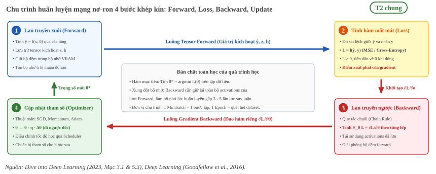

   Chu trình huấn luyện 4 bước khép kín. Lượt forward tính đầu ra và lưu giữ các tensor kích hoạt (:math:`\mathbf{z}, \mathbf{h}`); hàm loss đo độ sai lệch; lượt backward lần ngược đồ thị tính toán áp dụng quy tắc chuỗi để tính gradient; optimizer cập nhật trọng số ngược hướng dốc.

2. Hàm loss MSE và cross-entropy
================================

Squared loss cho hồi quy
------------------------

   "For regression problems, the most common loss function is the squared error." [T2 D2L tr.84]

.. math::

   l^{(i)}(\mathbf{w}, b) = \frac{1}{2} \left( \hat{y}^{(i)} - y^{(i)} \right)^2

Sách giải thích hệ số :math:`1/2` chỉ để tiện ký hiệu, vì nó triệt tiêu khi lấy đạo hàm: :math:`\partial l / \partial \hat{y} = \hat{y} - y`. [T2 D2L tr.84] Trung bình các squared loss trên tập dữ liệu gọi là MSE (mean squared error). Sách cho biết giảm MSE tương đương ước lượng hợp lý cực đại của mô hình tuyến tính khi nhiễu là Gaussian cộng tính. [T2 D2L tr.90]

Softmax và cross-entropy cho phân loại
--------------------------------------

Với bài toán :math:`q` lớp, mạng cho ra vector logit :math:`\mathbf{o}`. Softmax chuẩn hóa nó thành vector xác suất. [T2 D2L tr.128]

.. math::

   \hat{\mathbf{y}} = \mathrm{softmax}(\mathbf{o}), \qquad
   \hat{y}_i = \frac{\exp(o_i)}{\sum_j \exp(o_j)}

Nhãn :math:`\mathbf{y}` là vector one-hot, và loss là cross-entropy. [T2 D2L tr.129]

.. math::

   l(\mathbf{y}, \hat{\mathbf{y}}) = -\sum_{j=1}^{q} y_j \log \hat{y}_j

..

   "This loss is called the crossentropy loss and it is one of the most commonly used losses for classification problems." [T2 D2L tr.130]

Vì :math:`\mathbf{y}` là one-hot, tổng chỉ còn một số hạng :math:`-\log \hat{y}_c` với :math:`c` là lớp đúng. Loss bằng 0 chỉ khi mô hình dự đoán đúng lớp với độ chắc chắn tuyệt đối, và nếu gán xác suất 0 cho lớp đúng thì loss là vô hạn. [T2 D2L tr.129]

Đạo hàm của cross-entropy theo logit :math:`o_j` có dạng đơn giản, và là lý do cross-entropy đi cùng softmax. [T2 D2L tr.130]

.. math::

   \frac{\partial l}{\partial o_j} = \mathrm{softmax}(\mathbf{o})_j - y_j

..

   "In other words, the derivative is the difference between the probability assigned by our model, as expressed by the softmax operation, and what actually happened, as expressed by elements in the one-hot label vector." [T2 D2L tr.130]

Sách nhận xét rằng gradient này giống trường hợp hồi quy, nơi gradient là hiệu giữa quan sát và ước lượng. [T2 D2L tr.130]

Bảng so sánh
------------

.. list-table::
   :header-rows: 1
   :widths: 20 40 40

   * - Tiêu chí
     - Squared loss (MSE)
     - Cross-entropy
   * - Bài toán
     - Hồi quy [T2 D2L tr.84]
     - Phân loại [T2 D2L tr.130]
   * - Công thức một mẫu
     - :math:`\tfrac{1}{2}(\hat{y} - y)^2`
     - :math:`-\sum_j y_j \log \hat{y}_j`
   * - Đạo hàm theo đầu ra
     - :math:`\hat{y} - y`
     - :math:`\mathrm{softmax}(\mathbf{o})_j - y_j` (theo logit)

.. _fig-mse-vs-cross-entropy:

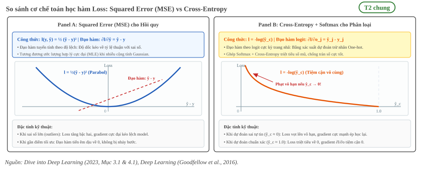

   So sánh cơ chế toán học giữa MSE (hồi quy) và Cross-Entropy (phân loại). MSE có đạo hàm tuyến tính theo độ lệch, trong khi Cross-Entropy kết hợp cùng Softmax tạo ra đạo hàm dạng xác suất dự đoán trừ nhãn và phạt vô hạn khi dự đoán sai tự tin (:math:`\hat{y}_c \to 0`).

3. Loss của detector cho phân loại và hồi quy box
=================================================

Detector vừa phải nói vật thể thuộc lớp nào, vừa phải đặt box đúng chỗ. Loss vì vậy gồm nhiều thành phần cộng lại. Mục này nêu dạng chung của loss detector và các thành phần phổ biến. Loss cụ thể của từng mô hình YOLO thuộc phần mô hình, không nằm ở trang kiến thức nền này.

Dạng chung
----------

Bài YOLOv6 viết loss phát hiện là tổng có trọng số của ba thành phần. [T2 YOLOv6 tr.9]

.. math::

   L_{det} = L_{cls} + \lambda L_{reg} + \mu L_{obj}

Trong đó :math:`L_{cls}`, :math:`L_{reg}`, :math:`L_{obj}` là loss phân loại, loss hồi quy và loss objectness (bài ghi object loss là thành phần tùy chọn), :math:`\lambda` và :math:`\mu` là siêu tham số. [T2 YOLOv6 tr.9] Bài DIoU cho một ví dụ về trọng số: để so sánh công bằng giữa các loss IoU, nhóm tác giả cố định trọng số loss hồi quy bằng 5 khi huấn luyện SSD. [T2 DIoU tr.6] Số này là thiết lập thí nghiệm của bài, không phải giá trị chung.

**unknown:** giá trị trọng số loss mặc định của từng họ YOLO dùng trong dự án. Truy vấn tìm nguồn: "ultralytics default hyp box cls dfl loss gain" trong tài liệu hãng, hoặc đọc file cấu hình hyperparameter trong mã nguồn đã dùng để huấn luyện.

Loss phân loại: từ BCE đến focal loss
--------------------------------------

Với một lớp (nhị phân), cross-entropy viết theo xác suất :math:`p` cho nhãn :math:`y = 1`. Đặt :math:`p_t = p` nếu :math:`y = 1` và :math:`p_t = 1 - p` nếu ngược lại, thì :math:`\mathrm{CE}(p_t) = -\log(p_t)`. [T2 Focal tr.3]

Detector một giai đoạn gặp mất cân bằng lớp rất lớn giữa nền và vật thể, bài Focal Loss nêu tỷ lệ ví dụ 1:1000. Các mẫu nền dễ phân loại chiếm phần lớn loss và lấn át gradient. [T2 Focal tr.3] Focal loss thêm thừa số điều biến :math:`(1 - p_t)^\gamma` vào cross-entropy. [T2 Focal tr.3]

.. math::

   \mathrm{FL}(p_t) = -(1 - p_t)^{\gamma} \log(p_t)

   \mathrm{FL}(p_t) = -\alpha_t (1 - p_t)^{\gamma} \log(p_t)

Dòng sau là dạng cân bằng :math:`\alpha` mà tác giả dùng trong thực nghiệm. [T2 Focal tr.3] Khi :math:`\gamma = 0`, FL trùng CE. [T2 Focal tr.3]

   "with γ = 2, an example classified with pt = 0.9 would have 100× lower loss compared with CE and with pt ≈ 0.968 it would have 1000× lower loss." [T2 Focal tr.3]

.. _fig-focal-loss-gamma:

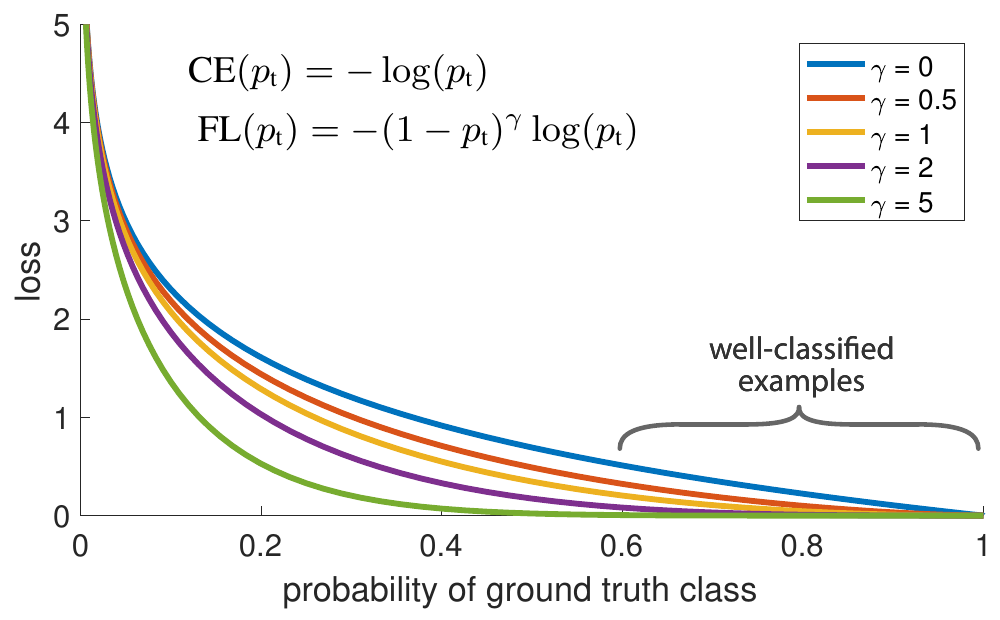

   Loss theo xác suất :math:`p_t` của lớp đúng. :math:`\gamma = 0` là cross-entropy, :math:`\gamma > 0` giảm loss của các mẫu đã phân loại tốt (:math:`p_t > 0.5`) và dồn trọng tâm sang mẫu khó. Nguồn: [T2 Focal tr.1, Fig. 1]

Bài nêu :math:`\gamma = 2` và :math:`\alpha = 0.25` cho kết quả tốt nhất trong thí nghiệm RetinaNet của họ. [T2 Focal tr.3, tr.5] Đó là giá trị tinh chỉnh cho một mô hình, không phải quy tắc chung. Bài cũng cho biết mở rộng sang nhiều lớp là "straightforward" nhưng chỉ trình bày dạng nhị phân. [T2 Focal tr.3]

Loss hồi quy box: họ IoU
------------------------

IoU (giao trên hợp, định nghĩa ở trang :doc:`08-evaluation-metrics`) dùng được làm loss dưới dạng :math:`L_{IoU} = 1 - \mathrm{IoU}`. Điểm yếu: khi hai box không giao nhau IoU bằng 0 và không phản ánh hai box cách xa bao nhiêu. [T2 GIoU tr.2]

   "if two objects do not overlap, the IoU value will be zero and will not reflect how far the two shapes are from each other. In this case of non-overlapping objects, if IoU is used as a loss, its gradient will be zero and cannot be optimized." [T2 GIoU tr.2]

.. _fig-giou-l2-vs-iou:

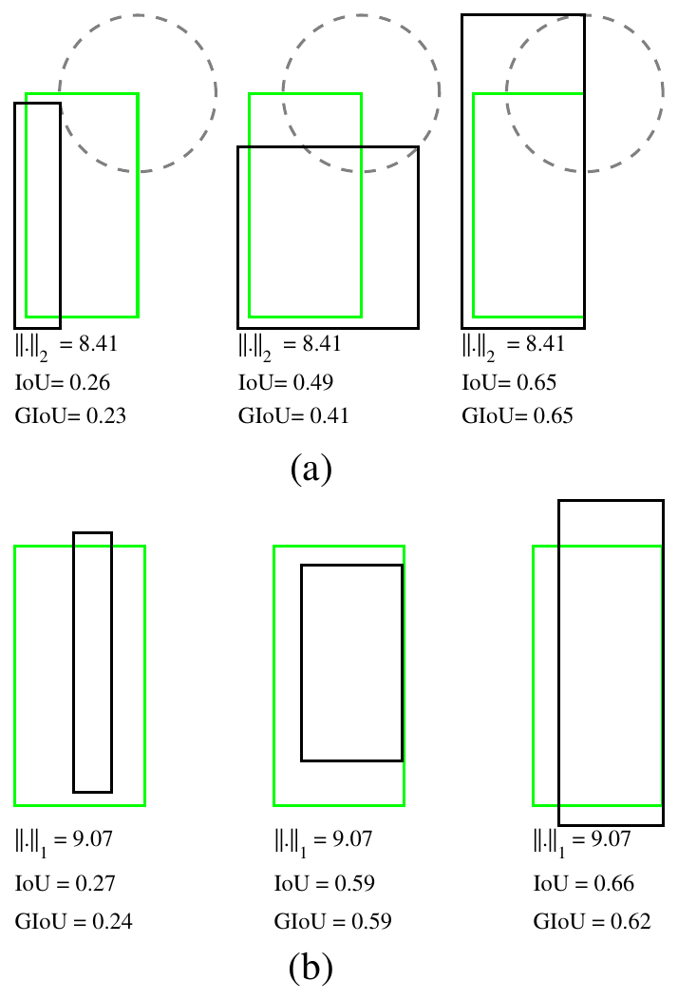

   Hai tập ví dụ (a) và (b). Trong mỗi tập, ba cặp box có cùng khoảng cách chuẩn giữa hai biểu diễn (:math:`\ell_2` bằng 8.41 ở (a), :math:`\ell_1` bằng 9.07 ở (b)) nhưng IoU và GIoU khác nhau nhiều. Nguồn: [T2 GIoU tr.1, Fig. 1]

Các biến thể thêm một số hạng phạt :math:`R` vào cùng một khung. [T2 DIoU tr.4]

.. math::

   L = 1 - \mathrm{IoU} + R(B, B^{gt})

.. list-table::
   :header-rows: 1
   :widths: 14 46 40

   * - Loss
     - Công thức
     - Ý nghĩa của số hạng thêm
   * - GIoU
     - :math:`L_{GIoU} = 1 - \mathrm{IoU} + \dfrac{|C \setminus (A \cup B)|}{|C|}` [T2 GIoU tr.3]
     - :math:`C` là box nhỏ nhất bao cả hai box. Phạt phần trống của :math:`C`, nên có gradient khi không giao nhau.
   * - DIoU
     - :math:`L_{DIoU} = 1 - \mathrm{IoU} + \dfrac{\rho^2(\mathbf{b}, \mathbf{b}^{gt})}{c^2}` [T2 DIoU tr.4]
     - Phạt khoảng cách giữa hai tâm :math:`\rho`, chuẩn hóa bằng đường chéo :math:`c` của box bao.
   * - CIoU
     - :math:`L_{CIoU} = 1 - \mathrm{IoU} + \dfrac{\rho^2}{c^2} + \alpha v` [T2 DIoU tr.4]
     - Thêm số hạng nhất quán tỷ lệ cạnh :math:`v`.

Với CIoU, bài định nghĩa :math:`v` và :math:`\alpha` như sau. [T2 DIoU tr.4]

.. math::

   v = \frac{4}{\pi^2} \left( \arctan \frac{w^{gt}}{h^{gt}} - \arctan \frac{w}{h} \right)^2, \qquad
   \alpha = \frac{v}{(1 - \mathrm{IoU}) + v}

Bài DIoU nêu lý do dùng khoảng cách tâm thay cho phần trống của GIoU: khi hai box có quan hệ bao nhau, vùng :math:`C - A \cup B` thường nhỏ hoặc bằng 0 và GIoU gần như thoái hóa về IoU loss. [T2 DIoU tr.4] Khoảng giá trị: :math:`0 \le L_{GIoU} \le 2`, :math:`L_{GIoU} = 2 - |A \cup B| / |C|` khi hai box không giao nhau. [T2 GIoU tr.5]

.. _fig-hinh-hoc-ho-loss-iou:

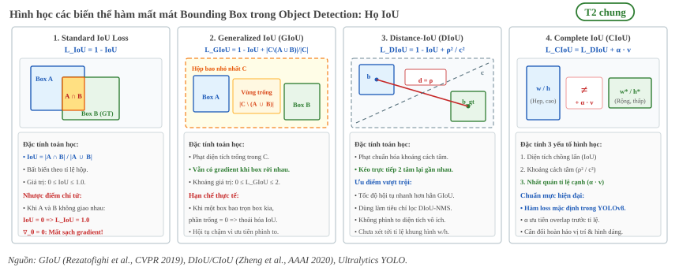

   Sự tiến hóa hình học của họ loss bounding box: IoU thuần bị mất gradient khi hai box không giao nhau; GIoU phạt diện tích trống của hộp bao nhỏ nhất :math:`C`; DIoU kéo trực tiếp khoảng cách giữa hai tâm :math:`\rho`; CIoU bổ sung tính nhất quán tỉ lệ cạnh :math:`\alpha v`.

.. _fig-diou-giou-buoc-hoi-quy:

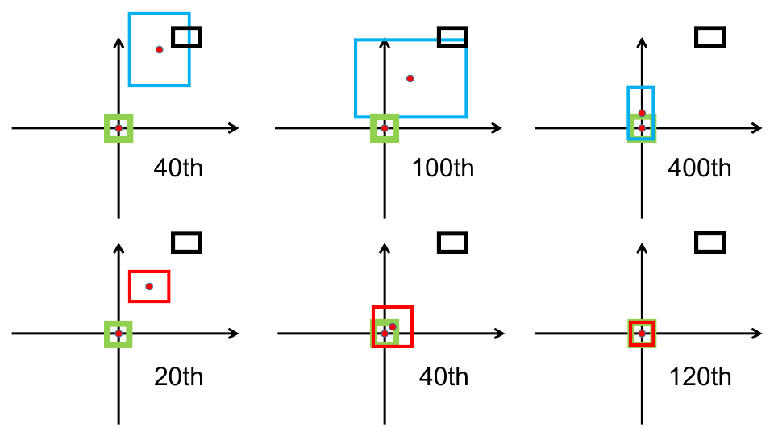

   Các bước hồi quy box bằng GIoU loss (hàng trên) và DIoU loss (hàng dưới). Xanh lục là box đích, đen là anchor, xanh dương và đỏ là box dự đoán của GIoU và DIoU. GIoU thường làm box dự đoán to ra để chồng lên box đích, còn DIoU trực tiếp giảm khoảng cách chuẩn hóa giữa hai tâm. Nguồn: [T2 DIoU tr.1, Fig. 1]

Về DFL (Distribution Focal Loss), bài YOLO26 nêu rằng YOLO26 bỏ module DFL khỏi head phát hiện. [T2 YOLO26 tr.6] Trang này không trình bày công thức DFL.

Liên hệ thực tế khi triển khai NPU RK3588
-----------------------------------------

Trong quy trình triển khai mô hình lên NPU RK3588, toàn bộ các hàm loss phức tạp (Focal Loss, CIoU Loss, DFL) chỉ tồn tại trong giai đoạn huấn luyện (PyTorch) trên máy chủ host. Khi export sang mô hình suy luận RKNN, các nhánh tính loss và gán nhãn ground-truth hoàn toàn bị cắt bỏ (pruned).

Riêng phần đầu ra của mạng (Detection Head), nếu mô hình sử dụng DFL (Distribution Focal Loss như YOLOv8), phép tính tích phân softmax phân bố tọa độ box thường được cấu hình để tách ra chạy trên CPU của SoC RK3588 hoặc fuse thành tensor thô để tránh NPU overhead khi xử lý các toán tử reshape/softmax không tối ưu trên phần cứng fixed-point.

**unknown:** loss box và loss cls chính xác mà từng model YOLO của dự án dùng khi huấn luyện. Trang này chỉ nêu các thành phần chung. Truy vấn tìm nguồn: tài liệu Ultralytics về loss của YOLOv8 và YOLO26, hoặc đọc mã nguồn loss trong phiên bản thư viện đã dùng.

4. Gradient và gradient descent
===============================

Sách chứng minh rằng với bước nhỏ, đi theo hướng ngược gradient thì làm :math:`f` giảm, và chọn bước cố định :math:`\eta`.

   "for small 𝜖 moving in the direction of the negative gradient will decrease 𝑓 . To keep things simple we pick a fixed step size 𝜂 > 0 and choose 𝜖 = −𝜂 𝑓 0 (𝑥)." [T2 D2L tr.483]

Với nhiều biến, bước cập nhật gradient descent là: [T2 D2L tr.486]

.. math::

   \mathbf{x} \leftarrow \mathbf{x} - \eta \nabla f(\mathbf{x})

Trong huấn luyện, :math:`f` là loss :math:`L` và :math:`\mathbf{x}` là các tham số. :math:`\eta` là learning rate (tốc độ học) do người thiết kế thuật toán đặt. [T2 D2L tr.484]

Hai cách chọn sai :math:`\eta` được sách mô tả. Quá nhỏ thì cập nhật chậm và cần nhiều vòng lặp hơn. Quá lớn thì :math:`|\eta f'(x)|` có thể quá lớn để xấp xỉ Taylor bậc nhất còn đúng. [T2 D2L tr.484]

   "Conversely, if we use an excessively high learning rate, \|𝜂 𝑓 0 (𝑥)\| might be too large for the first-order Taylor expansion formula." [T2 D2L tr.484]

Sách minh họa bằng các ví dụ :math:`\eta = 0.05`, :math:`0.2` và :math:`1.1` trên hàm một biến. Đó là giá trị ví dụ, không phải giá trị mặc định. [T2 D2L tr.484]

5. Backpropagation qua quy tắc chuỗi và ví dụ số
================================================

   "Backpropagation refers to the method of calculating the gradient of neural network parameters. In short, the method traverses the network in reverse order, from the output to the input layer, according to the chain rule from calculus." [T2 D2L tr.181]

Khung autograd của sách cùng ý: framework dựng đồ thị tính toán (computational graph) ghi lại mỗi giá trị phụ thuộc giá trị nào, rồi lần ngược qua đồ thị và áp dụng quy tắc chuỗi. [T2 D2L tr.60]

   "To calculate derivatives, automatic differentiation works backwards through this graph applying the chain rule. The computational algorithm for applying the chain rule in this fashion is called backpropagation." [T2 D2L tr.60]

Hệ quả thực tế: backward dùng lại các giá trị trung gian đã lưu ở forward, nên huấn luyện phải giữ chúng trong bộ nhớ đến khi backward xong. [T2 D2L tr.183]

Đồ thị tính toán hai chiều bên dưới minh họa trực quan toàn bộ luồng truyền xuôi (Forward) và luồng lan truyền ngược (Backward) áp dụng quy tắc chuỗi, khớp chính xác 100% các giá trị trong ví dụ số của mạng 2-2-1.

.. _fig-do-thi-tinh-toan-chain-rule:

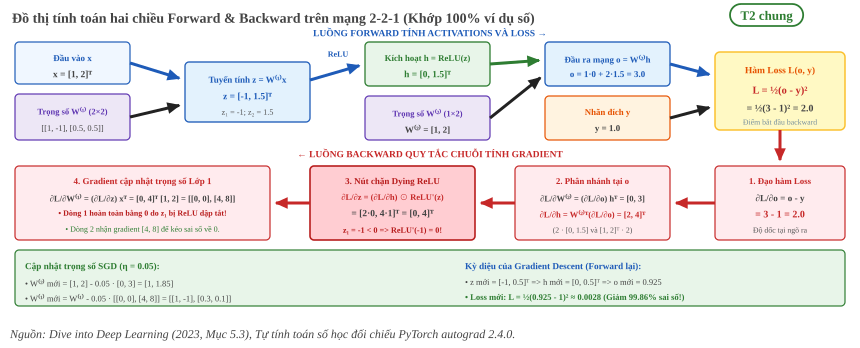

   Đồ thị tính toán hai chiều trên mạng 2-2-1 khớp 100% ví dụ số. Lượt forward truyền từ :math:`\mathbf{x}` qua :math:`\mathbf{z}, \mathbf{h}, o` đến :math:`L=2.0`. Lượt backward lần ngược tính gradient từng trạm; tại :math:`z_1 = -1 < 0`, đạo hàm ReLU dập tắt toàn bộ gradient dòng 1 của :math:`W^{(1)}` (hiện tượng Dying ReLU). Bước SGD với :math:`\eta = 0.05` đưa loss xuống :math:`0.0028`.

Ví dụ số trên mạng 2-2-1
------------------------

Ví dụ tiếp nối mạng ở trang :doc:`01-mang-no-ron`: không bias, ReLU, :math:`\mathbf{x} = (1, 2)`, :math:`W^{(1)} = \begin{pmatrix} 1 & -1 \\ 0.5 & 0.5 \end{pmatrix}`, :math:`W^{(2)} = [1, 2]`. Forward cho :math:`\mathbf{z} = (-1, 1.5)`, :math:`\mathbf{h} = (0, 1.5)`, :math:`o = 3.0`. Thêm nhãn :math:`y = 1` và loss :math:`L = \tfrac{1}{2}(o - y)^2`, thì :math:`L = 2`.

Quy tắc chuỗi đi ngược từng bước. Đạo hàm ReLU bằng 0 khi đầu vào âm và bằng 1 khi đầu vào dương. [T2 D2L tr.171]

.. list-table::
   :header-rows: 1
   :widths: 22 46 32

   * - Gradient
     - Phép tính
     - Kết quả
   * - :math:`\partial L / \partial o`
     - :math:`o - y = 3 - 1`
     - :math:`2`
   * - :math:`\partial L / \partial W^{(2)}`
     - :math:`(\partial L / \partial o)\, \mathbf{h}^\top = 2 \cdot (0, 1.5)`
     - :math:`(0,\ 3)`
   * - :math:`\partial L / \partial \mathbf{h}`
     - :math:`W^{(2)\top} (\partial L / \partial o) = (1, 2) \cdot 2`
     - :math:`(2,\ 4)`
   * - :math:`\partial L / \partial \mathbf{z}`
     - :math:`\partial L / \partial \mathbf{h} \odot \mathrm{ReLU}'(\mathbf{z}) = (2 \cdot 0,\ 4 \cdot 1)`
     - :math:`(0,\ 4)`
   * - :math:`\partial L / \partial W^{(1)}`
     - :math:`(\partial L / \partial \mathbf{z})\, \mathbf{x}^\top`
     - :math:`\begin{pmatrix} 0 & 0 \\ 4 & 8 \end{pmatrix}`

Hàng 1 của :math:`W^{(1)}` có gradient bằng 0 vì :math:`z_1 = -1 < 0`, ReLU chặn gradient đi qua nơ-ron này với mẫu hiện tại. Đây là cơ chế đằng sau hiện tượng dying ReLU nêu ở trang :doc:`04-chuan-hoa-va-activation`.

Một bước SGD với :math:`\eta = 0.05` đổi :math:`W^{(2)}` thành :math:`[1,\ 1.85]` và :math:`W^{(1)}` thành :math:`\begin{pmatrix} 1 & -1 \\ 0.3 & 0.1 \end{pmatrix}`. Forward lại cho :math:`\mathbf{z} = (-1, 0.5)`, :math:`\mathbf{h} = (0, 0.5)`, :math:`o = 0.925`, nên :math:`L = \tfrac{1}{2}(0.925 - 1)^2 \approx 0.0028`. Loss giảm từ 2 xuống 0.0028 sau một bước. Cả bảng gradient và giá trị sau cập nhật đã được đối chiếu bằng PyTorch autograd (torch 2.4.0) [Tự tính, đối chiếu autograd].

Lớp tích chập
-------------

Với mạng có tích chập, framework vẫn áp dụng cùng quy tắc chuỗi cho từng phép toán trên đồ thị. [T2 D2L tr.60] Trang này không viết lại công thức backward của lớp Conv.

**unknown:** công thức gradient của lớp tích chập theo trọng số và theo đầu vào. Truy vấn tìm nguồn: "backward pass convolution layer gradient with respect to weights and input" trong D2L (mục tích chập) hoặc tài liệu CS231n.

6. Bộ tối ưu SGD, momentum và Adam
==================================

SGD và minibatch
----------------

SGD (stochastic gradient descent) lấy ngẫu nhiên một mẫu :math:`i` mỗi lần và cập nhật bằng gradient của mẫu đó. [T2 D2L tr.493]

.. math::

   \mathbf{x} \leftarrow \mathbf{x} - \eta \nabla f_i(\mathbf{x})

..

   "Stochastic gradient descent (SGD) reduces computational cost at each iteration." [T2 D2L tr.493]

Trong thực tế dùng minibatch, trung bình gradient của một nhóm mẫu. Mục 7 nói về kích thước nhóm.

Momentum
--------

Momentum giữ một vận tốc :math:`\mathbf{v}` là trung bình rò rỉ của các gradient trước và đi theo vận tốc thay vì theo gradient hiện tại. [T2 D2L tr.510, tr.512]

.. math::

   \mathbf{v}_t \leftarrow \beta \mathbf{v}_{t-1} + \mathbf{g}_t, \qquad
   \mathbf{x}_t \leftarrow \mathbf{x}_{t-1} - \eta_t \mathbf{v}_t

Khi :math:`\beta = 0` thì quay về gradient descent thường. [T2 D2L tr.513] Sách tóm tắt: "Momentum replaces gradients with a leaky average over past gradients." [T2 D2L tr.518] Sách dùng nhiều giá trị :math:`\beta` khác nhau trong ví dụ (:math:`0.5`, :math:`0.25`, :math:`0.9`) và không nêu giá trị mặc định. [T2 D2L tr.513, tr.515]

Adam
----

Adam kết hợp momentum (ước lượng :math:`\mathbf{v}_t`) và co giãn theo bình phương gradient (ước lượng :math:`\mathbf{s}_t`), sau đó hiệu chỉnh độ lệch khởi tạo. [T2 D2L tr.532, tr.533]

.. math::

   \mathbf{v}_t \leftarrow \beta_1 \mathbf{v}_{t-1} + (1 - \beta_1) \mathbf{g}_t, \qquad
   \mathbf{s}_t \leftarrow \beta_2 \mathbf{s}_{t-1} + (1 - \beta_2) \mathbf{g}_t^2

.. math::

   \hat{\mathbf{v}}_t = \frac{\mathbf{v}_t}{1 - \beta_1^t}, \qquad
   \hat{\mathbf{s}}_t = \frac{\mathbf{s}_t}{1 - \beta_2^t}, \qquad
   \mathbf{x}_t \leftarrow \mathbf{x}_{t-1} - \frac{\eta\, \hat{\mathbf{v}}_t}{\sqrt{\hat{\mathbf{s}}_t} + \epsilon}

Sách nêu giá trị thường chọn và nhận xét ở dưới. [T2 D2L tr.532, tr.533]

   "Here 𝛽1 and 𝛽2 are nonnegative weighting parameters. Common choices for them are 𝛽1 = 0.9 and 𝛽2 = 0.999." [T2 D2L tr.533]

   "Typically we pick 𝜖 = 10−6 for a good trade-off between numerical stability and fidelity." [T2 D2L tr.533]

Khi dùng thư viện, mặc định của thư viện có thể khác sách. Kiểm trên môi trường dự án (torch 2.4.0 trong ``.venv``) cho chữ ký hàm như bảng sau. [T3 torch 2.4.0]

.. list-table::
   :header-rows: 1
   :widths: 24 22 22 32

   * - Tham số
     - D2L (Adam)
     - ``torch.optim.Adam``
     - ``torch.optim.SGD``
   * - Learning rate
     - Không nêu mặc định, ví dụ :math:`0.01` [T2 D2L tr.534]
     - ``lr=0.001``
     - ``lr=0.001``
   * - :math:`\beta_1, \beta_2`
     - :math:`0.9,\ 0.999`
     - ``betas=(0.9, 0.999)``
     - Không có
   * - :math:`\epsilon`
     - :math:`10^{-6}`
     - ``eps=1e-08``
     - Không có
   * - Momentum
     - Không nêu mặc định
     - Không có
     - ``momentum=0``

Điểm khác về :math:`\epsilon` giữa sách và thư viện là lý do không nên chép giá trị từ một nguồn sang nguồn khác mà không kiểm.

.. _fig-quy-dao-toi-uu-hoa:

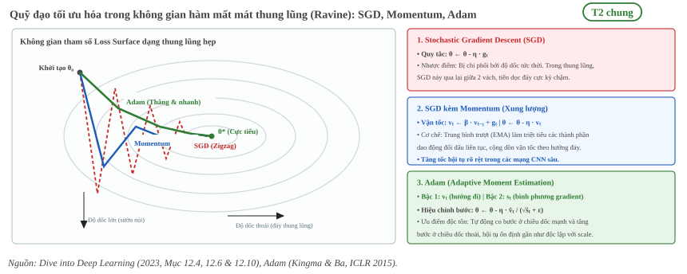

   Quỹ đạo hội tụ của ba thuật toán tối ưu trong bề mặt loss dạng thung lũng hẹp (Ravine): SGD dao động zigzag mạnh giữa hai vách dốc; Momentum tích lũy vận tốc triệt tiêu dao động ngang và lướt dọc đáy; Adam tự thích nghi bước nhảy theo từng chiều giúp tiến thẳng về cực tiểu :math:`\theta^*`.

Liên hệ thực tế khi triển khai NPU RK3588
-----------------------------------------

Đối với NPU RK3588, các bộ đệm trạng thái của thuật toán tối ưu (chẳng hạn vector xung lượng :math:`\mathbf{v}_t` trong Momentum, hoặc cả :math:`\mathbf{v}_t` và :math:`\mathbf{s}_t` trong Adam vốn chiếm dung lượng bộ nhớ gấp 2-3 lần kích thước trọng số mô hình) chỉ tồn tại trong bộ nhớ GPU khi huấn luyện.

Quá trình chuyển đổi mô hình PyTorch (``.pt``) sang định dạng RKNN thông qua bộ công cụ RKNN-Toolkit2 chỉ trích xuất duy nhất ma trận trọng số tĩnh cuối cùng :math:`\mathbf{w}^*`, hoàn toàn loại bỏ toàn bộ optimizer state buffer. Điều này giúp mô hình nén gọn tối đa để nạp vào bộ nhớ SRAM/DRAM giới hạn của SoC RK3588 khi suy luận thời gian thực.

7. Learning rate, scheduler, epoch và batch
===========================================

Learning rate
-------------

Tác động của :math:`\eta` đã nêu ở mục 4. Sách nói thêm rằng thay :math:`\eta` bằng :math:`\eta(t)` thay đổi theo thời gian làm việc kiểm soát hội tụ phức tạp hơn. Giảm quá nhanh thì dừng tối ưu sớm, giảm quá chậm thì lãng phí thời gian. [T2 D2L tr.495]

Scheduler
---------

   "Common choices are polynomial decay and piecewise constant schedules. Beyond that, cosine learning rate schedules have been found to work well empirically on some problems. Lastly, on some problems it is beneficial to warm up the optimizer prior to using large learning rates." [T2 D2L tr.540]

.. list-table::
   :header-rows: 1
   :widths: 22 48 30

   * - Scheduler
     - Quy tắc
     - Nguồn
   * - Giảm theo hệ số
     - :math:`\eta_{t+1} \leftarrow \max(\eta_{min},\ \eta_t \cdot \alpha)` với :math:`\alpha \in (0, 1)`
     - [T2 D2L tr.541]
   * - Giảm theo bậc (piecewise constant)
     - Giữ :math:`\eta` hằng trong từng đoạn, chia nửa tại các mốc. Sách minh họa bằng ``MultiStepLR(milestones=[15, 30], gamma=0.5)``.
     - [T2 D2L tr.541]
   * - Cosine
     - :math:`\eta_t = \eta_T + \dfrac{\eta_0 - \eta_T}{2}\left(1 + \cos\dfrac{\pi t}{T}\right)` với :math:`t \in [0, T]`, sau :math:`T` giữ :math:`\eta_T`
     - [T2 D2L tr.543]

Warmup là giai đoạn đầu tăng dần learning rate. Sách giải thích rằng learning rate lớn ngay từ đầu có thể gây phân kỳ, và warmup có thể áp cho bất kỳ scheduler nào. [T2 D2L tr.544, tr.545]

.. _fig-learning-rate-va-scheduler:

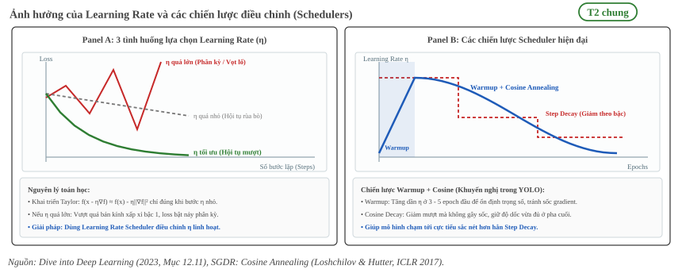

   Tác động của tốc độ học và các chiến lược điều chỉnh: :math:`\eta` quá lớn làm vọt lố phân kỳ, :math:`\eta` quá nhỏ gây hội tụ rùa bò. Chiến lược kết hợp Warmup tuyến tính ở vài epoch đầu cùng Cosine Annealing ở các epoch sau (chuẩn mực trong huấn luyện YOLO) giúp mô hình tránh sốc gradient và hội tụ vào cực tiểu sắc nét.

**unknown:** số bước warmup, hệ số giảm và loại scheduler mà dự án dùng cho YOLO. Sách không đưa giá trị khuyến nghị cho số bước warmup. Truy vấn tìm nguồn: cấu hình huấn luyện (``args.yaml``) của các run trong ``results/`` (T3).

Epoch, iteration và batch
-------------------------

Một epoch là một lượt qua toàn bộ tập huấn luyện [T2 D2L tr.105]. Từ định nghĩa epoch và iteration, suy ra với :math:`n` mẫu và batch size :math:`B` thì số lần cập nhật mỗi epoch là :math:`\lceil n / B \rceil`. Ví dụ của sách: batch size 1 trên 1500 mẫu cho 1500 lần cập nhật mỗi epoch. [T2 D2L tr.506]

Minibatch SGD dùng nhóm mẫu thay vì một mẫu. Lý do là hiệu quả tính toán.

   "At the heart of the decision to use minibatches is computational efficiency." [T2 D2L tr.500]

   "Minibatch stochastic gradient descent is able to trade-off convergence speed and computation efficiency. A minibatch size of 10 is more efficient than stochastic gradient descent; a minibatch size of 100 even outperforms GD in terms of runtime." [T2 D2L tr.507]

Sách tính loss trung bình trên minibatch, nên gradient không cần chia thêm cho batch size. [T2 D2L tr.504] Sách không nêu batch size mặc định hay khuyến nghị.

8. Overfitting, tăng cường dữ liệu và tập validation
====================================================

Overfitting và validation
-------------------------

   "The phenomenon of fitting closer to our training data than to the underlying distribution is called overfitting, and techniques for combatting overfitting are often called regularization methods." [T2 D2L tr.113]

Để phát hiện overfitting, sách dùng một tập validation tách riêng. Lỗi trên dữ liệu giữ lại này gọi là validation error. [T2 D2L tr.115]

   "we want to watch out for the cases when our training error is significantly lower than our validation error, indicating severe overfitting." [T2 D2L tr.115]

.. _fig-underfitting-overfitting:

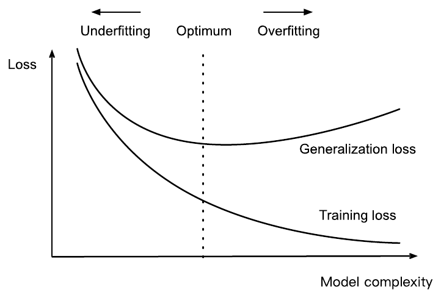

   Ảnh hưởng của độ phức tạp mô hình lên underfitting và overfitting. Loss huấn luyện giảm dần, loss tổng quát hóa giảm rồi tăng lại sau điểm tối ưu. Nguồn: [T2 D2L tr.116, Fig. 3.6.1]

Khi dữ liệu ít, sách nêu K-fold cross-validation như một giải pháp. [T2 D2L tr.117] Sách không nêu tỷ lệ chia train và validation.

**unknown:** tỷ lệ chia train, validation, test của các bộ dữ liệu trong dự án. Truy vấn tìm nguồn: ``data/*/DATA_CARD.md`` (T3).

Weight decay
------------

Weight decay (còn gọi :math:`\ell_2` regularization) cộng một số hạng phạt độ lớn trọng số vào loss. Hằng số :math:`\lambda` là siêu tham số chọn bằng dữ liệu validation. [T2 D2L tr.119]

.. math::

   L(\mathbf{w}, b) + \frac{\lambda}{2} \|\mathbf{w}\|^2

Với :math:`\lambda = 0` ta có loss gốc, với :math:`\lambda > 0` độ lớn :math:`\|\mathbf{w}\|` bị giới hạn. [T2 D2L tr.119] Tên "decay" xuất phát từ việc thuật toán tối ưu làm trọng số co lại ở mỗi bước. [T2 D2L tr.120] Sách không nêu giá trị :math:`\lambda` mặc định.

Dropout
-------

Dropout đặt về 0 một phần các nút của mỗi lớp trước khi tính lớp kế tiếp. [T2 D2L tr.194] Với xác suất :math:`p`, mỗi activation bị loại với xác suất :math:`p` và các activation còn lại được chia cho :math:`1 - p`. [T2 D2L tr.195, tr.196] Sách nêu: "Typically, we disable dropout at test time." [T2 D2L tr.196] Cách dropout hoạt động khác nhau giữa huấn luyện và suy luận được trình bày ở trang :doc:`06-huan-luyen-va-suy-luan`. Sách không nêu giá trị :math:`p` mặc định.

Sách mô tả trường hợp loại :math:`h_2` và :math:`h_5`: khi đó phép tính đầu ra không còn phụ thuộc :math:`h_2` và :math:`h_5`, và gradient của chúng cũng biến mất lúc backpropagation. [T2 D2L tr.195]

.. _fig-dropout-truoc-sau:

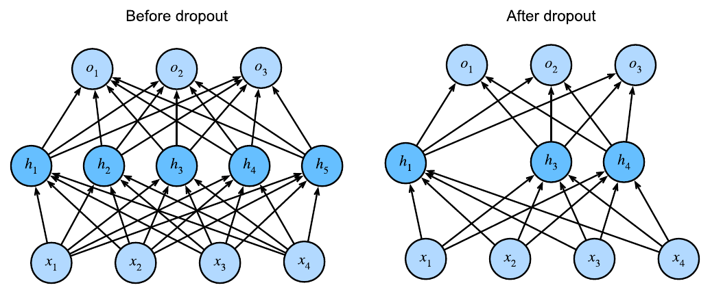

   Mạng MLP trước và sau dropout. Nguồn: [T2 D2L tr.195, Fig. 5.6.1]

Tăng cường dữ liệu
------------------

   "Image augmentation generates similar but distinct training examples after a series of random changes to the training images, thereby expanding the size of the training set." [T2 D2L tr.592]

Sách còn nêu lý do thứ hai: các thay đổi ngẫu nhiên giúp mô hình bớt dựa vào một số thuộc tính nhất định, nên khái quát hóa tốt hơn. [T2 D2L tr.592] Các kỹ thuật tăng cường dành riêng cho detector (như mosaic, lật có xử lý box) thuộc phần huấn luyện detector, không viết ở trang này.

Số trang D2L là số trang in (bằng số trang PDF trừ 40). Số trang của FOCAL, GIoU và DIoU là số trang PDF. Năm hình thực nghiệm trích từ tài liệu gốc được lưu ở ``_assets/img/01-kien-thuc-nen/01-nen-tang-ai/loss-va-backpropagation/``: Fig. 3.6.1 và 5.6.1 của D2L, Fig. 1 của FOCAL, GIoU và DIoU. Sáu hình sơ đồ nguyên lý và đồ thị giải thuật vector chuẩn hóa được tạo tự động lưu ở ``_assets/generated/01-kien-thuc-nen/01-nen-tang-ai/05-loss-va-backpropagation/``: bp-1 đến bp-6.
