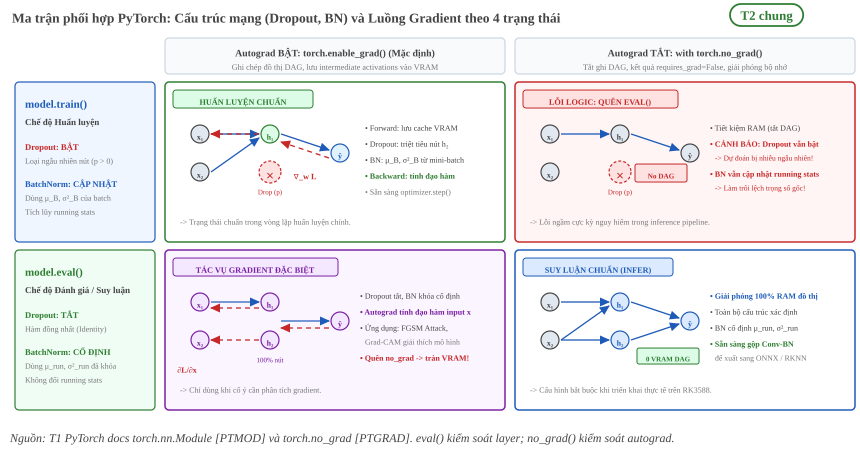
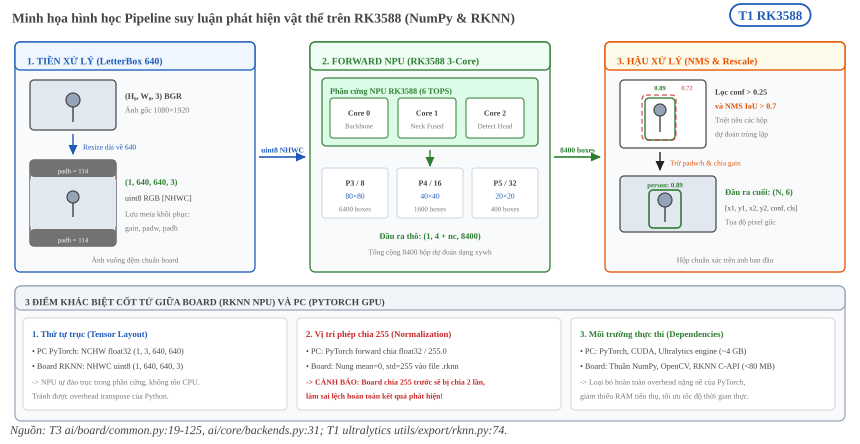
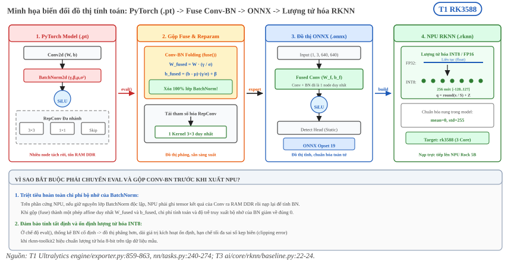

:tocdepth: 1

**********************
Huấn luyện và suy luận
**********************

.. admonition:: Trang này trả lời

   - Huấn luyện khác suy luận ở đâu, và vì sao khác biệt này quan trọng khi triển khai?
   - Lệnh nào chuyển mạng giữa hai chế độ, và lớp nào bị ảnh hưởng?
   - Pipeline suy luận của dự án gồm những chặng nào, với giá trị cụ thể ra sao?
   - Khi xuất mô hình sang ONNX cần chuẩn bị gì ở phía PyTorch?

.. admonition:: Tóm tắt

   - Huấn luyện lặp lại forward, tính loss, backward và cập nhật tham số. Suy luận chỉ chạy forward với tham số cố định (xem :doc:`05-loss-va-backpropagation` mục 1) [T2 D2L tr.105, tr.180].
   - ``model.train()`` và ``model.eval()`` đổi chế độ của mạng và chỉ ảnh hưởng một số lớp, ví dụ Dropout và BatchNorm [T1 PTMOD].
   - ``torch.no_grad()`` tắt tính gradient, giảm bộ nhớ khi chắc chắn không gọi ``backward()``. Đây là cơ chế khác với ``eval()`` [T1 PTGRAD, T1 PTMOD].
   - Dropout chỉ bật lúc huấn luyện [T2 D2L tr.196]. BatchNorm dùng thống kê mini-batch lúc huấn luyện và thống kê tích lũy lúc suy luận (xem :doc:`04-chuan-hoa-va-activation` mục 3).
   - Pipeline suy luận có ba chặng: tiền xử lý, forward và hậu xử lý. Trên board, dự án dùng LetterBox 640, đầu vào RGB uint8 ``(1, 640, 640, 3)``, ngưỡng conf 0.25, IoU 0.7, tối đa 300 box [T3 ai/board/common.py:19 đến 26, 62 đến 77].
   - Xuất ONNX cần đặt chế độ mạng trước khi xuất, cung cấp đầu vào mẫu (bộ xuất ghi lại shape của đầu vào mẫu) và chọn opset theo runtime hoặc compiler đích [T1 PTONNX].
   - Đường xuất của dự án đi qua Ultralytics: ``imgsz=640``, ``opset=19`` [T3 ai/core/rknn/baseline.py:22 đến 24] và bộ xuất của Ultralytics gọi ``model.eval()`` rồi ``fuse()`` (gộp Conv và BatchNorm) trước khi xuất [T1 ultralytics 8.4.154 engine/exporter.py:861, 863].
   - Bản docs PyTorch trong repo là 2.14 còn dự án chạy torch 2.4.0. Một số mặc định đã khác giữa hai bản (mục 4).

.. contents:: Trong trang này
   :local:
   :depth: 1

1. Hai chế độ của cùng một mạng
===============================

Cùng một bộ trọng số có thể chạy ở hai chế độ làm việc khác nhau. Một vòng huấn luyện gồm forward, tính loss, backward và cập nhật tham số (:doc:`05-loss-va-backpropagation`, mục 1). Suy luận chỉ giữ chặng forward, tham số không đổi.

Forward propagation được sách định nghĩa là việc tính và lưu các biến trung gian, kể cả đầu ra, từ lớp đầu vào đến lớp đầu ra. [T2 D2L tr.180] Backpropagation là cách tính gradient của tham số mạng [T2 D2L tr.181], nên suy ra chặng backward chỉ cần khi có bước cập nhật.

PyTorch tách việc này thành hai cơ chế độc lập, mỗi cái trả lời một câu hỏi khác nhau.

.. list-table::
   :header-rows: 1
   :widths: 24 38 38

   * - Cơ chế
     - Tác dụng
     - Nguồn
   * - ``model.train()`` và ``model.eval()``
     - Đặt chế độ của module. Chỉ ảnh hưởng một số lớp, ví dụ Dropout và BatchNorm. ``eval()`` tương đương ``train(False)``.
     - [T1 PTMOD]
   * - ``torch.no_grad()``
     - Tắt tính gradient. Kết quả mọi phép tính có ``requires_grad=False``, giảm bộ nhớ so với trường hợp bật.
     - [T1 PTGRAD]

..

   "Set the module in evaluation mode. This has an effect only on certain modules. See the documentation of particular modules for details of their behaviors in training/evaluation mode, i.e. whether they are affected, e.g. Dropout, BatchNorm, etc." [T1 PTMOD]

..

   "Disabling gradient calculation is useful for inference, when you are sure that you will not call Tensor.backward(). It will reduce memory consumption for computations that would otherwise have requires_grad=True." [T1 PTGRAD]

Hai cơ chế không thay thế nhau. Tài liệu `eval()` còn dẫn sang mục so sánh với các cơ chế dễ nhầm. [T1 PTMOD] Một mạng ở ``eval()`` vẫn tính gradient nếu không bọc ``no_grad()``, và một mạng trong ``no_grad()`` vẫn dùng hành vi train của Dropout và BatchNorm nếu chưa gọi ``eval()``. Hai ý này suy ra từ hai định nghĩa trên, tài liệu không viết thành câu riêng.

.. _fig-hl-1-ma-tran-eval-vs-nograd:

   Hình 6.1: Ma trận phối hợp giữa trạng thái layer (``model.train()`` / ``model.eval()``) và trạng thái engine Autograd (``torch.enable_grad()`` / ``torch.no_grad()``). Hai cơ chế hoàn toàn độc lập, tránh nhầm lẫn giữa việc khóa đồ thị gradient và việc đổi hành vi Dropout/BatchNorm [T1 PTMOD, T1 PTGRAD].

2. Khác biệt về gradient, BatchNorm, dropout và batch size
==========================================================

Bảng dưới gom các điểm khác nhau. Chi tiết của từng điểm nằm ở trang đã viết, trang này chỉ nêu kết luận và trỏ tới.

.. list-table::
   :header-rows: 1
   :widths: 16 28 28 28

   * - Tiêu chí
     - Huấn luyện
     - Suy luận
     - Chi tiết
   * - Gradient
     - Tính ở mỗi bước, cần lưu giá trị trung gian của forward [T2 D2L tr.183]
     - Không cần. Có thể bọc ``no_grad()`` [T1 PTGRAD]
     - :doc:`05-loss-va-backpropagation` mục 5
   * - BatchNorm
     - Thống kê của mini-batch, cập nhật running mean và running var
     - Cố định running mean và running var
     - :doc:`04-chuan-hoa-va-activation` mục 4
   * - Dropout
     - Bật, loại ngẫu nhiên một phần nút [T2 D2L tr.194]
     - Tắt: "Typically, we disable dropout at test time." [T2 D2L tr.196]
     - :doc:`05-loss-va-backpropagation` mục 8
   * - Batch size
     - Là tham số của minibatch SGD, ảnh hưởng thống kê BN và nhiễu gradient
     - Pipeline board xử lý từng ảnh, đầu vào ``(1, 640, 640, 3)`` [T3 ai/board/common.py:62 đến 77]
     - :doc:`05-loss-va-backpropagation` mục 7
   * - Độ chính xác số
     - FP32 hoặc mixed precision (kiểu dùng trong dự án là unknown, xem bên dưới)
     - Dự án xuất RKNN FP16 hoặc INT8 qua ``--quantize 16`` hoặc ``8`` [T3 ai/automation/export_npu.py:44]
     - :doc:`02-tensor-va-kieu-du-lieu`

Hình dưới ở trang 04 cho thấy cơ chế BatchNorm ở hai chế độ, xem :ref:`fig-act-7-co-che-batchnorm-train-vs-inference`. Hình dropout trước và sau khi loại nút ở trang 05, xem :ref:`fig-dropout-truoc-sau`.

**unknown:** giá trị batch size huấn luyện của từng run trong dự án. Truy vấn tìm nguồn: ``args.yaml`` hoặc ``config.yaml`` trong ``ai/automation/runs/<run_id>/`` (T3).

**unknown:** kiểu dữ liệu huấn luyện của dự án (FP32 hay mixed precision) ở hàng độ chính xác số. Truy vấn tìm nguồn: cấu hình huấn luyện, trường ``amp`` hoặc ``half`` trong ``config.yaml`` của run (T3).

3. Pipeline suy luận gồm tiền xử lý, forward và hậu xử lý
=========================================================

Suy luận một ảnh gồm ba chặng nối tiếp.

.. list-table::
   :header-rows: 1
   :widths: 18 40 42

   * - Chặng
     - Việc làm
     - Nội dung chi tiết
   * - Tiền xử lý
     - Đưa ảnh gốc về đúng kích thước, thứ tự kênh và kiểu dữ liệu mà mạng nhận
     - Mục này
   * - Forward
     - Chạy mạng với tham số cố định, ra đầu ra thô
     - Mục 1, và :doc:`01-mang-no-ron`
   * - Hậu xử lý
     - Giải mã đầu ra thô thành box, lọc ngưỡng và NMS
     - :doc:`07-bai-toan-phat-hien-vat-the` mục 6 và 7

3.1 Pipeline của dự án trên board
---------------------------------

Mã trên board chỉ dùng numpy, opencv, psutil và pyyaml, không có torch hay ultralytics. Tiền xử lý và hậu xử lý được viết lại bằng numpy để khớp với bộ đánh giá. [T3 ai/board/common.py:1 đến 5] Bảng dưới liệt kê các giá trị đọc từ mã.

.. list-table::
   :header-rows: 1
   :widths: 26 34 40

   * - Tham số
     - Giá trị
     - Vị trí
   * - Kích thước đầu vào
     - 640 (``IMGSZ``)
     - ``ai/board/common.py:19``
   * - Resize và LetterBox
     - Resize cạnh dài về 640 giữ tỷ lệ (chạy cả khi ảnh nhỏ hơn 640, vì điều kiện là ``r != 1``), rồi đệm căn giữa bằng giá trị 114. Chú thích mã ghi ``LetterBox(scaleup=False, center=True)``
     - ``ai/board/common.py:62 đến 77``
   * - Thứ tự kênh và kiểu
     - BGR sang RGB, uint8, shape ``(1, 640, 640, 3)``
     - ``ai/board/common.py:62 đến 77``
   * - Ngưỡng conf
     - 0.25 (``CONF``)
     - ``ai/board/common.py:22``
   * - Ngưỡng IoU của NMS
     - 0.7 (``IOU``)
     - ``ai/board/common.py:23``
   * - Số box tối đa
     - 300 (``MAX_DET``), 30000 box trước NMS (``MAX_NMS``)
     - ``ai/board/common.py:24, 25``
   * - Đầu ra thô
     - ``(1, 4 + nc, anchors)``, box dạng xywh theo pixel đầu vào
     - ``ai/board/common.py:98, 111 đến 114`` và ``ai/core/backends.py:4, 5``
   * - Quy đổi về ảnh gốc
     - Trừ phần đệm, chia hệ số tỷ lệ, cắt vào biên ảnh
     - ``ai/board/common.py:118 đến 120``

Giá trị chuẩn hóa pixel nằm ở hai chỗ khác nhau trên hai đường chạy. Backend PyTorch trên PC chia ``float32`` cho 255 trong ``forward`` [T3 ai/core/backends.py:31]. Với RKNN, bộ xuất của Ultralytics cấu hình ``mean_values=[[0, 0, 0]]``, ``std_values=[[255, 255, 255]]`` lúc chuyển ONNX sang RKNN, nên phép chia 255 nằm trong model ``.rknn`` còn board đưa vào uint8 [T1 ultralytics 8.4.154 utils/export/rknn.py:74]. Suy ra: nếu đưa ảnh đã chia 255 vào model ``.rknn`` thì bị chia hai lần. Đây là suy luận từ hai dòng mã, chưa kiểm bằng chạy thực.

Layout cũng khác giữa hai đường: backend PC nhận uint8 RGB NCHW ``(1, 3, 640, 640)`` [T3 ai/core/backends.py:3 đến 5], còn ``preprocess`` trên board trả NHWC ``(1, 640, 640, 3)`` [T3 ai/board/common.py:62 đến 77].

Các giá trị 0.25, 0.7 và 300 trùng cấu hình mặc định của Ultralytics 8.4.154: ngưỡng conf khi dự đoán 0.25 (khi đánh giá 0.001), IoU của NMS 0.7, tối đa 300 phát hiện mỗi ảnh. [T1 ultralytics 8.4.154 cfg/default.yaml:55 đến 57] Mặc định tham số của hàm ``non_max_suppression`` lại là ``iou_thres=0.45`` [T1 ultralytics 8.4.154 utils/nms.py:13 đến 16], nên một con số "IoU của NMS" cần xét xem nó đến từ cấu hình hay từ hàm. Thuật toán NMS và ý nghĩa các ngưỡng nằm ở :doc:`07-bai-toan-phat-hien-vat-the` mục 7.

Ngưỡng ``conf`` khi đánh giá AP trên PC (0.001 theo cấu hình mặc định ở trên) khác ngưỡng triển khai 0.25. Phân tích chênh lệch kết quả giữa hai chế độ không nằm trong trang này, xem phần kết quả và :doc:`08-evaluation-metrics`.

.. _fig-hl-2-pipeline-suy-luan-rk3588:

   Hình 6.2: Pipeline suy luận phát hiện vật thể đầu-cuối trên board RK3588 (NumPy & RKNN Runtime) và 3 điểm khác biệt cốt tử so với đường chạy PyTorch trên PC [T3 ai/board/common.py:19 đến 125, T3 ai/core/backends.py:31, T1 ultralytics utils/export/rknn.py:74].

4. Xuất mô hình để triển khai (PyTorch sang ONNX)
=================================================

ONNX là định dạng trung gian giữa PyTorch và trình biên dịch của NPU. Luồng ONNX sang RKNN nằm ở :doc:`../../02-nen-tang-rk3588/03-toolchain-runtime/01-luong-onnx-sang-rknn`. Mục này chỉ nêu phần phía PyTorch.

4.1 Những việc cần chuẩn bị
---------------------------

.. list-table::
   :header-rows: 1
   :widths: 24 46 30

   * - Việc
     - Nội dung
     - Nguồn
   * - Đặt chế độ mạng
     - Tùy chọn ``training`` của ``torch.onnx.export`` bị đánh dấu deprecated, tài liệu bảo đặt chế độ của mô hình trước khi xuất
     - [T1 PTONNX]
   * - Cung cấp đầu vào mẫu
     - ``args`` là các đầu vào mẫu, đối số Tensor thành đầu vào của mô hình xuất
     - [T1 PTONNX]
   * - Shape cố định hay động
     - Bộ xuất ghi lại shape của đầu vào mẫu. Muốn nhận shape động phải khai báo ``dynamic_shapes`` (hoặc ``dynamic_axes`` với bộ xuất TorchScript)
     - [T1 PTONNX]
   * - Chọn opset
     - Đặt ``opset_version`` theo bản opset mà runtime hoặc compiler đích hỗ trợ
     - [T1 PTONNX]

..

   "opset_version (int | None) – The version of the default (ai.onnx) opset to target. You should set opset_version according to the supported opset versions of the runtime backend or compiler you want to run the exported model with." [T1 PTONNX]

Tài liệu cũng nêu bộ xuất mới dựa trên ``torch.export`` là bộ xuất mới nhất cho PyTorch 2.6 trở lên. [T1 PTONNX]

4.2 Khác biệt giữa docs 2.14 và torch 2.4.0
-------------------------------------------

Docs trong repo là bản 2.14. Chữ ký ``torch.onnx.export`` kiểm trên môi trường dự án (torch 2.4.0) cho: ``training=TrainingMode.EVAL``, ``dynamo=False``. [T1 torch 2.4.0] Trong khi đó chữ ký trong docs 2.14 có ``dynamo=True``. [T1 PTONNX] Vì vậy các mô tả "mặc định" của docs 2.14 không áp dụng nguyên cho môi trường dự án.

4.3 Đường xuất của dự án
------------------------

Dự án không gọi ``torch.onnx.export`` trực tiếp. Hàm ``export_onnx`` gọi ``YOLO(weights).export(format="onnx", imgsz=imgsz, opset=19)`` với ``imgsz`` mặc định 640. [T3 ai/core/rknn/baseline.py:22 đến 24] Tài liệu Ultralytics về xuất RKNN ghi ``imgsz`` mặc định 640, ``batch`` mặc định 1, ``simplify`` mặc định True. Mặc định của ``opset`` trong bảng là None, và mô tả ghi "Defaults to 19 if unset, and values above 19 are reduced to 19". [T1 Ultralytics RKNN doc]

Bên trong bộ xuất của Ultralytics 8.4.154 cài trong ``.venv``, mạng được đặt ``requires_grad=False`` cho mọi tham số, gọi ``model.eval()`` rồi ``model.fuse()`` trước khi xuất. [T1 ultralytics 8.4.154 engine/exporter.py:859 đến 863] ``fuse`` gộp lớp Conv và BatchNorm, xóa nhánh BN và đổi ``forward`` sang bản đã gộp (dòng 252 đến 263). Hàm cũng tái tham số hóa RepConv và RepVGGDW (dòng 264 đến 269) và bỏ nhánh phát hiện không dùng của ``Detect`` (dòng 270, 271). [T1 ultralytics 8.4.154 nn/tasks.py:240 đến 274] Điều này khớp với kỹ thuật Conv-BN folding ở :doc:`04-chuan-hoa-va-activation` mục 5.

.. _fig-hl-3-luong-xuat-model-pytorch-sang-rknn:

   Hình 6.3: Quy trình tối ưu và chuyển đổi mô hình từ PyTorch checkpoint (.pt) qua bước gộp Conv-BN folding, xuất ONNX và biên dịch sang RKNN NPU (.rknn) [T1 engine/exporter.py:859 đến 863, T1 nn/tasks.py:240 đến 274, T3 ai/core/rknn/baseline.py:22 đến 24].

**unknown:** phép gộp ``fuse()`` của Ultralytics có cho kết quả số học đồng nhất với Conv-BN folding trong ``rknn-toolkit2`` không. Truy vấn tìm nguồn: so sánh đầu ra ``best.onnx`` với đầu ra của model PyTorch đã ``fuse()`` trên cùng ảnh (T3).

5. Vì sao khác biệt này quan trọng khi triển khai
=================================================

Các điểm ở trên dẫn tới ba hệ quả khi đưa model lên board.

.. list-table::
   :header-rows: 1
   :widths: 30 70

   * - Hệ quả
     - Lý do và nguồn
   * - Phải xuất ở chế độ ``eval``
     - Nếu BN còn ở chế độ train, đầu ra phụ thuộc thống kê của batch hiện tại thay vì thống kê tích lũy (:doc:`04-chuan-hoa-va-activation` mục 3). PyTorch cho biết ``eval()`` đổi hành vi của BatchNorm và Dropout [T1 PTMOD]. Bộ xuất của Ultralytics gọi ``eval()`` trước khi xuất [T1 ultralytics 8.4.154 engine/exporter.py:861]
   * - BN gộp được vào Conv
     - Ở ``eval``, BN là phép affine cố định nên có thể gộp vào Conv đứng trước (:doc:`04-chuan-hoa-va-activation` mục 5). Ultralytics làm bước này lúc xuất [T1 ultralytics 8.4.154 engine/exporter.py:863]
   * - Tiền xử lý và hậu xử lý phải khớp huấn luyện và đánh giá
     - Mã board viết lại tiền xử lý và hậu xử lý bằng numpy để khớp bộ đánh giá [T3 ai/board/common.py:1 đến 5]. Nếu LetterBox, thứ tự kênh hoặc phép chia 255 bị lệch thì đầu vào mạng khác đầu vào lúc đánh giá (suy luận, chưa đo)

Hệ quả cuối là suy luận, không phải suy ra từ nguồn trích dẫn: khi hai đường chạy (PC và board) có layout và chuẩn hóa khác nhau như mục 3, việc kiểm lại bằng cùng một ảnh trên cả hai đường là cách duy nhất để chắc chắn chúng cho cùng kết quả.

**unknown:** mức lệch số liệu giữa suy luận PyTorch trên PC và suy luận RKNN trên board của các run hiện có. Truy vấn tìm nguồn: bảng kết quả trong ``results/<ds>/table_*.md`` (T3).

Số trang D2L là số trang in (bằng số trang PDF trừ 40). PTMOD, PTGRAD và PTONNX là ba trang tài liệu PyTorch bản 2.14 (``torch.nn.Module``, ``torch.no_grad``, ``torch.onnx``) tải ngày 2026-10-20 về ``_assets/pdf/papers/11_pytorch_train_infer/``, dạng trang web nên không có số trang. Nguồn "T1 Ultralytics RKNN doc" là ``_assets/pdf/papers/09_yolo_architecture/ultralytics_docs_integrations_rockchip-rknn.txt``. Các nhãn T3 dẫn ``file:dòng`` trong repo hoặc trong ``.venv`` của dự án. Theo ``GLOSSARY.md``, T1 là tài liệu hãng hoặc mã nguồn chính thức (ở đây là PyTorch và Ultralytics), T3 là phép đo hoặc mã của dự án.
