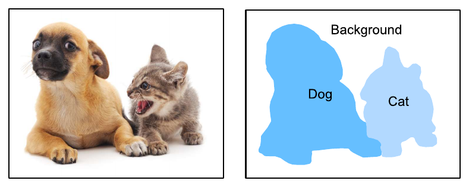
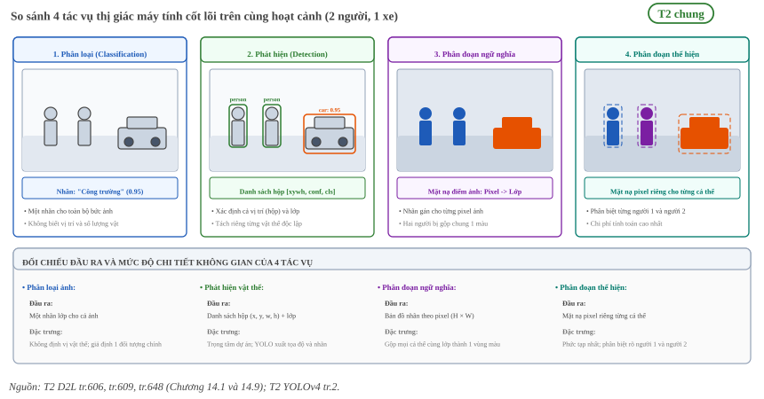
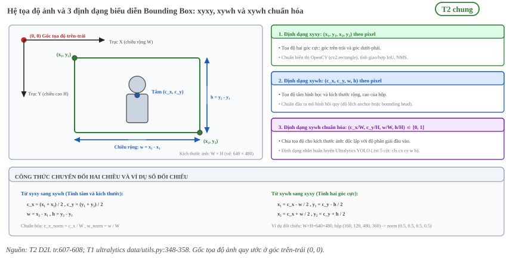
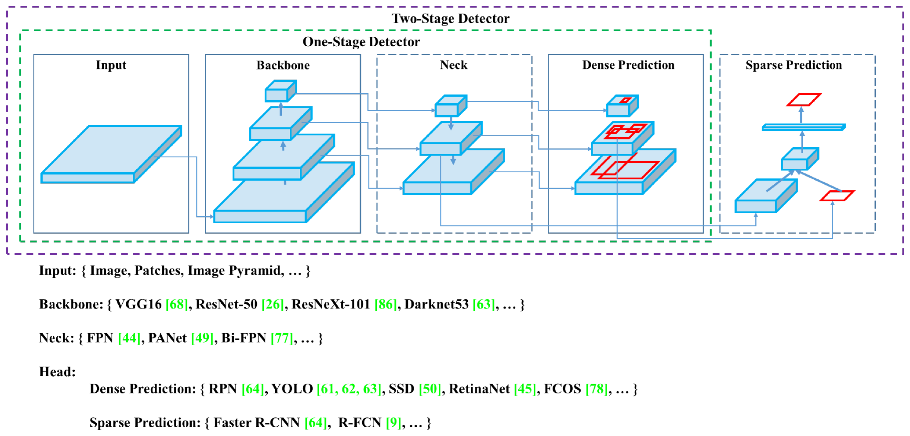
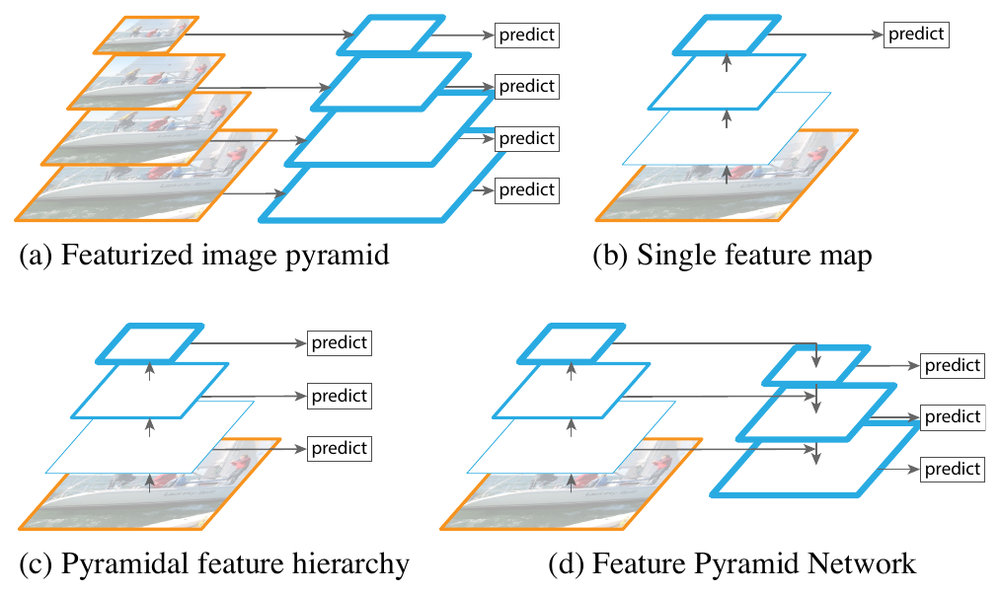
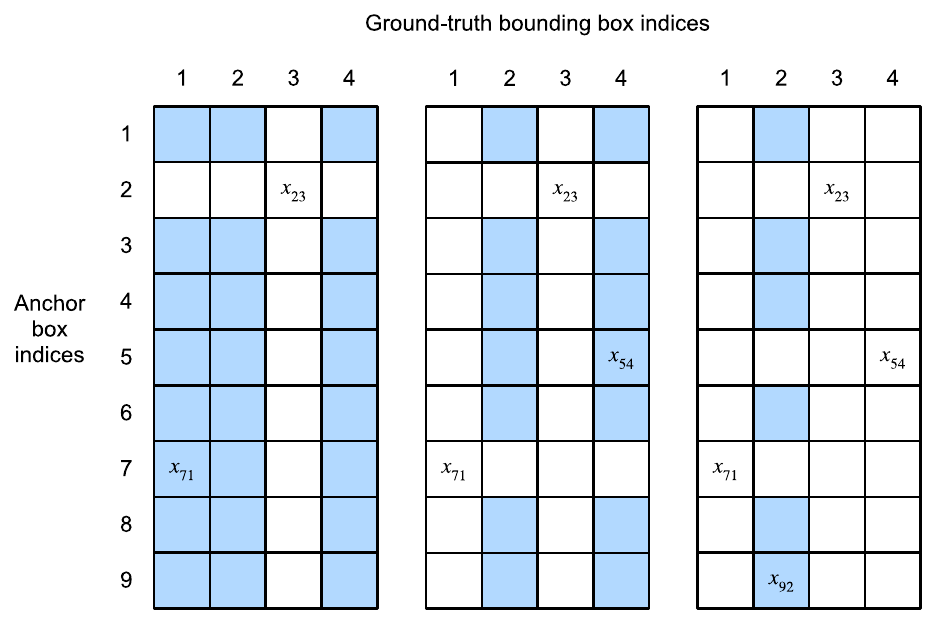
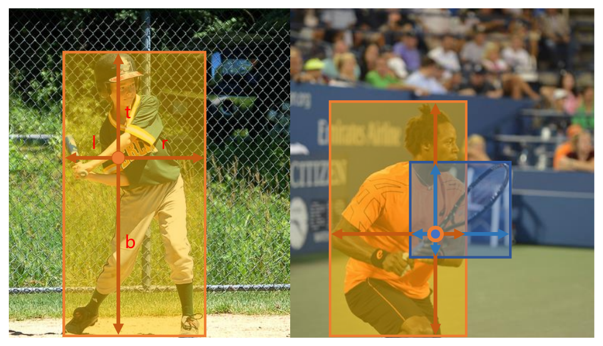
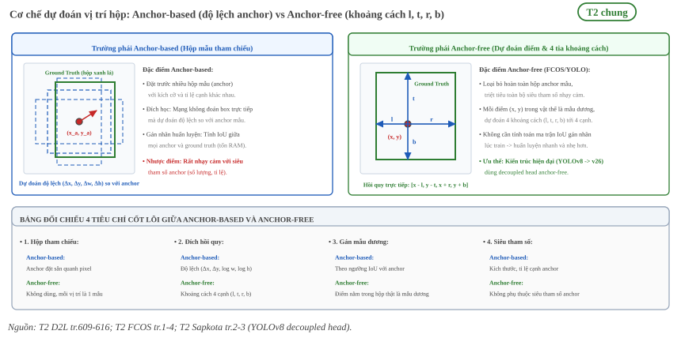
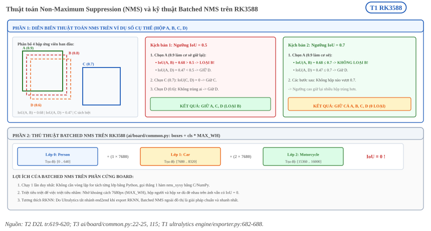

:tocdepth: 1

**************************
Bài toán phát hiện vật thể
**************************

.. admonition:: Trang này trả lời

   - Bài toán phát hiện vật thể gồm những thành phần nào, từ ảnh đầu vào đến danh sách box?
   - Phát hiện khác phân loại và phân đoạn ở đâu?
   - Box được biểu diễn bằng những định dạng nào và đổi qua lại ra sao?
   - Detector gồm những phần nào, anchor-based khác anchor-free ở đâu?
   - Từ đầu ra thô đến danh sách box cuối cùng đi qua những bước nào, NMS hoạt động ra sao?

.. admonition:: Tóm tắt

   - Phân loại ảnh gán một nhãn cho cả ảnh. Phát hiện vật thể cho biết cả lớp lẫn vị trí của từng vật. Phân đoạn ngữ nghĩa gán lớp cho từng pixel [T2 D2L tr.606, tr.648].
   - Vị trí vật thể thường biểu diễn bằng hộp chữ nhật (bounding box), theo hai dạng: hai góc (trái trên, phải dưới) hoặc tâm cùng chiều rộng, chiều cao [T2 D2L tr.607]. Nhãn dạng Ultralytics có 5 cột (lớp và 4 tọa độ chuẩn hóa) [T1 ultralytics 8.4.154 data/utils.py:355 đến 358].
   - Một detector một giai đoạn gồm backbone (trích đặc trưng), neck (gộp đặc trưng nhiều mức) và head (dự đoán kết quả) [T2 YOLOv6 tr.3, T2 YOLOv4 tr.2].
   - Anchor-based đặt sẵn nhiều box mẫu quanh mỗi pixel rồi dự đoán độ lệch so với box mẫu. Anchor-free dự đoán trực tiếp từ vị trí, bỏ các siêu tham số của anchor và bước tính chồng lấn lúc huấn luyện [T2 D2L tr.609, tr.616, T2 FCOS tr.1].
   - Đầu ra thô của detector là điểm lớp và tham số box cho từng ứng viên. Ứng viên được đổi thành box trong tọa độ ảnh, lọc theo ngưỡng confidence, rồi NMS loại box trùng [T2 D2L tr.619].
   - NMS giữ box confidence cao nhất và loại các box còn lại có IoU với nó vượt ngưỡng. Ví dụ số 4 box cho kết quả khác nhau ở ngưỡng 0.5 và 0.7 [T2 D2L tr.619, tr.620, Tự tính, đối chiếu script].
   - YOLO26 có nhánh ``end2end`` không cần NMS, nhưng Ultralytics tắt nhánh này khi xuất sang ``rknn``, nên đường xuất cho RK3588 vẫn cần NMS ngoài đồ thị [T1 ultralytics 8.4.154 engine/exporter.py:682 đến 688].

.. contents:: Trong trang này
   :local:
   :depth: 1

1. Phân loại, phát hiện và phân đoạn
====================================

Bài toán phân loại ảnh giả định ảnh có một vật chính và chỉ hỏi vật đó thuộc lớp nào. Khi ảnh có nhiều vật, ta cần biết cả lớp lẫn vị trí của từng vật. Sách gọi tác vụ này là object detection. [T2 D2L tr.606]

   "In image classification tasks, we assume that there is only one major object in the image and we only focus on how to recognize its category. However, there are often multiple objects in the image of interest. We not only want to know their categories, but also their specific positions in the image." [T2 D2L tr.606]

Phân đoạn ngữ nghĩa đi sâu hơn: thay vì hộp chữ nhật, nhãn và dự đoán nằm ở mức pixel. [T2 D2L tr.648]

   "Different from object detection, semantic segmentation recognizes and understands what are in images in pixel level: its labeling and prediction of semantic regions are in pixel level." [T2 D2L tr.648]

.. _fig-d2l-phan-doan-ngu-nghia:

   Nhãn phân đoạn ngữ nghĩa của ảnh chó và mèo: mỗi pixel thuộc một trong ba lớp chó, mèo, nền. Nguồn: [T2 D2L tr.648, Fig. 14.9.1]

Sách còn nêu phân đoạn thể hiện (instance segmentation), cần phân biệt cả các vật khác nhau cùng lớp: nếu có hai con chó thì phải biết pixel thuộc con nào. [T2 D2L tr.648]

.. list-table::
   :header-rows: 1
   :widths: 22 40 38

   * - Tác vụ
     - Đầu ra
     - Nguồn
   * - Phân loại ảnh
     - Một lớp cho cả ảnh (giả định có một vật chính)
     - [T2 D2L tr.606]
   * - Phát hiện vật thể
     - Lớp và vị trí (hộp chữ nhật) của từng vật
     - [T2 D2L tr.606, tr.609]
   * - Phân đoạn ngữ nghĩa
     - Lớp của từng pixel
     - [T2 D2L tr.648]
   * - Phân đoạn thể hiện
     - Vùng pixel của từng vật thể, phân biệt từng cá thể
     - [T2 D2L tr.648]

.. _fig-det-1-bon-tac-vu-thi-giac:

   Hình 7.1: So sánh 4 tác vụ thị giác máy tính cốt lõi (Phân loại, Phát hiện vật thể, Phân đoạn ngữ nghĩa, Phân đoạn thể hiện) trên cùng hoạt cảnh thực tế và đối chiếu mức độ chi tiết không gian ở đầu ra [T2 D2L tr.606, tr.609, tr.648, T2 YOLOv4 tr.2].

Trang này chỉ bàn về phát hiện vật thể, tức đầu ra là danh sách hộp chữ nhật kèm lớp và điểm tin cậy (xem Hình 7.1).

2. Bounding box và các định dạng (xyxy, xywh, chuẩn hóa)
========================================================

Sách dùng hộp chữ nhật (bounding box) để mô tả vị trí vật thể và nêu hai cách biểu diễn. [T2 D2L tr.607]

   "The bounding box is rectangular, which is determined by the 𝑥 and 𝑦 coordinates of the upper-left corner of the rectangle and the such coordinates of the lower-right corner. Another commonly used bounding box representation is the (𝑥, 𝑦)-axis coordinates of the bounding box center, and the width and height of the box." [T2 D2L tr.607]

Gốc tọa độ của ảnh là góc trên trái, chiều dương của trục :math:`x` hướng sang phải và của trục :math:`y` hướng xuống dưới. [T2 D2L tr.608] Phép đổi giữa hai dạng theo mã của sách như sau. [T2 D2L tr.607, tr.608]

.. math::

   c_x = \frac{x_1 + x_2}{2},\quad c_y = \frac{y_1 + y_2}{2},\quad w = x_2 - x_1,\quad h = y_2 - y_1

.. math::

   x_1 = c_x - \tfrac{w}{2},\quad y_1 = c_y - \tfrac{h}{2},\quad x_2 = c_x + \tfrac{w}{2},\quad y_2 = c_y + \tfrac{h}{2}

Dạng chuẩn hóa chia tọa độ cho kích thước ảnh. Sách minh họa với anchor box: "The coordinate values of both axes are divided by the width and height of the image, respectively." [T2 D2L tr.611] Nhãn dạng Ultralytics cũng chuẩn hóa. Mã kiểm tra nhãn của Ultralytics yêu cầu mỗi dòng nhãn có 5 cột (lớp và 4 tọa độ), từ chối tọa độ vượt quá 1.01 với thông báo "non-normalized or out of bounds coordinates", và ghi chú dạng ``(cls, xywh)`` cho hộp. [T1 ultralytics 8.4.154 data/utils.py:348, 355 đến 358]

.. list-table::
   :header-rows: 1
   :widths: 16 40 44

   * - Dạng
     - Các giá trị
     - Ghi chú
   * - ``xyxy``
     - :math:`(x_1, y_1, x_2, y_2)` theo pixel
     - Hai góc trái trên và phải dưới [T2 D2L tr.607]
   * - ``xywh``
     - :math:`(c_x, c_y, w, h)` theo pixel
     - Tâm, rộng, cao [T2 D2L tr.607]
   * - ``xywh`` chuẩn hóa
     - :math:`(c_x/W,\ c_y/H,\ w/W,\ h/H)`
     - Dạng nhãn của Ultralytics [T1 ultralytics 8.4.154 data/utils.py:348, 355 đến 358]

**Ví dụ tự tính.** Ảnh :math:`W \times H = 640 \times 480`, hộp ``xyxy`` :math:`(160, 120, 480, 360)`. Tâm là :math:`(320, 240)`, rộng :math:`w = 320`, cao :math:`h = 240`, nên ``xywh`` là :math:`(320, 240, 320, 240)` và dạng chuẩn hóa là :math:`(0.5, 0.5, 0.5, 0.5)`. Đổi ngược lại cho đúng :math:`(160, 120, 480, 360)`. [Tự tính, đối chiếu script]

.. _fig-det-2-bounding-box-va-he-toa-do:

   Hình 7.2: Hệ tọa độ ảnh (gốc trên-trái) và 3 định dạng biểu diễn Bounding Box (xyxy, xywh, xywh chuẩn hóa) cùng công thức chuyển đổi hai chiều và ví dụ đối chiếu (xem Hình 7.2) [T2 D2L tr.607, tr.608, T1 ultralytics data/utils.py:348 đến 358].

Độ đo chồng lấn giữa hai box (IoU) được định nghĩa ở trang :doc:`08-evaluation-metrics` mục 1.1. Sách nêu IoU là tỷ số diện tích giao trên diện tích hợp, nhận giá trị từ 0 đến 1, bằng 0 khi hai box không chồng nhau và bằng 1 khi hai box trùng. [T2 D2L tr.613]

3. Nhãn và lớp
==============

Mỗi vật thể trong ảnh huấn luyện được gán một lớp (class) và một hộp. Với mô hình phát hiện, "lớp" là chỉ số nguyên trong một danh sách tên lớp cố định. Trong định dạng nhãn của Ultralytics, mỗi ảnh có một file nhãn, mỗi dòng ứng một vật thể gồm 5 giá trị: chỉ số lớp rồi 4 tọa độ hộp. [T1 ultralytics 8.4.154 data/utils.py:340 đến 358]

Mã kiểm tra còn buộc chỉ số lớp nhỏ hơn số lớp khai báo của bộ dữ liệu, nếu không báo lỗi "Label class ... exceeds dataset class count". [T1 ultralytics 8.4.154 data/utils.py:362 đến 365] Vì vậy danh sách tên lớp, số lớp và chỉ số trong file nhãn phải khớp nhau.

Ngoài các lớp vật thể còn có lớp nền (background). Trong cách gán nhãn dựa trên anchor, một anchor không được gán hộp nào thì mang lớp "background" và gọi là anchor âm, các anchor còn lại gọi là anchor dương. [T2 D2L tr.616] Với detector không dùng anchor, một vị trí không nằm trong hộp nào thì là mẫu âm với nhãn nền :math:`c^* = 0`. [T2 FCOS tr.4]

Trang này không nêu tên hay số lượng lớp của một bộ dữ liệu cụ thể. Phần định nghĩa lớp, cách gộp lớp và số liệu nằm ở :doc:`../../02-phuong-phap/01-du-lieu/02-class-mapping`.

4. Kiến trúc detector gồm backbone, neck và head
================================================

Bài YOLOv6 mô tả detector một giai đoạn gồm ba phần. [T2 YOLOv6 tr.3]

   "A one-stage object detector is generally composed of the following parts: a backbone, a neck and a head. The backbone mainly determines the feature representation ability, meanwhile, its design has a critical influence on the inference efficiency since it carries a large portion of computation cost. The neck is used to aggregate the low-level physical features with high-level semantic features, and then build up pyramid feature maps at all levels." [T2 YOLOv6 tr.3]

..

   "The head consists of several convolutional layers, and it predicts final detection results according to multi-level features assembled by the neck." [T2 YOLOv6 tr.3]

Bài YOLOv4 nêu cùng cấu trúc từ góc nhìn lịch sử: detector hiện đại gồm backbone tiền huấn luyện trên ImageNet và head dự đoán lớp và box, còn các lớp chèn giữa hai phần để gom bản đồ đặc trưng từ nhiều giai đoạn gọi là neck. [T2 YOLOv4 tr.2]

   "Object detectors developed in recent years often insert some layers between backbone and head, and these layers are usually used to collect feature maps from different stages. We can call it the neck of an object detector." [T2 YOLOv4 tr.2]

.. _fig-yolov4-cau-truc-detector:

   Cấu trúc một object detector: đầu vào, backbone, neck, rồi head dự đoán dày (one-stage) hoặc thưa (two-stage). Danh sách bên dưới là ví dụ của từng phần theo bài. Nguồn: [T2 YOLOv4 tr.2, Fig. 2]

.. list-table::
   :header-rows: 1
   :widths: 14 50 36

   * - Phần
     - Vai trò
     - Nguồn
   * - Backbone
     - Quyết định khả năng biểu diễn đặc trưng và chiếm phần lớn chi phí tính toán
     - [T2 YOLOv6 tr.3]
   * - Neck
     - Gộp đặc trưng mức thấp (chi tiết vị trí) với mức cao (ngữ nghĩa), dựng bản đồ đặc trưng dạng kim tự tháp ở mọi mức
     - [T2 YOLOv6 tr.3, T2 FPN tr.1]
   * - Head
     - Dự đoán kết quả phát hiện từ đặc trưng nhiều mức do neck tạo ra
     - [T2 YOLOv6 tr.3]

Lý do cần neck nhiều mức: bài FPN cho biết phát hiện đa tỉ lệ cho kết quả tốt hơn, nhất là với vật nhỏ. [T2 FPN tr.3] Bài đề xuất kiến trúc đi từ trên xuống có kết nối ngang để dựng bản đồ đặc trưng ngữ nghĩa cao ở mọi tỉ lệ. [T2 FPN tr.1]

.. _fig-fpn-kim-tu-thap:

   Bốn cách dùng đặc trưng nhiều tỉ lệ: (a) kim tự tháp ảnh, (b) một bản đồ đặc trưng, (c) phân cấp đặc trưng của mạng, (d) Feature Pyramid Network. Nguồn: [T2 FPN tr.1, Fig. 1]

Các khối cụ thể của YOLOv8n và YOLO26n (``C2f``, ``C3k2``, ``SPPF``, đầu ``Detect``) nằm ở :doc:`../07-yolo/01-so-sanh-va-khoi-cau-thanh`. Trang này không lặp lại chúng.

5. Anchor-based và anchor-free
==============================

Anchor-based
------------

Các thuật toán phát hiện thường lấy mẫu nhiều vùng trong ảnh, xét vùng nào chứa vật quan tâm và điều chỉnh biên của vùng cho khớp hộp thật hơn. Một cách lấy mẫu là sinh nhiều hộp với tỉ lệ và khuôn dạng khác nhau, tâm đặt ở mỗi pixel. Các hộp này gọi là anchor box. [T2 D2L tr.609]

Với ảnh cao :math:`h` rộng :math:`w`, chọn tập tỉ lệ :math:`s_1, \dots, s_n` và tập tỉ lệ cạnh :math:`r_1, \dots, r_m`. Anchor tâm tại một pixel có rộng :math:`w s \sqrt{r}` và cao :math:`h s / \sqrt{r}`. Nếu dùng hết mọi tổ hợp thì có :math:`whnm` anchor, quá nhiều. Sách chỉ xét các tổ hợp chứa :math:`s_1` hoặc :math:`r_1`, nên mỗi pixel có :math:`n + m - 1` anchor và cả ảnh có :math:`wh(n + m - 1)`. [T2 D2L tr.610]

Lúc huấn luyện, mỗi anchor được gán hộp thật gần nhất theo IoU. Thuật toán của sách xây ma trận IoU giữa mọi anchor và mọi hộp thật, lần lượt chọn phần tử lớn nhất, gán hộp tương ứng cho anchor đó rồi bỏ hàng và cột của nó. Sau khi mọi hộp thật đã có anchor, các anchor còn lại chỉ được gán nếu IoU vượt một ngưỡng. [T2 D2L tr.614]

.. _fig-d2l-gan-anchor:

   Gán hộp thật cho anchor: mỗi bước chọn phần tử lớn nhất của ma trận IoU, gán hộp thật tương ứng cho anchor đó rồi bỏ hàng và cột của nó. Nguồn: [T2 D2L tr.615, Fig. 14.4.2]

Mạng không dự đoán tọa độ tuyệt đối mà dự đoán độ lệch của hộp thật so với anchor. Với tâm, rộng, cao của anchor :math:`A` là :math:`(x_a, y_a, w_a, h_a)` và của hộp :math:`B` là :math:`(x_b, y_b, w_b, h_b)`, độ lệch được ghi nhãn như sau. [T2 D2L tr.616]

.. math::

   \left( \frac{\frac{x_b - x_a}{w_a} - \mu_x}{\sigma_x},\ \frac{\frac{y_b - y_a}{h_a} - \mu_y}{\sigma_y},\ \frac{\log\frac{w_b}{w_a} - \mu_w}{\sigma_w},\ \frac{\log\frac{h_b}{h_a} - \mu_h}{\sigma_h} \right)

Giá trị mặc định của sách là :math:`\mu_x = \mu_y = \mu_w = \mu_h = 0`, :math:`\sigma_x = \sigma_y = 0.1`, :math:`\sigma_w = \sigma_h = 0.2`. [T2 D2L tr.616]

Anchor-free
-----------

Bài FCOS nêu gần như mọi detector hiện đại thời đó (RetinaNet, SSD, YOLOv3, Faster R-CNN) dựa vào anchor được định nghĩa trước, còn FCOS thì không có anchor. [T2 FCOS tr.1]

   "By eliminating the predefined set of anchor boxes, FCOS completely avoids the complicated computation related to anchor boxes such as calculating overlapping during training. More importantly, we also avoid all hyper-parameters related to anchor boxes, which are often very sensitive to the final detection performance." [T2 FCOS tr.1]

Thay vì lấy anchor làm hộp tham chiếu, detector coi mỗi vị trí trên bản đồ đặc trưng là một mẫu huấn luyện và hồi quy trực tiếp hộp đích tại đó. [T2 FCOS tr.4] Đích hồi quy là bốn khoảng cách :math:`(l^*, t^*, r^*, b^*)` từ vị trí tới bốn cạnh của hộp. [T2 FCOS tr.4]

.. _fig-fcos-du-doan-tung-pixel:

   FCOS dự đoán vectơ 4 chiều :math:`(l, t, r, b)` mã hóa vị trí hộp tại mỗi pixel thuộc vật thể. Ảnh phải cho thấy một vị trí nằm trong nhiều hộp nên không rõ nên hồi quy hộp nào. Nguồn: [T2 FCOS tr.1, Fig. 1]

.. list-table::
   :header-rows: 1
   :widths: 20 40 40

   * - Tiêu chí
     - Anchor-based
     - Anchor-free
   * - Hộp tham chiếu
     - Anchor sinh sẵn quanh mỗi pixel [T2 D2L tr.609]
     - Không có, mỗi vị trí là một mẫu [T2 FCOS tr.4]
   * - Đích hồi quy
     - Độ lệch so với anchor [T2 D2L tr.616]
     - Khoảng cách tới bốn cạnh hộp [T2 FCOS tr.4]
   * - Gán mẫu dương
     - Theo IoU giữa anchor và hộp thật, kèm ngưỡng [T2 D2L tr.614]
     - Vị trí nằm trong hộp thật là mẫu dương [T2 FCOS tr.4]
   * - Siêu tham số riêng
     - Kích thước, tỉ lệ cạnh, ngưỡng IoU gán nhãn [T2 D2L tr.610, T2 FCOS tr.3]
     - Bỏ các siêu tham số liên quan anchor [T2 FCOS tr.1]

.. _fig-det-3-anchor-based-vs-anchor-free:

   Hình 7.3: Cơ chế dự đoán vị trí hộp: Trường phái Anchor-based (dự đoán độ lệch so với anchor mẫu) đối chiếu với Anchor-free (dự đoán điểm và 4 khoảng cách :math:`l, t, r, b` tới 4 cạnh hộp) [T2 D2L tr.609 đến 616, T2 FCOS tr.1 đến 4, T2 Sapkota tr.2 đến 3].

Trong họ YOLO, bài khảo sát Sapkota ghi YOLOv2 đưa vào anchor box [T2 Sapkota tr.2] và YOLOv8 dùng đầu dự đoán tách (decoupled head) kiểu anchor-free (xem Hình 7.3). [T2 Sapkota tr.3] Bài YOLOv6 cũng nêu head có thể thuộc loại anchor-based hoặc anchor-free. [T2 YOLOv6 tr.3]

**unknown:** quy tắc gán mẫu dương cụ thể của YOLOv8 và YOLO26 (assigner). Trang này chỉ nêu cách gán của anchor-based theo D2L và của FCOS. Truy vấn tìm nguồn: "TaskAlignedAssigner" trong ``ultralytics/utils/tal.py`` (T1) và bài YOLO26 mục nói về STAL.

6. Đầu ra thô và giải mã thành box, score và class
==================================================

Đầu ra thô của detector không phải danh sách box cuối cùng. Với mỗi ứng viên (một anchor hoặc một vị trí), mạng cho điểm các lớp và tham số của hộp. Bước giải mã đổi các tham số đó thành hộp trong tọa độ ảnh.

Giải mã anchor-based
--------------------

Lúc dự đoán, sách sinh nhiều anchor và dự đoán lớp cùng độ lệch cho từng anchor. Hộp dự đoán nhận được từ anchor cộng độ lệch dự đoán, tức áp phép biến đổi ngược của công thức độ lệch ở mục 5. [T2 D2L tr.619]

**Ví dụ tự tính.** Anchor tâm :math:`(100, 100)`, rộng cao :math:`40 \times 40`. Độ lệch dự đoán :math:`(1.0, -0.5, 1.0, -1.0)` với :math:`\mu = 0`, :math:`\sigma_{xy} = 0.1`, :math:`\sigma_{wh} = 0.2`. Đảo công thức độ lệch ở mục 5 (suy ra từ công thức, sách không viết dạng đảo thành phương trình riêng) cho:

.. math::

   x_b = x_a + 0.1 \cdot o_x \cdot w_a = 104,\quad y_b = y_a + 0.1 \cdot o_y \cdot h_a = 98

.. math::

   w_b = w_a\, e^{0.2\, o_w} \approx 48.86,\quad h_b = h_a\, e^{0.2\, o_h} \approx 32.75

Hộp ``xyxy`` tương ứng là xấp xỉ :math:`(79.57, 81.63, 128.43, 114.37)`. Dùng độ lệch này lại cho đúng các giá trị :math:`o` ban đầu. [Tự tính, đối chiếu script]

Giải mã anchor-free
-------------------

Với detector kiểu FCOS, đầu ra tại vị trí :math:`(x, y)` là bốn khoảng cách :math:`(l, t, r, b)` tới bốn cạnh hộp. [T2 FCOS tr.2, tr.4] Hộp là :math:`(x - l,\ y - t,\ x + r,\ y + b)`. Công thức này suy ra từ định nghĩa các khoảng cách, bài không viết nó thành phương trình riêng.

**Ví dụ tự tính.** Vị trí :math:`(100, 80)` với :math:`(l, t, r, b) = (30, 20, 50, 40)` cho hộp :math:`(70, 60, 150, 120)`. [Tự tính, đối chiếu script]

Điểm và lớp của một hộp
-----------------------

Với một hộp dự đoán, mạng cho khả năng của từng lớp. Sách gọi giá trị lớn nhất :math:`p` là độ tin cậy (confidence hay score) của hộp và lớp tương ứng là lớp dự đoán. [T2 D2L tr.619]

   "Denoting by 𝑝 the largest predicted likelihood, the class corresponding to this probability is the predicted class for 𝐵. Specifically, we refer to 𝑝 as the confidence (score) of the predicted bounding box 𝐵." [T2 D2L tr.619]

Hình dạng và đơn vị cụ thể của đầu ra thô trên board (số cột, tọa độ theo pixel hay chuẩn hóa) phụ thuộc mô hình và đường xuất. Giá trị của dự án nằm ở :doc:`06-huan-luyen-va-suy-luan` mục 3.

7. Lọc ngưỡng confidence và NMS
===============================

Lọc theo confidence
-------------------

Trước NMS, các hộp có confidence dưới ngưỡng bị bỏ. Cấu hình mặc định của Ultralytics ghi ngưỡng confidence là 0.25 khi dự đoán và 0.001 khi đánh giá, kèm IoU cho NMS là 0.7 và tối đa 300 phát hiện mỗi ảnh. [T1 ultralytics 8.4.154 cfg/default.yaml:55 đến 57]

Cấu hình ghi riêng hai ngưỡng confidence cho hai tình huống. Hợp lý là ngưỡng thấp lúc đánh giá giữ lại nhiều hộp để vẽ đường cong precision-recall (:doc:`08-evaluation-metrics`), còn ngưỡng cao lúc dự đoán chỉ giữ các hộp đủ tin cậy. Lý do của hai giá trị là suy luận, ghi chú trong cấu hình chỉ nêu giá trị.

Mặc định của hàm cũng khác mặc định của cấu hình: hàm ``non_max_suppression`` đặt ``iou_thres=0.45`` và ``conf_thres=0.25`` làm mặc định tham số. [T1 ultralytics 8.4.154 utils/nms.py:13 đến 16] Khi đọc một con số "IoU của NMS" cần biết nó đến từ hàm hay từ cấu hình.

Non-maximum suppression
-----------------------

Nhiều anchor hoặc vị trí cùng bao một vật nên cho nhiều hộp chồng nhau. NMS gộp các hộp tương tự về một. [T2 D2L tr.619] Thuật toán của sách như sau. [T2 D2L tr.619, tr.620]

   "Select the predicted bounding box 𝐵1 with the highest confidence from 𝐿 as a basis and remove all non-basis predicted bounding boxes whose IoU with 𝐵1 exceeds a predefined threshold 𝜖 from 𝐿." [T2 D2L tr.619]

Quá trình lặp: sắp các hộp không phải nền theo confidence giảm dần thành danh sách :math:`L`, chọn hộp đầu làm cơ sở, loại các hộp có IoU với nó vượt :math:`\epsilon`, rồi chọn hộp tiếp theo còn lại làm cơ sở, cho đến khi mọi hộp trong :math:`L` đã làm cơ sở. Khi đó IoU của mọi cặp hộp còn lại đều dưới :math:`\epsilon`. [T2 D2L tr.619, tr.620]

**Ví dụ tự tính.** Bốn hộp ``xyxy`` cùng lớp: :math:`A = (10, 10, 110, 110)` điểm 0.9, :math:`B = (20, 20, 120, 120)` điểm 0.8, :math:`C = (150, 150, 250, 250)` điểm 0.7, :math:`D = (30, 30, 130, 130)` điểm 0.6.

.. list-table::
   :header-rows: 1
   :widths: 20 20 20 20 20

   * - IoU
     - A
     - B
     - C
     - D
   * - A
     - 1
     - 0.6807
     - 0
     - 0.4706
   * - B
     - 0.6807
     - 1
     - 0
     - 0.6807
   * - C
     - 0
     - 0
     - 1
     - 0
   * - D
     - 0.4706
     - 0.6807
     - 0
     - 1

Ví dụ: giao của A và B là :math:`90 \times 90 = 8100`, hợp là :math:`10000 + 10000 - 8100 = 11900`, nên IoU là :math:`8100 / 11900 = 0.6807`.

.. list-table::
   :header-rows: 1
   :widths: 14 46 40

   * - Ngưỡng
     - Diễn biến
     - Hộp giữ lại
   * - 0.5
     - Chọn A (0.9). IoU của B với A là 0.6807, vượt 0.5 nên B bị loại. D có IoU 0.4706 với A, không vượt nên giữ. Chọn C rồi D, không loại thêm
     - A, C, D
   * - 0.7
     - Chọn A. Không hộp nào có IoU với A vượt 0.7 (cao nhất là 0.6807). Các hộp sau cũng không loại nhau
     - A, B, C, D

Cả hai kết quả đã đối chiếu bằng script tự viết và bằng ``torchvision.ops.nms`` ở ngưỡng 0.5. [Tự tính, đối chiếu script]

Ví dụ cho thấy hai điều. Thứ nhất, ngưỡng cao hơn loại ít hộp hơn. Thứ hai, thứ tự quan trọng: D có IoU 0.6807 với B, nhưng B đã bị loại ở bước chọn A nên không còn gì để so, D được giữ vì IoU với A chỉ 0.4706.

NMS và lớp
----------

Mô tả thuật toán của sách xét các hộp không phải nền mà không nhắc tách theo lớp. [T2 D2L tr.619] Bản NMS trên board của dự án tách theo lớp bằng cách cộng vào tọa độ hộp một độ lệch tỉ lệ với chỉ số lớp (``MAX_WH``) trước khi tính IoU, nên hai hộp khác lớp không bao giờ bị loại nhau. [T3 ai/board/common.py:115]

.. _fig-det-4-thuat-toan-nms-va-batched-nms:

   Hình 7.4: Diễn biến thuật toán Non-Maximum Suppression (NMS) trên 4 hộp ứng viên ở hai ngưỡng IoU (0.5 và 0.7) cùng kỹ thuật Batched NMS trên phần cứng RK3588 (cộng độ lệch chỉ số lớp) [T2 D2L tr.619, tr.620, T3 ai/board/common.py:22 đến 25, 115, T1 ultralytics engine/exporter.py:682 đến 688].

Vì sao YOLO26 vẫn cần NMS khi xuất cho RK3588
---------------------------------------------

Bài FCOS xếp NMS vào bước hậu xử lý duy nhất của detector anchor-free. [T2 FCOS tr.1] YOLO26 có nhánh ``end2end`` (một-một) không cần NMS. Trong bộ xuất của Ultralytics, nếu định dạng nằm trong nhóm ``rknn``, ``ncnn``, ``executorch``, ``paddle``, ``imx``, ``edgetpu``, ``qnn`` thì nhánh ``end2end`` bị tắt với cảnh báo "This export format does not support end2end models, disabling the end2end branch." [T1 ultralytics 8.4.154 engine/exporter.py:682 đến 688] Vì vậy mô hình xuất sang RKNN dùng nhánh một-nhiều và NMS chạy bên ngoài đồ thị (xem Hình 7.4). Thuật ngữ này trùng với mục ``End-to-end head`` trong ``GLOSSARY.md`` của repo. Lý do tắt theo chú thích mã là "formats without top-k support".

Số trang D2L là số trang in (bằng số trang PDF trừ 40). Số trang của YOLOv4, FPN, FCOS, YOLOv6 và Sapkota là số trang PDF. Năm hình trong trang là hình gốc cắt từ trang PDF, nội dung giữ nguyên, lưu ở ``_assets/img/01-kien-thuc-nen/01-nen-tang-ai/bai-toan-phat-hien-vat-the/``: Fig. 14.9.1 và 14.4.2 của D2L, Fig. 2 của YOLOv4, Fig. 1 của FPN và Fig. 1 của FCOS. Bốn hình vector SVG minh họa trực quan lưu ở ``_assets/generated/01-kien-thuc-nen/01-nen-tang-ai/07-bai-toan-phat-hien-vat-the/`` do script ``figure_gen`` sinh. Các nhãn T1 ``ultralytics 8.4.154`` dẫn ``file:dòng`` trong ``.venv`` của dự án.
