:tocdepth: 1

************************************
Độ đo đánh giá
************************************

.. admonition:: Trang này trả lời

   - Các độ đo cơ bản để đánh giá mô hình Object Detection gồm những gì?
   - Cách tính và ý nghĩa thực tế của IoU, Precision, Recall, F1-Score, AP và mAP?
   - Các chỉ số hiệu năng phần cứng (Hardware Metrics) trong bài toán Edge AI gồm những gì?
   - Lý thuyết chi tiết về 4 chặng độ trễ (Pre-processing, Pure NPU, Post-processing, End-to-End) và sự khác biệt giữa hai loại FPS?

.. admonition:: Tóm tắt

   - Đánh giá mô hình Object Detection trên thiết bị biên luôn gồm 2 trụ cột chính: chất lượng phát hiện (AI Quality) và hiệu năng thực thi phần cứng (Hardware Performance).
   - AI Quality được xây dựng từ độ trùng khớp không gian (IoU), phân loại đúng sai (TP, FP, FN), cân bằng giữa bắt trúng và báo nhầm (Precision, Recall, F1), và tổng hợp qua diện tích đường cong P-R (AP, mAP50, mAP50-95).
   - Hardware Performance đo đạc khối lượng tính toán lý thuyết (Params, GFLOPs), thời gian trễ 4 chặng (Pre-processing, Pure NPU, Post-processing, E2E), tốc độ khung hình (FPS_latency so với Throughput FPS) và mức độ tiêu thụ bộ nhớ (RAM VmRSS, NPU SRAM/DRAM).

.. contents:: Trong trang này
   :local:
   :depth: 2

.. _11-nhom-ai-quality:

1. Nhóm độ đo chất lượng mô hình (AI Quality)
=============================================

Nhóm này đo lường mức độ thông minh và độ chính xác của mạng nơ-ron trong việc tìm kiếm và phân loại vật thể trong ảnh.

1.1. Intersection over Union (IoU)
------------------------------------

IoU là tỉ lệ giữa diện tích phần giao nhau và diện tích phần hợp của bounding box do mô hình dự đoán (:math:`B_{pred}`) với box nhãn thật (:math:`B_{gt}`):

.. math::

   \text{IoU} = \frac{\text{Area}(B_{pred} \cap B_{gt})}{\text{Area}(B_{pred} \cup B_{gt})}

- **Khoảng giá trị**: Từ 0 đến 1. Giá trị bằng 1 khi hai hộp bao trùng khít hoàn toàn, và bằng 0 khi hai hộp bao không có điểm chung.
- **Vai trò cốt lõi**: IoU đóng vai trò là điều kiện tiên quyết trong Object Detection. Nếu IoU giữa box dự đoán và box nhãn thật vượt qua một ngưỡng quy định (thường lấy mốc 0.5), box dự đoán đó mới được xét duyệt tiếp xem có đoán đúng lớp hay không.

.. _fig-iou-geometry:

.. figure:: ../../../_assets/generated/01-kien-thuc-nen/01-nen-tang-ai/evaluation-metrics/hm-1-iou-ban-chat-hinh-hoc.svg
   :align: center
   :width: 75%
   :alt: Bản chất hình học của IoU và các mức trùng khớp bounding box

   Bản chất hình học của IoU và các mức độ trùng khớp bounding box.

.. _fig-iou-chv-vi-du-thuc-te:

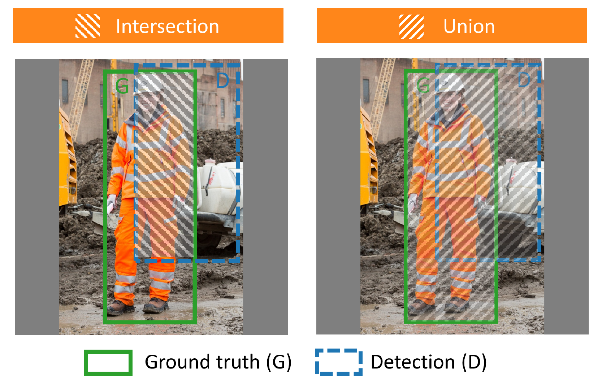

   Giao (Intersection) và hợp (Union) của box nhãn thật G (viền liền) và box dự đoán D (viền đứt) trên ảnh công trường thật. Nguồn: [T2 CHV tr.10, Figure 7]

1.2. TP, FP, FN (Bộ ba phân loại kết quả)
-----------------------------------------

Dựa trên ngưỡng IoU cho trước (:math:`\text{IoU}_{th}`, ví dụ 0.5), mỗi phát hiện của mô hình được xếp vào một trong các trường hợp:

- **TP (True Positive - Đoán đúng)**: Mô hình phát hiện ra vật thể, gán đúng lớp đối tượng và có :math:`\text{IoU} \ge \text{IoU}_{th}` so với nhãn thật. Trường hợp có nhiều box dự đoán cùng trùng một nhãn thật, chỉ box có confidence score cao nhất được tính là TP, các box còn lại bị tính là FP để tránh gian lận số lượng.
- **FP (False Positive - Báo nhầm / Báo động giả)**: Mô hình báo có vật thể nhưng thực tế không có, dự đoán sai nhãn lớp, hoặc box có vị trí lệch quá nhiều (:math:`\text{IoU} < \text{IoU}_{th}`).
- **FN (False Negative - Bỏ sót)**: Có vật thể thật tồn tại trong ảnh nhưng mô hình hoàn toàn không tìm ra, hoặc độ tin cậy của box thấp hơn ngưỡng lọc tối thiểu nên bị loại bỏ.
- **Lưu ý về TN (True Negative)**: Trong Object Detection, TN tương ứng với các vùng nền được xác định đúng là không chứa vật thể. Do số lượng vùng nền trống trong một bức ảnh là vô số, TN không được đưa vào bất kỳ công thức tính độ đo nào.

Bảng tóm tắt phân loại và ý nghĩa trong bài toán giám sát đồ bảo hộ (PPE):

.. list-table::
   :header-rows: 1
   :widths: 20 22 30 28

   * - Ký hiệu
     - Tên gọi
     - Tình huống thực tế trên ảnh
     - Ý nghĩa trong giám sát an toàn
   * - **TP**
     - Dương tính thật (Đúng)
     - Dự đoán có trang bị bảo hộ, đúng lớp và :math:`\text{IoU} \ge \text{IoU}_{th}`
     - Phát hiện chính xác công nhân tuân thủ trang bị an toàn
   * - **FP**
     - Báo động giả (Đoán nhầm)
     - Dự đoán có trang bị nhưng thực tế không có, hoặc box lệch vị trí (:math:`\text{IoU} < \text{IoU}_{th}`)
     - Gây phiền toái vì báo sai người không vi phạm
   * - **FN**
     - Bỏ sót vi phạm
     - Thực tế có vi phạm hoặc trang bị nhưng mô hình không phát hiện ra
     - Nguy hiểm: để lọt vi phạm an toàn tại công trường

1.3. Precision (Độ chuẩn xác)
-----------------------------

Precision đo lường tỷ lệ các phát hiện của mô hình là chính xác thật sự:

.. math::

   \text{Precision} = \frac{\text{TP}}{\text{TP} + \text{FP}}

- **Ý nghĩa**: Trong số tất cả các box mà mô hình đưa ra, có bao nhiêu phần trăm là đúng.
- **Tác động thực tế**: Precision cao đồng nghĩa với việc hệ thống rất ít khi báo động giả. Trong hệ thống giám sát đồ bảo hộ PPE, Precision cao giúp công nhân không bị nhắc nhở phiền phức vì những lỗi không có thật.

.. _fig-precision:

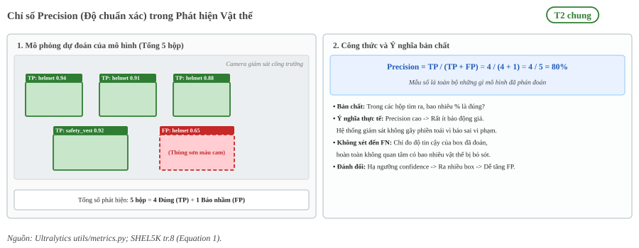

   Mô phỏng cơ chế tính Precision và ý nghĩa hạn chế báo động giả trong giám sát an toàn.

1.4. Recall (Độ nhạy / Độ bao phủ)
----------------------------------

Recall đo lường tỷ lệ các vật thể thật ngoài đời được mô hình tìm thấy:

.. math::

   \text{Recall} = \frac{\text{TP}}{\text{TP} + \text{FN}}

- **Ý nghĩa**: Mô hình bắt được bao nhiêu phần trăm trên tổng số vật thể thật có trong ảnh.
- **Tác động thực tế**: Recall cao đồng nghĩa với việc hệ thống rất ít khi bỏ sót vi phạm. Trong an toàn lao động, Recall là chỉ số sống còn để ngăn chặn tình huống công nhân không đội mũ bảo hộ hay không mặc áo phản quang mà camera lại bỏ qua.

.. _fig-recall:

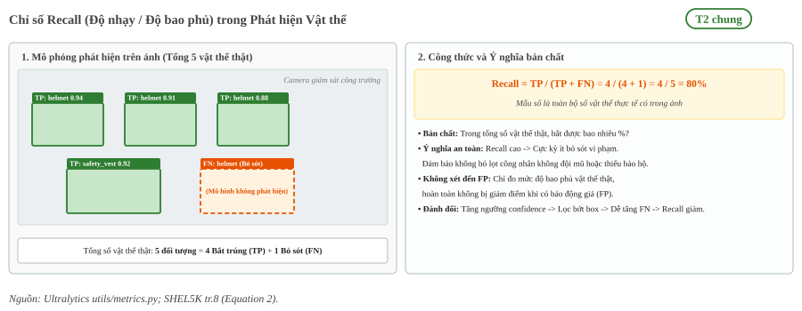

   Mô phỏng cơ chế tính Recall và ý nghĩa hạn chế bỏ sót đối tượng trong giám sát an toàn.

1.5. F1-Score và họ độ đo F-beta
--------------------------------

F1-Score là trung bình điều hòa (Harmonic Mean) giữa Precision và Recall:

.. math::

   \text{F1-Score} = 2 \times \frac{\text{Precision} \times \text{Recall}}{\text{Precision} + \text{Recall}}

Nguồn gốc tên gọi và họ độ đo F-beta tổng quát
~~~~~~~~~~~~~~~~~~~~~~~~~~~~~~~~~~~~~~~~~~~~~~

Tên gọi **F1** xuất phát từ việc chỉ số này là một trường hợp đặc biệt với tham số :math:`\beta = 1` của họ độ đo tổng quát **F-beta Score** (:math:`F_\beta`):

.. math::

   F_\beta = (1 + \beta^2) \times \frac{\text{Precision} \times \text{Recall}}{(\beta^2 \times \text{Precision}) + \text{Recall}}

Tham số :math:`\beta` đóng vai trò là trọng số điều chỉnh mức độ ưu tiên giữa Recall và Precision tùy theo đặc thù của bài toán thực tế:

- **Khi** :math:`\beta = 1` (**F1-Score**): Precision và Recall có trọng số ngang nhau, phù hợp cho bài toán đánh giá năng lực cân bằng tổng quát.
- **Khi** :math:`\beta = 2` (**F2-Score**): Recall được tính trọng số gấp đôi Precision. Thước đo này đặc biệt phù hợp cho các bài toán an toàn lao động PPE, y tế hoặc cứu hộ, nơi việc bỏ sót đối tượng vi phạm hoặc sự cố nguy hiểm hơn nhiều so với việc báo nhầm.
- **Khi** :math:`\beta = 0.5` (**F0.5-Score**): Precision được tính trọng số gấp đôi Recall, thường áp dụng cho các hệ thống kiểm duyệt giao dịch hoặc nhận diện sinh trắc học để triệt tiêu tối đa rủi ro báo nhầm.

Cơ chế tự phạt của trung bình điều hòa
~~~~~~~~~~~~~~~~~~~~~~~~~~~~~~~~~~~~~~

Tại sao F1-Score bắt buộc phải dùng trung bình điều hòa thay vì trung bình cộng thông thường?

- **Trung bình cộng che giấu khiếm khuyết**: Nếu một mô hình dự đoán bừa bãi ra khắp ảnh để đạt Recall = 0.95 nhưng Precision sụt xuống chỉ còn 0.15, trung bình cộng số học vẫn đạt 55.0%, gây ảo tưởng rằng mô hình hoạt động ở mức khá.
- **Trung bình điều hòa có cơ chế tự phạt**: Do mẫu số bị chi phối bởi tích số, F1-Score luôn bị kéo mạnh về phía chỉ số có giá trị thấp hơn. Trong kịch bản lệch lệch trên, F1-Score bị phạt nặng và tụt dốc xuống chỉ còn 25.9%. F1-Score chỉ có thể đạt điểm số cao khi cả Precision và Recall cùng đồng thời ở mức tốt.

.. _fig-f1-score:

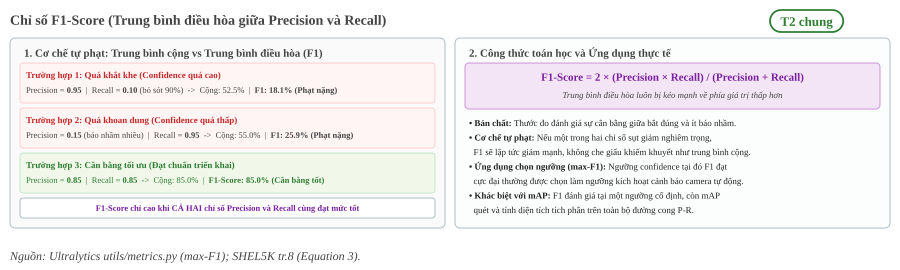

   Cơ chế tự phạt của trung bình điều hòa trong F1-Score và ứng dụng tìm điểm cân bằng tối ưu.

Đường cong F1-Confidence và ứng dụng max-F1 trong triển khai Edge AI
~~~~~~~~~~~~~~~~~~~~~~~~~~~~~~~~~~~~~~~~~~~~~~~~~~~~~~~~~~~~~~~~~~~~~

Trong thực tế huấn luyện các mô hình Object Detection (như YOLOv8, YOLO11), F1-Score không phải là một con số tĩnh mà biến thiên liên tục theo từng mức ngưỡng tin cậy (Confidence Threshold):

- Khi trượt ngưỡng tin cậy từ 0.0 lên 1.0, Precision tăng dần còn Recall giảm dần.
- Đồ thị biểu diễn biến thiên của F1-Score theo ngưỡng được gọi là **F1-Confidence Curve**. Điểm đỉnh cao nhất trên đường cong này được gọi là **max-F1**.
- **Ý nghĩa thực chiến**: Tọa độ hoành độ của điểm max-F1 chính là ngưỡng tin cậy tối ưu (:math:`T^*`) để kỹ sư thiết lập tham số `conf_thres` khi nạp mô hình chạy suy luận thực tế trên NPU RK3588, giúp camera giám sát đạt sự cân bằng tối ưu giữa việc tránh báo nhầm và không bỏ sót.
- **Khác biệt với mAP**: F1-Score và max-F1 là thước đo đánh giá chất lượng tại một điểm ngưỡng vận hành cụ thể, trong khi mAP đo lường diện tích tích phân trên toàn bộ đường cong P-R để đánh giá năng lực tổng quát xuyên suốt mọi ngưỡng.

1.6. Average Precision (AP)
---------------------------

Khi duyệt danh sách các bounding box dự đoán được sắp xếp theo độ tin cậy (confidence score) giảm dần từ 1.0 về 0.0, đường cong Precision-Recall (P-R Curve) được hình thành:

- **Cơ chế răng cưa (Sawtooth)**: Mỗi khi gặp một box đoán đúng (TP), Recall tăng lên và điểm dịch sang phải. Ngược lại, mỗi khi gặp một box báo nhầm (FP), Precision bị kéo tụt xuống thẳng đứng. Do đó, đường cong P-R thực tế luôn có dạng răng cưa nhấp nhô.
- **Nội suy cực đại (Interpolated Precision)**: Để triệt tiêu các vết sụt giảm răng cưa cục bộ và đảm bảo đường cong là một hàm giảm đơn điệu, các chuẩn đánh giá (PASCAL VOC, MS COCO) sử dụng phép nội suy cực đại:

.. math::

   p_{\text{interp}}(r) = \max_{\tilde{r} \ge r} p(\tilde{r})

Tại mỗi mốc Recall :math:`r`, giá trị Precision nội suy được lấy bằng giá trị Precision lớn nhất tìm thấy ở bên phải mốc đó.

- **Chuẩn tính diện tích COCO (101 mốc)**: AP là diện tích tích phân nằm dưới đường cong bậc thang nội suy. Chuẩn COCO hiện đại tính AP bằng trung bình cộng giá trị Precision nội suy tại 101 mốc Recall cách đều nhau (:math:`r \in \{0.00, 0.01, 0.02, \dots, 1.00\}`):

.. math::

   \text{AP} = \frac{1}{101} \sum_{r \in \{0.00, 0.01, \dots, 1.00\}} p_{\text{interp}}(r)

.. _fig-pr-curve-ap:

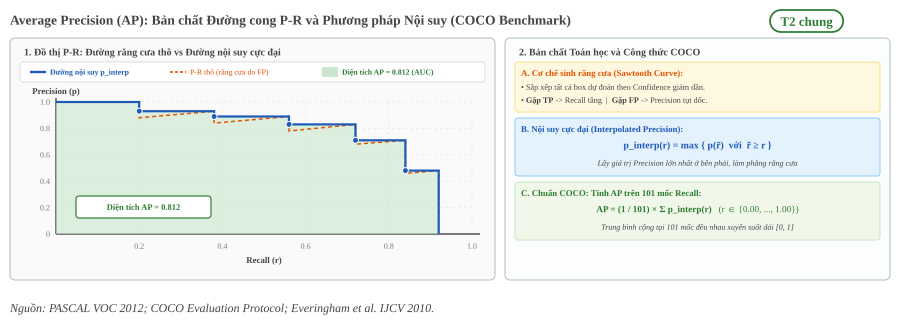

   Bản chất răng cưa của đường cong P-R, cơ chế nội suy cực đại và diện tích AP chuẩn COCO.

.. _fig-pr-curve-chv-thuc-te:

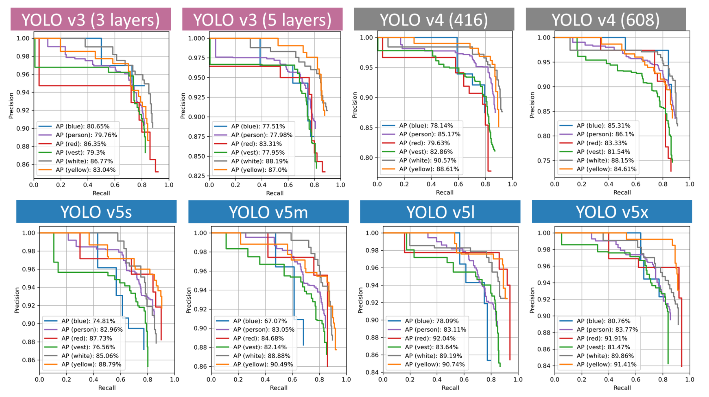

   Đường cong Precision × Recall thực tế của tám mô hình YOLO, mỗi màu là một lớp theo chú giải gốc (blue, person, red, vest, white, yellow). Đây là kết quả của bài CHV trên tập dữ liệu riêng của bài, không phải kết quả của dự án. Nguồn: [T2 CHV tr.11, Figure 8]

1.7. Mean Average Precision (mAP)
---------------------------------

mAP là trung bình cộng chỉ số AP của toàn bộ :math:`C` lớp đối tượng trong tập dữ liệu:

.. math::

   \text{mAP} = \frac{1}{C} \sum_{i=1}^{C} \text{AP}_i

Chỉ số này phản ánh năng lực tổng thể của mô hình trên toàn bộ không gian nhãn, ngăn ngừa tình trạng mô hình đạt điểm xuất sắc ở lớp phổ biến nhưng tê liệt ở các lớp hiếm.

.. _fig-map-classes:

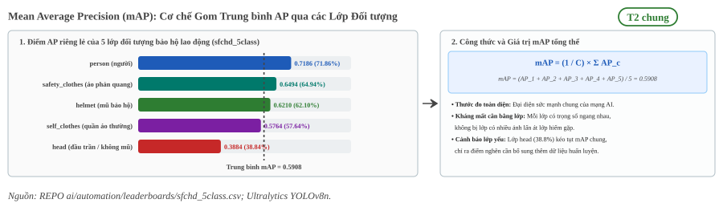

   Cơ chế tính Mean Average Precision (mAP) bằng trung bình cộng AP của các lớp đối tượng.

So sánh mAP@0.50 và mAP@0.50:0.95
~~~~~~~~~~~~~~~~~~~~~~~~~~~~~~~~~

Trong phát hiện vật thể, hai chuẩn đánh giá mAP phổ biến nhất gồm:

- **mAP@0.5 (hoặc mAP50)**: Kế thừa từ bộ chuẩn PASCAL VOC. Chỉ số này tính toán tại ngưỡng IoU cố định là 0.50. Đây là tiêu chí tương đối khoan dung, chỉ cần khung dự đoán trùng khớp tối thiểu 50% diện tích với nhãn thực tế là được tính là True Positive. mAP50 đánh giá tốt khả năng nhận diện và phân loại, nhưng không phản ánh mức độ khít khao của tọa độ hộp biên.
- **mAP@0.50:0.95 (hoặc mAP50-95)**: Chuẩn đánh giá chính thức của COCO Benchmark, đồng thời là thước đo chuẩn mực cho các dòng mô hình hiện đại (như YOLOv8, YOLOv11). Chỉ số này lấy trung bình cộng mAP qua 10 mốc IoU cách đều nhau từ 0.50 đến 0.95 với bước nhảy 0.05:

.. math::

   \text{mAP@[0.50:0.95]} = \frac{1}{10} \sum_{k=0}^{9} \text{mAP}_{\text{IoU} = 0.50 + 0.05k}

Tiêu chuẩn COCO phạt rất nặng các mô hình định vị biên lỏng lẻo, tạo ra thước đo toàn diện cả về khả năng nhận dạng lớp lẫn chất lượng hồi quy tọa độ.

.. _fig-map50-vs-95:

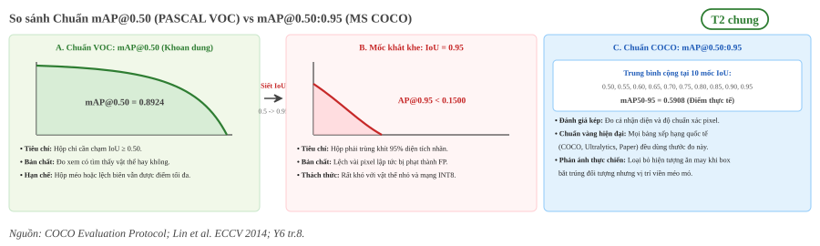

   So sánh cơ chế giữa mAP@0.50 (khoan dung) và mAP@0.50:0.95 (10 mốc IoU khắt khe chuẩn COCO).

Độ nhạy IoU của vật thể nhỏ trong mAP50-95
~~~~~~~~~~~~~~~~~~~~~~~~~~~~~~~~~~~~~~~~~~

Khi quan sát kết quả thực nghiệm trên các tập dữ liệu thực tế (như kiểm định đồ bảo hộ lao động PPE), giá trị mAP50-95 thường thấp hơn mAP50 từ 20% đến 40%. Hiện tượng này đặc biệt nghiêm trọng ở các lớp vật thể nhỏ do đặc tính hình học của phép tính IoU:

- **Đối với vật thể lớn (như Thân người, 200x400 pixel)**: Tọa độ viền chỉ lệch 8 đến 10 pixel do rung tay camera hay nhòe chuyển động vẫn giữ được IoU trên 0.85, do đó mô hình vẫn đạt điểm ở hầu hết các mốc IoU cao.
- **Đối với vật thể nhỏ (như Mũ, Găng tay, Giày bảo hộ, 30x30 pixel)**: Sai lệch định vị chỉ 3 đến 4 pixel đã làm diện tích giao nhau sụt giảm mạnh, khiến chỉ số IoU tụt xuống dưới 0.60. Do đó, các dự đoán này bị loại bỏ hoàn toàn tại các mốc IoU khắt khe từ 0.70 đến 0.95.

Độ sụt giảm do lượng tử hóa
~~~~~~~~~~~~~~~~~~~~~~~~~~~

Đối với quy trình triển khai mô hình lên bộ tăng tốc NPU, độ sụt giảm độ chính xác (:math:`\Delta\text{mAP}`) là chỉ số cốt lõi phản ánh sự đánh đổi giữa hiệu năng phần cứng và chất lượng mô hình:

.. math::

   \Delta\text{mAP} = \text{mAP}_{\text{FP32}} - \text{mAP}_{\text{INT8}}

Chỉ số này phản ánh độ hao hụt chất lượng nhận diện sau khi ép kiểu trọng số và activation từ số thực dấu phẩy động 32-bit (FP32) sang số nguyên 8-bit (INT8) thông qua RKNN-Toolkit2.

.. _fig-delta-map-quantization:

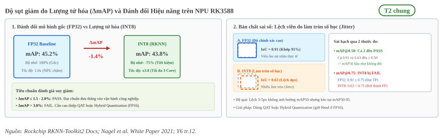

   Độ sụt giảm do lượng tử hóa (ΔmAP), ngưỡng kiểm định công nghiệp và bản chất rung lắc tọa độ hộp biên.

Cơ chế đánh đổi phần cứng và bản chất sai số
^^^^^^^^^^^^^^^^^^^^^^^^^^^^^^^^^^^^^^^^^^^^^^^^^^^^^^^^

1. **Lợi ích phần cứng**: Khi chuyển sang INT8, dung lượng mô hình giảm 75%, băng thông bộ nhớ DDR giảm mạnh và kích hoạt tối đa năng lực xử lý song song của 3 lõi NPU RK3588 (đạt đỉnh 6 TOPS).
2. **Bản chất sai số hình học (Quantization Jitter)**: Sai số làm tròn khi biểu diễn dải số thực liên tục bằng 256 mức nguyên (-128 đến 127) gây ra độ lệch nhẹ (3 đến 5 pixel) ở đầu ra hồi quy tọa độ bounding box.
3. **Phân hóa theo ngưỡng IoU**:
   - Đối với mAP@0.50: Độ lệch vài pixel hiếm khi kéo IoU xuống dưới 0.50, do đó :math:`\Delta\text{mAP@0.50}` thường rất nhỏ (dưới 0.5%).
   - Đối với mAP@0.50:0.95: Độ lệch này khiến hộp dự đoán trượt khỏi các mốc IoU cao (0.75 đến 0.95), dẫn đến :math:`\Delta\text{mAP@0.50:0.95}` sụt giảm rõ rệt.
4. **Tiêu chuẩn kiểm định thực tế**:
   - :math:`\Delta\text{mAP} \le 1.5\% - 2.0\%`: Đạt chuẩn (PASS). Mô hình sau nén đạt trạng thái tối ưu, đưa thẳng vào khai thác camera biên.
   - :math:`\Delta\text{mAP} > 3.0\%`: Cần áp dụng kỹ thuật Lượng tử hóa có nhận thức (QAT - Quantization-Aware Training) hoặc Lượng tử hóa lai (Hybrid Quantization) để giữ các lớp nhạy cảm ở kiểu dữ liệu FP16.

.. _12-nhom-hardware-performance:

2. Nhóm hiệu năng phần cứng (Efficiency / Hardware Metrics)
===========================================================

Đối với bài toán Edge AI chạy trên chip Rockchip RK3588S (hoặc RK3588), một mô hình có mAP cao nhưng chạy quá chậm hoặc tràn RAM thì không thể ứng dụng được. Nhóm chỉ số này được quy định chi tiết tại :doc:`/contents/02-phuong-phap/02-giao-thuc/02-bon-nhom-metric`.

2.1. Thông số mô hình (Parameters / Params)
-------------------------------------------

Parameters là tổng số lượng trọng số có thể học được (learnable weights và biases) của toàn bộ các tầng trong mạng nơ-ron sau khi đã fuse các lớp Convolution và Batch Normalization:

.. math::

   \text{Params}_{\text{Conv}} = (K \times K \times C_{\text{in}}) \times C_{\text{out}} + C_{\text{out}}

Trong đó :math:`K` là kích thước kernel (ví dụ :math:`3 \times 3`), :math:`C_{\text{in}}` là số kênh đầu vào, và :math:`C_{\text{out}}` là số kênh đầu ra.

.. _fig-parameters-params:

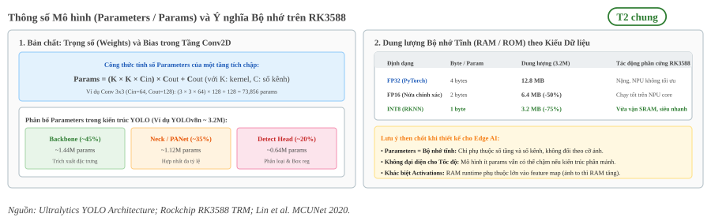

   Cấu thành Parameters trong tầng tích chập và dung lượng bộ nhớ tĩnh (RAM/ROM) trên SoC RK3588.

Ý nghĩa thực tiễn trên Edge AI
~~~~~~~~~~~~~~~~~~~~~~~~~~~~~~

- **Bộ nhớ tĩnh (Static Footprint)**: Parameters quyết định dung lượng file lưu trên ROM/eMMC và lượng RAM cần nạp khi khởi động. Với mô hình YOLOv8n (3.2M tham số), việc lượng tử hóa INT8 (1 byte/param) đưa dung lượng về 3.2 MB, lọt trọn vào bộ nhớ đệm SRAM/Cache của SoC RK3588.
- **Tính độc lập**: Parameters là giá trị bất biến, không phụ thuộc vào kích thước ảnh đầu vào. Tuy nhiên, ít tham số chưa chắc đã suy luận nhanh nếu đồ thị tính toán bị phân mảnh nhiều nhánh rẽ nhỏ lẻ.

2.2. Bộ nhớ động (Activations)
------------------------------

Activations là toàn bộ các tensor bản đồ đặc trưng (feature maps) trung gian được sinh ra ở đầu ra của các tầng mạng sau hàm kích hoạt (như ReLU, SiLU) trong suốt quá trình suy luận lan truyền tiến (forward pass).

Kích thước của một tensor Activation tại một tầng tích chập được xác định bởi:

.. math::

   \text{Kích thước Activation} = B \times C \times H \times W

Trong đó :math:`B` là kích thước batch (thường bằng 1 trên camera biên), :math:`C` là số kênh đặc trưng, :math:`H` và :math:`W` là chiều cao và chiều rộng không gian của feature map.

.. _fig-activations-vs-parameters:

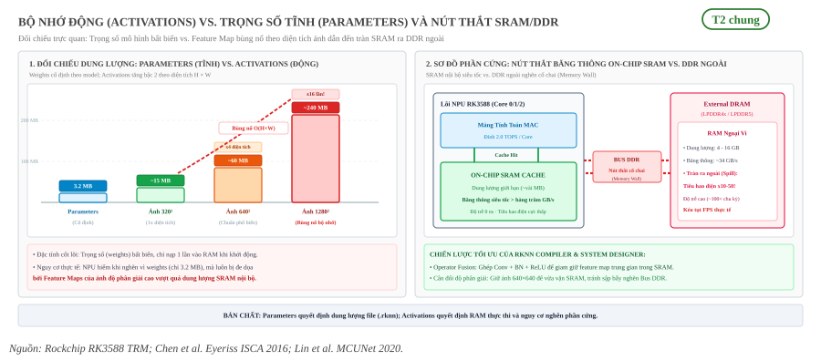

   So sánh Parameters (bộ nhớ tĩnh) với Activations (bộ nhớ động) và cơ chế tràn bộ nhớ SRAM trên SoC RK3588.

Nút thắt bộ nhớ SRAM và giải pháp Compiler
~~~~~~~~~~~~~~~~~~~~~~~~~~~~~~~~~~~~~~~~~~

- **Sự bùng nổ theo kích thước ảnh**: Khác với Parameters, Activations biến thiên theo diện tích ảnh (:math:`H \times W`). Ở các tầng đầu tiên, kích thước không gian lớn khiến dung lượng của riêng một tầng activation có thể vượt xa toàn bộ trọng số của mô hình (ví dụ ảnh 1280×1280 đẩy đỉnh activation lên tới 240 MB).
- **Hiện tượng tràn bộ nhớ (Spill-to-DRAM)**: Khi activation vượt quá dung lượng SRAM nội bộ của lõi NPU, dữ liệu bị đẩy ra DDR ngoài qua bus hệ thống, tiêu tốn năng lượng gấp 10 đến 50 lần và kéo tụt FPS thực tế (Memory Wall).
- **Tối ưu hóa RKNN Compiler**: Trình biên dịch RKNN áp dụng cơ chế Hợp nhất toán tử (Operator Fusion) và Cắt lớp (Layer Tiling) để chia nhỏ feature map thành các khối vừa vặn với SRAM, triệt tiêu tối đa chi phí đọc ghi DDR ngoài.

2.3. Khối lượng tính toán (FLOPs, GFLOPs và MACs)
-------------------------------------------------

Để đánh giá khối lượng công việc thuật toán độc lập với phần cứng chạy, các chỉ số đo đếm số lượng phép toán số học bao gồm:

Bản chất FLOPs và GFLOPs
~~~~~~~~~~~~~~~~~~~~~~~~

- **FLOPs (Floating-Point Operations)**:
  Tổng số lượng phép tính dấu phẩy động (cộng, trừ, nhân, chia số thực) mà mô hình cần thực hiện để xử lý xong một khung hình. Trong một tầng tích chập Conv2D chuẩn, số lượng phép tính được xác định theo công thức:

  .. math::

     \text{FLOPs}_{\text{Conv}} = 2 \times K \times K \times C_{\text{in}} \times H_{\text{out}} \times W_{\text{out}} \times C_{\text{out}}

- **GFLOPs (Giga Floating-Point Operations)**:
  Đơn vị quy chuẩn trong các bài báo khoa học và công cụ đo đạc thực tế (như Ultralytics, torchinfo). Vì một mô hình thị giác máy tính thường thực hiện hàng tỷ phép tính cho một ảnh 640×640, đơn vị hiển thị được chuẩn hóa về Giga (:math:`10^9` phép tính):

  .. math::

     1\text{ GFLOPs} = 10^9\text{ FLOPs} = 1{,}000{,}000{,}000\text{ phép tính}

  Ví dụ, mô hình YOLOv8n tiêu tốn khoảng 8.7 GFLOPs cho một ảnh kích thước chuẩn 640×640.

Quy đổi giữa FLOPs và MACs
~~~~~~~~~~~~~~~~~~~~~~~~~~

- **MACs (Multiply-Accumulate operations)**:
  Một phép nhân cộng tích lũy có dạng :math:`a \times b + c`. Một phép MAC bao gồm 1 phép nhân và 1 phép cộng, tương đương với 2 FLOPs. Quy tắc quy đổi chuẩn mực quốc tế:

  .. math::

     \text{MACs} = \frac{\text{FLOPs}}{2} \quad \Longleftrightarrow \quad \text{FLOPs} = 2 \times \text{MACs}

- **Model Size**:
  Dung lượng file mô hình thực tế lưu trữ trên ổ cứng (file `.onnx` ở định dạng FP32 và file `.rknn` sau khi nén lượng tử sang INT8 hoặc FP16).

2.4. Độ trễ 4 chặng (Latency)
--------------------------------------------------------------------------------

Thời gian trễ (latency) khi xử lý một bức ảnh từ camera biên không chỉ đơn thuần là lúc NPU tính toán, mà được cấu thành từ 4 chặng nối tiếp nhau xuyên suốt các khối phần cứng trong SoC:

.. math::

   \text{Latency}_{\text{E2E}} = T_{\text{pre}} + T_{\text{npu}} + T_{\text{post}}

.. _fig-latency-4-stages:

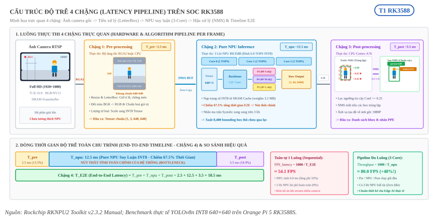

   Cấu trúc độ trễ 4 chặng: Phân tách luồng xử lý thực tế giữa CPU, RGA và NPU 3-Core kèm đường thời gian End-to-End.

Bản chất 4 chặng suy luận trên RK3588
~~~~~~~~~~~~~~~~~~~~~~~~~~~~~~~~~~~~~

- **Chặng 1: Pre-processing** (Tiền xử lý, :math:`T_{\text{pre}} \approx 2.5\text{ ms}`):
  Thao tác biến đổi ảnh thô thành tensor chuẩn cho mô hình: Resize cạnh dài, đệm viền xám giữ nguyên tỉ lệ (LetterBox 640×640), chuyển đổi hệ màu BGR sang RGB, và chuẩn hóa/lượng tử hóa sang INT8. Thường do CPU hoặc khối gia tốc đồ họa phần cứng **RGA2 (2D Raster Graphic Acceleration)** đảm nhiệm để giải phóng tải cho CPU. Dữ liệu sau đó được chuyển giao sang NPU qua cơ chế **DMA-BUF (Zero-Copy)** nhằm triệt tiêu độ trễ sao chép bộ nhớ.
- **Chặng 2: Pure NPU inference** (Suy luận thuần túy trên NPU, :math:`T_{\text{npu}} \approx 12.5\text{ ms}`):
  Thời gian NPU nhận input tensor từ bộ nhớ đệm SRAM/DRAM, nạp trọng số mô hình INT8, thực hiện toàn bộ các phép tích chập trên mảng tính toán MAC cores (3 lõi NPU RK3588 đạt đỉnh lý thuyết 6.0 TOPS), và trả ra output tensor thô. Đây là nút thắt tính toán chính của hệ thống, chiếm khoảng 65 - 70% tổng thời gian trễ của một khung hình.
- **Chặng 3: Post-processing** (Hậu xử lý, :math:`T_{\text{post}} \approx 3.5\text{ ms}`):
  Thời gian CPU Cortex-A76 tiếp nhận output tensor thô từ NPU, giải mã tọa độ hộp bao và điểm tin cậy các lớp (Class Scores), áp dụng ngưỡng lọc tự tin (:math:`\ge 0.25`), chạy thuật toán Non-Maximum Suppression (NMS, ngưỡng IoU 0.45) để triệt tiêu các box trùng lặp, và ánh xạ ngược tọa độ từ 640×640 về độ phân giải ảnh gốc (1080P).
- **Chặng 4: End-to-End Latency** (E2E - Độ trễ toàn chu trình, :math:`T_{\text{E2E}} \approx 18.5\text{ ms}`):
  Tổng thời gian hoàn tất chu kỳ xử lý từ lúc nhận ảnh thô đến khi xuất ra danh sách tọa độ vật thể cuối cùng: :math:`T_{\text{E2E}} = 2.5 + 12.5 + 3.5 = 18.5\text{ ms}`.

2.5. Tốc độ khung hình (FPS)
----------------------------

Trong hệ thống nhúng, có hai khái niệm FPS hoàn toàn khác nhau cần phân biệt rõ:

- **FPS_latency**: Tốc độ khung hình suy ra từ độ trễ toàn chu trình của một ảnh khi thực thi tuần tự trên một luồng đơn (Single-thread Sequential Processing):

  .. math::

     \text{FPS}_{\text{latency}} = \frac{1000}{\text{Latency}_{\text{E2E}} \text{ (ms)}} = \frac{1000}{T_{\text{pre}} + T_{\text{npu}} + T_{\text{post}}}

- **Throughput FPS (Thông lượng thực tế)**: Tốc độ xử lý khung hình trên giây của toàn bộ đường ống (Pipeline) khi áp dụng kỹ thuật chạy đa luồng bất đồng bộ (Multi-threading Pipeline) và phân bổ tải trên cả 3 lõi NPU (Core Mask ``0b111`` của RK3588):

  .. math::

     \text{Throughput FPS} = \frac{1000}{\max(T_{\text{pre}}, T_{\text{npu}}, T_{\text{post}})} = \frac{1000}{T_{\text{bottleneck}}}

.. _fig-fps-latency-vs-throughput:

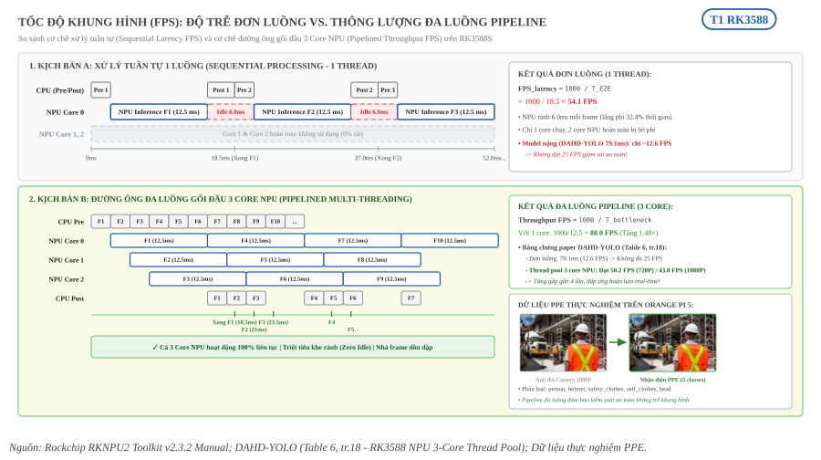

   So sánh cơ chế tốc độ khung hình (FPS): Độ trễ đơn luồng (:math:`\text{FPS}_{\text{latency}}`) đối chiếu với đường ống gối đầu 3 Core NPU (:math:`\text{Throughput FPS}`) kèm dữ liệu kiểm chứng PPE thực tế.

Bản chất đối chiếu giữa Latency FPS và Throughput FPS
~~~~~~~~~~~~~~~~~~~~~~~~~~~~~~~~~~~~~~~~~~~~~~~~~~~~~

- **Hạn chế của mô hình đơn luồng tuần tự**:
  Khi một khung hình chạy qua lần lượt Tiền xử lý (CPU) :math:`\to` NPU suy luận :math:`\to` Hậu xử lý (CPU), NPU chỉ hoạt động trong khoảng :math:`T_{\text{npu}}`. Trong toàn bộ thời gian CPU làm việc (:math:`T_{\text{pre}} + T_{\text{post}} \approx 6.0\text{ ms}`), phần cứng NPU bị bỏ rảnh rỗi (Idle), gây lãng phí tới 32.4% năng lực tính toán. Đồng thời, chỉ có 1 trong 3 lõi NPU được kích hoạt, 2 lõi còn lại không tải (0%). Với các mô hình lớn (như DAHD-YOLO có :math:`T_{\text{npu}} = 79.1\text{ ms}`), tốc độ đơn luồng chỉ đạt khoảng 12.6 FPS, không đáp ứng được ngưỡng giám sát thời gian thực chuẩn (25 FPS).
- **Ưu thế đột phá của đường ống đa luồng Pipeline**:
  Khi triển khai Thread Pool gối đầu kết hợp chia việc luân phiên trên 3 lõi NPU (Core 0, Core 1, Core 2), các công đoạn Pre-processing, NPU Inference và Post-processing diễn ra đồng thời cho các khung hình nối tiếp nhau (:math:`F_1, F_2, F_3\dots`). Cụm NPU luôn được duy trì 100% công suất hoạt động (Zero Idle). Tốc độ xuất khung hình không còn bị gò bó bởi tổng độ trễ :math:`T_{\text{E2E}}`, mà chỉ phụ thuộc vào thời gian của chặng nghẽn lớn nhất (:math:`T_{\text{npu}}`).
- **Bằng chứng thực nghiệm DAHD-YOLO trên RK3588**:
  Theo báo cáo thực tế trong bài báo DAHD-YOLO (*Table 6, tr. 18*), mô hình INT8 khi chạy đơn luồng 1 core chỉ đạt 0.1162 s/frame (:math:`\approx 8.6\text{ FPS}` tổng chu trình hoặc 12.6 FPS thuần suy luận 79.1 ms). Nhưng khi kích hoạt cơ chế Async Multi-thread trên 3 Core NPU RK3588, tốc độ Throughput thực tế đã vọt lên **50.2 FPS** ở độ phân giải 720P và **43.8 FPS** ở độ phân giải 1080P (tăng gần gấp 4 lần), đáp ứng hoàn hảo yêu cầu giám sát PPE công trường trực tiếp theo thời gian thực.

2.6. Bộ nhớ và tài nguyên phần cứng (Resource & Energy)
-------------------------------------------------------

- **RAM tiến trình (VmRSS)**: Dung lượng bộ nhớ RAM vật lý thực tế mà tiến trình suy luận chiếm dụng trong bộ nhớ hệ thống.
- **Bộ nhớ NPU (NPU Memory)**: Gồm bộ nhớ lưu trữ trọng số cố định (`weight_memory`) và bộ nhớ đệm động (`internal_memory` / SRAM) do driver NPU cấp phát để lưu trữ các tensor kích hoạt trung gian giữa các layer.
- **Tải CPU (CPU Utilization)**: Tỷ lệ phần trăm thời gian hoạt động của các lõi CPU Cortex-A76 và Cortex-A55 phục vụ cho tiền xử lý, hậu xử lý và điều phối dữ liệu cho NPU.
- **Phân bổ Layer (Layer Execution Breakdown)**: Kiểm tra danh sách từng layer trong mạng xem có chạy hoàn toàn trên NPU hay không. Nếu mô hình chứa toán tử lạ mà RKNN Toolkit chưa hỗ trợ, layer đó sẽ bị rớt ngược về CPU (CPU fallback), gây suy giảm tốc độ nghiêm trọng.
- **Nhiệt độ (Temperature)**: Nhiệt độ của cụm NPU đo từ cảm biến `npu-thermal`. Việc chạy tải nặng liên tục có thể đẩy nhiệt độ lên cao, kích hoạt cơ chế giảm xung tự động (thermal throttling) làm giảm FPS.

.. _13-bang-tong-hop-metrics:

3. Bảng tổng hợp các chỉ số đánh giá
====================================

.. list-table::
   :header-rows: 1
   :widths: 15 25 18 12 30

   * - Ký hiệu
     - Tên đầy đủ
     - Phân nhóm
     - Đơn vị
     - Ý nghĩa và mục đích
   * - IoU
     - Intersection over Union
     - AI Quality
     - [0, 1]
     - Đo độ trùng khớp không gian giữa box dự đoán và nhãn thật
   * - TP
     - True Positive
     - AI Quality
     - Số lượng
     - Dự đoán đúng vật thể, đúng lớp và IoU đạt ngưỡng
   * - FP
     - False Positive
     - AI Quality
     - Số lượng
     - Báo động giả (đoán sai lớp, lệch vị trí hoặc không có vật thể)
   * - FN
     - False Negative
     - AI Quality
     - Số lượng
     - Bỏ sót vật thể thật có trong ảnh
   * - Precision
     - Độ chuẩn xác
     - AI Quality
     - [0, 1]
     - Đo lường mức độ tin cậy, hạn chế cảnh báo nhầm (TP / (TP + FP))
   * - Recall
     - Độ nhạy / Bao phủ
     - AI Quality
     - [0, 1]
     - Đo lường tỷ lệ bắt trúng, hạn chế bỏ sót vi phạm (TP / (TP + FN))
   * - F1-Score
     - Điểm F1
     - AI Quality
     - [0, 1]
     - Trung bình điều hòa giữa Precision và Recall
   * - AP
     - Average Precision
     - AI Quality
     - [0, 1]
     - Diện tích dưới đường cong P-R của riêng từng lớp đối tượng
   * - mAP50
     - Mean AP @ 0.5
     - AI Quality
     - [0, 1]
     - Độ chính xác trung bình toàn bộ các lớp tại ngưỡng IoU 0.5
   * - mAP50-95
     - Mean AP @ 0.5:0.95
     - AI Quality
     - [0, 1]
     - Chuẩn COCO lấy trung bình qua 10 ngưỡng IoU (0.5 đến 0.95)
   * - ΔmAP
     - Độ sụt giảm mAP
     - AI Quality
     - [0, 1]
     - Mức suy hao độ chính xác khi lượng tử hóa từ FP32 xuống INT8
   * - Parameters
     - Số lượng tham số
     - Model Complexity
     - M (triệu)
     - Quy mô trọng số của mạng sau khi fuse Conv và BatchNorm
   * - GFLOPs / MACs
     - Khối lượng tính toán
     - Model Complexity
     - Tỷ phép tính
     - Khối lượng tính toán lý thuyết với ảnh đầu vào 640×640
   * - Model Size
     - Kích thước tệp
     - Model Complexity
     - MB
     - Dung lượng lưu trữ trên đĩa của file `.onnx` và file `.rknn`
   * - Pre Latency
     - Độ trễ tiền xử lý
     - Hardware
     - ms
     - Thời gian Resize, LetterBox, đổi định dạng màu trên CPU/RGA
   * - NPU Latency
     - Độ trễ NPU thuần
     - Hardware
     - ms
     - Thời gian chạy mạng nơ-ron thuần túy trên NPU RK3588S
   * - Post Latency
     - Độ trễ hậu xử lý
     - Hardware
     - ms
     - Thời gian lọc ngưỡng độ tin cậy, chạy NMS và ánh xạ box
   * - E2E Latency
     - Độ trễ toàn chu trình
     - Hardware
     - ms
     - Tổng thời gian hoàn tất từ ảnh thô đến tọa độ cuối cùng
   * - FPS_latency
     - FPS đơn khung hình
     - Hardware
     - FPS
     - Tốc độ quy đổi lý thuyết cho xử lý tuần tự (1000 / E2E)
   * - Throughput FPS
     - FPS thông lượng
     - Hardware
     - FPS
     - Tốc độ xử lý thực tế qua pipeline đa luồng 3 core NPU
   * - RAM (VmRSS)
     - Bộ nhớ RAM tiến trình
     - Resource
     - MB
     - Dung lượng RAM hệ thống thực tế bị tiến trình chiếm dụng
   * - NPU Memory
     - Bộ nhớ NPU
     - Resource
     - MB
     - Bộ nhớ cấp phát cho trọng số và bộ đệm trung gian của NPU
   * - CPU Load
     - Mức tải CPU
     - Resource
     - %
     - Tỷ lệ chiếm dụng CPU điều phối luồng dữ liệu
   * - Layer Breakdown
     - Phân bổ Layer
     - Resource
     - Số layer
     - Tỷ lệ layer thực thi trên NPU so với fallback về CPU
   * - Temperature
     - Nhiệt độ NPU
     - Resource
     - °C
     - Nhiệt độ chip đo tại thermal zone, kiểm soát hiện tượng giảm xung

.. _14-nguon-tham-khao:

4. Nguồn tham khảo
==================

- Công thức tính Precision, Recall, mAP trong bài toán PPE: :download:`_assets/pdf/papers/07_ppe_detection/shel5k_helmet_2022otgonbold.pdf <../../../_assets/pdf/papers/07_ppe_detection/shel5k_helmet_2022otgonbold.pdf>`, tr.8 (Equation 1-4).
- Hai hình thực tế ở mục 1.1 và 1.6 (CHV, Figure 7 và Figure 8): :download:`_assets/pdf/papers/07_ppe_detection/ppe_yolo_chv_2021wang.pdf <../../../_assets/pdf/papers/07_ppe_detection/ppe_yolo_chv_2021wang.pdf>`, tr.10 và tr.11. Hình cắt từ trang PDF, giữ nguyên nội dung, lưu ở ``_assets/img/01-kien-thuc-nen/01-nen-tang-ai/evaluation-metrics/``.
- Quy chuẩn nội suy 101 điểm cho AP và COCO mAP: `Ultralytics utils/metrics.py`, hàm `compute_ap`.
- Quy chuẩn đo đạc 4 nhóm metric của dự án trên RK3588: :doc:`/contents/02-phuong-phap/02-giao-thuc/02-bon-nhom-metric`.
- Đo lường và đối sánh Throughput FPS đa luồng trên RK3588: :download:`_assets/pdf/papers/05_rk3588/dahd_yolo_rk3588_2025.pdf <../../../_assets/pdf/papers/05_rk3588/dahd_yolo_rk3588_2025.pdf>`, tr.18 (Table 6).
- Chú giải thuật ngữ chi tiết: :doc:`/thuat-ngu`.
