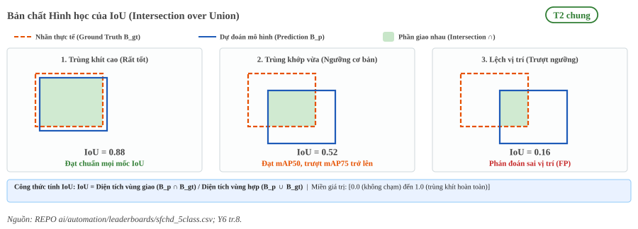
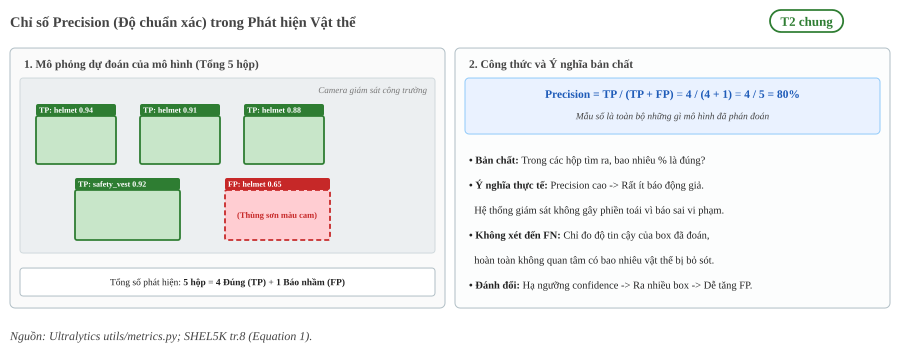
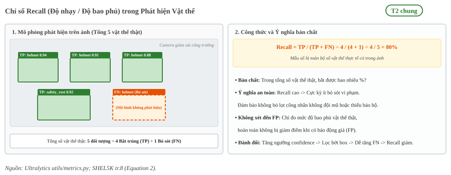
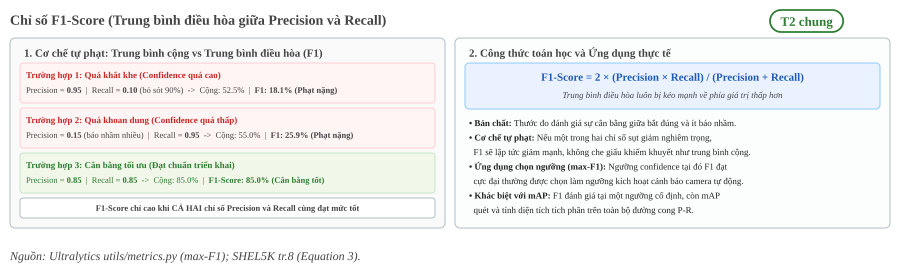
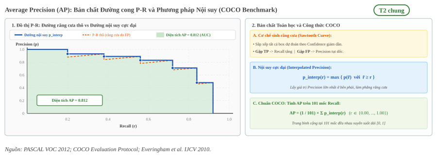
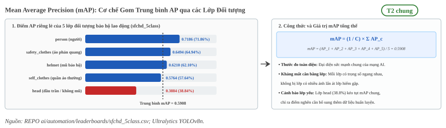
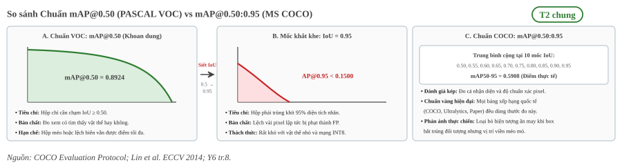

:tocdepth: 1

**************
Độ đo đánh giá
**************

.. admonition:: Trang này trả lời

   - Các độ đo cơ bản để đánh giá mô hình Object Detection gồm những gì?
   - Cách tính và ý nghĩa thực tế của IoU, Precision, Recall, F1-Score, AP và mAP?
   - Các độ đo phần cứng (tham số, MACs, độ trễ, FPS, bộ nhớ) được trình bày ở trang nào?

.. admonition:: Tóm tắt

   - Đánh giá mô hình Object Detection trên thiết bị biên luôn gồm 2 trụ cột chính: chất lượng phát hiện (AI Quality) và hiệu năng thực thi phần cứng (Hardware Performance).
   - AI Quality được xây dựng từ độ trùng khớp không gian (IoU), phân loại đúng sai (TP, FP, FN), cân bằng giữa bắt trúng và báo nhầm (Precision, Recall, F1), và tổng hợp qua diện tích đường cong P-R (AP, mAP50, mAP50-95).
   - Hardware Performance gồm khối lượng tính toán, bộ nhớ, độ trễ và FPS. Mỗi nhóm có trang chủ riêng, liệt kê ở mục 2.

.. contents:: Trong trang này
   :local:
   :depth: 2

1. Độ đo chất lượng
===================

Nhóm này đo lường mức độ thông minh và độ chính xác của mạng nơ-ron trong việc tìm kiếm và phân loại vật thể trong ảnh.

1.1 IoU
-------

IoU là tỉ lệ giữa diện tích phần giao nhau và diện tích phần hợp của bounding box do mô hình dự đoán (:math:`B_{pred}`) với box nhãn thật (:math:`B_{gt}`):

.. math::

   \text{IoU} = \frac{\text{Area}(B_{pred} \cap B_{gt})}{\text{Area}(B_{pred} \cup B_{gt})}

- **Khoảng giá trị**: Từ 0 đến 1. Giá trị bằng 1 khi hai hộp bao trùng khít hoàn toàn, và bằng 0 khi hai hộp bao không có điểm chung.
- **Vai trò cốt lõi**: IoU đóng vai trò là điều kiện tiên quyết trong Object Detection. Nếu IoU giữa box dự đoán và box nhãn thật vượt qua một ngưỡng quy định (thường lấy mốc 0.5), box dự đoán đó mới được xét duyệt tiếp xem có đoán đúng lớp hay không.

.. _fig-iou-geometry:

   Bản chất hình học của IoU và các mức độ trùng khớp bounding box.

.. _fig-iou-chv-vi-du-thuc-te:

.. figure:: ../../../_assets/img/01-kien-thuc-nen/01-nen-tang-ai/evaluation-metrics/chv-fig7-intersection-union-example.png
   :align: center
   :alt: Giao và hợp của box nhãn thật và box dự đoán trên ảnh công nhân công trường

   Giao (Intersection) và hợp (Union) của box nhãn thật G (viền liền) và box dự đoán D (viền đứt) trên ảnh công trường thật. Nguồn: [T2 CHV tr.10, Figure 7]

1.2 TP FP và FN
---------------

Dựa trên ngưỡng IoU cho trước (:math:`\text{IoU}_{th}`, ví dụ 0.5), mỗi phát hiện của mô hình được xếp vào một trong các trường hợp:

- **TP (True Positive - Đoán đúng)**: Mô hình phát hiện ra vật thể, gán đúng lớp đối tượng và có :math:`\text{IoU} \ge \text{IoU}_{th}` so với nhãn thật. Trường hợp có nhiều box dự đoán cùng trùng một nhãn thật, chỉ box có confidence score cao nhất được tính là TP, các box còn lại bị tính là FP để tránh gian lận số lượng.
- **FP (False Positive - Báo nhầm / Báo động giả)**: Mô hình báo có vật thể nhưng thực tế không có, dự đoán sai nhãn lớp, hoặc box có vị trí lệch quá nhiều (:math:`\text{IoU} < \text{IoU}_{th}`).
- **FN (False Negative - Bỏ sót)**: Có vật thể thật tồn tại trong ảnh nhưng mô hình hoàn toàn không tìm ra, hoặc độ tin cậy của box thấp hơn ngưỡng lọc tối thiểu nên bị loại bỏ.
- **Lưu ý về TN (True Negative)**: Trong Object Detection, TN tương ứng với các vùng nền được xác định đúng là không chứa vật thể. Do số lượng vùng nền trống trong một bức ảnh là vô số, TN không được đưa vào bất kỳ công thức tính độ đo nào.

Bảng tóm tắt phân loại và ý nghĩa trong bài toán giám sát đồ bảo hộ (PPE):

.. list-table::
   :header-rows: 1
   :widths: 20 22 30 28

   * - Ký hiệu
     - Tên gọi
     - Tình huống thực tế trên ảnh
     - Ý nghĩa trong giám sát an toàn
   * - **TP**
     - Dương tính thật (Đúng)
     - Dự đoán có trang bị bảo hộ, đúng lớp và :math:`\text{IoU} \ge \text{IoU}_{th}`
     - Phát hiện chính xác công nhân tuân thủ trang bị an toàn
   * - **FP**
     - Báo động giả (Đoán nhầm)
     - Dự đoán có trang bị nhưng thực tế không có, hoặc box lệch vị trí (:math:`\text{IoU} < \text{IoU}_{th}`)
     - Gây phiền toái vì báo sai người không vi phạm
   * - **FN**
     - Bỏ sót vi phạm
     - Thực tế có vi phạm hoặc trang bị nhưng mô hình không phát hiện ra
     - Nguy hiểm: để lọt vi phạm an toàn tại công trường

1.3 Precision
-------------

Precision đo lường tỷ lệ các phát hiện của mô hình là chính xác thật sự:

.. math::

   \text{Precision} = \frac{\text{TP}}{\text{TP} + \text{FP}}

- **Ý nghĩa**: Trong số tất cả các box mà mô hình đưa ra, có bao nhiêu phần trăm là đúng.
- **Tác động thực tế**: Precision cao đồng nghĩa với việc hệ thống rất ít khi báo động giả. Trong hệ thống giám sát đồ bảo hộ PPE, Precision cao giúp công nhân không bị nhắc nhở phiền phức vì những lỗi không có thật.

.. _fig-precision:

   Mô phỏng cơ chế tính Precision và ý nghĩa hạn chế báo động giả trong giám sát an toàn.

1.4 Recall
----------

Recall đo lường tỷ lệ các vật thể thật ngoài đời được mô hình tìm thấy:

.. math::

   \text{Recall} = \frac{\text{TP}}{\text{TP} + \text{FN}}

- **Ý nghĩa**: Mô hình bắt được bao nhiêu phần trăm trên tổng số vật thể thật có trong ảnh.
- **Tác động thực tế**: Recall cao đồng nghĩa với việc hệ thống rất ít khi bỏ sót vi phạm. Trong an toàn lao động, Recall là chỉ số sống còn để ngăn chặn tình huống công nhân không đội mũ bảo hộ hay không mặc áo phản quang mà camera lại bỏ qua.

.. _fig-recall:

   Mô phỏng cơ chế tính Recall và ý nghĩa hạn chế bỏ sót đối tượng trong giám sát an toàn.

1.5 F1 và F-beta
----------------

F1-Score là trung bình điều hòa (Harmonic Mean) giữa Precision và Recall:

.. math::

   \text{F1-Score} = 2 \times \frac{\text{Precision} \times \text{Recall}}{\text{Precision} + \text{Recall}}

Họ F-beta tổng quát
^^^^^^^^^^^^^^^^^^^

Tên gọi **F1** xuất phát từ việc chỉ số này là một trường hợp đặc biệt với tham số :math:`\beta = 1` của họ độ đo tổng quát **F-beta Score** (:math:`F_\beta`):

.. math::

   F_\beta = (1 + \beta^2) \times \frac{\text{Precision} \times \text{Recall}}{(\beta^2 \times \text{Precision}) + \text{Recall}}

Tham số :math:`\beta` đóng vai trò là trọng số điều chỉnh mức độ ưu tiên giữa Recall và Precision tùy theo đặc thù của bài toán thực tế:

- **Khi** :math:`\beta = 1` (**F1-Score**): Precision và Recall có trọng số ngang nhau, phù hợp cho bài toán đánh giá năng lực cân bằng tổng quát.
- **Khi** :math:`\beta = 2` (**F2-Score**): Recall được tính trọng số gấp đôi Precision. Thước đo này đặc biệt phù hợp cho các bài toán an toàn lao động PPE, y tế hoặc cứu hộ, nơi việc bỏ sót đối tượng vi phạm hoặc sự cố nguy hiểm hơn nhiều so với việc báo nhầm.
- **Khi** :math:`\beta = 0.5` (**F0.5-Score**): Precision được tính trọng số gấp đôi Recall, thường áp dụng cho các hệ thống kiểm duyệt giao dịch hoặc nhận diện sinh trắc học để triệt tiêu tối đa rủi ro báo nhầm.

Cơ chế tự phạt của trung bình điều hòa
^^^^^^^^^^^^^^^^^^^^^^^^^^^^^^^^^^^^^^

Tại sao F1-Score bắt buộc phải dùng trung bình điều hòa thay vì trung bình cộng thông thường?

- **Trung bình cộng che giấu khiếm khuyết**: Nếu một mô hình dự đoán bừa bãi ra khắp ảnh để đạt Recall = 0.95 nhưng Precision sụt xuống chỉ còn 0.15, trung bình cộng số học vẫn đạt 55.0%, gây ảo tưởng rằng mô hình hoạt động ở mức khá.
- **Trung bình điều hòa có cơ chế tự phạt**: Do mẫu số bị chi phối bởi tích số, F1-Score luôn bị kéo mạnh về phía chỉ số có giá trị thấp hơn. Trong kịch bản lệch lệch trên, F1-Score bị phạt nặng và tụt dốc xuống chỉ còn 25.9%. F1-Score chỉ có thể đạt điểm số cao khi cả Precision và Recall cùng đồng thời ở mức tốt.

.. _fig-f1-score:

   Cơ chế tự phạt của trung bình điều hòa trong F1-Score và ứng dụng tìm điểm cân bằng tối ưu.

Đường cong F1 theo confidence
^^^^^^^^^^^^^^^^^^^^^^^^^^^^^

Trong thực tế huấn luyện các mô hình Object Detection (như YOLOv8, YOLO11), F1-Score không phải là một con số tĩnh mà biến thiên liên tục theo từng mức ngưỡng tin cậy (Confidence Threshold):

- Khi trượt ngưỡng tin cậy từ 0.0 lên 1.0, Precision tăng dần còn Recall giảm dần.
- Đồ thị biểu diễn biến thiên của F1-Score theo ngưỡng được gọi là **F1-Confidence Curve**. Điểm đỉnh cao nhất trên đường cong này được gọi là **max-F1**.
- **Ý nghĩa thực chiến**: Tọa độ hoành độ của điểm max-F1 chính là ngưỡng tin cậy tối ưu (:math:`T^*`) để kỹ sư thiết lập tham số `conf_thres` khi nạp mô hình chạy suy luận thực tế trên NPU RK3588, giúp camera giám sát đạt sự cân bằng tối ưu giữa việc tránh báo nhầm và không bỏ sót.
- **Khác biệt với mAP**: F1-Score và max-F1 là thước đo đánh giá chất lượng tại một điểm ngưỡng vận hành cụ thể, trong khi mAP đo lường diện tích tích phân trên toàn bộ đường cong P-R để đánh giá năng lực tổng quát xuyên suốt mọi ngưỡng.

1.6 Average Precision
---------------------

Khi duyệt danh sách các bounding box dự đoán được sắp xếp theo độ tin cậy (confidence score) giảm dần từ 1.0 về 0.0, đường cong Precision-Recall (P-R Curve) được hình thành:

- **Cơ chế răng cưa (Sawtooth)**: Mỗi khi gặp một box đoán đúng (TP), Recall tăng lên và điểm dịch sang phải. Ngược lại, mỗi khi gặp một box báo nhầm (FP), Precision bị kéo tụt xuống thẳng đứng. Do đó, đường cong P-R thực tế luôn có dạng răng cưa nhấp nhô.
- **Nội suy cực đại (Interpolated Precision)**: Để triệt tiêu các vết sụt giảm răng cưa cục bộ và đảm bảo đường cong là một hàm giảm đơn điệu, các chuẩn đánh giá (PASCAL VOC, MS COCO) sử dụng phép nội suy cực đại:

.. math::

   p_{\text{interp}}(r) = \max_{\tilde{r} \ge r} p(\tilde{r})

Tại mỗi mốc Recall :math:`r`, giá trị Precision nội suy được lấy bằng giá trị Precision lớn nhất tìm thấy ở bên phải mốc đó.

- **Chuẩn tính diện tích COCO (101 mốc)**: AP là diện tích tích phân nằm dưới đường cong bậc thang nội suy. Chuẩn COCO hiện đại tính AP bằng trung bình cộng giá trị Precision nội suy tại 101 mốc Recall cách đều nhau (:math:`r \in \{0.00, 0.01, 0.02, \dots, 1.00\}`):

.. math::

   \text{AP} = \frac{1}{101} \sum_{r \in \{0.00, 0.01, \dots, 1.00\}} p_{\text{interp}}(r)

.. _fig-pr-curve-ap:

   Bản chất răng cưa của đường cong P-R, cơ chế nội suy cực đại và diện tích AP chuẩn COCO.

.. _fig-pr-curve-chv-thuc-te:

.. figure:: ../../../_assets/img/01-kien-thuc-nen/01-nen-tang-ai/evaluation-metrics/chv-fig8-precision-recall-curves.png
   :align: center
   :alt: Đường cong Precision x Recall thực tế của tám mô hình YOLO trên tập dữ liệu của bài CHV

   Đường cong Precision × Recall thực tế của tám mô hình YOLO, mỗi màu là một lớp theo chú giải gốc (blue, person, red, vest, white, yellow). Đây là kết quả của bài CHV trên tập dữ liệu riêng của bài, không phải kết quả của dự án. Nguồn: [T2 CHV tr.11, Figure 8]

1.7 mAP
-------

mAP là trung bình cộng chỉ số AP của toàn bộ :math:`C` lớp đối tượng trong tập dữ liệu:

.. math::

   \text{mAP} = \frac{1}{C} \sum_{i=1}^{C} \text{AP}_i

Chỉ số này phản ánh năng lực tổng thể của mô hình trên toàn bộ không gian nhãn, ngăn ngừa tình trạng mô hình đạt điểm xuất sắc ở lớp phổ biến nhưng tê liệt ở các lớp hiếm.

.. _fig-map-classes:

   Cơ chế tính Mean Average Precision (mAP) bằng trung bình cộng AP của các lớp đối tượng.

mAP50 và mAP50-95
^^^^^^^^^^^^^^^^^

Trong phát hiện vật thể, hai chuẩn đánh giá mAP phổ biến nhất gồm:

- **mAP@0.5 (hoặc mAP50)**: Kế thừa từ bộ chuẩn PASCAL VOC. Chỉ số này tính toán tại ngưỡng IoU cố định là 0.50. Đây là tiêu chí tương đối khoan dung, chỉ cần khung dự đoán trùng khớp tối thiểu 50% diện tích với nhãn thực tế là được tính là True Positive. mAP50 đánh giá tốt khả năng nhận diện và phân loại, nhưng không phản ánh mức độ khít khao của tọa độ hộp biên.
- **mAP@0.50:0.95 (hoặc mAP50-95)**: Chuẩn đánh giá chính thức của COCO Benchmark, đồng thời là thước đo chuẩn mực cho các dòng mô hình hiện đại (như YOLOv8, YOLOv11). Chỉ số này lấy trung bình cộng mAP qua 10 mốc IoU cách đều nhau từ 0.50 đến 0.95 với bước nhảy 0.05:

.. math::

   \text{mAP@[0.50:0.95]} = \frac{1}{10} \sum_{k=0}^{9} \text{mAP}_{\text{IoU} = 0.50 + 0.05k}

Tiêu chuẩn COCO phạt rất nặng các mô hình định vị biên lỏng lẻo, tạo ra thước đo toàn diện cả về khả năng nhận dạng lớp lẫn chất lượng hồi quy tọa độ.

.. _fig-map50-vs-95:

   So sánh cơ chế giữa mAP@0.50 (khoan dung) và mAP@0.50:0.95 (10 mốc IoU khắt khe chuẩn COCO).

Vật thể nhỏ trong mAP50-95
^^^^^^^^^^^^^^^^^^^^^^^^^^

Khi quan sát kết quả thực nghiệm trên các tập dữ liệu thực tế (như kiểm định đồ bảo hộ lao động PPE), giá trị mAP50-95 thường thấp hơn mAP50 từ 20% đến 40%. Hiện tượng này đặc biệt nghiêm trọng ở các lớp vật thể nhỏ do đặc tính hình học của phép tính IoU:

- **Đối với vật thể lớn (như Thân người, 200x400 pixel)**: Tọa độ viền chỉ lệch 8 đến 10 pixel do rung tay camera hay nhòe chuyển động vẫn giữ được IoU trên 0.85, do đó mô hình vẫn đạt điểm ở hầu hết các mốc IoU cao.
- **Đối với vật thể nhỏ (như Mũ, Găng tay, Giày bảo hộ, 30x30 pixel)**: Sai lệch định vị chỉ 3 đến 4 pixel đã làm diện tích giao nhau sụt giảm mạnh, khiến chỉ số IoU tụt xuống dưới 0.60. Do đó, các dự đoán này bị loại bỏ hoàn toàn tại các mốc IoU khắt khe từ 0.70 đến 0.95.

Độ sụt giảm do lượng tử hóa
^^^^^^^^^^^^^^^^^^^^^^^^^^^

Độ sụt giảm độ chính xác khi lượng tử hóa là hiệu mAP giữa bản FP32 và bản INT8:

.. math::

   \Delta\text{mAP} = \text{mAP}_{\text{FP32}} - \text{mAP}_{\text{INT8}}

Nguồn gốc sai số và vì sao detector nhạy với lượng tử hóa nằm ở :doc:`../03-luong-tu-hoa/03-phan-tich-sai-so-va-dac-thu-yolo`.

2. Độ đo phần cứng
==================

Một mô hình có mAP cao nhưng chạy quá chậm hoặc vượt bộ nhớ của thiết bị thì chưa dùng được. Mỗi độ đo phần cứng có một trang chủ:

.. list-table::
   :header-rows: 1
   :widths: 45 55

   * - Độ đo
     - Trang chủ
   * - Số tham số, MACs, FLOPs
     - :doc:`03-convolution-va-cnn` mục 4
   * - Bộ nhớ activation và bộ nhớ trọng số
     - :doc:`../05-bo-nho-hieu-nang/02-thiet-ke-nhan-thuc-bo-nho` mục 1
   * - Độ trễ bốn chặng, FPS, tài nguyên cần theo dõi
     - :doc:`../05-bo-nho-hieu-nang/01-do-do-tre-va-profiling` mục 1

3. Bảng tổng hợp
================

.. list-table::
   :header-rows: 1
   :widths: 15 25 18 12 30

   * - Ký hiệu
     - Tên đầy đủ
     - Phân nhóm
     - Đơn vị
     - Ý nghĩa và mục đích
   * - IoU
     - Intersection over Union
     - AI Quality
     - [0, 1]
     - Đo độ trùng khớp không gian giữa box dự đoán và nhãn thật
   * - TP
     - True Positive
     - AI Quality
     - Số lượng
     - Dự đoán đúng vật thể, đúng lớp và IoU đạt ngưỡng
   * - FP
     - False Positive
     - AI Quality
     - Số lượng
     - Báo động giả (đoán sai lớp, lệch vị trí hoặc không có vật thể)
   * - FN
     - False Negative
     - AI Quality
     - Số lượng
     - Bỏ sót vật thể thật có trong ảnh
   * - Precision
     - Độ chuẩn xác
     - AI Quality
     - [0, 1]
     - Đo lường mức độ tin cậy, hạn chế cảnh báo nhầm (TP / (TP + FP))
   * - Recall
     - Độ nhạy / Bao phủ
     - AI Quality
     - [0, 1]
     - Đo lường tỷ lệ bắt trúng, hạn chế bỏ sót vi phạm (TP / (TP + FN))
   * - F1-Score
     - Điểm F1
     - AI Quality
     - [0, 1]
     - Trung bình điều hòa giữa Precision và Recall
   * - AP
     - Average Precision
     - AI Quality
     - [0, 1]
     - Diện tích dưới đường cong P-R của riêng từng lớp đối tượng
   * - mAP50
     - Mean AP @ 0.5
     - AI Quality
     - [0, 1]
     - Độ chính xác trung bình toàn bộ các lớp tại ngưỡng IoU 0.5
   * - mAP50-95
     - Mean AP @ 0.5:0.95
     - AI Quality
     - [0, 1]
     - Chuẩn COCO lấy trung bình qua 10 ngưỡng IoU (0.5 đến 0.95)
   * - ΔmAP
     - Độ sụt giảm mAP
     - AI Quality
     - [0, 1]
     - Mức suy hao độ chính xác khi lượng tử hóa từ FP32 xuống INT8

Nguồn
=====

- Công thức tính Precision, Recall, mAP trong bài toán PPE: :download:`_assets/pdf/papers/07_ppe_detection/shel5k_helmet_2022otgonbold.pdf <../../../_assets/pdf/papers/07_ppe_detection/shel5k_helmet_2022otgonbold.pdf>`, tr.8 (Equation 1-4).
- Hai hình thực tế ở mục 1.1 và 1.6 (CHV, Figure 7 và Figure 8): :download:`_assets/pdf/papers/07_ppe_detection/ppe_yolo_chv_2021wang.pdf <../../../_assets/pdf/papers/07_ppe_detection/ppe_yolo_chv_2021wang.pdf>`, tr.10 và tr.11. Hình cắt từ trang PDF, giữ nguyên nội dung, lưu ở ``_assets/img/01-kien-thuc-nen/01-nen-tang-ai/evaluation-metrics/``.
- Quy chuẩn nội suy 101 điểm cho AP và COCO mAP: `Ultralytics utils/metrics.py`, hàm `compute_ap`.
- Chú giải thuật ngữ chi tiết: :doc:`/thuat-ngu`.
