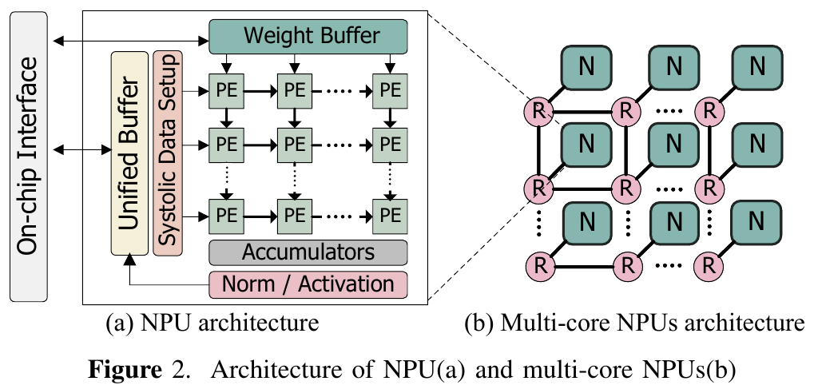
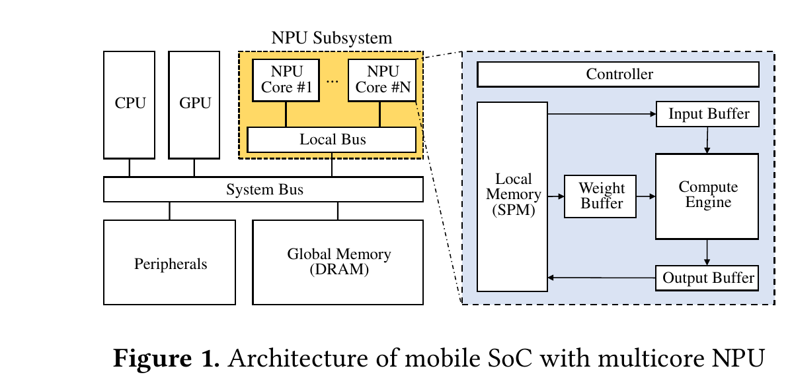
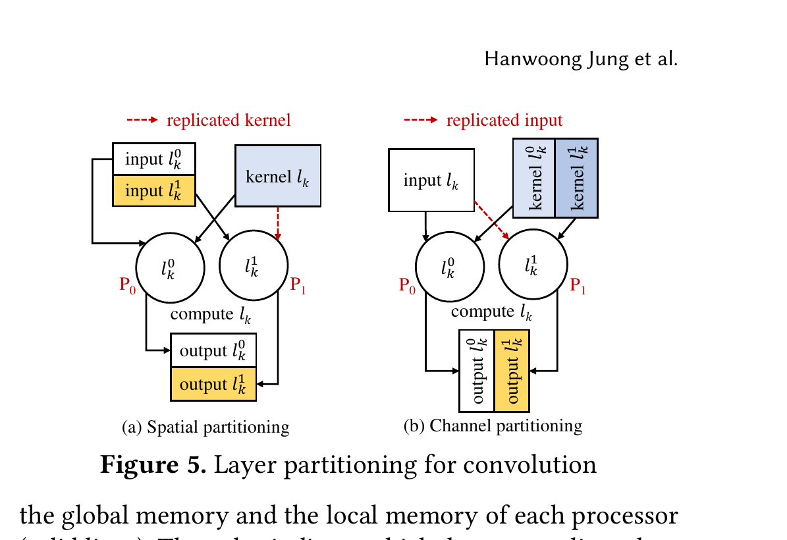

:tocdepth: 1

******************************************
Systolic array, sparsity và NPU nhiều core
******************************************

.. admonition:: Trang này trả lời

   - Mảng systolic là gì, dữ liệu chảy qua mảng thế nào và có quan hệ gì với dataflow weight stationary?
   - Bỏ qua phép nhân với 0 giúp được bao nhiêu và cần phần cứng gì?
   - Khi có nhiều NPU core thì chia việc thế nào, và cái giá là gì?

.. admonition:: Tóm tắt

   - Matrix unit của TPU dùng systolic execution để giảm số lần đọc và ghi Unified Buffer, vì đọc SRAM lớn tốn điện hơn phép tính số học [T2 Jouppi 2017 tr.4].
   - "Systolic" nói về cách dữ liệu chảy qua mảng, còn "stationary" nói về dữ liệu nào nằm yên. Hai khái niệm dùng chung được: Eyeriss mô tả weight stationary chạy như một mảng systolic [T2 Chen 2016 tr.7].
   - Tính lại cho TPU (suy ra): một tile trọng số 64 KiB đọc từ DRAM ở 34 GB/s mất khoảng 1349 chu kỳ 700 MHz, trùng với ridge point 1350 của roofline [T2 Jouppi 2017 tr.3] [T2 Jouppi 2017 tr.5] [T2 Jouppi 2017 tr.6].
   - Số 0 có thể bỏ qua: Cnvlutin tránh phép nhân khi activation bằng 0, mà theo paper TPU điều này xảy ra 44% thời gian và cải thiện trung bình 1.4 lần [T2 Jouppi 2017 tr.14]. TPU thì không hỗ trợ sparsity [T2 Jouppi 2017 tr.3].
   - Chia một lớp cho nhiều core theo chiều không gian hoặc chiều kênh. Mỗi cách phải nhân bản một loại dữ liệu khác nhau [T2 Jung 2023 tr.4].
   - Với suy luận một ảnh, chia batch không giúp độ trễ và pipeline giữa các core không hợp vì quá ít core [T2 Jung 2023 tr.2].
   - Các bài về nhiều core dùng ba mô hình bộ nhớ khác nhau, nên không có một kiến trúc "multi-core NPU" duy nhất [T2 Jung 2023 tr.2] [T2 Min 2023 tr.2] [T2 Gao 2023 tr.2].

.. contents:: Trong trang này
   :local:
   :depth: 1

.. _npu-systolic:

1. Systolic array
=================

1.1 Dữ liệu chảy qua mảng thế nào
---------------------------------

Jouppi 2017 giải thích lý do chọn systolic execution cho matrix unit:

   "As reading a large SRAM uses much more power than arithmetic, the matrix unit uses systolic execution to save energy by reducing reads and writes of the Unified Buffer" [T2 Jouppi 2017 tr.4]

Cơ chế mô tả như sau. Dữ liệu từ các hướng khác nhau đến các ô của mảng theo nhịp đều đặn rồi được kết hợp:

   "It relies on data from different directions arriving at cells in an array at regular intervals where they are combined." [T2 Jouppi 2017 tr.4]

Dữ liệu đi vào từ bên trái, trọng số nạp từ phía trên. Một phép MAC 256 phần tử di chuyển qua ma trận như một mặt sóng chéo (diagonal wavefront). Trọng số được nạp trước và có hiệu lực cùng với mặt sóng đi tới, kèm dữ liệu đầu tiên của một khối mới [T2 Jouppi 2017 tr.4].

.. figure:: ../../../_assets/img/01-kien-thuc-nen/02-npu/systolic-array-va-kien-truc-da-loi/tpu-fig4-systolic-data-flow.png
   :align: center
   :alt: Dòng dữ liệu systolic của Matrix Multiply Unit

   Systolic data flow của Matrix Multiply Unit: dữ liệu chảy vào từ bên trái, partial sum chảy xuống các accumulator. Nguồn: [T2 Jouppi 2017 tr.4, Figure 4]

Paper nhấn mạnh phần mềm không phải biết đến cấu trúc systolic để chương trình chạy đúng, nhưng phải để ý độ trễ của khối này nếu muốn hiệu năng [T2 Jouppi 2017 tr.4].

Ví dụ số (suy ra, TPU, tính bằng script). Mỗi tile trọng số của matrix unit là 256x256 byte INT8, tức 65,536 byte (paper ghi 64 KiB) và mất 256 chu kỳ để đẩy vào mảng [T2 Jouppi 2017 tr.3]. Vậy đường nạp là 256 byte mỗi chu kỳ, khớp với các đường nội bộ rộng 256 byte của TPU [T2 Jouppi 2017 tr.3]. Một phép nhân ma trận với B hàng đầu vào mất B chu kỳ pipeline trên tile đó [T2 Jouppi 2017 tr.3]. Nếu tile phải đọc từ DRAM ở 34 GB/s (Table 2, [T2 Jouppi 2017 tr.5]) thì mất:

.. math::

   \frac{65{,}536\ \text{byte}}{34 \times 10^9\ \text{byte/s}} \times 700 \times 10^6\ \text{chu kỳ/s} \approx 1349\ \text{chu kỳ}

Mảng chỉ bận hết thời gian khi B xấp xỉ 1349 trở lên. Con số này trùng ridge point 1350 mà paper vẽ ở roofline [T2 Jouppi 2017 tr.6]. Nói cách khác, systolic array giải bài toán đưa dữ liệu vào mảng bên trong chip, còn bài toán đưa trọng số từ DRAM lên vẫn do băng thông quyết định (xem :doc:`02-dataflow-va-phan-cap-bo-nho`).

1.2 Ưu và nhược so với dataflow khác
------------------------------------

"Systolic" và "stationary" không đồng nghĩa. Systolic mô tả luồng dữ liệu qua mảng, stationary mô tả dữ liệu nào được giữ lại trong PE. Chen 2016 mô hình hóa weight stationary như sau:

   "Weight Stationary: Each PE holds a single weight in the RF at a time. The psum generated in a PE at each cycle is either passed to its neighbor PE or stored back to the global buffer, and the PE array operates as a systolic array with little local control." [T2 Chen 2016 tr.7]

Layer-Puzzle thì dùng mảng systolic với dataflow output stationary [T2 Gao 2023 tr.2]. Đoạn mô tả kiến trúc NPU của họ:

   "It mainly consists of a systolic array that completes the convolution computation, a weight buffer that stores the weight, a unified buffer that stores the input feature maps(ifmaps), and output feature maps(ofmaps)." [T2 Gao 2023 tr.2]

   Sơ đồ (a) NPU có systolic array, Unified Buffer và Weight Buffer, (b) nhiều NPU nối qua router (R). Nguồn: [T2 Gao 2023 tr.2, Figure 2]

Tổng hợp các điểm do nguồn nêu:

.. list-table::
   :header-rows: 1
   :widths: 16 44 40

   * - Mặt
     - Ưu
     - Nhược
   * - Năng lượng và điều khiển
     - Giảm đọc ghi bộ đệm lớn [T2 Jouppi 2017 tr.4]. Điều khiển đơn giản ("little local control") [T2 Chen 2016 tr.7]
     - Trọng số nạp theo từng tile nên phụ thuộc băng thông DRAM (ví dụ 1349 chu kỳ ở trên, suy ra)
   * - Hình dạng lớp
     - Một lớp conv ánh xạ kênh vào C và kênh ra M lên hàng và cột của mảng [T2 Jouppi 2017 tr.14]
     - Lớp ít kênh dùng không hết mảng, ví dụ CNN1 của TPU chỉ có khoảng một nửa MAC chứa trọng số hữu ích [T2 Jouppi 2017 tr.6]
   * - Độ linh hoạt
     - Rất phù hợp phép nhân ma trận dày và convolution
     - Chen 2016 nhấn mạnh dataflow phải hiệu quả với nhiều hình dạng lớp và phần cứng phải lập trình được để ánh xạ [T2 Chen 2016 tr.4]

Giới hạn: bảng này gộp từ hai paper, các số chỉ đo trên TPU. Không suy ra rằng NPU RK3588 dùng systolic array hay không từ trang này.

.. _npu-sparsity:

2. Sparsity và zero-skipping
============================

2.1 Nguồn của số 0 (ReLU, pruning)
----------------------------------

Số 0 trong tính toán có hai nguồn thường gặp. Thứ nhất là activation bằng 0 do hàm ReLU biến giá trị âm thành 0. Jouppi 2017 viết trong phần công trình liên quan rằng Cnvlutin tránh phép nhân khi activation bằng 0, và activation bằng 0 trong "44% of the time", "presumably in part due to ReLU nonlinear function that transforms negative values to zero" [T2 Jouppi 2017 tr.14]. Chữ "presumably" cho thấy đây là suy đoán của paper, không phải đo riêng. Thứ hai là trọng số bị cắt bỏ (pruning). Cùng đoạn đó nêu Efficient Inference Engine có bước đầu giảm số trọng số khoảng 10 lần bằng cách lọc các giá trị rất nhỏ, rồi dùng mã Huffman để nén thêm [T2 Jouppi 2017 tr.14].

Giới hạn: tỷ lệ 44% là số của Cnvlutin cho các mạng của họ, được trích lại trong paper TPU. Tỷ lệ số 0 của một mô hình YOLO cụ thể là unknown (không có trong các paper dùng ở trang này).

2.2 Bỏ qua phép tính nhân 0 cần phần cứng gì
--------------------------------------------

Chen 2016 nêu hai việc phần cứng làm:

   "The architecture can also exploit sparsity by (1) only performing data reads and MACs on non-zero values and (2) compressing the data to reduce data movement." [T2 Chen 2016 tr.7]

Paper TPU mô tả cách Eyeriss làm: mã hóa run-length để giảm dung lượng bộ nhớ và tiết kiệm điện bằng cách tránh phép tính khi đầu vào bằng 0 [T2 Jouppi 2017 tr.14]. Như vậy cần ít nhất ba thành phần: nhận biết giá trị 0, mạch bỏ qua đọc và MAC tương ứng, và định dạng nén cho dữ liệu. Chi tiết mạch cụ thể nằm ở tài liệu khác mà Chen 2016 chỉ trích dẫn (trong paper ghi "Details on these techniques are described in [41]", [T2 Chen 2016 tr.7]), nên cơ chế chi tiết là unknown ở trang này.

Ngược lại, TPU bỏ qua sparsity:

   "This unit is designed for dense matrices. Sparse architectural support was omitted for time-to-deploy reasons. Sparsity will have high priority in future designs." [T2 Jouppi 2017 tr.3]

Ví dụ số (suy ra): nếu một tỷ lệ z phép nhân có toán hạng bằng 0 và bỏ qua được trọn vẹn thì số MAC phải làm còn :math:`1 - z`, tốc độ tối đa tăng :math:`1 / (1 - z)` lần. Với z = 0.44 thì tối đa 1.79 lần. Paper TPU ghi Cnvlutin cải thiện trung bình 1.4 lần [T2 Jouppi 2017 tr.14], thấp hơn mức tối đa vì còn chi phí để phát hiện và xử lý số 0 (suy ra, paper không nêu lý do). Kết luận chắc chắn duy nhất: bỏ qua 0 chỉ giúp ích khi phần cứng được thiết kế cho nó và khi dữ liệu thật sự thưa.

2.3 RK3588 có hỗ trợ hay không
------------------------------

Trang kiến thức nền không kết luận về RK3588. Cơ chế bỏ qua số 0 của NPU RK3588 (nếu có) được mô tả ở trang phần cứng :doc:`../../02-nen-tang-rk3588/01-phan-cung-npu/02-vi-kien-truc-va-khoi-tinh-toan-core`. Không đồng nhất cơ chế đó với mô tả sparsity trong paper ở trên.

.. _npu-da-core:

3. NPU nhiều core
=================

Vì sao có nhiều core? Jung 2023 nêu: multicore NPU phù hợp khi chạy đồng thời nhiều DNN, khi xử lý các mạng cỡ khác nhau, và khi nhà sản xuất cần dòng sản phẩm với số core NPU khác nhau [T2 Jung 2023 tr.2]. Kiến trúc điển hình của họ là mỗi core có compute engine và bộ nhớ cục bộ riêng:

   "Multicore design consists of a compute engine and distributed, isolated local memory per core." [T2 Jung 2023 tr.2]

   SoC di động với NPU nhiều core (Core 1 đến N nối qua Local Bus, mỗi core có Controller, Local Memory (SPM), Input, Weight, Output Buffer và Compute Engine). Nguồn: [T2 Jung 2023 tr.2, Figure 1]

3.1 Chia việc theo layer
------------------------

Jung 2023 chọn chia một lớp thành các lớp con (sub-layer) chạy song song trên các core:

   "By partitioning a layer of DNNs into multiple sub-layers, we can execute them in parallel on multicore NPUs." [T2 Jung 2023 tr.1]

Với lớp convolution, hai hướng chia thông dụng là theo chiều không gian và theo chiều kênh [T2 Jung 2023 tr.4]:

   "In spatial direction partitioning (Figure 5 (a)), input and output tensors are partitioned in spatial directions, that means images are segmented in half along the height or width." [T2 Jung 2023 tr.4]

   "Channel direction partitioning (Figure 5 (b)) produces an output image partitioned along channels." [T2 Jung 2023 tr.4]

   Hai cách chia một lớp convolution cho hai core: (a) theo chiều không gian, (b) theo chiều kênh. Nguồn: [T2 Jung 2023 tr.4, Figure 5]

Hai cách này khác nhau ở dữ liệu phải nhân bản:

.. list-table::
   :header-rows: 1
   :widths: 18 26 26 30

   * - Hướng chia
     - Dữ liệu được chia
     - Dữ liệu nhân bản vào mọi core
     - Nguồn
   * - Không gian (spatial)
     - input, output
     - kernel (vì mỗi phần tử output cần toàn bộ kernel)
     - [T2 Jung 2023 tr.4]
   * - Kênh (channel)
     - kernel, output
     - input
     - [T2 Jung 2023 tr.4]

Paper còn nêu hai biến thể chia theo hướng khác của mỗi loại, đánh dấu "không ưu tiên" vì cần thêm bước cộng partial sum giữa các core [T2 Jung 2023 tr.4].

Ví dụ số (suy ra, tính bằng script): lớp CONV3 của AlexNet (C = 256, M = 384, R = 3, ifmap có đệm 15x15, ofmap 13x13, hình dạng từ [T2 Chen 2016 tr.4]) chia cho 3 core, dữ liệu INT8, bỏ qua dữ liệu halo ở biên. Kernel nặng 884,736 byte, input 57,600 byte. Tổng byte phải nạp vào bộ nhớ cục bộ của cả 3 core:

.. csv-table:: Dữ liệu nạp vào 3 core theo hướng chia (byte, INT8, không tính halo)
   :header-rows: 1
   :widths: 20 30 30 20

   Lớp,Chia không gian (3 x kernel + input),Chia kênh (kernel + 3 x input),Hướng nhân bản ít hơn
   CONV1,"259,131","498,609",không gian
   CONV2,"967,728","445,584",kênh
   CONV3,"2,711,808","1,057,536",kênh
   CONV4,"2,033,856","793,152",kênh
   CONV5,"1,370,304","571,968",kênh

Lớp có ảnh lớn và ít kênh như CONV1 hợp chia theo không gian, lớp nhiều kênh như CONV3 hợp chia theo kênh. Jung 2023 rút ra kết luận tương ứng từ thực nghiệm trên InceptionV3: chia theo một hướng cho mọi lớp không phù hợp để tận dụng tối đa các core [T2 Jung 2023 tr.9]. Họ cũng nêu thêm một ràng buộc không nằm trong bảng trên:

   "If the number of channels is too small to distribute evenly across the cores, core utilization can be degraded." [T2 Jung 2023 tr.9]

3.2 Chia việc theo dữ liệu và theo tác vụ
-----------------------------------------

Các kiểu song song hóa DNN gồm song song theo dữ liệu, theo toán tử (chia một lớp) và theo pipeline. Với suy luận trên thiết bị di động, Jung 2023 loại hai kiểu đầu và cuối:

   "As inference on mobile devices usually works on a single image input, data parallelism, which decomposes a large number of input data into small sets, will not suit well on multicore NPU inference." [T2 Jung 2023 tr.2]

   "we can easily conclude that pipelining across multiple NPU cores is inadequate on mobile devices." [T2 Jung 2023 tr.2]

Lý do thứ hai là thiết bị di động chỉ có vài core nên khó tạo pipeline nhiều tầng [T2 Jung 2023 tr.2]. Trong từng core vẫn có tiling kết hợp double buffering để gối đầu truy cập bộ nhớ toàn cục với tính toán [T2 Jung 2023 tr.4]. Flexer định nghĩa tiling là việc chia tính toán một lớp thành các phép nhỏ vì dữ liệu cả lớp quá lớn để đưa vào NPU một lần [T2 Min 2023 tr.2], rồi dùng list scheduling để xếp các tile lên mọi NPU:

   "Flexer employs a list scheduling algorithm to dynamically schedule the tiled workload to all NPUs." [T2 Min 2023 tr.1]

Khi nhiều DNN cùng chạy, Layer-Puzzle phân biệt hai cách chia sẻ tài nguyên: temporal-sharing (các DNN lần lượt chiếm toàn bộ phần cứng theo từng lớp) và spatial-sharing (mỗi DNN được cấp một phần cố định phần cứng) [T2 Gao 2023 tr.1]. Phần này khác với chế độ chạy của RK3588 (chạy độc lập hay cùng làm một job), xem :doc:`../../02-nen-tang-rk3588/01-phan-cung-npu/03-che-do-da-loi-va-system-sram`.

3.3 Chi phí đồng bộ và chia sẻ bộ nhớ
-------------------------------------

Chia lớp thành các phần song song kéo theo hai chi phí. Thứ nhất là đồng bộ: khi một lớp chia cho nhiều core, cuối lớp phải đồng bộ để dữ liệu đã ghi xong ra bộ nhớ toàn cục trước khi lớp sau đọc. Jung 2023 viết rằng đồng bộ thường làm giảm hiệu năng, và họ chấp nhận tính trùng lặp (redundant computation) để bỏ đồng bộ, gọi là stratum construction [T2 Jung 2023 tr.5]. Thứ hai là trao đổi dữ liệu ở biên: dữ liệu halo được trao đổi trực tiếp giữa các core bằng giao diện halo-exchange để tiết kiệm băng thông bus [T2 Jung 2023 tr.5].

Chi phí thứ ba là tắc nghẽn bộ nhớ dùng chung. Layer-Puzzle nhấn mạnh với nhiều NPU chạy song song, tắc nghẽn truyền dữ liệu trên NoC và DRAM cũng là một yếu tố đáng kể:

   "when multiple NPUs execute in parallel, the data transmission congestion on NoC and DRAM is also a considerable factor in system performance." [T2 Gao 2023 tr.2]

Ba nguồn dùng ba mô hình bộ nhớ khác nhau nên các kết luận không chuyển được cho nhau:

.. list-table::
   :header-rows: 1
   :widths: 18 52 30

   * - Bài
     - Mô hình bộ nhớ
     - Nguồn
   * - Jung 2023
     - Bộ nhớ cục bộ cô lập theo từng core, dữ liệu trung gian qua bộ nhớ toàn cục (DRAM), có thể trao đổi halo trực tiếp giữa các core
     - [T2 Jung 2023 tr.2] [T2 Jung 2023 tr.5]
   * - Min 2023 (Flexer)
     - Global Buffer là scratchpad dùng chung trên chip: "facilitates data reuse between cores and reduces the amount of data loaded from external memory"
     - [T2 Min 2023 tr.2]
   * - Gao 2023 (Layer-Puzzle)
     - Nhiều NPU nối qua router (NoC) và chia sẻ DRAM, có xét tắc nghẽn
     - [T2 Gao 2023 tr.2]

Kết quả của Jung 2023 để tham khảo thứ tự độ lớn: trên một SoC di động hàng đầu có ba core (Samsung Exynos 2100 [T2 Jung 2023 tr.9]), kỹ thuật của họ cải thiện hiệu năng 23% so với cách chia tốt nhất trước đó và đạt tốc độ 2.1 lần so với một core:

   "Compared to the highest-performing partitioning approach, our techniques improve performance by 23%, achieving a speedup of 2.1x over single-core systems." [T2 Jung 2023 tr.1]

Với ba core mà chỉ được 2.1 lần, tăng tốc không tuyến tính. Giới hạn: đây là kết quả trên NPU của Samsung (mỗi core dùng engine inner-product kiểu adder-tree, có yêu cầu alignment kênh riêng [T2 Jung 2023 tr.9]), không phải Rockchip. Cách RK3588 chia việc cho ba core xem trang phần cứng ở trên. Đừng suy ra RK3588 chia theo chiều không gian hay chiều kênh từ các bài này.

4. Hiểu sai thường gặp
======================

.. list-table::
   :header-rows: 1
   :widths: 26 52 22

   * - Hiểu sai
     - Thực tế theo nguồn
     - Nguồn
   * - Systolic array và weight stationary là một
     - Systolic là cách dữ liệu chảy qua mảng. Weight stationary là dataflow giữ trọng số. WS có thể chạy như systolic, Layer-Puzzle dùng systolic với output stationary
     - [T2 Chen 2016 tr.7] [T2 Gao 2023 tr.2]
   * - Mảng systolic lớn luôn chạy hết công suất
     - Lớp ít kênh dùng không hết mảng, và trọng số phải đọc từ DRAM nên phụ thuộc băng thông (suy ra ở mục 1.1)
     - [T2 Jouppi 2017 tr.6]
   * - Bỏ qua số 0 luôn tăng tốc
     - TPU bỏ hỗ trợ sparsity. Lợi ích tối đa bị chặn bởi tỷ lệ số 0 (suy ra 1.79 lần ở 44%) và Cnvlutin đạt trung bình 1.4 lần
     - [T2 Jouppi 2017 tr.3] [T2 Jouppi 2017 tr.14]
   * - Thêm core thì tốc độ tăng tuyến tính
     - Jung 2023 đạt 2.1 lần trên 3 core sau khi tối ưu chia việc và đồng bộ
     - [T2 Jung 2023 tr.1]
   * - Chia batch cho các core là cách chính
     - Với suy luận một ảnh trên di động, song song theo dữ liệu không hợp
     - [T2 Jung 2023 tr.2]
   * - Mọi NPU nhiều core có bộ nhớ giống nhau
     - Có ít nhất ba mô hình: bộ nhớ cục bộ cô lập, global buffer chung, NoC cùng DRAM
     - [T2 Jung 2023 tr.2] [T2 Min 2023 tr.2] [T2 Gao 2023 tr.2]

Nguồn
=====

Số trang là số trang PDF. Các con số "suy ra" (1349 chu kỳ, 1.79 lần, dữ liệu nạp theo hướng chia) do script tính từ số liệu trong paper.

.. list-table::
   :header-rows: 1
   :widths: 14 8 62 16

   * - Nhãn
     - Tier
     - Tệp
     - Số lần
   * - ``Chen 2016``
     - T2
     - :download:`eyeriss_dataflow_2016chen.pdf <../../../_assets/pdf/papers/01_hardware/eyeriss_dataflow_2016chen.pdf>`
     - 8
   * - ``Jouppi 2017``
     - T2
     - :download:`tpu_datacenter_2017jouppi.pdf <../../../_assets/pdf/papers/01_hardware/tpu_datacenter_2017jouppi.pdf>`
     - 27
   * - ``Jung 2023``
     - T2
     - :download:`mobile_multicore_npu_2023jung.pdf <../../../_assets/pdf/papers/01_hardware/mobile_multicore_npu_2023jung.pdf>`
     - 30
   * - ``Min 2023``
     - T2
     - :download:`flexer_multi_npu_2023min.pdf <../../../_assets/pdf/papers/01_hardware/flexer_multi_npu_2023min.pdf>`
     - 5
   * - ``Gao 2023``
     - T2
     - :download:`layer_puzzle_multicore_2023gao.pdf <../../../_assets/pdf/papers/01_hardware/layer_puzzle_multicore_2023gao.pdf>`
     - 9
