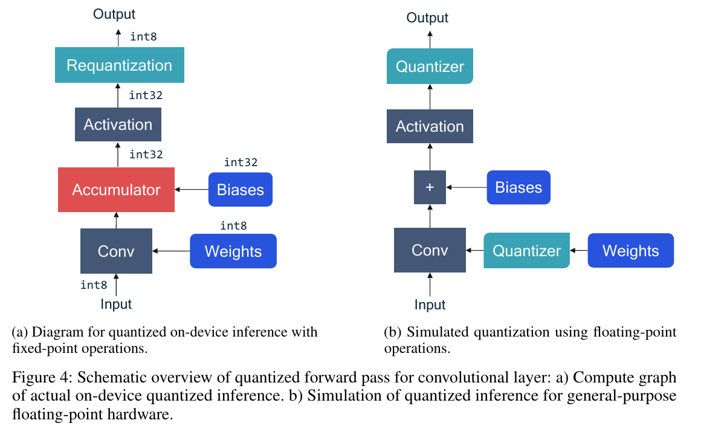
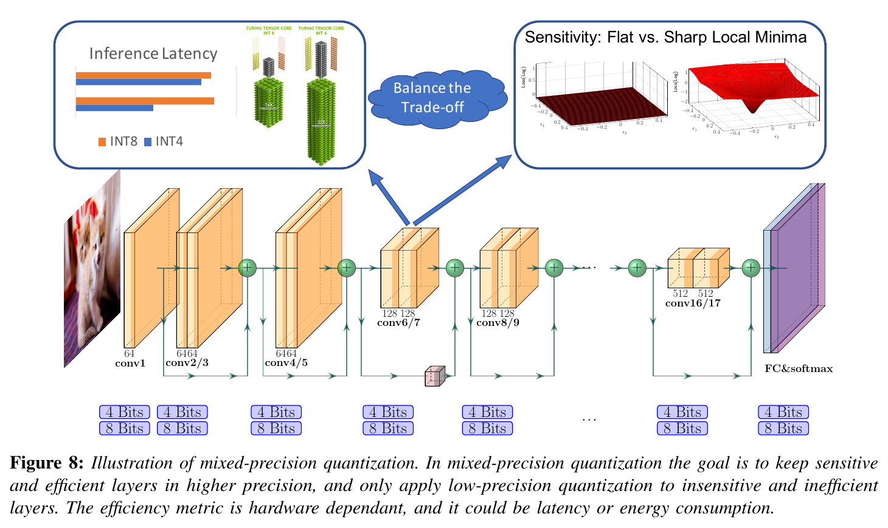

:tocdepth: 1

********************************************
Chiến lược lượng tử hóa: PTQ, QAT và hỗn hợp
********************************************

.. admonition:: Trang này trả lời

   - không train lại thì chọn scale và zero-point thế nào?
   - mô phỏng lượng tử hóa trong lúc train, và đạo hàm qua phép làm tròn thế nào?
   - có nên dùng nhiều mức bit trong cùng một model?

.. admonition:: Tóm tắt

   - Weight thường không cần calibration data còn activation thường cần vài batch, nhưng AdaRound là ngoại lệ dùng dữ liệu để tối ưu weight [T2 NAGEL tr.9] [T2 NAGEL tr.16].
   - Các cách chọn range gồm min-max, MSE, percentile và KL divergence, min-max nhạy với outlier [T2 NAGEL tr.9] [T2 GHOLAMI tr.6].
   - NAGEL khuyến nghị kinh nghiệm 500 đến 1000 ảnh calibration, QYOLO dùng 1500 ảnh COCO train2017, hai số này không phải quy tắc chung cho mọi model.
   - QAT cần train lại, cần dữ liệu có nhãn và thêm siêu tham số [T2 NAGEL tr.19]. STE xử lý việc đạo hàm của làm tròn bằng 0 hoặc không xác định.
   - Mixed-precision giữ lớp nhạy cảm ở độ chính xác cao hơn, nhưng QAREP là phản ví dụ: đặt hai lớp về float cho 51.3% so với 50.3% INT8 của RepVGG-A0 tái hiện.
   - Không PDF nào đo cấu hình mixed-precision trên mô hình detection, nên mục này là `unknown`.

.. contents:: Trong trang này
   :local:
   :depth: 1

.. _33-ptq-và-calibration-chọn-range:

PTQ và calibration (chọn range)
===============================

**Câu hỏi:** không train lại thì chọn scale và zero-point thế nào?

**Nguồn nói gì**

   "Post-training quantization (PTQ) algorithms take a pre-trained FP32 network and convert it directly into a fixed-point network without the need for the original training pipeline." [T2 NAGEL tr.8]

..

   "The process of choosing the clipping range is often referred to as calibration." [T2 GHOLAMI tr.5]

   "Weights can usually be quantized without any need for calibration data. However, determining parameters for activation quantization often requires a few batches of calibration data." [T2 NAGEL tr.9]

..

   "This leads to no clipping error. However, this approach is sensitive to outliers as strong outliers may cause excessive rounding errors." [T2 NAGEL tr.9]

   "we find qmin and qmax that minimize the MSE between the original and the quantized tensor" [T2 NAGEL tr.9]

..

   "One approach to address this is to use percentile instead of min/max of the signal" [T2 GHOLAMI tr.6]

   "Another approach is to select α and β to minimize KL divergence (i.e., information loss) between the real values and the quantized values" [T2 GHOLAMI tr.6]

..

   "Another quantization approach is static quantization, in which the clipping range is pre-calculated and static during inference. This approach does not add any computational overhead, but it typically results in lower accuracy as compared to dynamic quantization." [T2 GHOLAMI tr.6]

   "Usually, between 500 and 1000 unlabeled images are sufficient as a calibration set." [T2 NAGEL tr.16]

..

   "we recommend using symmetric quantizers for the weights and asymmetric quantizers for the activations." [T2 NAGEL tr.16]

|NAGEL Figure 8| *Hình 3.3. Pipeline PTQ chuẩn của NAGEL: CLE, thêm quantizer, weight range setting (MSE), AdaRound (nếu có dữ liệu) hoặc bias correction (nếu không), activation range setting (MSE). Nguồn: [T2 NAGEL tr.16, Figure 8]*

**Ý chính**

- Weight "usually" không cần dữ liệu calibration, activation "often requires a few batches of calibration data" (NAGEL tr.9). Ngoại lệ trong cùng nguồn: AdaRound dùng dữ liệu để tối ưu weight (NAGEL tr.16, Figure 8: "Use Data? Yes: AdaRound, No: Bias Correction"). Tổng hợp của file này: không viết "chỉ activation cần dữ liệu calibration" một cách tuyệt đối.
- Một số cách chọn range trong nguồn: min-max, MSE, percentile, KL divergence (NAGEL tr.9. GHOLAMI tr.6). NAGEL còn nêu cross-entropy và BN-based range setting (tr.10). Min-max nhạy với outlier.

**Giới hạn**

- Số ảnh calibration: NAGEL đưa ra khuyến nghị kinh nghiệm 500 đến 1000 ảnh cho pipeline PTQ chuẩn của bài (NAGEL tr.16). QYOLO dùng 1500 ảnh COCO train2017 làm điều kiện thí nghiệm (QYOLO tr.8). Hai con số này không phải quy tắc chung cho mọi model.
- QYOLO tr.4 mô tả MinMax là "chuẩn hóa về [-1, 1]", lệch với Eq. 6 của chính bài (QYOLO tr.6, ``l_x = min(x)``, ``u_x = max(x)``). Khi viết dùng NAGEL Eq. 14-15 (tr.9).

--------------

.. _34-qat-simulated-quantization-và-ste:

QAT, simulated quantization và STE
==================================

**Câu hỏi:** mô phỏng lượng tử hóa trong lúc train, và đạo hàm qua phép làm tròn thế nào?

**Nguồn nói gì**

   "we introduce quantizer blocks in the compute graph to induce quantization effects." [T2 NAGEL tr.6]

..

   "Both the input and output of the quantizer are in floating-point format but the output lies on the quantization grid." [T2 NAGEL tr.6]

   "QAT models the quantization noise source (see section 2.3) during training. This allows the model to find more optimal solutions than post-training quantization. However, the higher accuracy comes with the usual costs of neural network training, i.e., longer training times, need for labeled data and hyper-parameter search." [T2 NAGEL tr.19]

..

   "the gradient of the round-to-nearest operation in equation (4) is either zero or undefined everywhere, which makes gradient-based training impossible." [T2 NAGEL tr.19]

   "approximate the gradient using the straight-through estimator" [T2 NAGEL tr.19]

..

   "STE essentially ignores the rounding operation and approximates it with an identity function" [T2 GHOLAMI tr.9]

   "Despite the coarse approximation of STE, it often works well in practice, except for ultra low-precision quantization such as binary quantization" [T2 GHOLAMI tr.9]

|NAGEL Figure 4| *Hình 3.4a. (a) suy luận lượng tử hóa thật trên thiết bị: weight INT8, accumulator INT32, requantization sang INT8, (b) mô phỏng bằng phép tính float với các khối Quantizer. Nguồn: [T2 NAGEL tr.6, Figure 4]*

|GHOLAMI Figure 5| *Hình 3.4b. Quy trình QAT: forward qua bộ lượng tử hóa, backward dùng STE như hàm đồng nhất. Nguồn: [T2 GHOLAMI tr.9, Figure 5]*

**Ý chính**

- Mô phỏng (simulated quantization) thêm khối quantizer vào đồ thị tính toán nhưng giữ dữ liệu ở dạng float (NAGEL tr.6).
- QAT cần train lại, cần dữ liệu có nhãn và thêm siêu tham số (NAGEL tr.19). STE giải quyết việc đạo hàm của làm tròn bằng 0 hoặc không xác định.

**Giới hạn.** "Simulated quantization" được hai nguồn nhấn vào hai khía cạnh khác nhau: công cụ mô phỏng khi train và đánh giá trên phần cứng float (NAGEL tr.6), và một kiểu triển khai suy luận lưu tham số bit thấp nhưng tính bằng phép toán float (GHOLAMI tr.12). Khi viết nên nói rõ đang dùng khía cạnh nào.

--------------

.. _35-mixed-và-hybrid-precision:

Mixed và hybrid precision
=========================

**Câu hỏi:** có nên dùng nhiều mức bit trong cùng một model?

**Nguồn nói gì**

   "Different layers in a Neural Net have different impact on the loss function, and this motivates a mixed-precision approach to quantization." [T2 GHOLAMI tr.4]

..

   "One challenge with this approach is that the search space for choosing this bit setting is exponential in the number of layers." [T2 GHOLAMI tr.14]

   "Note that in this white paper we only consider homogeneous bit-width." [T2 NAGEL tr.8]

..

   "The input and output layers of the model are more sensitive to the loss of accuracy. In order to maintain the overall performance of the model, the original accuracy of these layers is usually retained. We also follow this practice." [T2 QYOLO tr.9]

   "Partial quantization results of RepVGG-A0 (w/ custom L2 ) in Table 2 is only 51.3%, after setting Layer 5 and 6 float." [T2 QAREP tr.4]

|GHOLAMI Figure 8| *Hình 3.5. Mixed-precision: mỗi lớp chọn 4 hoặc 8 bit, cân bằng giữa độ trễ và độ nhạy. Nguồn: [T2 GHOLAMI tr.13, Figure 8]*

**Ý chính.** Ý tưởng chung là giữ lớp nhạy cảm ở độ chính xác cao hơn (GHOLAMI tr.14). QYOLO giữ lớp đầu và cuối ở độ chính xác gốc, chỉ như một quy ước, không có thí nghiệm riêng (QYOLO tr.9). QAREP là một phản ví dụ: đặt hai lớp về float chưa cứu được độ chính xác của RepVGG (51.3% so với 50.3% INT8 của bản RepVGG-A0 tái hiện, QAREP Table 2 tr.4, bản RepVGG-A0 chính thức là 52.2%, Table 5 tr.6).

**Giới hạn.** Không PDF nào đo cấu hình mixed-precision trên mô hình detection. ``unknown``. Cách RKNN-Toolkit2 thực hiện hybrid quantization xem file ``04_``.

--------------

.. |NAGEL Figure 8| image:: ../../../_assets/img/npu/03_quantization_theory/nagel_fig8.png

.. |GHOLAMI Figure 5| image:: ../../../_assets/img/npu/03_quantization_theory/gholami_p9_fig5.png

Nguồn
=====

Các nhãn nguồn dùng trong trang này (tier, tệp, số lần trích).

.. list-table::
   :header-rows: 1
   :widths: 12 8 70 10

   * - Nhãn
     - Tier
     - Nguồn
     - Số lần
   * - ``NAGEL``
     - T2
     - :download:`quant_whitepaper_2021nagel.pdf <../../../_assets/pdf/papers/02_quantization/quant_whitepaper_2021nagel.pdf>`
     - 14
   * - ``GHOLAMI``
     - T2
     - :download:`quantization_survey_2021gholami.pdf <../../../_assets/pdf/papers/02_quantization/quantization_survey_2021gholami.pdf>`
     - 10
   * - ``QYOLO``
     - T2
     - :download:`qyolo_ptq_2023wang.pdf <../../../_assets/pdf/papers/02_quantization/qyolo_ptq_2023wang.pdf>`
     - 1
   * - ``QAREP``
     - T2
     - :download:`qarepvgg_quant_2024chu.pdf <../../../_assets/pdf/papers/08_npu_friendly_arch/qarepvgg_quant_2024chu.pdf>`
     - 1
