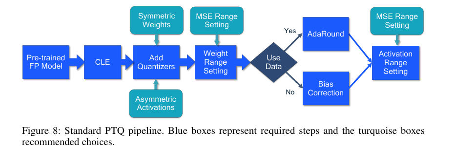
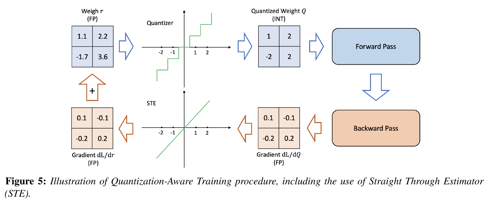
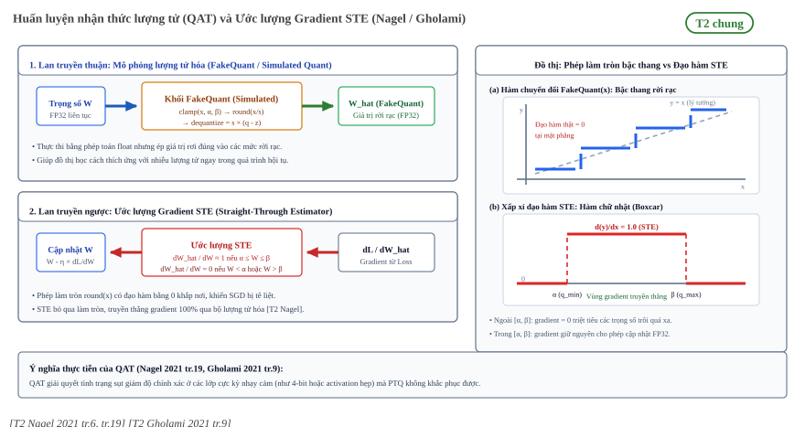

:tocdepth: 1

********************************************
Chiến lược lượng tử hóa: PTQ, QAT và hỗn hợp
********************************************

.. admonition:: Trang này trả lời

   - Không train lại thì chọn scale và zero-point thế nào (PTQ và calibration)?
   - QAT mô phỏng lượng tử hóa lúc train ra sao, và đạo hàm qua phép làm tròn xử lý thế nào?
   - Khi nào dùng nhiều mức bit trong một model, và khi nào nên chọn PTQ hay QAT?

.. admonition:: Tóm tắt

   - PTQ lấy mạng FP32 đã train và chuyển thẳng sang dấu phẩy tĩnh mà không cần quy trình train gốc [T2 Nagel 2021 tr.8].
   - Weight thường không cần dữ liệu calibration, activation thường cần vài batch. AdaRound là ngoại lệ vì dùng dữ liệu để tối ưu weight [T2 Nagel 2021 tr.9] [T2 Nagel 2021 tr.16].
   - Các cách chọn range gồm min-max, MSE, cross-entropy, dựa trên BN, percentile và KL divergence. Min-max nhạy với outlier [T2 Nagel 2021 tr.9] [T2 Gholami 2021 tr.6].
   - Nagel khuyến nghị 500 đến 1000 ảnh không nhãn làm tập calibration, Q-YOLO dùng 1500 ảnh COCO train2017. Hai số này là điều kiện thí nghiệm, không phải quy tắc chung [T2 Nagel 2021 tr.16] [T2 Wang 2023 tr.8].
   - QAT thêm khối quantizer vào đồ thị tính toán lúc train, cần dữ liệu có nhãn và thêm siêu tham số. STE xấp xỉ đạo hàm của làm tròn bằng 1 [T2 Nagel 2021 tr.19].
   - Mixed precision giữ lớp nhạy cảm ở độ chính xác cao hơn. Không nguồn nào đo cấu hình này trên detector, và chi phí chuyển kiểu giữa lớp là unknown.

.. contents:: Trong trang này
   :local:
   :depth: 1

1. PTQ và calibration
=====================

   "Post-training quantization (PTQ) algorithms take a pre-trained FP32 network and convert it directly into a fixed-point network without the need for the original training pipeline." [T2 Nagel 2021 tr.8]

Nagel nói PTQ không cần hoặc cần ít dữ liệu, ít chỉnh siêu tham số và không train đầu cuối, nên gần như dùng được qua một lời gọi API [T2 Nagel 2021 tr.9]. Bước nền tảng là tìm range cho từng quantizer, tức :math:`q_{min}` và :math:`q_{max}` trong công thức ở :doc:`01-luong-tu-hoa-affine-va-granularity`. Gholami gọi quá trình này là calibration [T2 Gholami 2021 tr.5].

1.1 Chọn range: min-max, percentile, entropy
--------------------------------------------

Nagel nhấn mạnh sự đánh đổi giữa clipping và rounding error khi chọn range, và các phương pháp thường tối ưu hàm chi phí cục bộ thay vì loss của task, vì PTQ cần nhanh và không train đầu cuối [T2 Nagel 2021 tr.9]. Dữ liệu cần cho từng loại tensor:

   "Weights can usually be quantized without any need for calibration data. However, determining parameters for activation quantization often requires a few batches of calibration data." [T2 Nagel 2021 tr.9]

.. list-table::
   :header-rows: 1
   :widths: 20 52 28

   * - Cách
     - Ý chính theo nguồn
     - Nguồn
   * - Min-max
     - :math:`q_{min} = \min V`, :math:`q_{max} = \max V`. Không có clipping error nhưng nhạy với outlier.
     - [T2 Nagel 2021 tr.9]
   * - MSE
     - Tìm :math:`q_{min}, q_{max}` làm tối thiểu MSE giữa tensor gốc và tensor đã lượng tử hóa. Giải bằng grid search, golden section hoặc nghiệm giải tích.
     - [T2 Nagel 2021 tr.9]
   * - Cross-entropy
     - Dùng khi các giá trị không quan trọng như nhau, ví dụ logits lớp cuối cần giữ thứ tự giá trị lớn.
     - [T2 Nagel 2021 tr.10]
   * - Dựa trên BN
     - Với activation đã qua batch norm, mean và std theo channel bằng tham số shift và scale đã học, dùng để suy ra range.
     - [T2 Nagel 2021 tr.10]
   * - Percentile
     - Dùng percentile của tín hiệu thay cho min và max.
     - [T2 Gholami 2021 tr.6]
   * - Entropy / KL
     - Chọn :math:`\alpha, \beta` làm tối thiểu KL divergence giữa giá trị thực và giá trị đã lượng tử hóa.
     - [T2 Gholami 2021 tr.6]

Nagel Table 2 (tr.10) cho thấy chọn range cho activation (asymmetric, weight giữ FP32) ảnh hưởng mạnh khi giảm bit. ImageNet, trung bình 5 lần chạy, FP32 ResNet18 69.68 và MobileNetV2 71.72:

.. list-table::
   :header-rows: 1
   :widths: 28 12 12 12 12 12 12

   * - Phương pháp
     - ResNet18 A8
     - A6
     - A4
     - MobileNetV2 A8
     - A6
     - A4
   * - Min-Max
     - 69.60
     - 68.19
     - 18.82
     - 70.96
     - 64.58
     - 0.53
   * - MSE
     - 69.59
     - 67.84
     - 31.40
     - 71.35
     - 67.55
     - 13.57
   * - MSE + Xent
     - 69.60
     - 68.91
     - 59.07
     - 71.36
     - 68.85
     - 30.94
   * - BN (α = 6)
     - 69.54
     - 68.73
     - 23.83
     - 71.32
     - 65.20
     - 0.66

Ở A8 mọi phương pháp gần như như nhau. Khác biệt chỉ lộ ra ở 4 bit.

Gholami phân biệt static và dynamic quantization theo thời điểm tính range. Static tính sẵn clipping range và giữ cố định lúc suy luận, không thêm chi phí tính toán nhưng thường kém chính xác hơn dynamic [T2 Gholami 2021 tr.6]. Dynamic tính range của từng activation lúc suy luận nên thường đạt độ chính xác cao nhất nhưng tốn kém, vì vậy thực tế thường dùng static [T2 Gholami 2021 tr.7].

.. _fig-nagel-pipeline-ptq:

   Pipeline PTQ chuẩn: cross-layer equalization, thêm quantizer, weight range setting (MSE), AdaRound nếu có dữ liệu hoặc bias correction nếu không, activation range setting (MSE). Nguồn: [T2 Nagel 2021 tr.16, Figure 8]

Không nên viết "chỉ activation cần dữ liệu calibration" tuyệt đối. Trong pipeline của Nagel, AdaRound dùng dữ liệu để tối ưu weight, còn khi không có dữ liệu thì dùng bias correction [T2 Nagel 2021 tr.16].

1.2 Cần bao nhiêu dữ liệu calibration
--------------------------------------

   "Usually, between 500 and 1000 unlabeled images are sufficient as a calibration set." [T2 Nagel 2021 tr.16]

Đây là khuyến nghị kinh nghiệm cho pipeline chuẩn của Nagel. Q-YOLO chọn ngẫu nhiên 1500 ảnh train2017 của COCO làm dữ liệu calibration trong thí nghiệm của mình [T2 Wang 2023 tr.8]. Cả hai là điều kiện thí nghiệm, không có nguồn nào đưa số ảnh tối thiểu chung cho mọi model. Cách chuẩn bị tập calibration trong RKNN-Toolkit2 nằm ở :doc:`../../02-nen-tang-rk3588/02-rknn-luong-tu-hoa/02-tap-calibration-va-quy-trinh-qat`.

Một điểm cần cẩn thận khi đọc Q-YOLO: tr.4 mô tả MinMax là chuẩn hóa về [-1, 1], còn Eq. 6 của chính bài (tr.6) là :math:`l_x = \min(x)`, :math:`u_x = \max(x)`. Trang dùng định nghĩa Nagel Eq. 14 và 15 cho min-max [T2 Nagel 2021 tr.9].

2. QAT
======

Nagel nêu lý do dùng QAT khi PTQ chưa đủ, nhất là với activation từ 4 bit trở xuống:

   "QAT models the quantization noise source (see section 2.3) during training. This allows the model to find more optimal solutions than post-training quantization. However, the higher accuracy comes with the usual costs of neural network training, i.e., longer training times, need for labeled data and hyper-parameter search." [T2 Nagel 2021 tr.19]

2.1 Simulated quantization (fake-quant)
---------------------------------------

   "we introduce quantizer blocks in the compute graph to induce quantization effects." [T2 Nagel 2021 tr.6]

Mô phỏng chạy bằng phép tính float, đầu vào và đầu ra của khối quantizer đều là float nhưng đầu ra nằm trên lưới lượng tử hóa [T2 Nagel 2021 tr.6]. Nagel còn ghi trên thiết bị thật, các lớp như batch norm được gộp vào lớp tuyến tính liền trước hoặc sau (BN folding) [T2 Nagel 2021 tr.6].

.. _fig-nagel-simulated-quant:

.. figure:: ../../../_assets/img/01-kien-thuc-nen/03-luong-tu-hoa/chien-luoc-ptq-qat-va-hon-hop/nagel-fig4-on-device-vs-simulated-quantization.png
   :align: center
   :alt: Suy luận lượng tử hóa thật trên thiết bị và mô phỏng bằng float

   Sơ đồ (a) Suy luận lượng tử hóa thật trên thiết bị: weight INT8, accumulator INT32, requantization sang INT8. (b) Mô phỏng bằng phép tính float với các khối quantizer. Nguồn: [T2 Nagel 2021 tr.6, Figure 4]

"Simulated quantization" có hai ngữ cảnh khác nhau trong hai nguồn. Nagel dùng nó làm công cụ mô phỏng khi train và đánh giá trên phần cứng float [T2 Nagel 2021 tr.6]. Gholami dùng nó cho một cách triển khai suy luận lưu tham số bit thấp nhưng tính bằng phép toán float, trái với integer-only quantization chạy toàn bộ bằng số nguyên [T2 Gholami 2021 tr.12]. Khi viết cần nói rõ đang theo nghĩa nào.

2.2 Straight-through estimator
------------------------------

Vấn đề của QAT là phép làm tròn không có đạo hàm hữu ích:

   "the gradient of the round-to-nearest operation in equation (4) is either zero or undefined everywhere, which makes gradient-based training impossible." [T2 Nagel 2021 tr.19]

Giải pháp phổ biến là STE, xấp xỉ đạo hàm của phép làm tròn bằng 1 [T2 Nagel 2021 tr.19]. Gholami diễn đạt thành "bỏ qua làm tròn, xem như hàm đồng nhất", và nhận xét STE thô nhưng thường dùng được trong thực tế, trừ lượng tử hóa cực thấp bit như nhị phân [T2 Gholami 2021 tr.9]:

   "Despite the coarse approximation of STE, it often works well in practice, except for ultra low-precision quantization such as binary quantization" [T2 Gholami 2021 tr.9]

   Quy trình QAT: forward qua bộ lượng tử hóa, backward dùng STE như hàm đồng nhất. Nguồn: [T2 Gholami 2021 tr.9, Figure 5]

   Cơ chế QAT: mô phỏng lượng tử hóa ở lan truyền thuận và ước lượng gradient STE (d(y)/dx = 1 trong khoảng [α, β]) ở lan truyền ngược [T2 Nagel 2021 tr.6, tr.19], [T2 Gholami 2021 tr.9].

3. Mixed và hybrid precision
============================

Nagel chỉ xét homogeneous bit-width (cùng bit-width cho weight hoặc activation ở mọi lớp) và ghi nhận phần cứng thường hỗ trợ cách này phổ biến hơn [T2 Nagel 2021 tr.8]. Mixed precision (hay heterogeneous bit-width) là hướng thay thế.

3.1 Chọn lớp nhạy cảm
---------------------

   "Different layers in a Neural Net have different impact on the loss function, and this motivates a mixed-precision approach to quantization." [T2 Gholami 2021 tr.4]

Mục tiêu là giữ lớp nhạy và kém hiệu quả ở độ chính xác cao hơn, chỉ áp dụng bit thấp cho lớp không nhạy. Tiêu chí hiệu quả phụ thuộc phần cứng, có thể là độ trễ hoặc năng lượng [T2 Gholami 2021 tr.13]. Khó khăn:

   "One challenge with this approach is that the search space for choosing this bit setting is exponential in the number of layers." [T2 Gholami 2021 tr.14]

Gholami điểm qua các cách giải: tìm kiếm bằng reinforcement learning hoặc NAS (tốn tài nguyên, nhạy siêu tham số), regularization chu kỳ, và HAWQ dùng độ nhạy bậc hai (Hessian) của mô hình [T2 Gholami 2021 tr.14]. Gholami cũng nhắc lợi ích của lượng tử hóa phụ thuộc phần cứng, nên có hướng hardware-aware dùng bảng tra độ trễ theo lớp và bit-width [T2 Gholami 2021 tr.14].

.. figure:: ../../../_assets/img/01-kien-thuc-nen/03-luong-tu-hoa/chien-luoc-ptq-qat-va-hon-hop/gholami-fig8-mixed-precision-quantization.png
   :align: center
   :alt: Mixed-precision quantization: mỗi lớp 4 hoặc 8 bit

   Mixed-precision: mỗi lớp chọn mức bit, cân bằng giữa độ trễ và độ nhạy. Nguồn: [T2 Gholami 2021 tr.13, Figure 8]

Ví dụ thực hành trong bài về YOLO: Q-YOLO giữ lớp vào và lớp ra ở độ chính xác gốc vì chúng nhạy với mất độ chính xác. Đây là quy ước theo kinh nghiệm, bài không có thí nghiệm riêng cho lựa chọn này:

   "The input and output layers of the model are more sensitive to the loss of accuracy. In order to maintain the overall performance of the model, the original accuracy of these layers is usually retained. We also follow this practice." [T2 Wang 2023 tr.9]

Chưa có nguồn nào trong bộ T2 đã kiểm đo cấu hình mixed-precision trên mô hình detection. Unknown. Đã tìm ở: Nagel, Gholami, Wang (Q-YOLO), Baghbanbashi (YOLOv7 quantization), từ khóa: "mixed precision", "mixed". Bài YOLOv7 có thử trộn các granularity khác nhau trong một mô hình (Table II, "Mix of 4 options" và "Mix of 3 options", tr.4) nhưng đó là trộn granularity ở cùng 4 bit, không phải trộn bit-width [T2 Baghbanbashi 2024 tr.4].

3.2 Chi phí chuyển đổi kiểu giữa các lớp
----------------------------------------

Nguồn T2 không nêu chi phí chuyển kiểu số giữa hai lớp kề nhau có bit-width khác nhau. Unknown. Đã tìm ở: Nagel, Gholami, từ khóa: "conversion", "cast", "switch", "mixed". Gholami chỉ nói chung rằng lợi ích tăng tốc của lượng tử hóa phụ thuộc phần cứng với nhiều yếu tố như bộ nhớ trên chip, băng thông và cache [T2 Gholami 2021 tr.14].

Điều gần nhất nguồn nêu là requantization khi hai nhánh có tham số lượng tử hóa khác nhau: với phép cộng element-wise và concatenation, lưới lượng tử hóa của hai nhánh có thể không trùng nên cần thêm bước requantization, hoặc tối ưu mạng để hai nhánh dùng chung tham số [T2 Nagel 2021 tr.8]. Cách RKNN-Toolkit2 làm hybrid quantization và đo lợi hại trên NPU nằm ở :doc:`../../02-nen-tang-rk3588/02-rknn-luong-tu-hoa/03-hybrid-quantization-va-accuracy-analysis`.

4. Khi nào chọn cái nào: bảng quyết định
========================================

Bảng dưới là tổng hợp của trang này từ các khẳng định ở trên (suy ra), không phải khuyến nghị nguyên văn của một nguồn.

.. list-table::
   :header-rows: 1
   :widths: 30 40 30

   * - Tình huống
     - Lựa chọn hợp lý
     - Cơ sở
   * - Cần kết quả nhanh, ít dữ liệu, 8 bit
     - PTQ với weight symmetric, activation asymmetric, range MSE
     - [T2 Nagel 2021 tr.16]
   * - PTQ ở 4 bit activation hoặc thấp hơn chưa đạt
     - Chuyển sang QAT, chấp nhận train lại và cần dữ liệu có nhãn
     - [T2 Nagel 2021 tr.19]
   * - Có vài lớp nhạy làm hỏng độ chính xác
     - Giữ riêng các lớp đó ở độ chính xác cao hơn (mixed precision)
     - [T2 Gholami 2021 tr.4]
   * - Không có dữ liệu để calibrate weight
     - Bias correction thay AdaRound
     - [T2 Nagel 2021 tr.16]
   * - Có phần cứng không hỗ trợ bit-width khác nhau
     - Kiểm tra hỗ trợ của thiết bị đích trước khi chọn mixed precision
     - [T2 Nagel 2021 tr.8] [T2 Gholami 2021 tr.14]

5. Hiểu sai thường gặp
======================

.. list-table::
   :header-rows: 1
   :widths: 28 52 20

   * - Hiểu sai
     - Thực tế theo nguồn
     - Nguồn
   * - Chỉ activation mới cần dữ liệu calibration
     - Weight thường không cần, nhưng AdaRound dùng dữ liệu để tối ưu weight
     - [T2 Nagel 2021 tr.9] [T2 Nagel 2021 tr.16]
   * - Cần 500 đến 1000 ảnh cho mọi model
     - Đó là khuyến nghị kinh nghiệm cho pipeline của Nagel, Q-YOLO dùng 1500
     - [T2 Nagel 2021 tr.16] [T2 Wang 2023 tr.8]
   * - QAT luôn tốt hơn PTQ nên chọn QAT
     - QAT có chi phí train, cần dữ liệu có nhãn và tìm siêu tham số
     - [T2 Nagel 2021 tr.19]
   * - STE là đạo hàm đúng của phép làm tròn
     - STE là xấp xỉ thô, thường dùng được nhưng không đảm bảo ở cực thấp bit
     - [T2 Gholami 2021 tr.9]
   * - Simulated quantization là suy luận số nguyên
     - Nagel dùng cho mô phỏng bằng float, Gholami dùng cho cách triển khai tính bằng float
     - [T2 Nagel 2021 tr.6] [T2 Gholami 2021 tr.12]

Nguồn
=====

.. list-table::
   :header-rows: 1
   :widths: 22 8 60 10

   * - Nhãn
     - Tier
     - Tệp
     - Số lần
   * - ``Nagel 2021``
     - T2
     - :download:`quant_whitepaper_2021nagel.pdf <../../../_assets/pdf/papers/02_quantization/quant_whitepaper_2021nagel.pdf>`
     - 37
   * - ``Gholami 2021``
     - T2
     - :download:`quantization_survey_2021gholami.pdf <../../../_assets/pdf/papers/02_quantization/quantization_survey_2021gholami.pdf>`
     - 21
   * - ``Wang 2023``
     - T2
     - :download:`qyolo_ptq_2023wang.pdf <../../../_assets/pdf/papers/02_quantization/qyolo_ptq_2023wang.pdf>`
     - 4
   * - ``Baghbanbashi 2024``
     - T2
     - :download:`quant_yolov7_2024.pdf <../../../_assets/pdf/papers/02_quantization/quant_yolov7_2024.pdf>`
     - 1
