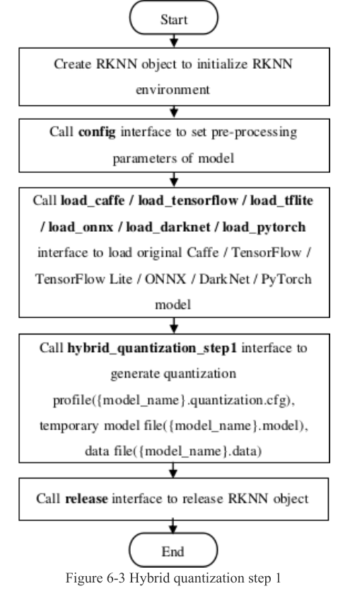
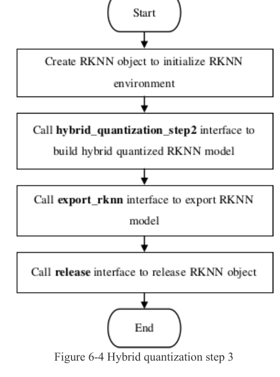

:tocdepth: 1

************************
RKNN: hybrid và accuracy
************************

.. admonition:: Trang này trả lời

   - làm thế nào để giữ một số lớp ở FP16 trong khi phần còn lại INT8?
   - làm sao biết lớp nào làm sụt độ chính xác sau khi lượng tử hóa?
   - khi kết quả lệch, kiểm tra theo thứ tự nào?

.. admonition:: Tóm tắt

   - Hybrid quantization gồm bốn bước, và lớp được đưa về FP16 chạy chậm hơn trên NPU [T1 UG232 tr.123].
   - `hybrid_quantization_step2` trả `0` hoặc `-1` và không tự ghi file `.rknn`, nên phải gọi `export_rknn` sau đó.
   - Hybrid int16 trên RK3588 là `unknown`, và hướng so sánh euclid của `auto_hybrid_euc_thresh` cũng `unknown` vì API232 và UG232 viết khác nhau.
   - Accuracy analysis so sánh từng lớp giữa `golden` và `simulator`, trong đó `entire` là sai số tích lũy còn `single` là sai số của riêng lớp (theo README của ví dụ chính thức). API232 và UG232 gọi tên các cột này khác nhau.
   - Quy trình vendor yêu cầu FP16 đúng trước, rồi mới xét quantization inference [T1 UG232 tr.131].
   - Chưa có nguồn nào áp dụng quy trình xử lý lỗi độ chính xác này cho YOLOv8 hay PPE, nên là `unknown`.

.. contents:: Trong trang này
   :local:
   :depth: 1

.. _43-hybrid-quantization:

Hybrid quantization
===================

**Câu hỏi:** làm thế nào để giữ một số lớp ở FP16 trong khi phần còn lại INT8?

**Nguồn nói gì**

   "Users can manually specify whether each layer should be quantized based on the output results of accuracy analysis." [T1 UG232 tr.123]

..

   "Changing specified quantized layers to non-quantized layers, using FLOAT16 for computation. (Note that non-quantized computation on the NPU has lower performance, resulting in reduced inference speed.)" [T1 UG232 tr.123]

   "When using the hybrid quantization feature, it involves four specific steps." [T1 UG232 tr.123]

..

   "hybrid_quantization_step1, which is used to generate the temporary model file (<model_name>.model), the data file (<model_name>.data), and the quantization configuration file (<model_name>.quantization. cfg)." [T1 API232 tr.20]

   "model_quantization_cfg: Path to the modified model quantization configuration file (<model_name>.quantization.cfg) generated by hybrid_quantization_step1." [T1 API232 tr.21]

..

   "In the "custom_quantize_layers" section, users can add custom quantization layers by specifying the tensor name followed by the quantization type." [T1 UG232 tr.124]

   "Currently, the available quantization data type is "float16"." [T1 UG232 tr.124]

..

   "Currently, only automatic adjustment from int8 quantization to fp16 is supported." [T1 UG232 tr.125]

   "enabling auto_hybrid will convert operations with cosine distance and euclidean distance below the specified thresholds to FP16 computation (currently only supported for 'w8a8' quantization)." [T1 API232 tr.14]

..

   "if the weight distribution of Conv layer weights is highly uneven, users may consider using hybrid quantization to further improve model accuracy." [T1 UG232 tr.134]

|UG232 Figure 6-3| *Hình 4.3a. Hybrid quantization bước 1: tạo đối tượng RKNN, ``config``, nạp model, ``hybrid_quantization_step1`` sinh ``.quantization.cfg``, ``.model``, ``.data``, rồi ``release``. Nguồn: [T1 UG232 tr.123, Figure 6-3]*

|UG232 Figure 6-4| *Hình 4.3b. Hybrid quantization bước 3: ``hybrid_quantization_step2`` rồi ``export_rknn``. Nguồn: [T1 UG232 tr.124, Figure 6-4]*

Chữ ký hàm trong code: ``hybrid_quantization_step1(self, dataset='dataset.txt', rknn_batch_size=None, proposal=False, proposal_dataset_size=1, custom_hybrid=None)`` [T1 RKNNPY rknn.py:200]. Ví dụ chính thức gọi ``rknn.hybrid_quantization_step1(dataset='./dataset.txt', proposal=False)`` [T1 EX ``functions/hybrid_quant/step1.py:28``].

**Ý chính**

- Bốn bước: (1) ``hybrid_quantization_step1`` sinh ba file, (2) sửa ``.quantization.cfg``, (3) ``hybrid_quantization_step2`` rồi ``export_rknn``, (4) suy luận (UG232 tr.123, 124, 125).
- Lớp được đưa về FP16 chạy chậm hơn trên NPU (UG232 tr.123). Trade-off giữa độ chính xác và tốc độ là điều UG232 tr.134 nhắc lại.
- ``hybrid_quantization_step2`` trả ``0`` hoặc ``-1``, không tự ghi file ``.rknn``. Phải gọi ``export_rknn`` sau đó (Figure 6-4. EX ``step2.py:23``).
- ``auto_hybrid`` tự đổi các lớp có cosine distance thấp hơn ngưỡng (mặc định 0.98) về FP16 (API232 tr.10, 14. UG232 tr.125).

**Giới hạn**

- Dtype cho phép trong ``custom_quantize_layers``: UG232 tr.124 chỉ "float16", EX ``step1.py:47`` in "Currently supported data types are: 'int8', 'int16', 'float16'." Hybrid int16 trên RK3588 là ``unknown``. Nhắc thêm: khi model chưa lượng tử hóa, API232 tr.14 viết "When the model is not quantized, enabling auto_hybrid will convert operations that exceed the FP16 value range to INT16 computation." (không riêng chip nào).
- Hướng so sánh euclid của ``auto_hybrid_euc_thresh``: API232 tr.14 viết "below", UG232 tr.125 viết "the greater than euclidean distance threshold". ``unknown`` cho đến khi đo.
- ``proposal=False`` có điền layer gợi ý hay không: ``unknown`` (``3rdparty/rknn-toolkit2/rknn-toolkit2/doc/changelog-2.3.2.txt`` dòng 399, v1.6.1b0: "proposal=False不生成推荐层", và EX ``step1.py:49-50`` mâu thuẫn nhau).

--------------

.. _44-accuracy-analysis:

Accuracy analysis
=================

**Câu hỏi:** làm sao biết lớp nào làm sụt độ chính xác sau khi lượng tử hóa?

**Nguồn nói gì**

   "Inference with quantized model and generate snapshot, that is dump tensor data of each layers. It will dump a snapshot of both data types include fp32 & quant for calculate quantitative error." [T1 API232 tr.22]

..

   "This interface can only be called after build or hybrid_quantization_step2." [T1 API232 tr.22]

   "Directory golden: Save the results of each layer on simulator when the entire floating-point model is completely run down." [T1 API232 tr.22]

..

   "Directory simulator: Save the results of each layer on simulator when the entire quantitative model is fully run (The output has been converted to float32)." [T1 API232 tr.22]

   "After loading the RKNN model through rknn.load_rknn(), the model accuracy analysis function can not be used because the RKNN model lacks the original model information." [T1 UG232 tr.30]

..

   "It is divided into 4 columns of accuracy, as follows:" [T1 UG232 tr.30]

Các cột (UG232 tr.31): ``simulator_error`` gồm ``entire`` ("The cosine distance and Euclidean distance from the beginning to the current layer simulator result compared with the golden result.") và ``single``.``runtime_error`` gồm ``entire`` và ``single_sim``. Ví dụ chính thức giải thích: "entire: output error of each layer between 'golden' and 'simulator', these errors will accumulate layer by layer." và "single: single-layer output error between 'golden' and 'simulator', can better reflect the single-layer accuracy of the simulator." [T1 EX ``functions/accuracy_analysis/README.md:19-21``].

|UG232 Figure 3-2| *Hình 4.4. Kết quả accuracy analysis: bốn nhóm cột ``simulator_error`` (entire, single) và ``runtime_error`` (entire, single_sim), mỗi nhóm có ``cos`` và ``euc``. Nguồn: [T1 UG232 tr.30, Figure 3-2]*

**Ý chính**

- Hàm so sánh từng lớp giữa mô hình float (``golden``) và mô hình đã lượng tử hóa (``simulator``), và nếu truyền ``target`` thì thêm ``runtime`` chạy trên NPU (API232 tr.22).
- ``entire`` là sai số tích lũy qua các lớp, ``single`` là sai số của riêng lớp đó (README của ví dụ). UG232 tr.134 hướng dẫn khi chọn lớp cho hybrid: xét đồng thời độ giảm ở cột ``single`` của ``simulator_error`` và vị trí lớp trong model, vì lỗi tích lũy theo lớp và lớp ở phía trước ảnh hưởng nhiều hơn.
- Giá trị ``cos`` gần 1 là tốt trong bảng mẫu (Figure 3-2), dù tài liệu gọi chung là "cosine distance".

**Giới hạn**

- Tên cột trong API232 (``entire_error``, ``single_error``) khác UG232 (``simulator_error``, ``runtime_error``). Dùng tên của UG232 và ví dụ chính thức.
- Golden tính bằng FP32 hay FP16: API232 tr.22 viết "fp32 & quant", UG232 tr.131 viết "RKNPU currently does not support FP32 calculations". ``unknown``.
- Ngưỡng cosine "đạt" trong ``error_analysis.txt`` không được nêu. UG232 tr.135 chỉ nhắc màu vàng hoặc đỏ.

--------------

.. _47-quy-trình-xử-lý-lỗi-độ-chính-xác-của-vendor:

Quy trình xử lý lỗi độ chính xác của vendor
===========================================

**Câu hỏi:** khi kết quả lệch, kiểm tra theo thứ tự nào?

**Nguồn nói gì**

   "Correct simulator inference results are the prerequisite for correct board-side runtime inference. Therefore, it is essential to prioritize ensuring correct results in the simulator before troubleshooting board-side runtime accuracy issues." [T1 UG232 tr.131]

..

   "Cosine distance can be used as a basic criterion for judging accuracy, but the final impact of quantization on accuracy still needs validation on the dataset." [T1 UG232 tr.131]

   "FP16 inference results must be correct for quantization inference to be correct. Therefore, when there are accuracy issues with quantization inference, it is essential to first verify the correctness of FP16 inference and then troubleshoot the accuracy issues with quantization inference." [T1 UG232 tr.131]

..

   "In general, channel quantization often provides significantly higher accuracy than layer quantization." [T1 UG232 tr.134]

   "Note that this may significantly increase the quantization time but can yield better accuracy than normal. The runtime performance is not adversely affected." [T1 UG232 tr.134]

..

   "Another special method is that when the Op with reduced accuracy is in the last layer, users can choose to move the execution of that layer's operation to post-processing, which will also effectively avoid the accuracy problem of this layer." [T1 UG232 tr.134]

|UG232 Figure 7-1| *Hình 4.7. Các bước xử lý lỗi độ chính xác: Simulator FP16, Simulator Quant, Connect Test, Runtime Test, kèm danh sách cần kiểm tra ở mỗi bước. Nguồn: [T1 UG232 tr.131, Figure 7-1]*

Thứ tự kiểm tra theo Figure 7-1: lỗi runtime thì kiểm tra Simulator FP16 trước (``mean/std``, ``inputs/outputs``, ``input_size_list``, tham số inference, FP16 overflow), rồi Simulator Quant (``quant_img_RGB2BGR``, ``optimization_level``, ``quantized_method``, ``quantized_algorithm``, Hybrid Quant, QAT), rồi Connect Test (accuracy analysis và phản hồi), rồi Runtime Test (tham số API, pre-process, post-process).

**Ý chính**

- Mọi bước sau chỉ có ý nghĩa nếu bước trước đúng: FP16 trước, lượng tử hóa sau, board sau cùng (UG232 tr.131).
- FP16 overflow là một nguyên nhân riêng: giá trị ngoài khoảng (-65504 đến 65504) làm tensor tràn (UG232 tr.133).
- UG232 tr.134 gợi ý thứ tự: đổi ``quantized_method`` sang ``channel``, rồi đổi thuật toán sang ``kl_divergence`` hoặc ``mmse``. Đổi thuật toán "may significantly increase the quantization time" nhưng "The runtime performance is not adversely affected", hybrid thì làm lớp được chọn chạy chậm hơn trên NPU.

**Giới hạn.** Quy trình này là của vendor cho model thông thường. Chưa có nguồn nào áp dụng cho YOLOv8 hay PPE: ``unknown``.

--------------

.. |UG232 Figure 3-2| image:: ../../../_assets/img/npu/04_quantization_rknn/ug232_p30_fig3-2.png

.. |UG232 Figure 7-1| image:: ../../../_assets/img/npu/04_quantization_rknn/ug232_p131_fig7-1.png

Nguồn
=====

Các nhãn nguồn dùng trong trang này (tier, tệp, số lần trích).

.. list-table::
   :header-rows: 1
   :widths: 12 8 70 10

   * - Nhãn
     - Tier
     - Nguồn
     - Số lần
   * - ``UG232``
     - T1
     - ``3rdparty/rknn-toolkit2/doc/02_Rockchip_RKNPU_User_Guide_RKNN_SDK_V2.3.2_EN.pdf`` (SDK trong repo chính)
     - 19
   * - ``API232``
     - T1
     - :download:`01_Rockchip_RKNPU_API_Reference_RKNN_Toolkit2_V2.3.2_EN.pdf <../../../_assets/pdf/papers/05_rk3588/01_vendor_docs/03_rknn_npu/01_Rockchip_RKNPU_API_Reference_RKNN_Toolkit2_V2.3.2_EN.pdf>`
     - 7
   * - ``RKNNPY``
     - T1
     - rknn_toolkit2 (wheel 2.3.2)
     - 1
