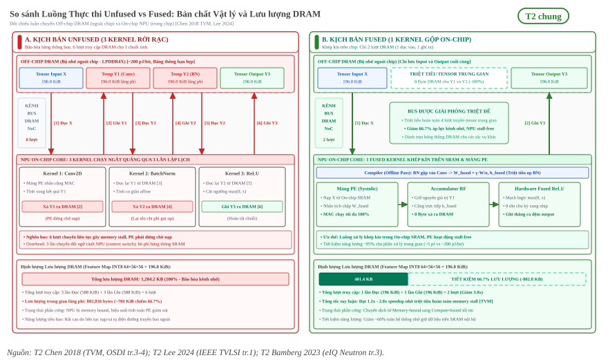
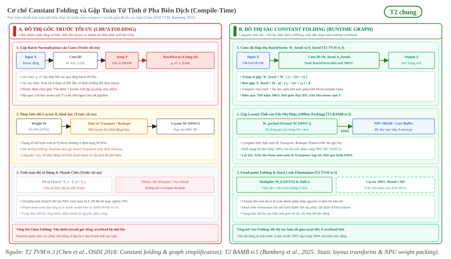

:tocdepth: 1

********************************
Tối ưu đồ thị và operator fusion
********************************

.. admonition:: Trang này trả lời

   - Operator fusion là gì và vì sao kỹ thuật này giúp giảm mạnh số lượt truy cập DRAM?
   - Những mẫu fusion điển hình nào thường xuất hiện trong các mạng nơ-ron tích chập?
   - Cơ chế constant folding và gộp toán tử hoạt động ra sao ở thời điểm biên dịch?
   - Hiệu quả giảm lưu lượng bộ nhớ ngoài của fusion được định lượng như thế nào qua ví dụ số?

.. admonition:: Tóm tắt

   - Operator fusion kết hợp nhiều toán tử kế tiếp thành một kernel tính toán duy nhất, triệt tiêu việc ghi và đọc các tensor trung gian ra DRAM [T2 TVM tr.3] [T2 LEE24 tr.1].
   - Giảm truy cập bộ nhớ ngoài giúp giải tỏa hiện tượng nghẽn băng thông, mang lại mức tăng tốc từ 1.2x đến 2x trên các mô hình tích chập [T2 TVM tr.4].
   - Mẫu fusion kinh điển nhất là Conv + Batch Normalization + Activation, trong đó Batch Normalization được gấp trực tiếp vào trọng số Conv qua cơ chế constant folding [T2 TVM tr.3].
   - Constant folding tính toán trước toàn bộ các biểu thức chỉ phụ thuộc vào trọng số tĩnh ở pha biên dịch, loại bỏ hoàn toàn các nút dư thừa khỏi đồ thị suy luận [T2 TVM tr.3].
   - Ví dụ số trên tensor 64×56×56 kiểu INT8: fusion giúp giảm 66.7% tổng lưu lượng DRAM cho activation, tiết kiệm chính xác 802,816 bytes trung chuyển bộ nhớ cho mỗi khối tính toán.
   - Các quy tắc fusion thực tế của NPU RK3588 thuộc về backend độc quyền RKNN, được ghi nhận tại mục nền tảng :doc:`../../02-nen-tang-rk3588/index`.

.. contents:: Trong trang này
   :local:
   :depth: 1

1. Operator fusion
==================

Trong các kiến trúc xử lý học sâu chuyên dụng (NPU), chi phí thời gian và năng lượng để trung chuyển dữ liệu qua bus bộ nhớ ngoài (DRAM) thường vượt trội so với chi phí tính toán số học nội bộ trên mảng xử lý (PE). Kỹ thuật gộp toán tử (Operator Fusion) là bước tối ưu đồ thị quan trọng nhất nhằm cắt giảm số lượt truy cập bộ nhớ này [T2 TVM tr.3] [T2 LEE24 tr.1].

1.1 Vì sao fusion giảm truy cập DRAM
------------------------------------

Khi một mạng nơ-ron được thực thi theo phương thức tuần tự truyền thống không gộp (unfused), mỗi toán tử trong đồ thị tính toán được biên dịch thành một kernel độc lập. Toán tử sản xuất (producer) đọc dữ liệu từ DRAM, thực hiện tính toán, rồi ghi toàn bộ tensor kết quả trung gian trở lại DRAM. Ngay sau đó, toán tử tiêu thụ (consumer) lại đọc tensor trung gian này từ DRAM vào thanh ghi để tiếp tục xử lý:

   "Operator fusion combines multiple operators into a single kernel without saving the intermediate results in memory." [T2 TVM tr.3]

..

   "Operator fusion is a scheduling method for combining multiple operations to minimize off-chip memory access." [T2 LEE24 tr.1]

Việc liên tục đẩy tensor kích thước lớn ra DRAM gây ra hai hậu quả nghiêm trọng:

1. **Nghẽn băng thông bộ nhớ (Memory bandwidth bottleneck)**: Băng thông DRAM bị chiếm dụng bởi các kết quả tạm thời, khiến các khối tính toán MAC phải dừng chờ dữ liệu (memory stalls), làm giảm hiệu suất sử dụng phần cứng.
2. **Tiêu hao năng lượng**: Năng lượng tiêu tốn cho một lượt truy cập DRAM cao hơn hàng chục đến hàng trăm lần so với việc đọc ghi dữ liệu trên thanh ghi nội bộ hoặc bộ đệm SRAM on-chip.

Khi compiler áp dụng operator fusion, nhiều toán tử liên tiếp được gom thành một hàm thực thi duy nhất. Dữ liệu đầu ra của toán tử đứng trước được giữ trực tiếp trên thanh ghi cục bộ hoặc bộ nhớ đệm SRAM của mảng PE để toán tử kế tiếp xử lý ngay lập tức. Nhờ đó, tensor trung gian không bao giờ phải ghi xuống DRAM hay đọc ngược trở lại, mang lại sự cải thiện rõ rệt về độ trễ suy luận:

   "We find that fused operators generate up to a 1.2× to 2× speedup by reducing memory accesses." [T2 TVM tr.4]

   So sánh luồng thực thi Unfused (trái: 3 lần ghi/đọc DRAM cho kết quả trung gian) và Fused (phải: 1 kernel duy nhất trên On-chip SRAM, triệt tiêu 66.7% lưu lượng DRAM) [T2 TVM tr.3-4] [T2 LEE24 tr.1].

Hình trên đối chiếu kiến trúc thực thi theo mô hình phân tầng phần cứng:

- **Kịch bản Unfused (bên trái)**: Mỗi kernel chạy độc lập làm phát sinh 3 vòng giao tiếp ping-pong (tổng cộng 6 lượt truyền dữ liệu) qua kênh bus DRAM / NoC ngoài chip. Vì tốc độ nạp/xả của DRAM LPDDR4X chậm hơn nhiều so với tốc độ tính toán của NPU, mảng PE liên tục rơi vào trạng thái dừng chờ (memory stall). Ngoài ra, runtime phải chịu chi phí chuyển đổi ngữ cảnh (context switch) 3 lần để tái cấu hình phần cứng cho từng kernel.
- **Kịch bản Fused (bên phải)**: Chuỗi toán tử được khép kín trực tiếp trên On-chip SRAM và thanh ghi nội bộ (Accumulator RF). Kênh bus ngoài được giải phóng 66.7% lưu lượng vì chỉ cần nạp đầu vào và ghi đầu ra cuối cùng, chuyển bài toán từ điểm nghẽn bộ nhớ (memory-bound) sang tính toán tối ưu (compute-bound) với tốc độ tăng từ 1.2x đến 2.0x.

1.2 Mẫu Conv BN activation
--------------------------

Trong các mạng nơ-ron thị giác máy tính, chuỗi toán tử xuất hiện phổ biến nhất là Tích chập (Convolution), Chuẩn hóa theo lô (Batch Normalization - BN) và Hàm kích hoạt phi tuyến (Activation, ví dụ ReLU) [T2 TVM tr.4].

Mẫu kết hợp này được compiler xử lý qua hai giai đoạn tối ưu:

- **Gấp Batch Normalization vào Convolution**: lúc suy luận, các tham số của BN là hằng số nên compiler gộp phép affine của BN vào trọng số và bias của Conv đứng trước [T2 TVM tr.3]. Công thức và chứng minh nằm ở :doc:`../01-nen-tang-ai/04-chuan-hoa-va-activation` mục 5.
- **Hợp nhất hàm kích hoạt (Fused Activation)**: Sau khi Conv hoàn tất phép tích lũy (accumulation), hàm kích hoạt như ReLU (tính :math:`\max(0, x)`) được thực hiện trực tiếp trên giá trị trong thanh ghi tích lũy trước khi ghi kết quả ra ngoài. Nhiều NPU tích hợp sẵn phần cứng tính hàm kích hoạt ngay tại lối ra của đơn vị xử lý PE, cho phép hoàn thành phép tính kích hoạt mà không tốn thêm chu kỳ xung nhịp riêng biệt [T2 BAMB tr.3].

Ngoài mẫu Conv + BN + ReLU, các compiler hiện đại còn hỗ trợ nhiều mẫu fusion phức tạp khác [T2 TVM tr.3] [T2 BAMB tr.7]:

- **Conv + Element-wise Add (Residual Connection)**: Gộp nhánh cộng tắt trong các khối ResNet/ResNeXt trực tiếp vào kernel tích chập hoặc activation đi kèm.
- **Depthwise Convolution + Pointwise Convolution**: Gộp các lớp tích chập tách biệt theo chiều sâu (depthwise separable convolution) trong các mô hình nhẹ.
- **Chuỗi toán tử từng phần tử (Injective chain)**: Gộp các phép cộng, nhân, scale và hàm kích hoạt liên tiếp thành một phép tính lồng nhau trên thanh ghi.

2. Constant folding và gộp op
=============================

Bên cạnh việc gộp các kernel thực thi động, compiler đồ thị còn thực hiện tối ưu hóa cấu trúc mô hình thông qua cơ chế gấp hằng số (constant folding):

   "constant-folding, which pre-computes graph parts that can be determined statically, saving execution costs;" [T2 TVM tr.3]

Bản chất của constant folding là phân tích đồ thị tính toán để phát hiện các biểu thức con mà tất cả các tensor đầu vào đều có giá trị bất biến (tĩnh) ở thời điểm biên dịch. Thay vì giữ lại các nút tính toán này để runtime thực hiện lại nhiều lần trong mỗi lần suy luận, compiler chạy trước phép toán đó một lần duy nhất trong quá trình biên dịch và thay thế toàn bộ nhánh đồ thị con bằng một nút hằng số chứa kết quả tính sẵn [T2 TVM tr.3].

   Cơ chế Constant Folding và gộp toán tử tĩnh: Đối chiếu đồ thị gốc chưa tối ưu (trái: tồn dư node BatchNorm, toán tử Transpose tĩnh và nhánh chết) với đồ thị suy luận tinh giản tại runtime (phải: W_fused/b_fused, layout đóng gói sẵn và cắt tỉa 100% nhánh chết) [T2 TVM tr.3] [T2 BAMB tr.5].

Hình trên minh họa ba cơ chế constant folding và tối ưu hóa tĩnh cốt lõi:

- **Gấp Batch Normalization vào Convolution**: Trong giai đoạn suy luận, 4 tham số của BN (:math:`\mu, \sigma^2, \gamma, \beta`) đều là hằng số cố định. Compiler tính toán trước trọng số và bias mới tích hợp trực tiếp phép biến đổi affine [T2 TVM tr.3]:

  .. math::

     W_{\text{fused}} = W \cdot \frac{\gamma}{\sqrt{\sigma^2 + \epsilon}}, \quad b_{\text{fused}} = (b - \mu) \cdot \frac{\gamma}{\sqrt{\sigma^2 + \epsilon}} + \beta

  Kết quả là toán tử BatchNorm hoàn toàn biến mất khỏi đồ thị runtime, tiết kiệm 100% thời gian thực thi của BN và triệt tiêu tensor trung gian trung chuyển qua DRAM.

- **Gộp các phép biến đổi hình học tĩnh (Offline Layout Packing)**: Trọng số mô hình từ các framework như PyTorch thường ở dạng NCHW. Các toán tử thay đổi hình dạng tensor như Reshape, Squeeze, Flatten hoặc Transpose sang layout phần cứng (ví dụ :math:`\text{NC1HWC2}` của NPU RK3588) được compiler thực hiện trước khi xuất file nhị phân [T2 BAMB tr.5]. Nhờ đó, runtime nạp thẳng trọng số qua kênh DMA mà không phát sinh lệnh sao chép bộ nhớ (zero-copy).

- **Tính toán trước hệ số lượng tử hóa và cắt tỉa nhánh chết (Dead Code Elimination)**: 
  
  - Tỷ lệ co giãn dạng số thực :math:`S_x \cdot S_w / S_y` được compiler chuyển đổi sẵn thành hệ số nhân nguyên :math:`M_0` (INT32) và số bit dịch phải :math:`n` cố định, giúp NPU INT8 thực thi hoàn toàn bằng phép nhân nguyên và dịch bit.
  - Các nhánh tính toán dư thừa từ giai đoạn huấn luyện (như nhánh phụ auxiliary head, dropout mask, debug probe) không nối tới đầu ra dự đoán sẽ bị cắt tỉa hoàn toàn, giúp giảm kích thước file mô hình và giải phóng bộ nhớ runtime [T2 TVM tr.3].

3. Ví dụ lưu lượng DRAM
=======================

Để thấy rõ lợi ích định lượng của kỹ thuật operator fusion, xét một khối tính toán tiêu biểu gồm 3 toán tử kế tiếp: Tích chập (Conv2D), Chuẩn hóa/Tỷ lệ (Scaling) và Kích hoạt (ReLU).

Xét một tensor đặc trưng trung gian có kích thước điển hình trong mạng thị giác:

- Batch size: :math:`N = 1`
- Số kênh: :math:`C = 64`
- Kích thước không gian: :math:`H = 56, W = 56`
- Kiểu dữ liệu: INT8 (mỗi phần tử chiếm đúng 1 byte)

Tổng số phần tử của tensor activation là:

.. math::

   \text{Số phần tử} = 1 \times 64 \times 56 \times 56 = 200{,}704 \text{ phần tử}

Với định dạng INT8, dung lượng bộ nhớ của mỗi bản đồ đặc trưng (feature map) là :math:`200{,}704 \text{ bytes} \approx 196.0 \text{ KiB}`.

.. list-table::
   :header-rows: 1
   :widths: 20 22 26 32

   * - Kịch bản thực thi
     - Thao tác trên DRAM
     - Lượng dữ liệu trung chuyển (Bytes)
     - Lưu lượng bộ nhớ ngoài
   * - **Không fusion**
     - Đọc :math:`X` cho Conv
     - :math:`200{,}704`
     - :math:`196.0 \text{ KiB}`
   * - *(Unfused)*
     - Ghi :math:`Y_1` từ Conv
     - :math:`200{,}704`
     - :math:`196.0 \text{ KiB}`
   * - 
     - Đọc :math:`Y_1` cho Scaling
     - :math:`200{,}704`
     - :math:`196.0 \text{ KiB}`
   * - 
     - Ghi :math:`Y_2` từ Scaling
     - :math:`200{,}704`
     - :math:`196.0 \text{ KiB}`
   * - 
     - Đọc :math:`Y_2` cho ReLU
     - :math:`200{,}704`
     - :math:`196.0 \text{ KiB}`
   * - 
     - Ghi :math:`Y_3` từ ReLU
     - :math:`200{,}704`
     - :math:`196.0 \text{ KiB}`
   * - **Tổng không fusion**
     - **6 lượt truy cập DRAM**
     - **1,204,224 bytes**
     - **1,176.0 KiB (~1.18 MiB)**
   * - **Có fusion**
     - Đọc :math:`X` vào mảng PE
     - :math:`200{,}704`
     - :math:`196.0 \text{ KiB}`
   * - *(Fused kernel)*
     - Xử lý nội bộ :math:`Y_1, Y_2`
     - :math:`0` (lưu trên thanh ghi/SRAM)
     - :math:`0.0 \text{ KiB}`
   * - 
     - Ghi :math:`Y_3` trực tiếp ra DRAM
     - :math:`200{,}704`
     - :math:`196.0 \text{ KiB}`
   * - **Tổng có fusion**
     - **2 lượt truy cập DRAM**
     - **401,408 bytes**
     - **392.0 KiB**

Kết quả so sánh định lượng:

- **Giảm lưu lượng DRAM tổng thể**: Từ :math:`1{,}204{,}224 \text{ bytes}` xuống còn :math:`401{,}408 \text{ bytes}`, tức giảm chính xác :math:`3.0\times` (tiết kiệm 66.7% băng thông DRAM phục vụ activation).
- **Triệt tiêu dữ liệu trung gian**: Hai tensor trung gian :math:`Y_1` và :math:`Y_2` được xử lý hoàn toàn trong nội bộ phần cứng, tiết kiệm tuyệt đối :math:`802{,}816 \text{ bytes}` (:math:`784.0 \text{ KiB}`) lượt đọc/ghi vô ích ra bộ nhớ ngoài.

4. Giới hạn với compiler thương mại
===================================

Các cơ chế và phân loại toán tử nêu trên (dựa theo TVM và các công trình học thuật) phản ánh các nguyên lý compiler tổng quát. Tuy nhiên, trên các bộ gia tốc AI thương mại khép kín, các quy tắc hợp nhất kernel được kiểm soát bởi các thuật toán heuristic riêng biệt và thường không được công bố mã nguồn:

   "the compilers of commercial NPUs apply graph optimizations in unpredictable ways." [T2 LENS tr.1]

Liên hệ RK3588: rule fusion và layout NC1HWC2 của RKNN nằm ở :doc:`../../02-nen-tang-rk3588/03-toolchain-runtime/05-fusion-va-layout-nc1hwc2`, danh mục toán tử và trường hợp rơi về CPU nằm ở :doc:`../../02-nen-tang-rk3588/03-toolchain-runtime/04-operator-list`.

Nguồn
=====

Các nhãn nguồn dùng trong trang này (tier, tệp, số lần trích).

.. list-table::
   :header-rows: 1
   :widths: 15 10 65 10

   * - Nhãn
     - Tier
     - Nguồn
     - Số lần
   * - ``TVM``
     - T2
     - :download:`tvm_compiler_2018chen.pdf <../../../_assets/pdf/papers/03_compiler/tvm_compiler_2018chen.pdf>`
     - 16
   * - ``LEE24``
     - T2
     - :download:`fused_layer_multiworkload_2024lee.pdf <../../../_assets/pdf/papers/03_compiler/fused_layer_multiworkload_2024lee.pdf>`
     - 4
   * - ``BAMB``
     - T2
     - :download:`npu_compiler_codesign_2025bamberg.pdf <../../../_assets/pdf/papers/03_compiler/npu_compiler_codesign_2025bamberg.pdf>`
     - 4
   * - ``LENS``
     - T2
     - :download:`npu_compiler_scheduling_2026.pdf <../../../_assets/pdf/papers/03_compiler/npu_compiler_scheduling_2026.pdf>`
     - 1
