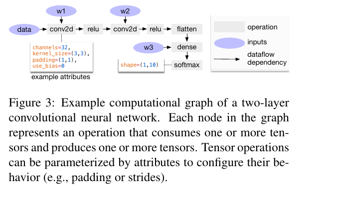
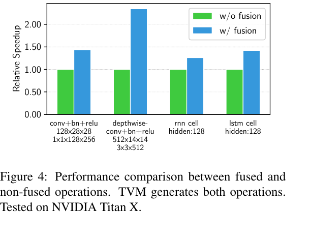

:tocdepth: 1

*************************************
Kỹ thuật tiling và lập lịch thực thi
*************************************

.. admonition:: Trang này trả lời

   - Tiling là gì và vì sao dung lượng bộ đệm SRAM on-chip buộc compiler phải phân khối tensor?
   - Vùng biên (halo / receptive field overlap) phát sinh chi phí tính toán và nạp dữ liệu ra sao khi chia tile?
   - Thứ tự các vòng lặp (loop reordering) chi phối việc tái sử dụng dữ liệu trên phần cứng như thế nào?
   - Kỹ thuật fused-layer trên NPU nhiều core được tối ưu và phân chia công việc ra sao?
   - Những giới hạn nào cần lưu ý khi đối chiếu lý thuyết compiler học thuật với NPU RK3588?

.. admonition:: Tóm tắt

   - Do dung lượng bộ đệm Feature Map (FM buffer / SRAM) trên chip nhỏ hơn nhiều so với DRAM, tensor activation không thể chứa toàn bộ cùng lúc mà phải phân chia thành các tile [T2 LEE24 tr.2] [T2 BAMB tr.4].
   - Phân khối không gian (spatial tiling) và thời gian (temporal tiling) giúp dữ liệu vừa vặn với SRAM, hạn chế tối đa việc tràn bộ nhớ ra ngoài [T2 BAMB tr.4] [T2 BAMB tr.5].
   - Với kernel tích chập lớn hơn 1x1, vùng trường tiếp nhận chồng lấn (halo) buộc hệ thống phải chịu chi phí nạp dư dữ liệu biên từ DRAM hoặc trao đổi giữa các bộ đệm [T2 BAMB tr.4] [T2 BAMB tr.8].
   - Hoán đổi thứ tự vòng lặp (loop reordering) quyết định chiến lược tái sử dụng dữ liệu: cố định trọng số (Weight Stationary), cố định activation (Input Stationary), hoặc cố định tổng tích lũy (Output Stationary) [T2 TVM tr.4].
   - Kỹ thuật fused-layer trên NPU đa nhân giảm dung lượng đỉnh bộ nhớ đệm, mở ra khả năng song song hóa nhiều workload đồng thời [T2 LEE24 tr.1] [T2 LEE24 tr.6].
   - Thuật toán tiling và chính sách phân bổ core thực tế của NPU RK3588 không được công bố (unknown); số liệu tăng tốc trong TVM được đo trên GPU Titan X, không thể gán trực tiếp cho RK3588 [T2 TVM tr.4] [T2 LENS tr.1].

.. contents:: Trong trang này
   :local:
   :depth: 1

1. Tiling theo dung lượng buffer
================================

Trong mọi kiến trúc vi xử lý mạng nơ-ron (NPU), hệ thống nhớ luôn được tổ chức theo cấu trúc phân cấp nghiêm ngặt: bộ nhớ ngoài DRAM có dung lượng lớn (hàng Gigabyte) nhưng băng thông hạn chế và tiêu tốn năng lượng cao; trong khi các khối bộ nhớ đệm trên chip (SRAM, TCM hoặc Feature Map buffer) có băng thông cực lớn và độ trễ thấp nhưng dung lượng rất hữu hạn [T2 LEE24 tr.2] [T2 BAMB tr.3].

1.1 Chia tensor thành tile
--------------------------

Đối với các mô hình học sâu hiện đại, dung lượng cần thiết để chứa trọn vẹn một bản đồ đặc trưng (feature map) ở các lớp đầu hoặc ở độ phân giải lớn thường vượt xa dung lượng SRAM nội bộ của NPU. Do đó, phần cứng không thể tải toàn bộ tensor vào chip trong một lần xử lý:

   "Since the FM buffer (on-chip memory) is much smaller than dram, it is not possible to store the entire feature map at once." [T2 LEE24 tr.2]

Để giải quyết bài toán này, compiler phải thực hiện kỹ thuật phân khối (tiling): chia nhỏ tensor 4 chiều :math:`(N, C, H, W)` thành các khối dữ liệu con (tile) có kích thước :math:`(t_n, t_c, t_h, t_w)`. Ràng buộc cốt lõi của bài toán lập lịch bộ đệm là tổng dung lượng của các tile hoạt động đồng thời tại mỗi bước thời gian không được vượt quá dung lượng vật lý của bộ đệm trên chip [T2 LEE24 tr.2] [T2 BAMB tr.4] [T2 BAMB tr.7]:

.. math::

   \text{Dung lượng}(tile_{input}) + \text{Dung lượng}(tile_{weight}) + \text{Dung lượng}(tile_{output}) \le \text{Dung lượng SRAM}

.. list-table::
   :header-rows: 1
   :widths: 22 28 50

   * - Chiến lược Tiling
     - Trục phân chia
     - Đặc điểm và đánh đổi
   * - Phân khối không gian (Spatial Tiling)
     - Chiều cao :math:`H` hoặc chiều rộng :math:`W`
     - Chia dòng tính toán (:math:`outH`), cho phép chia sẻ trọng số chung giữa các đơn vị PE qua cơ chế broadcast [T2 BAMB tr.4].
   * - Phân khối theo kênh (Channel Tiling)
     - Kênh nhập :math:`C_{in}` hoặc kênh xuất :math:`C_{out}`
     - Chia nhỏ số lượng bộ lọc trọng số; đòi hỏi tích lũy từng phần (partial sums) khi lặp qua các kênh ngõ vào.
   * - Phân khối thời gian (Temporal Tiling)
     - Thứ tự xử lý các khối theo thời gian
     - Điều phối thời điểm nạp và giải phóng tile trong SRAM, kết hợp chặt chẽ với kỹ thuật gộp lớp [T2 BAMB tr.5] [T2 BAMB tr.7].

Về mặt mã nguồn mức thấp, kỹ thuật loop tiling biến đổi một vòng lặp phẳng thành hai cấp vòng lặp lồng nhau: vòng lặp ngoài duyệt qua các tile và vòng lặp trong duyệt qua các phần tử bên trong tile [T2 TVM tr.4]:

.. code-block:: python

   # Phép phân khối một trục chiều cao 1024 thành các tile kích thước 8 trong TVM
   # yo, yi = s[C].split(y, factor=8)
   for yo in range(128):          # Duyệt qua 128 tile (vòng lặp ngoài)
       for yi in range(8):        # Duyệt qua 8 phần tử trong tile (vòng lặp trong)
           C[yo * 8 + yi] = ...

Việc lựa chọn kích thước tile đòi hỏi sự cân bằng nghiêm ngặt giữa nhiều yếu tố:

- **Đánh đổi kích thước tile**: Nếu chọn tile quá lớn, dữ liệu sẽ tràn bộ đệm SRAM buộc hệ thống phải ghi tràn ra DRAM; nếu chọn tile quá nhỏ, số lượng tile tăng lên khiến trọng số phải bị đọc đi đọc lại nhiều lần từ DRAM cho mỗi tile, gây lãng phí băng thông bộ nhớ ngoài [T2 LEE24 tr.2].
- **Cơ chế đệm kép (Double buffering / Ping-pong)**: Để che giấu độ trễ truyền dữ liệu qua DMA, compiler thường chia bộ đệm SRAM thành hai nửa đối xứng (ping-pong banks). Trong khi mảng PE đang tính toán trên khối dữ liệu thứ :math:`k`, bộ điều khiển DMA đồng thời nạp khối dữ liệu thứ :math:`k+1` từ DRAM vào nửa còn lại [T2 BAMB tr.5]. Cơ chế này đòi hỏi dung lượng bộ đệm khả dụng cho mỗi tile bị giảm đi một nửa so với tổng dung lượng vật lý của SRAM.
- **Ràng buộc căn lề phần cứng (Hardware Alignment Constraints)**: Các đơn vị tính toán vector hoặc mảng systolic thường yêu cầu kích thước tile phải là bội số của số lượng đơn vị tính toán song song (ví dụ: 8, 16 hoặc 32 phần tử) [T2 TVM tr.4] [T2 BAMB tr.4]. Khi kích thước thực tế của tensor không chia hết cho kích thước tile chuẩn, compiler buộc phải chèn thêm phần tử đệm (zero-padding). Việc này làm phát sinh các phép tính nhân cộng vô ích trên các giá trị 0 ở khối biên, làm suy giảm hiệu suất tính toán thực tế của mảng PE.
- **Tận dụng truyền khối DRAM (Burst transfers)**: Tỷ lệ khung hình của tile (:math:`t_w` so với :math:`t_h`) ảnh hưởng trực tiếp đến hiệu quả truy cập DRAM. Định dạng bố trí bộ nhớ (NCHW hoặc NHWC) quyết định chiều nào có các phần tử nằm liên tục trên không gian địa chỉ. Trong định dạng NCHW, các điểm ảnh trải theo chiều rộng :math:`W` nằm liên tục trong bộ nhớ; do đó, phân khối theo dòng chiều cao :math:`H` (line parallelism) bảo toàn toàn bộ dòng quét :math:`W` liên tục, cho phép bộ điều khiển DMA kích hoạt các chuỗi đọc khối burst tối đa băng thông [T2 BAMB tr.4]. Ngược lại, nếu cắt lát dọc theo :math:`W`, mỗi dòng chỉ nạp một đoạn ngắn có bước nhảy (stride), làm giảm hiệu suất truyền dẫn của bus bộ nhớ.

1.2 Chi phí biên (halo)
-----------------------

Khi áp dụng tiling không gian trên các lớp tích chập có kích thước kernel lớn hơn :math:`1 \times 1` (chẳng hạn :math:`3 \times 3` hoặc :math:`5 \times 5`), một vấn đề kỹ thuật cố hữu xuất hiện là sự chồng lấn của trường tiếp nhận (receptive field overlap) giữa các tile lân cận [T2 BAMB tr.4] [T2 BAMB tr.8].

Để tính toán được các điểm ảnh nằm sát mép của một tile đầu ra kích thước :math:`t_h \times t_w`, NPU cần một vùng đệm mở rộng bao quanh tile đầu vào tương ứng (thường gọi là vùng biên hay halo). Kích thước phần mở rộng này bằng :math:`\lfloor K / 2 \rfloor` về mỗi phía (với :math:`K` là kích thước cạnh kernel). Do đó, cửa sổ dữ liệu đầu vào của hai tile kề nhau luôn có một phần dữ liệu trùng lặp [T2 BAMB tr.4].

Ví dụ định lượng về chi phí biên với kernel tích chập :math:`3 \times 3` (stride 1, padding 1):

- Nếu chọn tile đầu ra nhỏ kích thước :math:`8 \times 8` (64 phần tử), tile đầu vào cần nạp là :math:`(8 + 2) \times (8 + 2) = 10 \times 10 = 100` phần tử. Số phần tử vùng biên halo là :math:`100 - 64 = 36` phần tử, chiếm tỷ lệ chi phí biên lên tới :math:`36 / 64 \approx 56.25\%`.
- Nếu chọn tile đầu ra lớn kích thước :math:`32 \times 32` (1024 phần tử), tile đầu vào cần nạp là :math:`(32 + 2) \times (32 + 2) = 34 \times 34 = 1156` phần tử. Vùng halo là :math:`1156 - 1024 = 132` phần tử, tỷ lệ chi phí biên giảm xuống chỉ còn :math:`132 / 1024 \approx 12.89\%`.

Sự tồn tại của vùng halo đặt compiler trước hai lựa chọn xử lý đều phát sinh chi phí:

1. **Nạp lặp lại từ DRAM (Redundant memory fetch)**: Mỗi tile tự nạp đầy đủ vùng đệm biên của nó từ bộ nhớ ngoài. Giải pháp này đơn giản về mặt điều khiển nhưng làm tăng tổng lưu lượng đọc từ DRAM do các hàng/cột biên bị nạp lại nhiều lần [T2 BAMB tr.4].
2. **Giao tiếp nội bộ giữa các bộ đệm (Inter-buffer halo exchange)**: NPU giữ lại phần dữ liệu biên trong SRAM và truyền trực tiếp sang bộ đệm của tile lân cận. Cách tiếp cận này tiết kiệm băng thông DRAM nhưng đòi hỏi kiến trúc bộ nhớ phức tạp (nhiều bank không xung đột) và cơ chế đồng bộ chặt chẽ giữa các engine tính toán [T2 BAMB tr.4].

Cần phân biệt rõ giữa padding ở biên mô hình và halo giữa các tile: khi tile nằm ở đường viền ngoài cùng của toàn bộ ảnh, các phần tử đệm (padding) thường được phần cứng tạo địa chỉ (Address Generation Unit) tự động điền giá trị 0 mà không phát sinh truy cập bộ nhớ. Tuy nhiên, khi tile nằm ở giữa tensor, toàn bộ vùng halo đều chứa các giá trị kích hoạt thực tế cần thiết cho phép tính, buộc hệ thống phải chịu chi phí nạp hoặc trung chuyển dữ liệu biên [T2 BAMB tr.4].

Khi hợp nhất nhiều lớp tích chập liên tiếp (fused-convolution layers), vùng halo bị khuếch đại lũy tiến qua từng lớp (receptive field mở rộng liên tục: từ 3 lên 5, 7 qua 3 lớp tích chập :math:`3 \times 3`), khiến tỷ lệ chi phí biên trên tổng khối lượng tính toán tăng vọt nếu kích thước tile ban đầu quá nhỏ [T2 LEE24 tr.2] [T2 BAMB tr.8].

2. Thứ tự vòng lặp và tái sử dụng dữ liệu (Data reuse)
======================================================

Toán tử tích chập trên tensor 4 chiều về bản chất được định nghĩa bằng một khối gồm 7 vòng lặp lồng nhau duyệt qua các trục kích thước [T2 TVM tr.4] [T2 BAMB tr.4]:

.. code-block:: text

   for n in [0, N):                  # Batch
     for co in [0, C_out):           # Kênh đầu ra
       for ho in [0, H_out):         # Chiều cao đầu ra
         for wo in [0, W_out):       # Chiều rộng đầu ra
           for ci in [0, C_in):      # Kênh đầu vào
             for kh in [0, K_h):     # Chiều cao kernel
               for kw in [0, K_w):   # Chiều rộng kernel
                 Y[n, co, ho, wo] += X[n, ci, ho*s + kh, wo*s + kw] * W[co, ci, kh, kw]

Biểu diễn mức vòng lặp cho phép compiler hoán đổi trật tự lồng nhau của các vòng lặp này (loop reordering) nhằm tối ưu hóa việc tái sử dụng dữ liệu (data reuse) trên các tầng nhớ nội bộ [T2 TVM tr.4]:

- **Cố định trọng số (Weight Stationary - WS)**: Đưa các vòng lặp duyệt qua tensor đặc trưng (chiều cao :math:`H`, chiều rộng :math:`W`) vào bên trong, giữ vòng lặp trọng số ở bên ngoài. Trọng số sau khi nạp vào mảng PE sẽ đứng yên để nhân với nhiều vị trí không gian khác nhau của ảnh đầu vào. Cơ chế này đặc biệt hiệu quả khi kích thước feature map lớn hơn nhiều so với kích thước ma trận trọng số.
- **Cố định ngõ ra (Output Stationary - OS)**: Giữ vòng lặp tích lũy (kênh ngõ vào :math:`C_{in}`, kích thước kernel :math:`K`) ở các vòng lặp trong cùng. Giá trị tích lũy cục bộ (partial sum) được giữ nguyên vẹn trong thanh ghi accumulator của PE cho đến khi hoàn tất phép tính, triệt tiêu hoàn toàn việc đọc ghi dữ liệu trung gian ra bộ đệm ngoài.
- **Cố định dữ liệu ngõ vào (Input Stationary - IS)**: Giữ phần tử activation đầu vào cố định và nhân lần lượt với các bộ lọc của nhiều kênh xuất khác nhau, giảm số lần đọc lại activation từ bộ đệm.

.. list-table::
   :header-rows: 1
   :widths: 22 24 26 28

   * - Kiểu Dataflow
     - Dữ liệu giữ trong PE
     - Dữ liệu di chuyển liên tục
     - Tình huống tối ưu nhất
   * - **Weight Stationary**
     - Trọng số lọc (:math:`W`)
     - Activation đầu vào (:math:`X`), Partial sums
     - Feature map lớn, kích thước trọng số vừa phải [T2 TVM tr.4]
   * - **Output Stationary**
     - Partial sum tích lũy (:math:`Y`)
     - Trọng số (:math:`W`), Activation đầu vào (:math:`X`)
     - Cần triệt tiêu lưu lượng ghi trung gian của psum [T2 TVM tr.4]
   * - **Input Stationary**
     - Activation đầu vào (:math:`X`)
     - Trọng số (:math:`W`), Partial sums
     - Số lượng kênh xuất (:math:`C_{out}`) rất lớn
   * - **Row Stationary**
     - Hàng trọng số (:math:`W_{row}`)
     - Hàng activation (:math:`X_{row}`), Partial sums
     - Tối ưu hóa đồng thời cả 3 chiều dữ liệu trong PE [T2 BAMB tr.2]

Bên cạnh 3 kiểu dataflow cổ điển, một số bộ gia tốc tiên tiến áp dụng cơ chế Cố định hàng (Row Stationary - RS) [T2 BAMB tr.2]. Bằng cách phân rã phép tích chập 2 chiều thành chuỗi các phép tính tích chập 1D theo từng hàng, Row Stationary cho phép mỗi PE lưu trữ một hàng trọng số trong thanh ghi cục bộ và lướt qua các hàng của feature map, tối ưu hóa việc tái sử dụng dữ liệu ở cả 3 chiều (trọng số, activation đầu vào và tổng tích lũy psum) ngay trong mạng lưới PE mà không cần truy xuất lại SRAM.

   Hình 6.5a. Đồ thị tính toán của một CNN hai lớp: mỗi nút là một op nhận một hoặc nhiều tensor. Nguồn: [T2 TVM tr.3, Figure 3]

   Hình 6.5b. So sánh có và không fusion trong TVM (conv+bn+relu, depthwise-conv+bn+relu, rnn cell, lstm cell), đo trên NVIDIA Titan X. Nguồn: [T2 TVM tr.4, Figure 4]

Trong TVM, quá trình biến đổi vòng lặp được trừu tượng hóa qua các nguyên hàm lịch trình (schedule primitives) như `tile`, `reorder`, `unroll`, và `cache_read/write` [T2 TVM tr.4]. Kỹ thuật phân tích dựa trên mô hình đa diện (polyhedral-based loop transformation) cho phép compiler kiểm tra tính hợp lệ về mặt toán học của các phép hoán đổi thứ tự lặp, đảm bảo không vi phạm các quan hệ phụ thuộc dữ liệu trước khi phát sinh mã máy [T2 TVM tr.13].

- **Duỗi vòng lặp (Loop Unrolling)**: Bằng cách mở rộng các vòng lặp trong cùng (chẳng hạn theo kích thước kernel :math:`K_w` hoặc kênh ngõ vào :math:`C_{in}` theo bội số của 8 hoặc 16), compiler tạo ra chuỗi lệnh không rẽ nhánh, ánh xạ song song trực tiếp lên các đơn vị nhân cộng MAC của phần cứng [T2 TVM tr.4].
- **Lồng ghép điểm tính toán (compute_at)**: Nguyên hàm `compute_at` cho phép compiler quy định vị trí vòng lặp cụ thể mà tensor trung gian sẽ được tính toán. Thay vì tính trọn vẹn tensor ngõ ra của lớp trước rồi mới chuyển sang lớp sau, dữ liệu trung gian được tính theo từng phần nhỏ ngay bên trong vòng lặp tiêu thụ của lớp kế tiếp, giúp giải phóng bộ đệm ngay sau khi sử dụng và ngăn ngừa việc cấp phát bộ nhớ dư thừa [T2 TVM tr.5].

3. Fused-layer trên NPU nhiều core
==================================

Kỹ thuật hợp nhất không dừng lại ở việc gộp các toán tử đơn giản (như Conv + ReLU), mà mở rộng sang việc thực thi xen kẽ nhiều lớp tích chập liên tiếp (layer fusion hoặc fused-layer execution) [T2 BAMB tr.7] [T2 LEE24 tr.1].

3.1 Cấu hình fused tìm bằng tìm kiếm / heuristic
------------------------------------------------

Mục tiêu cốt lõi của layer fusion là xử lý dữ liệu theo từng khối xuyên suốt qua hai hay nhiều lớp tích chập liên tiếp:

   "interleaving layer execution, commonly known as layer fusion, can reduce overall off-chip memory usage and thus improve execution latency." [T2 BAMB tr.7]

Tuy nhiên, việc ghép nhiều lớp làm phát sinh hiện tượng mức tiêu thụ bộ đệm không phẳng (non-flat memory usage) [T2 LEE24 tr.1]. Khi các lớp liên tiếp có kích thước không gian và số kênh khác nhau, kích thước tile tối ưu của lớp trước chưa chắc đã phù hợp với lớp sau.

Để giải quyết vấn đề này, các compiler hiện đại áp dụng các thuật toán tìm kiếm cấu hình lịch trình:

- **Quy hoạch ràng buộc (Constraint Programming)**: Như trong eIQ Neutron, compiler thiết lập mô hình tối ưu toán học với biến số là kích thước và lịch trình của các tile, ràng buộc tổng dung lượng bộ nhớ tại mọi bước thời gian phải nhỏ hơn dung lượng SRAM [T2 BAMB tr.4] [T2 BAMB tr.7].
- **Tìm kiếm trên đồ thị (Graph-based Search)**: Nghiên cứu của Lee et al. khảo sát hai mục tiêu tìm kiếm mang tính đánh đổi trên mạng ResNet-50 [T2 LEE24 tr.3]:

  * *Tối thiểu hóa độ trễ và truy cập DRAM*: Lựa chọn cấu hình tile lớn nhất có thể để nén thời gian chạy xuống mức thấp nhất. Tuy nhiên, phương án này đẩy mức sử dụng đỉnh của bộ đệm FM buffer lên tới sát ngưỡng dung lượng SRAM on-chip, không còn chỗ trống cho tác vụ nào khác [T2 LEE24 tr.3].
  * *Tối ưu hóa dung lượng bộ đệm FM*: Chấp nhận tăng nhẹ số chu kỳ truy xuất DRAM thông qua việc giảm dần chiều rộng tile (:math:`t_w`) bằng thuật toán `DecreaseTileWidth`, từ đó hạ thấp mức chiếm dụng đỉnh của bộ nhớ đệm trên chip [T2 LEE24 tr.3] [T2 LEE24 tr.5].

  Thuật toán xây dựng đồ thị lịch trình :math:`G_c` có trọng số và áp dụng tìm kiếm theo chiều sâu (DFS) kết hợp hàm cosine tương đồng giữa vector hướng tìm kiếm và hàm mục tiêu để chọn ra cấu hình lịch trình Pareto tối ưu [T2 LEE24 tr.4].

3.2 Chia việc giữa các core
---------------------------

Trên các bộ gia tốc AI đa nhân (multi-core NPU), compiler chịu trách nhiệm phân chia khối lượng công việc giữa các core sao cho cân bằng tải và tối ưu hóa việc chia sẻ dữ liệu [T2 BAMB tr.4] [T2 LEE24 tr.1]:

- **Song song hóa theo dòng không gian (Line Parallelism)**: Chia các dòng chiều cao ngõ ra (:math:`outH`) cho các core hoặc compute engine khác nhau [T2 BAMB tr.4]:

   "With lineparallel computing, different compute engines work on different output lines but the same output channels." [T2 BAMB tr.4]

  Do các dòng không gian dùng chung bộ lọc trọng số, tham số mô hình chỉ cần được đọc một lần từ bộ nhớ và phát quảng bá (broadcast) tới tất cả các engine, tiết kiệm tối đa băng thông [T2 BAMB tr.4].
- **Tránh xung đột ngân hàng bộ nhớ (Bank Conflict Avoidance)**: Khi nhiều core cùng truy xuất vào các khối bộ nhớ SRAM chia sẻ, các truy cập đồng thời vào cùng một ngân hàng (bank) sẽ gây trễ chu kỳ xung nhịp (bank collision stalls). Compiler phải căn lề địa chỉ và xen kẽ bước nhảy (stride interleaving) để đảm bảo các core truy cập vào các bank độc lập [T2 BAMB tr.3] [T2 BAMB tr.4].
- **Chi phí đồng bộ rào chắn (Barrier Synchronization Overhead)**: Khi phân chia các tile của cùng một lớp cho nhiều core xử lý song song, các core phải đợi nhau tại điểm rào chắn (barrier) trước khi chuyển sang lớp kế tiếp. Nếu một core hoàn thành sớm hơn các core còn lại do khối lượng tính toán ở mép biên nhỏ hơn, core đó buộc phải nhàn rỗi (idle), làm giảm hệ số tăng tốc lý thuyết của hệ thống đa nhân [T2 BAMB tr.4] [T2 LEE24 tr.2].
- **Đồng thời đa tác vụ (Multi-workload execution)**: Bằng cách áp dụng lịch trình fused-layer tối ưu để cắt giảm dung lượng đỉnh của bộ nhớ đệm trên chip, compiler giải phóng phần không gian SRAM còn trống để nạp và thực thi song song một mạng nơ-ron khác trên core kế bên. Thực nghiệm của Lee et al. chứng minh cơ chế này giúp tăng 32% hiệu năng tổng thể so với thực thi tuần tự [T2 LEE24 tr.6].

4. Giới hạn khi áp cho RK3588: thuật toán tiling thật là unknown
================================================================

Các mô hình và kết quả phân tích trong trang này được đúc kết từ các công trình học thuật tiêu biểu (TVM, eIQ Neutron, nghiên cứu DATE 2024 của Lee et al.):

1. **Ngữ cảnh thực nghiệm độc lập**:
   - Số liệu gia tốc từ 1.2x đến 2x trong Figure 4 của bài báo TVM được đo trên bộ vi xử lý đồ họa NVIDIA Titan X [T2 TVM tr.4], không phản ánh đặc tính của kiến trúc NPU chuyên dụng nhúng.
   - Nghiên cứu của Bamberg et al. (BAMB) được thực hiện riêng trên kiến trúc eIQ Neutron của NXP với vi điều khiển RISC-V [T2 BAMB tr.3].
   - Nghiên cứu của Lee et al. (LEE24) kiểm chứng trên bộ mô phỏng NPU nội bộ dựa trên mảng systolic [T2 LEE24 tr.3].
   - Nghiên cứu LENS 2026 chỉ ra rằng các compiler NPU thương mại áp dụng tối ưu hóa đồ thị và lập lịch kernel theo cách rất khó dự đoán:

      "the compilers of commercial NPUs apply graph optimizations in unpredictable ways." [T2 LENS tr.1]

     Những thay đổi nhỏ về kích thước shape hoặc batch size có thể kích hoạt các chiến lược phân khối và hợp nhất hoàn toàn khác nhau từ phía compiler, dẫn đến độ trễ phi tuyến tính giữa các hình dạng tensor khác nhau [T2 LENS tr.1] [T2 LENS tr.2].
2. **Hiện trạng thuật toán trên Rockchip RK3588**:
   - Đối với SoC Rockchip RK3588, thuật toán chia tile cụ thể (cách chọn kích thước :math:`t_h, t_w, t_c`), cơ chế đệm vùng halo, và chính sách phân bổ tính toán giữa 3 core NPU vật lý hoàn toàn không được nhà sản xuất công bố chi tiết trong tài liệu chính thức (``unknown``). Đã tìm trong: *RK3588 TRM Part 1 & Part 2*, *Rockchip RKNPU User Guide RKNN SDK v2.3.2*, và *Rockchip RKNPU Quick Start Guide*, với các từ khóa: `tiling`, `tile size`, `halo`, `buffer split`.
   - NPU RK3588 trang bị bộ nhớ đệm nội bộ 384 KB cho mỗi core NPU (tổng 1,152 KB trên 3 core), cùng khả năng truy cập vùng System SRAM 4 MB của SoC. Tuy nhiên, việc công cụ biên dịch `rknn-toolkit2` phân chia tile như thế nào để vừa vặn trong 384 KB này hay sử dụng System SRAM cho feature map là quy trình khép kín nội bộ.
   - Compiler thương mại `rknn-toolkit2` hoạt động như một hộp đen tối ưu tự động; người dùng không có cờ lệnh can thiệp trực tiếp vào kích thước tile hay cấu trúc vòng lặp ở mức thấp. Vì vậy, việc ước lượng hiệu năng không thể chỉ dựa vào số lượng MAC lý thuyết mà bắt buộc phải dựa trên đo đạc thực nghiệm bằng công cụ profiling của hãng.
   - Để tìm hiểu cấu trúc phần cứng của 3 core NPU, dung lượng bộ đệm nội bộ 384 KB mỗi core, và thanh ghi điều khiển đa core trên RK3588, xem tài liệu phần cứng tương ứng: :doc:`../../02-nen-tang-rk3588/01-phan-cung-npu/03-che-do-da-loi-va-system-sram`.

Nguồn
=====

Các nhãn nguồn dùng trong trang này (tier, tệp, số lần trích).

.. list-table::
   :header-rows: 1
   :widths: 15 10 65 10

   * - Nhãn
     - Tier
     - Nguồn
     - Số lần
   * - ``TVM``
     - T2
     - :download:`tvm_compiler_2018chen.pdf <../../../_assets/pdf/papers/03_compiler/tvm_compiler_2018chen.pdf>`
     - 7
   * - ``LEE24``
     - T2
     - :download:`fused_layer_multiworkload_2024lee.pdf <../../../_assets/pdf/papers/03_compiler/fused_layer_multiworkload_2024lee.pdf>`
     - 11
   * - ``BAMB``
     - T2
     - :download:`npu_compiler_codesign_2025bamberg.pdf <../../../_assets/pdf/papers/03_compiler/npu_compiler_codesign_2025bamberg.pdf>`
     - 17
   * - ``LENS``
     - T2
     - :download:`npu_compiler_scheduling_2026.pdf <../../../_assets/pdf/papers/03_compiler/npu_compiler_scheduling_2026.pdf>`
     - 1
