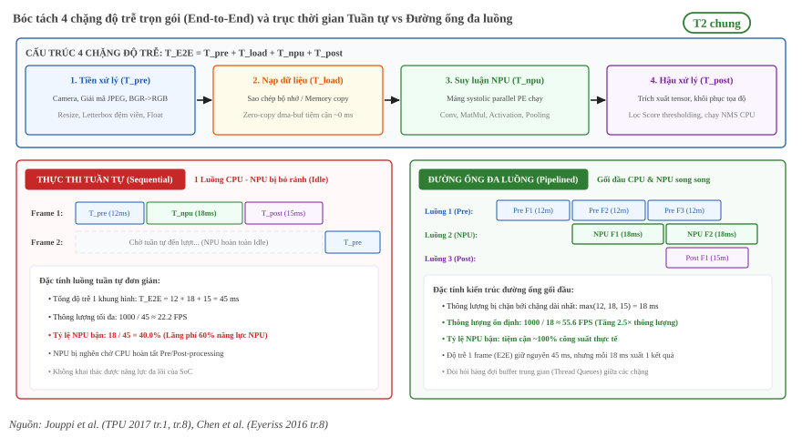

:tocdepth: 1

********************************
Đo độ trễ và phân tích hiệu năng
********************************

.. admonition:: Trang này trả lời

   - Độ trễ trọn gói (End-to-End Latency) gồm những chặng nào và đo đạc thế nào cho đúng chuẩn?
   - Tại sao báo cáo trung vị (Median) và phân vị đuôi (p95, p99) lại quan trọng hơn số trung bình đơn thuần?
   - Làm thế nào ứng dụng mô hình Roofline để xác định một mô hình hay một lớp bị nghẽn do tính toán hay băng thông bộ nhớ?
   - Những sai lầm phổ biến khi thực hiện benchmark và profiling trên thiết bị biên là gì?

.. admonition:: Tóm tắt

   - Độ trễ của ứng dụng AI tại biên gồm 4 chặng: tiền xử lý, nạp dữ liệu, suy luận NPU và hậu xử lý. FPS tính theo độ trễ và FPS thông lượng khác nhau khi các chặng chạy gối đầu.
   - Đo lường chuẩn xác đòi hỏi khởi động ấm (warm-up) để nạp bộ nhớ đệm, đo đủ số lần lặp để đánh giá độ biến thiên, và cố định xung nhịp (clock fixing) để loại bỏ nhiễu từ cơ chế điều tốc DVFS và hiện tượng hạ xung nhiệt (thermal throttling).
   - Báo cáo độ trễ phải dựa trên trung vị (Median / p50) và phân vị đuôi (p95, p99). Jouppi 2017 chứng minh yêu cầu đáp ứng thời gian thực được quyết định bởi phân vị thứ 99 chứ không phải thông lượng trung bình [T2 Jouppi 2017 tr.1] [T2 Jouppi 2017 tr.8].
   - Mô hình Roofline phân định rõ ràng giữa hai vùng: vùng dốc nghẽn băng thông bộ nhớ khi thiếu cường độ hoạt động [T2 Jouppi 2017 tr.5], và vùng phẳng nghẽn tính toán khi bão hòa công suất mảng MAC.
   - Truy cập bộ nhớ ngoài (DRAM) tiêu tốn năng lượng gấp hàng trăm lần so với phép tính MAC trên chip [T2 Chen 2016 tr.8], khiến nghẽn bộ nhớ trở thành nút thắt hàng đầu về cả tốc độ lẫn nhiệt năng trên phần cứng biên.

.. contents:: Trong trang này
   :local:
   :depth: 1

1. Các chặng của độ trễ
=======================

Khi triển khai các mô hình mạng nơ-ron sâu trên phần cứng biên, khái niệm độ trễ (latency) thường bị nhầm lẫn giữa thời gian suy luận thuần túy của bộ tăng tốc và thời gian đáp ứng trọn gói của toàn bộ ứng dụng. Để đánh giá đúng hiệu năng thực tế, chu trình xử lý phải được bóc tách thành các chặng độc lập.

1.1 Bốn chặng độ trễ
--------------------

Độ trễ trọn gói từ đầu đến cuối (End-to-End Latency: :math:`T_{\text{E2E}}`) của một tác vụ xử lý thị giác máy tính là tổng thời gian thực thi của bốn chặng nối tiếp nhau xuyên suốt các khối phần cứng trong SoC:

.. math::

   T_{\text{E2E}} = T_{\text{pre}} + T_{\text{load}} + T_{\text{npu}} + T_{\text{post}}

Ý nghĩa và đặc tính phần cứng của từng chặng:

* **Tiền xử lý (:math:`T_{\text{pre}}`)**:
  Bao gồm các thao tác thu nhận luồng dữ liệu từ cảm biến camera, giải mã ảnh, chuyển đổi không gian màu (ví dụ từ YUV/NV12 sang RGB/BGR), thay đổi kích thước ảnh (resizing), đệm viền (letterbox / padding) và chuẩn hóa dải giá trị số thực (normalization). Chặng này chủ yếu do CPU hoặc bộ giải mã đa phương tiện phần cứng (Hardware VPU/RGA) thực hiện.
* **Nạp dữ liệu (:math:`T_{\text{load}}`)**:
  Thời gian sao chép hoặc ánh xạ vùng nhớ chứa tensor đầu vào từ không gian bộ nhớ của hệ thống (User Space / DMA buffer) vào bộ nhớ khả dụng của NPU. Nếu không áp dụng kỹ thuật zero-copy, CPU phải thực hiện lệnh sao chép bộ nhớ tuần tự (memory copy) giữa các buffer, gây tắc nghẽn bus hệ thống và tiêu tốn chu kỳ CPU. Khi triển khai cơ chế zero-copy thông qua dma-buf hoặc bộ nhớ chia sẻ, chặng :math:`T_{\text{load}}` có thể được rút ngắn tiệm cận về 0 bằng cách ánh xạ trực tiếp các trang bộ nhớ vật lý vào bảng trang của IOMMU.
* **Suy luận NPU (:math:`T_{\text{npu}}`)**:
  Thời gian bộ tăng tốc NPU thực thi toàn bộ đồ thị tính toán của mô hình (các phép tích chập, nhân ma trận, hàm kích hoạt phi tuyến, pooling). Đây là chặng tận dụng các mảng xử lý song song MAC chuyên dụng.
* **Hậu xử lý (:math:`T_{\text{post}}`)**:
  Bao gồm việc trích xuất và biến đổi các tensor đầu ra từ NPU, giải mã tọa độ hộp bao (bounding box decoding), khôi phục độ phân giải gốc, lọc ngưỡng tin cậy (confidence score thresholding) và thuật toán triệt tiêu phi cực đại (Non-Maximum Suppression - NMS). Chặng này phần lớn chạy trên CPU và có tính tuần tự cao.

   Bóc tách 4 chặng độ trễ trọn gói (trên) và đối chiếu dòng thời gian tuần tự (trái) với đường ống đa luồng (phải).

1.2 Độ trễ và thông lượng
-------------------------

Có hai cách quy độ trễ ra số khung hình mỗi giây, và hai con số này khác nhau.

- **FPS theo độ trễ:** xử lý tuần tự từng ảnh trên một luồng, ảnh sau chỉ bắt đầu khi ảnh trước xong cả bốn chặng.

  .. math::

     \text{FPS}_{\text{latency}} = \frac{1000}{T_{\text{E2E}} \text{ (ms)}}

- **FPS thông lượng:** nhiều luồng gối đầu các chặng cho các ảnh liên tiếp, nên tốc độ ra ảnh chỉ bị giới hạn bởi chặng dài nhất.

  .. math::

     \text{FPS}_{\text{throughput}} = \frac{1000}{\max(T_{\text{pre}}, T_{\text{load}}, T_{\text{npu}}, T_{\text{post}})}

Trong chế độ tuần tự, NPU rảnh trong suốt :math:`T_{\text{pre}} + T_{\text{post}}`. Đường ống đa luồng lấp khoảng rảnh đó.

Ví dụ từ bài DAHD-YOLO, sau khi tác giả dùng thread pool trên RK3588: bản INT8 có thời gian suy luận một ảnh 79.1 ms và đạt 50.2 FPS ở 720P, 43.8 FPS ở 1080P [T2 DAHD tr.18, Table 6]. Nếu tính tuần tự theo độ trễ thì chỉ được 1000 / 79.1, khoảng 12.6 FPS (suy ra).

   "By utilizing a thread pool for acceleration, we optimize the entire detection process through multithreading." [T2 DAHD tr.18]

Văn bản cùng trang ghi bản INT8 chạy đơn luồng mất 0.1162 s mỗi khung hình [T2 DAHD tr.18], nhưng 116.2 ms trong Table 6 thuộc dòng FP16. Vì vậy số đơn luồng của bài chưa chắc (xem :doc:`Tiêu chí thân thiện NPU </contents/02-nen-tang-rk3588/05-yolo-tren-rk3588/03-tieu-chi-than-thien-npu>` mục 5.3).

1.3 Tài nguyên cần theo dõi
---------------------------

Ngoài độ trễ, một phép đo trên thiết bị biên thường ghi thêm các đại lượng sau. Cách đo cụ thể trên RK3588 nằm ở :doc:`Zero-copy, căn lề và profiling API </contents/02-nen-tang-rk3588/04-bo-nho-hieu-nang/03-zero-copy-can-le-profiling-api>`.

- **RAM tiến trình (VmRSS):** bộ nhớ vật lý mà tiến trình suy luận chiếm.
- **Bộ nhớ NPU:** phần cho trọng số và phần đệm cho tensor trung gian giữa các lớp.
- **Tải CPU:** thời gian CPU dùng cho tiền xử lý, hậu xử lý và điều phối NPU.
- **Phân bổ lớp:** lớp nào chạy trên NPU, lớp nào rơi về CPU. Lớp rơi về CPU làm tăng độ trễ.
- **Nhiệt độ:** tải nặng kéo dài có thể kích hoạt hạ xung do nhiệt (xem mục 2.4).

2. Cách đo đúng
===============

Đo đạc hiệu năng trên hệ thống nhúng biên chạy hệ điều hành đòi hỏi quy trình nghiêm ngặt nhằm loại bỏ các yếu tố gây nhiễu phi tất định từ môi trường phần cứng và phần mềm.

2.1 Khởi động ấm
----------------

Lần chạy đầu tiên của một mô hình nơ-ron (cold start) luôn ghi nhận độ trễ cao bất thường so với các lần chạy sau. Nguyên nhân xuất phát từ hàng loạt chi phí khởi tạo một lần:

* Nạp trọng số mô hình từ ổ lưu trữ (eMMC, UFS, NVMe) vào bộ nhớ RAM.
* Khởi tạo bối cảnh thực thi (execution context) của driver và runtime.
* Cấp phát các khối bộ đệm trung gian (intermediate scratchpad buffers).
* Lỗi trang bộ nhớ (page faults) khi các trang dữ liệu được truy cập lần đầu.
* Nạp các tập lệnh và dữ liệu vào các tầng bộ nhớ đệm (instruction cache và data cache) của SoC.

Nếu gộp lần chạy đầu vào tập dữ liệu đo lường, giá trị trung bình sẽ bị thổi phồng, không phản ánh đúng năng lực vận hành ổn định (steady-state). Quy chuẩn đo kiểm bắt buộc phải thực hiện khởi động ấm (warm-up): chạy thử nghiệm từ 10 đến 50 lần lặp độc lập mà không thu thập dữ liệu đo, chờ hệ thống đạt trạng thái cân bằng nhiệt và bộ đệm trước khi kích hoạt đồng hồ đo.

2.2 Số lần lặp và độ biến thiên
-------------------------------

Trên các hệ điều hành đa nhiệm như Linux, tiến trình đo đạc luôn chịu ảnh hưởng từ các ngắt phần cứng (hardware interrupts), cơ chế chuyển đổi ngữ cảnh (context switching) của bộ lập lịch (scheduler), và sự cạnh tranh băng thông bus hệ thống từ các ngoại vi khác.

Một phép đo đơn lẻ không mang ý nghĩa kết luận. Để đạt độ tin cậy khoa học, thực nghiệm phải được lặp lại với số lượng mẫu đủ lớn (thường từ 100 đến 1000 lần lặp liên tục). Bên cạnh các giá trị đại diện xu hướng trung tâm, báo cáo phải công bố các đại lượng đo lường độ phân tán:

* Độ lệch chuẩn (:math:`\sigma`): Thể hiện mức độ biến động quanh giá trị trung tâm.
* Khoảng tứ phân vị (Interquartile Range - IQR): Hiệu số giữa phân vị thứ 75 (Q3) và phân vị thứ 25 (Q1), có ưu thế không bị ảnh hưởng bởi các giá trị ngoại lai cực trị.

Độ biến thiên cao là bằng chứng trực tiếp cho thấy hệ thống đang gặp hiện tượng tranh chấp tài nguyên bộ nhớ ngầm hoặc mất ổn định về điều phối tiến trình.

2.3 Báo cáo trung vị và phân vị
-------------------------------

Báo cáo giá trị trung bình số học (Arithmetic Mean) là một thiếu sót nghiêm trọng trong đánh giá hệ thống nhúng thời gian thực. Giá trị trung bình che giấu các đỉnh trễ cục bộ (latency spikes) do các ngắt hệ thống đột xuất gây ra.

Trung vị (Median hay p50) là giá trị nằm ở chính giữa phân phối mẫu đã sắp xếp, phản ánh chính xác hành vi của 50% số khung hình trong điều kiện vận hành bình thường.

Trong các bài toán biên có yêu cầu an toàn nghiêm ngặt (như tự hành, phanh khẩn cấp, giám sát cảnh báo công trường), tham số quyết định chất lượng dịch vụ (QoS / SLA) là độ trễ phân vị đuôi (tail latency):

* **p95**: 95% số lần suy luận hoàn thành trong khoảng thời gian này, chỉ có 5% số lần chạy bị chậm hơn.
* **p99**: 99% số lần suy luận đáp ứng ngưỡng này, chỉ có 1% trường hợp ngoại lệ chậm nhất.

Jouppi 2017 khẳng định rằng trong các hệ sinh thái xử lý mô hình nơ-ron, ràng buộc quyết định là độ trễ phân vị thứ 99 chứ không phải thông lượng trung bình:

   "The TPU’s deterministic execution model is a better match to the 99th-percentile response-time requirement of our NN applications than are the time-varying optimizations of CPUs and GPUs" [T2 Jouppi 2017 tr.1]

..

   "inference prefers latency over throughput" [T2 Jouppi 2017 tr.8]

Bài báo chỉ ra rằng đối với mô hình MLP0 trên GPU và CPU, khi kích thước batch tăng lên để tối ưu thông lượng thì độ trễ phân vị thứ 99 vượt quá giới hạn 7 ms do ứng dụng quy định, khiến toàn bộ thông lượng tăng thêm đó trở nên vô giá trị vì không đáp ứng được khung thời gian thực thi [T2 Jouppi 2017 tr.8].

2.4 Cố định xung nhịp
---------------------

Cơ chế Điều chỉnh Điện áp và Tần số Động (Dynamic Voltage and Frequency Scaling - DVFS) trên các SoC biên tự động thay đổi tần số hoạt động của CPU, GPU và NPU nhằm tiết kiệm năng lượng và kiểm soát nhiệt độ chip.

Sự can thiệp tự động của DVFS tạo ra hai sai lệch nghiêm trọng trong benchmark:

1. **Độ trễ nâng xung (Frequency ramping latency)**: Khi hệ thống chuyển từ trạng thái nghỉ sang có tải, bộ điều tốc (governor) mất một khoảng thời gian trễ nhất định để nhận diện tải và nâng xung nhịp từ mức sàn lên mức trần, làm sai lệch kết quả của các lượt đo đầu.
2. **Hạ xung do nhiệt (Thermal throttling)**: Khi chạy benchmark lặp lại liên tục ở công suất cao, nhiệt độ bán dẫn vượt ngưỡng an toàn sẽ kích hoạt cơ chế bảo vệ phần cứng tự động tụt xung nhịp, khiến độ trễ các lần chạy sau tăng vọt so với ban đầu.

Để thu được kết quả đo lường mang tính xác thực và có thể tái lập, kỹ sư cần thực hiện quy trình cố định xung nhịp: cấu hình governor sang chế độ tĩnh (như `performance` hoặc khóa cố định một mức tần số danh định), đồng thời giám sát chặt chẽ cảm biến nhiệt độ phần cứng trong suốt quá trình đo. Cấu hình chi tiết về xung nhịp và DVFS trên NPU xem tại :doc:`Xung nhịp, DVFS và Reset </contents/02-nen-tang-rk3588/01-phan-cung-npu/04-xung-nhip-dvfs-va-reset>`.

3. Xác định giới hạn hiệu năng
==============================

Một mô hình nơ-ron chạy chậm có thể do năng lực tính toán của nhân xử lý bị quá tải, hoặc do hệ thống không kịp cung cấp dữ liệu qua đường truyền bộ nhớ. Việc xác định đúng nguyên nhân quyết định phương hướng tối ưu hóa mô hình.

3.1 Đặt lớp lên roofline
------------------------

Roofline chia một lớp vào vùng giới hạn bởi băng thông hoặc vùng giới hạn bởi tính toán, theo số phép tính trên mỗi byte đọc từ DRAM [T2 Jouppi 2017 tr.5]. Định nghĩa, công thức và ví dụ số nằm ở :doc:`Dataflow, phân cấp bộ nhớ và roofline </contents/01-kien-thuc-nen/02-npu/02-dataflow-va-phan-cap-bo-nho>` mục 3.

3.2 Dấu hiệu nghẽn băng thông
-----------------------------

Trong thực tế profiling trên thiết bị biên, các dấu hiệu nhận biết một mô hình bị nghẽn băng thông bộ nhớ bao gồm:

1. **Hiệu suất mảng MAC thực tế thấp**: Bộ định thời ghi nhận nhân NPU bận rộn 100% thời gian thực thi, nhưng số lượng phép tính MAC hoàn thành chỉ tương đương một phần nhỏ công suất đỉnh lý thuyết. Phần lớn chu kỳ xung nhịp bị tiêu hao vào trạng thái chờ nạp dữ liệu (memory stalls).
2. **Độ trễ không co giãn theo xung nhịp NPU**: Khi nâng xung nhịp lõi NPU (ví dụ tăng 25%), độ trễ thực thi của lớp chỉ giảm không đáng kể (dưới 5%), chứng tỏ nút thắt cổ chai nằm ở tốc độ truyền tải của bus bộ nhớ ngoài.
3. **Tiêu thụ năng lượng áp đảo từ DRAM**: Theo mô hình chi phí của Chen 2016, năng lượng truy cập DRAM ngoài chip đắt hơn khoảng 200 lần so với một phép tính MAC chuẩn trên chip [T2 Chen 2016 tr.8]:

   "Table IV shows the energy cost of accessing each level relative to a MAC operation under the listed conditions." [T2 Chen 2016 tr.8]

Khi các lớp mạng có cường độ hoạt động thấp liên tục truy xuất trọng số và activation từ DRAM ngoài, hệ thống sẽ phát sinh lượng nhiệt lớn từ bộ điều khiển bộ nhớ và suy giảm mạnh hiệu suất năng lượng tổng thể.

4. Hiểu sai thường gặp
======================

Quá trình đo đạc và phân tích hiệu năng trên thiết bị biên thường mắc phải các ngộ nhận sau:

.. list-table:: Các sai lầm phổ biến khi benchmark và profiling trên thiết bị biên
   :header-rows: 1
   :widths: 22 38 40

   * - Sai lầm
     - Cơ chế sai lệch thực tế
     - Giải pháp kỹ thuật chuẩn mực
   * - **Đồng nhất độ trễ NPU với độ trễ ứng dụng**
     - Bỏ qua thời gian tiền xử lý ảnh và hậu xử lý NMS trên CPU, dẫn đến tính toán thông lượng FPS trên lý thuyết cao hơn thực tế từ 1.5 đến 3 lần.
     - Phải đo đạc và công bố chi tiết cả bốn chặng (:math:`T_{\text{pre}}, T_{\text{load}}, T_{\text{npu}}, T_{\text{post}}`) của toàn bộ chu trình xử lý.
   * - **Bỏ qua giai đoạn khởi động ấm (warm-up)**
     - Trộn lẫn chi phí khởi tạo context, cấp phát bộ nhớ đệm và nạp cache của lần chạy đầu vào giá trị đo lường steady-state.
     - Luôn chạy từ 10 đến 50 lần lặp warm-up để hệ thống ổn định trạng thái trước khi kích hoạt bộ đếm thời gian.
   * - **Chỉ báo cáo giá trị trung bình đơn thuần**
     - Bị che lấp bởi các đỉnh trễ bất thường (latency spikes), không phát hiện được hiện tượng vi phạm thời hạn cam kết thời gian thực.
     - Báo cáo đồng thời trung vị (Median / p50) cùng các phân vị đuôi p95 và p99 theo chuẩn Jouppi 2017 [T2 Jouppi 2017 tr.1].
   * - **Để DVFS tự do điều chỉnh xung nhịp**
     - Xung nhịp biến động liên tục theo thuật toán governor và hiện tượng hạ xung nhiệt, khiến các lần đo không thể tái lập.
     - Cố định xung nhịp sang profile tĩnh và theo dõi nhiệt độ cảm biến trong suốt quá trình thử nghiệm.
   * - **Đánh giá tốc độ chỉ qua số lượng FLOPs/MACs**
     - Cho rằng mô hình ít FLOPs hơn (như MobileNet dùng depthwise conv) luôn chạy nhanh hơn, bỏ qua ảnh hưởng của cường độ hoạt động thấp gây nghẽn bộ nhớ [T2 Jouppi 2017 tr.5].
     - Phân tích vị trí của từng lớp trên đồ thị Roofline kết hợp profiling số chu kỳ chờ nạp dữ liệu từ bộ nhớ.

Để tìm hiểu chi tiết các công cụ profiling độc quyền, cơ chế zero-copy và phân tích băng thông trên phần cứng SoC RK3588, tham khảo :doc:`Zero-copy, căn lề và profiling API </contents/02-nen-tang-rk3588/04-bo-nho-hieu-nang/03-zero-copy-can-le-profiling-api>` và :doc:`DDR trên RK3588 </contents/02-nen-tang-rk3588/04-bo-nho-hieu-nang/01-ddr-tren-rk3588>`.

Nguồn
=====

Các tài liệu T2 được trích dẫn và đối chiếu trong trang này:

.. list-table::
   :header-rows: 1
   :widths: 15 10 60 15

   * - Nhãn
     - Tier
     - Tệp tài liệu
     - Số lần trích
   * - ``Jouppi 2017``
     - T2
     - :download:`tpu_datacenter_2017jouppi.pdf <../../../_assets/pdf/papers/01_hardware/tpu_datacenter_2017jouppi.pdf>`
     - 9
   * - ``Chen 2016``
     - T2
     - :download:`eyeriss_dataflow_2016chen.pdf <../../../_assets/pdf/papers/01_hardware/eyeriss_dataflow_2016chen.pdf>`
     - 3
   * - ``DAHD``
     - T2
     - :download:`dahd_yolo_rk3588_2025.pdf <../../../_assets/pdf/papers/05_rk3588/dahd_yolo_rk3588_2025.pdf>`
     - 3
