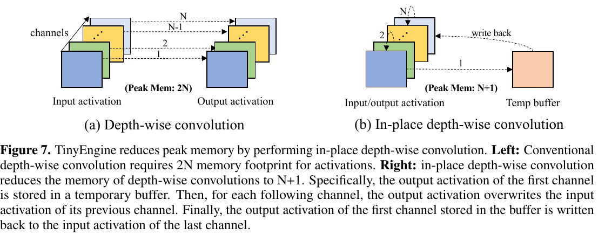
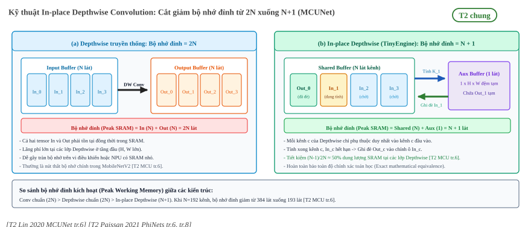

:tocdepth: 1

******************************
Thiết kế mạng nhận thức bộ nhớ
******************************

.. admonition:: Trang này trả lời

   - Mạng nơ-ron tiêu thụ những loại bộ nhớ nào trong quá trình thực thi suy luận?
   - Các nghiên cứu MCUNet và PhiNets giải quyết bài toán ràng buộc bộ nhớ tĩnh và động trên phần cứng biên ra sao?
   - Kỹ thuật In-place Depthwise Convolution làm cách nào cắt giảm bộ nhớ đỉnh từ 2N xuống N+1?
   - Những khác biệt căn bản và giới hạn khi chuyển giao các kỹ thuật nhận thức bộ nhớ từ MCU sang SoC biên có DRAM và NPU là gì?

.. admonition:: Tóm tắt

   - Bộ nhớ của một mạng nơ-ron phân tách thành hai thành phần độc lập: bộ nhớ tham số (Parameter Memory - PM / weights) lưu trữ tĩnh và bộ nhớ làm việc (Working Memory - WM / activations) lưu trữ các bản đồ đặc trưng động [T2 PHI tr.1] [T2 PHI tr.6].
   - Trên các hệ thống biên khắt khe, SRAM giới hạn kích thước activation đọc-ghi, trong khi Flash giới hạn kích thước mô hình chỉ đọc [T2 MCU tr.3].
   - Bộ nhớ đỉnh (Peak Memory) quyết định ngưỡng sống còn của phần cứng, thường xuất hiện ở các tầng mạng đầu tiên do kích thước không gian lớn, hoặc ở các mô hình phát hiện vật thể đa tỷ lệ do phải lưu giữ activation trung gian cho các nhánh nối tắt [T2 MCU tr.9].
   - Kỹ thuật In-place Depthwise Convolution trong MCUNet giúp cắt giảm bộ nhớ làm việc của lớp depthwise từ 2N xuống N+1 bằng cơ chế tính toán và ghi đè trực tiếp từng kênh [T2 MCU tr.6].
   - PhiNets tách rời ba trục ràng buộc gồm chi phí tính toán, bộ nhớ làm việc và bộ nhớ tham số, cho phép co giãn độc lập RAM qua hệ số :math:`t_0` và Flash qua hệ số :math:`\beta` [T2 PHI tr.1] [T2 PHI tr.8].
   - MCUNet và PhiNets thực nghiệm trên vi điều khiển bare-metal không có hệ điều hành và không có DRAM [T2 MCU tr.1]; khi chuyển giao sang SoC biên có DRAM và NPU, bài toán chuyển dịch từ giới hạn dung lượng vật lý sang tối ưu băng thông và năng lượng truy cập bộ nhớ ngoài [T2 Chen 2016 tr.8].

.. contents:: Trong trang này
   :local:
   :depth: 1

1. Hai loại bộ nhớ của một mạng
===============================

Trong các thiết kế mạng nơ-ron truyền thống hướng đến máy chủ hoặc máy tính cá nhân, mối quan tâm hàng đầu thường là số lượng phép tính dấu phẩy động (FLOPs) hoặc độ chính xác Top-1. Tuy nhiên, khi đưa mô hình xuống các thiết bị biên bị giới hạn tài nguyên nghiêm ngặt, dung lượng và hành vi truy xuất bộ nhớ mới là yếu tố quyết định tính khả thi của hệ thống.

1.1 Bộ nhớ làm việc (Activation) và bộ nhớ tham số (Weights)
------------------------------------------------------------

Bộ nhớ tiêu thụ trong quá trình suy luận của một mạng nơ-ron bao gồm hai thành phần có bản chất vận hành hoàn toàn trái ngược:

* **Bộ nhớ tham số (Parameter Memory - PM / Weights)**:
  Bao gồm toàn bộ trọng số (weights), độ lệch (biases), cùng các tham số tỷ lệ lượng tử hóa của các lớp tích chập và lớp kết nối đầy đủ. Đây là dữ liệu tĩnh, chỉ đọc (read-only) trong suốt chu trình suy luận. Dung lượng của PM tỷ lệ thuận với số lượng tham số của mô hình và độ rộng bit (bit-width) của kiểu dữ liệu (FP32, FP16 hoặc INT8). Kích thước PM hoàn toàn cố định, không phụ thuộc vào độ phân giải ảnh đầu vào.
* **Bộ nhớ làm việc (Working Memory - WM / Activations)**:
  Paissan 2021 định nghĩa đây là bộ nhớ động (dynamic memory) của mạng [T2 PHI tr.6]. Thành phần này dùng để lưu trữ các tensor kích hoạt trung gian (intermediate activation feature maps) sinh ra từ đầu ra của một lớp và đóng vai trò làm đầu vào cho lớp kế tiếp. Dữ liệu activation có tính chất đọc-ghi (read & write) liên tục, nhưng chỉ tồn tại tạm thời trong chu kỳ tính toán của từng lớp. Dung lượng bộ nhớ làm việc biến thiên trực tiếp theo kích thước không gian ảnh đầu vào :math:`(H \times W)` và số kênh đặc trưng :math:`C`.

Sự nhầm lẫn phổ biến trong thiết kế mạng biên là chỉ tìm cách nén kích thước file mô hình (giảm bộ nhớ tham số) mà bỏ qua dung lượng bản đồ đặc trưng (bộ nhớ làm việc). Một mô hình có số lượng tham số rất nhỏ vẫn có thể làm sập hệ thống biên nếu tạo ra các tensor kích hoạt trung gian vượt quá bộ nhớ truy cập ngẫu nhiên khả dụng.

Ví dụ minh họa định lượng trên một khối Inverted Residual Bottleneck (khối nền tảng của MobileNetV2):

* Tensor đầu vào: kích thước :math:`(C, H, W) = (32, 112, 112)`.
* Lớp mở rộng (1x1 Conv, hệ số mở rộng :math:`t = 6`): sinh ra tensor trung gian có shape :math:`(192, 112, 112)`.
* Lớp tích chập chiều sâu (3x3 Depthwise Conv): giữ nguyên shape :math:`(192, 112, 112)`.
* Lớp chiếu (1x1 Conv): đưa về shape đầu ra :math:`(64, 112, 112)`.

Tính toán dung lượng bộ nhớ cho khối này ở định dạng số nguyên 8-bit (INT8, 1 byte mỗi phần tử):

* **Bộ nhớ tham số (Weights)**:
  Lớp 1x1 mở rộng cần :math:`32 \times 192 = 6,144` bytes; lớp Depthwise cần :math:`192 \times 3 \times 3 = 1,728` bytes; lớp chiếu 1x1 cần :math:`192 \times 64 = 12,288` bytes. Tổng bộ nhớ trọng số chỉ vỏn vẹn **20,160 bytes** (:math:`\approx 19.7\text{ KB}`).
* **Bộ nhớ làm việc (Activation)**:
  Chỉ riêng tensor trung gian sau lớp mở rộng (:math:`192 \times 112 \times 112`) đã chiếm **2,408,448 bytes** (:math:`\approx 2.30\text{ MB}`).

Như vậy, bộ nhớ làm việc động của một khối đơn lẻ cao gấp hơn **119 lần** toàn bộ dung lượng trọng số tĩnh của chính khối đó. Trên các chip biên có bộ nhớ SRAM dưới 1 MB, khối tích chập này chắc chắn gây tràn bộ nhớ nếu không có cơ chế chia cắt (tiling) hoặc tối ưu bộ nhớ đỉnh.

2. MCUNet
=========

Công trình MCUNet (Lin 2020) là một trong những nghiên cứu tiên phong thiết lập phương pháp luận đồng thiết kế giữa kiến trúc mạng nơ-ron (TinyNAS) và engine thực thi siêu nhẹ (TinyEngine) trên các vi điều khiển cấp thấp.

2.1 SRAM giới hạn activation, Flash/DRAM giới hạn model size
------------------------------------------------------------

Lin 2020 chỉ ra sự phân hóa sâu sắc giữa hai tầng lưu trữ trên phần cứng vi điều khiển:

   "In deep learning scenarios, SRAM constrains the activation size (read&write); Flash constrains the model size (read-only)." [T2 MCU tr.3]

Đặc tính vật lý của hai loại bộ nhớ này trên các chip nhúng:

* **SRAM (Static RAM)**:
  Là bộ nhớ truy xuất ngẫu nhiên trên chip (on-chip), tốc độ cao nhưng chi phí diện tích silicon đắt đỏ. Trên các vi điều khiển, dung lượng SRAM thường rất nhỏ (dao động từ vài chục kilobyte đến dưới 1 megabyte). Toàn bộ bộ nhớ làm việc (activation buffers) bắt buộc phải nằm vừa trong SRAM để bộ xử lý có thể đọc và ghi kết quả tức thời.
* **Flash (Bộ nhớ bất khả biến)**:
  Dùng để lưu mã chương trình và trọng số mô hình. Dung lượng Flash thường lớn hơn SRAM từ 4 đến 16 lần (thường từ vài trăm kilobyte đến 2 megabyte). Do Flash là bộ nhớ chỉ đọc trong quá trình chạy, trọng số có thể được nạp trực tiếp từng phần mà không cần chiếm dụng SRAM.

Cơ chế thực thi tại chỗ (Execute-in-Place - XIP) hoặc nạp theo luồng từ Flash cho phép giải phóng toàn bộ không gian SRAM quý giá cho bộ đệm động của activation. Sự mất cân đối này định hình phương pháp luận thiết kế mạng trên MCU: kỹ sư có thể chấp nhận một mô hình có nhiều tham số để đổi lấy việc giảm kích thước activation trung gian, miễn là kích thước file mô hình không vượt quá ngưỡng Flash của phần cứng.

Do đó, một kiến trúc mạng biên tối ưu bắt buộc phải thỏa mãn đồng thời hai bất đẳng thức ràng buộc độc lập:

.. math::

   \text{Kích thước Model (Weights)} \le \text{Dung lượng Flash}

.. math::

   \text{Bộ nhớ đỉnh (Peak Activation)} \le \text{Dung lượng SRAM}

2.2 Tối ưu bộ nhớ đỉnh (Peak memory)
------------------------------------

Bộ nhớ đỉnh (Peak Memory) được định nghĩa là dung lượng RAM lớn nhất cần thiết tại thời điểm căng thẳng nhất trong chu trình suy luận của mạng. Đối với một mô hình tuần tự, bộ nhớ đỉnh tại lớp thứ :math:`l` bằng tổng dung lượng của tensor đầu vào và tensor đầu ra của lớp đó:

.. math::

   M_{\text{peak}} = \max_{l} \left( \text{Dung lượng}(\text{Input}_l) + \text{Dung lượng}(\text{Output}_l) \right)

Lin 2020 quan sát thấy bộ nhớ đỉnh của các mạng nơ-ron thị giác thường không nằm ở các tầng sâu nhất (nơi có nhiều tham số nhất), mà tập trung ở một vài tầng đầu tiên của mạng. Tại các tầng đầu, dù số kênh :math:`C` còn nhỏ, nhưng độ phân giải không gian :math:`(H \times W)` lại rất lớn, tạo ra các khối tensor kích hoạt khổng lồ.

Hiện tượng này càng trở nên nghiêm trọng đối với các tác vụ phát hiện vật thể (object detection). Các mô hình như YOLO sử dụng các bản đồ đặc trưng đa tỷ lệ (multi-scale feature maps) để dự đoán vật thể ở các kích thước khác nhau:

   "use multi-scale feature maps to generate the final prediction, which has to keep intermediate activations in the SRAM, increasing the peak memory by a large margin" [T2 MCU tr.9]

Để ghép nối các tầng đặc trưng từ phần trích xuất (backbone) sang mạng kim tự tháp (FPN/PANet), hệ thống buộc phải giữ lại toàn bộ activation của các tầng có độ phân giải cao trong bộ nhớ thay vì giải phóng ngay lập tức, khiến bộ nhớ đỉnh tăng vọt. Do đó, kỹ thuật TinyNAS của MCUNet chủ động tìm kiếm các cấu trúc mạng có độ phân giải giảm nhanh ở các tầng đầu để ghìm bộ nhớ đỉnh xuống mức thấp nhất.

Bên cạnh tối ưu hóa kiến trúc, kỹ thuật lập lịch bộ nhớ (memory scheduling) đóng vai trò quyết định trong việc giảm bộ nhớ đỉnh:

* **Cơ chế đệm luân phiên (Ping-Pong Buffering)**:
  Trong các runtime sơ khai, hệ thống cấp phát hai bộ đệm tĩnh luân phiên để đọc từ đệm A và ghi sang đệm B, rồi đảo ngược lại ở lớp tiếp theo. Kỹ thuật này đòi hỏi kích thước mỗi đệm phải bằng kích thước tensor lớn nhất của toàn mạng, gây lãng phí bộ nhớ ở các tầng sau.
* **Phân tích vòng đời tensor (Tensor Lifetime Analysis)**:
  TinyEngine xây dựng đồ thị vòng đời cho từng tensor kích hoạt, xác định chính xác thời điểm tensor được tạo ra và thời điểm nó được sử dụng lần cuối cùng. Khi một tensor không còn phụ thuộc downstream, vùng nhớ của nó lập tức được đưa vào danh sách tái cấp phát (memory reuse pool). Nhờ đó, các tensor ở các nhánh mạng khác nhau có thể chia sẻ chung các dải địa chỉ vật lý mà không gây xung đột dữ liệu.

3. PhiNets
==========

PhiNets (Paissan 2021) mở rộng triết lý nhận thức bộ nhớ bằng cách thiết lập một không gian kiến trúc có thể tùy biến linh hoạt, cho phép tách bạch hoàn toàn các ràng buộc vật lý của thiết bị mục tiêu.

3.1 Tách biệt chi phí tính toán, bộ nhớ làm việc và bộ nhớ tham số
------------------------------------------------------------------

Các họ mạng kinh điển như MobileNetV2 áp dụng hệ số co giãn độ rộng kênh đồng nhất (width multiplier :math:`\alpha`). Khi giảm :math:`\alpha`, cả số phép tính (MACs), dung lượng trọng số (PM) và bộ nhớ kích hoạt (WM) đều đồng thời suy giảm theo quy luật bậc hai hoặc bậc nhất. Sự ghép nối chặt này khiến mô hình không thể tối ưu khi phần cứng có cấu hình tài nguyên bất cân xứng (ví dụ chip có SRAM rất nhỏ nhưng Flash lớn, hoặc ngược lại).

Đóng góp cốt lõi của PhiNets là tách rời ba tham số ràng buộc này:

   "decouple the computational cost, working memory, and parameter memory" [T2 PHI tr.1]

Kiến trúc PhiNets đưa ra các siêu tham số độc lập để điều khiển từng thành phần:

* **Hệ số mở rộng kênh tầng đầu (:math:`t_0`)**: Điều chỉnh trực tiếp bộ nhớ làm việc (WM / RAM). Do bộ nhớ đỉnh chủ yếu tập trung ở các khối tích chập đầu tiên, việc giảm :math:`t_0` tại các khối này giúp ghìm mạnh RAM mà hầu như không ảnh hưởng đến dung lượng Flash của toàn mạng.
* **Hệ số nhân kênh tầng sâu (:math:`\beta`)**: Điều chỉnh trực tiếp bộ nhớ tham số (PM / Flash). Phần lớn trọng số tập trung ở các khối sau của mạng (nơi số kênh đạt cực đại), nên :math:`\beta` cho phép nén dung lượng file mô hình mà không làm tăng bộ nhớ kích hoạt của các tầng đầu.
* **Độ sâu (:math:`D`) và độ phân giải (:math:`R`)**: Điều tiết tổng số phép tính (MACs / FLOPs).

.. figure:: ../../../_assets/img/01-kien-thuc-nen/05-bo-nho-hieu-nang/thiet-ke-nhan-thuc-bo-nho/phinets-fig4-ram-flash-constraints.png
   :align: center
   :alt: Ràng buộc bộ nhớ RAM và FLASH trong PhiNets

   Hình 7.5b. PhiNets: RAM (WM, đồ thị trái) thay đổi tuyến tính theo ``t0``, FLASH (PM, đồ thị phải) thay đổi tuyến tính theo ``β`` (mỗi đồ thị 3 điểm). Nguồn: [T2 PHI tr.8, Fig. 4]

Đồ thị Hình 7.5b chứng minh tính trực giao hoàn hảo giữa hai tham số: dung lượng RAM thay đổi tuyến tính theo :math:`t_0` mà không bị chi phối bởi :math:`\beta`, trong khi dung lượng Flash thay đổi tuyến tính theo :math:`\beta` mà hoàn toàn độc lập với :math:`t_0` [T2 PHI tr.8].

Sự tách bạch này khắc phục triệt để nhược điểm của phương pháp co giãn hợp chất (Compound Scaling như họ EfficientNet). Trong Compound Scaling, người ta mở rộng đồng loạt độ sâu, độ rộng và độ phân giải theo một hệ số duy nhất với giả định ngầm rằng tài nguyên phần cứng tăng trưởng đồng đều. Nhưng trên các hệ thống nhúng biên, tỷ lệ giữa dung lượng RAM và Flash rất đa dạng và phân mảnh giữa các dòng chip. Việc co giãn ghép cặp khiến mô hình dễ rơi vào tình trạng vừa vặn dung lượng Flash nhưng lại làm tràn SRAM, hoặc ngược lại lãng phí phần lớn Flash vì bị nghẽn ở giới hạn RAM. PhiNets cho phép người kỹ sư khóa cứng ngưỡng RAM tối đa :math:`\text{WM}_{\max}` và Flash tối đa :math:`\text{PM}_{\max}` để sinh ra kiến trúc tối ưu vừa khít phần cứng.

4. Kỹ thuật In-place Depthwise Convolution (giảm peak memory từ 2N xuống N+1)
=============================================================================

Trong cấu trúc mạng nơ-ron di động, khối tích chập tách biệt theo chiều sâu (Depthwise Separable Convolution) là thành phần then chốt giúp cắt giảm số lượng phép tính MAC. Tuy nhiên, ở các engine thực thi truyền thống, lớp Depthwise lại là thủ phạm chính gây ra các đỉnh bộ nhớ cục bộ.

Trong một lớp Depthwise tiêu chuẩn:

* Bộ đệm đầu vào chứa tensor kích thước :math:`N = C \times H \times W`.
* Bộ đệm đầu ra chứa tensor kích thước :math:`N = C \times H \times W` (khi stride = 1 và giữ nguyên số kênh).
* Tổng dung lượng bộ nhớ làm việc mà runtime phải cấp phát đồng thời là :math:`2N`.

Cơ chế đột phá của kỹ thuật In-place Depthwise Convolution do Lin 2020 đề xuất trong TinyEngine dựa trên đặc tính toán học thuần túy của phép toán: trong tích chập Depthwise, mỗi kênh đầu ra :math:`c` chỉ phụ thuộc duy nhất vào kênh đầu vào :math:`c` tương ứng. Hoàn toàn không có sự giao thoa hay chia sẻ dữ liệu giữa các kênh khác nhau như trong tích chập chuẩn.

Từ quan sát đó, TinyEngine tái cấu trúc thứ tự tính toán và cấp phát bộ đệm:

1. Thay vì tính toán toàn bộ tensor đầu ra rồi mới giải phóng tensor đầu vào, engine chỉ cấp phát một bộ đệm tạm phụ trợ có dung lượng đúng bằng một lát cắt kênh: :math:`1 \text{ slice} = H \times W`.
2. Phép tính được thực hiện tuần tự từng kênh một. Kết quả của kênh :math:`c` được ghi tạm vào bộ đệm phụ trợ.
3. Ngay sau khi kênh :math:`c` tính toán hoàn tất, dữ liệu của kênh đầu vào :math:`c` không còn bất kỳ giá trị sử dụng nào trong tương lai. Engine lập tức sao chép lát cắt từ bộ đệm tạm ghi đè trực tiếp (in-place overwrite) vào đúng vị trí bộ nhớ của kênh đầu vào :math:`c`.

Lin 2020 khẳng định kỹ thuật này:

   "reduces the memory of depth-wise convolutions to N+1" [T2 MCU tr.6]

   Hình 7.5a. In-place depth-wise convolution của TinyEngine: peak memory giảm từ 2N xuống N+1 nhờ ghi đè activation của channel trước. Nguồn: [T2 MCU tr.6, Figure 7]

Nhờ cơ chế này, tổng bộ nhớ cần thiết giảm từ :math:`2N` xuống còn :math:`N + 1` lát cắt, tiết kiệm tới gần 50% bộ nhớ đỉnh tại các lớp Depthwise mà không làm suy giảm dù chỉ một phép tính độ chính xác.

   Kỹ thuật In-place Depthwise Convolution: cơ chế ghi đè kênh tuần tự qua bộ đệm phụ trợ 1 lát, cắt giảm bộ nhớ đỉnh từ 2N xuống N+1 [T2 Lin 2020 MCUNet tr.6], [T2 Paissan 2021 PhiNets tr.6, tr.8].

Quy trình luân chuyển bộ nhớ chi tiết của In-place Depthwise Convolution:

* **Bước 0 (Khởi tạo không gian)**:
  Cấp phát một mảng bộ nhớ chính gồm :math:`C` lát cắt kênh (:math:`\text{Buf}[0 \dots C-1]`) chứa toàn bộ tensor đầu vào kích thước :math:`C \times H \times W`, và duy nhất một lát cắt bộ đệm phụ trợ (:math:`\text{AuxBuf}`) có kích thước :math:`H \times W`.
* **Bước 1 (Xử lý kênh đầu tiên)**:
  Bộ nhân chập đọc dữ liệu từ kênh :math:`\text{Buf}[0]`, thực hiện phép tính với kernel tương ứng, và lưu giá trị kết quả vào :math:`\text{AuxBuf}`. Tại thời điểm này, toàn bộ dữ liệu gốc trong :math:`\text{Buf}[0]` trở thành vùng nhớ hết hạn (dead memory) vì không còn bất kỳ phép toán nào phụ thuộc vào nó.
* **Bước 2 (Ghi đè tại chỗ)**:
  Hệ thống sao chép dữ liệu từ :math:`\text{AuxBuf}` ghi đè trực tiếp vào vị trí của :math:`\text{Buf}[0]`. Sau thao tác này, :math:`\text{Buf}[0]` chính thức trở thành kênh đầu ra thứ 0, trong khi :math:`\text{AuxBuf}` được giải phóng để sẵn sàng cho kênh tiếp theo.
* **Bước lặp :math:`c` (Từ kênh 1 đến :math:`C-1`)**:
  Quá trình trên được lặp lại tuần tự cho các kênh tiếp theo. Tại bất kỳ thời điểm nào trong toàn bộ chu trình thực thi, phần cứng chỉ cần duy trì tối đa :math:`C + 1` lát cắt trong SRAM thay vì phải cấp phát riêng một vùng nhớ :math:`C` lát cắt mới cho tensor đầu ra.

5. Giới hạn khi chuyển giao sang thiết bị biên có DRAM và NPU
=============================================================

Mặc dù các phát hiện từ MCUNet và PhiNets mang lại nền tảng lý thuyết sâu sắc về nhận thức bộ nhớ, việc áp dụng nguyên bản các kết luận này sang các hệ thống SoC biên hiệu năng cao (như các chip tích hợp NPU) đòi hỏi sự cẩn trọng về mặt kỹ thuật.

Lin 2020 chỉ rõ môi trường thực nghiệm ban đầu của các nghiên cứu này:

   "Microcontrollers are bare-metal devices that do not have an operating system, nor do they have DRAM." [T2 MCU tr.1]

Sự chuyển dịch nền tảng phần cứng tạo ra những khác biệt bản chất:

.. list-table:: So sánh đặc tính bộ nhớ giữa Vi điều khiển (MCU) và SoC biên có NPU
   :header-rows: 1
   :widths: 22 38 40

   * - Tiêu chí
     - Vi điều khiển (Lin 2020 / Paissan 2021)
     - SoC biên có NPU và DRAM
   * - **Cấu trúc bộ nhớ**
     - Chạy bare-metal, bộ nhớ phẳng (flat memory), không có hệ điều hành, không có DRAM ngoài.
     - Chạy Linux với MMU/IOMMU, bộ nhớ phân trang ảo, trang bị từ vài GB đến hàng chục GB LPDDR4/LPDDR5.
   * - **Bản chất nghẽn**
     - Nghẽn dung lượng vật lý (Capacity-bound): tràn vài kilobyte SRAM là hệ thống sập (OOM crash).
     - Nghẽn băng thông và năng lượng (Bandwidth & Energy-bound): DRAM đủ chứa nhưng bus không tải kịp.
   * - **Vai trò bộ nhớ đỉnh**
     - Quyết định mô hình có nạp được vào chip hay không.
     - Quyết định lượng dữ liệu bị tràn (spill) từ SRAM nội bộ ra DRAM ngoài chip.

Các giới hạn cụ thể khi chuyển giao:

* **Từ giới hạn dung lượng sang giới hạn băng thông**:
  Trên SoC có DRAM, một mạng nơ-ron có activation lớn không bao giờ gặp lỗi thiếu RAM vật lý. Tuy nhiên, việc liên tục nạp và xả các tensor kích hoạt khổng lồ qua bus DDR ngoài chip sẽ bóp nghẹt băng thông hệ thống và tiêu tốn năng lượng gấp hàng trăm lần so với việc tính toán nội bộ trong SRAM [T2 Chen 2016 tr.8]. Do đó, mục tiêu tối ưu bộ nhớ đỉnh trên NPU là để giữ trọn vẹn tensor trung gian bên trong bộ đệm SRAM trên chip, tránh phát sinh lưu lượng DDR ngoài.
* **Tính khép kín của compiler NPU thương mại**:
  Kỹ thuật In-place Depthwise được Lin 2020 hiện thực hóa mã nguồn mở trong TinyEngine cho CPU ARM Cortex-M. Trên các SoC biên chuyên dụng, quá trình phân bổ bộ nhớ và gộp lớp (layer fusion) do compiler NPU độc quyền của từng hãng bán dẫn tự động thực hiện. Liệu compiler của Rockchip hay các hãng tương đương có áp dụng cơ chế ghi đè in-place cho lớp depthwise hay không là ``unknown`` (tài liệu SDK không công bố chi tiết thuật toán sinh mã hạ tầng).
* **Áp lực bộ nhớ của kiến trúc phát hiện vật thể đa tỷ lệ**:
  Nhận định của Lin 2020 về việc các mạng phát hiện vật thể đa tỷ lệ như YOLO làm tăng vọt bộ nhớ đỉnh [T2 MCU tr.9] hoàn toàn đúng về mặt nguyên lý trên SoC biên. Việc duy trì các bản đồ đặc trưng P3, P4, P5 trong thời gian dài để kết nối mạng kim tự tháp khiến NPU liên tục phải ghi dữ liệu trung gian ra DRAM ngoài, biến các tầng FPN/PANet thành điểm nghẽn lưu lượng chính trong các mô hình thị giác biên.
* **Chiến lược thiết kế mạng nơ-ron cho SoC biên**:
  Từ các phân tích trên, kỹ sư thiết kế mô hình cho các hệ thống biên có NPU cần chuyển dịch trọng tâm tối ưu. Thay vì chỉ cắt giảm tham số hoặc FLOPs trên giấy, cần ưu tiên thiết kế các cấu trúc mạng giảm thiểu các kết nối tắt kéo dài qua quá nhiều tầng trung gian, tạo điều kiện thuận lợi cho compiler thực hiện gộp lớp (layer fusion) hoàn toàn bên trong bộ nhớ đệm SRAM nội bộ của SoC.

Để tìm hiểu chi tiết về kiến trúc kênh bộ nhớ DDR, bộ nhớ đệm SRAM chuyên dụng và các kỹ thuật căn lề bộ đệm trên phần cứng SoC RK3588, tham khảo :doc:`DDR trên RK3588 </contents/02-nen-tang-rk3588/04-bo-nho-hieu-nang/01-ddr-tren-rk3588>` và :doc:`SRAM cho NPU </contents/02-nen-tang-rk3588/04-bo-nho-hieu-nang/02-sram-cho-npu>`.

Nguồn
=====

Các tài liệu T2 được trích dẫn và đối chiếu trong trang này:

.. list-table::
   :header-rows: 1
   :widths: 15 10 60 15

   * - Nhãn
     - Tier
     - Tệp tài liệu
     - Số lần trích
   * - ``MCU``
     - T2
     - :download:`mcunet_2020lin.pdf <../../../_assets/pdf/papers/04_memory/mcunet_2020lin.pdf>`
     - 6
   * - ``PHI``
     - T2
     - :download:`phinets_edge_2021paissan.pdf <../../../_assets/pdf/papers/04_memory/phinets_edge_2021paissan.pdf>`
     - 4
   * - ``Chen 2016``
     - T2
     - :download:`eyeriss_dataflow_2016chen.pdf <../../../_assets/pdf/papers/01_hardware/eyeriss_dataflow_2016chen.pdf>`
     - 1
