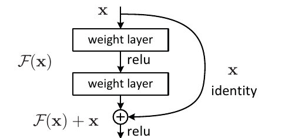
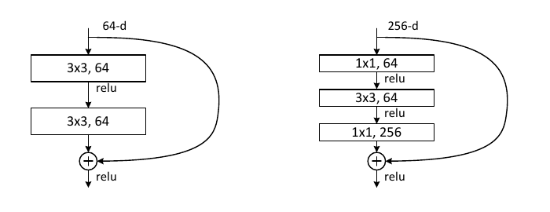
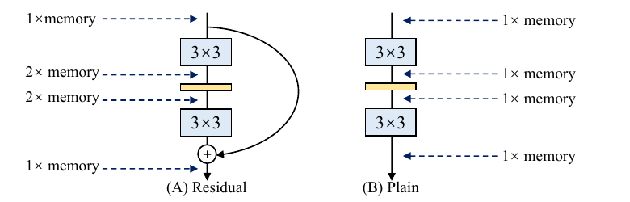

:tocdepth: 1

**********************
Khối residual (ResNet)
**********************

.. admonition:: Trang này trả lời

   - Khối residual sinh ra để giải điểm nghẽn nào của mạng tích chập sâu?
   - Học phần dư thay đổi gì về cách tối ưu và dòng gradient, và đánh đổi gì về tính toán, bộ nhớ?
   - Vì sao khối này nằm trong backbone của các mạng phát hiện hiện đại?

.. admonition:: Tóm tắt

   - Điểm nghẽn là hiện tượng degradation: thêm lớp vào một mạng đã đủ sâu làm sai số huấn luyện tăng, không phải do overfitting [T2 RESNET tr.1].
   - Khối residual cho các lớp xếp chồng học :math:`F(x) := H(x) - x`, đầu ra là :math:`F(x) + x`. Đây là giả thuyết rằng học phần dư dễ tối ưu hơn học ánh xạ gốc [T2 RESNET tr.2].
   - Shortcut identity không thêm tham số hay phép tính [T2 RESNET tr.2]. Với mạng sâu, bài gốc đổi khối hai lớp thành khối bottleneck 1x1, 3x3, 1x1 để giữ chi phí huấn luyện [T2 RESNET tr.6].
   - Bằng chứng thực nghiệm trên ImageNet: ở 34 lớp, top-1 error là 28.54 (plain) và 25.03 (ResNet). Ở 18 lớp hai bên gần bằng nhau (27.94 và 27.88) nhưng ResNet hội tụ nhanh hơn [T2 RESNET tr.5, tr.6].
   - Bài gốc lập luận khó khăn này khó có thể do tiêu biến gradient, vì mạng plain đã dùng BN [T2 RESNET tr.5].
   - Đánh đổi bộ nhớ: đầu vào khối phải được giữ đến phép cộng, đỉnh bộ nhớ activation tối đa 2 lần đầu vào nếu khối giữ nguyên kích thước feature map. Số này từ bài RepVGG, không phải bài ResNet [T2 REPVGG tr.4].

.. contents:: Trong trang này
   :local:
   :depth: 1

1. Điểm nghẽn: degradation
==========================

Trước ResNet, khởi tạo chuẩn hóa và các lớp chuẩn hóa trung gian đã giúp mạng hàng chục lớp bắt đầu hội tụ. Khi đó lộ ra một vấn đề khác:

   "with the network depth increasing, accuracy gets saturated (which might be unsurprising) and then degrades rapidly. Unexpectedly, such degradation is not caused by overfitting, and adding more layers to a suitably deep model leads to higher training error" [T2 RESNET tr.1]

Sai số huấn luyện của mạng sâu cao hơn mạng nông, nên không thể giải thích bằng overfitting. Hình 1 của bài đo trên CIFAR-10 với mạng plain 20 và 56 lớp:

   "The deeper network has higher training error, and thus test error." [T2 RESNET tr.1]

Điều này vô lý về mặt lý thuyết, vì mạng sâu luôn có một nghiệm xây dựng được:

   "There exists a solution by construction to the deeper model: the added layers are identity mapping, and the other layers are copied from the learned shallower model." [T2 RESNET tr.1]

Vậy mạng sâu ít nhất phải bằng mạng nông, nhưng bộ tối ưu không tìm ra nghiệm đó. Chồng các lớp phi tuyến khó học ánh xạ đồng nhất.

.. note::

   Một số tài liệu giải thích động cơ của residual bằng tiêu biến gradient. Bài gốc lập luận khác. Các mạng plain trong thí nghiệm đã dùng BN:

      "We argue that this optimization difficulty is unlikely to be caused by vanishing gradients." [T2 RESNET tr.5]

   Và bài đã kiểm tra gradient lan truyền ngược vẫn có chuẩn bình thường:

      "So neither forward nor backward signals vanish." [T2 RESNET tr.5]

   Tác giả chỉ giả thuyết rằng mạng plain sâu có tốc độ hội tụ thấp theo hàm mũ, và nói nguyên nhân sẽ nghiên cứu sau [T2 RESNET tr.5]. Nguyên nhân của degradation vì vậy chưa được bài này giải thích xong.

2. Ý tưởng: học phần dư
=======================

Gọi :math:`H(x)` là ánh xạ cần học bởi một vài lớp xếp chồng. Thay vì bắt các lớp học trực tiếp :math:`H(x)`, bài cho chúng học phần dư:

.. math::

   F(x) := H(x) - x, \qquad y = F(x) + x

   Hình 6.1a. Khối residual cơ bản: đầu vào x đi qua hai weight layer (ra :math:`F(x)`) và đồng thời theo shortcut identity, hai nhánh được cộng rồi qua ReLU. Nguồn: [T2 RESNET tr.2, Figure 2]

Đây là giả thuyết, không phải kết quả đã chứng minh:

   "We hypothesize that it is easier to optimize the residual mapping than to optimize the original, unreferenced mapping." [T2 RESNET tr.2]

Trường hợp cực đoan là khi ánh xạ đồng nhất là tối ưu:

   "it would be easier to push the residual to zero than to fit an identity mapping by a stack of nonlinear layers" [T2 RESNET tr.2]

Trong thực tế đồng nhất hiếm khi tối ưu, nhưng cách viết này vẫn giúp bài toán dễ hơn:

   "it should be easier for the solver to find the perturbations with reference to an identity mapping, than to learn the function as a new one" [T2 RESNET tr.3]

Về mặt đặc trưng, bài không khẳng định khối residual biểu diễn được nhiều hơn. Lợi ích được nêu là dễ tối ưu hơn, tức tìm nghiệm tốt hơn trong cùng không gian hàm.

Cơ chế của phép Add, điều kiện cùng kích thước và hai kiểu shortcut (identity, projection Conv 1x1) đã có ở :doc:`../01-nen-tang-ai/03-convolution-va-cnn` mục 9, không nhắc lại ở đây. Bài gốc còn một lựa chọn không thêm tham số khi tăng số kênh:

   "The shortcut still performs identity mapping, with extra zero entries padded for increasing dimensions. This option introduces no extra parameter" [T2 RESNET tr.4]

3. Dòng gradient
================

Phần này là suy diễn từ công thức, không phải câu trong bài. Với :math:`y = F(x) + x`, đạo hàm của đầu ra theo đầu vào là:

.. math::

   \frac{\partial y}{\partial x} = \frac{\partial F}{\partial x} + I

Số hạng :math:`I` cho gradient một đường đi thẳng về các lớp trước mà không nhân qua trọng số của :math:`F`. Điều này khớp với cách bài mô tả shortcut là đường đi không tham số, nhưng bài không dùng nó làm lý do chính (xem ghi chú ở mục 1).

4. Khối bottleneck cho mạng sâu
===============================

Với mạng sâu, bài đổi khối hai lớp 3x3 thành ba lớp:

   "The three layers are 1×1, 3×3, and 1×1 convolutions, where the 1×1 layers are responsible for reducing and then increasing (restoring) dimensions, leaving the 3×3 layer a bottleneck with smaller input/output dimensions." [T2 RESNET tr.6]

   Hình 6.1b. Trái: khối hai lớp 3x3, 64 kênh (dùng cho ResNet-34). Phải: khối bottleneck 1x1 (64), 3x3 (64), 1x1 (256) cho ResNet-50/101/152. Shortcut nối hai đầu 256 kênh. Nguồn: [T2 RESNET tr.6, Figure 5]

Lý do là chi phí huấn luyện:

   "Because of concerns on the training time that we can afford, we modify the building block" [T2 RESNET tr.6]

Shortcut identity càng quan trọng ở khối này, vì shortcut nối hai đầu có số kênh lớn:

   "If the identity shortcut in Fig. 5 (right) is replaced with projection, one can show that the time complexity and model size are doubled, as the shortcut is connected to the two high-dimensional ends." [T2 RESNET tr.6]

5. Đánh đổi
===========

.. list-table::
   :header-rows: 1
   :widths: 20 40 40

   * - Khía cạnh
     - Được
     - Mất hoặc điều kiện
   * - Tối ưu
     - ResNet-34 có top-1 error 25.03, plain-34 là 28.54 (10-crop, ImageNet) [T2 RESNET tr.5]
     - Giả thuyết dễ tối ưu hơn chưa có chứng minh, bài tự nói nguyên nhân sẽ nghiên cứu sau [T2 RESNET tr.5]
   * - Mạng nông
     - ResNet-18 hội tụ nhanh hơn plain-18 ở giai đoạn đầu [T2 RESNET tr.6]
     - Độ chính xác cuối gần như không đổi (27.88 so với 27.94) [T2 RESNET tr.5]
   * - Tham số và phép tính
     - Shortcut identity không thêm tham số hay phép tính [T2 RESNET tr.2]
     - Projection shortcut ở bottleneck làm gấp đôi chi phí và kích thước [T2 RESNET tr.6]
   * - Hình dạng tensor
     - Phép cộng đơn giản, không tham số
     - Hai nhánh phải cùng kích thước, đổi số kênh hoặc stride cần zero-padding hoặc Conv 1x1 (:doc:`../01-nen-tang-ai/03-convolution-va-cnn` mục 9)
   * - Bộ nhớ
     - Không có số đo riêng trong bài gốc ResNet
     - Đầu vào khối phải được giữ đến điểm cộng, nên đỉnh bộ nhớ tăng (xem mục 5.1)

5.1. Chi phí bộ nhớ của phép Add
--------------------------------

Bài ResNet không đo chi phí này. Bài RepVGG phân tích nó khi giải thích vì sao mạng đa nhánh kém hiệu quả lúc suy luận:

   "Memory-economical The multi-branch topology is memory-inefficient because the results of every branch need to be kept until the addition or concatenation, significantly raising the peak value of memory occupation. Fig. 3 shows that the input to a residual block need to be kept until the addition. Assuming the block maintains the feature map size, the peak value of extra memory occupation is 2× as the input. In contrast, a plain topology allows the memory occupied by the inputs to a specific layer to be immediately released when the operation is finished." [T2 REPVGG tr.4]

   Hình 6.1c. Đỉnh bộ nhớ activation: khối residual (A) giữ x trong lúc hai lớp 3x3 chạy nên chiếm 2x, mạng plain (B) luôn chiếm 1x. Nguồn: [T2 REPVGG tr.4, Figure 3]

Diễn giải cho phần cứng (suy luận của tài liệu này, bài gốc chỉ nói "memory"): phép Add cần cả :math:`x` lẫn :math:`F(x)`, nên tensor :math:`x` phải nằm lại trong bộ nhớ (SRAM hoặc DDR tùy kích thước và cách compiler xếp) trong lúc nhánh :math:`F` còn chạy. Khi khối giữ nguyên kích thước feature map, bài RepVGG tính đỉnh này là 2 lần đầu vào. Con số 2x là của hình đó, không phải số đo trên RK3588. Ảnh hưởng lên băng thông DDR chưa có số đo trong các nguồn đã đọc: unknown. Cách loại chi phí này bằng tái tham số hóa nằm ở :doc:`../08-thiet-ke-model/01-tai-tham-so-hoa-cau-truc` mục 1.

6. Vì sao nằm trong backbone phát hiện
======================================

ResNet giảm độ phân giải theo từng stage bằng Conv stride 2, không dùng pooling giữa các stage:

   "Downsampling is performed by conv3_1, conv4_1, and conv5_1 with a stride of 2." [T2 RESNET tr.5]

Với ảnh cắt 224x224 [T2 RESNET tr.4], các stage conv3_x, conv4_x, conv5_x cho bản đồ đặc trưng 28x28, 14x14, 7x7 (Table 1) [T2 RESNET tr.5]. Chia ra là stride 8, 16, 32, phép tính của tài liệu này. Đó cũng là ba tỉ lệ mà phần neck của mạng phát hiện cần (P3, P4, P5), nên ResNet gắn vào detector được mà không cần sửa cấu trúc.

Bài gốc thay VGG-16 bằng ResNet-101 trong Faster R-CNN và giữ nguyên phần còn lại:

   "The detection implementation (see appendix) of using both models is the same, so the gains can only be attributed to better networks." [T2 RESNET tr.8]

Cách làm này trùng với mục tiêu của khung backbone, neck, head độc lập của dự án: đổi một phần, giữ hai phần còn lại, để quy mức cải thiện cho đúng phần đã đổi.

Cùng ý cộng tắt xuất hiện trong YOLO ở các chỗ sau, không lặp lại nội dung ở đây:

- Khối Bottleneck của C2f cộng đầu vào vào đầu ra khi cờ ``shortcut`` bật. Backbone bật, neck tắt: :doc:`/contents/03-phuong-phap/01-tang-ai/02-kien-truc-model` mục 4.2.
- Cờ ``shortcut`` của SPPF ở YOLO26n: :doc:`../07-yolo/01-kien-truc-va-khoi-cau-thanh-yolo`.

Liên hệ RK3588: phép Add trong khối residual được gộp vào Conv hay không theo luật fusion của RKNN, xem :doc:`Layout NC1HWC2 và fusion </contents/02-nen-tang-rk3588/03-toolchain-runtime/05-fusion-va-layout-nc1hwc2>`.

Nguồn
=====

Nhãn nguồn dùng trong trang này.

.. list-table::
   :header-rows: 1
   :widths: 15 10 65 10

   * - Nhãn
     - Tier
     - Nguồn
     - Số lần
   * - ``RESNET``
     - T2
     - :download:`resnet_2015he.pdf <../../../_assets/pdf/papers/00_overview/resnet_2015he.pdf>`
     - 31
   * - ``REPVGG``
     - T2
     - :download:`repvgg_reparam_2021ding.pdf <../../../_assets/pdf/papers/08_npu_friendly_arch/repvgg_reparam_2021ding.pdf>`
     - 3

Số trang trong nhãn RESNET là chỉ số trang PDF của bản arXiv v1 (12 trang), bài He et al., Deep Residual Learning for Image Recognition (arXiv:1512.03385).
