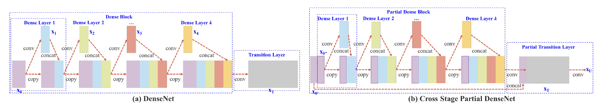
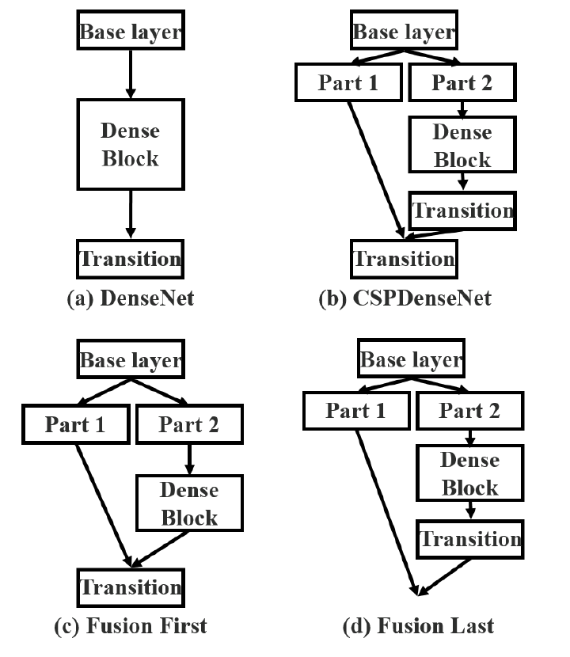
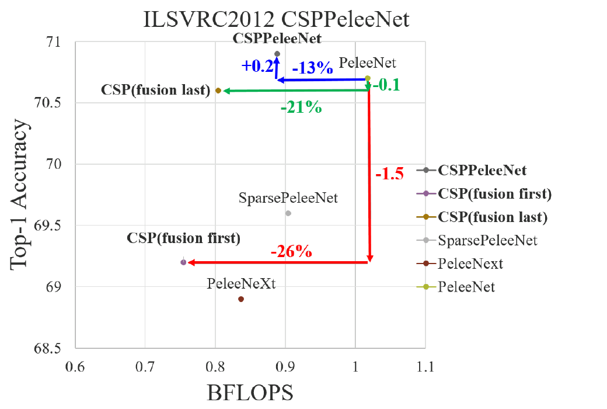
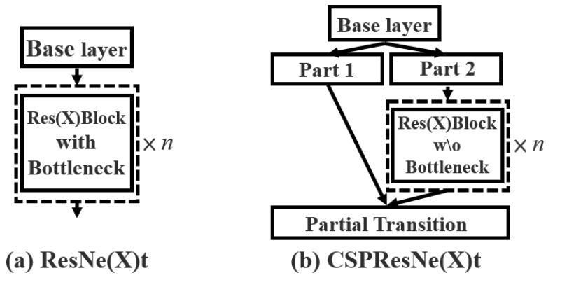

:tocdepth: 1

***********************
CSP và C2f (CSPDarknet)
***********************

.. admonition:: Trang này trả lời

   - CSP sinh ra để giải điểm nghẽn nào, và nó đổi gì trong cách chia, nối đặc trưng?
   - C2f của YOLOv8 khác khối CSP kiểu C3 ở đâu, theo mã nguồn?
   - Đánh đổi gì về tính toán và bộ nhớ, và Concat, Split của C2f tốn bao nhiêu trên NPU RK3588?
   - Vì sao họ CSP nằm trong backbone phát hiện, và phần nào chưa có nguồn?

.. admonition:: Tóm tắt

   - Bài CSPNet quy vấn đề về thông tin gradient bị lặp trong lúc tối ưu, và đề xuất chia bản đồ đặc trưng làm hai phần rồi nối lại ở cuối stage [T2 CSPNET tr.1, tr.2].
   - Chỉ một nửa số kênh đi qua dense block hay Res(X)Block, nửa kia nối thẳng đến cuối stage. Bài báo cáo giảm 10% đến 22% phép tính ở các mạng phân loại, độ chính xác giữ nguyên hoặc tăng [T2 CSPNET tr.8, tr.9].
   - Cách nối quan trọng hơn việc chia: nối trước rồi mới chuyển đổi (fusion first) làm top-1 giảm 1.5, còn chuyển đổi trước rồi nối (fusion last) chỉ giảm 0.1 [T2 CSPNET tr.5].
   - C2f là biến thể của Ultralytics: một Conv 1x1 sinh ``2c`` kênh, tách đôi, và mọi đầu ra trung gian của chuỗi Bottleneck đều được nối lại, nên đầu vào của Conv cuối rộng ``(2+n)c`` kênh [T1 block.py:306-315].
   - Chi phí chuyển sang bộ nhớ và các op không phải Conv: trên YOLOv8n INT8 ở RK3588, Split và Concat của tám khối C2f tốn 1933 µs, tức 19.3% thời gian chính các khối C2f và khoảng 8% thời gian chế độ debug cả mạng [T3 board].
   - Nguồn gốc thiết kế: bài YOLOv7 nêu ELAN và đường gradient ngắn nhất, dài nhất [T2 YOLOV7 tr.3]. Việc C2f dựa trên ELAN chỉ được bên thứ ba mô tả [T2 DAHD tr.4]. Chưa tìm thấy phát biểu của Ultralytics.
   - Lợi ích so với C3: một bài đo trên VisDrone cho C2f hơn C3 1.0 điểm mAP50 với thêm 1.5M tham số, không đo tốc độ [T2 SLYOLO tr.8]. Trong repo, phép đo riêng cho YOLOv8n trên PPE5 (mục 5, ba seed, train từ đầu 200 epoch): thay C2f bằng C3 làm AP50-95 trên css_test giảm 5.76 điểm (41.23 xuống 35.47), vượt độ phân tán giữa các seed (1.96 điểm). Trên ppe2286_ext chênh lệch 1.62 điểm không phân biệt được [T3 board].
   - Độ trễ INT8 trên RK3588 (``CORE_0``, một export mỗi nhánh): C3 nhanh hơn 1.4% (16.297 xuống 16.068 ms) dù ít hơn 16.0% GFLOPs. C3 bỏ 8 dòng Split và giữ 17 dòng Concat, nhưng các dòng ConvExSwish tăng thêm [T3 board].
   - Chưa giải được: lý do Ultralytics chọn C2f. Không phép đo nào trả lời được câu này.

.. contents:: Trong trang này
   :local:
   :depth: 1

1. Mục đích thiết kế
====================

Bài CSPNet bắt đầu từ chi phí suy luận của các mạng như ResNet, ResNeXt, DenseNet, và quy chi phí đó về một nguyên nhân trong quá trình tối ưu:

   "We attribute the problem to the duplicate gradient information within network optimization." [T2 CSPNET tr.1]

Bài cũng nêu lý do không dùng convolution tách theo chiều sâu (depthwise) để giảm tính toán, vì phần cứng ASIC cho thiết bị biên không hợp với nó:

   "the depth-wise separable convolution techniques they adopted are not compatible with industrial IC design such as Application-Specific Integrated Circuit (ASIC) for edge-computing systems." [T2 CSPNET tr.1]

Ý tưởng chính là chia bản đồ đặc trưng rồi gộp lại ở cuối stage:

   "to achieve a richer gradient combination while reducing the amount of computation" [T2 CSPNET tr.2]

   Hình 6.2a. Trái: một stage DenseNet, mọi lớp dense nhận toàn bộ đầu ra các lớp trước. Phải: stage CSPDenseNet, bản đồ đặc trưng đầu vào chia làm hai phần theo kênh, một phần đi qua partial dense block và partial transition layer, phần kia nối thẳng đến cuối stage. Nguồn: [T2 CSPNET tr.3, Figure 2]

Bài chỉ ra ba tác dụng của partial dense block:

   "1.) increase gradient path: Through the split and merge strategy, the number of gradient paths can be doubled." [T2 CSPNET tr.5]

Tác dụng thứ hai là cân bằng tính toán giữa các lớp, vì phần kênh vào dense layer chỉ còn một nửa. Tác dụng thứ ba là giảm lưu lượng bộ nhớ, theo chỉ số CIO (Convolutional Input/Output) bài dùng làm ước lượng cho lưu lượng DRAM [T2 CSPNET tr.3]:

   "a partial dense block is able to save at most half of the memory traffic of a network." [T2 CSPNET tr.5]

Con số này là cận trên cho DenseNet, tính theo công thức CIO của bài, không phải số đo trên một chip cụ thể.

Cách nối hai nhánh mới là chỗ quyết định. Bài so sánh hai thứ tự nối ở Hình 6.2b:

   Hình 6.2b. (a) DenseNet một đường. (b) CSPDenseNet đề xuất: transition, concatenation, rồi transition. (c) Fusion first: nối hai phần rồi mới transition. (d) Fusion last: phần dense đi qua transition rồi mới nối với Part 1. Nguồn: [T2 CSPNET tr.5, Figure 3]

Kết quả trên PeleeNet (Hình 6.2c) cho thấy thứ tự nối ảnh hưởng độ chính xác nhiều hơn mức giảm tính toán:

   "if one adopts the CSP (fusion last) strategy to perform image classification, the computation cost is significantly dropped, but the top-1 accuracy only drop 0.1%." [T2 CSPNET tr.5]

   "the CSP (fusion first) strategy does help the significant drop in computation cost, but the top-1 accuracy significantly drops 1.5%." [T2 CSPNET tr.5]

   Hình 6.2c. Top-1 theo BFLOPs trên ILSVRC2012. Từ PeleeNet: CSPPeleeNet giảm 13% BFLOPs và tăng 0.2 top-1, fusion last giảm 21% và mất 0.1, fusion first giảm 26% và mất 1.5. Nguồn: [T2 CSPNET tr.6, Figure 4]

Bảng 1 của bài cho số gốc: PeleeNet 70.7 top-1 ở 1.017 BFLOPs, CSPPeleeNet (γ = 0.5) 70.9 ở 0.888, CSP fusion last (γ = 0.5) 70.6 ở 0.804, CSP fusion first (γ = 0.5) 69.2 ở 0.755 [T2 CSPNET tr.8, Table 1].

Với ResNet và ResNeXt bài áp dụng cùng cách chia (Hình 6.2d). Vì chỉ một nửa kênh đi qua Res(X)Block, bài bỏ lớp bottleneck trong khối đó, và nêu một hệ quả về truy cập bộ nhớ:

   "This makes the theoretical lower bound of the Memory Access Cost (MAC) when the FLoating-point OPerations (FLOPs) is fixed." [T2 CSPNET tr.6]

   Hình 6.2d. (a) ResNe(X)t với Res(X)Block có bottleneck. (b) CSPResNe(X)t: bản đồ đặc trưng chia làm Part 1 và Part 2, Part 2 qua Res(X)Block không bottleneck, rồi hai phần nối ở partial transition. Nguồn: [T2 CSPNET tr.6, Figure 5]

Khối residual ở bên trong được giải thích ở :doc:`01-khoi-residual-resnet`, trang này không lặp lại.

2. Từ CSP đến C2f
=================

Mã Ultralytics 8.4.154 có cả khối kiểu YOLOv5 (``C3``) lẫn khối của YOLOv8 (``C2f``). Cả hai đều là CSP: chia đường đi, nối lại, qua một Conv 1x1 cuối. Khác biệt ở cách chia và cách nối.

.. list-table::
   :header-rows: 1
   :widths: 22 39 39

   * - Điểm so sánh
     - ``C3``
     - ``C2f``
   * - Cách chia
     - Hai Conv 1x1 song song từ đầu vào, ``cv1`` và ``cv2``, mỗi Conv ra ``c_`` kênh [T1 block.py:340-342]
     - Một Conv 1x1 ``cv1`` ra ``2c`` kênh rồi ``chunk(2, 1)``, nhánh tắt không qua Conv [T1 block.py:306-307, 313]
   * - Khối con
     - ``Bottleneck`` với kernel (1x1, 3x3) [T1 block.py:344]
     - ``Bottleneck`` với kernel (3x3, 3x3), ``e=1.0`` [T1 block.py:309]
   * - Thứ được nối
     - Đúng hai tensor: ``cv2(x)`` và đầu ra chuỗi ``m`` [T1 block.py:348]
     - Hai nửa sau chia và đầu ra của từng Bottleneck [T1 block.py:313-315]
   * - Số kênh vào Conv cuối
     - ``2c_``, cố định theo ``n`` [T1 block.py:343]
     - ``(2+n)c``, tăng theo ``n`` [T1 block.py:308]
   * - Cộng tắt trong Bottleneck
     - Khi ``shortcut`` bật và số kênh vào bằng ra [T1 block.py:480]
     - Cùng điều kiện [T1 block.py:480]

Sơ đồ khối, ví dụ số ở L2 và L6, vị trí ``shortcut`` bật hay tắt trong YOLOv8n đã có ở :doc:`/contents/03-phuong-phap/01-tang-ai/02-kien-truc-model` mục 4, và bản so sánh C2f với C3k2 ở :doc:`../07-yolo/01-kien-truc-va-khoi-cau-thanh-yolo` mục 2. Trang này không vẽ lại.

Về quan hệ với CSPNet, mã Ultralytics gọi cả hai là "CSP Bottleneck" (``C3``: "CSP Bottleneck with 3 convolutions", ``C2f``: "Faster Implementation of CSP Bottleneck with 2 convolutions" [T1 block.py:292, 326]). Việc chia kênh và nối cuối stage đúng với ý tưởng của CSPNet. Hai điều khác: C2f chia bằng ``chunk`` chứ không bằng hai Conv, và C2f nối cả đầu ra trung gian, không chỉ đầu ra cuối. Hai điều này không có trong bài CSPNet.

Nguồn gốc của hai điều đó đi qua ELAN. Bài YOLOv7 tóm tắt chiến lược của ELAN:

   "By controlling the shortest longest gradient path, a deeper network can learn and converge effectively." [T2 YOLOV7 tr.3]

Hai nguồn bên thứ ba gắn C2f với ELAN. Tài liệu mô tả YOLOv8 của MMYOLO (OpenMMLab):

   "The backbone network and neck module are based on the YOLOv7 ELAN design concept, replacing the C3 module of YOLOv5 with the C2f module." [T2 MMYOLO mục 1]

Và bài DAHD-YOLO (đã dùng ở trang đo RK3588):

   "The network component has drawn on the design concept of ELAN, specifically using C2f, which features a more abundant gradient flow." [T2 DAHD tr.4]

Giới hạn của chứng cứ này: cả hai đều là mô tả của người dùng ngoài, không phải phát biểu của Ultralytics, và không nguồn nào đo "gradient phong phú hơn". Tài liệu Ultralytics lưu trong repo (``ultralytics_docs_models_yolov8.txt``) không nhắc C2f. Issue #189 của kho Ultralytics (https://github.com/ultralytics/ultralytics/issues/189, do một contributor đăng, không phải nhân viên Ultralytics) chỉ liệt kê "Replace the C3 module with the C2f module" trong các thay đổi so với YOLOv5, không nêu lý do. Vì vậy phát biểu "Ultralytics thiết kế C2f theo ELAN" là chưa kiểm chứng ở nguồn gốc, chỉ có mô tả bên thứ ba.

Bài CSPNet cũng không nói CSP "giữ gradient ổn định". Mục tiêu bài nêu là gradient đa dạng hơn và ít lặp hơn, đo bằng top-1 và BFLOPs như Hình 6.2c, không phải bằng đo gradient.

3. Đánh đổi
===========

.. list-table::
   :header-rows: 1
   :widths: 20 40 40

   * - Khía cạnh
     - Được
     - Mất hoặc điều kiện
   * - Tính toán (CSPNet)
     - Giảm 10% đến 22% BFLOPs: CSPResNeXt-50 7.93 so với 10.11 BFLOPs, top-1 77.9 so với 77.8 [T2 CSPNET tr.9, Table 3]
     - Số trên ImageNet với mạng phân loại và bố trí huấn luyện của bài, chưa phải số của C2f trong YOLOv8
   * - Tham số (CSPNet)
     - CSPResNet-10 2.73M so với 5.24M tham số, top-1 65.3 so với 63.5 [T2 CSPNET tr.9, Table 3]
     - ResNet-10 là mạng rất nhỏ, bài nói đặc biệt hữu ích cho mạng nhẹ [T2 CSPNET tr.8]
   * - Độ chính xác
     - Giữ nguyên hoặc tăng khi giảm tính toán [T2 CSPNET tr.8]
     - Chỉ khi nối đúng cách: fusion first mất 1.5 top-1 [T2 CSPNET tr.5]
   * - Hình dạng tensor
     - Chia theo kênh, không đổi kích thước không gian
     - C2f nối ``(2+n)c`` kênh ở độ phân giải đầu vào của khối, rộng hơn C3 khi ``n`` lớn (mục 2)
   * - Bộ nhớ
     - CSPNet nêu cận trên giảm một nửa lưu lượng ở DenseNet [T2 CSPNET tr.5]
     - Với C2f, cần giữ ``y0``, ``y1`` và mọi đầu ra Bottleneck đến lúc Concat (mục 3.1). Chưa có số đo riêng cho C2f
   * - Op không phải Conv
     - Không có
     - Mỗi C2f thêm một Split và một Concat. Chi phí trên RK3588 ở mục 3.2

3.1. Bộ nhớ ở điểm Concat của C2f
---------------------------------

Phần này là suy luận từ mã nguồn, không phải câu trong bài nào. Trong ``forward`` của C2f, danh sách ``y`` giữ hai nửa sau chia và đầu ra của mỗi Bottleneck, rồi ``torch.cat`` nối tất cả [T1 block.py:313-315]. Vì vậy ở điểm Concat, cả ``2 + n`` tensor ``c`` kênh cùng tồn tại, cộng với tensor kết quả vừa tạo.

Ví dụ ở L2 của YOLOv8n (``C_out = 32``, ``c = 16``, ``n = 1``, bản đồ 160x160): đầu vào Conv cuối có 48 kênh, tức :math:`48 \times 160 \times 160 = 1{,}228{,}800` phần tử (phép tính của tài liệu, kích thước 48 kênh ở :doc:`../07-yolo/01-kien-truc-va-khoi-cau-thanh-yolo` mục 6). Với C3 cùng đầu vào, đầu ra và ``n``, đầu vào Conv cuối chỉ 32 kênh (``2c_``, ``c_ = 16``). Chênh lệch này phụ thuộc cách compiler xếp bộ nhớ và gộp Concat, nên không suy ra được mức tăng thời gian từ đây. Cùng loại lập luận với phép Add của khối residual: :doc:`01-khoi-residual-resnet` mục 5.1.

3.2. Concat và Split trên NPU RK3588
------------------------------------

YOLOv8n có tám khối C2f (L2, L4, L6, L8, L12, L15, L18, L21) [T1 yolov8.yaml:22-47]. Mỗi khối có một ``chunk`` và một ``cat`` theo mã, tương ứng toán tử Split và Concat của RKNN, xem :doc:`/contents/02-nen-tang-rk3588/05-yolo-tren-rk3588/02-op-yolov8-tren-rknn`.

Số đo trên board, model YOLOv8n INT8 5 lớp, ``eval_perf`` ở chế độ debug, trung vị ba phiên: toàn mạng có 17 dòng Concat (2341 µs, 10.03%) và 9 dòng Split (1052 µs, 4.58%) [T3 board, ``results/npu/latency/latency_per_block_ppe5_yolov8n_baseline_100ep_s0_int8_CORE_0.md`` Bảng 3]. Bảng thành phần trong khối của cùng tệp (Bảng 2) tách được phần thuộc tám khối C2f:

.. list-table::
   :header-rows: 1
   :widths: 14 16 16 16 18 20

   * - Khối
     - Cả khối (µs)
     - Split (µs)
     - Concat (µs)
     - Split + Concat (µs)
     - Tỉ lệ trong khối
   * - L2
     - 2732
     - 185
     - 252
     - 437
     - 16.0%
   * - L4
     - 1792
     - 119
     - 183
     - 302
     - 16.9%
   * - L6
     - 1228
     - 90
     - 122
     - 212
     - 17.3%
   * - L8
     - 714
     - 74
     - 81
     - 155
     - 21.7%
   * - L12
     - 828
     - 89
     - 105
     - 194
     - 23.4%
   * - L15
     - 1255
     - 120
     - 152
     - 272
     - 21.7%
   * - L18
     - 802
     - 90
     - 106
     - 196
     - 24.4%
   * - L21
     - 649
     - 83
     - 82
     - 165
     - 25.4%
   * - Tổng 8 khối
     - 10000
     - 850
     - 1083
     - 1933
     - 19.3%

Nguồn: [T3 board, Bảng 1 và Bảng 2 của tệp trên]. Cột "Tỉ lệ trong khối" và hàng tổng là phép tính của tài liệu. Đọc kết quả:

- Tám khối C2f tốn 10000 µs, 42.7% của tổng 23400 µs (trung vị debug). Split và Concat của chúng tốn 1933 µs, 8.3% tổng.
- C2f chiếm 1083 trong 2341 µs của Concat (46.3%) và 850 trong 1052 µs của Split (80.8%). Concat còn lại thuộc SPPF, neck (Concat giữa các tầng) và head.
- Tỉ lệ trong khối tăng từ 16.0% ở L2 lên 25.4% ở L21, khi khối nhỏ dần. Điều này khớp với phép khớp ở :doc:`/contents/03-phuong-phap/02-tang-npu-nen-do/03-phan-tich-sau-latency-tung-khoi` mục 2: thời gian Concat, Split, Add là ``144 µs mỗi MB đọc ghi + 68.4 µs`` (R2 0.71), tức phần lớn là hằng số mỗi dòng. Khớp với giả thuyết đó, không chứng minh nó.
- Đây là thời gian chế độ debug, không phải độ trễ (hệ số debug trên độ trễ 1.161 trong cùng tệp), và các dòng Split ở L18, L21 dao động giữa các phiên (47.8% và 48.2%).

Chi phí này nói lên vị trí của C2f trên NPU, không nói nó chậm hơn khối khác bao nhiêu. Muốn biết phải đo một khối đối chứng, xem mục 5.

Bài EDGE đo YOLO trên NPU RK3588 và đưa ra giả thuyết về chính khối này:

   "suggesting that architectural innovations (e.g., C2f in YOLOv8, C3k2 in YOLO11) introduce additional computational overheads that do not map efficiently onto NPUs." [T2 EDGE tr.5]

Đây là giả thuyết của tác giả EDGE (từ "suggesting"). Phân tích ở :doc:`/contents/02-nen-tang-rk3588/05-yolo-tren-rk3588/03-tieu-chi-than-thien-npu` ghi rằng bài không có phép đo tách riêng từng khối C2f hay C3k2. Tài liệu MMYOLO nêu cùng hướng, cũng là nhận định không kèm đo đạc:

   "However, there are a lot of operations such as Split and Concat in this C2f module that are not as deployment-friendly as before." [T2 MMYOLO mục 1]

Dữ liệu T3 ở trên là phép đo đầu tiên trong repo tách được phần Split và Concat của C2f trên cùng chip: 19.3% thời gian các khối C2f. Nó xác nhận hai op này tốn thời gian có thể thấy, nhưng chưa trả lời C2f chậm hơn khối thay thế bao nhiêu.

4. Tính phù hợp trong detection
===============================

CSP vào họ YOLO qua YOLOv4:

   "Finally, we choose CSPDarknet53 backbone, SPP additional module, PANet path-aggregation neck, and YOLOv3 (anchor based) head as the architecture of YOLOv4." [T2 YOLOV4 tr.5]

Lý do chọn backbone này trong YOLOv4 là trường tiếp nhận và số tham số: CSPDarknet53 có 29 lớp tích chập 3x3, trường tiếp nhận 725x725 và 27.6 M tham số, so với CSPResNeXt50 có 16 lớp, 425x425 và 20.6 M [T2 YOLOV4 tr.5]. Đó là lý do của YOLOv4, không phải của YOLOv8.

YOLOv8 giữ ý tưởng CSP nhưng đổi sang C2f ở cả backbone lẫn neck. Backbone dùng ``C2f`` với ``shortcut=True``, neck dùng ``C2f`` mặc định không có cộng tắt [T1 yolov8.yaml:22-47]. Bài tổng quan UEVOL mô tả backbone này như sau: "A C2f backbone with SPPF reduces parameters while preserving receptive-field richness." [T2 UEVOL tr.12] Đây là mô tả của bài tổng quan, không kèm phép đo riêng cho C2f.

Bằng chứng đo C2f so với C3 trong YOLOv8 chỉ tìm được ở một bài. SL-YOLO thay lần lượt C3 và C2f vào mô hình YOLOv8 của họ và báo cáo trên VisDrone2019-val:

.. list-table::
   :header-rows: 1
   :widths: 25 25 25 25

   * - Khối
     - mAP0.5 (%)
     - Tham số (M)
     - GFLOPs
   * - C3
     - 46.2
     - 9.8
     - 36.0
   * - C2f
     - 47.2
     - 11.3
     - 38.1

Nguồn: [T2 SLYOLO tr.8, Table 5]. Bài kết luận:

   "The C2f module achieves the highest mAP0.5 (47.2%), with 11.3M parameters and 38.1 GFLOPs." [T2 SLYOLO tr.8]

Chênh lệch là phép tính của tài liệu: C2f hơn 1.0 điểm mAP0.5, nhiều hơn 1.5M tham số (+15.3%) và 2.1 GFLOPs (+5.8%). Giới hạn khi áp dụng sang dự án này:

- Dữ liệu là ảnh drone VisDrone (vật thể nhỏ), không phải PPE5. Một bài, một tập dữ liệu, không có lặp seed.
- Phép thay nằm trong mô hình đã sửa thêm đầu P2 và neck HEPAN, và mô hình nền có 11.1M tham số, 28.5 GFLOPs [T2 SLYOLO tr.8, Table 3]. Đó không phải YOLOv8n.
- Bảng 5 không có cột tốc độ hay độ trễ, và không đo trên NPU.

Phần còn unknown, sau khi đã tìm nguồn và đo:

- Lý do Ultralytics thiết kế C2f như vậy: không tìm thấy phát biểu của Ultralytics, và không phép đo nào trả lời được câu hỏi về ý định. Mục 5 chỉ đo tác động của khối.
- Khối khác C3 (khối không CSP, C3k2 của YOLO26 và các khối khác): chưa đo. Mục 5 chỉ so C3 với C2f, vì không có khối "không CSP" chuẩn để làm đối chứng.
- Cách tách riêng ảnh hưởng của khối và của kích thước mô hình: chưa làm. C3 trong mục 5 nhỏ hơn C2f 17.4% tham số.

Liên hệ RK3588: Split và Concat được compiler xếp lên NPU hay CPU theo luật của toolchain, xem :doc:`Layout NC1HWC2 và fusion </contents/02-nen-tang-rk3588/03-toolchain-runtime/05-fusion-va-layout-nc1hwc2>`.

5. Đo C3 so với C2f trên YOLOv8n, PPE5 và RK3588
================================================

Mục này trả lời hai câu hỏi còn mở sau khi tìm nguồn: độ chính xác và độ trễ khi thay C2f bằng C3 trong YOLOv8n. Nó đo tác động của khối, không giải thích vì sao Ultralytics chọn C2f. Ngưỡng đọc kết quả được ghi trước khi có dữ liệu C3 trong ``experiments/npu/operator_support/c3_vs_c2f/rule.txt``. Số liệu lấy từ ``results/npu/operator_support/c3_vs_c2f.md`` (sinh bằng ``ai/npu/operator_support/analyze_c3_vs_c2f.py``) [T3 board].

5.1. Thiết lập
--------------

- Nhánh A là C2f, ``yolov8n.yaml`` gốc. Nhánh B là C3: mọi C2f đổi thành C3, giữ nguyên số lần lặp, độ rộng, ``scale: n``, DFL và SiLU. Cờ ``shortcut`` của Bottleneck giữ giống nhánh A (bật ở L2, L4, L6, L8, tắt ở L12, L15, L18, L21) [T1 block.py:325-348, T1 yolov8.yaml:22-47].
- Cả hai nhánh train từ đầu 200 epoch trên PPE5, ba seed (0, 1, 2), vì C3 không nạp được trọng số ``yolov8n.pt``. Cả sáu run chạy đủ 200 epoch.
- Nhánh B không cùng kích thước nhánh A:

.. list-table::
   :header-rows: 1
   :widths: 30 35 35

   * - Nhánh
     - Tham số
     - GFLOPs (640)
   * - A, C2f
     - 3,011,823
     - 8.196
   * - B, C3
     - 2,487,023 (nhỏ hơn 17.4%)
     - 6.885 (nhỏ hơn 16.0%)

Nguồn: [T3 board, ``c3_vs_c2f.md`` mục Size]. Đây là phép thay khối trên cùng file yaml, không phải so sánh cùng số tham số. Một chênh lệch có thể đến từ khối hoặc từ việc mô hình nhỏ hơn, và phép đo này không tách được hai nguyên nhân.

5.2. Độ chính xác (FP32)
------------------------

AP50-95 theo điểm phần trăm, protocol v1 của bảng xếp hạng PPE5. Độ phân tán S là giá trị lớn hơn của 1.35 và khoảng max trừ min giữa ba seed của nhánh nào rộng hơn.

.. list-table::
   :header-rows: 1
   :widths: 18 22 22 22 16

   * - Tập
     - A, C2f (seed 0, 1, 2)
     - B, C3 (seed 0, 1, 2)
     - D = B trừ A (trung bình)
     - S
   * - css_test
     - 41.04, 40.34, 42.30
     - 35.82, 35.22, 35.37
     - -5.76
     - 1.96
   * - ppe2286_ext
     - 16.92, 18.05, 18.46
     - 17.32, 14.78, 16.47
     - -1.62
     - 2.54

Nguồn: [T3 board, ``c3_vs_c2f.md`` mục Accuracy]. Theo bảng đọc đã ghi trước:

- css_test: D vượt S theo chiều âm, nên C3 mất độ chính xác ở kích thước này. Cả ba seed C3 (35.22 đến 35.82) đều thấp hơn cả ba seed C2f (40.34 đến 42.30). Câu này là quan sát của tài liệu.
- ppe2286_ext: ``|D|`` nhỏ hơn S, nên hai khối không phân biệt được với ba seed. Đây không phải kết luận "bằng nhau". Tập này thứ cấp theo quy tắc đã ghi, và hai tập không mâu thuẫn về dấu.
- Theo lớp trên css_test: NoHelmet D = -4.64 điểm và Vest D = -6.57 điểm. Trên ppe2286_ext, Vest D = -4.91 điểm, NoHelmet D = -0.03 điểm (AP50-95 của NoHelmet trên tập này chỉ 0.2 đến 0.5 điểm ở mọi run).

Về hội tụ, mAP50-95 tốt nhất trên tập val (epoch đạt) đọc từ ``metrics.csv`` của từng run: C2f 0.4359 (epoch 200), 0.4181 (188), 0.4209 (188). C3 0.3757 (190), 0.3860 (189), 0.3656 (178). Thay đổi mAP50-95 val từ epoch 180 đến 200 là -0.46, -0.17, +0.48 điểm ở ba run C3 và +1.84, +0.14, +0.77 điểm ở ba run C2f. Chưa thấy dấu hiệu C3 đang đuổi kịp ở cuối quá trình. Phép đo không chứng minh được C3 sẽ không thu hẹp khoảng cách nếu train lâu hơn.

5.3. Độ trễ INT8 trên RK3588
----------------------------

Mỗi nhánh export một lần từ run seed 0, cùng danh sách 300 ảnh calibration, cùng công thức INT8. Đo trên board bằng chương trình bench C (50 lượt khởi động và 1000 lượt mỗi vòng), khóa tần số, một phiên, xen kẽ A B A B, tám vòng. ``CORE_0`` chạy dưới ``taskset -c 4`` (ô ``a4i4`` của :doc:`/contents/03-phuong-phap/02-tang-npu-nen-do/06-co-che-cac-muc-do-tre`). ``CORE_0_1_2`` chạy dưới ``taskset -c 4-7`` với bốn vòng, chỉ báo cáo và không dùng bảng đọc.

.. list-table::
   :header-rows: 1
   :widths: 22 20 20 18 20

   * - Chế độ
     - A, C2f (ms)
     - B, C3 (ms)
     - B / A
     - Nhiễu cùng model
   * - ``CORE_0``, 8 vòng
     - 16.297
     - 16.068
     - 0.986 (0.985 đến 0.988)
     - 0.17%
   * - ``CORE_0_1_2``, 4 vòng
     - 15.866
     - 15.758
     - 0.993 (0.992 đến 0.994)
     - 0.16%

Nguồn: [T3 board, ``c3_vs_c2f.md`` mục Latency]. Theo bảng đọc: ``CORE_0`` cho C3 nhanh hơn, vì tỉ lệ trung vị 0.986 nằm dưới 1 trừ nhiễu. Mức nhanh hơn là 1.4%, rất nhỏ so với mức giảm 16.0% GFLOPs.

Bảng từng lớp (``CORE_0``, tổng thời gian các dòng):

.. list-table::
   :header-rows: 1
   :widths: 22 20 20 20 18

   * - Toán tử
     - A: số dòng
     - A: µs
     - B: số dòng
     - B: µs
   * - ConvExSwish
     - 57
     - 10380
     - 65
     - 10909
   * - Concat
     - 17
     - 1426
     - 17
     - 1192
   * - Split
     - 9
     - 532
     - 1
     - 117
   * - Add
     - 8
     - 328
     - 8
     - 328
   * - Tổng các dòng
     -
     - 16574
     -
     - 16450

Nguồn: [T3 board, ``c3_vs_c2f.md`` mục Per-layer detail]. Chênh lệch là phép tính của tài liệu:

- Split và Concat giảm 649 µs (1958 xuống 1309 µs). Đúng dự kiến từ mã: C3 dùng một ``torch.cat`` hai tensor và không có ``chunk``, nên mất 8 dòng Split và giữ 17 dòng Concat.
- ConvExSwish tăng 529 µs (nhiều dòng hơn: 57 lên 65), dù ít FLOPs hơn. Số này cho thấy tiết kiệm Split và Concat bị Conv ăn lại gần hết. Nguyên nhân cụ thể của việc tăng không được đo ở đây: unknown.
- Tổng các dòng giảm 124 µs (0.75%), cùng bậc với chênh lệch độ trễ đo bằng bench.

Với ``CORE_0_1_2``, cột WorkLoad của các dòng Add chia ra nhiều lõi, Concat chia ra nhiều lõi ở 3000 trên 3400 lượt ghi nhận, và Split luôn chạy một lõi. Đồ thị C3 cho cùng mô hình phân chia. Điều này áp dụng cho đồ thị này, và dùng để sửa nhận định ở :doc:`/contents/02-nen-tang-rk3588/05-yolo-tren-rk3588/02-op-yolov8-tren-rknn`.

5.4. Giới hạn
-------------

- Một board, một phiên đo, một export mỗi nhánh. Một lần export lại có thể làm độ trễ INT8 dịch chuyển.
- Độ chính xác chỉ đo FP32. Chưa đo INT8 của hai nhánh.
- Chỉ YOLOv8n (``scale: n``), PPE5, 640. Khối khác (C3k2 của YOLO26, khối không CSP) chưa thử.
- C3 nhỏ hơn 17.4% tham số, nên không tách được ảnh hưởng của khối khỏi ảnh hưởng của kích thước.
- Ba seed mỗi nhánh, không có kiểm định thống kê ngoài quy tắc S đã ghi trước.
- Không có phép đo nào cho thấy ý định của Ultralytics. Chỉ cho thấy tác động đo được của khối trên cấu hình này.

Nguồn
=====

Nhãn nguồn dùng trong trang này.

.. list-table::
   :header-rows: 1
   :widths: 15 10 65 10

   * - Nhãn
     - Tier
     - Nguồn
     - Số lần
   * - ``CSPNET``
     - T2
     - :download:`cspnet_2019wang.pdf <../../../_assets/pdf/papers/00_overview/cspnet_2019wang.pdf>`
     - 23
   * - ``YOLOV4``
     - T2
     - :download:`yolov4_2020bochkovskiy.pdf <../../../_assets/pdf/papers/12_detection_concepts/yolov4_2020bochkovskiy.pdf>`
     - 2
   * - ``EDGE``
     - T2
     - :download:`edgesoc_benchmark_2026kong.pdf <../../../_assets/pdf/papers/05_rk3588/edgesoc_benchmark_2026kong.pdf>`
     - 1
   * - ``UEVOL``
     - T2
     - :download:`ultralytics_yolo_evolution_2025sapkota.pdf <../../../_assets/pdf/papers/09_yolo_architecture/ultralytics_yolo_evolution_2025sapkota.pdf>`
     - 1
   * - ``YOLOV7``
     - T2
     - :download:`yolov7_2022wang.pdf <../../../_assets/pdf/papers/12_detection_concepts/yolov7_2022wang.pdf>`
     - 2
   * - ``SLYOLO``
     - T2
     - :download:`slyolo_visdrone_2024chen.pdf <../../../_assets/pdf/papers/09_yolo_architecture/slyolo_visdrone_2024chen.pdf>`
     - 4
   * - ``DAHD``
     - T2
     - :download:`dahd_yolo_rk3588_2025.pdf <../../../_assets/pdf/papers/05_rk3588/dahd_yolo_rk3588_2025.pdf>`
     - 2
   * - ``MMYOLO``
     - T2 (tài liệu kỹ thuật, không phải bài báo)
     - :download:`mmyolo_yolov8_description_927e0a4.md <../../../_assets/pdf/papers/09_yolo_architecture/mmyolo_yolov8_description_927e0a4.md>`
     - 2

Nhãn T1 ``block.py`` và ``yolov8.yaml`` là mã và cấu hình của gói Ultralytics 8.4.154 cài trong ``.venv`` (``ultralytics/nn/modules/block.py``, ``ultralytics/cfg/models/v8/yolov8.yaml``). Nhãn T3 board là các phép đo ở các trang đã liên kết và thí nghiệm mục 5 (quy tắc ``experiments/npu/operator_support/c3_vs_c2f/rule.txt``, dữ liệu board ``experiments/npu/operator_support/c3_vs_c2f/board/``, kết quả ``results/npu/operator_support/c3_vs_c2f.md``, bảng xếp hạng ``experiments/leaderboards/ppe5.csv``). Số trang trong nhãn ``CSPNET`` là chỉ số trang PDF của bản arXiv:1911.11929v1 (14 trang), ``YOLOV4`` là chỉ số trang PDF của arXiv:2004.10934, ``YOLOV7`` là arXiv:2207.02696, ``SLYOLO`` là arXiv:2411.11477v3, ``EDGE``, ``UEVOL`` và ``DAHD`` theo PDF trong repo. ``MMYOLO`` là tệp ``docs/en/recommended_topics/algorithm_descriptions/yolov8_description.md`` của kho open-mmlab/mmyolo, commit ``927e0a4`` (2023-04-18), lưu nguyên văn trong repo. Nhãn này gắn với mục (``mục 1``) thay cho số trang, và ``check_quotes.py`` không kiểm được tệp Markdown nên câu trích đã được đối chiếu thủ công bằng ``grep``.
