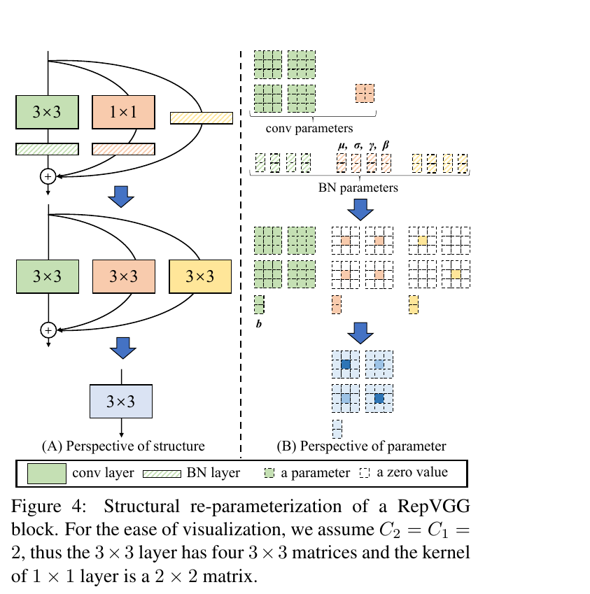
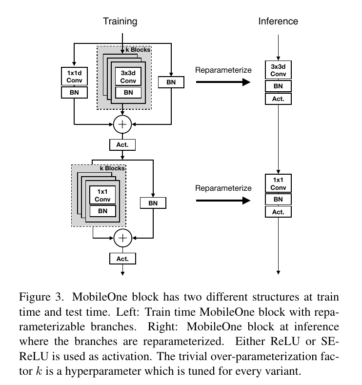
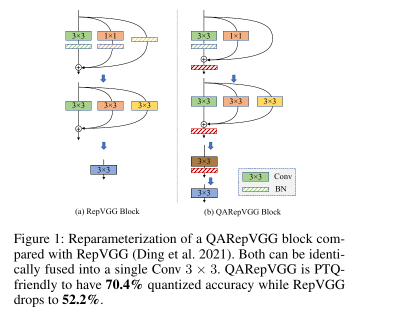
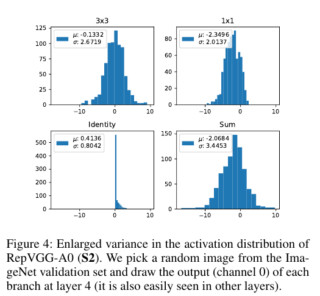

:tocdepth: 1

************************
Tái tham số hóa cấu trúc
************************

.. admonition:: Trang này trả lời

   - gộp nhánh lúc suy luận là gộp cái gì, và các bài đo trên phần cứng nào?
   - vì sao RepVGG khó lượng tử hóa, và QARepVGG sửa thế nào?

.. admonition:: Tóm tắt

   - Re-parameterization gộp các nhánh conv 3x3, 1x1, identity và BN thành một Conv 3x3, phép gộp cần cùng stride và padding lệch một pixel [T2 REPVGG tr.5].
   - Thứ hạng tốc độ phụ thuộc thiết bị: RepVGG-B0 nhanh hơn EfficientNet-B0 trên GPU 1080Ti (1817 so với 829 ví dụ/giây) [T2 REPVGG Table 4] nhưng chậm hơn trên CPU, GPU 2080Ti và iPhone 12 [T2 MOBONE Table 9].
   - Không bài nào đo RepVGG hay MobileOne trên NPU hay trên RK3588, nên kết quả trên NPU là unknown.
   - RepVGG khó lượng tử hóa INT8: "more than 20% top-1 accuracy drop on ImageNet" [T2 QAREP tr.1], và mức sụt dao động rất lớn giữa các biến thể theo Table 5.
   - QARepVGG sửa bằng cách bỏ BN khỏi nhánh identity và 1x1 rồi thêm BN sau phép cộng, kết quả chỉ đo bằng PyTorch-Quantization, không suy ra cho RKNN [T2 QAREP tr.5].

.. _81-re-parameterization-repvgg-mobileone:

Re-parameterization (RepVGG, MobileOne)
=======================================

**Câu hỏi:** gộp nhánh lúc suy luận là gộp cái gì, và các bài đo trên phần cứng nào?

**Nguồn nói gì**

   "Then we obtain the final bias by adding up the three bias vectors, and the final 3 × 3 kernel by adding the 1×1 kernels onto the central point of 3×3 kernel" [T2 REPVGG tr.5]

..

   "Note that the equivalence of such transformations requires the 3 × 3 and 1 × 1 layer to have the same stride, and the padding configuration of the latter shall be one pixel less than the former." [T2 REPVGG tr.5]

   "Notably, the body of an inference-time RepVGG only has one single type of operator: 3 × 3 conv followed by ReLU, which makes RepVGG fast on generic computing devices like GPUs." [T2 REPVGG tr.2]

..

   "Even better, RepVGG allows for specialized hardware to achieve even higher speed because given the chip size and power consumption, the fewer types of operators we require, the more computing units we can integrate onto the chip." [T2 REPVGG tr.2]

   "For skip connection the batchnorm is folded to a convolutional layer with identity 1x1 kernel" [T2 MOBONE tr.4]

..

   "MobileOne blocks are similar to blocks introduced in" [T2 MOBONE tr.4]

   Hình 8.1a. Structural re-parameterization của một khối RepVGG: ba nhánh (3x3 + BN, 1x1 + BN, identity + BN) được cộng lại thành một Conv 3x3 (A: cấu trúc, B: tham số). Nguồn: [T2 REPVGG tr.5, Figure 4]

   Hình 8.1b. Khối MobileOne lúc train (nhiều nhánh có thể reparameterize, k khối) và lúc suy luận (3x3d Conv + BN + Act rồi 1x1 Conv + BN + Act, khối được thiết kế cho conv tách thành depthwise và pointwise, MOBONE tr.4). Nguồn: [T2 MOBONE tr.5, Figure 3]

Số đo (nguyên từ bảng, kèm thiết bị):

.. list-table::
   :header-rows: 1

   * - Bài
     - Bảng
     - Thiết bị đo
     - Số
   * - REPVGG
     - Table 4, tr.7
     - NVIDIA 1080Ti, batch 128, fp32 (EfficientNet-B0 ở đây là bản tự huấn luyện 120 epoch, 75.11, khác bản 77.1 của MOBONE)
     - RepVGG-B0: 75.14 top-1, 1817 ví dụ/giây. ResNet-50: 76.31, 719. EfficientNet-B0: 75.11, 829
   * - MOBONE
     - Table 9, tr.7
     - iPhone 12 (Core ML), CPU Xeon, GPU RTX 2080Ti (TensorRT, batch 1)
     - RepVGG-B0: CPU 55.97 ms, GPU 1.45 ms, mobile 1.82 ms. EfficientNet-B0: 28.71, 1.35, 1.72. MobileOne-S1: 13.04, 0.66, 0.89
   * - MOBONE
     - Table 5, tr.5
     - huấn luyện ImageNet
     - MobileOne-S0 71.4 có re-param so với 69.6 không có

**Ý chính**

- Phép gộp gộp các nhánh conv (3x3, 1x1), nhánh identity và BN vào một Conv 3x3 có bias. MobileOne nói BN được gộp vào conv trước nó trong mọi nhánh (MOBONE tr.4). Phép gộp cần cùng stride và padding lệch một pixel (REPVGG tr.5).
- Graph lúc suy luận chỉ còn một loại op: Conv 3x3 + ReLU (REPVGG tr.2). REPVGG nói chip chuyên dụng có thể nhanh hơn vì ít loại op, đây là giả thuyết của tác giả, không có số đo.
- Thứ hạng tốc độ phụ thuộc thiết bị: RepVGG-B0 nhanh hơn EfficientNet-B0 trên GPU 1080Ti (1817 so với 829 ví dụ/giây, REPVGG Table 4), nhưng chậm hơn trên CPU, GPU 2080Ti và iPhone 12 (55.97 so với 28.71 ms, 1.45 so với 1.35 ms, 1.82 so với 1.72 ms, MOBONE Table 9).

**Giới hạn**

- REPVGG chỉ đo GPU 1080Ti. Không bài nào đo RepVGG hay MobileOne trên NPU hay trên RK3588. ``unknown``.
- Lượng tử hóa INT8 của RepVGG: xem file :ref:`Mô hình re-parameterized (RepVGG, QARepVGG) <38-mô-hình-re-parameterized-repvgg-qarepvgg>` (QAREP tr.1: "more than 20% top-1 accuracy drop on ImageNet"). Tổng hợp của file này: các bài cho thấy re-param giúp nhanh trên GPU, CPU và iPhone, còn QAREP cho thấy RepVGG khó lượng tử hóa INT8 theo PTQ chuẩn (không phải RKNN).

--------------

.. _38-mô-hình-re-parameterized-repvgg-qarepvgg:

Mô hình re-parameterized (RepVGG, QARepVGG)
===========================================

**Câu hỏi:** vì sao RepVGG khó lượng tử hóa, và QARepVGG sửa thế nào?

**Nguồn nói gì**

   "Nonetheless, its quantization performance is usually too poor to deploy (more than 20% top-1 accuracy drop on ImageNet) when INT8 inference is desired." [T2 QAREP tr.1]

..

   "Note that we use the deployed model after fusing multi-branches, because the unfused one would incur extra quantization errors. This trick is widely used in popular quantization frameworks." [T2 QAREP tr.3]

   "we remove BN from the identity and 1×1 branch plus appending an extra BN after the addition of three branches." [T2 QAREP tr.5]

..

   "Noticeably, YOLOv6s-RepVGG suffers a huge quantization degradation for about 7.4% mAP via PTQ." [T2 QAREP tr.7]

   "QAT methods can only be applied for RepVGG in deploy mode (single-branch), otherwise directly quantizing multi-branch modules makes them difficult to be fused for higher throughput" [T2 QAREP tr.10]

   Hình 3.8a. Reparameterization của khối RepVGG và QARepVGG, cả hai đều gộp được thành một Conv 3x3. QARepVGG bỏ BN khỏi nhánh identity và 1x1, thêm BN sau phép cộng. Nguồn: [T2 QAREP tr.1, Figure 1]

   Hình 3.8b. Phương sai activation lớn của RepVGG-A0 (S2): đầu ra của từng nhánh tại lớp 4. Nguồn: [T2 QAREP tr.5, Figure 4]

QAREP Table 5 (tr.6), trích một phần (bỏ các hàng RepVGG-B1g2, RepVGG-B1 và bản A0 tái hiện 72.2 và 50.3), ImageNet top-1, FP32 so với INT8 (PTQ), deploy mode:

.. list-table::
   :header-rows: 1

   * - Model
     - FP32
     - INT8
   * - RepVGG-A0 (bản chính thức)
     - 72.4
     - 52.2
   * - QARepVGG-A0
     - 72.2
     - 70.4
   * - RepVGG-B0
     - 75.1
     - 40.2
   * - QARepVGG-B0
     - 74.8
     - 72.9
   * - RepVGG-B1g4
     - 77.6
     - 0.55
   * - QARepVGG-B1g4
     - 77.4
     - 76.5
   * - RepVGG-B2g4
     - 78.5
     - 13.7
   * - QARepVGG-B2g4
     - 78.4
     - 77.7
   * - RepVGG-B2
     - 78.8
     - 51.3
   * - QARepVGG-B2
     - 79.0
     - 77.7

QAREP Table 8 (tr.7) là bảng phát hiện đối tượng trên COCO (mAP FP32 và INT8: YOLOv6s-RepVGG 42.4 và 35.0. YOLOv6s-QARepVGG 42.3 và 41.0. YOLOv6t-RepVGG 40.8 và 37.8), phân đoạn ngữ nghĩa là Table 9.

**Ý chính**

- Sụt độ chính xác của RepVGG dao động rất lớn giữa các biến thể: từ khoảng 20 điểm (A0) tới 77 điểm (B1g4) theo Table 5. "Khoảng 20%" trong abstract chỉ là mức thấp nhất.
- QARepVGG sửa bằng bốn thay đổi M1 đến M4 (QAREP Table 3, tr.5): M1 dùng L2 thường thay cho custom L2 (INT8 của RepVGG-A0 từ 50.3 lên 61.6), M2 và M3 bỏ BN khỏi nhánh identity và nhánh 1x1, M4 thêm BN sau phép cộng ba nhánh (INT8 lần lượt 62.5, 69.5, 70.4 khi cộng dồn M2, M3, M4. FP32 72.2 ở cấu hình cuối). Mô hình vẫn gộp được thành một Conv 3x3 (QAREP tr.1, tr.5, Figure 1).

**Giới hạn**

- QAREP lượng tử hóa 8-bit symmetric bằng PyTorch-Quantization, gồm cả lớp đầu và cuối (QAREP tr.6). Không nêu rõ per-channel hay per-tensor, và trong thí nghiệm của bài không nêu phương pháp calibration (chỉ nói dùng "the same settings and the calibration dataset"). Kết quả này không suy ra cho mọi model re-parameterized hay cho RKNN.
- Số "7.4% mAP" của YOLOv6s-RepVGG là PTQ trong thiết lập của QAREP, không phải RKNN.
- QAREP viết "Round rounds float values to integers using ceiling rounding" (tr.2), trái với định nghĩa round-to-nearest của NAGEL tr.4. Dùng NAGEL cho định nghĩa.

Nguồn
=====

Các nhãn nguồn dùng trong trang này (tier, tệp, số lần trích).

.. list-table::
   :header-rows: 1
   :widths: 12 8 70 10

   * - Nhãn
     - Tier
     - Nguồn
     - Số lần
   * - ``QAREP``
     - T2
     - :download:`qarepvgg_quant_2024chu.pdf <../../../_assets/pdf/papers/08_npu_friendly_arch/qarepvgg_quant_2024chu.pdf>`
     - 7
   * - ``REPVGG``
     - T2
     - :download:`repvgg_reparam_2021ding.pdf <../../../_assets/pdf/papers/08_npu_friendly_arch/repvgg_reparam_2021ding.pdf>`
     - 5
   * - ``MOBONE``
     - T2
     - :download:`mobileone_reparam_2023vasu.pdf <../../../_assets/pdf/papers/08_npu_friendly_arch/mobileone_reparam_2023vasu.pdf>`
     - 3
