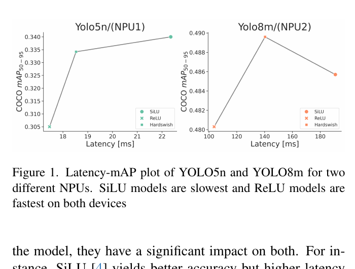

:tocdepth: 1

**********************************
Hàm kích hoạt và chi phí phần cứng
**********************************

.. admonition:: Trang này trả lời

   - Sự chênh lệch chi phí thực thi giữa ReLU, SiLU và Hardswish trên các nền tảng phần cứng (GPU, CPU di động, NPU) được đo đạc như thế nào?
   - Tại sao việc lựa chọn hàm kích hoạt lại ảnh hưởng sâu sắc đến cấu trúc phần cứng và độ phức tạp tính toán của mô hình lượng tử hóa INT8 trên NPU?
   - Những quy tắc thiết kế nào được đề xuất khi tối ưu hóa hàm kích hoạt cho các kiến trúc thị giác hướng tới bộ tăng tốc biên?

.. admonition:: Tóm tắt

   - ReLU vượt trội hoàn toàn về tốc độ so với SiLU và Hardswish trên mọi nền tảng phần cứng được thực nghiệm, nhờ cấu trúc toán học đơn giản và khả năng hợp nhất trực tiếp vào lớp tích chập (operator fusion) [T2 Y6 tr.8].
   - Trên vi xử lý di động iPhone 12, SiLU có độ trễ cao hơn ReLU khoảng 66% (2.54 ms so với 1.53 ms), trong khi các hàm phi tuyến động như DynamicReLU làm trễ tăng hơn 150 lần do chi phí đồng bộ hóa dữ liệu [T2 MOBONE tr.4]; trên GPU Tesla T4, Conv + ReLU đạt tốc độ cao hơn SiLU 29% (1246 FPS so với 963 FPS) [T2 Y6 tr.9]; trên ba NPU biên, SiLU làm tăng độ trễ từ 20% đến 159% so với ReLU [T2 ACTNAS tr.6].
   - Đối với NPU thiên về số nguyên INT8, các hàm kích hoạt phi tuyến siêu việt (như SiLU, Swish) đòi hỏi bảng tra cứu Look-Up Table (LUT) hoặc bộ hàm đặc biệt (SFU) gây nghẽn phần cứng; ngược lại, ReLU và ReLU6 được tích hợp thẳng vào bước scale và cắt ngưỡng số nguyên (requantization) mà không tốn thêm chu kỳ truy cập bộ nhớ.
   - Chiến lược ActNAS chứng minh tính hiệu quả của thiết kế hàm kích hoạt lai (mixed activation): việc thay thế activation ở hai tầng đầu tiên bằng họ ReLU giúp tiết kiệm tới 58% bộ nhớ trên NPU mà mAP chỉ suy giảm dưới 1% so với mô hình thuần SiLU [T2 ACTNAS tr.7]. Mô hình ActNAS8m.2 đạt tốc độ nhanh hơn 1.66 lần so với bản SiLU mà không làm suy giảm đáng kể độ chính xác [T2 ACTNAS tr.8].
   - Chi phí thực thi vi kiến trúc chi tiết của SiLU so với ReLU trên các dòng NPU cụ thể (bao gồm NPU Rockchip RK3588) là unknown do các tài liệu chuẩn hiện chưa công bố số đo tách biệt từng toán tử.

.. contents:: Trong trang này
   :local:
   :depth: 1

1. Bảng chi phí activation theo phần cứng
=========================================

Cơ sở lý thuyết toán học, công thức đạo hàm và đồ thị phân tích của các hàm kích hoạt phi tuyến phổ biến (ReLU, LeakyReLU, Sigmoid, SiLU, GELU, Hardswish) đã được trình bày chi tiết tại :doc:`/contents/01-kien-thuc-nen/01-nen-tang-ai/04-chuan-hoa-va-activation`. Phần này tập trung khảo sát chi phí độ trễ (latency), thông lượng khung hình (FPS) và mức độ tiêu thụ bộ nhớ khi các hàm kích hoạt này được thực thi trên các kiến trúc phần cứng thực tế.

Trong các kiến trúc thị giác máy tính hiện đại, đặc biệt là dòng mô hình YOLO từ phiên bản v5 đến v8, SiLU (Sigmoid Linear Unit hay Swish-1) được sử dụng mặc định trên toàn bộ các tầng nhờ khả năng tối ưu hóa gradient mượt mà, giúp mô hình đạt độ chính xác mAP cao hơn so với ReLU [T2 ACTNAS tr.1, 2]. Tuy nhiên, xét trên khía cạnh hiệu năng phần cứng, hàm kích hoạt ReLU đơn giản lại sở hữu lợi thế áp đảo về tốc độ tính toán:

   "ReLU is fast but often less precise, while SiLU offers higher accuracy at the expense of speed." [T2 ACTNAS tr.1]

   "ReLU has a greater speed advantage because of its fusion into convolution." [T2 Y6 tr.8]

Khảo sát thực nghiệm từ ba công bố độc lập (MobileOne, YOLOv6 và ActNAS) cung cấp bức tranh đối chiếu toàn diện về chi phí thực thi của các hàm kích hoạt trên vi xử lý di động, GPU máy chủ và NPU chuyên dụng:

.. list-table:: Chi phí thực thi của các hàm kích hoạt trên các nền tảng phần cứng
   :header-rows: 1
   :widths: 16 22 22 40

   * - Nền tảng
     - Mô hình thử nghiệm
     - Chế độ đo đạc
     - Số liệu độ trễ / Thông lượng đo được
   * - iPhone 12 (Core ML)
     - Mạng CNN 30 lớp
     - Batch 1, fp16/fp32
     - ReLU: 1.53 ms; GELU: 1.63 ms; SE-ReLU: 2.10 ms; SiLU: 2.54 ms; Dynamic Shift-Max: 57.04 ms; DynamicReLU-B: 242.14 ms; DynamicReLU-A: 273.49 ms [T2 MOBONE tr.4]
   * - Tesla T4 (TensorRT)
     - YOLOv6-N (640x640)
     - Batch 32, FP16
     - Conv + ReLU: 1246 FPS (34.8% AP); Conv + SiLU: 963 FPS (36.6% AP); RepConv + ReLU: 1233 FPS (35.2% AP); RepConv + SiLU: 971 FPS (36.5% AP) [T2 Y6 tr.9]
   * - NPU 1 (Biên)
     - YOLOv8m (640x640)
     - 50 lần đo lấy trung bình
     - ReLU: 93.17 ms (48.03 mAP); Hardswish: 166.80 ms (48.96 mAP); SiLU: 241.50 ms (48.57 mAP) [T2 ACTNAS tr.6]
   * - NPU 2 (Biên)
     - YOLOv8m (640x640)
     - 50 lần đo lấy trung bình
     - ReLU: 103.73 ms (48.03 mAP); Hardswish: 140.33 ms (48.96 mAP); SiLU: 190.87 ms (48.57 mAP) [T2 ACTNAS tr.6]
   * - NPU 3 (Biên)
     - YOLOv8m (640x640)
     - 50 lần đo lấy trung bình
     - ReLU: 283.40 ms (48.03 mAP); Hardswish: 308.80 ms (48.96 mAP); SiLU: 340.00 ms (48.57 mAP) [T2 ACTNAS tr.6]

Các số liệu thực nghiệm trên cho thấy những quy luật nhất quán giữa các lớp phần cứng khác nhau:

1. **Trên vi xử lý di động iPhone 12 (Apple Neural Engine / GPU)**:
   - ReLU đạt thời gian thực thi nhanh nhất với 1.53 ms trên mạng 30 lớp [T2 MOBONE tr.4].
   - GELU (1.63 ms) chỉ chậm hơn ReLU khoảng 6.5% nhờ các tập lệnh vector hóa được tối ưu tốt trong Core ML, trong khi SiLU mất 2.54 ms, chậm hơn ReLU tới 66% (tăng thêm 1.01 ms độ trễ).
   - Khi bổ sung cơ chế Squeeze-and-Excitation (SE-ReLU), độ trễ tăng lên 2.10 ms do phép tổng hợp kênh toàn cục (global average pooling) tạo ra điểm nghẽn đồng bộ hóa dữ liệu.
   - Đáng chú ý, các hàm kích hoạt động (Dynamic activations) như DynamicReLU-A (273.49 ms) và DynamicReLU-B (242.14 ms) làm tăng độ trễ lên hơn 150 lần so với ReLU do yêu cầu sinh trọng số phụ thuộc dữ liệu đầu vào và phá vỡ cơ chế song song hóa phần cứng [T2 MOBONE tr.4].
   - Nghiên cứu MobileOne chỉ ra rằng các thành phần cấu trúc buộc phải đồng bộ hóa dữ liệu toàn cục hoặc truy cập bộ nhớ phụ trợ sẽ làm bùng nổ độ trễ ẩn trên chip [T2 MOBONE tr.4]:

   "To demonstrate the hidden costs like memory access cost and synchronization cost, we ablate over using skip connections" [T2 MOBONE tr.4]

   Do đó, để tối ưu hóa hoàn toàn cho thiết bị di động, MobileOne kiên quyết chỉ sử dụng duy nhất hàm kích hoạt ReLU:

   "Therefore we use only ReLU activations in MobileOne." [T2 MOBONE tr.3]

2. **Trên GPU máy chủ NVIDIA Tesla T4**:
   - Ở mô hình YOLOv6-N, việc thay thế SiLU bằng ReLU giúp tốc độ khung hình tăng vọt từ 963 FPS lên 1246 FPS (tăng 29.4% thông lượng) [T2 Y6 tr.9].
   - Sự đánh đổi là độ chính xác phân loại giảm 1.8 điểm AP (từ 36.6% xuống 34.8%).
   - Khi áp dụng khối tái tham số hóa RepConv, cấu hình RepConv + ReLU đạt 1233 FPS (35.2% AP) so với 971 FPS của RepConv + SiLU, mang lại điểm cân bằng tối ưu giữa tốc độ và độ chính xác trong môi trường công nghiệp [T2 Y6 tr.8, 9].

3. **Trên các bộ tăng tốc chuyên dụng NPU**:
   - Khảo sát của ActNAS trên ba NPU biên cho thấy mức độ nhạy cảm của NPU đối với hàm kích hoạt là rất lớn, do tài nguyên bộ nhớ đệm on-chip trên NPU bị giới hạn khắt khe [T2 ACTNAS tr.6, 8]:

   "the impact of different activations is more prominent on NPUs as latency is not only affected by the complexity of operations but also by the memory usage." [T2 ACTNAS tr.8]

   - Trên NPU 1, SiLU (241.50 ms) có độ trễ gấp 2.59 lần so với ReLU (93.17 ms), tương đương mức tăng 159%. Trên NPU 2, SiLU tăng 84% độ trễ (190.87 ms so với 103.73 ms). Trên NPU 3, mức tăng là 20% (340.00 ms so với 283.40 ms).
   - Hàm Hardswish đóng vai trò trung gian: nhanh hơn SiLU rõ rệt trên NPU 1 và NPU 2, đồng thời mang lại mAP cao hơn cả SiLU (48.96% so với 48.57%) [T2 ACTNAS tr.6].
   - Khi áp dụng tìm kiếm tối ưu hóa kiến trúc nhận biết phần cứng, mô hình ActNAS8m.2 đạt bước nhảy vọt về tốc độ [T2 ACTNAS tr.8]:

   "ActNAS8m.2 model is 1.66x faster compared to the SiLU model without significant impact on accuracy of the model." [T2 ACTNAS tr.8]

Đồ thị đường cong đánh đổi giữa độ chính xác và độ trễ (Pareto frontier) trong Hình 8.2 minh họa rõ rệt sự phân hóa này: các mô hình thuần SiLU luôn nằm ở vùng có độ trễ cao nhất, trong khi các mô hình lai do ActNAS tạo ra thiết lập một đường biên Pareto vượt trội hơn hẳn các mô hình sử dụng đơn nhất một hàm kích hoạt [T2 ACTNAS tr.1, 7].

   Hình 8.2. Biểu đồ độ trễ và mAP của YOLO5n (NPU1) và YOLO8m (NPU2) với SiLU, ReLU, Hardswish. Hai NPU không nêu tên. Nguồn: [T2 ACTNAS tr.1, Figure 1]

2. Quy tắc chọn activation cho NPU thiên về INT8
================================================

Các bộ tăng tốc xử lý nơ-ron (NPU) trên thiết bị biên thường tập trung tối ưu hóa diện tích đế silicon và hiệu quả năng lượng cho các phép toán số nguyên 8-bit (INT8). Đường ống xử lý tích chập lượng tử hóa thông thường bao gồm:

.. math::

   q_{\text{out}} = \text{clip}\left(\left\lfloor q_{\text{acc}} \cdot M \right\rceil + z_{\text{out}}, \, q_{\min}, \, q_{\max}\right)

Trong đó :math:`q_{\text{acc}}` là giá trị tích lũy số nguyên 32-bit từ mảng nhân chập (MAC array), :math:`M` là hệ số tỉ lệ requantization, và :math:`z_{\text{out}}` là zero-point. Trong quy trình này, việc lựa chọn hàm kích hoạt ảnh hưởng trực tiếp đến kiến trúc phần cứng:

**1. Hợp nhất hoàn toàn vào khâu Requantization (Operator Fusion)**

Hàm ReLU được định nghĩa là :math:`\max(0, x)`. Khi chuyển đổi sang không gian số nguyên lượng tử hóa, phép toán này hoàn toàn tương đương với việc gán giá trị ngưỡng cắt dưới :math:`q_{\min} = z_{\text{out}}` ngay trong bộ cắt ngưỡng số nguyên của phần cứng. Trong trường hợp lượng tử hóa đối xứng (symmetric quantization) với :math:`z_{\text{out}} = 0`, phép cắt dưới đơn giản là chặn các giá trị âm về mức 0. Bộ phần cứng NPU không cần bổ sung bất kỳ mạch logic phụ trợ nào, không làm tăng chu kỳ xung nhịp và không phải chuyển dữ liệu ra bộ nhớ đệm trung gian SRAM/DRAM [T2 Y6 tr.8].

Đối với hàm ReLU6 (:math:`\min(\max(0, x), 6)`), ngưỡng cắt trên được thiết lập trực tiếp là :math:`q_{\max} = \text{quantize}(6.0)`. Do cả hai ngưỡng đều được kiểm soát trực tiếp bởi bộ hạn chế số nguyên có sẵn trong bộ gom tích lũy MAC, ReLU và ReLU6 đạt hiệu quả thực thi cao nhất trên mọi NPU INT8.

**2. Chi phí của các hàm phi tuyến siêu việt (SiLU, GELU, Swish)**

Các hàm kích hoạt như SiLU (:math:`x \cdot \frac{1}{1 + e^{-x}}`) hoặc GELU chứa phép tính hàm mũ số thực và phép chia. Mạch phần cứng INT8 không thể thực hiện trực tiếp phép tính này trên các thanh ghi số nguyên. Để hỗ trợ, NPU buộc phải sử dụng một trong ba cơ chế xử lý:

- **Bảng tra cứu Look-Up Table (LUT)**: Sử dụng bảng tra 256 phần tử cho đầu vào INT8. Tuy nhiên, bảng tra đòi hỏi bộ nhớ đệm SRAM chuyên dụng và gây trễ truy xuất bảng (table lookup latency), hạn chế khả năng song song hóa trên các mảng tính toán SIMD/Systolic. Nếu áp dụng LUT trên bộ tích lũy 32-bit trước requantization, dung lượng bảng tra sẽ bùng nổ đến mức không thể hiện thực phần cứng.
- **Tách đồ thị thành các toán tử cơ bản**: Tách SiLU thành phép tính Sigmoid và Mul. Khi tách rời, tensor trung gian phải được ghi ra SRAM rồi đọc lại vào bộ tính toán, gây bùng nổ chi phí truy cập bộ nhớ (Memory Access Cost - MAC) và làm tăng điện năng tiêu thụ.
- **Bộ hàm đặc biệt (SFU - Special Function Unit)**: Một số vi kiến trúc trang bị mạch SFU để xấp xỉ chuỗi Taylor hoặc đa thức mảnh. Tuy nhiên, số lượng bộ SFU thường rất ít so với số lượng nhân MAC, dẫn đến hiện tượng nghẽn cổ chai tính toán (computational bottleneck).

**3. Hardswish như giải pháp dung hòa và giới hạn tính tương thích**

Nhằm khắc phục nhược điểm của Swish trên thiết bị biên, MobileNet-V3 đề xuất hàm Hardswish thay thế đoạn hàm mũ bằng đường tuyến tính từng phần [T2 MOBONE tr.3]:

.. math::

   \text{Hardswish}(x) = x \cdot \frac{\text{ReLU6}(x + 3)}{6}

Hàm này loại bỏ hoàn toàn phép tính hàm mũ số thực, thay bằng các phép cộng, nhân và dịch bit số nguyên dễ cài đặt trên các tập lệnh SIMD CPU như ARM NEON. Một số NPU giả định có thể hỗ trợ Hardswish một cách hiệu quả [T2 S3NAS tr.2]:

   "the NPU assumed in this paper can execute depth-wise separable convolution (DWConv), squeeze-and-excitation (SE), and h-swish activation function efficiently" [T2 S3NAS tr.2]

Tuy nhiên, Vasu và các cộng sự chỉ ra rằng giải pháp này không phải lúc nào cũng tối ưu khi triển khai trên nhiều nền tảng phần cứng khác nhau, đặc biệt là các NPU mảng hai chiều không có bộ chia [T2 MOBONE tr.3]:

   "MobileNet-V3 [30], introduces an optimized activation function - Hard-Swish for a specific platform. However, scaling such functions to different platforms may be difficult. Therefore, our design uses basic operators that are already available across different platforms." [T2 MOBONE tr.3]

**4. Đánh giá proxy không chi phí và quy tắc cấu trúc lai từ ActNAS**

Để tìm kiếm hàm kích hoạt tối ưu theo từng tầng mà không tiêu tốn tài nguyên tính toán cho việc huấn luyện lại hàng trăm mô hình, ActNAS sử dụng chỉ số đánh giá không chi phí huấn luyện (Zero-Cost Proxy NWOT - Neural Wire Odds Table) [T2 ACTNAS tr.2, 3]:

   "To validate the effectiveness of NWOT score as a proxy to the mAP of trained YOLO models, we estimated the correlation between the mAP of 131 variations of YOLO models in MCUBench" [T2 ACTNAS tr.3]

   "Figure 3 shows that the NWOT score has a strong correlation with the mAP of fully trained models." [T2 ACTNAS tr.3]

Phân tích không gian đặc trưng chỉ ra rằng các tầng đầu tiên của mạng thị giác đảm nhận việc xử lý các bản đồ đặc trưng có kích thước không gian lớn (:math:`H \times W` lớn), đóng góp tỷ trọng bộ nhớ và số lượng phép tính activation cao nhất trên toàn mạng [T2 ACTNAS tr.7]. Từ không gian tìm kiếm gồm các hàm ứng viên [ReLU, SiLU, Hardswish, ReLU6, LeakyReLU], ActNAS phát hiện quy tắc thực nghiệm quan trọng [T2 ACTNAS tr.2, 7]:

   "None of the ActNAS models utilized SiLU or Hardswish in the first two layers." [T2 ACTNAS tr.7]

Ngay cả phương pháp thay thế thô (naive approach) chuyển đổi ba hàm kích hoạt đầu tiên từ SiLU sang ReLU cũng mang lại hiệu quả rõ rệt [T2 ACTNAS tr.7]:

   "slightly slower performance compared to other baseline models, but the drop in mAP was less than 1% compared to the SiLU model" [T2 ACTNAS tr.7]

Bằng cách áp dụng các biến thể ReLU tại các tầng đầu và duy trì SiLU hoặc Hardswish ở các tầng sau, mô hình ActNAS5n.1 giảm được 58% dung lượng bộ nhớ trên NPU 1, đồng thời tăng 22.28% tốc độ so với bản thuần SiLU mà mức sụt giảm mAP duy trì dưới 1% [T2 ACTNAS tr.7]. Đối với các hệ thống nhạy cảm với độ trễ thời gian thực, việc sử dụng RepConv kết hợp với ReLU hoàn toàn là giải pháp được khuyến nghị hàng đầu [T2 Y6 tr.8]:

   "We suggest users adopt RepConv with ReLU in latency-sensitive applications." [T2 Y6 tr.8]

3. Điều chưa biết (unknown: chi phí chi tiết trên các NPU khác nhau)
====================================================================

Mặc dù các quy tắc thiết kế chung đã được kiểm chứng trên các nền tảng thử nghiệm, việc áp dụng cụ thể lên từng dòng NPU chuyên dụng vẫn gặp phải các rào cản thông tin:

1. **Thiếu thông số vi kiến trúc của các NPU trong nghiên cứu**: Công trình ActNAS hoàn toàn không công bố danh tính nhà sản xuất, tên gọi thương mại hay thông số vi kiến trúc của ba vi xử lý NPU được sử dụng trong bài báo [T2 ACTNAS tr.3]:

   "We are not disclosing the vendor name and actual name of these NPUs" [T2 ACTNAS tr.3]

   Người dùng không thể biết các NPU này sử dụng kiến trúc mảng Systolic Array, SIMD VLIW hay vi kiến trúc dòng dữ liệu (dataflow), cũng như không rõ các phép đo được thực hiện ở chế độ số nguyên INT8 hay dấu phẩy động FP16.

2. **Tính chuyển giao phần cứng thấp của các mô hình NAS**: Nghiên cứu ActNAS chỉ ra rằng mô hình được tìm kiếm và tối ưu hóa riêng cho một NPU cụ thể mang lại hệ số tăng tốc cao nhất trên chính thiết bị đó, nhưng lại chỉ đạt mức tăng tốc rất thấp hoặc không đáng kể khi chạy trên phần cứng khác [T2 ACTNAS tr.8]:

   "We can see that both NPU aware models provide highest speedup on these devices but very low speedup on other devices." [T2 ACTNAS tr.8]

   Hiện tượng này xuất phát từ sự khác biệt sâu sắc giữa các bộ tăng tốc biên: kích thước bộ nhớ đệm nội bộ (SRAM capacity), cơ chế DMA chuyển khối, số lượng cổng đọc/ghi và khả năng tối ưu hóa của từng trình biên dịch đồ thị.

3. **Chưa có số liệu vi mô công khai trên NPU Rockchip RK3588**:
   Tài liệu danh mục toán tử RKNN (OPL) chứng minh rằng NPU RK3588 có hỗ trợ toán tử kết hợp dạng ``ConvolutionSwish`` (chi tiết xem tại :doc:`/contents/02-nen-tang-rk3588/03-toolchain-runtime/04-operator-list`), cho thấy NPU có khả năng hợp nhất SiLU. Tuy nhiên, trong các tài liệu chuẩn (Tier 2), chưa có báo cáo thực nghiệm nào công bố số đo độ trễ vi mô tách biệt giữa một lớp tích chập gộp ReLU và một lớp tích chập gộp SiLU trên từng lõi NPU RK3588.

   Sự tương tác giữa hàm kích hoạt và kiến trúc đồ thị tính toán còn phụ thuộc vào nhiều yếu tố hệ thống:

   - Cấu hình tối ưu hóa đồ thị của trình biên dịch: Trình biên dịch RKNN cung cấp các cấp độ tối ưu hóa đồ thị khác nhau, trong đó các luật gộp toán tử (fusion passes) có thể biến đổi tùy thuộc vào cấu trúc lớp tích chập đứng trước và lớp chuẩn hóa đứng sau.
   - Băng thông truy cập bộ nhớ cục bộ SRAM giữa ba lõi NPU độc lập (Core 0, Core 1, Core 2) khi phải lưu chuyển các bản đồ đặc trưng có độ phân giải lớn.

   Do đó, chi phí chi tiết và mức độ chênh lệch độ trễ chính xác giữa SiLU và ReLU trên NPU RK3588 là unknown. (Đã tìm ở: các bài báo học thuật đo benchmark RK3588, tài liệu nhà sản xuất Rockchip; từ khóa: activation latency, SiLU vs ReLU benchmark, RK3588 NPU operator profiling).

Nguồn tham khảo
===============

Các tài liệu nghiên cứu chuẩn (Tier 2) được trích dẫn trong trang này:

.. list-table::
   :header-rows: 1
   :widths: 15 10 60 15

   * - Nhãn
     - Tier
     - Tên tài liệu và đường dẫn
     - Số lần trích
   * - ``ACTNAS``
     - T2
     - :download:`actnas_yolo_2025sah.pdf <../../../_assets/pdf/papers/08_npu_friendly_arch/actnas_yolo_2025sah.pdf>`
     - 12
   * - ``MOBONE``
     - T2
     - :download:`mobileone_reparam_2023vasu.pdf <../../../_assets/pdf/papers/08_npu_friendly_arch/mobileone_reparam_2023vasu.pdf>`
     - 5
   * - ``Y6``
     - T2
     - :download:`yolov6_hwfriendly_2022li.pdf <../../../_assets/pdf/papers/08_npu_friendly_arch/yolov6_hwfriendly_2022li.pdf>`
     - 4
   * - ``S3NAS``
     - T2
     - :download:`s3nas_npu_aware_2020lee.pdf <../../../_assets/pdf/papers/06_nas/s3nas_npu_aware_2020lee.pdf>`
     - 1
