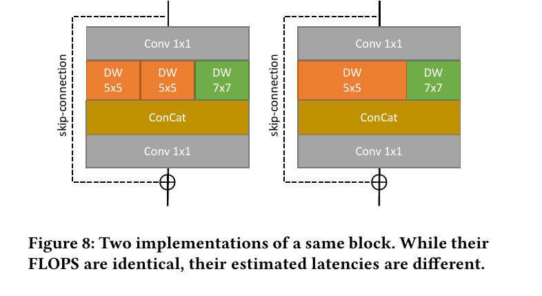
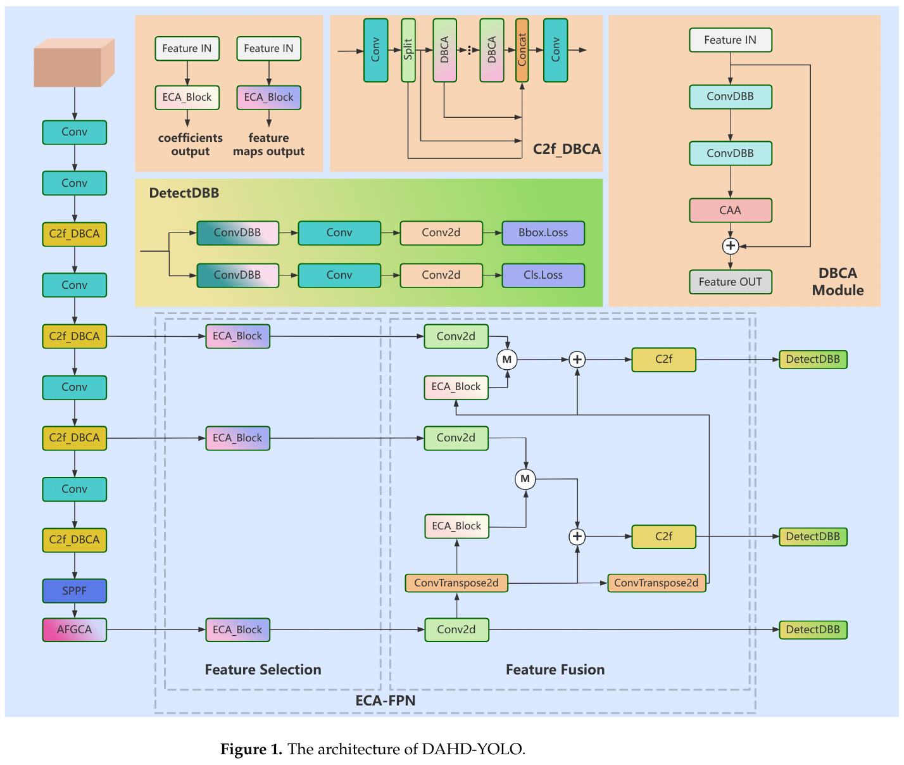

:tocdepth: 1

*************************************
Hardware-aware NAS và detector tối ưu
*************************************

.. admonition:: Trang này trả lời

   - Tìm kiếm kiến trúc nơ-ron nhận biết phần cứng (Hardware-aware NAS) sử dụng những chỉ số nào và kết quả có chuyển giao được giữa các NPU không?
   - Các detector hiện đại như YOLOv6 tối ưu hóa cấu trúc tích chập, nhánh rẽ và đầu giải mã như thế nào cho phần cứng?
   - Các nghiên cứu thực nghiệm trên SoC Rockchip RK3588 (EDGE benchmark, DAHD-YOLO) cho thấy điều gì về tương quan giữa FLOPs, độ phức tạp kiến trúc và độ trễ thực tế?

.. admonition:: Tóm tắt

   - Hardware-aware NAS giải quyết sự lệch pha giữa FLOPs lý thuyết và độ trễ thực tế trên phần cứng: S3NAS sử dụng bộ ước lượng độ trễ xây dựng trên bộ mô phỏng chu kỳ chính xác của NPU MIDAP [T2 S3NAS tr.1, 4], trong khi ActNAS tìm kiếm hàm kích hoạt tối ưu theo từng tầng trên đồ thị YOLO [T2 ACTNAS tr.1, 2].
   - Kết quả tối ưu hóa từ NAS phụ thuộc chặt chẽ vào đặc tính vi kiến trúc của phần cứng đích và có khả năng chuyển giao rất thấp sang các bộ tăng tốc khác [T2 ACTNAS tr.8]. Chưa có công trình NAS công khai nào nhắm tới NPU Rockchip (unknown).
   - YOLOv6 tối ưu hóa cho phần cứng công nghiệp thông qua cấu trúc EfficientRep Backbone dùng khối RepBlock (lúc train) gộp thành RepConv (lúc suy luận); với các mô hình lớn hơn, khối CSPStackRep kết hợp kết nối tắt CSP để cân bằng giữa độ chính xác và dung lượng tính toán [T2 Y6 tr.4]. Đồng thời, YOLOv6 loại bỏ Distribution Focal Loss (DFL) ở các mô hình nhỏ để triệt tiêu chi phí hồi quy hộp bao quá mức [T2 Y6 tr.5].
   - Nghiên cứu benchmark EDGE trên RK3588 chứng minh hiện tượng nghịch lý: YOLO11n có FLOPs thấp nhất (6.5 GFLOPS) nhưng lại có độ trễ INT8 cao nhất (30.71 ms so với 24.88 ms của YOLOv8n và 21.7 ms của YOLOv5n), cho thấy các cải tiến cấu trúc như C3k2 hay C2f tạo ra chi phí phụ trợ chưa tối ưu trên NPU [T2 EDGE tr.4, 5, 7].
   - DAHD-YOLO sửa đổi kiến trúc YOLOv8 bằng cách đưa vào khối tái tham số hóa DBB và cơ chế chú ý trên RK3588, nhưng kết quả thực nghiệm ở INT8 cho thấy mô hình cải tiến chạy chậm hơn đáng kể so với baseline (79.1 ms so với 56.3 ms) do độ phức tạp cấu trúc tăng cao [T2 DAHD Table 6, tr.20], kèm theo nhiều điểm bất nhất số liệu nội bộ.

.. contents:: Trong trang này
   :local:
   :depth: 1

1. NAS nhận biết NPU
====================

Trong tối ưu hóa mô hình học sâu, số lượng phép tính dấu phẩy động (FLOPs) hoặc số lượng tham số (Parameters) thường được sử dụng làm thước đo hiệu năng tính toán. Tuy nhiên, trên các bộ xử lý chuyên dụng NPU, độ trễ thực tế không tỷ lệ thuận với FLOPs do chi phí truy cập bộ nhớ (MAC), băng thông truyền dữ liệu giữa DRAM và SRAM nội bộ, cùng mức độ lấp đầy mảng nhân chập (MAC array utilization) đóng vai trò chi phối. Phương pháp tìm kiếm kiến trúc nơ-ron nhận biết phần cứng (Hardware-aware Neural Architecture Search - HW-NAS) đưa độ trễ đo đạc trực tiếp hoặc độ trễ ước lượng từ bộ mô phỏng vào hàm mục tiêu tối ưu nhằm sinh ra kiến trúc khớp với vi cấu trúc phần cứng.

1.1 S3NAS (Bộ ước lượng độ trễ NPU, DWConv vs Fused Conv)
---------------------------------------------------------

Công trình S3NAS (Lee và cộng sự, 2020) phát triển một framework tìm kiếm kiến trúc siêu mạng (supernet-based NAS) tối ưu hóa riêng cho bộ xử lý nơ-ron:

   "an analytical latency estimator is devised, based on a cycle-level NPU simulator that runs an entire CNN considering the memory access overhead accurately." [T2 S3NAS tr.1]

Cần lưu ý rằng phần cứng mục tiêu trong nghiên cứu S3NAS là MIDAP - một bộ xử lý NPU giả định được phát triển dưới dạng mô hình ảo chu kỳ chính xác (cycle-accurate simulator) chứ chưa phải chip vật lý thương mại [T2 S3NAS tr.4]:

   "Note that MIDAP has not been implemented as a real hardware chip yet but as a virtual prototype with a cycle-accurate simulator." [T2 S3NAS tr.4]

Để tối ưu hóa cho mảng tính toán của MIDAP, S3NAS áp dụng các ràng buộc kiến trúc vi mô cụ thể nhằm tránh lãng phí chu kỳ xử lý [T2 S3NAS tr.9]:

   "We make the number of filters to be multiples of 16 to maximize the MAC unit utilization on MIDAP." [T2 S3NAS tr.9]

Không gian tìm kiếm siêu mạng của S3NAS cho phép số lượng khối ở từng giai đoạn thay đổi linh hoạt thay vì cố định như các phương pháp One-Shot NAS truyền thống, với các kích thước kernel ứng viên :math:`\{3 \times 3, 5 \times 5, 7 \times 7\}` và hệ số mở rộng kênh :math:`\{3, 4, 6\}` [T2 S3NAS tr.4, 5]. Do số phép nhân trong một lớp DWConv bằng :math:`W \times H \times C \times K^2`, các giai đoạn sâu hơn của mạng thường có độ trễ ngắn hơn nhờ diện tích không gian :math:`H \times W` giảm nhanh hơn tốc độ tăng của số kênh :math:`C` [T2 S3NAS tr.5].

Một phát hiện quan trọng trong S3NAS là sự tương tác giữa loại khối tích chập và phần cứng NPU. Trong khi các khối tích chập tách kênh (Depthwise Separable Convolution - DWConv trong MBConv) giúp giảm mạnh FLOPs lý thuyết, chúng có tỷ lệ tính toán trên bộ nhớ rất thấp (arithmetic intensity thấp). Trên các bộ xử lý như Google Edge TPU, các khối tích chập hợp nhất (Fused Inverted Bottleneck Conv) chạy nhanh hơn đáng kể dù sở hữu nhiều phép tính hơn [T2 S3NAS tr.1]. Ngược lại, trên kiến trúc MIDAP vốn trang bị các đơn vị vector xử lý DWConv hiệu quả, kết quả so sánh ở Bảng 1 [T2 S3NAS tr.5] cho thấy thứ tự ngược lại:

.. list-table:: So sánh hiệu năng các loại khối xây dựng cơ bản trong S3NAS trên bộ mô phỏng MIDAP
   :header-rows: 1
   :widths: 40 30 30

   * - Loại khối xây dựng cơ bản (Building Block)
     - Độ chính xác Top-1 ImageNet (%)
     - Độ trễ ước lượng trên MIDAP (ms)
   * - Fused Inverted Bottleneck Conv
     - 77.34
     - 6.90
   * - MBConv (Depthwise Separable Conv)
     - 77.75
     - 2.05
   * - Combined (Không gian kết hợp cả hai)
     - 76.55
     - 2.20

Số liệu từ Bảng 1 của S3NAS [T2 S3NAS tr.5] chứng minh rằng trên MIDAP, khối MBConv đạt độ trễ 2.05 ms, nhanh hơn gấp 3.3 lần so với khối Fused Conv (6.90 ms) ở cùng mức độ chính xác tương đương. Điều này khẳng định loại khối "tối ưu nhất" hoàn toàn phụ thuộc vào đặc tính phần cứng đích [T2 S3NAS tr.1, 2]:

   "the NPU assumed in this paper can execute depth-wise separable convolution (DWConv), squeeze-and-excitation (SE), and h-swish activation function efficiently" [T2 S3NAS tr.2]

   Hình 8.3. Hai cách cài đặt cùng một khối MixConv: cùng FLOPS nhưng độ trễ ước lượng khác nhau. Nguồn: [T2 S3NAS tr.6, Figure 8]

Hình 8.3 minh họa rõ ràng hiện tượng này: cùng một khối MixConv với cùng số lượng FLOPs nhưng khi sắp xếp các toán tử con và luồng dữ liệu khác nhau, độ trễ ước lượng trên NPU có sự phân hóa đáng kể do chi phí chuyển kênh và lưu trữ trung gian [T2 S3NAS tr.6].

1.2 ActNAS (Tìm kiếm activation tối ưu theo tầng)
-------------------------------------------------

Khác với các phương pháp NAS truyền thống can thiệp vào cấu trúc kênh và số tầng, ActNAS tập trung vào bài toán tối ưu hóa hàm kích hoạt phi tuyến theo từng lớp riêng lẻ trên đồ thị YOLO [T2 ACTNAS tr.1, 2]:

   "we generate a search space by systematically replacing each activation function in the reference model with a set of candidate activations: [ReLU, SiLU, Hardswish, ReLU6, and LeakyReLU]." [T2 ACTNAS tr.2]

Thay vì huấn luyện lại toàn bộ mô hình cho từng cấu hình ứng viên trong không gian tìm kiếm rộng lớn, ActNAS sử dụng chỉ số ước lượng không chi phí (Zero-Cost Proxy NWOT) [T2 ACTNAS tr.3]:

   "Figure 3 shows that the NWOT score has a strong correlation with the mAP of fully trained models." [T2 ACTNAS tr.3]

Kết hợp thuật toán tiến hóa với bảng tra độ trễ thực tế trên thiết bị (lấy trung bình 50 lần đo), ActNAS phát hiện quy luật cấu trúc then chốt:

   "None of the ActNAS models utilized SiLU or Hardswish in the first two layers." [T2 ACTNAS tr.7]

Bằng cách áp dụng các biến thể ReLU tại các tầng đầu có kích thước bản đồ đặc trưng lớn và giữ lại SiLU hoặc Hardswish ở các tầng sâu, mô hình ActNAS5n.1 giảm được 58% bộ nhớ trên NPU 1, tăng 22.28% tốc độ so với bản thuần SiLU mà mAP chỉ giảm dưới 1% [T2 ACTNAS tr.7]. Trên mô hình lớn hơn, ActNAS8m.2 đạt bước nhảy vọt [T2 ACTNAS tr.8]:

   "ActNAS8m.2 model is 1.66x faster compared to the SiLU model without significant impact on accuracy of the model." [T2 ACTNAS tr.8]

Tuy nhiên, nghiên cứu ActNAS cũng chỉ ra ranh giới nghiêm ngặt về khả năng tổng quát hóa của các mô hình NAS:

   "We can see that both NPU aware models provide highest speedup on these devices but very low speedup on other devices." [T2 ACTNAS tr.8]

Mô hình được tối ưu hóa cho NPU đích đạt tốc độ cao nhất trên phần cứng đó, nhưng khi chuyển giao sang các NPU của hãng khác thì hệ số tăng tốc suy giảm rõ rệt. Hiện tại, chưa có công bố chuẩn nào thực hiện NAS trực tiếp trên vi xử lý Rockchip RK3588 (unknown).

2. Detector thiết kế cho phần cứng (YOLOv6 RepBlock / RepConv / CSPStackRep)
============================================================================

Mô hình phát hiện đối tượng YOLOv6 được thiết kế với mục tiêu thu hẹp khoảng cách phần cứng (hardware gap) giữa nghiên cứu học thuật và môi trường phục vụ công nghiệp thực tế [T2 Y6 tr.2]:

   "There is a hardware gap when it comes to real serving environment. Typically, low-power GPUs like Tesla T4 are less costly and provide rather good inference performance." [T2 Y6 tr.2]

Nhóm tác giả nhận định các lớp tích chập chuẩn kích thước :math:`3 \times 3` sở hữu mật độ tính toán cao và được hỗ trợ tối đa bởi các thư viện vi mã trên phần cứng [T2 Y6 tr.3]:

   "Typically a 3×3 convolution is highly optimized on mainstream GPUs and CPUs and it enjoys higher computational density." [T2 Y6 tr.3]

.. figure:: ../../../_assets/img/01-kien-thuc-nen/06-thiet-ke-model/hardware-aware-nas-va-detector/yolov6-fig3-repblock-repconv-cspstackrep.png
   :align: center
   :alt: YOLOv6 RepBlock lúc train, RepConv lúc suy luận và CSPStackRep Block

   Hình 8.4a. YOLOv6: (a) RepBlock lúc train, (b) RepConv lúc suy luận, (c) CSPStackRep Block. Nguồn: [T2 Y6 tr.4, Figure 3]

Kiến trúc YOLOv6 đề xuất ba cải tiến cấu trúc then chốt hướng tới phần cứng:

1. **Khối RepBlock và RepConv**:
   - Ở các mô hình quy mô nhỏ (YOLOv6-N, YOLOv6-T, YOLOv6-S), mạng sử dụng cấu trúc đường dẫn đơn (plain single-path).
   - Lúc huấn luyện, khối RepBlock duy trì các nhánh song song :math:`3 \times 3`, :math:`1 \times 1` và identity kèm BN (Hình 8.4a-a).
   - Lúc suy luận, khối được hợp nhất hoàn toàn thành RepConv chỉ gồm một lớp Conv 3x3 kết hợp với ReLU (Hình 8.4a-b), tối ưu hóa bộ nhớ đệm và triệt tiêu chi phí phân mảnh toán tử [T2 Y6 tr.3, 4].

2. **Khối CSPStackRep cho mô hình dung lượng lớn**:
   - Khi mở rộng quy mô mô hình (YOLOv6-M, YOLOv6-L), cấu trúc mạng đơn thuần khiến số lượng tham số và phép tính bùng nổ theo cấp số mũ [T2 Y6 tr.4].
   - Để kiểm soát chi phí tính toán mà vẫn đảm bảo độ chính xác cao, YOLOv6 giới thiệu khối CSPStackRep (Hình 8.4a-c). Khối này tích hợp kết nối tắt phân tách Cross Stage Partial (CSP), bao gồm ba lớp tích chập :math:`1 \times 1` và một chuỗi các sub-block (mỗi sub-block gồm hai khối RepVGG/RepConv kèm kết nối cộng dư) [T2 Y6 tr.4].

3. **Mạng cổ Rep-PAN và phân bổ gán nhãn động**:
   - Cấu trúc mạng cổ (Neck) áp dụng thiết kế Rep-PAN dựa trên PANet, nhưng thay thế các khối tích chập chuẩn bằng RepBlocks (hoặc CSPStackRep ở bản lớn) kết hợp với các phép nối kênh (concatenation) và up-sampling [T2 Y6 tr.3].
   - Trong quá trình huấn luyện, nhóm tác giả áp dụng cơ chế gán nhãn động Task Alignment Learning (TAL) kết hợp VariFocal Loss cho phân loại và SIoU/GIoU cho hồi quy, giúp ổn định quá trình hội tụ mà không làm thay đổi cấu trúc đồ thị lúc suy luận [T2 Y6 tr.3, 5].

4. **Cắt giảm chi phí ở đầu giải mã (Efficient Decoupled Head & DFL)**:
   - Các đầu giải mã tách nhánh truyền thống (như trong FCOS hay YOLOX) sử dụng hai lớp Conv 3x3 trên mỗi nhánh phân loại và định vị. YOLOv6 tinh gọn cấu trúc bằng cách chỉ giữ lại duy nhất một lớp Conv 3x3 trung gian theo chiến lược hybrid-channel, giúp giảm đáng kể chi phí tính toán [T2 Y6 tr.4].
   - Đặc biệt, đối với hàm mất mát phân phối hộp bao Distribution Focal Loss (DFL), YOLOv6 chỉ ra sự lãng phí tài nguyên phần cứng nghiêm trọng [T2 Y6 tr.5]:

   "DFL usually outputs 17× more regression values than general box regression, leading to a substantial overhead." [T2 Y6 tr.5]

   Việc xuất ra số lượng giá trị hồi quy gấp 17 lần khiến cho chi phí xử lý I/O và độ trễ tăng vọt, triệt tiêu lợi thế thời gian thực trên các mô hình nhỏ. Vì vậy, DFL bị loại bỏ hoàn toàn trên YOLOv6-N và YOLOv6-S [T2 Y6 tr.5].

Trong các thử nghiệm triệt tiêu trên GPU Tesla T4 [T2 Y6 Table 4, tr.9], RepConv + ReLU đạt 1233 FPS (35.2% AP) so với 971 FPS của RepConv + SiLU, khẳng định ưu thế của sự kết hợp giữa tái tham số hóa và toán tử thân thiện phần cứng [T2 Y6 tr.8]:

   "ReLU has a greater speed advantage because of its fusion into convolution." [T2 Y6 tr.8]

   "We suggest users adopt RepConv with ReLU in latency-sensitive applications." [T2 Y6 tr.8]

3. Các nghiên cứu trên chip Rockchip (EDGE benchmark YOLOv5/v8/11 trên RK3588, DAHD-YOLO DBB, phân tích điểm bất nhất và giới hạn)
==================================================================================================================================

Trong khi các bài báo kiến trúc như YOLOv6 chủ yếu đo lường trên GPU Tesla T4, một số công trình học thuật gần đây đã tiến hành đo đạc thực nghiệm trực tiếp trên vi xử lý Rockchip RK3588.

**1. Khảo sát Benchmark toàn diện từ công trình EDGE (Kong và cộng sự, 2026)**

Nghiên cứu EDGE tiến hành khảo sát hiệu năng của 9 biến thể YOLO (v5, v8, v11 ở các kích cỡ nano, small, medium) trên ba SoC của Rockchip gồm RV1106, RK3568 và RK3588 [T2 EDGE tr.4, 5]:

   "All deployments used the original FP32 PyTorch weights; no model was retrained, fine-tuned, pruned, or structurally modified beyond quantization." [T2 EDGE tr.4]

Các phép đo được thực hiện qua 100 lần chạy, loại bỏ 10 lần đầu khởi động; độ lệch chuẩn luôn duy trì dưới 1% giá trị trung bình nhờ đường ống thực thi tần số cố định của NPU Rockchip [T2 EDGE tr.5].

.. figure:: ../../../_assets/img/01-kien-thuc-nen/06-thiet-ke-model/hardware-aware-nas-va-detector/edge-fig3-yolo-latency-rv1106-rk3568-rk3588.png
   :align: center
   :alt: Độ trễ suy luận trung bình của các model YOLO trên RV1106, RK3568 và RK3588

   Hình 8.4b. Độ trễ suy luận trung bình của các model YOLO trên RV1106, RK3568 và RK3588 với ảnh 640x640. Nguồn: [T2 EDGE tr.5, Fig. 3]

.. list-table:: So sánh thông số kiến trúc và độ trễ INT8 trên NPU RK3588 (Đo ở ảnh 640x640)
   :header-rows: 1
   :widths: 18 16 16 16 18 16

   * - Mô hình
     - Tham số (M)
     - GFLOPS
     - mAP (%)
     - Độ trễ AUTO (ms)
     - Độ trễ C0_1_2 (ms)
   * - YOLOv5n
     - 2.6
     - 7.7
     - 34.3
     - 21.70
     - 21.07
   * - YOLOv8n
     - 3.2
     - 8.7
     - 37.3
     - 24.88
     - 25.33
   * - YOLO11n
     - 2.6
     - 6.5
     - 39.5
     - 30.71
     - 31.27

Từ Bảng 2 và Bảng 4 của công trình EDGE [T2 EDGE tr.4, 7], ta nhận thấy một hiện tượng nghịch lý:

- **FLOPs thấp nhưng trễ cao**: YOLO11n có số lượng phép tính lý thuyết thấp nhất (chỉ 6.5 GFLOPS so với 8.7 của v8n và 7.7 của v5n), nhưng thời gian suy luận trên NPU RK3588 lại cao nhất (30.71 ms so với 24.88 ms của v8n và 21.7 ms của v5n).
- **Nguyên nhân kiến trúc**: Nhóm tác giả EDGE đưa ra nhận định [T2 EDGE tr.5]:

   "Instead, latency correlated more closely with model accuracy (mAP), suggesting that architectural innovations (e.g., C2f in YOLOv8, C3k2 in YOLO11) introduce additional computational overheads that do not map efficiently onto NPUs." [T2 EDGE tr.5]

Cần lưu ý rằng đây là giả thuyết phân tích của nhóm tác giả EDGE, bài báo không thực hiện phép đo vi mô phân tách từng khối C2f hoặc C3k2 trên NPU.

- **Khả năng đáp ứng thời gian thực (Real-time Feasibility)**:
  Bài báo phân tích tính khả thi thời gian thực theo các ngưỡng 25 FPS (40 ms), 30 FPS (33.3 ms) và 50 FPS (20 ms) [T2 EDGE tr.5]. Trên RK3588 ở độ phân giải 640x640, toàn bộ các mô hình nano (v5n 21.7 ms, v8n 24.88 ms, v11n 30.71 ms) đều đạt ngưỡng 30 FPS, nhưng không mô hình nào đạt ngưỡng 50 FPS (20 ms). Ngược lại, các mô hình quy mô medium (v5m, v8m, v11m) có độ trễ từ 58 ms đến hơn 90 ms, không thể đáp ứng tần số khung hình camera giám sát tiêu chuẩn nếu không hạ độ phân giải hoặc áp dụng kỹ thuật cắt tỉa [T2 EDGE tr.5, 7].

- **Điểm bất nhất nội bộ trong công trình EDGE**: Tại trang 6, bài báo nêu rằng với mô hình YOLOv5n, sự khác biệt giữa cấu hình đơn lõi và đa lõi là dưới 5% (21.5 ms so với 20.5 ms) và đưa ra kết luận khái quát:

   "For larger models, the gains were similarly modest or even negligible" [T2 EDGE tr.6]

Tuy nhiên, bảng số liệu thực nghiệm Table 4 (trang 7) lại phản ánh điều ngược lại: ở YOLOv5s, độ trễ giảm từ 34.42 ms (lõi C0) xuống 27.95 ms (chế độ C0_1_2); ở YOLOv5m, độ trễ giảm từ 69.61 ms xuống 58.34 ms (chế độ ALL); ở YOLO11s, cấu hình tự động AUTO đạt 41.25 ms, nhanh hơn rõ rệt so với 52.47 ms ở lõi đơn C0 [T2 EDGE Table 4]. Lời văn khái quát của EDGE mâu thuẫn trực tiếp với các số liệu chi tiết trong bảng của chính họ.

**2. Khảo sát mô hình cải tiến DAHD-YOLO (Sensors 2025)**

Công trình DAHD-YOLO cải tiến mạng YOLOv8 phục vụ bài toán phát hiện hành vi hút thuốc trong các môi trường phức tạp, tích hợp khối tái tham số hóa DBB (Diverse Branch Block) trong khối C2f_DBCA, cơ chế chú ý ECA-FPN, khối AFGCA và đầu DetectDBB [T2 DAHD tr.5, Figure 1].

   Hình 8.4c. Kiến trúc DAHD-YOLO (xây trên YOLOv8, thêm C2f_DBCA, ECA-FPN, DetectDBB, AFGCA). Nguồn: [T2 DAHD tr.5, Figure 1]

Thực nghiệm triển khai trên bo mạch Orange Pi 5 Plus trang bị RK3588 (sử dụng nhóm luồng tăng tốc đa lõi) cung cấp các kết quả đối chiếu tại Bảng 6 [T2 DAHD Table 6, tr.18]:

- **Mô hình gốc YOLOv8s**: Ở chế độ INT8, đạt 56.3 ms độ trễ, thông lượng 70.9 FPS (ở độ phân giải 720P) và 73.0% mAP50.
- **Mô hình cải tiến DAHD-YOLO**: Ở chế độ INT8, đạt 79.1 ms độ trễ, thông lượng 50.2 FPS (720P) và 74.36% mAP50.

Nghiên cứu DAHD ghi nhận chi tiết về độ trễ trên ảnh 720P [T2 DAHD tr.18]:

   "single image with a resolution of 1280 × 720 reaches 79.1 ms" [T2 DAHD tr.18]

Kết quả thực nghiệm trên NPU RK3588 cho thấy một thực tế rõ ràng: mặc dù việc đưa vào các khối tái tham số hóa DBB và cơ chế chú ý giúp tăng nhẹ độ chính xác mAP50 (từ 73.0% lên 74.36%), tốc độ suy luận của mô hình ở INT8 lại bị suy giảm nghiêm trọng (độ trễ tăng từ 56.3 ms lên 79.1 ms, thông lượng giảm 29.2% từ 70.9 FPS xuống 50.2 FPS). Tác giả bài báo thừa nhận [T2 DAHD tr.20]:

   "The model's increased structural complexity has resulted in a decline in inference speed." [T2 DAHD tr.20]

Về khía cạnh tiêu thụ năng lượng, công trình DAHD ghi nhận bo mạch Orange Pi 5 Plus trang bị RK3588 chỉ tiêu thụ dưới 10 W (từ 6 W đến 9 W) trong toàn bộ quá trình thực thi đa luồng, thấp hơn rất nhiều so với mức tiêu thụ khoảng 200 W của nền tảng máy tính gắn card đồ họa RTX 3070 [T2 DAHD tr.18]. Điều này khẳng định lợi thế vượt trội về hiệu suất năng lượng của bộ xử lý NPU nhúng, ngay cả khi cấu trúc mô hình chưa đạt điểm tối ưu tuyệt đối về độ trễ.

**3. Phân tích các điểm bất nhất và giới hạn của nghiên cứu DAHD-YOLO**

Khi thẩm định dữ liệu từ bài báo DAHD-YOLO, có nhiều điểm mâu thuẫn số liệu nội bộ cần lưu ý:

1. **Nghịch lý giữa độ trễ và thông lượng ở FP16**: Trong Table 6 (trang 18), ở chế độ FP16, DAHD-YOLO được báo cáo có thời gian suy luận là 116.2 ms (nhanh hơn mức 131.9 ms của YOLOv8s), nhưng thông lượng khung hình FPS ở 720P lại ghi 26.9 FPS (chậm hơn mức 32.9 FPS của YOLOv8s). Hai chỉ số này mâu thuẫn trực tiếp với nhau về mặt logic tính toán.
2. **Nhầm lẫn giữa FP16 và INT8 trong văn bản**: Tại trang 18, văn bản ghi: "the INT8 optimized model's single-thread inference time per frame is 0.1162 s", trong khi trong Table 6 giá trị 116.2 ms lại thuộc về dòng cấu hình FP16, còn cấu hình INT8 có thời gian là 79.1 ms.
3. **Mâu thuẫn giá trị mAP50 giữa các bảng**: Tại Table 6, độ chính xác mAP50 của YOLOv8s và DAHD-YOLO lần lượt là 73.6% và 78.76%. Tuy nhiên, trong bảng thử nghiệm triệt tiêu (Ablation Study, Table 4 trang 16), baseline YOLOv8s lại ghi 80.9% và DAHD-YOLO đạt 86.0% mà không có lời giải thích về sự khác biệt tập dữ liệu kiểm thử.
4. **Không bóc tách được yếu tố thành phần**: DAHD-YOLO thay đổi đồng thời nhiều thành phần kiến trúc (C2f_DBCA, ECA-FPN, AFGCA, Wise-PIoU, DetectDBB), do đó không thể bóc tách định lượng xem sự suy giảm tốc độ trên NPU RK3588 bắt nguồn từ phép tái tham số hóa DBB hay do các khối chú ý phân mảnh gây ra.

Nguồn tham khảo
===============

Các tài liệu nghiên cứu chuẩn (Tier 2) được trích dẫn trong trang này:

.. list-table::
   :header-rows: 1
   :widths: 15 10 60 15

   * - Nhãn
     - Tier
     - Tên tài liệu và đường dẫn
     - Số lần trích
   * - ``S3NAS``
     - T2
     - :download:`s3nas_npu_aware_2020lee.pdf <../../../_assets/pdf/papers/06_nas/s3nas_npu_aware_2020lee.pdf>`
     - 7
   * - ``ACTNAS``
     - T2
     - :download:`actnas_yolo_2025sah.pdf <../../../_assets/pdf/papers/08_npu_friendly_arch/actnas_yolo_2025sah.pdf>`
     - 6
   * - ``Y6``
     - T2
     - :download:`yolov6_hwfriendly_2022li.pdf <../../../_assets/pdf/papers/08_npu_friendly_arch/yolov6_hwfriendly_2022li.pdf>`
     - 7
   * - ``EDGE``
     - T2
     - :download:`edgesoc_benchmark_2026kong.pdf <../../../_assets/pdf/papers/05_rk3588/edgesoc_benchmark_2026kong.pdf>`
     - 6
   * - ``DAHD``
     - T2
     - :download:`dahd_yolo_rk3588_2025.pdf <../../../_assets/pdf/papers/05_rk3588/dahd_yolo_rk3588_2025.pdf>`
     - 5
