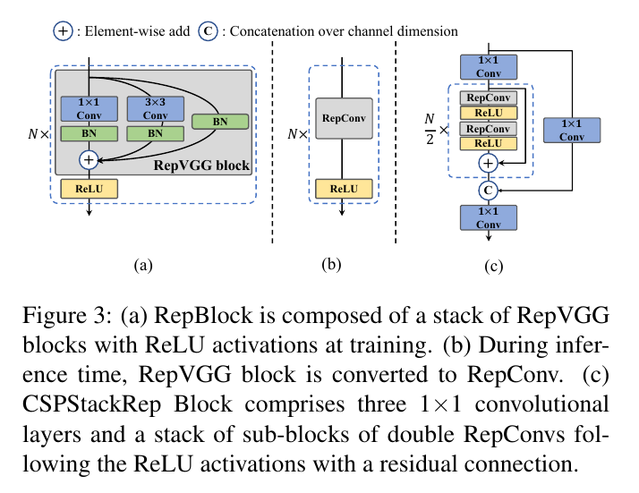
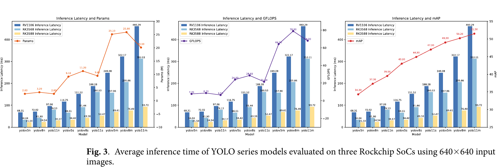

:tocdepth: 1

**************************
NAS và detector thân thiện
**************************

.. admonition:: Trang này trả lời

   - NAS dùng chỉ số phần cứng nào, và kết quả có chuyển giao sang thiết bị khác không?
   - những thay đổi nào của detector đã được đo trên NPU Rockchip?

.. admonition:: Tóm tắt

   - S3NAS dùng bộ ước lượng độ trễ xây từ bộ mô phỏng của MIDAP, chưa phải chip thật, còn ActNAS đo trên NPU không nêu tên [T2 S3NAS tr.4, T2 ACTNAS tr.3].
   - Kết quả NAS tối ưu cho một NPU chỉ có speedup rất thấp trên thiết bị khác [T2 ACTNAS tr.8].
   - Không bài NAS nào dùng RK3588 hoặc NPU Rockchip làm thiết bị đích, nên NAS cho Rockchip là `unknown`.
   - Chỉ DAHD sửa model và đo trên RK3588, và ở INT8 model đã sửa chậm hơn baseline: 79.1 so với 56.3 ms [T2 DAHD Table 6].
   - EDGE chỉ benchmark, và YOLO11n chậm hơn YOLOv8n trên RK3588 (30.71 so với 24.88 ms), còn lời giải thích về C3k2 và C2f chỉ là giả thuyết của tác giả [T2 EDGE tr.5].
   - DAHD-YOLO là bài về hành vi hút thuốc chứ không phải PPE, và Table 6 có mâu thuẫn nội bộ về mAP50 so với bảng ablation ở tr.15.

.. _83-nas-nhận-biết-npu-s3nas-actnas:

NAS nhận biết NPU (S3NAS, ActNAS)
=================================

**Câu hỏi:** NAS dùng chỉ số phần cứng nào, và kết quả có chuyển giao sang thiết bị khác không?

**Nguồn nói gì**

   "Note that MIDAP has not been implemented as a real hardware chip yet but as a virtual prototype with a cycle-accurate simulator." [T2 S3NAS tr.4]

..

   "an analytical latency estimator is devised, based on a cycle-level NPU simulator that runs an entire CNN considering the memory access overhead accurately." [T2 S3NAS tr.1]

   "We make the number of filters to be multiples of 16 to maximize the MAC unit utilization on MIDAP." [T2 S3NAS tr.9]

..

   "we generate a search space by systematically replacing each activation function in the reference model with a set of candidate activations: [ReLU, SiLU, Hardswish, ReLU6, and LeakyReLU]." [T2 ACTNAS tr.2]

   "We can see that both NPU aware models provide highest speedup on these devices but very low speedup on other devices." [T2 ACTNAS tr.8]

|S3NAS Figure 8| *Hình 8.3. Hai cách cài đặt cùng một khối MixConv: cùng FLOPS nhưng độ trễ ước lượng khác nhau. Nguồn: [T2 S3NAS tr.6, Figure 8]*

S3NAS Table 1 (tr.5), trên bộ mô phỏng MIDAP, ImageNet (mỗi dòng là mạng do NAS tìm với ràng buộc độ trễ riêng: 7.0 ms cho thí nghiệm khối fused và 2.15 ms cho các thí nghiệm còn lại, S3NAS tr.5) (độ chính xác %, độ trễ ms): Fused inverted bottleneck conv 77.34 và 6.90. MBConv 77.75 và 2.05. Combined 76.55 và 2.20.

**Ý chính**

- S3NAS dùng bộ ước lượng độ trễ xây từ bộ mô phỏng của một NPU giả định (MIDAP), không phải chip thật (S3NAS tr.1, 4). ActNAS đo độ trễ trên thiết bị, trung bình 50 lần, nhưng NPU không nêu tên.
- Khối "tốt nhất" phụ thuộc NPU: trên MIDAP MBConv (độ trễ 2.05 ms) nhanh hơn khối fused (6.90 ms) vì MIDAP hỗ trợ DWConv hiệu quả (S3NAS Table 1). Tổng hợp của file này: một NPU khác có thể cho thứ tự ngược lại, S3NAS tr.1 nhắc Edge-TPU chạy fused conv nhanh hơn dù nhiều MAC hơn.
- ActNAS chỉ tìm activation theo từng lớp, không đổi kiến trúc (ACTNAS tr.2). Kết quả tối ưu cho một NPU không chuyển giao tốt cho thiết bị khác (ACTNAS tr.8).

**Giới hạn.** Không bài nào dùng thiết bị đích là RK3588 hoặc NPU Rockchip. NAS cho Rockchip là ``unknown``.

--------------

.. _84-detector-thân-thiện-phần-cứng-và-các-bài-về-rockchip:

Detector thân thiện phần cứng và các bài về Rockchip
====================================================

**Câu hỏi:** những thay đổi nào của detector đã được đo trên NPU Rockchip?

**Nguồn nói gì**

   "Typically a 3×3 convolution is highly optimized on mainstream GPUs and CPUs and it enjoys higher computational density." [T2 Y6 tr.3]

..

   "DFL usually outputs 17× more regression values than general box regression, leading to a substantial overhead." [T2 Y6 tr.5]

   "There is a hardware gap when it comes to real serving environment. Typically, low-power GPUs like Tesla T4 are less costly and provide rather good inference performance." [T2 Y6 tr.2]

..

   "All deployments used the original FP32 PyTorch weights; no model was retrained, fine-tuned, pruned, or structurally modified beyond quantization." [T2 EDGE tr.4]

   "Instead, latency correlated more closely with model accuracy (mAP), suggesting that architectural innovations (e.g., C2f in YOLOv8, C3k2 in YOLO11) introduce additional computational overheads that do not map efficiently onto NPUs." [T2 EDGE tr.5]

..

   "The model's increased structural complexity has resulted in a decline in inference speed." [T2 DAHD tr.20]

   "produced invalid results due to quantization noise" [T2 RK66 tr.4]

..

   "INT8 instability likely arises from unsupported or partially supported RKNN operators" [T2 RK66 tr.12]

|YOLOv6 Figure 3| *Hình 8.4a. YOLOv6: (a) RepBlock lúc train, (b) RepConv lúc suy luận, (c) CSPStackRep Block. Nguồn: [T2 Y6 tr.4, Figure 3]*

|EDGE Figure 3| *Hình 8.4b. Độ trễ suy luận trung bình của các model YOLO trên RV1106, RK3568 và RK3588 với ảnh 640x640. Nguồn: [T2 EDGE tr.5, Fig. 3]*

|DAHD-YOLO Figure 1| *Hình 8.4c. Kiến trúc DAHD-YOLO (xây trên YOLOv8, thêm C2f_DBCA, ECA-FPN, DetectDBB, AFGCA). Nguồn: [T2 DAHD tr.5, Figure 1]*

Số đo trên RK3588:

.. list-table::
   :header-rows: 1

   * - Bài
     - Bảng
     - Thiết bị đo
     - Số
   * - EDGE
     - Table 4, tr.7
     - RK3588 (board không nêu), INT8, 640x640, các chế độ core (ms)
     - YOLOv5n: AUTO 21.7, C0_1_2 21.07. YOLOv8n: 24.88, 25.33. YOLO11n: 30.71, 31.27
   * - EDGE
     - Table 2, tr.4
     - tham số (M), GFLOPS, mAP
     - YOLOv5n 2.6, 7.7, 34.3. YOLOv8n 3.2, 8.7, 37.3. YOLO11n 2.6, 6.5, 39.5
   * - DAHD
     - Table 6, tr.18
     - Orange Pi 5 Plus RK3588. FPS ở 720P, 1080P, 1440P, đo bằng thread pool."single image with a resolution of 1280 × 720 reaches 79.1 ms" (DAHD tr.18), batch không nêu
     - YOLOv8s FP16: FPS720P 32.9, mAP50 73.6, thời gian 131.9 ms. YOLOv8s INT8: 70.9, 73.0, 56.3. DAHD-YOLO FP16: 26.9, 78.76, 116.2. DAHD-YOLO INT8: 50.2, 74.36, 79.1

**Ý chính**

- Y6 nêu động cơ về khoảng cách phần cứng với GPU công suất thấp như Tesla T4 (Y6 tr.2) và không nhắc NPU. Các ablation RepConv, ReLU và DFL (Table 4, 5, 10) chỉ đo trên T4. CPU Intel Core i7 chỉ xuất hiện ở so sánh cả model ở phụ lục (Table 20). Tổng hợp của file này: Y6 được tối ưu cho GPU và CPU, không phải NPU.
- Chỉ DAHD sửa model (thêm DBB, attention) và đo trên RK3588. Ở INT8 model đã sửa chạy chậm hơn baseline cả về độ trễ lẫn FPS: 79.1 so với 56.3 ms và FPS720P 50.2 so với 70.9 (DAHD Table 6). Ở FP16 hai chỉ số ngược nhau (116.2 so với 131.9 ms nhưng FPS 26.9 so với 32.9, xem bảng mâu thuẫn). FPS được đo bằng thread pool (DAHD tr.18). DAHD tr.20 nêu độ phức tạp cấu trúc làm giảm tốc độ nhưng không nêu thiết bị. DAHD-YOLO là sự kết hợp nhiều thay đổi nên không tách được nguyên nhân.
- EDGE không sửa model, chỉ benchmark (EDGE tr.4). Trên RK3588 YOLO11n chậm hơn YOLOv8n dù ít GFLOPS hơn (30.71 so với 24.88 ms, 6.5 so với 8.7 GFLOPS). Lời giải thích về C3k2 và C2f chỉ là giả thuyết của tác giả (EDGE tr.5).
- EDGE tr.6: với YOLOv5n chênh lệch giữa một core và đa core dưới 5% (21.5 so với 20.5 ms) và "For larger models, the gains were similarly modest or even negligible". Nhưng Table 4 (tr.7) cho thấy các model khác giảm rõ: YOLOv5s C0 34.42 xuống 27.95 ở C0_1_2. YOLOv5m C0 69.61 xuống 58.34 ở ALL. YOLOv8n C0 24.54 xuống 21.25 ở ALL, trong khi YOLO11s AUTO 41.25 thấp hơn C0 52.47. Lời văn và bảng của EDGE không nhất quán.

**Giới hạn**

- DAHD-YOLO là bài phát hiện hành vi hút thuốc (smoking), không phải PPE. Table 6 không nêu kích thước ảnh và batch, và có mâu thuẫn nội bộ: mAP50 trong Table 6 (73.6 và 78.76) khác bảng ablation ở tr.15 (80.9 cho YOLOv8s và 86.0 cho DAHD-YOLO, không giải thích). Ngoài ra, DAHD tr.18 viết 0.1162 s cho "INT8 optimized model" trong khi 116.2 ms trong Table 6 thuộc hàng FP16.
- LNB-YOLO chỉ có số FPS trên RTX 3090 và đếm TP, FP, FN trên 20 ảnh ở RK3568, không có độ trễ NPU (LNB tr.20 đến 22). RK66 chạy FP32 trên RK3566 vì INT8 cho kết quả sai, và không sửa model (RK66 tr.4, 12). Cả hai không dùng cho RK3588.
- RK66 tr.4 gọi RKNN-Toolkit Lite2 là công cụ chuyển ONNX sang RKNN model, trái với định nghĩa trong :doc:`/thuat-ngu` (Lite2 chỉ chạy model có sẵn).
- AGENT (YOLO-World, FP16, Orange Pi 5): "four operators fell back to CPU execution" nhưng không có bảng độ trễ và không nêu tên op. Không dùng cho 8.4.

--------------

.. |S3NAS Figure 8| image:: ../../../_assets/img/npu/08_model_design_for_npu/s3nas_p6_fig8.png

.. |DAHD-YOLO Figure 1| image:: ../../../_assets/img/npu/08_model_design_for_npu/dahd_p5_fig1.png

Nguồn
=====

Các nhãn nguồn dùng trong trang này (tier, tệp, số lần trích).

.. list-table::
   :header-rows: 1
   :widths: 12 8 70 10

   * - Nhãn
     - Tier
     - Nguồn
     - Số lần
   * - ``S3NAS``
     - T2
     - :download:`s3nas_npu_aware_2020lee.pdf <../../../_assets/pdf/papers/06_nas/s3nas_npu_aware_2020lee.pdf>`
     - 4
   * - ``Y6``
     - T2
     - :download:`yolov6_hwfriendly_2022li.pdf <../../../_assets/pdf/papers/08_npu_friendly_arch/yolov6_hwfriendly_2022li.pdf>`
     - 4
   * - ``EDGE``
     - T2
     - :download:`edgesoc_benchmark_2026kong.pdf <../../../_assets/pdf/papers/05_rk3588/edgesoc_benchmark_2026kong.pdf>`
     - 3
   * - ``ACTNAS``
     - T2
     - :download:`actnas_yolo_2025sah.pdf <../../../_assets/pdf/papers/08_npu_friendly_arch/actnas_yolo_2025sah.pdf>`
     - 2
   * - ``DAHD``
     - T2
     - :download:`dahd_yolo_rk3588_2025.pdf <../../../_assets/pdf/papers/05_rk3588/dahd_yolo_rk3588_2025.pdf>`
     - 2
   * - ``RK66``
     - T2
     - :download:`rk3566_npu_yolo11_2026limaran.pdf <../../../_assets/pdf/papers/05_rk3588/rk3566_npu_yolo11_2026limaran.pdf>`
     - 2
