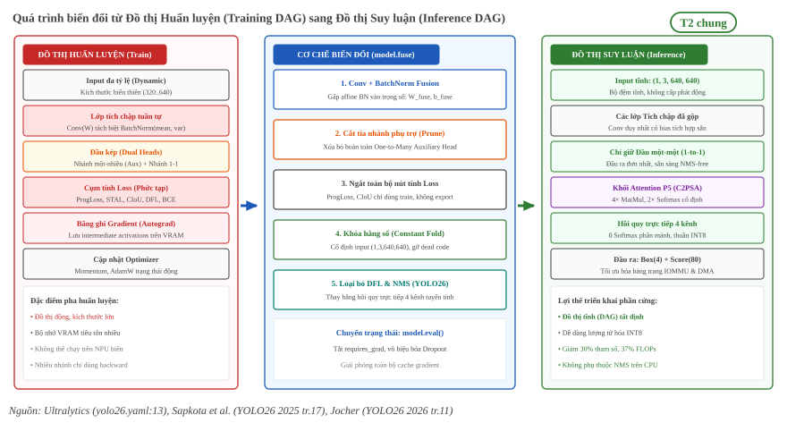

:tocdepth: 2

**************************************
Biến đổi đồ thị suy luận từ huấn luyện
**************************************

Trang này phân tích mối quan hệ giữa pha huấn luyện và cấu trúc đồ thị suy luận trong các mô hình YOLO, tập trung vào sự chuyển dịch từ YOLOv8 sang YOLO26. Nhiều cải tiến thuật toán hiện đại chỉ can thiệp vào giai đoạn tối ưu hóa tham số mà không để lại bất kỳ chi phí tính toán nào trong đồ thị xuất khẩu. Ngược lại, việc loại bỏ phân phối hộp DFL và áp dụng nhánh gán nhãn một-một làm biến đổi căn bản cấu trúc các toán tử suy luận trên phần cứng biên. Độc giả quan tâm đến việc chuyển đổi đồ thị này sang định dạng RKNN trên vi xử lý RK3588 có thể tham khảo :doc:`../../02-nen-tang-rk3588/05-yolo-tren-rk3588/01-do-thi-xuat-va-duong-rknn`.

.. contents:: Mục lục trang
   :local:
   :depth: 2

1. Từ đồ thị huấn luyện sang suy luận
=====================================

Các biến đổi chung khi chuyển từ huấn luyện sang suy luận nằm ở trang chủ của từng khái niệm:

- Hai chế độ ``train`` và ``eval``, gradient, Dropout: :doc:`../01-nen-tang-ai/06-huan-luyen-va-suy-luan`.
- Gộp BatchNorm vào Conv: :doc:`../01-nen-tang-ai/04-chuan-hoa-va-activation` mục 5.
- Constant folding và loại nhánh chết: :doc:`../04-compiler/02-toi-uu-do-thi-va-operator-fusion` mục 2.

Mục này chỉ nêu phần riêng của YOLO26. Mạng duy trì đồng thời nhánh một-nhiều và nhánh một-một lúc huấn luyện, còn đồ thị suy luận bỏ nhánh phụ trợ một-nhiều:

   "Parameter counts and FLOPs denote the fused inference architecture, which merges Conv/BatchNorm layers and removes the auxiliary one-to-many detection head used during training." [T2 Y26A tr.17]

   Đường ống biến đổi từ đồ thị huấn luyện sang đồ thị suy luận: Conv-BN fusion, cắt tỉa nhánh phụ trợ và chuyển đổi sang dạng tĩnh tối ưu hóa NPU [T2 Y26A tr.17], [T2 Y26B tr.6-7].

.. list-table:: Phân loại tác động của các thành phần huấn luyện lên đồ thị suy luận
   :header-rows: 1
   :widths: 25 35 40

   * - Thành phần huấn luyện
     - Tác động lên đồ thị suy luận
     - Cơ chế xử lý khi xuất khẩu mô hình
   * - Phép gộp Conv + BatchNorm
     - Thay đổi cấu trúc (rút gọn)
     - Gộp tham số toán học vào một lớp Conv duy nhất có bias
   * - Nhánh phụ trợ (One-to-many)
     - Bị loại bỏ hoàn toàn
     - Cắt tỉa nhánh thừa qua phương thức ``model.fuse()`` [T2 Y26A tr.17]
   * - Module phân phối hộp DFL
     - Bị bãi bỏ trong YOLO26
     - Thay bằng nhánh hồi quy trực tiếp tuyến tính 4 kênh [T2 Y26A tr.8]
   * - Đầu một-một (One-to-one Head)
     - Giữ lại làm đầu ra chính
     - Xuất trực tiếp dự đoán đơn nhất, hỗ trợ NMS-free [T2 Y26B tr.7]
   * - Hàm mất mát (ProgLoss, TAL)
     - Hoàn toàn không tác động
     - Chỉ dùng để tính đạo hàm ngược, không sinh ra node ONNX [T2 Y26B tr.4]
   * - Bộ tối ưu hóa (MuSGD, AdamW)
     - Hoàn toàn không tác động
     - Cập nhật trọng số tĩnh trong checkpoint, bị gỡ khi export [T2 Y26B tr.7]

2. Bỏ DFL và dùng nhánh một-một
===============================

Sự biến đổi đồ thị rõ rệt nhất giữa YOLOv8 và YOLO26 nằm ở việc tái cấu trúc đầu dự đoán (Detect Head), tác động trực tiếp đến tính khả thi và độ trễ khi triển khai trên phần cứng biên.

Cấu trúc đầu DFL của YOLOv8, đầu hồi quy trực tiếp của YOLO26 và cơ chế nhánh một-một nằm ở :doc:`01-kien-truc-va-khoi-cau-thanh-yolo` mục 5. Mục này chỉ xét thay đổi trên đồ thị suy luận.

So sánh luồng giải mã tọa độ hộp trên đồ thị:
  - Đường ống giải mã của YOLOv8:

    .. code-block:: text

       Conv(64 kênh) --> Reshape(4, 16) --> Softmax(dim=16) --> MatMul([0..15]) --> Box(4)

    Tại mỗi bước, tensor trung gian phải được cấp phát trên bộ nhớ, tạo thành rào cản phụ thuộc dữ liệu khiến NPU không thể gộp toán tử.
  - Đường ống giải mã của YOLO26:

    .. code-block:: text

       Conv(4 kênh) -------------------------------------------------------------> Box(4)

    Đầu ra từ lớp tích chập cuối cùng chính là khoảng cách biên hộp thực tế, loại bỏ hoàn toàn khâu giải mã xác suất trung gian.

Tác động đến lượng tử hóa số nguyên (INT8 Quantization):
  - Khi lượng tử hóa mạng YOLOv8 sang INT8, phân phối kích hoạt của 16 bin trước Softmax có dải động rộng và phân tán. Việc chuyển đổi Softmax sang số nguyên đòi hỏi các bảng tra cứu (LUT) phức tạp hoặc buộc phải giải lượng tử ngược về FP32, phá vỡ tính liên tục của luồng tính toán INT8 trên NPU.
  - Với YOLO26, do giá trị hộp được xuất trực tiếp từ Conv :math:`1 \times 1`, toán tử này tuân theo công thức lượng tử hóa chuẩn của phép tích chập: :math:`q_{out} = M \cdot (q_{in} \ast q_{w}) + Z_{out}`. Toàn bộ khâu tính tọa độ hộp có thể thực thi trọn vẹn trên các mảng nhân cộng tích lũy số nguyên (INT8 MACs) của NPU mà không cần bất kỳ toán tử phi tuyến đặc thù nào.
  - Mỗi kênh hộp của YOLO26 chỉ cần xác định một cặp tham số lượng tử hóa :math:`(S, Z)` tĩnh thông qua phương pháp hiệu chuẩn phân kỳ KL (Kullback-Leibler) hoặc MSE trên tập dữ liệu đại diện. Điều này giúp loại bỏ hoàn toàn hiện tượng bão hòa hoặc sai số tràn số thường gặp khi lượng tử hóa các hàm phi tuyến tính như Softmax.

Tích hợp nhánh một-một và cơ chế NMS-free:
  - Cơ chế lọc hậu kỳ tĩnh: Khi xuất mô hình với cờ ``end2end: True`` [T1 yolo26.yaml:9], khâu hậu kỳ chỉ bao gồm việc nhân ngưỡng tin cậy và trích chọn :math:`K` dự đoán hàng đầu thông qua hàm ``topk`` cố định (như 100 hoặc 300 đối tượng) [T1 ultralytics/nn/modules/head.py]. Các toán tử này có khối lượng tính toán cố định và hoàn toàn độc lập với mật độ vật thể trong cảnh quay.
  - Đánh giá độ chính xác: Trên tập dữ liệu COCO val, nhánh một-một của YOLO26n đạt 40.1% mAP (theo đánh giá end-to-end), trong khi nhánh một-nhiều khi dùng NMS truyền thống đạt 40.9% mAP [T2 YOFF tr.14]. Sự chênh lệch 0.8% mAP là mức đánh đổi hợp lý để đổi lấy khả năng thực thi thời gian thực ổn định và đơn giản hóa đồ thị triển khai.

3. Cải tiến chỉ ở pha huấn luyện
================================

Bên cạnh các thay đổi về cấu trúc mạng, YOLO26 giới thiệu ba kỹ thuật huấn luyện đột phá nhằm cải thiện độ chính xác và tốc độ hội tụ mà hoàn toàn không làm phát sinh thêm bất kỳ chi phí tính toán hay thay đổi nào trong đồ thị suy luận ONNX xuất ra.

- **Progressive Loss (ProgLoss)**:
  - Khái niệm: Trong quá trình huấn luyện mô hình end-to-end có cả hai nhánh, việc cân bằng tín hiệu giám sát giữa nhánh một-nhiều và nhánh một-một là thách thức lớn. ProgLoss giải quyết vấn đề này bằng chiến lược điều chỉnh động trọng số hàm tổn thất theo thời gian: "ProgLoss adaptively reweights objectives to prevent domination by easy examples late in training, while STAL prioritizes assignment for tiny or occluded instances" [T2 Y26B tr.4].
  - Cơ chế hoạt động: Ở những epoch đầu tiên, ProgLoss gán trọng số lớn hơn cho nhánh một-nhiều để cung cấp tín hiệu gradient dày đặc giúp backbone học biểu diễn không gian nhanh chóng. Càng về các epoch cuối, trọng số giám sát chuyển dần sang nhánh một-một nhằm rèn luyện mạng khả năng ra quyết định dứt khoát trên từng đối tượng [T2 YOFF tr.11].
  - Bù đắp độ chính xác khi bỏ DFL: Nghiên cứu thực nghiệm chỉ ra rằng: "Table 2 shows that removing DFL alone costs 0.6 AP on the YOLO11s baseline (47.0 to 46.4), but this gap is fully recovered by L1 supervision (+0.2), STAL (+0.2), and the backbone/neck refinement (+0.2)" [T2 YOFF tr.11]. Nhờ sự kết hợp của ProgLoss và giám sát L1, độ chính xác định vị hộp được bù đắp hoàn toàn mà đồ thị suy luận vẫn giữ nguyên tính chất nhẹ của phép hồi quy trực tiếp.
  - Tính chất đối với đồ thị suy luận: ProgLoss chỉ là một hệ số tỷ lệ trong biểu thức tính đạo hàm ngược của PyTorch. Khi xuất mô hình sang ONNX hoặc định dạng suy luận phần cứng, toàn bộ mã nguồn của ProgLoss bị loại bỏ hoàn toàn.

- **Small-Target-Aware Label Assignment (STAL)**:
  - Khái niệm: Các bộ gán nhãn truyền thống như Task-Aligned Assigner (TAL) thường thiên vị các đối tượng có kích thước lớn, dẫn tới việc các vật thể nhỏ hoặc bị che khuất không được gán đủ số lượng anchor tích cực trong quá trình huấn luyện [T2 YOFF tr.8].
  - Cơ chế hoạt động: STAL đưa vào một kích thước chuẩn hóa tham chiếu :math:`s_{ref}=16` pixel để cân chỉnh lại điểm căn chỉnh (alignment metric), đảm bảo các vật thể nhỏ vẫn nhận được số lượng mẫu huấn luyện dương tương xứng [T2 YOFF tr.8, tr.14].
  - Bảo toàn không gian ứng viên: Khác với các phương pháp làm phình dữ liệu giám sát, tác giả nhấn mạnh: "Importantly, STAL modifies only the candidate-selection mask." [T2 YOFF tr.8]. Hộp nhãn gốc :math:`g_i` vẫn được bảo toàn trọn vẹn cho việc tính điểm căn chỉnh và hồi quy hộp thực tế. Điều này: "makes STAL deliberately conservative: it does not alter localization targets or inflate supervision for ordinary objects" [T2 YOFF tr.8].
  - Tính chất đối với đồ thị suy luận: STAL chỉ thực hiện logic so khớp hình học giữa bounding box nhãn thực tế và các anchor trong pha huấn luyện. Thuật toán này không tạo ra bất kỳ tham số hay toán tử nào trong đồ thị suy luận.

- **Bộ tối ưu hóa MuSGD (Muon-assisted SGD)**:
  - Khái niệm: YOLO26 giới thiệu bộ tối ưu hóa lai kết hợp giữa SGD truyền thống và thuật toán tối ưu ma trận Muon: "the introduction of the MuSGD optimizer (Figure 4d), which combines the strengths of Stochastic Gradient Descent (SGD) with the recently proposed Muon optimizer" [T2 Y26B tr.7].
  - Cơ chế hoạt động: MuSGD khai thác khả năng tổng quát hóa tốt của SGD-momentum trên các lớp tích chập thông thường, đồng thời áp dụng các bước cập nhật trực giao hóa ma trận thông qua thuật toán lặp Newton-Schulz từ Muon lên các ma trận trọng số 2 chiều [T2 YOFF tr.7], [T2 Y26B tr.7].
  - Phân tách tham số ma trận và vector: Trong triển khai thực tế, Muon chỉ áp dụng cho các trọng số 2 chiều hoặc tensor tích chập đa chiều sau khi trải phẳng thành ma trận :math:`(C_{out}, C_{in} \times K_h \times K_w)`. Các tham số 1 chiều như vector bias hoặc các tham số chuẩn hóa vẫn được tối ưu hóa bằng thuật toán SGD momentum truyền thống [T2 YOFF tr.7]. Thuật toán lặp xấp xỉ ma trận trực giao :math:`O_t \approx U V^T` từ gradient :math:`G` theo công thức:

    .. math::

       X_{k+1} = X_k \left(a I + b X_k^T X_k + c (X_k^T X_k)^2\right)

    với các hệ số thực nghiệm cố định :math:`a=3.4445, b=-4.7750, c=2.0315`, giúp giới hạn giá trị kỳ dị của ma trận cập nhật, ngăn chặn hiện tượng bùng nổ gradient mà không cần giảm learning rate toàn cục.

  - Hiệu quả huấn luyện: MuSGD giúp mô hình đạt độ chính xác cao hơn với số lượng epoch ít hơn (giảm từ 600 epoch xuống còn 500 epoch trên tập COCO), rút ngắn chu kỳ huấn luyện và tiết kiệm năng lượng tính toán [T2 YOFF tr.12].
  - Tính chất đối với đồ thị suy luận: Sau khi hoàn thành huấn luyện, bộ tối ưu hóa MuSGD được giải phóng khỏi bộ nhớ, chỉ còn lại các giá trị trọng số tĩnh được lưu trong tệp mô hình. Đồ thị suy luận không chứa bất kỳ dấu vết nào của thuật toán tối ưu.

4. Điều chưa biết
=================

Mặc dù các tài liệu công bố chính thức đã chứng minh ưu thế lý thuyết của kiến trúc YOLO26 trên môi trường GPU và CPU chuẩn, việc ứng dụng mô hình này trên các bộ xử lý thần kinh biên (Edge NPU) vẫn tồn tại các điểm chưa được làm sáng tỏ trong y văn:

- Sự đánh đổi giữa nhánh một-một và nhánh một-nhiều sau lượng tử hóa INT8:
  - Hiện tại, các tài liệu T2 mới chỉ cung cấp số liệu so sánh mAP giữa nhánh một-một (40.1%) và một-nhiều (40.9%) ở độ chính xác số thực FP32 trên GPU máy chủ [T2 YOFF tr.14]. Mức độ suy giảm độ chính xác khi lượng tử hóa INT8 (PTQ/QAT) đối với nhánh một-một nhạy cảm trên các trình biên dịch NPU độc quyền của từng hãng sản xuất chip vẫn chưa được công bố bằng thực nghiệm độc lập.

- Mức độ tối ưu hóa phần cứng cho các toán tử Pointwise Self-Attention:
  - Mặc dù cơ chế Attention trong C2PSA và C3k2 chỉ hoạt động trên lưới :math:`20 \times 20` (400 token) nhằm hạn chế FLOPs, khả năng các trình biên dịch NPU độc quyền có dung hợp hiệu quả toán tử ``MatMul`` và ``Softmax`` vào bộ nhớ đệm SRAM trên chip hay không phụ thuộc hoàn toàn vào kiến trúc nội bộ của từng bộ tăng tốc.
  - Thao tác hoán vị trục bộ nhớ (transpose và reshape) cần thiết cho Attention có nguy cơ phá vỡ luồng truyền dữ liệu liên tục (streaming dataflow) vốn được tối ưu hóa cho các toán tử tích chập truyền thống trên phần cứng NPU.

- Khả năng tương thích của nhánh gán nhãn một-một trên các pipeline suy luận lai:
  - Các tài liệu T2 tập trung vào đường suy luận end-to-end trên nền tảng PyTorch/TensorRT. Tuy nhiên, khi triển khai trên các hệ thống nhúng thực tế, việc xuất toàn bộ đầu dự đoán lên NPU hay chỉ xuất các tensor đặc trưng thô để CPU xử lý hậu kỳ là một quyết định kiến trúc phụ thuộc vào năng lực của từng driver phần cứng. Vấn đề khảo sát thực nghiệm và các điểm nghẽn chuyển đổi cụ thể của YOLO trên vi xử lý Rockchip RK3588 được trình bày chi tiết tại chuyên đề :doc:`../../02-nen-tang-rk3588/05-yolo-tren-rk3588/01-do-thi-xuat-va-duong-rknn`.

Nguồn
=====

Các tài liệu kỹ thuật và bài báo hội thảo chính thức được sử dụng để đối chiếu dữ liệu trong trang này:

.. list-table:: Danh mục tài liệu tham khảo và đối soát trích dẫn
   :header-rows: 1
   :widths: 14 10 60 16

   * - Nhãn
     - Phân loại
     - Tên tài liệu / Đường dẫn lưu trữ
     - Ghi chú
   * - ``YOFF``
     - T2
     - :download:`yolo26_official_2026jocher.pdf <../../../_assets/pdf/papers/09_yolo_architecture/yolo26_official_2026jocher.pdf>`
     - Jocher et al. (2026), bài báo chính thức về họ mô hình YOLO26
   * - ``Y26A``
     - T2
     - :download:`yolo26_nmsfree_2026chakrabarty.pdf <../../../_assets/pdf/papers/09_yolo_architecture/yolo26_nmsfree_2026chakrabarty.pdf>`
     - Chakrabarty (2026), phân tích cơ chế NMS-free và giải mã không DFL
   * - ``Y26B``
     - T2
     - :download:`yolo26_arch_2025sapkota.pdf <../../../_assets/pdf/papers/09_yolo_architecture/yolo26_arch_2025sapkota.pdf>`
     - Sapkota et al. (2025), khảo sát cấu trúc mạng và tối ưu hóa phần cứng
   * - ``T1``
     - T1
     - Tệp cấu hình ``yolo26.yaml`` và mã nguồn Ultralytics
     - Cấu hình mạng gốc trong thư viện ``ultralytics``
