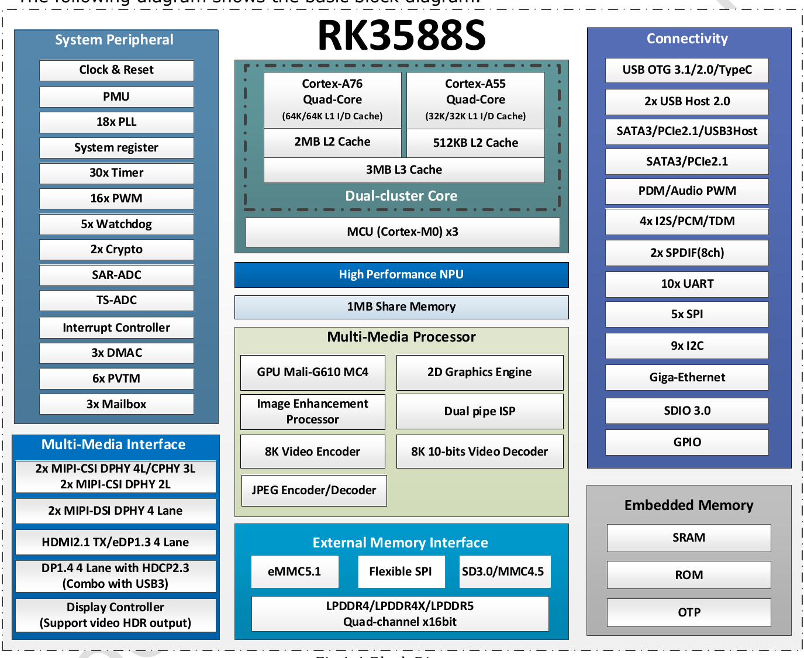
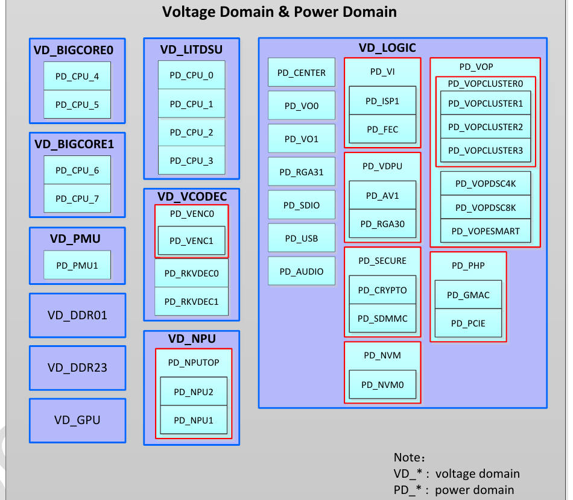
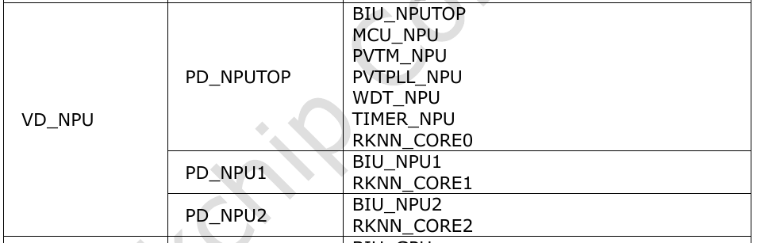
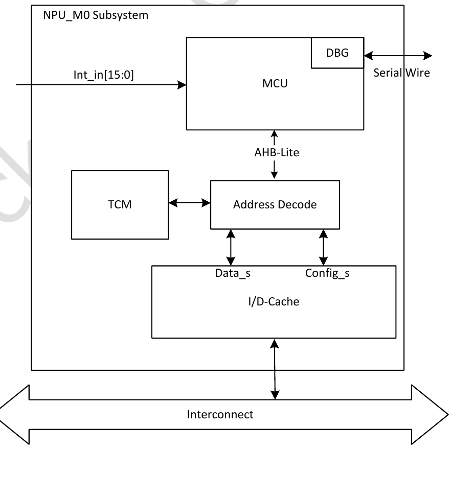

:tocdepth: 1

************************
Vị trí SoC và miền nguồn
************************

.. admonition:: Trang này trả lời

   - NPU nằm đâu trong SoC và nối vào bus nào?
   - NPU thuộc miền nguồn nào, bật tắt miền nguồn ra sao?
   - MCU đi kèm NPU là gì, nối với NPU thế nào?

.. admonition:: Tóm tắt

   - NPU có ba core RKNN, chạy ba core cùng nhau, hai core cùng nhau hoặc riêng lẻ [T1 TRM1 tr.1984].
   - Giao diện AHB dùng để cấu hình, giao diện AXI master dùng để lấy dữ liệu từ bộ nhớ gắn vào SoC AXI interconnect [T1 TRM1 tr.1985].
   - VD_NPU chứa ba power domain PD_NPUTOP, PD_NPU1, PD_NPU2 [T1 TRM1 tr.1091]. PD_NPU1 và PD_NPU2 lồng trong PD_NPUTOP [T1 TRM1 tr.1268].
   - Tắt một domain: gửi BIU idle request, ghi bit power down, đọc thanh ghi trạng thái cho tới khi xong [T1 TRM1 tr.1269].
   - Có ba MCU Cortex-M0 trong SoC. MCU của NPU (NPU_M0) có TCM 64KB, cache 16KB và 16 ngắt nối trực tiếp [T1 TRM1 tr.1276] [T1 TRM1 tr.1298].
   - Trong driver ``rknpu`` 0.9.8, CPU chính ghi trực tiếp thanh ghi task và xử lý ngắt ``npu0..2_irq`` qua MMIO mà không giao tiếp với NPU_M0 hay MAILBOX2 [T1 DRV rknpu_job.c:272-375].
   - TRM1 và TRM2 không chứa chuỗi "iommu". Phía DTS và driver có khai báo IOMMU cho NPU [T1 DTS 3478].

.. contents:: Trong trang này
   :local:
   :depth: 1

.. _vi-tri-cua-npu-trong-soc:

1. Vị trí NPU trong SoC
=======================

Một SoC gồm nhiều khối IP (CPU, GPU, NPU, bộ điều khiển DDR, ...) nối với nhau qua mạng bus interconnect. Khối chủ động khởi tạo giao dịch đọc ghi là master, khối chỉ đáp ứng là slave.

1.1 Sơ đồ khối RK3588
---------------------

TRM1 không có sơ đồ khối của cả SoC. Chương 1 của TRM1 có các bảng address mapping, interrupt và DMAC. Sơ đồ khối nằm trong datasheet, còn sơ đồ interconnect nằm trong TRM2 (xem :doc:`06-duong-truyen-du-lieu-iommu-va-ddr`).

.. _fig-ds-v17-block-diagram:

   Sơ đồ khối của datasheet RK3588S. Nguồn: [T1 DS V1.7 tr.17, Fig. 1-1]

Sơ đồ khối có ba mục liên quan tới NPU gồm ``MCU (Cortex-M0) x3``, ``High Performance NPU`` và ``1MB Share Memory`` [T1 DS V1.7 tr.17]. Datasheet mô tả: "The build-in NPU supports INT4/INT8/INT16/FP16 hybrid operation and computing power is up to 6TOPs." [T1 DS V1.7 tr.7] và "Include triple NPU core, and support triple core co-work, dual core co-work, and work independently" [T1 DS V1.7 tr.11]. TRM1 chương 36 nêu cùng ý: "RKNN is the process unit which is dedicated to neural network." [T1 TRM1 tr.1984].

Bảng sau gom các khối thuộc NPU trong bản đồ địa chỉ (Table 1-1) và bảng ngắt (Table 1-3, cột "High level", tiêu đề ở tr.20) của TRM1:

.. list-table::
   :header-rows: 1
   :widths: 26 22 14 38

   * - Khối
     - Địa chỉ đầu
     - Kích thước
     - Ngắt (Table 1-3) và nguồn
   * - RKNN C0 / C1 / C2
     - ``FDAB0000``, ``FDAC0000``, ``FDAD0000``
     - 64KB mỗi core
     - ID 142, 143, 144 (``irq_rknn_c0..c2``) [T1 TRM1 tr.18] [T1 TRM1 tr.24]
   * - NPU_GRF
     - ``FD5A2000``
     - 8KB
     - Không có ngắt riêng [T1 TRM1 tr.17]
   * - PVTM_NPU
     - ``FDAF0000``
     - 32KB
     - ID 388 (``irq_npu_pvtm``) [T1 TRM1 tr.18] [T1 TRM1 tr.25]
   * - WDT_NPU
     - ``FDAF8000``
     - 32KB
     - ID 438 (``irq_wdt_npu``) [T1 TRM1 tr.18] [T1 TRM1 tr.26]
   * - TIMER_NPU (2 kênh)
     - ``FDB00000``
     - 32KB
     - ID 436, 437 (``irq_timer0/1_npu``) [T1 TRM1 tr.19] [T1 TRM1 tr.26]
   * - MAILBOX2 (MCU_NPU)
     - ``FECE0000``
     - 64KB
     - Ngắt nối vào NPU_M0 (mục 3.2) [T1 TRM1 tr.19]
   * - MCU_TCM, MCU_CACHE
     - ``F6F00000``, ``F6F10000``
     - 64KB, 64KB
     - ID 390 (``irq_npumcu_cache``) [T1 TRM1 tr.16] [T1 TRM1 tr.25]

Trong DTS, node ``rknpu`` dùng ba vùng ``reg`` 0xfdab0000, 0xfdac0000, 0xfdad0000 kích thước 0x10000 [T1 DTS 3452-3454] và ba ngắt tên ``npu0_irq``, ``npu1_irq``, ``npu2_irq`` [T1 DTS 3458] gắn với ``GIC_SPI 110``, ``111``, ``112`` [T1 DTS 3455-3457] (cộng 32 offset GIC SPI khớp với ID 142, 143, 144 của Table 1-3). Node ``rknpu`` ở trạng thái ``disabled`` trong file dtsi và được bật ở file DTS của từng board [T1 DTS 3479].

1.2 NPU nối với bus nào
-----------------------

NPU có hai giao diện tương ứng với hai miền xung nhịp ("RKNN has two clock domains, one is AHB clock, the other is AXI clock." [T1 TRM1 tr.2052]):

- **AHB slave**: "AHB interface used for configuration only support single" [T1 TRM1 tr.1984] và "The AHB slave interface is used to access the registers for configuration, debug and test." [T1 TRM1 tr.1985].
- **AXI master**: "AXI interface used to fetch data from memory" [T1 TRM1 tr.1984] và "The AXI master interface is used to fetch data from memory that is attached to the Soc AXI interconnect." [T1 TRM1 tr.1985]. Ngoài dữ liệu tensor, khối Register File Fetch Unit cũng đọc cấu hình thanh ghi từ bộ nhớ hệ thống qua AXI ("Register File Fetch Unit fetch register configuration from external system memory through AXI interface." [T1 TRM1 tr.1986]).

Phía interconnect, TRM2 mô tả bốn bộ lập lịch DDR ("Four embedded DDR schedulers for transaction reorder to maximum DDR efficiency" [T1 TRM2 tr.16]) và Table 1-3 liệt kê NPU là master qua các cổng NPU1, NPU0_MRO, NPU0_MWR, NPU2 và MCU_NPU [T1 TRM2 tr.19] (chi tiết tại :doc:`06-duong-truyen-du-lieu-iommu-va-ddr`).

**Khai báo IOMMU.** TRM1 và TRM2 không chứa chuỗi "iommu" và chỉ liệt kê hai khối MMU600 ("There are two MMU600 instances in RK3588, MMU600_PCIE and MMU600_PHP respectively." [T1 TRM1 tr.1273]). Ngược lại, DTS và driver khai báo đầy đủ IOMMU riêng cho NPU: node ``rknpu`` trỏ tới ``iommus = <&rknpu_mmu>`` [T1 DTS 3478], node ``rknpu_mmu`` dùng ``compatible = "rockchip,iommu-v2"`` với ba ngắt ``npu0_mmu``, ``npu1_mmu``, ``npu2_mmu`` [T1 DTS 3712-3728] [T1 DTS 3721]. Khi khởi tạo, driver kiểm tra phandle ``iommus`` [T1 DRV rknpu_drv.c:794-816], gọi ``iommu_group_get`` nếu IOMMU bật hoặc ``of_reserved_mem_device_init`` nếu tắt [T1 DRV rknpu_drv.c:1294-1306], đặt ``.dma_mask = DMA_BIT_MASK(40)`` [T1 DRV rknpu_drv.c:186], hỗ trợ tối đa ``RKNPU_MAX_IOMMU_DOMAIN_NUM = 16`` domain [T1 DRV include/rknpu_drv.h:56] thông qua hai ioctl ``RKNPU_GET_IOMMU_DOMAIN_ID`` (24) và ``RKNPU_SET_IOMMU_DOMAIN_ID`` (25) [T1 DRV include/rknpu_ioctl.h:135-136]. Tài liệu UG232 ghi nhận mỗi không gian địa chỉ ``iommu_domain_id`` có kích thước 4GB [T1 UG232 tr.45].

2. Power domain
===============

Power domain (``PD_*``) là vùng mạch có thể cắt nguồn riêng để tiết kiệm điện khi không dùng, còn voltage domain (``VD_*``) là vùng mạch dùng chung một đường cấp điện áp [T1 TRM1 tr.1092].

2.1 Miền nguồn của NPU
----------------------

TRM1 ghi nhận SoC hỗ trợ nhiều miền điện áp ("Support multi voltage domains: VD_BIGCORE0, VD_BIGCORE1, VD_LITDSU, VD_GPU, VD_NPU, VD_VCODEC, VD_DDR01, VD_DDR23, VD_LOGIC, VD_PMU" [T1 TRM1 tr.1091]) và ba miền nguồn bên trong ``VD_NPU`` ("Support multi power domains in VD_NPU: PD_NPUTOP, PD_NPU1, PD_NPU2" [T1 TRM1 tr.1091]).

.. _fig-trm1-voltage-power-domain:

   Phân vùng voltage domain và power domain của RK3588. VD_NPU chứa PD_NPUTOP, PD_NPU2 và PD_NPU1. Nguồn: [T1 TRM1 tr.1092, Fig. 7-2]

.. _fig-trm1-table-vd-npu:

   Hàng VD_NPU của bảng tóm tắt voltage domain và power domain. Nguồn: [T1 TRM1 tr.1093, Table 7-1]

.. list-table::
   :header-rows: 1
   :widths: 20 55 25

   * - Power domain
     - Thành phần
     - Nguồn
   * - PD_NPUTOP
     - BIU_NPUTOP, MCU_NPU, PVTM_NPU, PVTPLL_NPU, WDT_NPU, TIMER_NPU, RKNN_CORE0 (7 mục)
     - [T1 TRM1 tr.1093]
   * - PD_NPU1
     - BIU_NPU1, RKNN_CORE1
     - [T1 TRM1 tr.1093]
   * - PD_NPU2
     - BIU_NPU2, RKNN_CORE2
     - [T1 TRM1 tr.1093]

Core 0 nằm chung domain với MCU_NPU, còn core 1 và core 2 mỗi core một domain riêng. Table 7-2 của TRM1 xếp ``PD_NPUTOP`` là miền ngoài (external) và ``PD_NPU1``, ``PD_NPU2`` là miền trong (internal) lồng bên trong [T1 TRM1 tr.1268], với quy tắc bắt buộc: "external power domain should not be power down before internal power domain power down, external power domain should be power up before internal power domain power up." [T1 TRM1 tr.1268] và "Incorrect power order may cause power leakage." [T1 TRM1 tr.1269].

DTS khai báo cấu trúc lồng tương ứng: ``power-domain@RK3588_PD_NPU`` chứa ``RK3588_PD_NPUTOP``, và ``RK3588_PD_NPUTOP`` chứa ``RK3588_PD_NPU1`` cùng ``RK3588_PD_NPU2`` [T1 DTS 3116-3148]. Mỗi domain gắn các khối QoS tương ứng: PD_NPUTOP với ``qos_npu0_mwr``, ``qos_npu0_mro``, ``qos_mcu_npu`` [T1 DTS 3130-3132], PD_NPU1 với ``qos_npu1`` [T1 DTS 3139], PD_NPU2 với ``qos_npu2`` [T1 DTS 3146]. Node ``rknpu`` tham chiếu cả ba domain qua ``power-domains = <&power RK3588_PD_NPUTOP>, <&power RK3588_PD_NPU1>, <&power RK3588_PD_NPU2>`` và ``power-domain-names = "npu0", "npu1", "npu2"`` [T1 DTS 3473-3476].

Về cấp điện áp ngoài chip, datasheet mô tả VD_NPU là "One isolated voltage domain to support DVFS" [T1 DS V1.7 tr.11] với giới hạn tuyệt đối từ -0.3 V đến 1.1 V [T1 DS V1.7 tr.30] và dải điện áp vận hành khuyến nghị:

.. list-table::
   :header-rows: 1
   :widths: 34 12 12 12 30

   * - Tham số
     - Min
     - Typ
     - Max
     - Nguồn
   * - ``VDD_NPU``
     - 0.55 V
     - 0.75 V
     - 0.95 V
     - [T1 DS V1.7 tr.31] [T1 DS V1.3 pdf 29]
   * - ``VDD_NPU_MEM``
     - 0.675 V
     - 0.75 V
     - 0.95 V
     - [T1 DS V1.7 tr.31] [T1 DS V1.3 pdf 29]

2.2 Bật tắt miền nguồn
----------------------

PMU (Power Management Unit) điều khiển nguồn theo hai chế độ: chế độ phần mềm ("When operating at software power mode, that means software can manage power sources directly by accessing PMU registers." [T1 TRM1 tr.1098]) và chế độ phần cứng qua máy trạng thái FSM ("When operating at hardware power mode, software manages power sources indirectly through FSM (Finite States Machine) in PMU and those settings always not take effect immediately." [T1 TRM1 tr.1098]). TRM1 không có cấu hình riêng cho NPU trong hai chế độ công suất thấp "Power mode 0" và "Power mode 1" [T1 TRM1 tr.1098].

**Quy trình tắt và bật bằng phần mềm** (TRM1 mục 7.5.3):

1. Gửi BIU idle request bằng cách đặt bit tương ứng trong ``PMU_IDLE_SFTCON0/1/2`` [T1 TRM1 tr.1269].
2. Đọc ``PMU_IDLE_ACK_STS0/1`` và ``PMU_IDLE_STS0/1`` để chờ trạng thái BIU idle hoàn tất [T1 TRM1 tr.1269].
3. Cho phép tắt nguồn domain bằng cách đặt bit tương ứng bằng 1 trong ``PMU_PWR_GATE_SFTCON0/1/2`` [T1 TRM1 tr.1269].
4. Đọc ``PMU_PWR_GATE_STS0/1`` để chờ domain tắt xong [T1 TRM1 tr.1269]. Khi bật lại (nhánh "Software power up without repair flow"), phần mềm xóa bit tương ứng về 0: "Enable power up to the specific power domain by setting corresponding bit to 0 in PMU_PWR_GATE_SFTCON0/1/2 register" [T1 TRM1 tr.1269].

**Thanh ghi PMU liên quan NPU** (offset tính từ Operational Base):

.. list-table::
   :header-rows: 1
   :widths: 22 10 48 20

   * - Thanh ghi
     - Offset
     - Bit cho NPU
     - Nguồn
   * - ``PMU_BIU_IDLE_SFTCON0``
     - 0x810C
     - bit 3 ``idle_req_npu2_sftena``, bit 2 ``idle_req_npu1_sftena``, bit 1 ``idle_req_nputop_sftena`` (reset 0x0)
     - [T1 TRM1 tr.1180]
   * - ``PMU_BIU_IDLE_STS0``
     - 0x8120
     - bit 3 ``idle_npu2``, bit 2 ``idle_npu1``, bit 1 ``idle_nputop`` (chỉ đọc, "1'b1: Idle")
     - [T1 TRM1 tr.1187]
   * - ``PMU_PWR_GATE_SFTCON0``
     - 0x814C
     - bit 5 ``pd_npu2_dwn_sftena``, bit 4 ``pd_npu1_dwn_sftena``, bit 3 ``pd_nputop_dwn_sftena`` (reset 0x1). Bit 1 ``pd_npu_dwn_sftena``: "Enable power down VD_NPU by software." (reset 0x0)
     - [T1 TRM1 tr.1195] [T1 TRM1 tr.1196]
   * - ``PMU_VOL_GATE_CON0``
     - 0x8158
     - bit 1 ``vd_npu_off_ena``: "Enable power off VD_NPU." (reset 0x0)
     - [T1 TRM1 tr.1198]
   * - ``PMU_PWR_GATE_STS0``
     - 0x8180
     - bit 5 ``pd_npu2_dwn_stat``, bit 4 ``pd_npu1_dwn_stat``, bit 3 ``pd_nputop_dwn_stat`` (chỉ đọc, reset 0x1). Bit 1 ``pd_npu_dwn_stat``: "The power state of VD_NPU." "1'b0: Power up / 1'b1: Power down"
     - [T1 TRM1 tr.1206] [T1 TRM1 tr.1207]
   * - ``PMU_VOL_GATE_FAST_CON``
     - 0x818C
     - bit 1 ``vd_npu_fast_ena`` (reset 0x0)
     - [T1 TRM1 tr.1208]
   * - ``PMU_NPU_PWRUP_CNT``, ``PMU_NPU_PWRDN_CNT``
     - 0x8198, 0x819C
     - bit [19:0] đọc ghi, reset 0xfffff ("VD_NPU will power up completely if VD_NPU power up count from npu_pwrup_cnt to zero" [T1 TRM1 tr.1208])
     - [T1 TRM1 tr.1208] [T1 TRM1 tr.1209]
   * - ``PMU_MEM_PWR_GATE_SFTCON0``
     - 0x81A0
     - bit 5 ``pd_npu2_mem_dwn_sftena``, bit 4 ``pd_npu1_mem_dwn_sftena``, bit 3 ``pd_nputop_mem_dwn_sftena`` (reset 0x0): "Enable power down PD_NPU2's / PD_NPU1's / PD_NPUTOP's memory by software."
     - [T1 TRM1 tr.1209] [T1 TRM1 tr.1210]

Trong RK3588, nguồn bộ nhớ tách biệt với nguồn logic trong từng power domain ("In RK3588, memory powers are independent of logic powers in the power domain." [T1 TRM1 tr.1270]), và điện áp ngoài được cấp qua PMIC giao tiếp bằng I2C hoặc IO [T1 TRM1 tr.1270].

**Phía driver.** Driver ``rknpu`` quản lý nguồn qua cơ chế runtime PM của nhân Linux theo đúng thứ tự miền lồng nhau:

- **Gắn domain**: nếu ``power-domains`` có nhiều phần tử, hàm khởi tạo gọi ``dev_pm_domain_attach_by_name`` cho ``"npu0"``, ``"npu1"`` và ``"npu2"`` (khi ``num_irqs > 2``), đặt ``multiple_domains = true`` [T1 DRV rknpu_drv.c:1442-1456].
- **Bật và tắt nguồn**: ``rknpu_power_on`` gọi ``pm_runtime_resume_and_get`` lần lượt theo thứ tự ``npu0 -> npu1 -> npu2`` [T1 DRV rknpu_drv.c:904-980], còn ``rknpu_power_off`` gọi ``pm_runtime_put_sync`` theo chiều ngược lại ``npu2 -> npu1 -> npu0`` [T1 DRV rknpu_drv.c:1046-1051].
- **Trì hoãn tắt**: mặc định đặt ``power_put_delay = 3000`` (3 giây) qua workqueue ``rknpu_power_off_wq`` và biến đếm ``power_refcount`` [T1 DRV rknpu_drv.c:375-386] [T1 DRV rknpu_drv.c:1466-1467].

3. MCU đi kèm
=============

3.1 MCU là gì
-------------

RK3588 tích hợp ba phân hệ vi điều khiển Cortex-M0: "There are three MCU subsystem in RK3588, PMU_M0, NPU_M0 and DDR_M0 respectively." [T1 TRM1 tr.1276] và "The MCU Subsystem embedded one MCU processor(Cortex-M0,r0p0-03rel0), a 16KB unified I/D cache, a tightly-coupled memory(TCM) and interrupt multiplexer(INTMUX)." [T1 TRM1 tr.1276]. Cấu hình ba MCU theo Table 9-1:

.. list-table::
   :header-rows: 1
   :widths: 25 25 25 25

   * - Thuộc tính
     - PMU_M0
     - NPU_M0
     - DDR_M0
   * - TCM
     - 16KB
     - 64KB
     - 32KB
   * - CACHE
     - 16KB
     - 16KB
     - NA
   * - IRQ_NUM
     - 32
     - 16
     - 8
   * - INTMUX
     - YES
     - NA
     - YES

Nguồn của bảng: [T1 TRM1 tr.1276]. Datasheet ghi ngắn gọn: "MCU in VD_NPU integrate 16KB Cache and 64KB TCM" [T1 DS V1.7 tr.8], còn giao diện bus là "Support one 128bit AHB-Lite bus master interface to SoC interconnect" [T1 TRM1 tr.1276]. Khác với PMU_M0 và DDR_M0 nhận toàn bộ đường ngắt GIC qua INTMUX [T1 DS V1.7 tr.8], NPU_M0 có INTMUX là ``NA`` và nhận trực tiếp 16 ngắt riêng.

.. _fig-trm1-npu-m0-subsystem:

   Sơ đồ khối của NPU_M0 subsystem: MCU (DBG, Serial Wire), TCM, I/D-Cache, Address Decode (Data_s, Config_s), Interconnect và ``Int_in[15:0]``. Nguồn: [T1 TRM1 tr.1277, Fig. 9-2, tên hình in ở đầu tr.1278]

3.2 Nối với NPU thế nào
-----------------------

**Ngắt.** Mười sáu đường ngắt nối trực tiếp vào NPU_M0 không qua INTMUX ("The 16 interrupts are connected to NPU_M0 without INTMUX directly." [T1 TRM1 tr.1298], Table 9-8):

.. list-table::
   :header-rows: 1
   :widths: 20 30 20 30

   * - IRQ ID
     - Nguồn
     - IRQ ID
     - Nguồn
   * - 0, 1
     - Timer0_NPU, Timer1_NPU
     - 4, 5, 6
     - C0_RKNN, C1_RKNN, C2_RKNN
   * - 2, 3
     - PVTM_NPU, WDT_NPU
     - 7
     - CACHE_NPU
   * - 8 đến 11
     - MAILBOX2_AP
     - 12 đến 15
     - MAILBOX2_BB

**Bộ nhớ, remap, cache, mailbox, JTAG và clock** của ``MCU_NPU``:

- **Remap và cache**: vùng địa chỉ của MCU có bảng remap qua ``bus_sgrf_mcu_con0..3`` ("these remap operation could not take effect until the MCU soft reset." [T1 TRM1 tr.1297]) và cache mặc định bị bypass sau reset ("The Cache is bypassed after reset and need to be initialized by the MCU." [T1 TRM1 tr.1298]).
- **MAILBOX2**: "MAILBOX2 is suggested to use for communication between MCU in PD_NPU and CPU." [T1 TRM1 tr.1402].
- **JTAG và clock gate**: thanh ghi ``SYS_GRF_SOC_CON10`` (offset ``0x0328``) chứa trường ``mcujtag_sel`` bit [11:10] với giá trị `"2'b11: JTAG IO select NPU MCU"` [T1 TRM1 tr.724]. Thanh ghi ``CRU_GATE_CON30`` (offset ``0x0878``) điều khiển ``clk_npu_cm0_rtc_en`` (bit 5), ``fclk_npu_cm0_core_en`` (bit 3) và ``hclk_npu_cm0_biu_en`` (bit 2, "When high, disable clock") [T1 TRM1 tr.136], còn DTS khai báo ``<&cru HCLK_NPU_CM0_ROOT>`` trong ``PD_NPUTOP`` [T1 DTS 3129].
- **Cùng miền nguồn với core 0**: ``MCU_NPU`` nằm trong ``PD_NPUTOP`` cùng ``RKNN_CORE0`` [T1 TRM1 tr.1093], là một master riêng trên interconnect [T1 TRM2 tr.19] và gắn ``qos_mcu_npu`` vào ``pm_qos`` của ``PD_NPUTOP`` [T1 DTS 3130-3132]. Khi ``PD_NPUTOP`` tắt, ``MCU_NPU`` và core 0 cùng mất nguồn.

3.3 Phạm vi điều phối job trên driver
-------------------------------------

Tài liệu phần cứng T1 (TRM1 Chương 9, TRM2, Datasheet) chỉ mô tả tài nguyên phần cứng của ``NPU_M0`` (TCM 64KB, cache 16KB, 16 đường IRQ trực tiếp và ``MAILBOX2``) mà không đề cập firmware chạy trên vi điều khiển này. Trong mã nguồn driver ``rknpu`` 0.9.8 trên Linux, CPU chính trực tiếp ghi thanh ghi cấu hình task vào từng nhân NPU qua MMIO và trực tiếp đăng ký hàm xử lý ba ngắt ``npu0_irq``, ``npu1_irq``, ``npu2_irq`` trên GIC mà không giao tiếp với ``NPU_M0`` hay ``MAILBOX2`` [T1 DRV rknpu_drv.c:84-88] [T1 DRV rknpu_job.c:272-375].

4. Hiểu sai thường gặp
======================

.. list-table::
   :header-rows: 1
   :widths: 24 52 24

   * - Hiểu sai
     - Thực tế theo nguồn
     - Nguồn
   * - TRM chứng minh NPU đi qua IOMMU
     - TRM1 và TRM2 không chứa chuỗi "iommu". Khai báo IOMMU chỉ có ở DTS và driver.
     - [T1 TRM1 tr.1273] [T1 DTS 3478]
   * - Ba core nằm chung một power domain
     - Ba core nằm ở ba domain: RKNN_CORE0 trong PD_NPUTOP, RKNN_CORE1 trong PD_NPU1, RKNN_CORE2 trong PD_NPU2.
     - [T1 TRM1 tr.1093]
   * - PD_NPU1, PD_NPU2 bật tắt độc lập với PD_NPUTOP
     - Chúng là internal của PD_NPUTOP. Domain ngoài không được tắt trước domain trong và phải bật trước. Sai thứ tự có thể gây power leakage.
     - [T1 TRM1 tr.1268] [T1 TRM1 tr.1269]
   * - Mọi MCU của SoC đều có INTMUX
     - NPU_M0 ghi INTMUX là NA và có 16 IRQ nối trực tiếp.
     - [T1 TRM1 tr.1276] [T1 TRM1 tr.1298]
   * - Driver Linux gửi job NPU thông qua MCU NPU_M0
     - Driver ``rknpu`` 0.9.8 ghi trực tiếp các thanh ghi task qua MMIO và nhận ngắt ``npu0..2_irq`` tại CPU chính, không gọi ``NPU_M0`` hay ``MAILBOX2``.
     - [T1 DRV rknpu_job.c:272-375] [T1 TRM1 tr.1276]
   * - Chương 36 nói NPU truy cập DDR
     - Chương 36 chỉ nói "memory that is attached to the Soc AXI interconnect", không nhắc DDR.
     - [T1 TRM1 tr.1985]
   * - Bật tắt power domain chỉ là ghi một bit
     - Phải gửi BIU idle request trước, rồi ghi bit power down, rồi chờ bit trạng thái.
     - [T1 TRM1 tr.1269]

Nguồn
=====

Các nhãn nguồn dùng trong trang này (tier, tệp, số lần trích).

.. list-table::
   :header-rows: 1
   :widths: 12 8 70 10

   * - Nhãn
     - Tier
     - Tệp
     - Số lần
   * - ``TRM1``
     - T1
     - :download:`rk3588_part1.pdf <../../../_assets/pdf/datasheet/trm/rk3588_part1.pdf>`
     - 82
   * - ``TRM2``
     - T1
     - :download:`rk3588_part2.pdf <../../../_assets/pdf/datasheet/trm/rk3588_part2.pdf>`
     - 3
   * - ``DS V1.7``
     - T1
     - :download:`Rockchip_RK3588S_Datasheet_V1.7.pdf <../../../_assets/pdf/datasheet/soc/Rockchip_RK3588S_Datasheet_V1.7.pdf>`
     - 10
   * - ``DS V1.3``
     - T1
     - :download:`Rockchip_RK3588_Datasheet_V1.3_20220328.pdf <../../../_assets/pdf/datasheet/soc/Rockchip_RK3588_Datasheet_V1.3_20220328.pdf>`
     - 2
   * - ``UG232``
     - T1
     - ``3rdparty/rknn-toolkit2/doc/02_Rockchip_RKNPU_User_Guide_RKNN_SDK_V2.3.2_EN.pdf`` (SDK trong repo chính)
     - 1
   * - ``DRV``
     - T1
     - ``3rdparty/rknpu-driver-0.9.8/`` (commit f6eedab0 theo SOURCE.txt)
     - 14
   * - ``DTS``
     - T1
     - ``3rdparty/rknpu-driver-0.9.8/dts/rk3588s.dtsi``
     - 16

Số trang của TRM1, TRM2 và DS V1.7 là số trang in, bằng số trang PDF. DS V1.3 không có số trang in nên dùng ``pdf N`` là số trang PDF. DRV và DTS dẫn theo ``tệp:dòng``.
