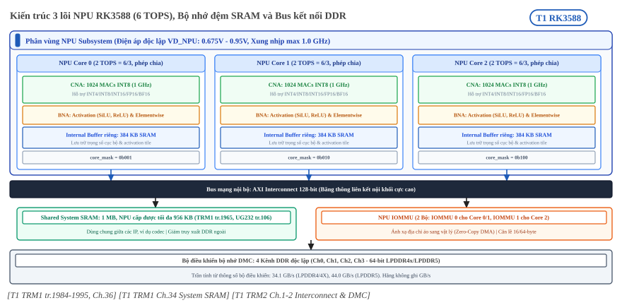
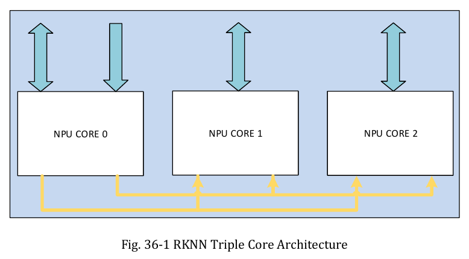
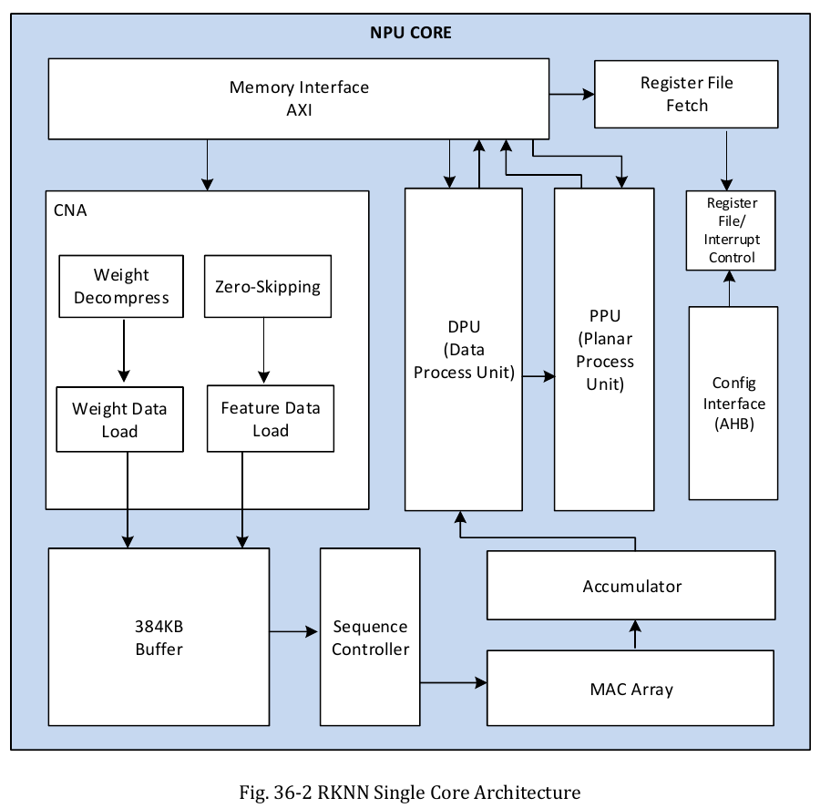

:tocdepth: 1

***************************************
Vi kiến trúc và khối tính toán NPU core
***************************************

.. admonition:: Trang này trả lời

   - Một core gồm những khối nào và dữ liệu đi qua chúng thế nào?
   - Core hỗ trợ những kiểu số nào, mỗi chu kỳ làm được bao nhiêu MAC?
   - Buffer 384KB trong core được tổ chức ra sao?
   - DPU làm gì với conv, matmul và layout dữ liệu?

.. admonition:: Tóm tắt

   - Một core gồm CNA (đường vào dữ liệu), MAC array với accumulator, DPU, PPU, buffer và sequence controller [T1 TRM1 tr.1985].
   - Kiểu số hỗ trợ: integer 4, integer 8, integer 16, float 16, Bfloat 16 và tf32 [T1 TRM1 tr.1984].
   - TRM ghi "1024x3 integer 8 MAC operations per cycle" và "2048x3 integer 4 MAC operation per cycle". Mỗi bước sang kiểu rộng hơn giảm một nửa (suy ra), tới "256x3 tf32" [T1 TRM1 tr.1984].
   - Datasheet V1.3 và V1.7 ghi ``Max NPU frequency`` là 1000 MHz [T1 DS V1.3 pdf 30] [T1 DS V1.7 tr.32]. Với quy ước 2 phép mỗi MAC (suy ra, hãng không nêu), ba core INT8 cho 6.144 TOPS, khớp "up to 6 TOPS" [T1 DS V1.7 tr.11].
   - Buffer ghi "384KBx3 internal buffer" [T1 TRM1 tr.1984]. Sơ đồ vẽ "384KB Buffer" bên trong một NPU CORE [T1 TRM1 tr.1985]. Thanh ghi chia buffer thành bank cho weight và feature [T1 TRM1 tr.2004].
   - DPU xử lý phép theo phần tử (relu, sigmoid, tanh), softmax, transpose, đổi định dạng dữ liệu [T1 TRM1 tr.1985].
   - TRM không có chế độ matmul riêng. Matmul là API ở mức SDK [T1 UG152 tr.60].

.. contents:: Trong trang này
   :local:
   :depth: 1

.. _cau-truc-mot-core:

1. Cấu trúc một core
====================

Mạng nơ-ron chủ yếu là các phép nhân tích lũy (MAC, multiply-accumulate): nhân hai số rồi cộng vào tổng. Một core NPU là mạch chuyên thực hiện số lượng lớn MAC song song, cộng thêm các khối xử lý trước và sau MAC (xem nền tảng tại :doc:`../../01-kien-thuc-nen/02-npu/01-kien-truc-npu-va-mac`).

1.1 Sơ đồ các khối
------------------

RK3588 có ba core giống nhau, chạy riêng hoặc phối hợp ("Include triple NPU CORE" / "Support triple core co-work, dual core co-work, and work independently" [T1 TRM1 tr.1984]):

.. _fig-npu-triple-core-arch:

   Kiến trúc 3 lõi NPU RK3588 (6 TOPS INT8), phân bổ Internal Buffer 384KB mỗi core, System SRAM 1MB và bus AXI kết nối tới 4 kênh DDR. Nguồn: tổng hợp từ [T1 TRM1 Ch.34, Ch.36, TRM2 Ch.1-2].

.. _fig-trm1-triple-core:

   Kiến trúc RKNN ba core. Nguồn: [T1 TRM1 tr.1984, Fig. 36-1]

.. _fig-trm1-single-core:

   Kiến trúc một core RKNN. Nguồn: [T1 TRM1 tr.1985, Fig. 36-2]

Các nhãn trong Fig. 36-2 gồm: NPU CORE, Memory Interface AXI, Register File Fetch, Register File/Interrupt Control, CNA, Weight Decompress, Zero-Skipping, Weight Data Load, Feature Data Load, DPU (Data Process Unit), PPU (Planar Process Unit), Config Interface (AHB), Accumulator, 384KB Buffer, Sequence Controller, MAC Array [T1 TRM1 tr.1985].

.. list-table:: Các thành phần trong một NPU core [T1 TRM1 Ch.36]
   :header-rows: 1
   :widths: 14 22 46 18

   * - Nhóm
     - Khối
     - Vai trò theo TRM / Suy luận
     - Nguồn
   * - Điều khiển & Giao tiếp
     - PC (0x0000)
     - Nạp danh sách thanh ghi từ bộ nhớ qua AXI (Register File Fetch Unit), quản lý ngắt, đếm task
     - [T1 TRM1 tr.1986, tr.1994-1997]
   * - 
     - Giao diện AXI, AHB
     - AXI master đọc nạp dữ liệu từ bộ nhớ hệ thống; AHB slave để CPU cấu hình, debug, test thanh ghi
     - [T1 TRM1 tr.1985]
   * - Tính conv
     - CNA (0x1000)
     - Tiền xử lý conv, nạp weight/feature, giải nén, zero-skipping
     - [T1 TRM1 tr.1985]
   * - 
     - CBUF (trong CNA)
     - Internal buffer 384KB chia bank, giữ weight/feature, tái dùng dữ liệu
     - [T1 TRM1 tr.2003-2004]
   * - 
     - CSC (trong CNA)
     - Convolution Sequence Controller: quét weight/feature từ buffer, đưa sang core tính
     - [T1 TRM1 tr.2001, tr.2008]
   * - 
     - MAC array / CORE (0x3000)
     - Mảng nhân cộng song song (1024 MAC INT8 mỗi chu kỳ trên mỗi core)
     - [T1 TRM1 tr.1984, tr.2001]
   * - 
     - CMAC
     - Tên module Convolution MAC (ứng với mảng MAC trong CORE)
     - [T1 TRM1 tr.2054]
   * - Hậu xử lý
     - DPU (0x4000)
     - Phép trên từng phần tử (activation ReLU, sigmoid, tanh), softmax, đổi định dạng dữ liệu
     - [T1 TRM1 tr.1985]
   * - 
     - BS_CORE (trong DPU)
     - Bias & Scaling: ALU (Add/Minus qua ``bs_alu_algo``), nhân scale định lượng (``bs_mul_algo``/MUL/PReLU), ReLU; nạp bias/scale qua BRDMA [T1 TRM1 tr.2020, tr.2038]. Luôn tham gia luồng tích chập chuẩn (Convolution Flow 1).
     - [T1 TRM1 tr.2020, tr.2038]
   * - 
     - BN_CORE (trong DPU)
     - BatchNorm: nhân hệ số scale và chuẩn hóa batch; nạp tham số qua NRDMA [T1 TRM1 tr.2023-2024, tr.2039]. Trong luồng suy luận thông thường (như YOLOv8n), BatchNorm luôn được compiler fuse trực tiếp vào trọng số và bias của Conv (Conv-BN folding), nên không chạy trên BN_CORE. Khối này được phần cứng trưng dụng làm bộ nhân tích chập thay thế khi chạy Convolution Flow 2 (zero-skipping) [T1 TRM1 tr.2055].
     - [T1 TRM1 tr.2023-2024, tr.2039, tr.2055]
   * - 
     - EW_CORE (trong DPU)
     - Element-Wise: ALU 9 phép toán (``ew_alu_algo``: Max, Min, Add, Div, Minus, Abs, Neg, Floor, Ceil), bộ đổi kiểu, nạp toán hạng qua ERDMA
     - [T1 TRM1 tr.2025-2028, tr.2040]
   * - 
     - PPU (0x6000)
     - Planar Process Unit cho pooling (average, max, min pooling)
     - [T1 TRM1 tr.1985, tr.2055]
   * - Đọc dữ liệu
     - DPU_RDMA, PPU_RDMA
     - Đọc dữ liệu trực tiếp vào DPU (0x5000: MRDMA, BRDMA, NRDMA, ERDMA) và PPU (0x7000) ở flying mode
     - [T1 TRM1 tr.1986, tr.2017, tr.2036-2040]
   * - 
     - DDMA, SDMA
     - Cấu hình tham số giao dịch bus AXI (0x8000, 0x9000), ưu tiên, QoS
     - [T1 TRM1 tr.2046-2049]

TRM1 chỉ in tên đầy đủ cho ``DPU (Data Process Unit)`` và ``PPU (Planar Process Unit)`` trên Fig. 36-2 [T1 TRM1 tr.1985], trong khi các khối con ``CNA``, ``CMAC``, ``CSC``, ``CBUF``, ``DDMA``, ``SDMA``, ``BS``, ``BN``, ``EW`` dùng tên viết tắt kế thừa từ quy chuẩn kiến trúc vi xử lý mở NVDLA [nguồn khác NVDLA Hardware Architecture Spec]. Trong NVDLA, ``CBUF`` là Convolution Buffer (SRAM đệm on-chip), ``CSC`` là Convolution Sequence Controller (điều khiển nạp weight và feature map từ CBUF vào mảng tính toán), ``CMAC`` là Convolution MAC (mảng nhân cộng song song), và ``SDP`` (Single Data Point Processor, tương ứng với ``DPU`` của Rockchip) chia thành ba khối con: ``BS`` (Bias & Scaling) kèm BRDMA, ``BN`` (Batch Normalization) kèm NRDMA, và ``EW`` (Element-Wise) kèm ERDMA. Trong NPU RK3588, ``CMAC`` chính là mảng tính toán ``MAC Array`` thuộc khối ``CORE`` (``0x3000``), khớp với việc các thanh ghi gating (``RKNN_core_mac_gating`` offset ``0x300C``) và độ chính xác tính toán (``RKNN_core_misc_cfg`` offset ``0x3010``) đều nằm ở khối này [T1 TRM1 tr.1989, tr.2013-2014, tr.2054].

Mỗi khối thanh ghi nằm trong một trang 4KB của không gian địa chỉ core (Table 1-1 "RKNN Address Mapping"): ``PC 0x0000``, ``CNA 0x1000``, ``CORE 0x3000``, ``DPU 0x4000``, ``DPU_RDMA 0x5000``, ``PPU 0x6000``, ``PPU_RDMA 0x7000``, ``DDMA 0x8000``, ``SDMA 0x9000`` và ``GLOBAL 0xf000`` [T1 TRM1 tr.1986] (chi tiết tại :doc:`05-ban-do-thanh-ghi-va-co-che-cau-hinh`).

Driver xác nhận cấu hình 3 nhân qua ba tên ngắt ``npu0_irq``, ``npu1_irq``, ``npu2_irq`` [T1 DRV rknpu_drv.c:84-88], ``.num_irqs = ARRAY_SIZE(rk3588_npu_irqs)`` [T1 DRV rknpu_drv.c:193], ``.core_mask = 0x7`` [T1 DRV rknpu_drv.c:197], và các mặt nạ ``RKNPU_CORE0_MASK`` (0x01), ``RKNPU_CORE1_MASK`` (0x02), ``RKNPU_CORE2_MASK`` (0x04), ``RKNPU_CORE_AUTO_MASK`` (0x00) [T1 DRV include/rknpu_job.h:24-27] (``nbuf_size = 0`` trên RK3588 [T1 DRV rknpu_drv.c:195]).

1.2 Luồng dữ liệu qua core
--------------------------

TRM mô tả hai đường tính được chọn bằng thanh ghi: "RKNN supports variety of convolution and matrix multiplication. If use the MAC array to calculate, the work flow should obey the Figure 1-4, and if use DPU CORE calculate, work flow should obey the Figure 1-5." [T1 TRM1 tr.2053] (văn bản ghi Figure 1-4 và 1-5 tương ứng với Fig. 36-4 và Fig. 36-5 in trong PDF):

1. **Convolution Flow 1 (đường qua MAC array)**: Áp dụng cho tích chập 2D tiêu chuẩn (Fig. 36-4). Dữ liệu weight và feature map từ CBUF đi vào mảng MAC (CMAC trong CORE). Kết quả tích chập đi trực tiếp vào DPU (nơi ``BS_CORE`` cộng bias và nhân scale định lượng), sau đó có thể nối ống sang PPU để pooling nếu cần [T1 TRM1 tr.2054].
2. **Convolution Flow 2 (đường trực tiếp qua DPU CORE)**: Áp dụng khi dùng DPU CORE thực hiện tính toán (Fig. 36-5), không đi qua mảng MAC [T1 TRM1 tr.2053, tr.2055].

PPU hỗ trợ hai chế độ: chạy nối ống cùng DPU hoặc chạy độc lập ở flying mode ("You can use PPU in two ways, pipeline with DPU, and flying mode independently." [T1 TRM1 tr.2055]). Trường ``flying_mode`` chọn nguồn dữ liệu cho DPU ("flying_mode ... 1'd0: DPU core main data is from convolution output; 1'd1: DPU core main data is from MRDMA;" [T1 TRM1 tr.2017]), còn ``output_mode`` quyết định đầu ra đi vào PPU hay ghi ra ngoài ("[0]: If the output goes to PPU, high is active; [1]: If the output goes to outside, high is active." [T1 TRM1 tr.2017]).

**Cơ chế Zero-skipping và ràng buộc conv_mode 3.** Khi phần tử feature bằng 0, phần cứng có thể bỏ bước nạp trọng số tương ứng từ bộ nhớ hệ thống ("When one pixel feature data is 0, the corresponding weight data is not fetched from system memory." [T1 TRM1 tr.2006]). Cơ chế này được cấu hình qua nhóm thanh ghi ``RKNN_cna_fc_con0`` (offset ``0x1060``, bit 0 ``fc_skip_en``, bit 31:16 ``fc_skip_data``), ``cna_fc_con1`` và ``cna_fc_con2`` [T1 TRM1 tr.2006, tr.2055]. TRM1 quy định rõ ràng buộc phần cứng:

   "If enable zero skipping, the conv_mode of DPU must configure to be 3, and must bypass the BS_CORE. The alu_src must set to be 0, the mul_src must set to be 1, and the alu_algo must set be 3. We bypass BS_CORE, and use BN_CORE to calculate convolution, so the extra operators have to achieve by EW_CORE. But we use NRDMA to read operands to EW_CORE when ew_src is 1." [T1 TRM1 tr.2055]

Ràng buộc này giải thích nguyên lý thiết kế:
- Zero-skipping được gán vào khối điều khiển Fully Connected (FC) của CNA và hoạt động trên đường **Convolution Flow 2**.
- Trong chế độ này, DPU chuyển sang ``conv_mode = 3``, tắt hẳn ``BS_CORE`` và chuyển giao nhiệm vụ tính tích chập cho bộ nhân của ``BN_CORE``, đồng thời dồn các toán tử hậu xử lý/activation về sau sang ``EW_CORE`` nhận dữ liệu qua kênh nạp ``NRDMA``.
- **Mảng MAC không bỏ phép nhân 0**: TRM1 chỉ mô tả việc bỏ nạp trọng số từ bộ nhớ hệ thống [T1 TRM1 tr.2006] và soft clock gating [T1 TRM1 tr.2013], không có cơ chế cắt chu kỳ nhân trong mảng MAC. Bằng chứng thực nghiệm từ thí nghiệm X5 trên bo mạch RK3588 (:doc:`../../03-phuong-phap/02-tang-npu-nen-do/01-ke-hoach-do` mục 3) cho thấy khi đưa vào ảnh toàn 0, ảnh thật và ảnh ngẫu nhiên, độ trễ suy luận dao động dưới 0.008 ms (< 0.05% tổng độ trễ 16.5 ms) [T3 onboard_x5], chứng minh mảng MAC chạy theo chu kỳ SIMD cố định độc lập với giá trị dữ liệu.
- **YOLOv8n không bật zero-skipping**: Compiler RKNN không bật zero-skipping cho YOLOv8n do YOLOv8n hoàn toàn cấu thành từ các tầng tích chập không gian 2D (57 tầng ``ConvExSwish``), không sử dụng luồng FC/GEMV của Convolution Flow 2.

2. Kiểu số và số MAC mỗi chu kỳ
===============================

2.1 Bảng kiểu số hỗ trợ
-----------------------

Mục 36.1 ghi: "Support integer 4, integer 8, integer 16, float 16, Bfloat 16 and tf32 operation" [T1 TRM1 tr.1984], trùng với mục 1.2.6 của datasheet [T1 DS V1.7 tr.11] [T1 DS V1.3 pdf 9] [T1 DS V0.1 tr.11] (trong khi trang tổng quan của datasheet tóm tắt bốn kiểu chính: "supports INT4/INT8/INT16/FP16 hybrid operation and computing power is up to 6TOPs" [T1 DS V1.7 tr.7]). Mã kiểu trong thanh ghi giữa CNA [T1 TRM1 tr.2000] (lặp lại ở ``RKNN_core_misc_cfg`` [T1 TRM1 tr.2014]) và DPU [T1 TRM1 tr.2017] [T1 TRM1 tr.2018]:

.. list-table::
   :header-rows: 1
   :widths: 22 26 52

   * - Mã
     - CNA (``proc_precision``, ``in_precision``)
     - DPU (``in_precision``, ``proc_precision``, ``out_precision``)
   * - 3'd0 / 3'd1
     - int 8 / int 16
     - Integer 8bit / Integer 16bit
   * - 3'd2 / 3'd3
     - float 16 / bfloat 16
     - Float point 16bit / Bfloat 16bit
   * - 3'd4 / 3'd5
     - Reserved / Reserved
     - Integer 32bit / Float point 32bit
   * - 3'd6 / 3'd7
     - int4 / tf32
     - Integer 4bit / (không liệt kê)

DPU có thêm ``Integer 32bit`` và ``Float point 32bit`` cho dữ liệu trung gian/đầu ra, còn mục 36.1 viết "tf32" [T1 TRM1 tr.1984] trong khi mục 36.3.2 in là "tf16" [T1 TRM1 tr.1985].

2.2 MAC trên chu kỳ theo kiểu
-----------------------------

Mục 36.1 liệt kê số phép MAC mỗi chu kỳ [T1 TRM1 tr.1984]:

.. list-table::
   :header-rows: 1
   :widths: 20 45 35

   * - Kiểu
     - TRM ghi
     - Tỉ lệ so với INT8
   * - INT4
     - "2048x3 integer 4 MAC operation per cycle"
     - 2 lần
   * - INT8
     - "1024x3 integer 8 MAC operations per cycle"
     - 1
   * - INT16 / FP16 / BF16
     - "512x3 integer 16 / float 16 / bfloat 16 MAC operations per cycle"
     - 1/2
   * - TF32
     - "256x3 tf32 MAC operation per cycle"
     - 1/4

Mỗi khi độ rộng bit tăng gấp đôi, số phép MAC mỗi chu kỳ giảm một nửa, và hậu tố ``x3`` tương ứng với 3 nhân NPU ("triple NPU core" [T1 TRM1 tr.1984]). Mô tả thanh ghi CNA xác nhận cấu trúc nhóm kênh và mảng MAC 32x32 ở chế độ INT8: "In int8, 32 kernels form 1 group, in int16 or fp16, 16 kernels form 1 group." [T1 TRM1 tr.2000] và "Int8 mac array 32x32 mode ... This register is target for multicore mode. By single core mode keep it at 3'd0." [T1 TRM1 tr.2001] ($32 \times 32 = 1024$ MAC mỗi nhân). Ràng buộc kênh: ``datain_channel`` ở chế độ int 8 phải là bội của 8, ở chế độ int 16 hoặc float 16 là bội của 4 [T1 TRM1 tr.2002]. Ở mức SDK, API nhân ma trận (matmul) trong UG152 hỗ trợ hai kiểu ``int8`` và ``float16`` [T1 UG152 tr.66].

2.3 Đỉnh lý thuyết của một core
-------------------------------

Từ ba thông số trong tài liệu hãng gồm `"1024x3 integer 8 MAC operations per cycle"` [T1 TRM1 tr.1984], tần số tối đa `"Max NPU frequency: 1000 MHz"` trong Table 3-2 của bản datasheet V1.3 và V1.7 [T1 DS V1.3 pdf 30] [T1 DS V1.7 tr.32] (bản V0.1 cũ chưa điền giá trị tại ô này [T1 DS V0.1 tr.31]), và mức công bố `"Neural network acceleration engine with processing performance up to 6 TOPS"` [T1 DS V1.7 tr.11]:

- **Một core (INT8, 1000 MHz)**: :math:`1024 \times 1000 \times 10^6 = 1.024 \times 10^{12}\text{ MAC/s}`, tương đương **2.048 TOPS** theo quy ước 1 MAC = 2 phép tính (1 nhân + 1 cộng).
- **Ba core (INT8, 1000 MHz)**: :math:`3 \times 1.024 \times 10^{12} = 3.072 \times 10^{12}\text{ MAC/s}`, tương đương **6.144 TOPS**, khớp với con số `"up to 6 TOPS"` của datasheet [T1 DS V1.7 tr.11].

Tài liệu hãng chỉ công bố ba mốc đầu-cuối trên mà không in công thức trung gian hay số TOPS cho các kiểu dữ liệu khác. Tần số 1000 MHz là trần tối đa (ví dụ cố định tần số trong UG152 dùng mốc 1 GHz cho ``fdab0000`` trên RK3588 và 600 MHz cho ``ff300000.npu`` trên dòng chip khác [T1 UG152 tr.73-74]), còn tần số vận hành thực tế do bảng OPP trong DTS và governor quyết định (xem :doc:`04-xung-nhip-dvfs-va-reset`).

.. _buffer-384kb-trong-moi-core:

3. Buffer 384KB trong mỗi core
==============================

TRM1 và các bản datasheet đều ghi `"384KBx3 internal buffer"` [T1 TRM1 tr.1984] / `"Embedded 384KBx3 internal buffer"` [T1 DS V1.7 tr.11] [T1 DS V1.3 pdf 10] [T1 DS V0.1 tr.11]. Fig. 36-2 vẽ khối ``384KB Buffer`` nằm bên trong từng ``NPU CORE`` [T1 TRM1 tr.1985] (tách biệt với System SRAM dùng chung toàn SoC ở :doc:`03-che-do-da-loi-va-system-sram`). Buffer được phân bổ theo bank qua thanh ghi ``RKNN_cna_cbuf_con0`` (offset ``0x1040``) [T1 TRM1 tr.2003-2004]:

.. list-table::
   :header-rows: 1
   :widths: 22 58 20

   * - Trường
     - TRM ghi
     - Nguồn
   * - ``weight_bank``
     - "Bank numbers for weight data. 4'd1: Bank 7 occupied by weight data ... 4'd7: Bank 1-7 occupied by weight data."
     - [T1 TRM1 tr.2004]
   * - ``data_bank``
     - "Bank numbers for feature data. 4'd0: Bank 0 occupied by feature data ... 4'd6: Bank 0-6 occupied by feature data."
     - [T1 TRM1 tr.2004]
   * - ``fc_data_bank``
     - "Bank numbers for fc zero-skipping feature data. In FC zero-skipping mode, set to be 1, Otherwise, must set to be 0."
     - [T1 TRM1 tr.2004]
   * - ``data_reuse``, ``weight_reuse``
     - "Enable data reuse. fetching data directly from internal buffer." Tương tự cho weight
     - [T1 TRM1 tr.2004]
   * - ``data_entries``
     - "How many banks space needed to store one feature map row."
     - [T1 TRM1 tr.2004]
   * - ``feature_grains``
     - "Feature data rows needs to be buffered before convolution start. It's suggested to set this field as y_stride+weight_height+1."
     - [T1 TRM1 tr.2000]
   * - ``cbuf_cs_disable_clkgate``
     - "Cache auto gating."
     - [T1 TRM1 tr.2008]

Weight chiếm các bank từ cao xuống (Bank 7, rồi Bank 6..7, ..., Bank 1..7), còn feature chiếm từ thấp lên (Bank 0, rồi Bank 0..1, ..., Bank 0..6) trên cùng tập chỉ số ``Bank 0`` đến ``Bank 7`` [T1 TRM1 tr.2004]. TRM1 chỉ định danh chỉ số bank từ 0 đến 7 trong thanh ghi mà không công bố dung lượng byte của từng bank riêng lẻ.

4. DPU
======

DPU (Data Process Unit) nhận kết quả từ MAC array hoặc đọc dữ liệu trực tiếp qua DMA ở flying mode (mục 1.2) để thực thi các toán tử hậu tích chập.

4.1 Chế độ conv
---------------

Trường ``conv_mode`` xuất hiện tại ba khối thanh ghi:

.. list-table::
   :header-rows: 1
   :widths: 30 52 18

   * - Thanh ghi
     - Giá trị
     - Nguồn
   * - CNA ``RKNN_cna_conv_con1`` (bit 3:0)
     - 2'd0: Direct convolution. 2'd3: Depthwise convolution. 2'd1, 2'd2: Reserved
     - [T1 TRM1 tr.2000]
   * - DPU ``RKNN_dpu_feature_mode_cfg`` (bit 4:3)
     - 2'd0: Normal convolution mode. 2'd3: Depthwise convolution mode. 2'd1, 2'd2: Reserved
     - [T1 TRM1 tr.2017]
   * - DPU_RDMA ``RKNN_dpu_rdma_feature_mode_cfg``
     - 2'd0: Dc. 2'd3: Depthwise
     - [T1 TRM1 tr.2036]

Các trường cấu hình conv khác gồm ``dw_en`` ("Depthwise enable" [T1 TRM1 tr.2014]), ``deconv`` ("Enable deconvolution function." [T1 TRM1 tr.1999]), ``atrous_y_dilation`` và ``atrous_x_dilation`` [T1 TRM1 tr.2001], cùng ``argb_in`` (4'd8 đến 4'd11 ứng với chế độ 1 đến 4 kênh đầu vào không căn lề [T1 TRM1 tr.1999]).

Bên trong DPU có ba lõi con ``BS_CORE``, ``BN_CORE``, ``EW_CORE`` cùng các kênh đọc DMA ``MRDMA``, ``BRDMA``, ``NRDMA``, ``ERDMA`` [T1 TRM1 tr.2057]. Từng phép toán được bật/tắt qua các bit bypass: "you can configure BS_ALU_BYPASS, BS_MUL_BYPASS, BS_RELU_BYPASS, BS_MUL_PRELU, BS_MUL_SHIFT, BS_RELUX_EN etc. to specify the operators you want to achieve." [T1 TRM1 tr.2057], hoặc chuyển đổi lõi xử lý khi bật zero-skipping ("We bypass BS_CORE, and use BN_CORE to calculate convolution, so the extra operators have to achieve by EW_CORE." [T1 TRM1 tr.2055]). Việc ánh xạ từ danh sách toán tử cấp cao trong Operator List (:doc:`../03-toolchain-runtime/04-operator-list`) xuống các khối ``BS_CORE``, ``BN_CORE``, ``EW_CORE`` do compiler đóng của RKNN SDK thực hiện.

4.2 Chế độ matmul
-----------------

Ở mức thanh ghi TRM1, phần cứng nêu "RKNN supports variety of convolution and matrix multiplication." [T1 TRM1 tr.2053] và cung cấp nhóm thanh ghi "Full connected control register0/1/2" (``RKNN_cna_fc_con0/1/2`` tại ``0x1060``, ``0x1064``, ``0x1074``) cùng "Full connected data size control register0/1" (``0x1084``, ``0x1088``) [T1 TRM1 tr.1987] [T1 TRM1 tr.2006]. Ở mức SDK, Rockchip cung cấp bộ C API nhân ma trận riêng ("The matrix multiplication interface is a set of APIs to efficiently perform matrix multiplication operations on the NPU (It is currently a beta version, and RV1103/RV1106 is not currently supported)." [T1 UG152 tr.60]), cho phép chọn nhân NPU trên RK3588 [T1 UG152 tr.62] với giới hạn kích thước: "for an int8 input matrix, K is required to be less than or equal to 4096; for a float16 input matrix, K is required to be less than or equal to 2048." [T1 UG152 tr.66].

4.3 Layout dữ liệu
------------------

Nền tảng về NCHW và NHWC được trình bày tại :doc:`../../01-kien-thuc-nen/01-nen-tang-ai/02-tensor-va-kieu-du-lieu`, còn công thức ``NC1HWC2`` và giá trị ``C2`` theo chip nằm ở :doc:`../03-toolchain-runtime/05-fusion-va-layout-nc1hwc2` mục 1.

**Layout matmul trên RK3588** (UG152 Table 4-7 đến 4-9): ma trận A dùng ``perf_layout`` ``[K/16,M,16]`` cho cả int8 và float16 [T1 UG152 tr.65], ma trận B dùng ``native_layout`` ``[N/32,K/32,32,32]`` cho int8 và ``[N/16,K/32,16,32]`` cho float16 [T1 UG152 tr.66], còn ma trận C dùng ``[K/4,M,4]`` kiểu int32 và float32 (bảng gốc in K/4 tại vị trí chiều N), trong đó phép chia làm tròn lên và phần dư điền 0 [T1 UG152 tr.66].

**Thanh ghi liên quan layout** (TRM1):

.. list-table::
   :header-rows: 1
   :widths: 24 56 20

   * - Trường
     - TRM ghi
     - Nguồn
   * - ``mc_surf_out`` (DPU data format)
     - "1'd0: Output feature obey the rule of 16byte align for one pixel; 1'd1: Output feature can output 2 surface serial or 4 surf serials."
     - [T1 TRM1 tr.2018]
   * - ``surf_mode`` (CNA data size)
     - "2'd0: 1surf series; 2'd1: 1surf series; 2'd2: 2 surf series; 2'd3: 4 surf series."
     - [T1 TRM1 tr.2003]
   * - ``line_stride``, ``surf_stride``
     - "Feature width with Virtual box." và "Feature map actual surface area."
     - [T1 TRM1 tr.2007] [T1 TRM1 tr.2008]
   * - ``datain_channel_real``
     - Nếu kênh vào không là bội của 8 (int8) hoặc 4 (int 16, float 16) thì đặt số kênh thật ở trường này
     - [T1 TRM1 tr.2002]
   * - ``offset_pend``
     - "What value the extra channel be set."
     - [T1 TRM1 tr.2018]

Quy tắc căn lề "16byte align for one pixel" của ``mc_surf_out`` tương ứng với một gói 16 phần tử INT8 (16 byte) trên mỗi vị trí không gian $(h, w)$ trong bố cục ``NC1HWC2`` với $C_2 = 16$.

5. Hiểu sai thường gặp
======================

.. list-table::
   :header-rows: 1
   :widths: 24 52 24

   * - Hiểu sai
     - Thực tế theo nguồn
     - Nguồn
   * - Datasheet không công bố tần số tối đa NPU nên không tính được 6 TOPS
     - Bản V1.3 và V1.7 ghi rõ ``Max NPU frequency: 1000 MHz`` (chỉ bản V0.1 cũ chưa điền giá trị). Với 1024x3 MAC INT8/chu kỳ và 2 phép/MAC, đỉnh lý thuyết đạt 6.144 TOPS.
     - [T1 DS V1.3 pdf 30] [T1 DS V1.7 tr.32] [T1 DS V0.1 tr.31] [T1 DS V1.7 tr.11]
   * - 384KB là tổng dung lượng buffer của cả ba core và chia đều 48KB mỗi bank
     - Fig. 36-2 vẽ "384KB Buffer" nằm trong từng NPU CORE (384KBx3), còn thanh ghi chỉ đánh số Bank 0 đến Bank 7 mà không công bố dung lượng byte của từng bank.
     - [T1 TRM1 tr.1984] [T1 TRM1 tr.1985] [T1 TRM1 tr.2004]
   * - MAC array bỏ chu kỳ nhân khi gặp toán hạng bằng 0
     - TRM1 chỉ mô tả việc không đọc weight từ bộ nhớ hệ thống khi feature bằng 0.
     - [T1 TRM1 tr.2006]
   * - NPU có tập thanh ghi riêng biệt chỉ dành cho matmul
     - TRM1 cung cấp các thanh ghi FC (``RKNN_cna_fc_con0..2``), còn giao diện matmul được cung cấp qua bộ API của SDK.
     - [T1 TRM1 tr.2053] [T1 UG152 tr.60]
   * - Tên kiểu số dấu phẩy động 32-bit rút gọn nhất quán trong TRM1
     - TRM1 viết "tf32" ở mục 36.1 cùng bảng mã thanh ghi ``3'd7``, nhưng viết "tf16" ở mục 36.3.2.
     - [T1 TRM1 tr.1984] [T1 TRM1 tr.1985] [T1 TRM1 tr.2000]

Nguồn
=====

Các nhãn nguồn dùng trong trang này (tier, tệp, số lần trích).

.. list-table::
   :header-rows: 1
   :widths: 12 8 70 10

   * - Nhãn
     - Tier
     - Tệp
     - Số lần
   * - ``TRM1``
     - T1
     - :download:`rk3588_part1.pdf <../../../_assets/pdf/datasheet/trm/rk3588_part1.pdf>`
     - 81
   * - ``DS V1.7``
     - T1
     - :download:`Rockchip_RK3588S_Datasheet_V1.7.pdf <../../../_assets/pdf/datasheet/soc/Rockchip_RK3588S_Datasheet_V1.7.pdf>`
     - 10
   * - ``DS V1.3``
     - T1
     - :download:`Rockchip_RK3588_Datasheet_V1.3_20220328.pdf <../../../_assets/pdf/datasheet/soc/Rockchip_RK3588_Datasheet_V1.3_20220328.pdf>`
     - 5
   * - ``DS V0.1``
     - T1
     - :download:`02_RK3588_Datasheet_V0.1-20210727.pdf <../../../_assets/pdf/datasheet/soc/02_RK3588_Datasheet_V0.1-20210727.pdf>`
     - 4
   * - ``UG152``
     - T1
     - :download:`02_Rockchip_RKNPU_User_Guide_RKNN_API_V1.5.2_EN.pdf <../../../_assets/pdf/rknn/02_Rockchip_RKNPU_User_Guide_RKNN_API_V1.5.2_EN.pdf>`
     - 10
   * - ``DRV``
     - T1
     - ``3rdparty/rknpu-driver-0.9.8/`` (commit f6eedab0 theo SOURCE.txt)
     - 5

Số trang của TRM1, DS V1.7, DS V0.1 và UG152 là số trang in, bằng số trang PDF. DS V1.3 không có số trang in nên ``pdf N`` là số trang PDF. Hai bản datasheet cũ khác trong cùng thư mục gồm HYY Rev 1.1 (``01_HYY_Rockchip_RK3588_Datasheet.pdf``, pdf 32) và RK3588S V1.3 (``Rockchip_RK3588S_Datasheet_V1.3_20220310.pdf``, pdf 31) cũng để trống giá trị ``Max NPU frequency`` giống bản V0.1.
