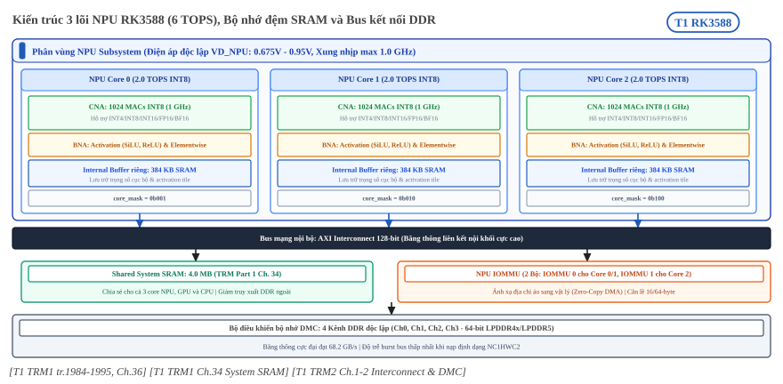
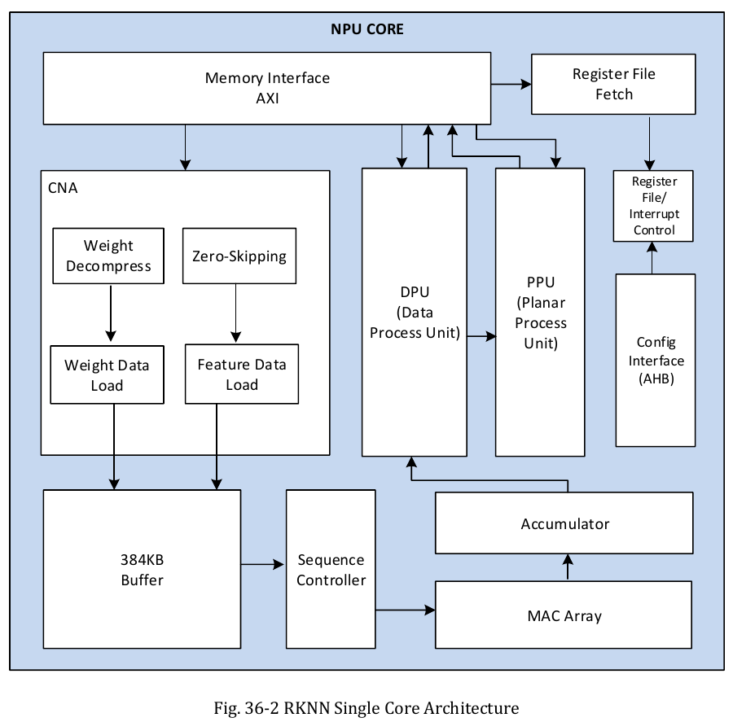

:tocdepth: 1

***************************************
Vi kiến trúc và khối tính toán NPU core
***************************************

.. admonition:: Trang này trả lời

   - Một core gồm những khối nào và dữ liệu đi qua chúng thế nào?
   - Core hỗ trợ những kiểu số nào, mỗi chu kỳ làm được bao nhiêu MAC?
   - Buffer 384KB trong core được tổ chức ra sao?
   - DPU làm gì với conv, matmul và layout dữ liệu?

.. admonition:: Tóm tắt

   - Một core gồm CNA (đường vào dữ liệu), MAC array với accumulator, DPU, PPU, buffer và sequence controller [T1 TRM1 tr.1985].
   - Kiểu số hỗ trợ: integer 4, integer 8, integer 16, float 16, Bfloat 16 và tf32 [T1 TRM1 tr.1984].
   - TRM ghi "1024x3 integer 8 MAC operations per cycle" và "2048x3 integer 4 MAC operation per cycle". Mỗi bước sang kiểu rộng hơn giảm một nửa (suy ra), tới "256x3 tf32" [T1 TRM1 tr.1984].
   - Datasheet V1.3 và V1.7 ghi ``Max NPU frequency`` là 1000 MHz [T1 DS V1.3 pdf 30] [T1 DS V1.7 tr.32]. Với quy ước 2 phép mỗi MAC (suy ra, hãng không nêu), ba core INT8 cho 6.144 TOPS, khớp "up to 6 TOPS" [T1 DS V1.7 tr.11].
   - Buffer ghi "384KBx3 internal buffer" [T1 TRM1 tr.1984]. Sơ đồ vẽ "384KB Buffer" bên trong một NPU CORE [T1 TRM1 tr.1985]. Thanh ghi chia buffer thành bank cho weight và feature [T1 TRM1 tr.2004].
   - DPU xử lý phép theo phần tử (relu, sigmoid, tanh), softmax, transpose, đổi định dạng dữ liệu [T1 TRM1 tr.1985].
   - TRM không có chế độ matmul riêng. Matmul là API ở mức SDK [T1 UG152 tr.60].

.. contents:: Trong trang này
   :local:
   :depth: 1

.. _cau-truc-mot-core:

1. Cấu trúc một core
====================

Mạng nơ-ron chủ yếu là các phép nhân tích lũy (MAC, multiply-accumulate): nhân hai số rồi cộng vào tổng. Một core NPU là mạch chuyên làm số lượng lớn MAC song song, cộng thêm các khối làm việc phụ trước và sau MAC. Xem nền tảng ở :doc:`../../01-kien-thuc-nen/02-npu/01-kien-truc-npu-va-mac`. (Đoạn này là giải thích nền, không phải câu của nguồn.)

1.1 Sơ đồ các khối
------------------

RK3588 có ba core giống nhau, chạy riêng hoặc phối hợp:

   "Include triple NPU CORE" / "Support triple core co-work, dual core co-work, and work independently" [T1 TRM1 tr.1984]

.. _fig-npu-triple-core-arch:

   Kiến trúc 3 lõi NPU RK3588 (6 TOPS INT8), phân bổ Internal Buffer 384KB mỗi core, System SRAM 4MB và bus AXI kết nối tới 4 kênh DDR. Nguồn: tổng hợp từ [T1 TRM1 Ch.34, Ch.36; TRM2 Ch.1-2].

.. _fig-trm1-triple-core:

.. figure:: ../../../_assets/img/02-nen-tang-rk3588/01-phan-cung-npu/cau-truc-npu-core/trm1-fig36-1-triple-core-architecture.png
   :align: center
   :alt: Kiến trúc RKNN ba core, mỗi core là một khối NPU CORE

   Kiến trúc RKNN ba core. Nguồn: [T1 TRM1 tr.1984, Fig. 36-1]

.. _fig-trm1-single-core:

   Kiến trúc một core RKNN. Nguồn: [T1 TRM1 tr.1985, Fig. 36-2]

Các nhãn trong Fig. 36-2 (đọc từ lớp chữ của trang): NPU CORE, Memory Interface AXI, Register File Fetch, Register File/Interrupt Control, CNA, Weight Decompress, Zero-Skipping, Weight Data Load, Feature Data Load, DPU (Data Process Unit), PPU (Planar Process Unit), Config Interface (AHB), Accumulator, 384KB Buffer, Sequence Controller, MAC Array [T1 TRM1 tr.1985]. Mũi tên nối khối phải xem trên hình, lớp chữ không có.

.. list-table::
   :header-rows: 1
   :widths: 24 56 20

   * - Khối
     - Vai trò theo TRM
     - Nguồn
   * - Neural Network Accelerating Engine
     - "This unit include convolution pre-process controller, internal buffer, mac array, accumulator. It provides parallel convolution MAC for recognition functions"
     - [T1 TRM1 tr.1985]
   * - DPU
     - "mainly process the single data calculate, such as leaky_relu, relu, relux, sigmoid, tanh...etc. It also provides function: softmax, transpose, data format conversion"
     - [T1 TRM1 tr.1985]
   * - PPU
     - "mainly provide planar function followed by output data from Data Processing Unit, such as average pooling, max pooling, min pooling"
     - [T1 TRM1 tr.1985]
   * - Register File Fetch Unit
     - "fetch register configuration from external system memory through AXI interface"
     - [T1 TRM1 tr.1986]
   * - Giao diện AXI, AHB
     - AXI master lấy dữ liệu từ bộ nhớ. AHB slave truy cập thanh ghi để cấu hình, debug, test
     - [T1 TRM1 tr.1985]

TRM không khai triển các chữ CNA, CMAC, CSC, CBUF, DDMA, SDMA, BS, BN: unknown. Đã tìm ở: TRM1 chương 36, datasheet, UG152, từ khóa: CNA, CMAC, CBUF, "convolution neural".

Mỗi khối thanh ghi nằm trong một trang 4KB của không gian địa chỉ core (Table 1-1 "RKNN Address Mapping") [T1 TRM1 tr.1986]:

.. list-table::
   :header-rows: 1
   :widths: 14 14 14 14 14 14 16

   * - PC
     - CNA
     - CORE
     - DPU
     - DPU_RDMA
     - PPU
     - PPU_RDMA
   * - 0x0000
     - 0x1000
     - 0x3000
     - 0x4000
     - 0x5000
     - 0x6000
     - 0x7000

Còn DDMA 0x8000, SDMA 0x9000 và GLOBAL 0xf000 [T1 TRM1 tr.1986]. Phần thanh ghi chi tiết thuộc trang :doc:`05-ban-do-thanh-ghi-va-co-che-cau-hinh`.

Driver xác nhận số core: ba tên ngắt ``npu0_irq``, ``npu1_irq``, ``npu2_irq`` [T1 DRV rknpu_drv.c:84-88], ``.num_irqs = ARRAY_SIZE(rk3588_npu_irqs)`` [T1 DRV rknpu_drv.c:193], ``.core_mask = 0x7`` [T1 DRV rknpu_drv.c:197], và các mask ``RKNPU_CORE0_MASK`` 0x01, ``RKNPU_CORE1_MASK`` 0x02, ``RKNPU_CORE2_MASK`` 0x04, ``RKNPU_CORE_AUTO_MASK`` 0x00 [T1 DRV include/rknpu_job.h:24-27]. Header driver không có số MAC và không có giá trị 384KB (``nbuf_size = 0`` cho RK3588 [T1 DRV rknpu_drv.c:195]).

1.2 Luồng dữ liệu qua core
--------------------------

TRM mô tả hai đường tính, chọn bằng thanh ghi:

   "RKNN supports variety of convolution and matrix multiplication. If use the MAC array to calculate, the work flow should obey the Figure 1-4, and if use DPU CORE calculate, work flow should obey the Figure 1-5." [T1 TRM1 tr.2053]

Văn bản TRM ghi "Figure 1-4", "Figure 1-5", nhưng hình in trong PDF là Fig. 36-4 và Fig. 36-5. Đây là lỗi đánh số của tài liệu.

Với đường conv qua MAC array, các bước cấu hình theo Fig. 36-4 là:

.. list-table::
   :header-rows: 1
   :widths: 10 70 20

   * - Bước
     - TRM ghi
     - Nguồn
   * - 3
     - Cấu hình kích thước feature map, input precision, process precision, grains, entries và kích thước weight
     - [T1 TRM1 tr.2054]
   * - 4
     - Cấu hình process precision, ``conv_mode`` và các thanh ghi auto gating của CMAC và CNA sequence controller
     - [T1 TRM1 tr.2054]
   * - 5
     - "you can specify some operators to the outputs of convolution according to configure the DPU_CORE. DPU CORE has some fixed operators, also you can specify some programmed operators."
     - [T1 TRM1 tr.2054]
   * - 6
     - "you can do some extra operators to the outputs of DPU, pooling for example."
     - [T1 TRM1 tr.2054]

Từ các bước này, luồng dữ liệu là: CNA nạp feature và weight, MAC array nhân, accumulator cộng dồn, DPU áp các toán tử theo phần tử, PPU làm pooling (suy ra từ bước 3 đến 6 và từ Fig. 36-2).

PPU có hai cách dùng, và DPU có hai nguồn dữ liệu chính:

   "You can use PPU in two ways, pipeline with DPU, and flying mode independently." [T1 TRM1 tr.2055]

..

   "flying_mode ... 1'd0: DPU core main data is from convolution output; 1'd1: DPU core main data is from MRDMA;" [T1 TRM1 tr.2017]

``output_mode`` quyết định đầu ra đi vào PPU hay ra ngoài: "[0]: If the output goes to PPU, high is active; [1]: If the output goes to outside, high is active." [T1 TRM1 tr.2017]

**Zero-skipping.** Khi feature bằng 0 thì không cần weight tương ứng:

   "When one pixel feature data is 0, the corresponding weight data is not fetched from system memory." [T1 TRM1 tr.2006]

Bật bằng thanh ghi ``cna_fc_con0``, ``cna_fc_con1``, ``cna_fc_con2`` [T1 TRM1 tr.2055], và có ràng buộc: "If enable zero skipping, the conv_mode of DPU must configure to be 3, and must bypass the BS_CORE." [T1 TRM1 tr.2055] TRM không nói MAC array có bỏ phép nhân với 0 hay không: unknown. Đã tìm ở: TRM1 chương 36, từ khóa: "MAC gating", "zero". Chỉ có việc bỏ fetch weight [T1 TRM1 tr.2006] và thanh ghi clock gating ``slcg_op_en`` "Soft clock gating signals." [T1 TRM1 tr.2013]

2. Kiểu số và số MAC mỗi chu kỳ
===============================

2.1 Bảng kiểu số hỗ trợ
-----------------------

   "Support integer 4, integer 8, integer 16, float 16, Bfloat 16 and tf32 operation" [T1 TRM1 tr.1984]

Datasheet ghi cùng danh sách ở mục 1.2.6 [T1 DS V1.7 tr.11] [T1 DS V1.3 pdf 9] [T1 DS V0.1 tr.11]. Dòng tổng quan chỉ nêu bốn kiểu: "supports INT4/INT8/INT16/FP16 hybrid operation and computing power is up to 6TOPs" [T1 DS V1.7 tr.7]. Hai chỗ này không khớp nhau, nguồn không giải thích.

Mã kiểu trong thanh ghi khác nhau giữa CNA và DPU:

.. list-table::
   :header-rows: 1
   :widths: 22 26 52

   * - Mã
     - CNA (``proc_precision``, ``in_precision``)
     - DPU (``in_precision``, ``proc_precision``, ``out_precision``)
   * - 3'd0
     - int 8
     - Integer 8bit
   * - 3'd1
     - int 16
     - Integer 16bit
   * - 3'd2
     - float 16
     - Float point 16bit
   * - 3'd3
     - bfloat 16
     - Bfloat 16bit
   * - 3'd4
     - Reserved
     - Integer 32bit
   * - 3'd5
     - Reserved
     - Float point 32bit
   * - 3'd6
     - int4
     - Integer 4bit
   * - 3'd7
     - tf32
     - (không liệt kê)

Nguồn của bảng: CNA [T1 TRM1 tr.2000], DPU [T1 TRM1 tr.2017] [T1 TRM1 tr.2018]. Cùng mã CNA lặp lại trong ``RKNN_core_misc_cfg`` [T1 TRM1 tr.2014]. DPU có thêm integer 32 và float 32 mà danh sách chương 36.1 không nêu. Ghi chú: mục 36.1 viết "tf32" [T1 TRM1 tr.1984], còn mục 36.3.2 viết "tf16" [T1 TRM1 tr.1985]. TRM không nhất quán.

2.2 MAC trên chu kỳ theo kiểu
-----------------------------

Mục 36.1 liệt kê số MAC mỗi chu kỳ [T1 TRM1 tr.1984]:

.. list-table::
   :header-rows: 1
   :widths: 20 40 40

   * - Kiểu
     - TRM ghi
     - Tỉ lệ so với INT8 (suy ra)
   * - INT4
     - "2048x3 integer 4 MAC operation per cycle"
     - 2 lần
   * - INT8
     - "1024x3 integer 8 MAC operations per cycle"
     - 1
   * - INT16
     - "512x3 integer 16 MAC operations per cycle"
     - 1/2
   * - FP16
     - "512x3 float 16 MAC operations per cycle"
     - 1/2
   * - BF16
     - "512x3 bfloat 16 MAC operations per cycle"
     - 1/2
   * - TF32
     - "256x3 tf32 MAC operation per cycle"
     - 1/4

Quy luật: mỗi lần tăng độ rộng kiểu số thì số MAC giảm một nửa (suy ra từ sáu số đã trích, TRM không giải thích lý do).

TRM không viết "mỗi core" cạnh các số này. Hệ số "x3" khớp với "triple NPU core" [T1 TRM1 tr.1984], nhưng việc ghép "x3" thành ba core là suy ra của trang này, không phải câu nguồn.

Thanh ghi hỗ trợ cách đọc INT8 là mảng 32x32:

   "In int8, 32 kernels form 1 group, in int16 or fp16, 16 kernels form 1 group." [T1 TRM1 tr.2000]

   "Int8 mac array 32x32 mode ... This register is target for multicore mode. By single core mode keep it at 3'd0." [T1 TRM1 tr.2001]

Suy ra: 32 nhân 32 bằng 1024, cùng giá trị với số MAC INT8 trong "1024x3". TRM không nối hai con số này. Ràng buộc kênh: ``datain_channel`` ở chế độ int 8 phải là bội của 8, ở chế độ int 16 hoặc float 16 là bội của 4 [T1 TRM1 tr.2002].

Ở mức SDK, ma trận (matmul) trong UG152 chỉ liệt kê int8 và float16, không có int4 hay bf16 [T1 UG152 tr.66].

2.3 Ví dụ số: đỉnh lý thuyết của một core
-----------------------------------------

Ba đầu vào đã trích:

   "1024x3 integer 8 MAC operations per cycle" [T1 TRM1 tr.1984]

..

   "Max NPU frequency   NA   NA   1000   MHz" [T1 DS V1.3 pdf 30, Table 3-2] (dòng giống hệt ở [T1 DS V1.7 tr.32])

..

   "Neural network acceleration engine with processing performance up to 6 TOPS" [T1 DS V1.7 tr.11]

Bản datasheet cũ ghi khác: V0.1 ghi ``Max NPU frequency`` là ``TBD`` [T1 DS V0.1 tr.31]. Trang này dùng V1.3 và V1.7. Con số 1000 MHz là mức tối đa trong datasheet, không phải xung nhịp chạy mặc định.

Phép tính (tất cả là suy ra từ ba đầu vào trên):

.. list-table::
   :header-rows: 1
   :widths: 40 36 24

   * - Bước
     - Phép tính
     - Kết quả
   * - Một core, INT8, MAC mỗi giây
     - :math:`1024 \times 1000 \times 10^6`
     - :math:`1.024 \times 10^{12}` MAC/s
   * - Ba core (giả định "x3" là ba core)
     - :math:`3 \times 1.024 \times 10^{12}`
     - :math:`3.072 \times 10^{12}` MAC/s
   * - Quy đổi 2 phép mỗi MAC (nhân và cộng), ba core
     - :math:`2 \times 3.072 \times 10^{12}`
     - 6.144 TOPS
   * - Quy đổi 2 phép mỗi MAC, một core
     - :math:`2 \times 1.024 \times 10^{12}`
     - 2.048 TOPS

Kết quả 6.144 TOPS gần với "up to 6 TOPS" của datasheet. Nếu không có hệ số 2 thì chỉ ra 3.072 T-MAC/s, không khớp 6 TOPS. Quy ước "2 phép mỗi MAC" là suy ra cho khớp 6.144 TOPS, hãng không nêu.

Điều chưa biết:

- Quy ước đếm phép tính của hãng: unknown. Đã tìm ở: TRM1 chương 36, năm bản datasheet, UG152, API Reference V2.3.2, Operator List V2.3.2, từ khóa: TOPS, "operations per", "2 ops", twice, "per MAC".
- Xung nhịp 1 GHz có phải mặc định không: unknown. UG152 chỉ có lệnh ví dụ cố định tần số ("# Fix NPU frequency, for example, 1GHz" [T1 UG152 tr.74]) và ví dụ "e.g., at 1GHz" cho đường dẫn ``fdab0000`` [T1 UG152 tr.73]. Cùng trang có ví dụ "e.g., at 600MHz" cho ``ff300000.npu`` [T1 UG152 tr.73], thuộc chip khác.
- TOPS cho kiểu khác INT8: hãng không nêu, trang này không tính.

.. _buffer-384kb-trong-moi-core:

3. Buffer 384KB trong mỗi core
==============================

   "384KBx3 internal buffer" [T1 TRM1 tr.1984]

..

   "Embedded 384KBx3 internal buffer" [T1 DS V1.7 tr.11]

Datasheet V1.3 và V0.1 ghi cùng câu [T1 DS V1.3 pdf 10] [T1 DS V0.1 tr.11]. Fig. 36-2 vẽ khối "384KB Buffer" bên trong một NPU CORE [T1 TRM1 tr.1985], còn Fig. 36-1 vẽ ba khối NPU CORE [T1 TRM1 tr.1984]. Suy ra: 384KB cho mỗi core, ba core. Văn bản TRM không viết "mỗi core".

Đây là buffer nội bộ của core, khác với System SRAM dùng chung toàn SoC ở :doc:`03-che-do-da-loi-va-system-sram`.

Buffer được chia thành các bank qua thanh ghi ``RKNN_cna_cbuf_con0`` (0x1040) [T1 TRM1 tr.2003], các trường bit ở [T1 TRM1 tr.2004]:

.. list-table::
   :header-rows: 1
   :widths: 22 58 20

   * - Trường
     - TRM ghi
     - Nguồn
   * - ``weight_bank``
     - "Bank numbers for weight data. 4'd1: Bank 7 occupied by weight data ... 4'd7: Bank 1-7 occupied by weight data."
     - [T1 TRM1 tr.2004]
   * - ``data_bank``
     - "Bank numbers for feature data. 4'd0: Bank 0 occupied by feature data ... 4'd6: Bank 0-6 occupied by feature data."
     - [T1 TRM1 tr.2004]
   * - ``fc_data_bank``
     - "Bank numbers for fc zero-skipping feature data. In FC zero-skipping mode, set to be 1, Otherwise, must set to be 0."
     - [T1 TRM1 tr.2004]
   * - ``data_reuse``, ``weight_reuse``
     - "Enable data reuse. fetching data directly from internal buffer." Tương tự cho weight
     - [T1 TRM1 tr.2004]
   * - ``data_entries``
     - "How many banks space needed to store one feature map row."
     - [T1 TRM1 tr.2004]
   * - ``feature_grains``
     - "Feature data rows needs to be buffered before convolution start. It's suggested to set this field as y_stride+weight_height+1."
     - [T1 TRM1 tr.2000]
   * - ``cbuf_cs_disable_clkgate``
     - "Cache auto gating."
     - [T1 TRM1 tr.2008]

Cách đọc: weight chiếm bank từ cao xuống (bank 7, rồi 6 đến 7, ...), feature chiếm bank từ thấp lên (bank 0, rồi 0 đến 1, ...). Hai vùng chia chung một dãy bank, nên tăng bank cho weight thì giảm chỗ cho feature (suy ra từ các giá trị trên).

Điều chưa biết: số bank tường minh và kích thước một bank. Đã tìm ở: TRM1 chương 36, datasheet, UG152, từ khóa: bank, KB, "8 banks". Chỉ có chỉ số bank từ 0 đến 7 [T1 TRM1 tr.2004]. Phép chia 384KB cho 8 bank bằng 48KB là suy ra từ cả hai điều chưa biết, nên không dùng làm số chính thức.

4. DPU
======

DPU (Data Process Unit) nhận kết quả từ MAC array, hoặc tự đọc dữ liệu bằng DMA ở flying mode (xem 1.2), rồi áp các toán tử. Phần này nhìn DPU ở ba góc: chế độ conv, matmul và layout.

4.1 Chế độ conv
---------------

``conv_mode`` có mặt ở ba khối thanh ghi:

.. list-table::
   :header-rows: 1
   :widths: 30 52 18

   * - Thanh ghi
     - Giá trị
     - Nguồn
   * - CNA ``RKNN_cna_conv_con1`` (bit 3:0)
     - 2'd0: Direct convolution. 2'd3: Depthwise convolution. 2'd1, 2'd2: Reserved
     - [T1 TRM1 tr.2000]
   * - DPU ``RKNN_dpu_feature_mode_cfg`` (bit 4:3)
     - 2'd0: Normal convolution mode. 2'd3: Depthwise convolution mode. 2'd1, 2'd2: Reserved
     - [T1 TRM1 tr.2017]
   * - DPU_RDMA ``RKNN_dpu_rdma_feature_mode_cfg``
     - 2'd0: Dc. 2'd3: Depthwise
     - [T1 TRM1 tr.2036]

Các trường cấu hình conv khác: ``dw_en`` "Depthwise enable" [T1 TRM1 tr.2014], ``deconv`` "Enable deconvolution function." [T1 TRM1 tr.1999], ``atrous_y_dilation`` và ``atrous_x_dilation`` (chèn pad giữa hai pixel) [T1 TRM1 tr.2001], ``argb_in`` với 4'd8 đến 4'd11 là chế độ 1 đến 4 kênh đầu vào không căn lề [T1 TRM1 tr.1999].

DPU gồm các lõi con BS_CORE, BN_CORE, EW_CORE và các DMA đọc MRDMA, BRDMA, NRDMA, ERDMA [T1 TRM1 tr.2057]. Mỗi toán tử bật tắt bằng thanh ghi bypass: "you can configure BS_ALU_BYPASS, BS_MUL_BYPASS, BS_RELU_BYPASS, BS_MUL_PRELU, BS_MUL_SHIFT, BS_RELUX_EN etc. to specify the operators you want to achieve." [T1 TRM1 tr.2057] Ví dụ ở chế độ zero-skipping: "We bypass BS_CORE, and use BN_CORE to calculate convolution, so the extra operators have to achieve by EW_CORE." [T1 TRM1 tr.2055]

Quan hệ giữa tên BS, BN, EW và tên op trong Operator List: unknown. Đã tìm ở: TRM1 chương 36, Operator List V2.3.2, từ khóa: BS_CORE, BN_CORE, EW_CORE. Xem danh sách op thực sự chạy trên NPU ở :doc:`../03-toolchain-runtime/04-operator-list`.

4.2 Chế độ matmul
-----------------

TRM không có chế độ hay thanh ghi matmul riêng. Chỉ có hai điều:

- Câu "RKNN supports variety of convolution and matrix multiplication." [T1 TRM1 tr.2053]
- Các thanh ghi "Full connected control register0/1/2" (``RKNN_cna_fc_con0/1/2`` ở 0x1060, 0x1064, 0x1074) và "Full connected data size control register0/1" (0x1084, 0x1088) [T1 TRM1 tr.1987] [T1 TRM1 tr.2006].

TRM không nói matmul được ánh xạ vào các thanh ghi FC. Đó chỉ là suy luận. Đã tìm ở: TRM1 chương 36, từ khóa: matmul, gemm, "inner product", "full connect".

Ở mức SDK có API riêng:

   "The matrix multiplication interface is a set of APIs to efficiently perform matrix multiplication operations on the NPU (It is currently a beta version, and RV1103/RV1106 is not currently supported)." [T1 UG152 tr.60]

..

   "This function is used to set the available NPU cores for matrix multiplication (only RK3588 is supported)." [T1 UG152 tr.62]

Ràng buộc kích thước: "for an int8 input matrix, K is required to be less than or equal to 4096; for a float16 input matrix, K is required to be less than or equal to 2048." [T1 UG152 tr.66]

4.3 Layout dữ liệu
------------------

Layout là cách xếp các phần tử tensor vào bộ nhớ. Nền tảng về NCHW và NHWC ở :doc:`../../01-kien-thuc-nen/01-nen-tang-ai/02-tensor-va-kieu-du-lieu`. (Câu này là giải thích nền.)

**NC1HWC2 của RKNN.** UG152 mô tả: "the rknn_tensor_format might be the NC1HWC2, which is a special memory arrangement. The memory address from low to high is C2->W->H->C1->N, among which the C2 has the fastest changing rate and N is the slowest one." [T1 UG152 tr.56] Giá trị C2 theo chip (Table 4-6):

.. list-table::
   :header-rows: 1
   :widths: 24 25 25 26

   * - Chip
     - int8 (lượng tử)
     - float16 (không lượng tử)
     - int16 (lượng tử)
   * - RK3588
     - 16
     - 8
     - 8
   * - RK3566, RK3568
     - 8
     - 4
     - 4

Nguồn: [T1 UG152 tr.56]. Ý nghĩa đầy đủ và cách fusion ảnh hưởng layout xem :doc:`../03-toolchain-runtime/05-fusion-va-layout-nc1hwc2`.

**Layout matmul trên RK3588** (UG152 Table 4-7 đến 4-9): A dùng ``perf_layout`` ``[K/16,M,16]`` cho cả int8 và float16 [T1 UG152 tr.65]. B dùng ``native_layout`` ``[N/32,K/32,32,32]`` cho int8 và ``[N/16,K/32,16,32]`` cho float16 [T1 UG152 tr.66]. C là ``[K/4,M,4]`` kiểu int32 và float32 (chú thích bảng in K/4 ở chỗ lẽ ra là N, trích như bản in) [T1 UG152 tr.66]. Phép chia làm tròn lên và phần thừa điền 0 [T1 UG152 tr.66].

**Thanh ghi liên quan layout** (TRM1):

.. list-table::
   :header-rows: 1
   :widths: 24 56 20

   * - Trường
     - TRM ghi
     - Nguồn
   * - ``mc_surf_out`` (DPU data format)
     - "1'd0: Output feature obey the rule of 16byte align for one pixel; 1'd1: Output feature can output 2 surface serial or 4 surf serials."
     - [T1 TRM1 tr.2018]
   * - ``surf_mode`` (CNA data size)
     - "2'd0: 1surf series; 2'd1: 1surf series; 2'd2: 2 surf series; 2'd3: 4 surf series."
     - [T1 TRM1 tr.2003]
   * - ``line_stride``, ``surf_stride``
     - "Feature width with Virtual box." và "Feature map actual surface area."
     - [T1 TRM1 tr.2007] [T1 TRM1 tr.2008]
   * - ``datain_channel_real``
     - Nếu kênh vào không là bội của 8 (int8) hoặc 4 (int 16, float 16) thì đặt số kênh thật ở trường này
     - [T1 TRM1 tr.2002]
   * - ``offset_pend``
     - "What value the extra channel be set."
     - [T1 TRM1 tr.2018]

Suy ra: quy tắc "16 byte cho một pixel" của ``mc_surf_out`` và C2 bằng 16 của int8 cùng nói về nhóm 16 phần tử int8. TRM và UG152 không nối hai điều này.

5. Hiểu sai thường gặp
======================

.. list-table::
   :header-rows: 1
   :widths: 24 52 24

   * - Hiểu sai
     - Thực tế theo nguồn
     - Nguồn
   * - Datasheet ghi tần số tối đa NPU là TBD nên không suy ra được 6 TOPS
     - V1.3 và V1.7 ghi 1000 MHz. TBD có ở V0.1 và một số bản khác (xem ghi chú dưới mục Nguồn).
     - [T1 DS V1.3 pdf 30] [T1 DS V1.7 tr.32] [T1 DS V0.1 tr.31]
   * - "1024x3" nghĩa là 1024 MAC mỗi core
     - TRM không viết "mỗi core". Ghép "x3" thành ba core là suy ra.
     - [T1 TRM1 tr.1984]
   * - 6 TOPS là hãng tính theo công thức đã công bố
     - Hãng không nêu quy ước đếm. Hệ số 2 phép mỗi MAC chỉ là suy ra khớp 6.144 TOPS.
     - [T1 DS V1.7 tr.11]
   * - 384KB là tổng của cả ba core
     - Fig. 36-2 vẽ "384KB Buffer" trong một NPU CORE, nên suy ra 384KB mỗi core. Văn bản không viết "mỗi core".
     - [T1 TRM1 tr.1984] [T1 TRM1 tr.1985]
   * - Mỗi bank buffer là 48KB
     - Số bank và kích thước bank đều chưa được nguồn nêu. 48KB chỉ là phép chia tự suy.
     - [T1 TRM1 tr.2004]
   * - MAC array bỏ phép nhân với 0
     - TRM chỉ mô tả việc không fetch weight khi feature bằng 0.
     - [T1 TRM1 tr.2006]
   * - NPU có thanh ghi matmul riêng
     - TRM chỉ có thanh ghi FC. Matmul là API ở mức SDK.
     - [T1 TRM1 tr.2053] [T1 UG152 tr.60]
   * - Kiểu thứ sáu là tf16 hay tf32 thì tùy trang
     - TRM viết "tf32" ở mục 36.1 và "tf16" ở mục 36.3.2. Mã thanh ghi 3'd7 ghi tf32.
     - [T1 TRM1 tr.1984] [T1 TRM1 tr.1985] [T1 TRM1 tr.2000]

Nguồn
=====

Các nhãn nguồn dùng trong trang này (tier, tệp, số lần trích).

.. list-table::
   :header-rows: 1
   :widths: 12 8 70 10

   * - Nhãn
     - Tier
     - Tệp
     - Số lần
   * - ``TRM1``
     - T1
     - :download:`rk3588_part1.pdf <../../../_assets/pdf/datasheet/trm/rk3588_part1.pdf>`
     - 85
   * - ``DS V1.7``
     - T1
     - :download:`Rockchip_RK3588S_Datasheet_V1.7.pdf <../../../_assets/pdf/datasheet/soc/Rockchip_RK3588S_Datasheet_V1.7.pdf>`
     - 9
   * - ``DS V1.3``
     - T1
     - :download:`Rockchip_RK3588_Datasheet_V1.3_20220328.pdf <../../../_assets/pdf/datasheet/soc/Rockchip_RK3588_Datasheet_V1.3_20220328.pdf>`
     - 5
   * - ``DS V0.1``
     - T1
     - :download:`02_RK3588_Datasheet_V0.1-20210727.pdf <../../../_assets/pdf/datasheet/soc/02_RK3588_Datasheet_V0.1-20210727.pdf>`
     - 4
   * - ``UG152``
     - T1
     - :download:`02_Rockchip_RKNPU_User_Guide_RKNN_API_V1.5.2_EN.pdf <../../../_assets/pdf/rknn/02_Rockchip_RKNPU_User_Guide_RKNN_API_V1.5.2_EN.pdf>`
     - 15
   * - ``DRV``
     - T1
     - ``3rdparty/rknpu-driver-0.9.8/`` (commit f6eedab0 theo SOURCE.txt)
     - 5

Số trang của TRM1, DS V1.7, DS V0.1 và UG152 là số trang in, bằng số trang PDF. DS V1.3 không có số trang in nên ``pdf N`` là số trang PDF. Các bản datasheet khác cũng ghi ``Max NPU frequency`` là ``TBD``: bản HYY Rev 1.1 (``01_HYY_Rockchip_RK3588_Datasheet.pdf``, pdf 32) và RK3588S V1.3 (``Rockchip_RK3588S_Datasheet_V1.3_20220310.pdf``, pdf 31). Hai bản này nằm cùng thư mục với các bản datasheet khác và không có nhãn riêng trong bảng này.
