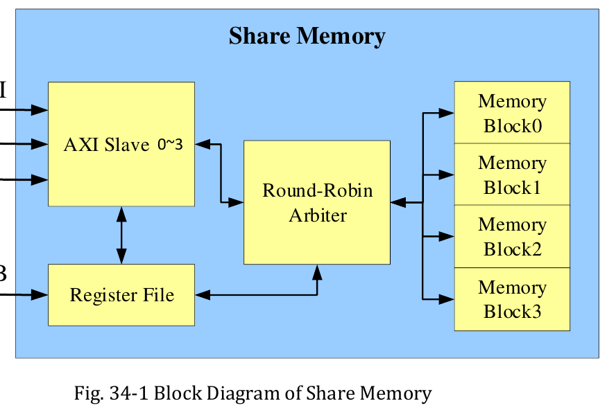

:tocdepth: 1

***********************************
Chế độ đa lõi và bộ nhớ System SRAM
***********************************

.. admonition:: Trang này trả lời

   - Ba core NPU chạy riêng hay chạy cùng nhau?
   - Chọn chế độ bằng gì, và việc được chia ra sao?
   - System SRAM có dung lượng và địa chỉ thế nào?
   - System SRAM chia sẻ với những thành phần nào?

.. admonition:: Tóm tắt

   - TRM1 ghi NPU có ba core, hỗ trợ ba core cùng làm việc, hai core cùng làm việc và chạy độc lập [T1 TRM1 tr.1984].
   - Thanh ghi ``nn_mode`` có các mode 32x32, 64x32, 96x32, 32x64, 32x96. TRM1 chỉ ghi "target for multicore mode" và không gắn mode nào với dual hay triple [T1 TRM1 tr.2001].
   - Người dùng chọn core bằng ``core_mask`` (AUTO, CORE_0, CORE_1, CORE_2, CORE_0_1, CORE_0_1_2) [T1 UG152 tr.26] [T1 UG232 tr.74].
   - Ở chế độ nhiều core, op ngoài danh sách Conv, Add, Concat, Relu... "will fallback to Core0" [T1 UG152 tr.27]. Chia theo khối lượng tính thì có [T1 UG232 tr.75], chia theo chiều tensor thì unknown.
   - Trong driver 0.9.8, AUTO chọn lõi có ít task nhất và chạy job trên một lõi [T1 DRV rknpu_job.c:508-538].
   - SoC có 1MB System SRAM, 956KB cấp được cho các IP, đã hỗ trợ cấp cho RKNPU, tối đa 956KB và căn 4K [T1 SRAM-zh dòng 11] [T1 SRAM-zh dòng 38].
   - Vùng 0xFF000000~0xFF0FFFFF gồm bốn block 256KB [T1 TRM1 tr.1965]. DTS của repo giao toàn bộ vùng 956KB cho hai decoder, node NPU không có ``rockchip,sram`` [T1 DTS dòng 6868-6881].
   - Độ trễ và băng thông SRAM nhìn từ NPU, ý nghĩa cửa sổ ``FD600000`` và lý do 956KB thay vì 1024KB đều là unknown.

.. contents:: Trong trang này
   :local:
   :depth: 1

.. _chedo-nhieu-core:

1. Chế độ nhiều core
====================

Khi một chip có nhiều đơn vị tính giống nhau, có hai cách dùng chúng: mỗi đơn vị chạy một job riêng (chạy độc lập), hoặc nhiều đơn vị cùng làm một job bằng cách chia khối lượng tính (co-work). Cách thứ hai cần thêm việc chia, đồng bộ và chia sẻ bộ nhớ. Phần nền về chia việc nhiều core xem :doc:`../../01-kien-thuc-nen/02-npu/03-systolic-array-va-kien-truc-da-loi`. Trang này chỉ nêu điều tài liệu RK3588 ghi.

1.1 Các chế độ 1, 2, 3 core
---------------------------

RK3588 có ba NPU core giống nhau. TRM1 mô tả khả năng ghép như sau:

   "Include triple NPU CORE
   Support triple core co-work, dual core co-work, and work independently" [T1 TRM1 tr.1984]

Datasheet nhắc lại cùng ý và thêm "Multi-task, multi-scenario in parallel" [T1 DS V1.7 pdf 11]. Hình dưới là sơ đồ ba core của TRM1. TRM1 không giải thích bằng chữ các đường nối giữa các core.

.. _fig-nhieu-core-triple-core:

.. figure:: ../../../_assets/img/02-nen-tang-rk3588/01-phan-cung-npu/nhieu-core-va-sram-he-thong/trm1-fig36-1-triple-core-architecture.png
   :align: center
   :alt: Kiến trúc ba NPU core của RK3588

   Kiến trúc ba NPU core (RKNN Triple Core Architecture). Nguồn: [T1 TRM1 tr.1984, Fig. 36-1]

Địa chỉ và ngắt của ba core (mỗi core một vùng thanh ghi 64KB):

.. list-table::
   :header-rows: 1
   :widths: 20 25 15 40

   * - Core
     - Địa chỉ cơ sở
     - Kích thước
     - Ngắt
   * - RKNN C0
     - ``FDAB0000``
     - 64KB
     - 142 ``irq_rknn_c0`` [T1 TRM1 tr.24]
   * - RKNN C1
     - ``FDAC0000``
     - 64KB
     - 143 ``irq_rknn_c1`` [T1 TRM1 tr.24]
   * - RKNN C2
     - ``FDAD0000``
     - 64KB
     - 144 ``irq_rknn_c2`` [T1 TRM1 tr.24]

Các địa chỉ lấy từ bảng Address Mapping [T1 TRM1 tr.18].

Thông số theo core, theo TRM1:

   "1024x3 integer 8 MAC operations per cycle" ... "384KBx3 internal buffer" [T1 TRM1 tr.1984]

TRM1 không viết chữ "mỗi core" cạnh "1024x3". Chi tiết một core xem :doc:`02-vi-kien-truc-va-khoi-tinh-toan-core`.

Thanh ghi ``nn_mode`` (``RKNN_cna_conv_con3``, offset ``0x1014``, bit 30:28) là chỗ duy nhất TRM1 nói tới "multicore mode" ở mức thanh ghi:

   "This register is target for multicore mode. By single core mode keep it at 3'd0." [T1 TRM1 tr.2001]

.. list-table::
   :header-rows: 1
   :widths: 15 30 25 30

   * - Giá trị
     - Mô tả của TRM1
     - Tích hai số (suy ra)
     - Ghi chú
   * - ``3'd0``
     - Int8 mac array 32x32 mode
     - 32x32 = 1024
     - Chế độ một core, "keep it at 3'd0"
   * - ``3'd1``
     - 64x32 mode
     - 64x32 = 2048
     - Không gắn với dual
   * - ``3'd2``
     - 96x32 mode
     - 96x32 = 3072
     - Không gắn với triple
   * - ``3'd4``
     - 32x64 mode
     - 32x64 = 2048
     - Không gắn với core nào
   * - ``3'd5``
     - 32x96 mode
     - 32x96 = 3072
     - Không gắn với core nào
   * - ``3'd3, 3'd6, 3'd7``
     - Reserved
     - không áp dụng
     -

Cột mô tả lấy từ [T1 TRM1 tr.2001]. Cột "Tích hai số" là phép nhân của người viết (suy ra), không phải câu của hãng. TRM1 không nói mode nào ứng với dual hay triple, nên không viết "dual = 64x32". Xem mục 2.3.

Cấu hình trong driver 0.9.8 (bằng chứng từ mã, không phải câu của hãng):

- DTS có ba vùng reg ``0xfdab0000``, ``0xfdac0000``, ``0xfdad0000`` và ba ngắt ``npu0_irq``, ``npu1_irq``, ``npu2_irq`` [T1 DTS dòng 3450-3480].
- Cấu hình RK3588 có ``.core_mask = 0x7`` [T1 DRV rknpu_drv.c:197]. Mask từng lõi: CORE0 ``0x01``, CORE1 ``0x02``, CORE2 ``0x04``, AUTO ``0x00``, ``RKNPU_MAX_CORES`` bằng 3 [T1 DRV include/rknpu_job.h:18-27].
- Hàng đợi riêng cho từng lõi, và chỉ có năm mask hợp lệ trong ``rknpu_job_commit``: ``0x1``, ``0x2``, ``0x4``, ``0x3``, ``0x7``. Giá trị khác báo ``Unknown core mask`` [T1 DRV rknpu_job.c:402-424]. Vì vậy CORE1|CORE2 và CORE0|CORE2 không có nhánh hợp lệ.
- Task theo lõi nằm trong ``subcore_task[5]``, mỗi phần tử gồm ``task_start`` và ``task_number`` [T1 DRV include/rknpu_ioctl.h:241-279]. Khi ``num_irqs`` lớn hơn 1, job một hoặc hai lõi lấy ``subcore_task[core_index]``, job ba lõi lấy ``subcore_task[core_index + 2]`` [T1 DRV rknpu_job.c:71-90]. Driver nhận phân chia task từ userspace. Không thấy chỗ driver tự chia task (suy luận từ mã đã đọc).
- Nếu core2 bị đánh dấu invalid: core0 hoặc core1 cũng invalid thì trả ``-ENODEV``, ngược lại dùng ``rk3583_rknpu_config`` [T1 DRV rknpu_drv.c:1274-1288].

1.2 Cách chọn chế độ
--------------------

Người dùng chọn core qua API. Với C API của RKNN:

   "RKNN_NPU_CORE_AUTO : Referring to automatic mode, meaning that it will select the idle core inside the NPU;" ... "RKNN_NPU_CORE_0_1_2: Running on both NPU0, NPU1 and NPU2 simultaneously." [T1 UG152 tr.26]

Bảng tham số ``core_mask`` của UG232 liệt kê AUTO, CORE_0, CORE_1, CORE_2, CORE_0_1, CORE_0_1_2 và ``RKNN_NPU_CORE_ALL`` ("Selecting the number of NPU cores to run depending on the platform") [T1 UG232 tr.74]. Python mặc định là ``NPU_CORE_AUTO`` [T1 UG232 tr.73]. RK3576 chỉ có hai core nên không đặt được CORE_2 và CORE_0_1_2 [T1 API232 tr.17].

Chế độ nhiều core không tăng tốc mọi op:

   "For multi-cores mode (when enabling RKNN_NPU_CORE_0_1 and RKNN_NPU_CORE_0_1_2), the following ops have better acceleration :
   Conv, DepthwiseConvolution, Add, Concat, Relu, Clip, Relu6, ThresholdedRelu. Prelu, LeakyRelu.
   Other type of op will fallback to Core0 to continue running." [T1 UG152 tr.27]

Và mạng nhỏ có thể chậm đi:

   "Multi-core operation is suitable for networks with a large amount of calculations. A little improvement for small networks, and may even lead to performance degradation due to single-core and multi-core switching (this switching requires CPU intervention)." [T1 UG232 tr.72]

Cách chia việc. UG232 mô tả log phân bổ theo từng lớp:

   "'50.0%/50.0%/0.0% - Up:50.0%' means that the calculation amount of this layer is distributed with Core0 responsible for 50% and Core1 responsible for 50%." [T1 UG232 tr.75]

Log mẫu của hãng có cột ``WorkLoad(0/1/2)-ImproveTherical``, ví dụ ``Conv ... NPU 50.0%/50.0%/0.0% - Up:50.0%`` và ``MaxPool ... NPU 100.0%/0.0%/0.0% - Up:0.0%`` [T1 UG232 tr.75]. UG232 nêu hai lý do một lớp chạy trên một core:

   "The load of this layer is too small, smaller than the granularity of NPU multi-core task allocation, so this layer runs on a single core;
   This type of operator does not implement multi-core task segmentation in the NPU driver and will be supported in subsequent versions." [T1 UG232 tr.75]

.. list-table::
   :header-rows: 1
   :widths: 40 60

   * - Câu hỏi
     - Trả lời có nguồn
   * - Có chia theo khối lượng tính không?
     - Có. Mỗi lớp được chia theo tỷ lệ phần trăm khối lượng tính giữa các core [T1 UG232 tr.75]
   * - Chia theo chiều nào của tensor (không gian, kênh, batch)?
     - unknown (xem mục 2.3)
   * - Mode ``nn_mode`` nào ứng với dual, triple?
     - unknown (xem mục 2.3)

Về chế độ AUTO, hai nguồn nói hai mức khác nhau. Hãng mô tả "select the idle core" [T1 UG152 tr.26]. Mã driver 0.9.8 chọn lõi có ``task_num`` nhỏ nhất (so sánh bằng ``>``, nên hòa thì lấy lõi số nhỏ), đặt ``core_mask`` về mask của lõi đó và ``use_core_num = 1`` [T1 DRV rknpu_job.c:508-538]. Nghĩa là trong driver này AUTO chạy một job trên đúng một lõi. Đây là bằng chứng từ mã, không phải câu của hãng.

Với batch, API232 khuyên ``rknn_batch_size`` nên bằng số core NPU, vì chỉ trên nền tảng nhiều core nó mới tăng hiệu năng [T1 API232 tr.14]. UG152 v1.4.0 ghi "Add the support of single batch multi-cores of NPU for RK3588" [T1 UG152 tr.3].

UG232 gợi ý ba bước khi đo hiệu năng nhiều core: đặt tần số CPU, DDR, NPU ở mức cao nhất, gắn ứng dụng vào CPU lớn, gắn ngắt NPU vào CPU lớn đó [T1 UG232 tr.75].

.. _system-sram-dung-chung-npu:

2. System SRAM dùng chung với NPU
=================================

SRAM là bộ nhớ nằm trên chip, truy cập nhanh hơn DDR và không đi qua bộ điều khiển DDR. NPU đã có buffer 384KB trong mỗi core (xem :doc:`02-vi-kien-truc-va-khoi-tinh-toan-core`). System SRAM là bộ nhớ khác: nó thuộc SoC, mọi IP đều có thể dùng. Hai thứ này không được gộp.

2.1 Dung lượng và địa chỉ
-------------------------

Hãng ghi dung lượng và giới hạn cấp cho NPU:

   "RK3588 SOC内部含有1MB的SRAM，其中有956KB可供给SOC上各个IP所使用，已支持为RKNPU指定分配使用" [T1 SRAM-zh dòng 11]

Tạm dịch: SoC có 1MB SRAM, trong đó 956KB cấp cho các IP, đã hỗ trợ chỉ định cấp cho RKNPU. Bản tiếng Anh nằm ở UG232: "RK3588 SOC contains 1MB of SRAM internally, of which 956KB can be used by various IPs on the SOC" [T1 UG232 tr.106].

   "从系统分配需求大小的SRAM给RKNPU，最大可分配956KB，且大小需要4K对齐" [T1 SRAM-zh dòng 38]

Tạm dịch: cấp cho RKNPU lượng SRAM theo nhu cầu, tối đa 956KB, kích thước căn 4K. SRAM hiện cấp cho hai loại bộ nhớ Internal và Weight, mục đích là giảm áp lực băng thông DDR [T1 SRAM-zh dòng 12]. UG232 thêm: "it may have a certain impact on inference time" [T1 UG232 tr.106].

Địa chỉ và cấu trúc phần cứng, theo TRM1:

.. list-table::
   :header-rows: 1
   :widths: 40 60

   * - Nội dung
     - Giá trị
   * - Dung lượng
     - "Support total 1024KB memory comprised of four memory blocks" [T1 TRM1 tr.1965]
   * - Dải địa chỉ hợp lệ
     - ``0xFF000000~0xFF0FFFFF`` [T1 TRM1 tr.1965]
   * - Địa chỉ cơ sở Block0 đến Block3
     - ``0xFF000000``, ``0xFF040000``, ``0xFF080000``, ``0xFF0C0000`` [T1 TRM1 tr.1965]
   * - Mỗi block
     - 256KB, gồm bốn SRAM bank (mục 34.3.1) [T1 TRM1 tr.1965]
   * - Hàng ``SYSTEM_SRAM`` trong Address Mapping
     - ``FF000000``, 1MB [T1 TRM1 tr.19]. Còn một hàng ``FD600000``, 1MB [T1 TRM1 tr.18]
   * - Remap khi boot
     - ``SYSTEM_SRAM(1MB)`` tại ``0xFF000000``, ``PMU_SRAM(8KB)`` tại ``0xFF100000`` [T1 TRM1 tr.20]. Khi remap bằng 2'b10, SYSTEM_SRAM ánh xạ tới ``0xFFFF0000`` [T1 TRM1 tr.16]

.. _fig-nhieu-core-share-memory:

   Sơ đồ khối Share Memory (System SRAM). Nguồn: [T1 TRM1 tr.1965, Fig. 34-1]

Ví dụ số. Các block cách nhau 0x40000, tức 262144 byte, bằng 256KB (suy ra), khớp bốn block cho 1024KB. Vì sao vùng cấp được nhỏ hơn 1MB? Ví dụ DTS của hãng cấp ``reg = <0x0 0xff001000 0x0 0xef000>``. Ta có ``0xEF000`` bằng 978944 byte, bằng 956 x 1024 (suy ra). Địa chỉ đầu vùng cấp được là ``0xFF001000`` và cuối là ``0xFF001000 + 0xEF000 = 0xFF0F0000``, khớp log mẫu của hãng ``sram region: [0x00000000ff001000, 0x00000000ff0f0000), sram size: 0xef000`` [T1 UG232 tr.108]. Phần thiếu so với 1MB là 1024 trừ 956, bằng 68KB (suy ra). Datasheet ghi "System SRAM(share memory), part of space is addressed only in security mode" [T1 DS V1.7 pdf 10]. Câu này cũng có ở các bản HYY (pdf 10) và RK3588S V1.3 (pdf 9) của datasheet, nhưng không có tài liệu nào viết phép tính nối 68KB với câu đó, nên trang không coi đó là nguyên nhân.

Ví dụ DTS của hãng (rút gọn) cấp toàn bộ 956KB cho NPU và gắn vào node NPU:

.. code-block:: none

   syssram: sram@ff001000 {
       compatible = "mmio-sram";
       reg = <0x0 0xff001000 0x0 0xef000>;
       rknpu_sram: rknpu_sram@0 {
           reg = <0x0 0xef000>; // 956KB
       };
   };
   /* trong node NPU */
   rockchip,sram = <&rknpu_sram>;

Nguồn: [T1 SRAM-zh dòng 44-56] [T1 UG232 tr.106] [T1 UG232 tr.107].

Phía API: ``total_sram_size`` ("Only for RK3588, memory size of SRAM reserved for NPU") và ``free_sram_size`` ("Only for RK3588, the current available SRAM") [T1 UG152 tr.49]. Cờ ``RKNN_FLAG_ENABLE_SRAM`` trong ``rknn_init()`` cấp "as much memory as possible" từ SRAM của hệ thống làm Internal Tensor memory [T1 UG232 tr.107]. Biến môi trường ``RKNN_INTERNAL_MEM_TYPE=sram#256`` hay ``RKNN_WEIGHT_MEM_TYPE=sram#128`` ở [T1 SRAM-zh dòng 87-103]. Cách cấu hình và khi nào đáng dùng xem :doc:`../04-bo-nho-hieu-nang/02-sram-cho-npu`.

Điều kiện dùng khác nhau giữa hai tài liệu. SRAM-zh ghi runtime ">=1.3.4b14", UG232 ghi "librknnrt.so ... version >=1.6.0". Cả hai cùng yêu cầu driver từ 0.8.0 trở lên và ``CONFIG_ROCKCHIP_RKNPU_SRAM=y`` [T1 UG232 tr.106] [T1 UG232 tr.107] [T1 SRAM-zh 21-22].

Phía driver 0.9.8 (bằng chứng từ mã): đọc ``rockchip,sram`` bằng ``of_parse_phandle``, không có node thì ``sram_size = 0`` [T1 DRV rknpu_drv.c:1146-1190]. Cấp SRAM cho GEM cần ``CONFIG_ROCKCHIP_RKNPU_SRAM`` và cờ ``RKNPU_MEM_TRY_ALLOC_SRAM`` bằng ``1 << 8`` [T1 DRV include/rknpu_ioctl.h:74], dùng ở [T1 DRV rknpu_gem.c:720-721]. Hai ioctl ``RKNPU_GET_TOTAL_SRAM_SIZE`` (22) và ``RKNPU_GET_FREE_SRAM_SIZE`` (23) [T1 DRV include/rknpu_ioctl.h:133-134].

2.2 Chia sẻ với thành phần khác
-------------------------------

SRAM này không chỉ của NPU:

   "注意：默认系统中可能已为其他IP分配SRAM，比如编解码模块，各IP分配的SRAM区域不能重叠，否则会存在同时读写出现数据错乱现象" [T1 SRAM-zh dòng 39]

Tạm dịch: mặc định hệ thống có thể đã cấp SRAM cho IP khác, ví dụ codec. Vùng của các IP không được chồng lấn, nếu không dữ liệu bị hỏng khi đọc ghi đồng thời. Bản UG232 tương đương [T1 UG232 tr.106].

Phát hiện từ DTS của repo (``dts/rk3588s.dtsi``, driver 0.9.8): cùng ``syssram`` ``0xff001000`` kích thước ``0xef000`` được chia cho hai decoder.

.. list-table::
   :header-rows: 1
   :widths: 30 25 25 20

   * - Node
     - ``reg`` (offset, kích thước)
     - Kích thước thập phân (suy ra)
     - Tham chiếu từ
   * - ``rkvdec0_sram``
     - ``<0x0 0x78000>``
     - 480KB
     - dòng 4222
   * - ``rkvdec1_sram``
     - ``<0x78000 0x77000>``
     - 476KB
     - dòng 4276

Nguồn: [T1 DTS dòng 6868-6881]. ``0x78000 + 0x77000 = 0xEF000``, đúng toàn bộ vùng 956KB, và 480KB cộng 476KB bằng 956KB (suy ra). Node NPU không có thuộc tính ``rockchip,sram`` [T1 DTS dòng 3450-3480]. Suy ra từ DTS của fork này (không phải khẳng định của hãng): theo DTS mặc định, codec chiếm toàn bộ vùng và NPU chưa có phần nào. Muốn cấp cho NPU phải sửa DTS theo ví dụ ở mục 2.1.

Chia sẻ giữa các rknn context cũng có quy tắc riêng:

   "When SRAM is occupied by a certain rknn context, other rknn contexts do not support reusing the SRAM of this segment. The RKNN_FLAG_SHARE_SRAM function in rknn_api.h has not yet been implemented." [T1 UG232 tr.108]

Nếu một context chưa dùng hết SRAM thì phần còn lại các context khác dùng được [T1 UG232 tr.108].

2.3 Điều chưa biết
------------------

.. list-table::
   :header-rows: 1
   :widths: 30 70

   * - Mục
     - Kết quả
   * - Chia theo chiều nào của tensor
     - unknown. Đã tìm ở: TRM1, driver 0.9.8, DTS, UG152, UG232, API232, từ khóa: ``task_start``, ``subcore_task``, ``split``, ``partition``, ``granularity``, ``task segmentation``. Driver chỉ nhận ``subcore_task``. UG232 chỉ nói "calculation amount" và "granularity of NPU multi-core task allocation", không có số. Compiler và runtime là ``.so`` ngoài driver
   * - ``nn_mode`` nào là dual, triple
     - unknown. Đã tìm ở: TRM1, driver, DTS, UG152, UG232, API232, từ khóa: ``nn_mode``, ``co-work``, ``dual core``, ``triple core``. Chỉ có bảng giá trị và câu "target for multicore mode"
   * - Độ trễ và băng thông của System SRAM nhìn từ NPU
     - unknown. Đã tìm ở: TRM1 chương 34, UG232 mục 5.7, SRAM-zh, 5 datasheet, từ khóa: ``latency``, ``bandwidth``, ``GB/s``, ``cycle``. Chương 34 chỉ ghi "four AXI Slave interfaces with 256 bits data bus width" và arbiter Round-Robin [T1 TRM1 tr.1965], không có số cho NPU
   * - Ý nghĩa cửa sổ ``SYSTEM_SRAM`` ``FD600000`` (1MB)
     - unknown. Đã tìm ở: TRM1, DTS, driver, ``docs/contents``, UG152, UG232, 5 datasheet, từ khóa: ``FD600000``. Chỉ có hàng trong bảng Address Mapping [T1 TRM1 tr.18]
   * - Vì sao 956KB thay vì 1024KB
     - unknown. Đã tìm ở: mọi nguồn trên, từ khóa: ``956``, ``0xef000``, ``security mode``. Chỉ có câu datasheet "part of space is addressed only in security mode" [T1 DS V1.7 pdf 10] [T1 DS V0.1 pdf 10] [T1 DS V1.3 pdf 9], không câu nào nối hai điều này

3. Hiểu sai thường gặp
======================

.. list-table::
   :header-rows: 1
   :widths: 24 52 24

   * - Hiểu sai
     - Thực tế theo nguồn
     - Nguồn
   * - Ba core luôn chạy chung một job
     - TRM1 ghi ba chế độ: triple co-work, dual co-work, work independently. Trong driver 0.9.8, AUTO đưa job vào một lõi
     - [T1 TRM1 tr.1984] [T1 DRV rknpu_job.c:508-538]
   * - ``nn_mode`` 64x32 là dual, 96x32 là triple
     - TRM1 chỉ liệt kê mode và ghi "target for multicore mode", không gắn mode nào với dual hay triple
     - [T1 TRM1 tr.2001]
   * - Ở CORE_0_1_2 mọi op được chia đều ba core
     - Op ngoài danh sách tăng tốc "will fallback to Core0". Lớp tải nhỏ hoặc op chưa hỗ trợ chia thì chạy một core
     - [T1 UG152 tr.27] [T1 UG232 tr.75]
   * - Dùng nhiều core luôn nhanh hơn
     - Mạng nhỏ cải thiện ít, có thể chậm đi vì chuyển đổi đơn core và đa core cần CPU can thiệp
     - [T1 UG232 tr.72]
   * - System SRAM 956KB mặc định thuộc NPU
     - 956KB là mức tối đa cấp được. Mặc định có thể đã cấp cho codec. DTS của repo giao toàn bộ cho hai decoder, node NPU không có ``rockchip,sram``
     - [T1 SRAM-zh dòng 38] [T1 SRAM-zh dòng 39] [T1 DTS dòng 6868-6881]
   * - System SRAM và buffer 384KB trong core là một
     - Buffer 384KB nằm trong core (``384KBx3 internal buffer``). System SRAM thuộc SoC, 1MB, dùng chung nhiều IP
     - [T1 TRM1 tr.1984] [T1 TRM1 tr.1965]
   * - Bật SRAM luôn rút ngắn thời gian suy luận
     - UG232 ghi có thể ảnh hưởng thời gian suy luận. Số đo cụ thể: unknown
     - [T1 UG232 tr.106]

Nguồn
=====

Các nhãn nguồn dùng trong trang này (tier, tệp, số lần trích).

.. list-table::
   :header-rows: 1
   :widths: 12 8 70 10

   * - Nhãn
     - Tier
     - Tệp
     - Số lần
   * - ``TRM1``
     - T1
     - :download:`rk3588_part1.pdf <../../../_assets/pdf/datasheet/trm/rk3588_part1.pdf>`
     - 27
   * - ``DS V1.7``
     - T1
     - :download:`Rockchip_RK3588S_Datasheet_V1.7.pdf <../../../_assets/pdf/datasheet/soc/Rockchip_RK3588S_Datasheet_V1.7.pdf>`
     - 3
   * - ``DS V1.3``
     - T1
     - :download:`Rockchip_RK3588_Datasheet_V1.3_20220328.pdf <../../../_assets/pdf/datasheet/soc/Rockchip_RK3588_Datasheet_V1.3_20220328.pdf>`
     - 1
   * - ``DS V0.1``
     - T1
     - :download:`02_RK3588_Datasheet_V0.1-20210727.pdf <../../../_assets/pdf/datasheet/soc/02_RK3588_Datasheet_V0.1-20210727.pdf>`
     - 1
   * - ``UG152``
     - T1
     - :download:`02_Rockchip_RKNPU_User_Guide_RKNN_API_V1.5.2_EN.pdf <../../../_assets/pdf/rknn/02_Rockchip_RKNPU_User_Guide_RKNN_API_V1.5.2_EN.pdf>`
     - 8
   * - ``UG232``
     - T1
     - ``3rdparty/rknn-toolkit2/doc/02_Rockchip_RKNPU_User_Guide_RKNN_SDK_V2.3.2_EN.pdf`` (SDK trong repo chính)
     - 24
   * - ``API232``
     - T1
     - :download:`01_Rockchip_RKNPU_API_Reference_RKNN_Toolkit2_V2.3.2_EN.pdf <../../../_assets/pdf/rknn/01_Rockchip_RKNPU_API_Reference_RKNN_Toolkit2_V2.3.2_EN.pdf>`
     - 2
   * - ``DRV``, ``DTS``
     - T1
     - ``3rdparty/rknpu-driver-0.9.8/`` (commit f6eedab0 theo SOURCE.txt). ``DTS`` là ``dts/rk3588s.dtsi``
     - 13 và 5
   * - ``SRAM-zh``
     - T1
     - :doc:`SRAM usage (zh) </contents/06-tai-lieu-hang/04-sram-usage>`
     - 11

Số trang TRM1, UG152, UG232, API232, DS V1.7 và DS V0.1 là số trang PDF, trùng số in. DS V1.3 không có số trang in nên ``pdf N`` là số trang PDF. Dòng của ``SRAM-zh`` là số dòng trong ``04-sram-usage.rst``. Hai hình lấy từ TRM1 và nằm ở ``_assets/img/02-nen-tang-rk3588/01-phan-cung-npu/nhieu-core-va-sram-he-thong/``.
