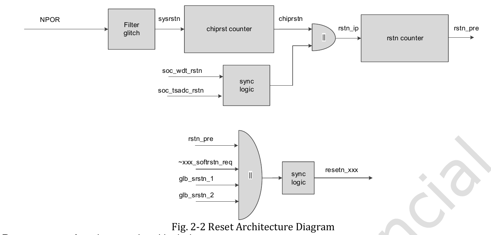

:tocdepth: 1

****************************************
Xung nhịp, điều tần DVFS và cơ chế reset
****************************************

.. admonition:: Trang này trả lời

   - NPU nhận clock từ đâu và được cắt clock thế nào?
   - NPU chạy ở những tần số nào, đổi mức ra sao?
   - NPU được reset thế nào?

.. admonition:: Tóm tắt

   - RKNN có hai miền clock: AHB và AXI. Clock AXI cũng là core clock của mọi Calculate Core và Control Core, tần số điều khiển bằng CRU. Clock được gate tự động khi khối rảnh [T1 TRM1 tr.2052].
   - TRM1 không có sơ đồ cây clock riêng cho NPU. Cây trong trang này suy ra từ bảng mux ``CRU_CLKSEL_CON73`` và ``CON74`` [T1 TRM1 tr.82].
   - Mỗi core có gate riêng (``aclk_rknnN``, ``hclk_rknnN``), nhưng chỉ có một mux/chia ``clk_rknn_dsu0`` trong CON73/CON74 [T1 TRM1 tr.134] [T1 TRM1 tr.82].
   - Datasheet ghi ``Max NPU frequency`` là 1000 MHz ở RK3588 V1.3 và RK3588S V1.7, và ``TBD`` ở V0.1, HYY Rev 1.1 và RK3588S V1.3 [T1 DS V1.3 pdf 30] [T1 DS V1.7 tr.32] [T1 DS V0.1 tr.31].
   - Bảng mức tần số và điện áp chỉ có trong DTS của driver 0.9.8, từ 300 đến 1000 MHz cho "RK3588 npu" [T1 DTS dòng 3534-3655]. Đây là cấu hình DTS, không phải câu của hãng.
   - Driver dùng governor ``rknpu_ondemand`` nhưng hàm target không đọc tải [T1 DRV rknpu_devfreq.c:54-64]. Khi tăng tần số, điện áp được tăng trước. Khi giảm tần số, điện áp được giảm sau [T1 DRV rknpu_devfreq.c:501] [T1 DRV rknpu_devfreq.c:527].
   - Ba core có bộ reset độc lập (``aresetn`` và ``hresetn`` mỗi core). TRM1 yêu cầu giữ reset tối thiểu 32 core clock và nhả hai tín hiệu cùng lúc [T1 TRM1 tr.2052].

.. contents:: Trong trang này
   :local:
   :depth: 1

.. _clock-dvfs-reset:

1. Cây clock của NPU
====================

Nền. Clock là tín hiệu xung nhịp cấp cho mạch số. Tần số clock quyết định tốc độ tính. Trong CRU (Clock and Reset Unit), TRM1 liệt kê các đơn vị cơ bản: Gating, MUX, Divfree, Fracdiv, Divfree50, DivFreeNP5 [T1 TRM1 tr.30]. Hiểu ngắn gọn: PLL tạo tần số cao từ một dao động 24MHz, mux chọn một nguồn, bộ chia hạ tần số, gate cắt clock. Câu của hãng: "All R3588 PLLs receive 24MHz oscillator as input reference clock" và "All clocks can be gated by software" [T1 TRM1 tr.30].

1.1 Miền clock và clock gating
------------------------------

TRM1 mô tả hai miền clock của khối RKNN:

   "RKNN has two clock domains, one is AHB clock, the other is AXI clock." ... "AXI clock also used for core clock for every Calculate Core and Control Core. Clock frequency can be controlled by CRU, please refer to the relevant sections." [T1 TRM1 tr.2052]

Clock gating là cắt clock của khối đang rảnh để bớt công suất động:

   "Automatic localized clock gating is employed throughout the design in order to minimize the dynamic power consumption." ... "If a block and the interface to the block are both idle, then the clock of that block will be gated automatically. This feature can be disabled by software." [T1 TRM1 tr.2052]

Ở mức thanh ghi: ``RKNN_cna_clk_gate`` (offset ``0x1090``, reset ``0x00000000``) có bit ``1'd0: Auto clock gate is enabled`` và ``1'd1: Disable csc block clock gate``, tương tự cho weight block và feature block [T1 TRM1 tr.1987, tr.2008-2009]. ``RKNN_core_mac_gating`` (offset ``0x300C``, reset ``0x07800800``) là thanh ghi gating phía core. Trường ``slcg_op_en`` [26:0] được mô tả là "Soft clock gating signals." [T1 TRM1 tr.2013], bản tóm tắt thanh ghi ở [T1 TRM1 tr.1988]. Nghĩa từng bit của trường này: unknown. Đã tìm ở: TRM1 tr.2013, từ khóa: ``slcg_op_en``, ``mac_gating``.

1.2 CRU: mux, chia, gate
------------------------

TRM1 có Fig. 2-1 CRU Block Diagram (chung cho cả SoC) và không có hình cây clock riêng cho NPU. Cây dưới đây suy ra từ tên trong bảng mux, TRM1 không vẽ:

.. code-block:: none

   PLL: gpll, cpll, aupll, npll, spll   (clk_*_mux)
     -> mux + chia   clk_rknn_dsu0_src_t   CON73 bit 9:7 và bit 6:2
     -> mux          clk_rknn_dsu0         CON74 bit 0 (chọn src_t hoặc clk_npu_pvtpll)
     -> gate         GATE_CON29 bit 3 (clk_rknn_dsu0_en)

Cây này là suy ra từ tên và bảng mux. Thanh ghi mux và chia nằm trong ``CRU_CLKSEL_CON73`` (offset ``0x0424``) và ``CRU_CLKSEL_CON74`` (offset ``0x0428``) [T1 TRM1 tr.82] [T1 TRM1 tr.83].

.. _bang-cru-clksel-npu:

.. list-table:: Thanh ghi chọn nguồn và chia clock của NPU
   :header-rows: 1
   :widths: 14 10 26 50

   * - Thanh ghi
     - Bit
     - Tên
     - Giá trị
   * - CON73
     - 15
     - ``clk_testout_npu_sel``
     - ``0: clk_rknn_dsu0_src_t``, ``1: clk_npu_pvtpll``
   * - CON73
     - 14:10
     - ``clk_testout_npu_div``
     - reset ``0x1f``, chia ``div_con + 1``
   * - CON73
     - 9:7
     - ``clk_rknn_dsu0_src_t_sel``
     - reset ``0x1``. ``000`` gpll, ``001`` cpll, ``010`` aupll, ``011`` npll, ``100`` spll
   * - CON73
     - 6:2
     - ``clk_rknn_dsu0_src_t_div``
     - reset ``0x01``, chia ``div_con + 1``
   * - CON73
     - 1:0
     - ``hclk_rknn_root_sel``
     - ``00`` matrix_200m, ``01`` matrix_100m, ``10`` matrix_50m, ``11`` xin_osc0_func
   * - CON74
     - 4
     - ``clk_npu_pvtpll_sel``
     - reset ``0x1``. ``0: clk_rknn_dsu0_src_t``, ``1: xin_osc0_func``
   * - CON74
     - 0
     - ``clk_rknn_dsu0_sel``
     - reset ``0x0``. ``0: clk_rknn_dsu0_src_t``, ``1: clk_npu_pvtpll``

Nguồn của bảng: [T1 TRM1 tr.82] cho CON73 và [T1 TRM1 tr.82] [T1 TRM1 tr.83] cho CON74. CON74 còn các bit cho MCU Cortex-M0 (``clk_npu_cm0_rtc_sel``, ``hclk_npu_cm0_root_sel``) và cho timer, ``pclk_nputop_root_sel``, không liệt kê ở đây.

Ví dụ số (suy ra). ``clk_rknn_dsu0_src_t_div`` có giá trị reset ``0x01``, nên theo công thức "Divide by (div_con + 1)" nguồn được chia 1 + 1 = 2 [T1 TRM1 tr.82]. Tần số PLL cụ thể không được lấy từ nguồn nào trong trang này nên không tính ra MHz.

Cổng clock (gate). Bit 0 ở reset nghĩa là clock bật [T1 TRM1 tr.134]:

.. list-table::
   :header-rows: 1
   :widths: 28 72

   * - Thanh ghi
     - Bit và clock
   * - ``CRU_GATE_CON27`` (``0x086C``, tr.134)
     - 0 ``aclk_rknn1_en``, 1 ``aclk_rknn1_biu_en``, 2 ``hclk_rknn1_en``, 3 ``hclk_rknn1_biu_en``
   * - ``CRU_GATE_CON28`` (``0x0870``, tr.135)
     - tương tự cho ``rknn2``
   * - ``CRU_GATE_CON29`` (``0x0874``, tr.135-136)
     - 0 ``hclk_rknn_root_en``, 1 ``clk_rknn_dsu0_df_en``, 2 ``clk_testout_npu_en``, 3 ``clk_rknn_dsu0_en``, 4 ``pclk_nputop_root_en``, 5 ``pclk_nputop_biu_en``, 6 ``pclk_npu_timer_en``, 10 ``pclk_npu_wdt_en``, 13 ``pclk_npu_grf_en``, 15 ``clk_npu_pvtm_en``
   * - ``CRU_GATE_CON30`` (``0x0878``, tr.136)
     - 6 ``aclk_rknn0_en``, 7 ``aclk_rknn0_biu_en``, 8 ``hclk_rknn0_en``, 9 ``hclk_rknn0_biu_en``, bit 1-3 và 5 là clock ``npu_cm0`` (MCU Cortex-M0)

Nguồn của bảng: [T1 TRM1 tr.134] [T1 TRM1 tr.135] [T1 TRM1 tr.136]. ``clk_npu_pvtpll_en`` ở đầu tr.137 thuộc ``CRU_GATE_CON30`` [T1 TRM1 tr.137]. Kết luận rút ra (suy ra từ bảng): mỗi core có gate ``aclk``/``hclk`` riêng, nhưng trong CON73/CON74 chỉ có một mux và một bộ chia ``clk_rknn_dsu0``. TRM1 không có bộ chia riêng cho ``aclk_rknn0``, ``aclk_rknn1``, ``aclk_rknn2``.

Tự hạ clock khi rảnh (auto clock switch). ``CRU_AUTOCS_CLK_RKNN_DSU0_SRC_T_CON0`` (``0x0F38``, reset ``0x00200004``) và ``_CON1`` (``0x0F3C``) có trong bảng tóm tắt [T1 TRM1 tr.49]. Chi tiết: CON0 có ``wait_th`` [31:16] reset ``0x0020`` và ``idle_th`` [15:0] reset ``0x0004``. CON1 có ``clksel_cfg`` [15:14] chọn clock thay thế (``2'b01`` là ``xin_osc0_func_div``, ``2'b10`` là ``clk_rtc_32k``) [T1 TRM1 tr.257]. Bit 13:

   "switch_en / 1'b1: Enable clk_rknn_dsu0_src_t switched to lower frequency when module is inactive. / 1'b0: Disable auto switch function." [T1 TRM1 tr.257]

PVTPLL của NPU nằm trong ``NPU_GRF`` (``NPU_GRF_PVTPLL_CON0_L`` offset ``0x000C`` đến ``_CON3`` offset ``0x001C``). Bit 15 ``bypass``: "Support glitch-free frequency conversion" khi bằng 0 [T1 TRM1 tr.765-767]. TRM1 không viết rằng PVTPLL điều khiển tần số core NPU của RK3588. DTS gắn ``rockchip,pvtm-pvtpll;`` vào node OPP (mục 2.1).

1.3 Clock trong DTS
-------------------

Node NPU trong DTS của driver 0.9.8 [T1 DTS dòng 3450-3480]:

.. code-block:: none

   clocks = <&scmi_clk SCMI_CLK_NPU>, <&cru ACLK_NPU0>, <&cru ACLK_NPU1>, <&cru ACLK_NPU2>,
            <&cru HCLK_NPU0>, <&cru HCLK_NPU1>, <&cru HCLK_NPU2>, <&cru PCLK_NPU_ROOT>;
   clock-names = "clk_npu", "aclk0", "aclk1", "aclk2", "hclk0", "hclk1", "hclk2", "pclk";
   assigned-clocks = <&scmi_clk SCMI_CLK_NPU>;
   assigned-clock-rates = <200000000>;

Clock đầu tiên ``clk_npu`` là clock SCMI. Tần số khởi tạo gán là 200000000 Hz (dòng 3467-3468). Quan hệ giữa ``SCMI_CLK_NPU`` và ``clk_rknn_dsu0`` của CRU: unknown. Đã tìm ở: TRM1, DTS, từ khóa: ``SCMI_CLK_NPU``, ``clk_rknn_dsu0``.

Miền nguồn cũng khai báo clock (dòng 3116-3149). ``RK3588_PD_NPUTOP`` có ``HCLK_NPU_ROOT``, ``PCLK_NPU_ROOT``, ``CLK_NPU_DSU0``, ``HCLK_NPU_CM0_ROOT``. ``RK3588_PD_NPU1`` và ``RK3588_PD_NPU2`` lồng trong PD_NPUTOP và đều có ``HCLK_NPU_ROOT``, ``PCLK_NPU_ROOT``, ``CLK_NPU_DSU0`` [T1 DTS dòng 3116-3149]. Node NPU gọi ba domain bằng ``power-domains`` với tên ``npu0``, ``npu1``, ``npu2`` [T1 DTS dòng 3473-3476]. Quan hệ lồng và bật tắt domain xem :doc:`01-vi-tri-soc-phan-vung-nguon-va-mcu`.

Ba domain cùng tham chiếu ``CLK_NPU_DSU0``. Suy ra: ba core có thể dùng chung nguồn clock này. Không có câu nào của hãng nói "ba core chạy cùng tần số". Đã tìm ở: TRM1 chương 36, UG152, UG232, API232, SRAM-zh, DTS, driver, từ khóa: ``same frequency``, ``share clock``, ``per-core``. Kết luận: unknown.

Driver chỉ đọc một tần số, từ ``clks[0]`` (SCMI), không đọc theo core: ``current_freq = clk_get_rate(rknpu_dev->clks[0].clk)`` [T1 DRV rknpu_debugger.c:177-191] (cũng ở [T1 DRV rknpu_drv.c:406]). Driver lấy mọi clock bằng ``devm_clk_bulk_get_all`` [T1 DRV rknpu_drv.c:1314]. Tài liệu hãng dùng đường dẫn ``/sys/kernel/debug/clk/clk_npu_dsu0/clk_rate`` để cố định tần số RK3588 [T1 UG152 tr.73]. Suy ra từ tên: ``clk_npu_dsu0`` là tên Linux của ``clk_rknn_dsu0`` trong TRM1. Không nguồn nào nói điều này.

2. DVFS
=======

DVFS (Dynamic Voltage and Frequency Scaling) là đổi cặp tần số và điện áp theo mức. Mỗi mức là một cặp, gọi là OPP (Operating Performance Point). Trong Linux, bảng OPP nằm trong DTS và governor devfreq chọn mức. Hãng chưa công bố bảng mức cho RK3588 trong tài liệu RKNN (xem cuối mục 2.1).

2.1 Các mức tần số
------------------

Tần số tối đa theo datasheet. Cả năm bản datasheet đã kiểm:

.. _bang-datasheet-max-npu:

.. list-table:: Dòng ``Max NPU frequency`` qua các bản datasheet
   :header-rows: 1
   :widths: 34 10 14 14 14 14

   * - Bản
     - Trang PDF
     - Max NPU
     - Max GPU
     - Max CPU
     - Nguồn
   * - ``02_RK3588_Datasheet_V0.1-20210727``
     - 31
     - ``TBD`` MHz
     - TBD
     - TBD GHz
     - [T1 DS V0.1 tr.31]
   * - ``01_HYY_Rockchip_RK3588_Datasheet`` (Rev 1.1)
     - 32
     - ``TBD`` MHz
     - TBD
     - TBD
     - [T1 DS HYY tr.32]
   * - ``Rockchip_RK3588S_Datasheet_V1.3_20220310``
     - 31
     - ``TBD`` MHz
     - TBD
     - TBD
     - [T1 DS S1.3 tr.31]
   * - ``Rockchip_RK3588_Datasheet_V1.3_20220328``
     - 30
     - 1000 MHz
     - 1000
     - 2.2-2.4 GHz
     - [T1 DS V1.3 pdf 30]
   * - ``Rockchip_RK3588S_Datasheet_V1.7`` (Rev 1.7, 2026-01-05)
     - 32
     - 1000 MHz
     - 1000
     - 2.2-2.4 GHz
     - [T1 DS V1.7 tr.32]

Dòng gốc của V1.7, sau Table 3-2 Recommended operating conditions, theo thứ tự cột Min, Typ, Max, Unit: ``Max NPU frequency  NA  NA  1000  MHz`` [T1 DS V1.7 tr.32]. Vậy hai bản mới ghi 1000 MHz là tần số tối đa. Ba bản cũ để ``TBD``.

Điện áp trong cùng bảng: ``VDD_NPU`` 0.55 / 0.75 / 0.95 V và ``VDD_NPU_MEM`` 0.675 / 0.75 / 0.95 V (Min / Typ / Max) [T1 DS V1.7 tr.31] [T1 DS V1.3 pdf 29]. Bản V0.1 ghi ``VDD_NPU`` là ``TBD`` / 0.75 / ``TBD`` [T1 DS V0.1 tr.30].

Công suất. Datasheet ghi "computing power is up to 6TOPs" [T1 DS V1.7 tr.7] và "processing performance up to 6 TOPS" [T1 DS V1.7 tr.11]. TRM1 ghi "1024x3 integer 8 MAC operations per cycle" [T1 TRM1 tr.1984]. Phép tính của người viết (suy ra): 3072 MAC x 2 phép x 1 GHz = 6144 tỷ phép mỗi giây, tức 6.144 TOPS, khớp "up to 6 TOPS". Quy ước 2 phép cho mỗi MAC không có trong tài liệu của hãng.

Bảng OPP. Datasheet chỉ cho trần 1000 MHz. Bảng mức nằm trong DTS của driver 0.9.8 (``npu_opp_table``, ``compatible = "operating-points-v2"``) [T1 DTS dòng 3482-3710]. Đây là cấu hình DTS của fork này (Orange Pi, commit f6eedab0), không phải câu của hãng. OPP "RK3588 npu" (``opp-supported-hw = <0xf9 0xffff>``) [T1 DTS dòng 3534-3655]:

.. _bang-opp-dts:

.. list-table:: OPP "RK3588 npu" trong DTS (``opp-microvolt`` là target, min, max)
   :header-rows: 1
   :widths: 22 24 54

   * - Dòng DTS
     - ``opp-hz``
     - ``opp-microvolt``
   * - 3534-3549
     - 300000000
     - ``<700000 700000 850000>`` (biến thể L1: ``687500``)
   * - 3550-3565
     - 400000000
     - ``<700000 700000 850000>``
   * - 3566-3581
     - 500000000
     - ``<700000 700000 850000>``
   * - 3582-3597
     - 600000000
     - ``<700000 700000 850000>``
   * - 3598-3609
     - 700000000
     - ``<700000 700000 850000>``
   * - 3610-3623
     - 800000000
     - ``<750000 750000 850000>``
   * - 3624-3639
     - 900000000
     - ``<800000 800000 850000>``
   * - 3640-3655
     - 1000000000
     - ``<850000 850000 850000>``

Nguồn của bảng: [T1 DTS dòng 3534-3655]. Giá trị ``opp-microvolt`` ở đây là giá trị mặc định, chưa tính các biến thể ``-L1`` đến ``-L5``. OPP 1000 MHz có biến thể: L1 ``837500``, L2 ``825000``, L3 ``812500``, L4 ``800000``, L5 ``787500`` [T1 DTS dòng 3643-3654]. Mỗi mục có hai bộ ba, theo suy ra tương ứng hai supply (``rknpu`` và ``mem``). Các cột trên chỉ lấy bộ ba đầu.

OPP "RK3588J/M" (``opp-supported-hw = <0x06 0xffff>``): 300, 400, 500, 600, 700 và 800 MHz đều ``<750000 750000 850000>``, thêm mức ``opp-j-m-950000000`` là ``<837500 837500 850000>``. Tối đa 950 MHz [T1 DTS dòng 3658-3709] [T1 DTS dòng 3694-3697].

Ví dụ số (suy ra từ bảng). Từ 300 MHz lên 1000 MHz, tần số tăng 1000 / 300, khoảng 3.33 lần. Điện áp target tăng từ 700000 lên 850000 microvolt, 850 / 700, khoảng 1.21 lần.

Thuộc tính khác của bảng OPP, kèm điều kiện nhiệt [T1 DTS dòng 3485-3531]:

.. list-table::
   :header-rows: 1
   :widths: 42 18 40

   * - Thuộc tính
     - Giá trị
     - Ghi chú
   * - ``rockchip,init-freq``
     - ``1000000``
     - Đơn vị KHz (dòng 3525), tức 1000 MHz
   * - ``intermediate-threshold-freq``
     - ``500000``
     - KHz (dòng 3524)
   * - ``rockchip,high-temp`` và ``rockchip,high-temp-max-freq``
     - ``85000`` và ``800000``
     - Dòng 3530-3531. Đọc là: trên 85 độ C giới hạn tối đa 800 MHz (đơn vị nhiệt suy ra, DTS không ghi). Hành vi thực phụ thuộc rockchip monitor
   * - ``rockchip,low-temp`` và ``rockchip,low-temp-min-volt``
     - ``15000`` và ``750000``
     - Dòng 3528-3529
   * - ``rockchip,pvtm-pvtpll``, ``rockchip,pvtm-thermal-zone``
     - có, ``"npu-thermal"``
     - Dòng 3506, 3513
   * - ``rockchip,opp-clocks``
     - ``PCLK_NPU_GRF``, ``HCLK_NPU_ROOT``
     - Dòng 3515
   * - ``volt-mem-read-margin``
     - ``< 855000 1 765000 2 675000 3 495000 4 >``
     - Dòng 3517-3522

Tài liệu RKNN không có bảng mức cho RK3588. Chỉ có ví dụ đầu ra:

   "Taking RK3588 as an example, the hardware frequency output after executing eval_perf is as follows (the frequencies supported by different firmware may vary)." [T1 UG232 tr.31]

kèm dòng ``NPU Current Frequency List: - 1000000000`` [T1 UG232 tr.31]. Số 1000000000 còn có trong ví dụ lệnh cố định tần số "e.g., at 1GHz" [T1 UG152 tr.73]. UG232 mục 8.1.1 chỉ dẫn tới script ngoài ``scaling_frequency.sh`` của rknn_model_zoo [T1 UG232 tr.136]. Vì vậy bảng OPP ở trên là nguồn duy nhất cho các mức trung gian.

2.2 Cơ chế đổi mức
------------------

Governor tùy chỉnh của driver 0.9.8 (``rknpu_devfreq.c``):

- Tên ``rknpu_ondemand``, ``polling_ms`` bằng 50, hàm target là ``devfreq_rknpu_ondemand_func`` [T1 DRV rknpu_devfreq.c:48] [T1 DRV rknpu_devfreq.c:73-74].
- Hàm này trả ``ondemand_freq`` nếu khác 0, ngược lại trả ``previous_freq``. Nó không đọc tải [T1 DRV rknpu_devfreq.c:54-64].
- ``ondemand_freq`` chỉ được gán lúc khởi tạo [T1 DRV rknpu_devfreq.c:383] [T1 DRV rknpu_devfreq.c:699] và khi ghi node debugfs ``freq`` [T1 DRV rknpu_debugger.c:229].

Suy ra từ mã: driver này không tự đổi tần số theo tải. Tần số đổi khi người dùng ghi ``freq``, hoặc khi devfreq và monitor (nhiệt) gọi ``npu_devfreq_target`` (hàm này gọi ``devfreq_recommended_opp``, ``rockchip_monitor_volt_adjust_lock`` và ``dev_pm_opp_set_rate`` [T1 DRV rknpu_devfreq.c:576-612]).

Thứ tự đổi điện áp và tần số trong ``npu_opp_helper`` [T1 DRV rknpu_devfreq.c:465-573]:

.. list-table::
   :header-rows: 1
   :widths: 16 84

   * - Hướng
     - Các bước
   * - Tăng
     - Comment "Scaling up? Scale voltage before frequency" [T1 DRV rknpu_devfreq.c:501]. Đặt ``mem_reg``, rồi ``vdd_reg``, rồi ``rockchip_set_read_margin``, rồi ``clk_set_rate(clk, new_freq)``
   * - Giảm
     - Comment "Scaling down? Scale voltage after frequency" [T1 DRV rknpu_devfreq.c:527]. ``rockchip_set_read_margin``, rồi ``clk_set_rate``, rồi hạ ``vdd_reg``, rồi hạ ``mem_reg``

Có đường khôi phục ``restore_freq``, ``restore_rm``, ``restore_voltage`` nếu một bước lỗi [T1 DRV rknpu_devfreq.c:559-571]. Helper chỉ đăng ký khi DTS có cả ``rknpu-supply`` và ``mem-supply``.

Khi tắt nguồn, driver hạ tần: ``#define POWER_DOWN_FREQ 200000000`` [T1 DRV rknpu_devfreq.c:16] và ``clk_set_rate(opp_info->scmi_clk, POWER_DOWN_FREQ)`` ở nhánh SCMI [T1 DRV rknpu_devfreq.c:754-755]. Giá trị này trùng ``assigned-clock-rates`` của DTS.

Giao diện người dùng do hãng mô tả:

   "If the NPU driver version is after 0.7.2, you can query the NPU version, the utilization of different NPU cores and manually switch the NPU power supply through the node." [T1 UG152 tr.73]

Lệnh cố định tần số trên RK3588 (kèm ghi chú "Need to upgrade firmware"):

.. code-block:: none

   echo userspace > /sys/class/devfreq/fdab0000.npu/governor
   echo 1000000000 > /sys/kernel/debug/clk/clk_npu_dsu0/clk_rate

Nguồn: [T1 UG152 tr.73]. Lưu ý: "The driver version after 0.7.2, it is required to turn on the power of NPU first before setting frequency" [T1 UG152 tr.73]. Từ driver 0.8.2 có thêm ``/sys/kernel/debug/rknpu/freq`` để xem và đặt tần số [T1 UG152 tr.74]. Governor ``rknpu_ondemand`` là mã trong driver. Lệnh của hãng đặt ``userspace``, là governor chuẩn của Linux devfreq. Hai điều này không mâu thuẫn nhưng cần phân biệt.

3. Reset
========

Nền. Reset đưa mạch về trạng thái đầu. Ở đây có hai lớp: reset phần cứng của khối RKNN theo từng miền clock, và reset mềm do phần mềm yêu cầu qua CRU.

TRM1 mô tả hai tín hiệu reset tương ứng hai miền clock:

   "Correspond to the clock domain, there are two reset signals. Aresetn, the reset signal for AXI interface and every Calculate Core and Control Core. Hresetn is the AHB interface reset pin and which is synchronized to the AHB clock domain.
   All the two signals must be asserted for a minimum of 32 core clock cycles, using the slowest of the two clocks. Then two signals must be release at the same time." [T1 TRM1 tr.2052]

CRU soft reset: mỗi bit mô tả "When high, reset relative logic". Ba core có reset độc lập (``aresetn`` và ``hresetn`` mỗi core):

.. _bang-reset-cru-npu:

.. list-table:: Thanh ghi soft reset của NPU
   :header-rows: 1
   :widths: 30 14 56

   * - Thanh ghi
     - Trang
     - Bit
   * - ``CRU_SOFTRST_CON27`` (``0x0A6C``)
     - 182
     - 0 ``aresetn_rknn1``, 1 ``aresetn_rknn1_biu``, 2 ``hresetn_rknn1``, 3 ``hresetn_rknn1_biu``
   * - ``CRU_SOFTRST_CON28`` (``0x0A70``)
     - 182
     - tương tự cho ``rknn2``
   * - ``CRU_SOFTRST_CON29`` (``0x0A74``)
     - 182-183
     - ``aresetn_rknn_dsu0``, ``presetn_nputop_biu``, ``presetn_npu_timer``, ``resetn_nputimer0/1``, ``presetn_npu_wdt``, ``tresetn_npu_wdt``, ``presetn_npu_grf``
   * - ``CRU_SOFTRST_CON30`` (``0x0A78``)
     - 183-184
     - 6 ``aresetn_rknn0``, 7 ``aresetn_rknn0_biu``, 8 ``hresetn_rknn0``, 9 ``hresetn_rknn0_biu``, 2 ``hresetn_npu_cm0_biu``, 3 ``fresetn_npu_cm0_core`` (reset ``0x1``), 4 ``tresetn_npu_cm0_jtag``. ``resetn_npu_pvtpll`` ở đầu tr.184

Nguồn của bảng: [T1 TRM1 tr.182] [T1 TRM1 tr.183] [T1 TRM1 tr.184].

Kiến trúc reset toàn SoC (Fig. 2-2) cho thấy các nguồn reset:

.. _fig-clock-dvfs-reset-arch:

   Kiến trúc reset (Reset Architecture Diagram). Nguồn: [T1 TRM1 tr.31, Fig. 2-2]

.. list-table::
   :header-rows: 1
   :widths: 30 70

   * - Tín hiệu
     - Mô tả của TRM1
   * - ``NPOR``
     - External power on reset
   * - ``soc_wdt_rstn``
     - Reset from WDT module
   * - ``soc_tsadc_rstn``
     - Reset from TSADC module
   * - ``softrstn_req``
     - Software reset request by programming CRU_SOFTRST_CON
   * - ``glb_srstn_1``
     - First global software reset by programming CRU_GLB_SRST_FST as 0xfdb9
   * - ``glb_srstn_2``
     - Second global software reset by programming CRU_GLB_SRST_SND as 0xeca8

Nguồn của bảng: [T1 TRM1 tr.30] [T1 TRM1 tr.31] (mục 2.3.2 System Reset Solution).

Reset trong DTS và driver 0.9.8. DTS khai báo sáu reset [T1 DTS dòng 3469-3472]:

.. code-block:: none

   resets = <&cru SRST_A_RKNN0>, <&cru SRST_A_RKNN1>, <&cru SRST_A_RKNN2>,
            <&cru SRST_H_RKNN0>, <&cru SRST_H_RKNN1>, <&cru SRST_H_RKNN2>;
   reset-names = "srst_a0", "srst_a1", "srst_a2", "srst_h0", "srst_h1", "srst_h2";

Hàm ``rknpu_soft_reset`` thực hiện theo thứ tự [T1 DRV rknpu_reset.c:98-150]:

.. list-table::
   :header-rows: 1
   :widths: 8 92

   * - Bước
     - Việc làm
   * - 1
     - Nếu ``bypass_soft_reset`` bằng 1 thì in cảnh báo ``bypass soft reset`` và thoát
   * - 2
     - ``mutex_trylock(&reset_lock)``, đặt ``soft_reseting = true``, ``msleep(100)``
   * - 3
     - Đánh thức ``job_done_wq`` của từng lõi
   * - 4
     - Assert tất cả ``srsts[i]``, ``udelay(10)``, deassert tất cả, ``udelay(10)``
   * - 5
     - Detach rồi attach lại IOMMU domain (dòng 141-147)

Các reset được lấy bằng ``devm_reset_control_get_exclusive_by_index`` sau khi đếm bằng ``of_count_phandle_with_args`` [T1 DRV rknpu_reset.c:34-54]. Điều kiện gọi: ioctl ``RKNPU_ACT_RESET`` [T1 DRV rknpu_drv.c:420-421], job timeout [T1 DRV rknpu_job.c:714] hoặc lỗi [T1 DRV rknpu_job.c:604]. Tham số module ``bypass_soft_reset`` ("bypass RKNPU soft reset if set it to 1, disabled by default") [T1 DRV rknpu_drv.c:70-73].

Driver assert cả sáu reset (A0-A2, H0-H2) cùng lúc và dùng ``udelay(10)``. TRM1 yêu cầu giữ tối thiểu 32 core clock và nhả hai tín hiệu cùng lúc [T1 TRM1 tr.2052]. Driver không có đoạn kiểm chứng 32 chu kỳ. Trang không kết luận gì từ so sánh này.

4. Hiểu sai thường gặp
======================

.. list-table::
   :header-rows: 1
   :widths: 24 52 24

   * - Hiểu sai
     - Thực tế theo nguồn
     - Nguồn
   * - Datasheet RK3588 ghi ``Max NPU frequency`` là TBD
     - Chỉ ba bản (V0.1, HYY Rev 1.1, RK3588S V1.3) ghi ``TBD``. RK3588 V1.3 và RK3588S V1.7 ghi 1000 MHz
     - [T1 DS V0.1 tr.31] [T1 DS V1.3 pdf 30] [T1 DS V1.7 tr.32]
   * - Số 1000000000 trong tài liệu RKNN là bảng mức của hãng
     - Đó là ví dụ đầu ra ``eval_perf`` ("the frequencies supported by different firmware may vary") và ví dụ lệnh. Bảng OPP chỉ có trong DTS của driver
     - [T1 UG232 tr.31] [T1 UG152 tr.73] [T1 DTS dòng 3534-3655]
   * - Bảng OPP trong DTS là số liệu hãng công bố
     - Đây là DTS của driver 0.9.8 (fork Orange Pi). Hành vi thực tế còn phụ thuộc rockchip monitor
     - [T1 DTS dòng 3482-3710]
   * - Governor ``rknpu_ondemand`` tự đổi tần theo tải
     - Hàm target không đọc tải, trả ``ondemand_freq`` hoặc ``previous_freq``
     - [T1 DRV rknpu_devfreq.c:54-64]
   * - Mỗi core có clock và tần số riêng vì có gate riêng
     - Có gate ``aclk``/``hclk`` riêng cho từng core, nhưng chỉ một mux/chia ``clk_rknn_dsu0``. Ba core có chạy cùng tần số hay không: unknown
     - [T1 TRM1 tr.134] [T1 TRM1 tr.82]
   * - PVTPLL điều khiển tần số core NPU
     - TRM1 có thanh ghi ``NPU_GRF_PVTPLL`` nhưng không viết câu này. DTS chỉ gắn ``rockchip,pvtm-pvtpll`` vào node OPP
     - [T1 TRM1 tr.765-767] [T1 DTS dòng 3506]
   * - Soft reset trong driver chỉ reset một core
     - Driver assert đồng thời cả sáu reset (A0-A2, H0-H2)
     - [T1 DRV rknpu_reset.c:98-150] [T1 DTS dòng 3469-3472]
   * - Hạ điện áp trước rồi mới hạ tần số
     - Driver 0.9.8 làm ngược lại: khi giảm thì hạ tần số trước, hạ điện áp sau. Khi tăng thì tăng điện áp trước
     - [T1 DRV rknpu_devfreq.c:501] [T1 DRV rknpu_devfreq.c:527]

Nguồn
=====

Các nhãn nguồn dùng trong trang này (tier, tệp, số lần trích).

.. list-table::
   :header-rows: 1
   :widths: 12 8 70 10

   * - Nhãn
     - Tier
     - Tệp
     - Số lần
   * - ``TRM1``
     - T1
     - :download:`rk3588_part1.pdf <../../../_assets/pdf/datasheet/trm/rk3588_part1.pdf>`
     - 39
   * - ``DS V1.7``
     - T1
     - :download:`Rockchip_RK3588S_Datasheet_V1.7.pdf <../../../_assets/pdf/datasheet/soc/Rockchip_RK3588S_Datasheet_V1.7.pdf>`
     - 7
   * - ``DS V1.3``
     - T1
     - :download:`Rockchip_RK3588_Datasheet_V1.3_20220328.pdf <../../../_assets/pdf/datasheet/soc/Rockchip_RK3588_Datasheet_V1.3_20220328.pdf>`
     - 4
   * - ``DS V0.1``
     - T1
     - :download:`02_RK3588_Datasheet_V0.1-20210727.pdf <../../../_assets/pdf/datasheet/soc/02_RK3588_Datasheet_V0.1-20210727.pdf>`
     - 4
   * - ``DS HYY``
     - T1
     - :download:`01_HYY_Rockchip_RK3588_Datasheet.pdf <../../../_assets/pdf/datasheet/soc/01_HYY_Rockchip_RK3588_Datasheet.pdf>` (nhãn thêm riêng cho trang này, Rev 1.1)
     - 1
   * - ``DS S1.3``
     - T1
     - :download:`Rockchip_RK3588S_Datasheet_V1.3_20220310.pdf <../../../_assets/pdf/datasheet/soc/Rockchip_RK3588S_Datasheet_V1.3_20220310.pdf>` (nhãn thêm riêng cho trang này, RK3588S V1.3)
     - 1
   * - ``UG152``
     - T1
     - :download:`02_Rockchip_RKNPU_User_Guide_RKNN_API_V1.5.2_EN.pdf <../../../_assets/pdf/rknn/02_Rockchip_RKNPU_User_Guide_RKNN_API_V1.5.2_EN.pdf>`
     - 7
   * - ``UG232``
     - T1
     - ``3rdparty/rknn-toolkit2/doc/02_Rockchip_RKNPU_User_Guide_RKNN_SDK_V2.3.2_EN.pdf`` (SDK trong repo chính)
     - 4
   * - ``DRV``, ``DTS``
     - T1
     - ``3rdparty/rknpu-driver-0.9.8/`` (commit f6eedab0 theo SOURCE.txt). ``DTS`` là ``dts/rk3588s.dtsi``
     - 29 và 16

Số trang TRM1, UG152, UG232, DS V1.7 và DS V0.1 là số trang PDF, trùng số in. DS V1.3 không có số trang in nên ``pdf N`` là số trang PDF. Hình Fig. 2-2 lấy từ TRM1 và nằm ở ``_assets/img/02-nen-tang-rk3588/01-phan-cung-npu/clock-dvfs-reset/``.
