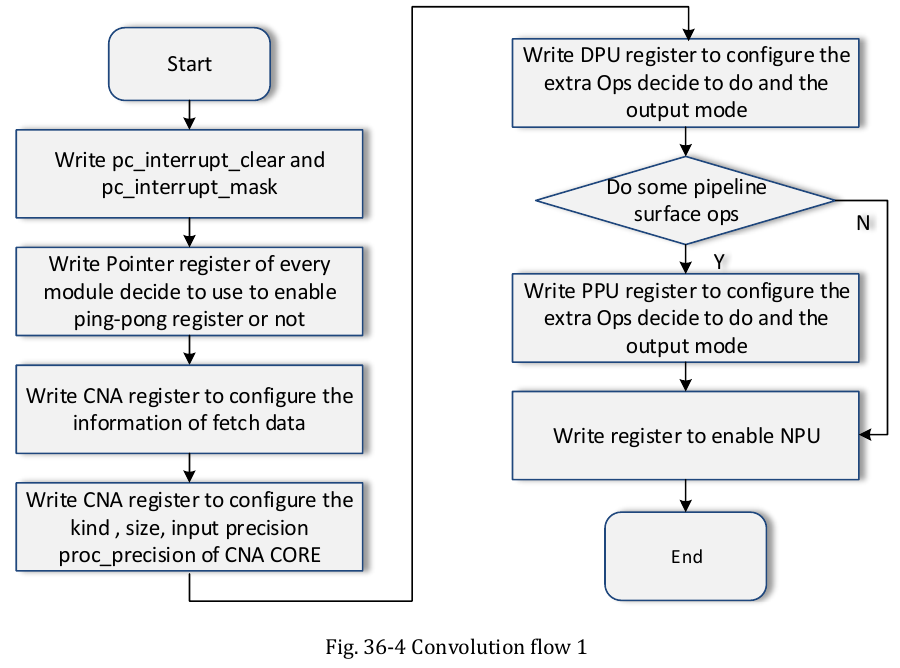

:tocdepth: 1

***********************************
Bản đồ thanh ghi và cơ chế cấu hình
***********************************

.. admonition:: Trang này trả lời

   - Thanh ghi của NPU được tổ chức ra sao và nằm ở địa chỉ nào?
   - Hai chế độ cấu hình (slave configured mode và PC mode) khác nhau thế nào, driver dùng chế độ nào?
   - Ping-pong register là gì và ai bật nó?
   - Ngắt của NPU báo những sự kiện gì, nối với core nào, driver xử lý ra sao?
   - TRM có chỗ nào tự mâu thuẫn hoặc bỏ trống trong phần này?

.. admonition:: Tóm tắt

   - Mỗi core có một vùng thanh ghi 64KB, bên trong chia thành các block 4KB (PC, CNA, CORE, DPU, DPU_RDMA, PPU, PPU_RDMA, DDMA, SDMA) và block GLOBAL 4 byte [T1 TRM1 tr.18, tr.1986].
   - TRM nêu hai chế độ: slave configured mode (CPU ghi thanh ghi qua AHB) và PC mode (NPU tự nạp danh sách thanh ghi từ bộ nhớ qua AXI), chọn bằng bit ``pc_sel`` [T1 TRM1 tr.1994, tr.2053].
   - Driver rknpu 0.9.8 từ chối job không có cờ PC, nên chỉ chạy PC mode [T1 DRV rknpu_job.c:394-397].
   - Ping-pong là hai nhóm thanh ghi luân phiên để giấu thời gian nạp cấu hình, bật bằng thanh ghi ``S_POINTER`` của từng block thực thi và ``task_pp_en`` của khối PC [T1 TRM1 tr.1997, tr.2052].
   - Có 3 tín hiệu ngắt, mỗi bit của ``PC_INTERRUPT_STATUS`` là một trong 17 sự kiện, trong đó TRM đặt tên cho bit 0 đến 13 [T1 TRM1 tr.1995, tr.2053].
   - TRM có hai lỗi biên tập: cột dải địa chỉ của GLOBAL ở Table 1-1 in ``0xf000 ~ 0xf004`` trong khi độ dài là ``4 BYTE`` và thanh ghi duy nhất ``RKNN_global_operation_enable`` nằm ở ``0xF008`` [T1 TRM1 tr.1986, tr.1993, tr.2052], và văn bản gọi "Figure 1-3" trong khi hình in là Fig. 36-3 [T1 TRM1 tr.2053].
   - Ngắt thứ i của driver dùng handler của core i, khớp tên nguồn ``irq_rknn_c0`` đến ``c2`` [T1 DRV rknpu_drv.c:84-88] [T1 TRM1 tr.24].

.. contents:: Trong trang này
   :local:
   :depth: 1

.. _sec-npu-register-map:

1. Register map
===============

1.1 Địa chỉ nội bộ
------------------

Mỗi core NPU có một vùng thanh ghi 64KB: RKNN C0 ``0xFDAB0000``, C1 ``0xFDAC0000``, C2 ``0xFDAD0000`` [T1 TRM1 tr.18], khớp với khai báo ``reg`` trong DTS [T1 DTS dts/rk3588s.dtsi:3450-3454]. Bên trong vùng 64KB đó, Table 1-1 của Chương 36 chia các khối con theo ``Base[15:12]`` [T1 TRM1 tr.1986]:

.. list-table:: Địa chỉ nội bộ của một core (cộng vào base của core) [T1 TRM1 tr.1986]
   :header-rows: 1
   :widths: 14 14 22 50

   * - Block
     - Base[15:12]
     - Khoảng địa chỉ
     - Ghi chú
   * - PC
     - 0
     - 0x0000 ~ 0x0fff
     - Khối điều khiển nạp thanh ghi từ bộ nhớ (``pc_source_addr``), ngắt (``pc_interrupt_*``) và đếm task (``pc_task_con``) [T1 TRM1 tr.1994-1997]
   * - CNA
     - 1
     - 0x1000 ~ 0x1fff
     - 4K BYTE
   * - CORE
     - 3
     - 0x3000 ~ 0x3fff
     - 4K BYTE (không có Base 2 trong bảng)
   * - DPU / DPU_RDMA
     - 4 / 5
     - 0x4000 ~ 0x5fff
     - Mỗi block 4K BYTE (``0x4000 ~ 0x4fff`` và ``0x5000 ~ 0x5fff``)
   * - PPU / PPU_RDMA
     - 6 / 7
     - 0x6000 ~ 0x7fff
     - Mỗi block 4K BYTE (``0x6000 ~ 0x6fff`` và ``0x7000 ~ 0x7fff``)
   * - DDMA / SDMA
     - 8 / 9
     - 0x8000 ~ 0x9fff
     - Mỗi block 4K BYTE (``0x8000 ~ 0x8fff`` và ``0x9000 ~ 0x9fff``)
   * - GLOBAL
     - f
     - 0xf000 ~ 0xf004 (in nhầm)
     - Độ dài ``4 BYTE``, thanh ghi duy nhất nằm ở ``0xF008`` [T1 TRM1 tr.1986, tr.1993, tr.2052]

**Lỗi in dải địa chỉ GLOBAL trong Table 1-1.** Ở Table 1-1, hàng ``GLOBAL`` ghi ``Length = 4 BYTE`` (tức đúng một thanh ghi 32-bit duy nhất) nhưng cột Range lại in ``0xf000 ~ 0xf004`` [T1 TRM1 tr.1986]. Cả bảng tóm tắt thanh ghi (``tr.1993``), mô tả chi tiết ``RKNN_global_operation_enable`` (``tr.2052``) lẫn header driver (``#define RKNPU_OFFSET_ENABLE_MASK 0xf008``) đều xác nhận thanh ghi 4 byte duy nhất của khối GLOBAL nằm tại offset ``0xF008`` [T1 TRM1 tr.1993, tr.2052] [T1 DRV include/rknpu_ioctl.h:34]. Một lỗi đánh số khác là văn bản mục 36.5.4 gọi các hình là "Figure 1-3/1-4/1-5" trong khi chú thích in trên trang là Fig. 36-3 đến 36-7 [T1 TRM1 tr.2053].

1.2 Thanh ghi mode ping-pong và ngắt
------------------------------------

Tất cả thanh ghi dưới đây có kích thước 32 bit (Size W) trong bảng tóm tắt [T1 TRM1 tr.1986]:

.. _tbl-npu-reg-key:

.. list-table:: Thanh ghi chính [T1 TRM1 tr.1994-1999, tr.2052]
   :header-rows: 1
   :widths: 24 10 9 42 15

   * - Thanh ghi
     - Offset
     - Reset
     - Trường TRM mô tả
     - Trang
   * - ``RKNN_pc_operation_enable``
     - 0x0008
     - 0x0
     - [0] ``op_en``: 0 tắt PC module, 1 bật PC module nạp thanh ghi cho từng task
     - tr.1994
   * - ``RKNN_pc_base_address``
     - 0x0010
     - 0x0
     - [31:4] ``pc_source_addr``. [0] ``pc_sel``: 0 là PC mode (AXI DMA), 1 là Slave mode (AHB)
     - tr.1994
   * - ``RKNN_pc_register_amounts``
     - 0x0014
     - 0x0
     - [15:0] ``pc_data_amount``: số register nạp cho một task, mỗi register 64 bit
     - tr.1994
   * - ``RKNN_pc_interrupt_mask``
     - 0x0020
     - 0x1ffff
     - [16:0] ``int_mask``. Bit 0 đến 13 có mô tả sự kiện
     - tr.1995
   * - ``RKNN_pc_interrupt_clear``
     - 0x0024
     - 0x0
     - [16:0] ``int_clr``, W1C
     - tr.1995
   * - ``RKNN_pc_interrupt_status``
     - 0x0028
     - 0x0
     - [16:0] ``int_st``, W1C ("which and with mask bit")
     - tr.1995-1996
   * - ``RKNN_pc_interrupt_raw_status``
     - 0x002C
     - 0x0
     - [16:0] ``int_raw_st``
     - tr.1996
   * - ``RKNN_pc_task_con``
     - 0x0030
     - 0x0
     - [13] ``task_count_clear`` (W1C). [12] ``task_pp_en``. [11:0] ``task_number``
     - tr.1996-1997
   * - ``RKNN_pc_task_dma_base_addr``
     - 0x0034
     - 0x0
     - [31:4] ``dma_base_addr``. Địa chỉ AXI cuối bằng base cộng offset
     - tr.1997
   * - ``RKNN_pc_task_status``
     - 0x003C
     - 0x0
     - [11:0] bộ đếm task hiện tại. [12], [13] là cờ trạng thái task
     - tr.1997
   * - ``RKNN_{block}_s_status``
     - block + 0x0
     - 0x0
     - Sáu block CNA (``0x1000``), CORE (``0x3000``), DPU (``0x4000``), DPU_RDMA (``0x5000``), PPU (``0x6000``), PPU_RDMA (``0x7000``). [17:16] ``status_1``, [1:0] ``status_0``
     - tr.1998
   * - ``RKNN_{block}_s_pointer``
     - block + 0x4
     - 0x0
     - [16] ``executer`` (RO), [5] ``executer_pp_clear``, [4] ``pointer_pp_clear``, [3] ``pointer_pp_mode``, [2] ``executer_pp_en``, [1] ``pointer_pp_en``, [0] ``pointer``
     - tr.1998-1999
   * - ``RKNN_{block}_operation_enable``
     - block + 0x8
     - 0x0
     - [0] ``op_en``. "This register and after this are all shadowed for ping-pong operation."
     - tr.1999
   * - ``RKNN_global_operation_enable``
     - 0xF008
     - 0x0
     - [0] ``cna_op_en``, [2] ``core_op_en``, [3] ``dpu_op_en``, [4] ``dpu_rdma_op_en``, [5] ``ppu_op_en``, [6] ``ppu_rdma_op_en`` (bit 1 reserved)
     - tr.2052

Hai khối ``DDMA`` (``0x8000``) và ``SDMA`` (``0x9000``) chỉ chứa các thanh ghi cấu hình tham số bus AXI, trọng số arbiter và QoS toàn cục (``cfg_outstanding``, ``rd_weight_*``, ``cfg_dma_*``) chứ không phải khối thực thi theo task nên không có bit bật trong ``RKNN_global_operation_enable`` và không có thanh ghi ``s_pointer`` [T1 TRM1 tr.1992-1993, tr.2052].

**Định dạng một lệnh 64-bit** trong PC mode:

   "Each register takes 64 bits, it is combined as following: bit[63:48] indicates which block the register forward to. bit[47:16] the register's value; bit[15: 0] the register's offset address in each block." [T1 TRM1 tr.1994]

Bit chọn đích trong ``bit[63:48]``: ``bit[56]`` là PC, ``bit[57]`` CNA, ``bit[59]`` CORE, ``bit[60]`` DPU, ``bit[61]`` DPU_RDMA, ``bit[62]`` PPU, ``bit[63]`` PPU_RDMA và ``bit[55]`` đặt ``op_en`` cho từng block (ví dụ ``64'h0081_0000_007f_0008`` đặt ``op_en`` ở cuối danh sách thanh ghi sau từ ``64'h0041_xxxx_xxxx_xxxx``) [T1 TRM1 tr.1994].

1.3 Thanh ghi mà driver thực sự ghi
-----------------------------------

Driver định nghĩa các offset PC khớp với bảng ở mục 1.2: ``PC_OP_EN 0x8``, ``PC_DATA_ADDR 0x10``, ``PC_DATA_AMOUNT 0x14``, ``PC_TASK_CONTROL 0x30``, ``PC_DMA_BASE_ADDR 0x34``, ``INT_MASK 0x20``, ``INT_CLEAR 0x24``, ``INT_STATUS 0x28``, ``INT_RAW_STATUS 0x2c`` [T1 DRV include/rknpu_ioctl.h:21-38]. Hằng số cấu hình của RK3588 trong driver gồm ``pc_data_amount_scale = 2``, ``pc_task_number_bits = 12``, ``pc_task_status_offset = 0x3c``, ``max_submit_number = (1 << 12) - 1`` và ``core_mask = 0x7`` [T1 DRV rknpu_drv.c:183-202].

.. _sec-npu-hai-che-do:

2. Hai chế độ cấu hình
======================

2.1 TRM nói gì
--------------

   "RKNN has two types of work mode: slave configured mode and pc work mode. Pc work mode need to initial register information to the system memory, then obey flowing flows as Figure 1-3 shows." [T1 TRM1 tr.2053]

   "pc_sel ... 1'd0: PC mode, use AXI DMA to fetch register config; 1'd1: Slave mode, use AHB to set register." [T1 TRM1 tr.1994]

.. list-table:: So sánh hai chế độ [T1 TRM1 tr.1984-1986, tr.1994, tr.2053]
   :header-rows: 1
   :widths: 20 40 40

   * - Tiêu chí
     - Slave configured mode (``pc_sel = 1``)
     - PC mode (``pc_sel = 0``)
   * - Ai ghi thanh ghi
     - CPU ghi từng thanh ghi qua giao diện AHB slave (chỉ hỗ trợ truy cập ``single``)
     - Register File Fetch Unit của NPU tự nạp danh sách thanh ghi từ bộ nhớ hệ thống qua AXI master
   * - Khởi động
     - Ghi thanh ghi bật từng khối (``op_en``)
     - Ghi ``pc_op_enable`` để bắt đầu một nhóm task

.. _fig-npu-pc-flow:

.. figure:: ../../../_assets/img/02-nen-tang-rk3588/01-phan-cung-npu/thanh-ghi-va-che-do-cau-hinh/trm1-fig36-3-pc-flow.png
   :align: center
   :alt: Luồng PC mode từ khởi tạo thanh ghi trong bộ nhớ đến ghi pc_op_enable

   Luồng PC mode: khởi tạo thông tin thanh ghi trong bộ nhớ hệ thống, ghi ``pc_interrupt_clear`` và ``pc_interrupt_mask``, ghi ``pc_amount``, ``pc_addr``, ``pc_task_number``, ``pc_task_dma_base``, rồi ghi ``pc_op_enable``. Nguồn: [T1 TRM1 tr.2053, Fig. 36-3]

.. _fig-npu-conv-flow-1:

   Luồng cấu hình một phép convolution ("Convolution flow 1"): ghi ``pc_interrupt_clear`` và ``pc_interrupt_mask``, ghi thanh ghi ``Pointer`` của mỗi module để bật hoặc tắt ping-pong, cấu hình CNA, DPU, tùy chọn PPU, rồi bật NPU. Nguồn: [T1 TRM1 tr.2054, Fig. 36-4]

2.2 Driver dùng gì
------------------

Hàm commit của driver ghi ``0x1`` vào ``PC_DATA_ADDR`` (``0x10``, ``// switch to slave mode``) rồi kiểm tra cờ ``RKNPU_JOB_PC``: ``if (!(args->flags & RKNPU_JOB_PC)) { job->ret = -EINVAL; return job->ret; }`` [T1 DRV rknpu_job.c:385-397]. Như vậy bản driver 0.9.8 chỉ thực thi job ở chế độ PC mode [T1 DRV include/rknpu_ioctl.h:97-98]. Hàm ``rknpu_job_subcore_commit_pc`` ghi thanh ghi theo đúng thứ tự của Fig. 36-3 [T1 DRV rknpu_job.c:272-375]:

.. list-table:: Thứ tự ghi thanh ghi của driver trong PC mode [T1 DRV rknpu_job.c:346-372]
   :header-rows: 1
   :widths: 6 50 44

   * - Bước
     - Thanh ghi và giá trị
     - Dòng mã và lưu ý đối chiếu TRM1
   * - 1
     - ``PC_DATA_ADDR`` <- ``regcmd_addr`` của task đầu
     - ``rknpu_job.c:346, 349``
   * - 2
     - ``PC_DATA_AMOUNT`` <- ``(regcfg_amount + 4 + scale - 1) / scale - 1``
     - ``rknpu_job.c:352-356`` (``RKNPU_PC_DATA_EXTRA_AMOUNT = 4``, ``scale = 2`` trên RK3588 [T1 DRV rknpu_drv.c:187])
   * - 3
     - ``INT_MASK`` <- ``int_mask`` của task cuối
     - ``rknpu_job.c:358`` (do userspace điền trong ``struct rknpu_task`` [T1 DRV include/rknpu_ioctl.h:226])
   * - 4
     - ``INT_CLEAR`` <- ``int_mask`` của task đầu
     - ``rknpu_job.c:360``
   * - 5
     - ``PC_TASK_CONTROL`` <- ``((0x6 | task_pp_en) << 12) | task_number``
     - ``rknpu_job.c:362-363`` (đặt bit 12 ``task_pp_en``, bit 13 ``task_count_clear`` và bit 14 thuộc dải ``[31:14]`` mà TRM1 ghi reserved [T1 TRM1 tr.1996])
   * - 6
     - ``PC_DMA_BASE_ADDR`` <- ``task_base_addr``
     - ``rknpu_job.c:365``
   * - 7
     - ``PC_OP_EN`` <- ``0x1`` rồi ``0x0``
     - ``rknpu_job.c:371-372``

.. _sec-npu-ping-pong:

3. Ping-pong
============

3.1 Hai tầng ping-pong trong TRM
--------------------------------

   "In order to reduce the time of fetch registers, every Calculate Core and Control Core of RKNN has its owner ping-pong registers. Configure the group 0 when use the group 1, and configure the group 1 when use group 0. ... Writing S_POINTER of every block can enable this function." [T1 TRM1 tr.2052]

**Tầng 1 (trong từng block thực thi qua ``S_POINTER``):** từ thanh ghi ``operation_enable`` (offset ``+0x8``) trở đi, mọi thanh ghi của block đều có hai bản shadow cho group 0 và group 1 [T1 TRM1 tr.1999]. Thanh ghi ``s_pointer`` (offset ``+0x4``) gồm: bit 0 ``pointer`` (chọn group để ghi), bit 1 ``pointer_pp_en``, bit 2 ``executer_pp_en``, bit 3 ``pointer_pp_mode`` (0 đổi theo executer, 1 đổi theo pointer), bit 4 ``pointer_pp_clear``, bit 5 ``executer_pp_clear`` và bit 16 ``executer`` (RO, báo group đang chạy) [T1 TRM1 tr.1998-1999]. Thanh ghi ``s_status`` (offset ``+0x0``) báo trạng thái hai executer (0 idle, 1 đang chạy, 2 đang chạy và executer kia chờ) [T1 TRM1 tr.1998].

**Tầng 2 (ở cấp PC task qua ``task_pp_en``):** bit 12 của ``RKNN_pc_task_con`` (``0x0030``) bật nạp cấu hình task tiếp theo ngay sau khi nạp xong cấu hình task trước thay vì đợi task trước tính xong [T1 TRM1 tr.1997].

3.2 Cách driver bật ping-pong
-----------------------------

Ở mức job, cờ ``RKNPU_JOB_PINGPONG = 1 << 2`` quyết định ``task_pp_en`` [T1 DRV include/rknpu_ioctl.h:101] [T1 DRV rknpu_job.c:292]. Khi RK3588 chạy trên nền tảng đa lõi (``num_irqs > 1``), driver khởi tạo trực tiếp ``s_pointer`` của CNA (``0x1004``) và CORE (``0x3004``) qua MMIO trước khi kích PC:

.. code-block:: c

   if (i == core_index) {
       REG_WRITE((0xe + 0x10000000 * i), 0x1004);
       REG_WRITE((0xe + 0x10000000 * i), 0x3004);

(trích từ [T1 DRV rknpu_job.c:305-311]). Hằng số ``0xe`` bật đồng thời ba bit ``pointer_pp_en`` (bit 1), ``executer_pp_en`` (bit 2) và ``pointer_pp_mode`` (bit 3) [T1 TRM1 tr.1998], còn thành phần ``0x10000000 * i`` đặt chỉ số core ``i`` vào các bit ``[29:28]`` (nằm trong dải ``[31:17]`` mà tài liệu TRM1 để trống là reserved). Các thanh ghi ``s_pointer`` của DPU, DPU_RDMA, PPU và PPU_RDMA không ghi qua MMIO trong hàm này mà nằm trong chuỗi lệnh 64-bit ``regcmd`` do runtime tạo sẵn [T1 TRM1 tr.1994, tr.2054].

.. _sec-npu-ngat:

4. Ngắt
=======

4.1 Sự kiện và thanh ghi ngắt
-----------------------------

   "RKNN has 3 interrupt output signal and it remains asserted until the host processor clears the interrupt. Each bit of PC_INTERRUPT_STATUS represents one of the 17 possible events that the RKNN can signal to the host processor." [T1 TRM1 tr.2053]

   "Note: In pc mode, int mask set the last one task's interrupt masking." [T1 TRM1 tr.1995]

.. _tbl-npu-int-bits:

.. list-table:: Các bit ``[16:0]`` của ``pc_interrupt_*`` (reset của mask là ``0x0001FFFF``) [T1 TRM1 tr.1986, tr.1995-1996]
   :header-rows: 1
   :widths: 14 56 30

   * - Bit
     - Sự kiện
     - Nguồn
   * - 0, 1
     - CNA feature group 0, group 1
     - [T1 TRM1 tr.1995]
   * - 2, 3
     - CNA weight group 0, group 1
     - [T1 TRM1 tr.1995]
   * - 4, 5
     - CNA csc group 0, group 1
     - [T1 TRM1 tr.1995]
   * - 6, 7
     - CORE group 0, group 1
     - [T1 TRM1 tr.1995]
   * - 8, 9
     - DPU group 0, group 1
     - [T1 TRM1 tr.1995]
   * - 10, 11
     - PPU group 0, group 1
     - [T1 TRM1 tr.1995]
   * - 12 / 13
     - DMA read error / DMA write error
     - [T1 TRM1 tr.1995]
   * - 14, 15, 16
     - Nằm trong trường 17-bit ``[16:0]`` nhưng bảng thanh ghi TRM1 chỉ liệt kê mô tả đến bit 13
     - [T1 TRM1 tr.1995]

4.2 Nối ngắt với core và xử lý trong driver
-------------------------------------------

.. list-table:: Ba nguồn ngắt của NPU
   :header-rows: 1
   :widths: 22 18 18 42

   * - Nguồn
     - Số trong TRM1 Table 1-3
     - ``GIC_SPI`` trong DTS
     - Ghi chú
   * - ``irq_rknn_c0``
     - 142
     - 110
     - High level [T1 TRM1 tr.24] [T1 DTS dts/rk3588s.dtsi:3455-3457]
   * - ``irq_rknn_c1``
     - 143
     - 111
     - High level [T1 TRM1 tr.24] [T1 DTS dts/rk3588s.dtsi:3455-3457]
   * - ``irq_rknn_c2``
     - 144
     - 112
     - High level [T1 TRM1 tr.24] [T1 DTS dts/rk3588s.dtsi:3455-3457]

MCU ``NPU_M0`` cũng có đường nhận ba ngắt này với IRQ ID 4 (``C0_RKNN``), 5 (``C1_RKNN``), 6 (``C2_RKNN``) [T1 TRM1 tr.1298]. Trong driver Linux, từng đường ngắt gắn với handler riêng của core tương ứng: ``npu0_irq -> rknpu_core0_irq_handler``, ``npu1_irq -> rknpu_core1_irq_handler``, ``npu2_irq -> rknpu_core2_irq_handler`` [T1 DRV rknpu_drv.c:84-88].

Khi ngắt xảy ra, ``rknpu_core_irq_handler`` đọc ``INT_STATUS`` của ``base[core_index]``, đối chiếu ``rknpu_fuzz_status(status)`` với ``job->int_mask[core_index]``, ghi ``RKNPU_INT_CLEAR`` (``0x1ffff``) vào ``INT_CLEAR`` và gọi ``rknpu_job_done`` [T1 DRV rknpu_job.c:640-682]. Hàm ``rknpu_fuzz_status`` gộp từng cặp bit group 0/1 theo sáu mặt nạ ``0x3``, ``0xc``, ``0x30``, ``0xc0``, ``0x300``, ``0xc00`` (bit 0 đến 11) và bỏ qua bit 12-13 [T1 DRV rknpu_job.c:615-638]. Nếu một job vượt quá ``max_submit_number = (1 << 12) - 1`` (4095 task), ``rknpu_job_done`` tự động nạp đợt tiếp theo cho tới khi hết danh sách task [T1 DRV rknpu_drv.c:196] [T1 DRV rknpu_job.c:466-472]. Khi timeout, driver in ``INT_STATUS``, ``INT_RAW_STATUS``, ``job->int_mask`` và bộ đếm task ``0x3c & 0xfff`` [T1 DRV rknpu_job.c:591-601].

5. Hiểu sai thường gặp
======================

.. list-table::
   :header-rows: 1
   :widths: 28 50 22

   * - Hiểu sai
     - Thực tế theo nguồn
     - Nguồn
   * - Driver chọn giữa slave mode và PC mode tùy job.
     - Bản 0.9.8 trả ``-EINVAL`` cho job không có cờ PC, nên chỉ chạy PC mode.
     - [T1 DRV rknpu_job.c:394-397]
   * - GLOBAL có hai thanh ghi tại ``0xf000`` và ``0xf004``.
     - Table 1-1 ghi ``Length = 4 BYTE`` (một thanh ghi 32-bit duy nhất) và cả tr.1993, tr.2052 lẫn driver đều đặt ``RKNN_global_operation_enable`` tại ``0xF008``.
     - [T1 TRM1 tr.1986, tr.1993, tr.2052] [T1 DRV include/rknpu_ioctl.h:34]
   * - TRM có "Figure 1-3" riêng cho PC flow.
     - Văn bản gọi Figure 1-3, hình in là Fig. 36-3. Các flow slave là Fig. 36-4 đến 36-7.
     - [T1 TRM1 tr.2053]
   * - 17 sự kiện ngắt đều có mô tả.
     - Chỉ bit 0 đến 13 có tên sự kiện trong bảng thanh ghi, còn bit 14, 15, 16 nằm trong ``[16:0]`` nhưng bị bỏ trống mô tả.
     - [T1 TRM1 tr.1995]
   * - Ping-pong là một cờ duy nhất.
     - Có hai tầng: ``S_POINTER`` trong từng block thực thi và ``task_pp_en`` ở cấp PC task.
     - [T1 TRM1 tr.1997-1998]
   * - Driver bắt được lỗi DMA bằng nhánh "invalid irq status".
     - ``rknpu_fuzz_status`` chỉ lấy bit 0..11 nên bit 12 và 13 không tham gia phép so với ``int_mask``.
     - [T1 DRV rknpu_job.c:615-638]

Nguồn
=====

.. list-table::
   :header-rows: 1
   :widths: 14 8 68 10

   * - Nhãn
     - Tier
     - Tệp
     - Số lần
   * - ``TRM1``
     - T1
     - :download:`rk3588_part1.pdf <../../../_assets/pdf/datasheet/trm/rk3588_part1.pdf>` (số trang in bằng số trang PDF)
     - 52
   * - ``DRV``
     - T1
     - ``3rdparty/rknpu-driver-0.9.8/`` (commit f6eedab0 theo SOURCE.txt)
     - 23
   * - ``DTS``
     - T1
     - ``3rdparty/rknpu-driver-0.9.8/dts/rk3588s.dtsi``
     - 4
