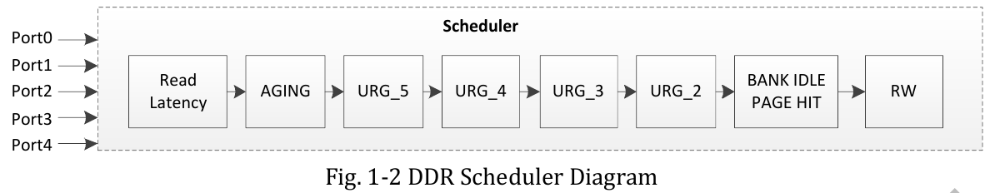
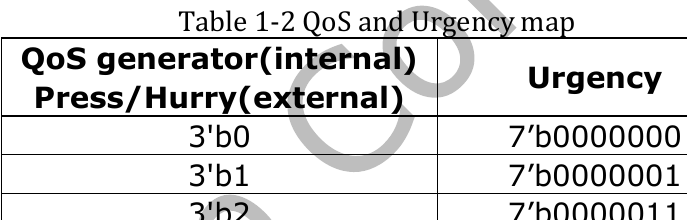
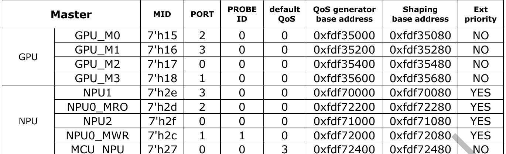

:tocdepth: 1

**********************************
Interconnect QoS và DDR controller
**********************************

.. admonition:: Trang này trả lời

   - Dữ liệu từ DDR đến NPU đi qua những khối nào?
   - QoS đặt ưu tiên cho NPU ở đâu, và có bao nhiêu tầng QoS khác nhau?
   - IOMMU của NPU có gì, TRM nói được bao nhiêu?
   - DDR controller giới hạn loại DRAM, số kênh và ánh xạ chân ra sao?
   - NPU có dùng DMAC của SoC không?

.. admonition:: Tóm tắt

   - Interconnect có 4 DDR scheduler để sắp xếp lại giao dịch và quản lý ưu tiên QoS cho IP thời gian thực [T1 TRM2 tr.16].
   - Mức QoS 3 bit được ánh xạ sang urgency 7 bit (Table 1-2). Ưu tiên chỉ có tác dụng đến scheduler, sau khi vào hàng đợi lệnh của DDRCTL thì lệnh chạy theo thứ tự [T1 TRM2 tr.17].
   - Bốn cổng master của NPU có default QoS 0 và Ext priority YES, MCU_NPU có default QoS 3 và Ext priority NO [T1 TRM2 tr.19].
   - Có ba tầng QoS khác nhau (BIU 3 bit, DDRCTL ``arqos``, trong IP NPU 2 bit) và TRM không nối chúng với nhau [T1 TRM2 tr.18, tr.173] [T1 TRM1 tr.2048].
   - TRM1 và TRM2 không mô tả thanh ghi IOMMU của NPU, nhưng DTS và driver khai báo rõ thiết bị ``rockchip,iommu-v2`` tại ``0xfdab9000`` với 4 vùng thanh ghi [T1 DTS dts/rk3588s.dtsi:3712-3722].
   - Bộ điều khiển hỗ trợ LPDDR4/4X/5, 4 kênh x 16-bit (tổng 64 bit, ứng với các nhóm chân ``DDR_CH0_*_A/B`` và ``DDR_CH1_*_C/D``) hoặc 2 kênh (32 bit), trần speed grade 4267 và 5500 Mbps [T1 TRM2 tr.55-56, tr.555-558] [T1 DS V1.7 tr.14].
   - Không có request nào của NPU trong danh sách DMAC. NPU tự đọc ghi bộ nhớ bằng AXI master và các khối DMA con của chính nó [T1 TRM1 tr.27, tr.1985].

.. contents:: Trong trang này
   :local:
   :depth: 1

Đường đi của một giao dịch bộ nhớ từ NPU: master NPU qua BIU (nơi đặt QoS), vào interconnect, đến DDR scheduler của kênh, qua một cổng AXI vào DDRCTL, qua DFI sang DDRPHY rồi tới chip DRAM. Loại DRAM, số kênh và giới hạn cấu hình thực ở :doc:`../04-bo-nho-hieu-nang/01-ddr-tren-rk3588`. Cách NPU dùng System SRAM ở :doc:`03-che-do-da-loi-va-system-sram`.

.. _sec-npu-interconnect-qos:

1. Interconnect và QoS
======================

1.1 Interconnect và DDR scheduler
---------------------------------

TRM2 mô tả tính năng của interconnect và 4 DDR scheduler (Channel0 ``0xFE000000``, Channel1 ``0xFE002000``, Channel2 ``0xFE004000``, Channel3 ``0xFE006000``, mỗi khối 8KB) [T1 TRM2 tr.16]:

   "Four embedded DDR schedulers for transaction reorder to maximum DDR efficiency" ... "Priority management for quality of service (QoS), especially for real-time IP" [T1 TRM2 tr.16]

   "The scheduler optimizes DRAM efficiency by choosing the best transaction to execute inside each port input queue: the scheduler can reorder requests across queues, and within a queue as long as they do not have conflicting addresses or ordering constraints." ... "an urgent read request may take precedence over less urgent write requests, even though there may be a global efficiency loss due to DRAM bus turnaround." [T1 TRM2 tr.16]

.. _fig-npu-interconnect-diagram:

.. figure:: ../../../_assets/img/02-nen-tang-rk3588/01-phan-cung-npu/duong-du-lieu-bus-iommu-ddr/trm2-fig1-1-interconnect-diagram.png
   :align: center
   :alt: Sơ đồ interconnect từ các master qua scheduler đến DDRCTL

   Sơ đồ interconnect: hàng master (CPU, GPU, NPU, VOP, ISP, master khác) vào interconnect, qua 4 scheduler đến 4 DDRCTL, SYSMEM và các slave khác. Nguồn: [T1 TRM2 tr.16, Fig. 1-1]

.. _fig-npu-ddr-scheduler:

   DDR scheduler với Port0 đến Port4 và các tiêu chí trọng tài: Read Latency, AGING, URG_5 đến URG_2, BANK IDLE PAGE HIT, RW. Nguồn: [T1 TRM2 tr.17, Fig. 1-2]

Hai tiêu chí trọng tài liên quan trực tiếp đến ưu tiên: ``AGING`` (ưu tiên các request vượt ngưỡng ``Aging(n)`` của cổng ``n``) và ``URG`` (ánh xạ mức QoS 3-bit sang ``Urgency`` 7-bit theo kiểu thang nhiệt kế từ ``0 -> 0000000`` đến ``7 -> 1111111`` trong Table 1-2) [T1 TRM2 tr.17].

.. _fig-npu-qos-urgency-map:

   Table 1-2: ánh xạ mức QoS 3 bit sang Urgency 7 bit (cột ghi "QoS generator(internal) / Press/Hurry(external)"). Nguồn: [T1 TRM2 tr.17, Table 1-2]

Do bộ trọng tài chỉ xét bốn tầng ``URG5, URG4, URG3, URG2`` (Fig. 1-2), mức QoS 1 (``0000001``) không bật tầng nào nên các giá trị hiệu lực trong scheduler là ``0, 2, 3, 4`` và ``5`` (văn bản TRM2 tr.20 ghi nhầm tham chiếu "Table1-1" thay vì Table 1-2) [T1 TRM2 tr.17, tr.20]. Lưu ý giới hạn của QoS tại DDRCTL:

   "although the high priority request will be sent to DDR controller first, it does not mean that it can be served by DDR immediately. The request in DDR controller command queue will be executed in order taking no account of priority." [T1 TRM2 tr.17]

1.2 QoS generator và Ext priority
---------------------------------

Mỗi master có một BIU (bus interface unit) chứa QoS generator (khi cấu hình thanh ghi QoS generator của một BIU thì clock của BIU đó phải đang bật) [T1 TRM2 tr.18]:

.. _tbl-npu-master-biu:

.. list-table:: Các master BIU của NPU (rút từ Table 1-3) [T1 TRM2 tr.19]
   :header-rows: 1
   :widths: 13 10 8 10 11 14 14 10

   * - Master
     - MID
     - PORT
     - PROBE ID
     - default QoS
     - QoS generator base
     - Shaping base
     - Ext priority
   * - NPU1
     - 7'h2e
     - 3
     - 0
     - 0
     - 0xfdf70000
     - 0xfdf70080
     - YES
   * - NPU0_MRO
     - 7'h2d
     - 2
     - 0
     - 0
     - 0xfdf72200
     - 0xfdf72280
     - YES
   * - NPU2
     - 7'h2f
     - 0
     - 0
     - 0
     - 0xfdf71000
     - 0xfdf71080
     - YES
   * - NPU0_MWR
     - 7'h2c
     - 1
     - 1
     - 0
     - 0xfdf72000
     - 0xfdf72080
     - YES
   * - MCU_NPU
     - 7'h27
     - 0
     - 0
     - 3
     - 0xfdf72400
     - 0xfdf72480
     - NO

.. _fig-npu-master-biu-table:

   Table 1-3, trích hàng GPU và NPU. Nguồn: [T1 TRM2 tr.19, Table 1-3]

Trong Table 1-3, các cổng tính toán của NPU và GPU_M0..M3 đều có default QoS 0, thấp hơn VOP_M0/M1 (2), MCU_NPU (3), USB/EMMC/DMAC1/DMAC2 (4) và HDCP0/1 (5) [T1 TRM2 tr.18-19]. Cột ``Ext priority = YES`` cho biết BIU có tín hiệu ưu tiên ngoài (``Press/Hurry``) từ IP để nâng độ ưu tiên động khi ``ExtControl = 0x1`` (``SocketQosEn = 1``), khi đó interconnect chọn mức cao hơn giữa thanh ghi nội bộ và tín hiệu ngoài [T1 TRM2 tr.19-20, tr.28].

1.3 Thanh ghi QoS và ba tầng QoS
--------------------------------

QoS generator có hai thanh ghi định danh (``Id_CoreId`` tại ``0x0000``, ``Id_RevisionId`` tại ``0x0004``) và 5 thanh ghi điều khiển [T1 TRM2 tr.27-28]:

.. list-table:: Thanh ghi điều khiển QoS generator [T1 TRM2 tr.27-28]
   :header-rows: 1
   :widths: 28 10 14 48

   * - Thanh ghi
     - Offset
     - Reset
     - Mô tả
   * - ``QoSGenerator_Priority``
     - 0x0008
     - 0x80000000
     - ``P1 [10:8]`` (HIGH hurry ở Regulator, hoặc READ urgency ở Fixed/Limiter), ``P0 [2:0]`` (LOW hurry hoặc WRITE urgency)
   * - ``QoSGenerator_Mode``
     - 0x000C
     - 0x00000003
     - ``[1:0]``: ``00`` Fixed, ``01`` Limiter, ``10`` Bypass, ``11`` Regulator
   * - ``QoSGenerator_Bandwidth``
     - 0x0010
     - 0x00000000
     - Ngưỡng băng thông ``[12:0]`` tính theo đơn vị ``1/256`` byte mỗi chu kỳ clock BIU
   * - ``QoSGenerator_Saturation``
     - 0x0014
     - 0x00000040
     - Cửa sổ đo ``[9:0]`` theo đơn vị 16 byte
   * - ``QoSGenerator_ExtControl``
     - 0x0018
     - 0x00000000
     - bit 3 ``ExtLimitEn``, bit 2 ``IntClkEn``, bit 1 ``ExtThrEn``, bit 0 ``SocketQosEn``

Ba tầng QoS xuất hiện độc lập trong tài liệu phần cứng:

.. list-table:: Ba tầng QoS
   :header-rows: 1
   :widths: 24 16 36 24

   * - Tầng
     - Độ rộng
     - Vai trò
     - Nguồn
   * - QoS generator trong BIU
     - 3 bit
     - Đặt ưu tiên của request, ánh xạ sang urgency 7 bit cho DDR scheduler
     - [T1 TRM2 tr.17-18]
   * - ``arqos`` ở cổng AXI DDRCTL
     - 0..13 hoặc 14
     - ``rqos_map_level1`` chia vùng, ``rqos_map_region`` chọn LPR (0), VPR (1) hoặc HPR (2)
     - [T1 TRM2 tr.173-174]
   * - QoS đọc trong IP NPU
     - 2 bit/trường
     - ``RKNN_ddma/sdma_cfg_dma_rd_qos`` (``0x8020``/``0x9020``) đặt ``rd_pc/ppu/dpu/kernel/feature_qos``
     - [T1 TRM1 tr.1993, tr.2048]

1.4 Shaping và Probe đo băng thông
----------------------------------

Trong interconnect còn có hai cơ chế giám sát và điều tiết lưu lượng [T1 TRM2 tr.20, tr.29, tr.54]:

- **Shaping:** giới hạn số gói đang chờ giữa master và scheduler qua thanh ghi ``Shaper_NbPktMax0`` (offset ``0x0008``, ``[7:0]``, reset ``0xFF`` tức 255 gói) tại địa chỉ ``Shaping base`` ở Table 1-3 [T1 TRM2 tr.19-20, tr.29].
- **Probe:** 12 bộ probe đo thống kê lưu lượng DDR scheduler. Để đếm số byte payload của một master, đặt ``Counters_0_Src = 0x14`` (``FILT_BYTE``), ``Filters_0_usebase = MID`` (ví dụ ``7'h2e`` cho NPU1), ``Filters_0_opcode = 0xf``, ``Filters_0_status = 0x3``, ``Filters_0_length = 0xf`` và ``Filters_0_usemask = 0x7f`` [T1 TRM2 tr.20, tr.54].

.. _sec-npu-iommu:

2. IOMMU của NPU
================

TRM1 và TRM2 chỉ liệt kê các khối ``MMU600PCIE_TCU`` (``7'h29``), ``MMU600PHP_TBU`` (``7'h2a``) và ``MMU600PHP_TCU`` (``7'h2b``) của phân hệ PCIe/PHP [T1 TRM2 tr.19], không in bảng thanh ghi của khối IOMMU gắn với NPU. Cấu hình phần cứng và cách điều khiển IOMMU của NPU được xác định trực tiếp từ DTS và mã nguồn driver ``rknpu`` 0.9.8:

.. list-table:: Cấu hình IOMMU của NPU trong DTS và driver 0.9.8
   :header-rows: 1
   :widths: 56 44

   * - Nội dung
     - Nguồn
   * - Nút NPU trỏ tới IOMMU: ``iommus = <&rknpu_mmu>;``
     - [T1 DTS dts/rk3588s.dtsi:3478]
   * - ``rknpu_mmu: iommu@fdab9000``, ``compatible = "rockchip,iommu-v2"``, bốn vùng ``reg`` (``0xfdab9000``, ``0xfdaba000``, ``0xfdaca000``, ``0xfdada000``, mỗi vùng ``0x100``), ngắt ``npu0_mmu``, ``npu1_mmu``, ``npu2_mmu``
     - [T1 DTS dts/rk3588s.dtsi:3712-3722]
   * - Driver quản lý tối đa 16 domain: ``RKNPU_MAX_IOMMU_DOMAIN_NUM 16``, cùng cờ ``iommu_en`` và mảng ``iommu_domains``
     - [T1 DRV include/rknpu_drv.h:56, 133, 172-177]
   * - Cờ bộ nhớ ``RKNPU_MEM_IOMMU = 1 << 4`` ("IOMMU mapping"), ioctl ``RKNPU_GET_IOMMU_EN``, ``RKNPU_GET_IOMMU_DOMAIN_ID``, ``RKNPU_SET_IOMMU_DOMAIN_ID``
     - [T1 DRV include/rknpu_ioctl.h:65-66, 129-136] [T1 DRV rknpu_drv.c:483-492]

.. _sec-npu-ddr-controller:

3. DDR controller
=================

Chi tiết loại DRAM, tốc độ PHY và trần băng thông lý thuyết nằm ở :doc:`../04-bo-nho-hieu-nang/01-ddr-tren-rk3588`. Mục này tóm tắt cấu hình kênh, ánh xạ chân vật lý và cổng AXI của DDRCTL:

- **Cấu hình kênh và địa chỉ:** hỗ trợ 4 kênh interleave (tổng 64 bit, tối đa 32GB, ``CENTER_GRF_CON4[8:4] = 5'b0000``) hoặc 2 kênh (32 bit, tối đa 16GB) [T1 TRM2 tr.20, tr.55]. Khi không interleave với ``CENTER_GRF_CON4[8:4] = 5'b00000`` (Table 1-5), 4 kênh (mỗi kênh 8GB) nằm tại ``0x0_0000_0000``, ``0x2_0000_0000``, ``0x4_0000_0000`` và ``0x6_0000_0000`` [T1 TRM2 tr.20-21]. Việc băm địa chỉ interleave dùng các thanh ghi ``SGRF_DDR_HASH_CON0..7``, ``DDR_BANK_HASH_CTRL`` và ``DDR_RANK_MASK0`` trong ``DSU_SGRF`` (cho DSU) và ``BUS_SGRF`` (cho các master khác) [T1 TRM2 tr.54].
- **Ánh xạ 4 kênh logic sang tên chân vật lý:** mục ``2.5 Interface Description`` (Table 2-1 đến Table 2-4) của TRM2 ánh xạ trực tiếp 4 kênh 16-bit (``Quad-channel x16bit`` [T1 DS V1.7 tr.14]) sang ký hiệu chân trên vỏ chip [T1 TRM2 tr.555-558] [T1 DS V1.7 tr.19-29] [T1 DS V1.3 pdf 18-28]:

  - ``DDR Channel 0`` -> nhóm chân ``DDR_CH0_*_A`` (``DDR_CH0_DQ0_A..DQ15_A``, ``DDR_CH0_CK_A``, ...) [T1 TRM2 tr.555-556].
  - ``DDR Channel 1`` -> nhóm chân ``DDR_CH0_*_B`` (``DDR_CH0_DQ0_B..DQ15_B``, ``DDR_CH0_CK_B``, ...) [T1 TRM2 tr.556-557].
  - ``DDR Channel 2`` -> nhóm chân ``DDR_CH1_*_C`` (``DDR_CH1_DQ0_C..DQ15_C``, ``DDR_CH1_CK_C``, ...) [T1 TRM2 tr.557-558].
  - ``DDR Channel 3`` -> nhóm chân ``DDR_CH1_*_D`` (``DDR_CH1_DQ0_D..DQ15_D``, ``DDR_CH1_CK_D``, ...) [T1 TRM2 tr.558].

- **Cổng AXI và QoS tại DDRCTL:** mỗi DDRCTL có một cổng AXI nhận giao dịch từ ``DDRSCH0~3`` (qua module Scramble mặc định bypass), lưu dữ liệu đọc vào SRAM read re-order buffer để trả về đúng thứ tự, và bật cổng bằng ``DDRCTL_PCTRL.port_en = 1'b1`` (``0x20090``) [T1 TRM2 tr.56-57, tr.173, tr.559]. Thanh ghi ``DDRCTL_PCFGQOS0`` (``0x20094``) và ``DDRCTL_PCFGWQOS0/1`` (``0x2009C``, ``0x200A0``) phân vùng ``arqos``/``awqos`` sang LPR/VPR/HPR, còn bit 13 ``rd_port_urgent_en`` của ``DDRCTL_PCFGR`` cho phép dùng tín hiệu sideband ``arurgent`` [T1 TRM2 tr.171, tr.173-174]. Phía scheduler cấu hình loại DRAM qua ``DDRSCH_DeviceConf`` (``0x0008``), ``DDRSCH_DeviceSize`` (granule 64MB) và ``DDRSCH_DdrMode`` (``MwrSize``, ``BurstSize``) [T1 TRM2 tr.22, tr.25].

4. DMA của NPU
==============

SoC có ba bộ ``DMAC0/1/2`` (master ``7'h08..7'h0a``, cùng ``DMA2DDR`` ``7'h07`` trong Table 1-3 [T1 TRM2 tr.19]), nhưng danh sách request ngoại vi (Table 1-4 và Table 12-1) chỉ phục vụ I2S, PDM, SPDIF, UART, SPI, PWM, CAN và ``sdmmc_buffer`` [T1 TRM1 tr.27, tr.1314]. NPU không dùng DMAC của SoC mà tự truy cập bộ nhớ qua giao diện AXI master và các khối DMA nội bộ (PC fetch, CNA, DPU_RDMA, PPU_RDMA, DDMA, SDMA) [T1 TRM1 tr.1984-1986].

Hai khối ``DDMA`` (``0x8000``) và ``SDMA`` (``0x9000``) có cùng cấu trúc thanh ghi điều khiển giao dịch AXI [T1 TRM1 tr.2046-2049]:

.. list-table:: Thanh ghi DMA của NPU (offset tính từ ``0x8000`` hoặc ``0x9000``) [T1 TRM1 tr.2046-2048]
   :header-rows: 1
   :widths: 30 10 40 20

   * - Thanh ghi
     - Offset
     - Nội dung
     - Nguồn
   * - ``cfg_outstanding``
     - 0x00
     - ``wr_os_cnt [15:8]``, ``rd_os_cnt [7:0]``: số giao dịch outstanding tối đa
     - [T1 TRM1 tr.2046]
   * - ``rd_weight_0`` / ``rd_weight_1``
     - 0x04 / 0x10
     - Trọng số burst đọc của PPU, DPU, kernel, feature (``0x04``) và của PC (``0x10``)
     - [T1 TRM1 tr.2046-2047]
   * - ``cfg_dma_arb``
     - 0x18
     - ``wr_arbit_model``, ``rd_arbit_model``, ``wr_fix_arb``, ``rd_fix_arb``
     - [T1 TRM1 tr.2047]
   * - ``cfg_dma_rd_qos``
     - 0x20
     - QoS đọc 2-bit theo từng đường (PC, PPU, DPU, kernel, feature)
     - [T1 TRM1 tr.2048]
   * - ``cfg_dma_rd_cfg`` / ``wr_cfg``
     - 0x24 / 0x28
     - Tham số AXI: ``arcache``, ``arprot``, ``arburst``, ``arsize`` và các trường ``aw*``
     - [T1 TRM1 tr.2048]

Độ dài burst AXI của CNA được cấu hình thêm ở ``RKNN_cna_dma_con0`` (``0x1078``) với ``weight_burst_len`` và ``data_burst_len`` (``4'd3`` = burst 4, ``4'd7`` = burst 8, ``4'd15`` = burst 16) [T1 TRM1 tr.2007].

5. Hiểu sai thường gặp
======================

.. list-table::
   :header-rows: 1
   :widths: 28 50 22

   * - Hiểu sai
     - Thực tế theo nguồn
     - Nguồn
   * - Đặt QoS cao là NPU được phục vụ ngay.
     - Request ưu tiên cao vào DDRCTL trước, nhưng hàng đợi lệnh của DDRCTL chạy theo thứ tự, không xét ưu tiên.
     - [T1 TRM2 tr.17]
   * - QoS của NPU là một giá trị duy nhất.
     - Có ba tầng độc lập: BIU 3 bit, ``arqos`` của DDRCTL và QoS đọc 2 bit trong IP NPU.
     - [T1 TRM2 tr.18, tr.173] [T1 TRM1 tr.2048]
   * - RK3588 chỉ có 2 kênh DDR vì tên chân là ``DDR_CH0`` và ``DDR_CH1``.
     - Mỗi nhóm chia thành hai kênh 16-bit độc lập: ``DDR_CH0_*_A/B`` là Channel 0/1 và ``DDR_CH1_*_C/D`` là Channel 2/3 (tổng 4 kênh x 16-bit = 64 bit).
     - [T1 TRM2 tr.555-558] [T1 DS V1.7 tr.14]
   * - DDR của RK3588 có thể là DDR3 hoặc DDR4.
     - Mô tả PHY có nhắc DDR3/DDR4, nhưng tính năng DMC và datasheet chỉ hỗ trợ LPDDR4/4X/5.
     - [T1 TRM2 tr.55-56]
   * - NPU chuyển dữ liệu bằng DMAC của SoC.
     - Table 1-4 và Table 12-1 không có request của NPU. NPU dùng AXI master và các khối DMA con của chính nó.
     - [T1 TRM1 tr.27, tr.1985]
   * - Tham chiếu "Table1-1" ở TRM2 tr.20 là bảng địa chỉ scheduler.
     - Câu đó nói về giá trị URG, bảng đúng là Table 1-2 (tr.17).
     - [T1 TRM2 tr.17, tr.20]

Nguồn
=====

.. list-table::
   :header-rows: 1
   :widths: 14 8 68 10

   * - Nhãn
     - Tier
     - Tệp
     - Số lần
   * - ``TRM1``
     - T1
     - :download:`rk3588_part1.pdf <../../../_assets/pdf/datasheet/trm/rk3588_part1.pdf>` (số trang in bằng số trang PDF)
     - 15
   * - ``TRM2``
     - T1
     - :download:`rk3588_part2.pdf <../../../_assets/pdf/datasheet/trm/rk3588_part2.pdf>` (số trang in bằng số trang PDF)
     - 44
   * - ``DS V1.7``
     - T1
     - :download:`Rockchip_RK3588S_Datasheet_V1.7.pdf <../../../_assets/pdf/datasheet/soc/Rockchip_RK3588S_Datasheet_V1.7.pdf>` (trang in)
     - 4
   * - ``DS V1.3``
     - T1
     - :download:`Rockchip_RK3588_Datasheet_V1.3_20220328.pdf <../../../_assets/pdf/datasheet/soc/Rockchip_RK3588_Datasheet_V1.3_20220328.pdf>` (số trang PDF)
     - 1
   * - ``DRV``
     - T1
     - ``3rdparty/rknpu-driver-0.9.8/`` (commit f6eedab0 theo SOURCE.txt)
     - 3
   * - ``DTS``
     - T1
     - ``3rdparty/rknpu-driver-0.9.8/dts/rk3588s.dtsi``
     - 3
