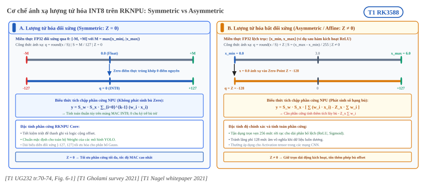
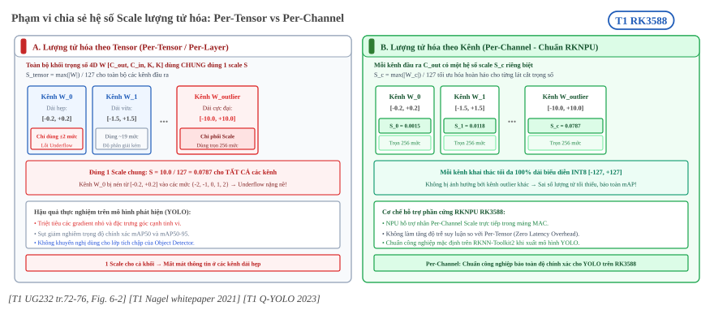
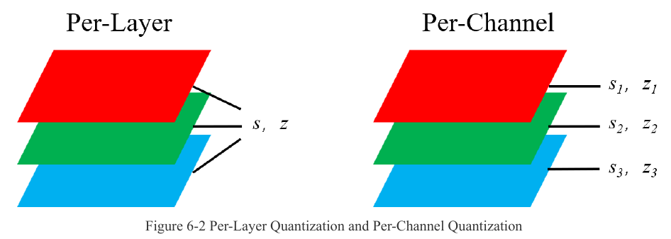

:tocdepth: 1

*************************************
Kiểu dữ liệu và cấu hình lượng tử hóa
*************************************

.. admonition:: Trang này trả lời

   - RKNN-Toolkit2 lượng tử hóa theo kiểu nào, và RK3588 dùng được kiểu và thuật toán nào?
   - Tham số nào của ``rknn.config()`` và ``rknn.build()`` tác động đến kết quả lượng tử hóa?
   - Trường hợp nào chọn giá trị nào?

.. admonition:: Tóm tắt

   - Trong tài liệu API, chỉ ``w8a8`` không ghi giới hạn chip, các kiểu ``w4a16``, ``w8a16``, ``w16a16i``, ``w16a16i_dfp`` ghi chip khác và ``w4a8`` ghi "Not supported yet" [T1 API232 tr.7].
   - UG232 nói hẹp hơn: chỉ hỗ trợ INT8 tuyến tính bất đối xứng, mặc định ``asymmetric_quantized-8`` [T1 UG232 tr.22] [T1 UG232 tr.122]. Hai tài liệu không mâu thuẫn về ý nghĩa nhưng khác tên giá trị.
   - Thuật toán chọn khoảng lượng tử hóa: ``normal`` (mặc định), ``mmse``, ``kl_divergence``. ``gdq`` chỉ hợp lệ với ``w4a16`` và ``w8a16`` [T1 API232 tr.8].
   - Per-channel chỉ áp dụng cho weight, activation luôn per-layer [T1 UG232 tr.120]. Mặc định ``quantized_method`` là ``channel`` [T1 API232 tr.8].
   - ``mean_values``, ``std_values`` được gộp vào model và ảnh calibration được chuẩn hóa trước khi lượng tử hóa [T1 UG232 tr.22] [T1 UG232 tr.132]. ``quant_img_RGB2BGR`` chỉ có tác dụng lúc đọc ảnh calibration [T1 API232 tr.7].
   - Khi không lượng tử hóa, simulator tính bằng FP16 vì RKNPU không hỗ trợ FP32 [T1 UG232 tr.131].
   - Mặc định ``do_quantization`` là ``True`` theo API232 và ``False`` theo UG232 [T1 API232 tr.14] [T1 UG232 tr.122]. Nên luôn truyền tường minh.

.. contents:: Trong trang này
   :local:
   :depth: 1

.. _kieu-thuat-toan-luong-tu-hoa:

1. Kiểu và thuật toán lượng tử hóa RK3588 hỗ trợ
================================================

Nền. Lượng tử hóa đổi số thực sang số nguyên bằng scale và zero-point. Phần lý thuyết (công thức affine, đối xứng và bất đối xứng, granularity) nằm ở :doc:`../../01-kien-thuc-nen/03-luong-tu-hoa/01-luong-tu-hoa-affine-va-granularity` và không nhắc lại ở đây. Trang này chỉ trả lời toolkit của Rockchip cho chọn những gì.

1.1 Kiểu dữ liệu ``quantized_dtype``
------------------------------------

API232 liệt kê sáu giá trị cho ``quantized_dtype`` và gắn mỗi giá trị với chip được hỗ trợ:

   "w8a8: The weight is 8bit asymmetric quantitative accuracy, and the activation value is 8bit asymmetric quantitative accuracy. (RK2118 not supported)" [T1 API232 tr.7]

.. list-table:: Các giá trị ``quantized_dtype`` theo API232
   :header-rows: 1
   :widths: 14 38 28 20

   * - Giá trị
     - Weight và activation
     - Ghi chú chip trong nguồn
     - Dùng cho RK3588 (suy ra)
   * - ``w8a8``
     - weight INT8 bất đối xứng, activation INT8 bất đối xứng
     - "RK2118 not supported"
     - Có
   * - ``w4a16``
     - weight 4-bit bất đối xứng, activation số thực 16-bit
     - "Only RK3576/RV1126B supported"
     - Không
   * - ``w8a16``
     - weight 8-bit bất đối xứng, activation số thực 16-bit
     - "Only RK3562 supported"
     - Không
   * - ``w4a8``
     - weight 4-bit, activation 8-bit bất đối xứng
     - "Not supported yet"
     - Không
   * - ``w16a16i``
     - weight và activation 16-bit bất đối xứng
     - "Only RV1103/RV1106 supported"
     - Không
   * - ``w16a16i_dfp``
     - weight và activation 16-bit dynamic fixed-point
     - "Only RV1103/RV1106 supported"
     - Không

Nguồn của bảng: [T1 API232 tr.7]. Cột cuối là suy ra: RK3588 không nằm trong danh sách chip của năm giá trị còn lại, còn ``w8a8`` chỉ loại trừ RK2118. API232 không có câu nào nói thẳng "RK3588 hỗ trợ w8a8".

UG232 mô tả hẹp hơn, chỉ nêu một kiểu: INT8 tuyến tính bất đối xứng, mặc định ``asymmetric_quantized-8`` [T1 UG232 tr.22]. Chương lượng tử hóa của UG232 cũng ghi "RKNN-Toolkit2 supports INT8 as the quantization data type." [T1 UG232 tr.121]. Hai tài liệu khác nhau ở tên giá trị (``w8a8`` so với ``asymmetric_quantized-8``) và độ rộng danh sách. Nguồn không giải thích chênh lệch này (unknown. Đã tìm ở: API232 tr.7, UG232 tr.22, 121, 122, từ khóa: ``asymmetric_quantized``, ``w8a8``).

Hình dưới là minh họa của hãng cho hai kiểu. Ở kiểu đối xứng, zero-point nằm đúng tâm của dải số nguyên (INT8 thì bằng 0). Ở kiểu bất đối xứng, zero-point tính từ min và max nên thường lệch khỏi tâm [T1 UG232 tr.120].

.. _fig-quant-symm-asymm:

   Cơ chế ánh xạ lượng tử hóa INT8: Symmetric (Z = 0, tối ưu mảng MAC NPU không cần cộng offset) và Asymmetric (Z ≠ 0, bảo toàn dải động phân bố lệch như ReLU). Nguồn: [T1 UG232 tr.70-74, Fig. 6-1].

.. _fig-ug232-doi-xung:

.. figure:: ../../../_assets/img/02-nen-tang-rk3588/02-rknn-luong-tu-hoa/kieu-du-lieu-va-cau-hinh-luong-tu-hoa/ug232-fig6-1-symmetric-vs-asymmetric.png
   :align: center
   :alt: Lượng tử hóa tuyến tính đối xứng và bất đối xứng

   Khoảng số thực ở trên được ánh xạ đều xuống dải số nguyên ở dưới. Đối xứng lấy khoảng từ -max(x) đến max(x), bất đối xứng lấy khoảng từ min(x) đến max(x) (hình in nhãn -min(x)). Nguồn: [T1 UG232 tr.120, Figure 6-1]

1.2Thuật toán ``quantized_algorithm``
--------------------------------------

Thuật toán quyết định cách chọn khoảng giá trị (min, max) trước khi tính scale và zero-point [T1 UG232 tr.120]. API232 liệt kê bốn giá trị, UG232 chỉ ba.

.. list-table:: Thuật toán lượng tử hóa trong toolkit
   :header-rows: 1
   :widths: 16 40 28 16

   * - Thuật toán
     - Cách chọn khoảng
     - Tốc độ và số ảnh khuyến nghị
     - Nguồn
   * - ``normal``
     - Lấy trực tiếp max và min của số thực. Không có lỗi truncation nhưng nhạy với outlier
     - Nhanh. Khoảng 20 đến 100 ảnh
     - [T1 UG232 tr.121] [T1 API232 tr.8]
   * - ``mmse``
     - Cực tiểu hóa sai số bình phương giữa số thực và số đã lượng tử hóa rồi giải lượng tử
     - Chậm hơn và tốn bộ nhớ hơn. Khoảng 20 đến 50 ảnh
     - [T1 UG232 tr.121] [T1 API232 tr.8]
   * - ``kl_divergence``
     - Cực tiểu hóa KL divergence giữa phân phối số thực và số nguyên
     - Chậm hơn ``normal``, nhanh hơn ``mmse``. Khoảng 20 đến 100 ảnh
     - [T1 UG232 tr.121] [T1 API232 tr.8]
   * - ``gdq``
     - Không mô tả cách chọn khoảng
     - Khuyến nghị hơn 200 ảnh
     - [T1 API232 tr.8]

Điều kiện của ``gdq`` là then chốt cho RK3588:

   "The gdq quantization algorithm is only valid at w4a16 and w8a16, which can effectively improve the weight accuracy of the w4a16 and w8a16." [T1 API232 tr.8]

Suy ra: ``w4a16`` và ``w8a16`` không dùng cho RK3588 (mục 1.1) nên ``gdq`` cũng không dùng được trên RK3588. Ba thuật toán còn lại là phạm vi thực tế.

Số bin của histogram, cách cắt (clipping) và công thức chi tiết của ba thuật toán là unknown. Đã tìm ở: UG232 tr.119 đến 121 (công thức là hình ảnh, không có text), API232 tr.8, từ khóa: ``bin``, ``clip``, ``percentile``.

1.3 Granularity ``quantized_method``
------------------------------------

API232 cho ba giá trị: ``layer``, ``channel`` (mặc định) và ``group{SIZE}``. Với ``group{SIZE}``, mỗi output channel của weight được chia thành các nhóm theo input channel, ``{SIZE}`` là bội của 32 từ 32 đến 256, và chỉ hợp lệ khi ``quantized_dtype = w4a16`` [T1 API232 tr.8]. UG232 chỉ liệt kê ``layer`` và ``channel`` [T1 UG232 tr.22].

   "Note: In RKNN-Toolkit2, Per-Channel quantization is only applied to the weights, while the activation values and intermediate values are still quantized using Per-Layer quantization." [T1 UG232 tr.120]

.. _fig-quant-per-tensor-channel:

   Phạm vi chia sẻ hệ số scale: Per-Tensor (1 scale toàn khối, dễ bị chi phối bởi outlier) và Per-Channel (mỗi channel 1 scale độc lập, chuẩn bảo toàn mAP cho YOLO trên RKNN). Nguồn: [T1 UG232 tr.72-76, Fig. 6-2].

.. _fig-ug232-per-layer-channel:

   Per-layer: các channel dùng chung một cặp (s, z). Per-channel: mỗi channel có cặp riêng (s1, z1), (s2, z2), (s3, z3). Nguồn: [T1 UG232 tr.120, Figure 6-2]

Hệ quả: ``quantized_method`` chỉ đổi cách lượng tử hóa weight. Activation luôn dùng một cặp (scale, zero-point) cho cả tensor. Suy ra: ``group{SIZE}`` không dùng cho RK3588 vì đòi ``w4a16``.

Operator List của RK3588 khớp với điều này. Với Convolution, weight hỗ trợ "per‑layer" và "per‑channel", còn input và output chỉ "per‑layer" [T1 OPL tr.58] [T1 OPL tr.59]. Kiểu dữ liệu ghi là ``int8(Tensor), float16(Tensor)`` [T1 OPL tr.59].

1.4 Khi không lượng tử hóa
--------------------------

   "RKNPU currently does not support FP32 calculations, so the simulator defaults to FP16 computation when quantization is not enabled." [T1 UG232 tr.131]

``float_dtype`` chỉ nhận ``float16`` và mặc định ``float16`` [T1 API232 tr.8]. FP16 có dải ±65504, tensor vượt dải này bị overflow và cho kết quả bất thường [T1 UG232 tr.133]. Kiểu số FP16 và INT8 nói chung xem :doc:`../../01-kien-thuc-nen/01-nen-tang-ai/02-tensor-va-kieu-du-lieu`.

.. _tham-so-config-luong-tu-hoa:

2. Tham số config ảnh hưởng lượng tử hóa
========================================

UG232 chia việc theo hai hàm: cấu hình phương pháp lượng tử hóa nằm ở ``rknn.config()``, còn công tắc lượng tử hóa và đường dẫn tập calibration nằm ở ``rknn.build()`` [T1 UG232 tr.122].

Trình tự gọi: ``rknn.config(...)``, ``rknn.load_*``, ``rknn.build(do_quantization=..., dataset=...)`` [T1 API232 tr.14] [T1 API232 tr.15].

2.1 Nhóm tham số chuẩn hóa đầu vào
----------------------------------

.. list-table:: Tham số chuẩn hóa đầu vào của ``rknn.config()``
   :header-rows: 1
   :widths: 22 52 26

   * - Tham số
     - Ý nghĩa và mặc định
     - Nguồn
   * - ``mean_values``
     - Danh sách con theo từng input, độ dài bằng số channel. ``[[128,128,128]]`` nghĩa là trừ 128 ở ba channel. Mặc định ``None`` (mean bằng 0)
     - [T1 API232 tr.6]
   * - ``std_values``
     - Cùng định dạng. Giá trị trừ mean rồi chia cho số này. Mặc định ``None`` (std bằng 1)
     - [T1 API232 tr.6]
   * - ``quant_img_RGB2BGR``
     - Đổi RGB sang BGR trước khi nạp ảnh calibration. Mặc định ``False``. Chỉ hiệu lực với ảnh jpg, png, bmp, bị bỏ qua với file npy
     - [T1 API232 tr.7]

Vai trò của ``mean_values`` và ``std_values``: giá trị này được dùng trong quá trình lượng tử hóa, và lúc suy luận bằng C API ảnh không cần trừ mean và chia std nữa [T1 UG232 tr.22]. Khi bật lượng tử hóa, ảnh trong tập calibration được chuẩn hóa trước [T1 UG232 tr.132]. Vì vậy hai tham số này phải trùng với phép chuẩn hóa dùng lúc huấn luyện. Nếu sai, khoảng giá trị activation tính từ calibration lệch so với dữ liệu thật.

``quant_img_RGB2BGR`` có phạm vi hẹp hơn:

   "This configuration is only used to read the quantize image in the quantization stage (build interface) or in quantitative accuracy analysis (accuracy_analysis interface), and will not be recorded in the final RKNN model." [T1 API232 tr.7]

Do đó dữ liệu đưa vào lúc suy luận phải tự đúng thứ tự kênh [T1 API232 tr.7]. Khi bật ``quant_img_RGB2BGR=True``, thứ tự thực hiện là đổi RGB sang BGR trước rồi mới tới mean và std [T1 UG232 tr.22]. Tham số này phải khớp thứ tự kênh của ảnh huấn luyện, cấu hình sai có thể làm giảm mạnh độ chính xác lượng tử hóa [T1 UG232 tr.133].

2.2 Nhóm tham số lượng tử hóa
-----------------------------

.. list-table:: Tham số trực tiếp điều khiển lượng tử hóa
   :header-rows: 1
   :widths: 20 12 40 28

   * - Tham số
     - Hàm
     - Giá trị và mặc định
     - Nguồn
   * - ``quantized_dtype``
     - config
     - Mục 1.1. Mặc định ``w8a8`` (API232)
     - [T1 API232 tr.7]
   * - ``quantized_algorithm``
     - config
     - Mục 1.2. Mặc định ``normal``
     - [T1 API232 tr.8]
   * - ``quantized_method``
     - config
     - Mục 1.3. Mặc định ``channel``
     - [T1 API232 tr.8]
   * - ``float_dtype``
     - config
     - ``float16``, kiểu số khi không lượng tử hóa
     - [T1 API232 tr.8]
   * - ``do_quantization``
     - build
     - Bật tắt lượng tử hóa. API232 ghi mặc định ``True``
     - [T1 API232 tr.14]
   * - ``dataset``
     - build
     - File văn bản, mỗi dòng một đường dẫn jpg, png hoặc npy. Nhiều input thì các file trên cùng dòng cách nhau bằng dấu cách
     - [T1 API232 tr.14]
   * - ``auto_hybrid``
     - build
     - Mặc định ``False``. Bật thì op có cosine distance hoặc euclidean distance thấp hơn ngưỡng được chuyển sang FP16 (hiện chỉ cho ``w8a8``)
     - [T1 API232 tr.14]
   * - ``auto_hybrid_cos_thresh``
     - config
     - Ngưỡng cosine distance, mặc định 0.98
     - [T1 API232 tr.10]
   * - ``auto_hybrid_euc_thresh``
     - config
     - Ngưỡng euclidean distance, mặc định ``None`` (không bật)
     - [T1 API232 tr.10]

Hai tài liệu mâu thuẫn ở mặc định của ``do_quantization``:

   "do_quantization: Specify whether to enable quantization, with the default value being 'False'." [T1 UG232 tr.122]

API232 ghi "do_quantization: Whether to quantize the model. The default value is True." [T1 API232 tr.14]. UG232 tr.131 và tr.133 đều gọi ``rknn.build()`` với ``do_quantization`` đặt tường minh. Nguồn không cho biết giá trị mặc định nào đúng với bản 2.3.2 (unknown. Đã tìm ở: API232 tr.14, 15, UG232 tr.122, 131, 133, từ khóa: ``do_quantization``). Cách an toàn là truyền giá trị tường minh.

Về cỡ tập calibration, API232 khuyến nghị theo từng thuật toán (mục 1.2), UG232 nói chung 20 đến 200 ảnh và cho biết tăng số ảnh làm lâu hơn nhưng chưa chắc chính xác hơn [T1 UG232 tr.122]. Cách chuẩn bị file và chọn ảnh xem :doc:`02-tap-calibration-va-quy-trinh-qat`. Hybrid thủ công và ``auto_hybrid`` xem :doc:`03-hybrid-quantization-va-accuracy-analysis`.

Nhóm này còn tham số ``quantize_weight``: khi ``do_quantization`` là ``False``, lượng tử hóa một phần weight để giảm kích thước file, mặc định ``False`` [T1 API232 tr.9]. UG232 mô tả tương tự cho khóa YAML cùng tên [T1 UG232 tr.27]. Tham số ``quantized_hybrid_level`` không có trong API232 và UG232 (unknown. Đã tìm ở: api232, ug232, từ khóa: ``quantized_hybrid_level``).

2.3 Nhóm tham số tối ưu
-----------------------

Nhóm này không đổi thuật toán lượng tử hóa nhưng đổi đồ thị trước khi lượng tử hóa nên ảnh hưởng độ chính xác.

.. list-table:: Tham số tối ưu và đích chip
   :header-rows: 1
   :widths: 22 52 26

   * - Tham số
     - Tác dụng
     - Nguồn
   * - ``optimization_level``
     - Mặc định 3, bật mọi rule. Giá trị 2 hoặc 1 tắt một số rule có thể ảnh hưởng độ chính xác. Giá trị 0 tắt hết
     - [T1 API232 tr.8]
   * - ``target_platform``
     - Chip đích. Danh sách có ``rk3588``. Mặc định ``None``
     - [T1 API232 tr.8]
   * - ``compress_weight``
     - Nén weight để giảm kích thước file. Mặc định ``False``
     - [T1 API232 tr.9]
   * - ``single_core_mode``
     - Chỉ sinh model một core. Chỉ hợp lệ với RK3588 và RK3576. Mặc định ``False``
     - [T1 API232 tr.9]
   * - ``model_pruning``
     - Cắt tỉa model có weight thưa. Mặc định ``False``
     - [T1 API232 tr.9]
   * - ``op_target``
     - Chỉ định op chạy trên ``cpu``, ``npu``, ``gpu`` hoặc ``auto``
     - [T1 API232 tr.9]
   * - ``rknn_batch_size`` (build)
     - Chỉnh batch của input. Chỉ tăng hiệu năng trên NPU nhiều core, nên khớp số core
     - [T1 API232 tr.14]

``optimization_level`` có liên hệ trực tiếp với độ chính xác: UG232 mô tả mức 3 là ưu tiên tốc độ, bật cả rule ảnh hưởng nhẹ đến độ chính xác, và hạ xuống 0 để tắt các rule đó khi cần kiểm tra [T1 UG232 tr.133]. Lưu ý: ``target_platform`` mặc định ``None``, và các mẫu code trong tài liệu dùng ``'rk3566'`` [T1 API232 tr.10] [T1 UG232 tr.23]. Khi dùng cho RK3588 phải đặt ``target_platform='rk3588'``.

Ý nghĩa cụ thể của ``single_core_mode`` và ``op_target`` với hiệu năng RK3588 không thuộc trang này (xem trang về nhiều core ở phần cứng).

.. _bang-quyet-dinh-config:

3. Bảng quyết định
==================

.. list-table:: Chọn giá trị config theo tình huống
   :header-rows: 1
   :widths: 30 30 40

   * - Tình huống
     - Chọn
     - Căn cứ
   * - Bắt đầu, chưa có số đo
     - ``w8a8``, ``normal``, ``channel``, 20 đến 100 ảnh
     - Đó là mặc định và khuyến nghị cho ``normal`` [T1 API232 tr.8] [T1 UG232 tr.121]
   * - Độ chính xác lượng tử hóa thấp với ``normal``
     - Thử ``kl_divergence`` rồi ``mmse``
     - UG232: khi gặp vấn đề độ chính xác, thử hai thuật toán này [T1 UG232 tr.121]
   * - Phân phối đặc trưng không đều, hoặc vài outlier
     - ``kl_divergence``
     - "when the feature distribution is uneven" [T1 API232 tr.8], giảm ảnh hưởng của vài outlier [T1 UG232 tr.121]
   * - Có outlier lớn, chấp nhận build chậm
     - ``mmse``, khoảng 20 đến 50 ảnh
     - Chậm hơn nhưng thường chính xác hơn ``normal`` [T1 API232 tr.8] [T1 UG232 tr.121]
   * - Muốn chính xác hơn cho weight
     - Giữ ``channel``
     - ``channel`` thường chính xác hơn ``layer`` [T1 API232 tr.8]
   * - Muốn ``w4a16``, ``w8a16``, ``gdq`` hoặc ``group{SIZE}``
     - Không dùng cho RK3588
     - Các giá trị này gắn với chip khác (mục 1.1, suy ra)
   * - Model gốc nhận BGR (thường là Caffe)
     - ``quant_img_RGB2BGR=True``, và tự đảm bảo dữ liệu suy luận là BGR
     - [T1 API232 tr.7] [T1 UG232 tr.133]
   * - Mean và std
     - Đặt trùng phép chuẩn hóa lúc huấn luyện
     - [T1 UG232 tr.132]
   * - Nghi ngờ rule tối ưu làm giảm độ chính xác
     - Hạ ``optimization_level`` xuống 0 để kiểm
     - [T1 UG232 tr.133]
   * - Vài lớp mất độ chính xác sau lượng tử hóa
     - ``auto_hybrid=True`` và chỉnh ngưỡng cosine
     - Chỉ cho ``w8a8`` [T1 API232 tr.14]. Quy trình đầy đủ xem :doc:`03-hybrid-quantization-va-accuracy-analysis`
   * - Tensor FP16 vượt ±65504
     - Sửa cấu trúc model, hoặc ``auto_hybrid`` khi không lượng tử hóa (chuyển op sang INT16)
     - [T1 UG232 tr.133] [T1 API232 tr.14]
   * - Cần tập calibration
     - Ảnh sát cảnh triển khai thật, 20 đến 200 ảnh
     - [T1 UG232 tr.122] [T1 API232 tr.14]

4. Hiểu sai thường gặp
======================

.. list-table::
   :header-rows: 1
   :widths: 28 52 20

   * - Hiểu sai
     - Thực tế theo nguồn
     - Nguồn
   * - Per-channel áp dụng cho cả activation
     - Chỉ weight. Activation và giá trị trung gian luôn per-layer
     - [T1 UG232 tr.120]
   * - Không lượng tử hóa nghĩa là chạy FP32
     - RKNPU không hỗ trợ FP32, tính bằng FP16
     - [T1 UG232 tr.131]
   * - ``quant_img_RGB2BGR`` được ghi vào model
     - Chỉ dùng khi đọc ảnh calibration và ``accuracy_analysis``, không ghi vào model
     - [T1 API232 tr.7]
   * - Mẫu code trong tài liệu dùng thẳng cho RK3588
     - Mẫu dùng ``target_platform='rk3566'``
     - [T1 API232 tr.10] [T1 UG232 tr.23]
   * - Càng nhiều ảnh calibration càng chính xác
     - Tăng số ảnh làm chậm quantization và không chắc tăng độ chính xác
     - [T1 UG232 tr.122] [T1 API232 tr.8]

Nguồn
=====

Số trang là số trang PDF, trùng số in với API232 và UG232. Với OPL, số trang là số trang PDF (trang in nhỏ hơn 6, ví dụ PDF 58 là trang in 52).

.. list-table::
   :header-rows: 1
   :widths: 12 8 70 10

   * - Nhãn
     - Tier
     - Tệp
     - Số lần
   * - ``API232``
     - T1
     - :download:`01_Rockchip_RKNPU_API_Reference_RKNN_Toolkit2_V2.3.2_EN.pdf <../../../_assets/pdf/rknn/01_Rockchip_RKNPU_API_Reference_RKNN_Toolkit2_V2.3.2_EN.pdf>`
     - 51
   * - ``UG232``
     - T1
     - ``3rdparty/rknn-toolkit2/doc/02_Rockchip_RKNPU_User_Guide_RKNN_SDK_V2.3.2_EN.pdf`` (SDK trong repo chính)
     - 40
   * - ``OPL``
     - T1
     - :download:`03_RKNN_Compiler_Support_Operator_List_V2.3.2.pdf <../../../_assets/pdf/rknn/03_RKNN_Compiler_Support_Operator_List_V2.3.2.pdf>`
     - 3
