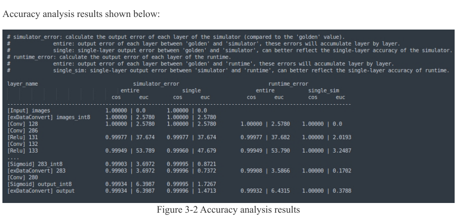
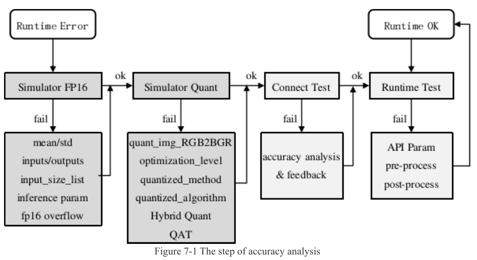

:tocdepth: 1

*********************************************
Hybrid quantization và phân tích độ chính xác
*********************************************

.. admonition:: Trang này trả lời

   - Làm thế nào để giữ một số lớp ở FP16 trong khi phần còn lại INT8?
   - Làm sao biết lớp nào làm sụt độ chính xác sau khi lượng tử hóa?
   - Khi kết quả lệch, kiểm tra theo thứ tự nào?

.. admonition:: Tóm tắt

   - Hybrid quantization gồm bốn bước. Lớp được đưa về FP16 chạy chậm hơn trên NPU [T1 UG232 tr.123].
   - Bước 1 sinh ba file (``.model``, ``.data``, ``.quantization.cfg``). Người dùng sửa ``.cfg`` ở bước 2 [T1 API232 tr.20] [T1 UG232 tr.124].
   - ``hybrid_quantization_step2`` trả ``0`` hoặc ``-1`` [T1 API232 tr.21]. Ví dụ chính thức gọi ``export_rknn`` ngay sau đó để có file ``.rknn`` [T1 UG232 tr.124, Figure 6-4].
   - ``rknn.accuracy_analysis()`` so từng lớp giữa model float (``golden``) và model lượng tử hóa chạy trên simulator, thêm ``runtime`` nếu đặt ``target`` [T1 API232 tr.22].
   - UG232 hướng dẫn chọn lớp cho hybrid bằng cột ``single`` của ``simulator_error`` cùng vị trí lớp trong model [T1 UG232 tr.134].
   - Quy trình hãng: FP16 đúng trước, rồi mới xét lượng tử hóa, rồi board [T1 UG232 tr.131].
   - Unknown: hybrid int16 trên RK3588, hướng so sánh euclid của ``auto_hybrid``, golden tính FP32 hay FP16, ngưỡng cosine "đạt", và việc áp dụng quy trình cho YOLOv8 hay PPE.

.. contents:: Trong trang này
   :local:
   :depth: 1

.. _hybrid-quantization:

1. Hybrid quantization
======================

Nền. PTQ INT8 dùng một kiểu số duy nhất cho cả model (xem :doc:`01-kieu-du-lieu-va-cau-hinh-luong-tu-hoa`). Một số lớp nhạy với sai số lượng tử hóa nên kéo độ chính xác xuống. Hybrid quantization cho phép chọn riêng từng lớp có lượng tử hóa hay không. Khái niệm chung nằm ở :doc:`../../01-kien-thuc-nen/03-luong-tu-hoa/02-chien-luoc-ptq-qat-va-hon-hop`. Trang này chỉ nêu cách làm trong RKNN-Toolkit2.

   "Users can manually specify whether each layer should be quantized based on the output results of accuracy analysis." [T1 UG232 tr.123]

Hai cách dùng được UG232 liệt kê [T1 UG232 tr.123]:

- Đổi lớp đã lượng tử hóa sang không lượng tử hóa, tính bằng FLOAT16.
- Sửa tham số lượng tử hóa của từng lớp (UG232 không khuyến nghị).

Cái giá được hãng nêu ngay trong cùng đoạn:

   "(Note that non-quantized computation on the NPU has lower performance, resulting in reduced inference speed.)" [T1 UG232 tr.123]

1.1 Hai bước và file trung gian
-------------------------------

Hybrid quantization gồm bốn bước [T1 UG232 tr.123]. Hai bước gọi API (1 và 3) được tách bằng một bước sửa file tay (2), vì vậy giữa chúng toolkit để lại file trung gian trên đĩa.

.. list-table:: Bốn bước hybrid quantization
   :header-rows: 1
   :widths: 8 32 60

   * - Bước
     - Việc làm
     - Đầu ra
   * - 1
     - Nạp model gốc, gọi ``hybrid_quantization_step1``
     - ``<model_name>.model`` (model tạm), ``<model_name>.data`` (file dữ liệu), ``<model_name>.quantization.cfg`` (cấu hình lượng tử hóa) [T1 API232 tr.20]
   * - 2
     - Sửa ``.quantization.cfg`` bằng tay
     - File ``.cfg`` đã sửa [T1 UG232 tr.124]
   * - 3
     - Gọi ``hybrid_quantization_step2`` rồi ``export_rknn``
     - Model RKNN hybrid [T1 UG232 tr.124, Figure 6-4]
   * - 4
     - Suy luận bằng model RKNN vừa tạo
     - Kết quả suy luận [T1 UG232 tr.125]

.. _fig-hybrid-step1:

.. figure:: ../../../_assets/img/02-nen-tang-rk3588/02-rknn-luong-tu-hoa/hybrid-quantization-va-accuracy-analysis/ug232-fig6-3-hybrid-quantization-step1.png
   :align: center
   :width: 55%
   :alt: Lưu đồ bước 1 của hybrid quantization

   Bước 1: tạo đối tượng RKNN, ``config``, nạp model gốc, ``hybrid_quantization_step1`` sinh ``.quantization.cfg``, ``.model``, ``.data``, rồi ``release``. Nguồn: [T1 UG232 tr.123, Figure 6-3]

.. _fig-hybrid-step3:

.. figure:: ../../../_assets/img/02-nen-tang-rk3588/02-rknn-luong-tu-hoa/hybrid-quantization-va-accuracy-analysis/ug232-fig6-4-hybrid-quantization-step3.png
   :align: center
   :width: 55%
   :alt: Lưu đồ bước 3 của hybrid quantization

   Bước 3: ``hybrid_quantization_step2`` rồi ``export_rknn``. Nguồn: [T1 UG232 tr.124, Figure 6-4]

Tham số của hai hàm theo API232:

.. list-table:: Tham số ``hybrid_quantization_step1`` và ``step2``
   :header-rows: 1
   :widths: 24 76

   * - Hàm và tham số
     - Ý nghĩa
   * - ``step1``: ``dataset``, ``rknn_batch_size``
     - Như hàm ``build`` [T1 API232 tr.20]
   * - ``step1``: ``proposal``, ``proposal_dataset_size``
     - Sinh gợi ý cấu hình hybrid, mặc định ``False`` và ``1``. Hãng giải thích mặc định 1 vì chức năng proposal tốn thời gian [T1 API232 tr.20]
   * - ``step1``: ``custom_hybrid``
     - Chọn subgraph hybrid theo nhiều cặp ``[input_name, output_name]``, tên lấy từ file ``.model`` [T1 API232 tr.21]
   * - ``step2``: ``model_input``, ``data_input``, ``model_quantization_cfg``
     - Đường dẫn ``.model``, ``.data``, ``.quantization.cfg`` (đã sửa) do ``step1`` sinh ra [T1 API232 tr.21]
   * - Giá trị trả về của cả hai
     - ``0`` thành công, ``-1`` thất bại [T1 API232 tr.21]

API232 chỉ mô tả giá trị trả về của ``step2`` là ``0`` hoặc ``-1``. Việc ``step2`` không tự ghi file ``.rknn`` được suy ra từ Figure 6-4 (có bước ``export_rknn`` riêng) và từ ví dụ chính thức (``step2.py`` gọi ``rknn.export_rknn('./ssd_mobilenet_v2.rknn')`` sau ``step2``) [T1 UG232 tr.124, Figure 6-4] [T1 EX ``functions/hybrid_quant/step2.py``].

1.2 Chọn lớp giữ độ chính xác cao
---------------------------------

Cấu hình nằm trong ``.quantization.cfg`` với hai phần [T1 UG232 tr.124]:

- ``custom_quantize_layers``: thêm cặp ``<tên tensor>: <kiểu>`` để đổi kiểu tính của lớp đó.
- ``quantize_parameters``: tham số lượng tử hóa của từng tensor (``qtype``, ``qmethod``, ``dtype``, ``min``, ``max``, ``scale``, ``zero_point``).

   "In the "custom_quantize_layers" section, users can add custom quantization layers by specifying the tensor name followed by the quantization type." ... "Currently, the available quantization data type is "float16"." [T1 UG232 tr.124]

Tên tensor lấy từ kết quả accuracy analysis (mục 2) hoặc mở file ``.model`` bằng Netron [T1 UG232 tr.124].

Cách chọn lớp theo hướng dẫn xử lý lỗi của hãng [T1 UG232 tr.134]:

1. Chạy accuracy analysis, tìm lớp làm độ chính xác giảm nhiều và ghi lại tên tensor đầu ra.
2. Ghi tên tensor vào file cấu hình hybrid.
3. Chạy hết các bước hybrid và đo lại (có thể dùng lại accuracy analysis).

Lưu ý của hãng khi chọn:

   "(Note: because errors accumulate layer by layer, layers closer to the front have a greater impact on the final accuracy. Therefore, consider both the accuracy loss of the single column of simulator_error and the position of the layer in the model.)" [T1 UG232 tr.134]

Nếu chưa đủ, hãng cho phép hybrid thêm nhiều lớp, đổi lại hiệu năng suy luận giảm, nên phải cân bằng độ chính xác và tốc độ [T1 UG232 tr.134]. Điều kiện hãng nêu cho trường hợp này: sau khi đã thử đổi phương pháp và thuật toán lượng tử hóa mà cột ``entire`` vẫn kém, và cột ``single`` cho thấy một số lớp tụt rõ (ví dụ trọng số Conv phân bố rất lệch) [T1 UG232 tr.134].

Tự động chọn lớp bằng ``auto_hybrid``:

.. list-table:: ``auto_hybrid`` theo hãng
   :header-rows: 1
   :widths: 30 70

   * - Mục
     - Nội dung
   * - Bật
     - ``rknn.build(do_quantization=True, dataset='./dataset.txt', auto_hybrid=True)`` [T1 UG232 tr.125]
   * - Khi model đang lượng tử hóa
     - Đổi các phép tính có cosine distance và euclidean distance vượt ngưỡng về FP16, chỉ hỗ trợ lượng tử hóa ``w8a8`` [T1 API232 tr.14]
   * - Khi model chưa lượng tử hóa
     - Kiểm tra từng lớp có tràn FP16 không và đổi lớp tràn sang INT16. Cần dataset để tính khoảng giá trị mỗi lớp [T1 UG232 tr.125]
   * - Ngưỡng
     - ``auto_hybrid_cos_thresh`` mặc định 0.98. ``auto_hybrid_euc_thresh`` mặc định ``None`` (không bật) [T1 API232 tr.10]
   * - Hướng điều chỉnh
     - Hiện chỉ hỗ trợ tự đổi từ int8 sang fp16 [T1 UG232 tr.125]

Các điểm chưa rõ:

- Kiểu dữ liệu cho phép trong ``custom_quantize_layers``. UG232 chỉ ghi ``float16`` [T1 UG232 tr.124]. Ví dụ chính thức in ra "Currently supported data types are: 'int8', 'int16', 'float16'." [T1 EX ``functions/hybrid_quant/step1.py``]. Hybrid int16 trên RK3588: unknown. Đã tìm ở: UG232 tr.123-125, API232 tr.14, 20-21, ``step1.py``, từ khóa: ``int16``, ``custom_quantize_layers``.
- Hướng so sánh của ``auto_hybrid_euc_thresh``. API232 viết "below" [T1 API232 tr.14], UG232 viết "the greater than euclidean distance threshold" [T1 UG232 tr.125]. Hai nguồn viết ngược nhau: unknown.
- ``proposal=False`` có điền lớp gợi ý vào ``.cfg`` hay không: unknown. Ví dụ ``step1.py`` gọi ``proposal=False`` nhưng vẫn in "the configuration file will automatically fill in some layers that may cause a decrease in accuracy (may be inaccurate)" [T1 EX ``functions/hybrid_quant/step1.py``]. Changelog 2.3.2 (v1.6.1b0) ghi ``proposal=False`` không sinh layer đề xuất [T1 changelog-2.3.2.txt dòng 399]. Hai nguồn mâu thuẫn.

.. _accuracy-analysis:

2. Accuracy analysis
====================

Nền. Cosine distance và euclidean distance đo độ lệch giữa hai tensor (cosine càng gần 1 càng giống). Accuracy analysis áp hai độ đo này cho đầu ra của từng lớp, nên chỉ ra lớp đầu tiên bắt đầu lệch. Hãng viết: "Cosine distance can be used as a basic criterion for judging accuracy, but the final impact of quantization on accuracy still needs validation on the dataset." [T1 UG232 tr.131]

   "Inference with quantized model and generate snapshot, that is dump tensor data of each layers. It will dump a snapshot of both data types include fp32 & quant for calculate quantitative error." [T1 API232 tr.22]

Điều kiện gọi và đầu ra:

.. list-table:: ``rknn.accuracy_analysis()``
   :header-rows: 1
   :widths: 26 74

   * - Mục
     - Nội dung
   * - Điều kiện gọi
     - Chỉ gọi sau ``build`` hoặc ``hybrid_quantization_step2`` [T1 API232 tr.22]
   * - Không dùng được sau ``load_rknn``
     - Vì file RKNN thiếu thông tin model gốc [T1 UG232 tr.30]
   * - Tham số
     - ``inputs`` (jpg, png, bmp, npy), ``output_dir`` (mặc định ``./snapshot``), ``target``, ``device_id`` [T1 UG232 tr.30] [T1 API232 tr.22]
   * - Không đặt ``target``
     - Thư mục ``simulator``, thư mục ``golden`` và file ``error_analysis.txt`` [T1 API232 tr.22]
   * - Đặt ``target``
     - Thêm thư mục ``runtime`` (kết quả từng lớp chạy trên NPU) và cột lỗi so với simulator trong ``error_analysis.txt`` [T1 API232 tr.22]

Ý nghĩa hai thư mục chính:

   "Directory golden: Save the results of each layer on simulator when the entire floating-point model is completely run down." [T1 API232 tr.22]

   "Directory simulator: Save the results of each layer on simulator when the entire quantitative model is fully run (The output has been converted to float32)." [T1 API232 tr.22]

Kết quả hiển thị bốn nhóm cột (UG232 tr.30 ghi "It is divided into 4 columns of accuracy") [T1 UG232 tr.30]:

.. list-table:: Các cột của bảng kết quả
   :header-rows: 1
   :widths: 22 14 64

   * - Nhóm
     - Cột
     - Ý nghĩa theo UG232 tr.31
   * - ``simulator_error``
     - ``entire``
     - Cosine và euclidean distance từ đầu model đến lớp hiện tại, so kết quả simulator với golden
   * - ``simulator_error``
     - ``single``
     - Dùng đầu vào golden của lớp hiện tại, so kết quả simulator với golden
   * - ``runtime_error``
     - ``entire``
     - Cosine và euclidean distance giữa kết quả thực (board) và golden từ đầu đến lớp hiện tại
   * - ``runtime_error``
     - ``single_sim``
     - Dùng đầu vào golden của lớp hiện tại, so kết quả thực trên board với kết quả simulator

Ví dụ chính thức mô tả ngắn gọn hơn: ``entire`` là sai số đầu ra từng lớp giữa golden và simulator và sai số này tích lũy qua các lớp, còn ``single`` là sai số của riêng lớp [T1 EX ``functions/accuracy_analysis/README.md:19-21``].

.. _fig-accuracy-analysis:

   Kết quả accuracy analysis, mỗi nhóm cột có ``cos`` và ``euc``. Nguồn: [T1 UG232 tr.30, Figure 3-2]

Cách đọc (suy ra từ định nghĩa cột ở trên): ``entire`` giảm dần là hiện tượng bình thường vì lỗi cộng dồn, còn một lớp có ``single`` thấp bất thường là ứng viên cho hybrid. Ở bảng mẫu của ví dụ chính thức, ``cos`` gần 1 là tốt [T1 EX ``functions/accuracy_analysis/README.md``].

Các điểm chưa rõ:

- Tên cột. API232 gọi ``entire_error`` và ``single_error`` [T1 API232 tr.22], UG232 gọi ``simulator_error`` và ``runtime_error`` [T1 UG232 tr.31]. Trang này dùng tên của UG232 và ví dụ.
- Golden tính bằng FP32 hay FP16: unknown. API232 viết "fp32 & quant" [T1 API232 tr.22], còn UG232 viết "RKNPU currently does not support FP32 calculations" [T1 UG232 tr.131]. Đã tìm ở: API232 tr.22, UG232 tr.30-31, 131, từ khóa: ``golden``, ``fp32``.
- Ngưỡng cosine "đạt" trong ``error_analysis.txt``: unknown. UG232 chỉ nói màu vàng hoặc đỏ khi cosine thấp hoặc euclid cao [T1 UG232 tr.135]. Đã tìm ở: UG232 tr.30-31, 131-135, từ khóa: ``threshold``, ``yellow``.

.. _quy-trinh-loi-do-chinh-xac:

3. Quy trình xử lý lỗi độ chính xác của hãng
============================================

Chương 7 của UG232 chia việc điều tra thành hai nhánh. Nguyên tắc nền:

   "Correct simulator inference results are the prerequisite for correct board-side runtime inference. Therefore, it is essential to prioritize ensuring correct results in the simulator before troubleshooting board-side runtime accuracy issues." [T1 UG232 tr.131]

   "FP16 inference results must be correct for quantization inference to be correct. Therefore, when there are accuracy issues with quantization inference, it is essential to first verify the correctness of FP16 inference and then troubleshoot the accuracy issues with quantization inference." [T1 UG232 tr.131]

.. _fig-quy-trinh-7-1:

   Từ Runtime Error đi qua Simulator FP16, Simulator Quant, Connect Test, Runtime Test, mỗi bước kèm danh sách cần kiểm tra khi fail. Nguồn: [T1 UG232 tr.131, Figure 7-1]

.. list-table:: Thứ tự kiểm tra theo UG232
   :header-rows: 1
   :widths: 6 22 72

   * - Thứ tự
     - Bước
     - Cần kiểm tra
   * - 1
     - Simulator FP16
     - ``mean_values``/``std_values``, ``inputs``/``outputs``, ``input_size_list``, tham số ``inference`` (thứ tự BGR/RGB, thêm chiều batch, ``data_format``) [T1 UG232 tr.132]. Kiểm bằng cách so kết quả framework gốc với FP16 simulator (``do_quantization=False``, ``target=None``) qua cosine distance [T1 UG232 tr.132]. Nếu vẫn lệch thì xét tràn FP16 [T1 UG232 tr.133]
   * - 2
     - Simulator Quant
     - ``quant_img_RGB2BGR``, ``optimization_level`` (mặc định 3, ưu tiên tốc độ nên có quy tắc tối ưu ảnh hưởng nhẹ độ chính xác), ``dataset`` (nên 20 đến 200 ảnh, sát cảnh triển khai) [T1 UG232 tr.133]. Sau đó thử ``quantized_method``, ``quantized_algorithm``, hybrid, QAT [T1 UG232 tr.134] [T1 UG232 tr.135]
   * - 3
     - Connect Test
     - Chạy suy luận có kết nối board (đặt ``target`` trong ``init_runtime``). Nếu lệch simulator thì chạy ``accuracy_analysis`` với ``target``, xem cột ``single_sim`` của ``runtime_error`` (vàng hoặc đỏ) rồi gửi kết quả cho đội NPU của Rockchip [T1 UG232 tr.135]
   * - 4
     - Runtime Test
     - Cấu hình đầu vào của C API, tiền xử lý, hậu xử lý phải khớp phía simulator. Có thể đặt ``RKNN_LOG_LEVEL=5`` để dump kết quả từng lớp ra thư mục ``dumps`` [T1 UG232 tr.135] [T1 UG232 tr.136]

Tràn FP16. Giá trị ngoài khoảng -65504 đến 65504 làm tensor tràn. Hãng hướng dẫn chạy ``accuracy_analysis(..., target=None)`` và nếu cột ``entire`` hoặc ``single`` của ``simulator_error`` có giá trị bất thường (chữ ``inf``) thì có thể tràn, khi đó thử đổi cấu trúc model (ví dụ thêm lớp BN) [T1 UG232 tr.133].

Thứ tự thử khi độ chính xác lượng tử hóa chưa đủ [T1 UG232 tr.134]:

.. list-table:: Các biện pháp theo thứ tự UG232
   :header-rows: 1
   :widths: 6 40 54

   * - Bước
     - Biện pháp
     - Ghi chú của hãng
   * - 1
     - Đổi ``quantized_method`` từ ``layer`` sang ``channel``
     - Channel thường cho độ chính xác cao hơn layer đáng kể
   * - 2
     - Đổi ``quantized_algorithm`` từ ``normal`` sang ``kl_divergence`` hoặc ``mmse``
     - Thời gian lượng tử hóa có thể tăng nhiều, hiệu năng chạy không bị ảnh hưởng xấu
   * - 3
     - Hybrid quantization cho các lớp ``single`` tụt rõ
     - Lớp chuyển FP16 chạy chậm hơn. Cân bằng độ chính xác và tốc độ
   * - 4
     - Chuyển lớp suy giảm ở cuối model sang hậu xử lý
     - Chỉ khi lớp đó là lớp cuối
   * - 5
     - QAT
     - Khi hybrid vẫn chưa đủ, hoặc đủ nhưng hiệu năng không đạt. Xem :doc:`02-tap-calibration-va-quy-trinh-qat`

..

   "Another special method is that when the Op with reduced accuracy is in the last layer, users can choose to move the execution of that layer's operation to post-processing, which will also effectively avoid the accuracy problem of this layer." [T1 UG232 tr.134]

Phạm vi. Quy trình này là của hãng cho model nói chung. Chưa có nguồn nào áp dụng cho YOLOv8 hay bài toán PPE: unknown. Đã tìm ở: UG232 chương 6.3, 7, API232 tr.14, 20-22, từ khóa: ``yolo``, ``detection``.

.. _hieu-sai-hybrid:

4. Hiểu sai thường gặp
======================

.. list-table::
   :header-rows: 1
   :widths: 30 50 20

   * - Hiểu sai
     - Thực tế theo nguồn
     - Nguồn
   * - Hybrid không làm giảm tốc độ
     - Lớp đưa về FP16 chạy chậm hơn trên NPU
     - [T1 UG232 tr.123]
   * - ``hybrid_quantization_step2`` tự ghi file ``.rknn``
     - Hãng gọi ``export_rknn`` riêng ở bước 3
     - [T1 UG232 tr.124]
   * - ``custom_quantize_layers`` nhận mọi kiểu
     - UG232 ghi hiện chỉ ``float16``. Kiểu khác là unknown
     - [T1 UG232 tr.124]
   * - Có thể phân tích độ chính xác sau khi ``load_rknn``
     - Không, vì thiếu thông tin model gốc
     - [T1 UG232 tr.30]
   * - Cosine cao nghĩa là model đạt yêu cầu
     - Cosine chỉ là tiêu chí cơ bản, tác động cuối cùng phải kiểm trên dataset
     - [T1 UG232 tr.131]
   * - Lỗi trên board luôn do runtime
     - Phải đúng ở simulator trước, rồi mới xét board
     - [T1 UG232 tr.131]

Nguồn
=====

.. list-table::
   :header-rows: 1
   :widths: 14 8 68 10

   * - Nhãn
     - Tier
     - Tệp
     - Số lần
   * - ``UG232``
     - T1
     - ``3rdparty/rknn-toolkit2/doc/02_Rockchip_RKNPU_User_Guide_RKNN_SDK_V2.3.2_EN.pdf`` (SDK trong repo chính)
     - 56
   * - ``API232``
     - T1
     - :download:`01_Rockchip_RKNPU_API_Reference_RKNN_Toolkit2_V2.3.2_EN.pdf <../../../_assets/pdf/rknn/01_Rockchip_RKNPU_API_Reference_RKNN_Toolkit2_V2.3.2_EN.pdf>`
     - 21
   * - ``EX``
     - T1
     - ``3rdparty/rknn-toolkit2/rknn-toolkit2/examples/functions/`` (``hybrid_quant``, ``accuracy_analysis``)
     - 5
   * - ``changelog-2.3.2.txt``
     - T1
     - ``3rdparty/rknn-toolkit2/rknn-toolkit2/doc/changelog-2.3.2.txt``
     - 1
