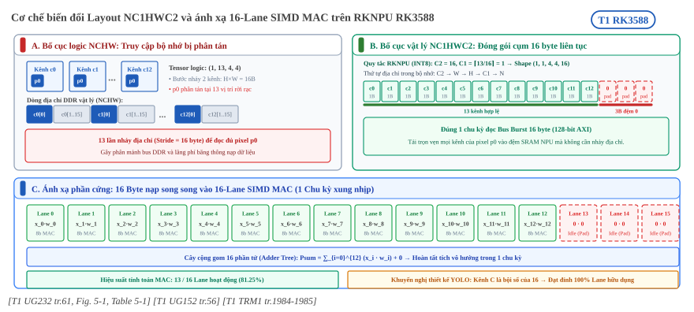
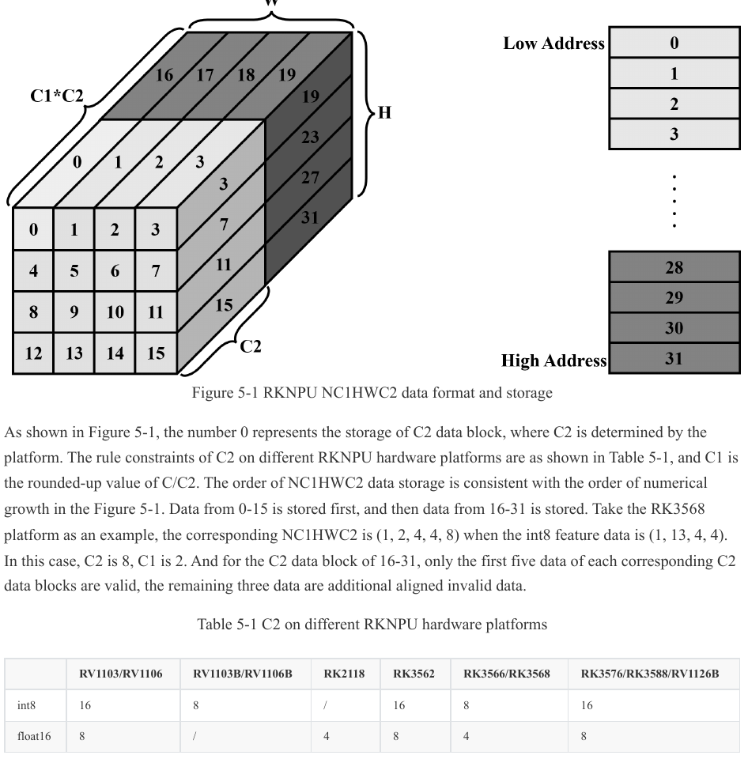

:tocdepth: 1

************************
Layout NC1HWC2 và fusion
************************

.. admonition:: Trang này trả lời

   - Dữ liệu được xếp thế nào trong bộ nhớ NPU, và C1, C2 tính ra sao?
   - Có những yêu cầu căn lề (alignment) nào, và cái nào bắt buộc?
   - Toolkit gộp op thế nào, hãng đã công bố rule fusion nào, và người dùng can thiệp được đến đâu?

.. admonition:: Tóm tắt

   - RKNN có bốn format dữ liệu: NHWC, NCHW, NC1HWC2 và UNDEFINE. NC1HWC2 là format riêng của phần cứng RKNPU [T1 UG232 tr.61].
   - Địa chỉ tăng dần theo thứ tự C2, W, H, C1, N (C2 đổi nhanh nhất). C1 là C/C2 làm tròn lên [T1 UG152 tr.56] [T1 UG232 tr.61].
   - Trên RK3588, C2 là 16 với int8 và 8 với float16 [T1 UG152 tr.56]. Ví dụ ``(1,13,4,4)`` int8 thành ``(1,1,4,4,16)`` (suy ra từ công thức của hãng).
   - Có ít nhất bốn đại lượng "alignment" khác nhau, không gộp được: C2 của layout, căn lề width của input (chỉ zero-copy), căn lề channel của output và bội số channel để chạy hiệu quả (không bắt buộc) [T1 UG232 tr.144].
   - Toolkit có tự tối ưu đồ thị nhưng "not omnipotent and perfect", người dùng có thể đổi thứ tự op để tạo cặp fusion mà phần cứng hỗ trợ [T1 UG232 tr.141].
   - UG232 công bố sáu rule fusion đã hỗ trợ và sáu rule kế hoạch tương lai [T1 UG232 tr.142]. OPL có thêm các op hợp nhất của ConvTranspose mà bảng UG232 không có [T1 OPL tr.65].
   - Thứ tự pass, thuật toán chọn fuse và cách chọn C2, C1 cho từng tensor là unknown. OPL 3.2.19 và UG232 tr.142 viết thứ tự Add và Activation khác nhau.

.. contents:: Trong trang này
   :local:
   :depth: 1

.. _layout-nc1hwc2:

1. NC1HWC2
==========

Nền. Một tensor ảnh bốn chiều ``(N, C, H, W)`` có thể xếp trong bộ nhớ theo nhiều cách. NCHW và NHWC là hai cách quen thuộc. Phần cứng NPU đọc dữ liệu theo khối kênh nên có cách xếp riêng. UG232 viết RKNN có bốn format (NHWC, NCHW, NC1HWC2, UNDEFINE), hai format đầu là phổ biến nên không giải thích thêm, và NC1HWC2 là format "dedicated to RKNPU hardware" [T1 UG232 tr.61]. Header runtime có bốn giá trị tương ứng ``RKNN_TENSOR_NCHW``, ``RKNN_TENSOR_NHWC``, ``RKNN_TENSOR_NC1HWC2``, ``RKNN_TENSOR_UNDEFINED`` [T1 EX 3rdparty/rknn-toolkit2/rknpu2/runtime/Linux/librknn_api/include/rknn_api.h:235-238].

1.1 Cách xếp và công thức
-------------------------

Trục kênh ``C`` được cắt thành các khối ``C2`` kênh liền nhau, ``C1`` là số khối. Thứ tự địa chỉ theo UG152:

   "The memory address from low to high is C2->W->H->C1->N, among which the C2 has the fastest changing rate and N is the slowest one." [T1 UG152 tr.56]

UG232 bổ sung "C2 is determined by the platform" và "C1 is the rounded-up value of C/C2" [T1 UG232 tr.61]. Với ``C`` không chia hết cho ``C2``, phần cuối của khối kênh cuối là dữ liệu căn thêm không hợp lệ. UG232 lấy RK3568 làm ví dụ: int8 ``(1, 13, 4, 4)`` thành ``(1, 2, 4, 4, 8)``, với ``C2 = 8``, ``C1 = 2``, và ở khối 16 đến 31 chỉ năm giá trị đầu mỗi khối C2 là hợp lệ, ba giá trị còn lại là dữ liệu căn thêm [T1 UG232 tr.61].

.. _fig-rknn-01-layout-nc1hwc2:

   Cơ chế biến đổi định dạng Layout NC1HWC2: Tầng hình học tách kênh C2=16 và tầng ánh xạ phần cứng vào 16 lane SIMD MAC trên NPU Core RK3588. Nguồn: [T1 UG232 tr.61, Fig. 5-1] [T1 UG152 tr.56] [T1 TRM1 tr.1984-1985].

.. _fig-nc1hwc2-fig5-1:

   Format NC1HWC2: C2 là khối kênh nằm liền nhau trong bộ nhớ, C1 là số khối. Table 5-1 liệt kê C2 theo chip. Nguồn: [T1 UG232 tr.61, Figure 5-1 và Table 5-1]

Bảng giá trị ``C2`` theo UG152 có hàng riêng cho RK3588: int8 là 16, float16 là 8, int16 là 8 [T1 UG152 tr.56]. UG232 Table 5-1 có cùng giá trị ở cột chung RK3576/RK3588/RV1126B (int8 là 16, float16 là 8), còn RK3566/RK3568 là 8 và 4 [T1 UG232 tr.61].

Mã chuyển đổi của hãng cho biết vị trí phần tử. Với ``C2 = dims[4]``, phần tử kênh ``c`` tại điểm ảnh thứ ``hw`` nằm ở chỉ số ``(c / C2) * H * W * C2 + hw * C2 + (c % C2)`` trong mảng NC1HWC2 [T1 UG232 tr.63]. Công thức này đọc từ hàm ``NC1HWC2_to_NCHW`` và đã viết lại cho một batch (suy ra).

1.2 Ví dụ số trên RK3588
------------------------

Các hàng 1 và 2 của bảng dưới là suy ra từ công thức, các hàng còn lại là log mẫu của hãng cho mô hình int8 chạy trên RK3588 [T1 SRAM-zh dòng 198] [T1 SRAM-zh dòng 199] [T1 SRAM-zh dòng 211].

.. list-table::
   :header-rows: 1
   :widths: 24 12 20 14 30

   * - Shape gốc ``(N,C,H,W)``
     - Kiểu
     - NC1HWC2
     - Giá trị căn thêm trong khối cuối
     - Ghi chú
   * - ``(1,13,4,4)``
     - int8
     - ``(1,1,4,4,16)``
     - 3 trên 16
     - Suy ra, ``C2 = 16``, ``C1 = ceil(13/16) = 1``
   * - ``(1,13,4,4)``
     - float16
     - ``(1,2,4,4,8)``
     - 3 trên 8
     - Suy ra, ``C2 = 8``, ``C1 = ceil(13/8) = 2``
   * - ``(1,32,112,112)``
     - int8
     - ``(1,2,112,112,16)``
     - 0
     - Log hãng, ``C1 = 32/16 = 2`` [T1 SRAM-zh dòng 199]
   * - ``(1,512,14,14)``
     - int8
     - ``(1,32,14,14,16)``
     - 0
     - Log hãng, ``C1 = 512/16 = 32`` [T1 SRAM-zh dòng 211]
   * - ``(1,3,224,224)``
     - int8
     - ``(1,1,224,224,3)``
     - không áp dụng
     - Input đầu tiên, trục cuối là 3 chứ không phải 16 [T1 SRAM-zh dòng 198]

Hàng cuối cùng khớp quy tắc của UG232 tr.69: input bốn chiều có số kênh 1, 3 hoặc 4 dùng layout NHWC, các số kênh khác dùng NC1HWC2 [T1 UG232 tr.69]. Với ``C1 = 1`` và ``C2 = 3`` thứ tự bộ nhớ của shape ``(1,1,224,224,3)`` trùng NHWC (suy ra). Trang chủ của các quy tắc zero-copy là :doc:`../04-bo-nho-hieu-nang/03-zero-copy-can-le-profiling-api`.

1.3 Layout nào được trả về khi query
------------------------------------

Runtime không bắt người dùng chọn layout. ``RKNN_QUERY_NATIVE_INPUT_ATTR`` và ``RKNN_QUERY_NATIVE_OUTPUT_ATTR`` trả về layout và kiểu cho hiệu quả phần cứng cao nhất, và UG232 nói kiểu này khác ``RKNN_QUERY_INPUT_ATTR`` [T1 UG232 tr.69] [T1 UG232 tr.70]. Các trường ``w_stride``, ``size_with_stride`` và ``h_stride`` của ``rknn_tensor_attr`` mô tả stride và kích thước thực tế, trong đó ``w_stride`` chỉ đọc và ``0`` nghĩa là bằng ``width`` [T1 EX 3rdparty/rknn-toolkit2/rknpu2/runtime/Linux/librknn_api/include/rknn_api.h:298-300] [T1 EX 3rdparty/rknn-toolkit2/rknpu2/runtime/Linux/librknn_api/include/rknn_api.h:308-309].

.. list-table::
   :header-rows: 1
   :widths: 20 40 40

   * - Layout query ra
     - Input
     - Output
   * - ``NHWC``
     - Bốn chiều, kênh 1, 3 hoặc 4. Với ``pass_through=1`` width có thể cần căn theo ``w_stride`` [T1 UG232 tr.69]
     - Thường do người dùng gọi ``RKNN_QUERY_NATIVE_NHWC_OUTPUT_ATTR`` [T1 UG232 tr.70]
   * - ``NC1HWC2``
     - Bốn chiều, kênh khác 1, 3, 4. Với ``pass_through=0`` người dùng đưa NHWC và interface đổi bằng CPU, với ``pass_through=1`` người dùng tự đổi [T1 UG232 tr.69]
     - Bốn chiều. Muốn NCHW thì người dùng phải đổi ở ngoài [T1 UG232 tr.70]
   * - ``UNDEFINED``
     - Thường không phải bốn chiều. NPU không xử lý mean, std hay đổi layout [T1 UG232 tr.69]
     - Thường không phải bốn chiều, không cần đổi layout [T1 UG232 tr.70]

--------------

.. _layout-alignment:

.. _64-layout-nc1hwc2-và-các-kiểu-alignment:

2. Alignment
============

Nền. "Alignment" là yêu cầu một kích thước (số kênh, độ rộng, số byte) phải chia hết cho một giá trị để phần cứng đọc ghi hiệu quả hoặc đúng. Các nguồn dùng chữ này cho những đại lượng khác nhau, nên bảng dưới tách riêng từng loại cho RK3588. Chỉ hàng đầu là một phần định nghĩa layout, các hàng khác là ràng buộc của từng giao diện hoặc khuyến nghị.

.. list-table::
   :header-rows: 1
   :widths: 20 38 20 22

   * - Đại lượng
     - Giá trị cho RK3588
     - Bắt buộc?
     - Nguồn
   * - C2 của layout
     - int8 là 16, float16 là 8
     - Là định nghĩa layout
     - [T1 UG152 tr.56] [T1 UG232 tr.61]
   * - Width của input (zero-copy)
     - Model int8: 16 phần tử khi kênh là 1, 3, 4 và 1 phần tử khi kênh khác. Model float16: 8 phần tử và 1 phần tử. Input không phải bốn chiều: 1 phần tử
     - Chỉ khi dùng zero-copy API
     - [T1 OPL tr.336] [T1 OPL tr.335]
   * - Channel của output
     - Tùy layout và kiểu output (xem 2.2)
     - Bắt buộc với output do NPU chuyển đổi
     - [T1 OPL tr.339]
   * - Bội số channel để chạy hiệu quả
     - int8: Conv input 32, Conv output 32, Depthwise 64, op khác 16. float16: 32, 16, 32, 8
     - Không bắt buộc
     - [T1 UG232 tr.144] [T1 UG232 tr.145]
   * - Căn SRAM
     - 4K khi cấp SRAM cho NPU
     - Điều kiện cấp phát
     - Xem :doc:`../01-phan-cung-npu/03-che-do-da-loi-va-system-sram`

2.1 Input: căn lề width
-----------------------

Bảng input RK3588 ở OPL 5.1.2 là ảnh, nên các số trong bảng trên đọc từ ảnh trang đó [T1 OPL tr.336]. Đơn vị là số phần tử. Với model int8 và input đầu là uint8 hoặc int8, bước mean, scale và quant chạy trên NPU. Với input đầu là float16 hoặc kiểu khác, các bước đó chạy trên CPU [T1 OPL tr.336]. Điều kiện zero-copy trong UG232 Table 5-2 cho nhóm RK3588 là "Width 16-byte aligned" với input bốn chiều có kênh 1, 3, 4, và tổng kích thước căn 16 byte với input không bốn chiều [T1 UG232 tr.65]. Hai nguồn nhất quán: 16 phần tử int8 là 16 byte, 8 phần tử float16 cũng là 16 byte (suy ra, 2 byte mỗi phần tử).

OPL ghi chú thêm rằng ràng buộc này chỉ áp dụng cho zero-copy API, giá trị căn của width tra được từ thuộc tính ``w_stride`` và ``w_stride`` không đổi được [T1 OPL tr.335]. Nếu không cần mean và scale thì phải đặt chúng là 0 và 1 [T1 OPL tr.335].

2.2 Output: căn lề channel và H*W
---------------------------------

OPL 5.2.2 cho RK3588 các giá trị sau [T1 OPL tr.339]. ``H*W`` phải căn 4 trong mọi ô NC1HWC2.

.. list-table::
   :header-rows: 1
   :widths: 24 20 28 28

   * - Kiểu output
     - NCHW
     - NHWC
     - NC1HWC2
   * - int8
     - không yêu cầu
     - căn 16
     - lớp cuối là họ Conv thì căn 32, lớp cuối không phải họ Conv thì căn 16
   * - float16
     - không yêu cầu
     - căn 8
     - họ Conv thì căn 16, không phải họ Conv thì căn 8

Lưu ý của OPL: căn lề của output NHWC chỉ áp dụng khi phần chuyển đổi output do NPU làm, và với output NC1HWC2 thì kích thước vùng nhớ lấy theo giá trị query ra [T1 OPL tr.339]. Danh sách op thuộc "họ Conv" (卷积类) không được nêu ở chỗ này (unknown. Đã tìm ở: OPL tr.339, từ khóa: ``卷积类``).

2.3 Bội số channel để chạy hiệu quả
-----------------------------------

UG232 mục 8.5.1 nói bội số channel giúp NPU tính hiệu quả hơn và thân thiện với DDR, và nhấn mạnh:

   "Listed below are some size rules that are more friendly to DDR reading and writing. These rules are not mandatory." [T1 UG232 tr.144]

Bảng cho RK3588, RK3576, RV1126B là Table 8-2 [T1 UG232 tr.145]. Bảng riêng cho RK3566/RK3568 (Table 8-1) có số khác, ví dụ int8 là 32, 16, 32, 8 [T1 UG232 tr.144]. Các số 16 của C2 (int8), 16 của "op khác" ở Table 8-2 và 16 của output không phải họ Conv cùng xuất hiện, nhưng nguồn không nói chúng là một đại lượng (suy ra, giữ tách riêng).

2.4 Điều chưa rõ
----------------

- Cách chọn ``C2`` và ``C1`` cho từng tensor là unknown. Đã tìm ở: UG232, UG152, API232, OPL, từ khóa: ``C1``, ``C2``, ``NativeShape``.
- Log mẫu của hãng có một hàng không khớp công thức: ``(1,512,7,7)`` thành ``(1,33,7,7,16)`` [T1 SRAM-zh dòng 222]. Theo công thức ``C1 = ceil(512/16) = 32``, nhưng log ghi 33 (suy ra). Các hàng ``(1,512,14,14)`` thành ``(1,32,14,14,16)`` ở dòng 211 khớp. Không nguồn nào giải thích, nguyên nhân là unknown.

--------------

.. _fusion-rule:

3. Rule fusion đã biết
======================

Nền. Fusion là gộp nhiều op liền nhau thành một op chạy một lượt trên NPU. Hiểu ngắn gọn (giải thích của trang này, không phải câu của hãng): kết quả trung gian không phải ghi ra rồi đọc lại bộ nhớ. Hai ví dụ trong log của hãng: mô hình MobileNet với ``--target rk3588`` có op ``ConvClip`` và ``ConvAdd`` chiếm lần lượt 66.79% và 15.94% ở cột ``TimeRatio(%)`` [T1 UG232 tr.56]. Log đa lõi mẫu có lớp ``ConvRelu`` [T1 UG232 tr.75]. Tên op ``ConvClip``, ``ConvRelu`` trùng tên mục hợp nhất của OPL. Op đơn lẻ và quy tắc ``op_target`` xem :doc:`04-operator-list`.

3.1 Toolkit tự gộp đến đâu
--------------------------

   "In the RKNN-Toolkit2 toolchain, the software stack already performs graph optimization to a certain extent during the model conversion process. However, this process is not omnipotent and perfect." [T1 UG232 tr.141]

UG232 viết có đồ thị lý thuyết gộp được nhưng bước tối ưu cuối không gộp, và người dùng có thể chỉnh thuật toán để giải quyết [T1 UG232 tr.141]. Tham số ``optimization_level`` mặc định 3. Giá trị 2 hoặc 1 tắt một số tối ưu có thể ảnh hưởng độ chính xác, giá trị 0 tắt hết [T1 API232 tr.8] [T1 UG232 tr.22]. Thứ tự các pass và danh sách rule nội bộ là unknown. Đã tìm ở: UG232, UG152, API232, OPL, từ khóa: ``fuse``, ``fusion``, ``pass``. T1 chỉ có tên pass trong log lỗi (``RKNNInitCastConst``, ``RKNNMultiSurfacePass``, ``RKNNTilingPass``, ``RKNNProfileAnalysisPass``, ``OpEmit``) [T1 UG232 tr.168] và tên hàm trong traceback (``graph_optimizer._fuse_ops`` và ``graph_optimizer.fuse_ops``) [T1 UG232 tr.166].

3.2 Rule phần cứng của UG232
----------------------------

UG232 8.4.2 liệt kê rule fusion phần cứng [T1 UG232 tr.142]. Ảnh dưới là hình 8-7 cùng bảng.

.. _fig-fusion-fig8-7:

.. figure:: ../../../_assets/img/02-nen-tang-rk3588/03-toolchain-runtime/fusion-va-layout-nc1hwc2/ug232-fig8-7-fusion-rules.png
   :align: center
   :alt: Đổi thứ tự Transpose và Clip để Conv và Clip hợp nhất bằng phần cứng, kèm bảng rule fusion

   Đổi thứ tự Transpose và Clip để Conv và Clip hợp nhất bằng phần cứng, kèm bảng rule. Nguồn: [T1 UG232 tr.142, Figure 8-7]

- Đã hỗ trợ: Conv+Relu, Conv+PRelu(LeakyRelu), Conv+Clip, Conv+Sigmoid(Tanh/Elu/Silu...), Conv+Add, Conv+Activation+Add [T1 UG232 tr.142].
- Kế hoạch tương lai: Activation+Add(Mul), Add(Mul)+Activation, Conv+Mul, Conv+Activation+Mul, Conv+Activation+Pooling, Conv+Activation+Add(Mul)+Pooling [T1 UG232 tr.142].

UG232 viết "The hardware fusion rules are as follows" và không nêu chip [T1 UG232 tr.142]. Với RK3588 cần đối chiếu thêm OPL mục 3.2 ở phần 3.3.

3.3 Op hợp nhất trong OPL cho RK3588
------------------------------------

OPL liệt kê các op hợp nhất thành mục riêng, mỗi mục tự mô tả công thức [T1 OPL tr.60] [T1 OPL tr.63].

.. list-table::
   :header-rows: 1
   :widths: 30 14 32 24

   * - Op hợp nhất
     - Mục
     - Công thức
     - Đa lõi
   * - AddRelu, MulRelu
     - 3.2.2, 3.2.42
     - ``Relu(A + B)``, ``Relu(A * B)`` [T1 OPL tr.57] [T1 OPL tr.78]
     - ``支持``
   * - ConvolutionRelu, Clip, PRelu/LeakyRelu, Add
     - 3.2.7 đến 3.2.10
     - ``Act(Conv(Input))`` hoặc ``Add(Conv(Input0), Input1)`` [T1 OPL tr.60] [T1 OPL tr.61]
     - ``支持``
   * - ConvolutionAddRelu
     - 3.2.19
     - ``Relu(Add(Conv(Input0), Input1))`` [T1 OPL tr.63]
     - ``支持``
   * - Convolution cộng Sigmoid, Tanh, Softplus, HardSigmoid, HardSwish, Elu, Swish, Mish
     - 3.2.11 đến 3.2.18
     - ``Act(Conv(Input))`` [T1 OPL tr.61] [T1 OPL tr.62] [T1 OPL tr.63]
     - ``暂不支持``
   * - ConvTranspose cộng 12 hàm trên (Relu, Clip, PRelu/LeakyRelu, Add, Sigmoid, Tanh, Softplus, HardSigmoid, HardSwish, Elu, Swish, Mish)
     - 3.2.21 đến 3.2.32
     - ``Act(ConvTranspose(Input))`` hoặc ``Add(ConvTranspose(Input0), Input1)`` [T1 OPL tr.65] [T1 OPL tr.66] [T1 OPL tr.67]
     - Không có dòng. ConvTranspose gốc là ``暂不支持`` [T1 OPL tr.65]

Các mục Convolution và ConvTranspose hợp nhất ghi "说明及规格限制同" op gốc, tức dùng lại ràng buộc của op gốc [T1 OPL tr.60]. AddRelu và MulRelu ghi input và output giống Add và Mul [T1 OPL tr.57] [T1 OPL tr.78].

UG232 liệt kê Conv+Sigmoid(Tanh/Elu/Silu...) và OPL liệt kê mục Swish nhưng không có mục Silu. SiLU và Swish với hệ số 1 là cùng một hàm, nên hai tên có thể chỉ cùng một fusion (suy ra, không có câu hãng xác nhận). Bảng UG232 không có hàng cho ConvTranspose, trong khi OPL có 12 mục hợp nhất cho nó. OPL cũng có AddRelu và MulRelu hỗ trợ, trong khi UG232 xếp ``Add(Mul)+Activation`` vào kế hoạch tương lai [T1 UG232 tr.142]. OPL 3.2.19 viết ``Relu(Add(Conv(...)))`` còn UG232 liệt kê ``Conv+Activation+Add`` ở thứ tự Activation trước Add. Hai nguồn chưa thống nhất về thứ tự này, và vì thế mức độ hỗ trợ hai biến thể là unknown.

3.4 Fusion ở mức đồ thị con
---------------------------

   "The RKNN software stack will match certain graph relationships into custom operators" [T1 UG232 tr.147]

Hai rule đồ thị con được nêu: ``Split + Sigmoid + Mul -> GLU`` và ``ReduceMean + Sub + Pow + ReduceMean + Add + Sqrt + Div (+ Mul + Add) -> LayerNorm`` [T1 UG232 tr.148]. Nếu op không được gộp, UG232 gợi ý kiểm tra kết nối giữa chúng có khớp mẫu hay không [T1 UG232 tr.147].

3.5 Người dùng can thiệp được gì
--------------------------------

UG232 mục 8.4 và 8.5 nêu các hướng sau từ phía mô hình, mục 8.4 ghi rõ là không bắt buộc [T1 UG232 tr.141]:

- Đổi op không chạy NPU thành op tương đương chạy NPU, ví dụ channel shuffle của ShuffleNetV2 thành Conv trọng số 0 và 1 [T1 UG232 tr.141].
- Đổi thứ tự Transpose và Clip để Conv và Clip gộp được (Hình 8-7) [T1 UG232 tr.141] [T1 UG232 tr.142].
- Gộp các lát Slice của YOLOv5-nano vào một Conv [T1 UG232 tr.142].
- Gộp các op lặp liên tiếp như Reshape, Transpose, Slice và một số Add, Mul, Sub, Div [T1 UG232 tr.143].
- Giảm ba loại op kém hiệu quả: chuyển dữ liệu (Transpose, Reshape, Split, Concat), đổi kích thước (Resize, Tile, Pooling, Pad) và activation không phải Relu (Sigmoid, Tanh, Softplus, Hardswish) [T1 UG232 tr.146].
- Bảo đảm bội số channel (mục 2.3) khi thiết kế model [T1 UG232 tr.144].

Ngoài ra ``optimization_level=2`` đưa Resize về CPU theo UG232 tr.176 (xem :ref:`operator-list-mau-thuan`).

--------------

4. Hiểu sai thường gặp
======================

.. list-table::
   :header-rows: 1
   :widths: 28 52 20

   * - Hiểu sai
     - Thực tế theo nguồn
     - Nguồn
   * - C2 luôn là 16
     - 16 chỉ cho int8 trên RK3588. float16 là 8 và RK3566/RK3568 là 8 và 4
     - [T1 UG152 tr.56] [T1 UG232 tr.61]
   * - Mọi input đều ở NC1HWC2
     - Input bốn chiều có kênh 1, 3, 4 dùng NHWC
     - [T1 UG232 tr.69]
   * - Muốn chạy được thì channel phải chia hết cho 32
     - Bội số channel ở UG232 là không bắt buộc, chỉ giúp hiệu quả
     - [T1 UG232 tr.144]
   * - Căn lề output là một con số cho cả mô hình
     - Phụ thuộc layout, kiểu và việc lớp cuối là họ Conv
     - [T1 OPL tr.339]
   * - Bảng fusion của UG232 liệt kê đủ mọi fusion trên RK3588
     - OPL có thêm op hợp nhất của ConvTranspose, AddRelu và MulRelu mà bảng không nêu
     - [T1 UG232 tr.142] [T1 OPL tr.65]
   * - Người dùng không cần quan tâm đến fusion
     - Hãng nói toolkit tối ưu không hoàn hảo, nên người dùng có thể đổi thứ tự op
     - [T1 UG232 tr.141]

--------------

Nguồn
=====

Các nhãn nguồn dùng trong trang này (tier, tệp, số lần trích).

.. list-table::
   :header-rows: 1
   :widths: 12 8 70 10

   * - Nhãn
     - Tier
     - Nguồn
     - Số lần
   * - ``UG232``
     - T1
     - ``3rdparty/rknn-toolkit2/doc/02_Rockchip_RKNPU_User_Guide_RKNN_SDK_V2.3.2_EN.pdf`` (SDK trong repo chính)
     - 56
   * - ``UG152``
     - T1
     - :download:`02_Rockchip_RKNPU_User_Guide_RKNN_API_V1.5.2_EN.pdf <../../../_assets/pdf/rknn/02_Rockchip_RKNPU_User_Guide_RKNN_API_V1.5.2_EN.pdf>`
     - 6
   * - ``API232``
     - T1
     - :download:`01_Rockchip_RKNPU_API_Reference_RKNN_Toolkit2_V2.3.2_EN.pdf <../../../_assets/pdf/rknn/01_Rockchip_RKNPU_API_Reference_RKNN_Toolkit2_V2.3.2_EN.pdf>`
     - 1
   * - ``OPL``
     - T1
     - :download:`03_RKNN_Compiler_Support_Operator_List_V2.3.2.pdf <../../../_assets/pdf/rknn/03_RKNN_Compiler_Support_Operator_List_V2.3.2.pdf>`
     - 29
   * - ``SRAM-zh``
     - T1
     - :doc:`../../06-tai-lieu-hang/04-sram-usage` (log mẫu ở dòng 198 đến 222)
     - 7
   * - ``EX``
     - T1
     - Mã đi kèm SDK ``3rdparty/rknn-toolkit2/rknpu2/runtime/Linux/librknn_api/include/rknn_api.h``, không tải xuống
     - 3
