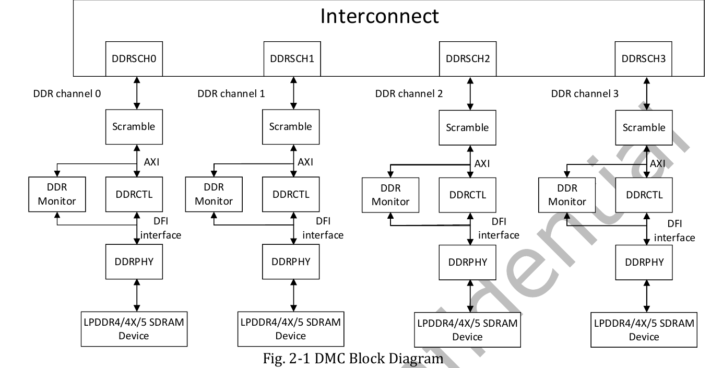

:tocdepth: 1

***************
DDR trên RK3588
***************

.. admonition:: Trang này trả lời

   - RK3588 dùng loại DRAM nào, mấy kênh, bề rộng bus bao nhiêu?
   - Băng thông DDR tối đa của bộ điều khiển là bao nhiêu, tính từ đâu?
   - NPU truy cập DDR theo đường nào, và đo lưu lượng DDR của một mô hình ra sao?
   - Phần nào về DDR chưa có nguồn?

.. admonition:: Tóm tắt

   - Datasheet ghi giao diện bộ nhớ ngoài là quad channel LPDDR4/LPDDR4X/LPDDR5, mỗi kênh rộng 16 bit, tối đa 2 rank mỗi kênh, tổng 32GB. Bản RK3588S (V1.7) ghi cùng các dòng này [T1 DS V1.7 tr.7] [T1 DS V1.7 tr.8] [T1 DS V1.3 tr.6] [T1 DS V0.1 tr.7].
   - Bộ điều khiển DMC hỗ trợ 4 kênh interleave (bus 64 bit, tối đa 32GB) hoặc 2 kênh interleave tùy chọn (bus 32 bit, tối đa 16GB), LPDDR4 đến LPDDR4-4267 và LPDDR5 đến LPDDR5-5500 [T1 TRM2 tr.55].
   - Hãng không nêu băng thông GB/s. Trần của bộ điều khiển trong trang này là phép suy ra: 34.1 GB/s (LPDDR4/4X) và 44.0 GB/s (LPDDR5) cho 4 kênh, bằng một nửa với 2 kênh [T1 TRM2 tr.55] [T1 TRM2 tr.56].
   - NPU là master AXI, đi qua interconnect và DDR scheduler vào DDRCTL. Phần bus, QoS, IOMMU và DDRCTL nằm ở :doc:`../01-phan-cung-npu/06-duong-truyen-du-lieu-iommu-va-ddr`.
   - Công cụ RKNN cho thấy lưu lượng DDR của mô hình: cột ``DDRCycles`` và ``RW(KB)`` theo từng toán tử, tổng ``Total Memory Read/Write Per Frame Size(KB)`` [T1 UG232 tr.32].
   - Zero-copy giảm băng thông DDR vì không sao chép dữ liệu giữa các IP [T1 UG232 tr.8]. Kích thước toán tử căn lề đúng cũng làm DDR đọc ghi hiệu quả hơn [T1 UG232 tr.144].
   - Bốn kênh điều khiển DDR Channel 0..3 ánh xạ tương ứng ra bốn nhóm chân 16-bit ``DDR_CH0_*_A``, ``DDR_CH0_*_B``, ``DDR_CH1_*_C`` và ``DDR_CH1_*_D`` [T1 TRM2 tr.555-558] [T1 DS V1.7 tr.21]. Loại chip DRAM và tốc độ thực tế phụ thuộc thiết kế từng bo mạch (ví dụ một bo mạch RK3588 dùng 16 GB LPDDR4X đạt 8807 MiB/s đo bằng ``mbw`` [T2 EDGE tr.3]).

.. contents:: Trong trang này
   :local:
   :depth: 1

.. _sec-ddr-tren-rk3588:

1. Loại DDR và băng thông
=========================

Mọi lớp của mạng nơ-ron đều đọc trọng số và đọc ghi tensor trung gian. Khi dữ liệu không nằm vừa trong SRAM trên chip, chúng đi qua DRAM ngoài. Suy ra: băng thông DDR là một trần của tốc độ suy luận, bên cạnh trần tính toán (MAC). Nền tảng về roofline và phân cấp bộ nhớ ở :doc:`../../01-kien-thuc-nen/02-npu/02-dataflow-va-phan-cap-bo-nho`. Mục này trả lời DDR của RK3588 là loại gì và trần của bộ điều khiển tính ra sao.

1.1 Giao diện bộ nhớ ngoài theo datasheet
-----------------------------------------

Phần Overview của datasheet mô tả giao diện bộ nhớ ngoài là quad channel và hỗ trợ ba chuẩn LPDDR. Phần Features nêu bề rộng từng kênh:

   "Support four channels, each channel 16bits data widths" [T1 DS V1.7 tr.8]

Các dòng về bộ nhớ ngoài giống nhau ở các bản datasheet đã đọc:

.. list-table:: Mục Dynamic Memory Interface trong datasheet
   :header-rows: 1
   :widths: 30 34 36

   * - Nội dung
     - Giá trị
     - Nguồn
   * - Chuẩn
     - JEDEC LPDDR4/LPDDR4X/LPDDR5
     - [T1 DS V1.7 tr.8] [T1 DS V1.3 tr.7] [T1 DS V0.1 tr.8]
   * - Số kênh và bề rộng mỗi kênh
     - 4 kênh, mỗi kênh 16 bit
     - [T1 DS V1.7 tr.8] [T1 DS V1.3 tr.7] [T1 DS V0.1 tr.8]
   * - Rank
     - Tối đa 2 rank (chip select) mỗi kênh
     - [T1 DS V1.7 tr.8] [T1 DS V1.3 tr.7] [T1 DS V0.1 tr.8]
   * - Không gian địa chỉ
     - Tối đa 32GB
     - [T1 DS V1.7 tr.8] [T1 DS V1.3 tr.7] [T1 DS V0.1 tr.8]
   * - Chế độ tiết kiệm điện
     - Power-down và self-refresh cho SDRAM
     - [T1 DS V1.7 tr.8] [T1 DS V1.3 tr.7]
   * - Mô tả tổng quan
     - "quad channel external memory interface (LPDDR4/LPDDR4X/LPDDR5)"
     - [T1 DS V1.7 tr.7] [T1 DS V1.3 tr.6] [T1 DS V0.1 tr.7]

Sơ đồ khối của datasheet ghi khối External Memory Interface với nhãn LPDDR4/LPDDR4X/LPDDR5 và Quad-channel x16bit [T1 DS V1.7 tr.17] [T1 DS V1.3 tr.16]. Phần Overview của bản RK3588S V1.7 viết "RK3588S has high-performance quad channel external memory interface" [T1 DS V1.7 tr.7], nên về DDR hai biến thể không khác nhau theo datasheet.

1.2 Bộ điều khiển DMC và các cấu hình hợp lệ
--------------------------------------------

TRM2 chương 2 mô tả DMC gồm DDRCTL (bộ điều khiển) và DDRPHY. Danh sách tính năng cho biết các cấu hình bộ điều khiển chấp nhận:

   "Support up to 4-channel interleaving with a maximum of 32GB capacity in total, 2 ranks for each channel" [T1 TRM2 tr.55]

.. list-table:: Tính năng bộ nhớ của DMC
   :header-rows: 1
   :widths: 32 44 24

   * - Mục
     - Nội dung theo TRM2
     - Nguồn
   * - Giao thức
     - LPDDR4/4X/5. LPDDR4 đến LPDDR4-4267, LPDDR5 đến LPDDR5-5500
     - [T1 TRM2 tr.55]
   * - 4 kênh interleave
     - Bus dữ liệu 64 bit, tối đa 32GB, 2 rank mỗi kênh
     - [T1 TRM2 tr.55]
   * - 2 kênh interleave (tùy chọn)
     - Bus dữ liệu 32 bit, tối đa 16GB, 2 rank mỗi kênh
     - [T1 TRM2 tr.55]
   * - Tỉ lệ tần số
     - 1:2:2 (LPDDR4/4X), 1:1:2 hoặc 1:1:4 (LPDDR5), điều khiển bằng phần mềm
     - [T1 TRM2 tr.55]
   * - Burst
     - Burst16 cho LPDDR4/4X/5
     - [T1 TRM2 tr.55]
   * - Đổi tần số lúc chạy
     - LPDDR4/4X/5 đổi tần số do phần mềm điều khiển
     - [T1 TRM2 tr.55]
   * - Scramble
     - Có, mặc định bị bypass
     - [T1 TRM2 tr.55] [T1 TRM2 tr.57]
   * - DDR monitor
     - Mỗi kênh một module, thống kê chu kỳ idle, số lệnh activate, read, write, page hit, page miss
     - [T1 TRM2 tr.55]

Tốc độ trần của PHY được nêu riêng:

   "up to 4267Mbps for LPDDR4/4X and up to 5500Mbps for LPDDR5" [T1 TRM2 tr.56]

Cùng đoạn mô tả PHY có câu "It supports all JEDEC DDR3/DDR3L/DDR4/LPDDR3/LPDDR4 SDRAM components in the market." [T1 TRM2 tr.56]. Đây có thể là mô tả của IP PHY chung (suy ra, TRM không nói như vậy), mâu thuẫn bề mặt với tính năng LPDDR4/4X/5 của DMC. Trang này chỉ khẳng định LPDDR4/4X/5 theo Overview và datasheet.

Cùng đoạn, TRM2 ghi các chân SSTL I/O chạy "up to 2133MHz" [T1 TRM2 tr.56]. Với LPDDR4 dữ liệu truyền ở cả hai sườn xung, nên 2133 MHz tương ứng 4267 Mbps trên mỗi chân (suy ra, TRM2 không viết quan hệ này).

Mỗi kênh DDRCTL chỉ có một cổng AXI và có DDR scheduler riêng phía interconnect [T1 TRM2 tr.56]. Địa chỉ scheduler, bảng ánh xạ địa chỉ kênh khi không interleave và các thanh ghi cấu hình DDRCTL đã mô tả ở :ref:`sec-npu-ddr-controller`, trang này không lặp.

.. _fig-ddr-dmc-4-kenh:

   Sơ đồ khối DMC 4 kênh interleave: DDRSCH0 đến 3, DDR channel 0 đến 3, Scramble, AXI, DDRCTL kèm DDR Monitor, DFI, DDRPHY, thiết bị LPDDR4/4X/5. Nguồn: [T1 TRM2 tr.56, Fig. 2-1]

1.3 Trần băng thông của bộ điều khiển
-------------------------------------

Hãng không nêu băng thông GB/s của DDR trong datasheet và TRM2 chương 1 đến 2 (đã tìm từ khóa ``GB/s``, ``MB/s``, ``peak``, ``theoretical`` trong DS V1.7, DS V1.3, DS V0.1 và TRM2 tr.16 đến tr.80, không có giá trị băng thông DDR). Có thể tính trần của bộ điều khiển từ ba số đã trích:

- Tốc độ mỗi chân tối đa: 4267 Mbps (LPDDR4/4X) và 5500 Mbps (LPDDR5) [T1 TRM2 tr.56].
- Bề rộng bus: 16 bit mỗi kênh [T1 DS V1.7 tr.8], 64 bit với 4 kênh interleave và 32 bit với 2 kênh [T1 TRM2 tr.55].
- Đổi bit sang byte bằng cách chia 8.

Công thức (suy ra):

.. math::

   B_{\text{trần}} \;[\text{MB/s}] \;=\; \frac{\text{tốc độ mỗi chân [Mbps]} \times \text{bề rộng bus [bit]}}{8}

.. _tbl-ddr-bang-thong-suy-ra:

.. list-table:: Trần băng thông của bộ điều khiển (suy ra, đơn vị 1 GB = 1000 MB)
   :header-rows: 1
   :widths: 26 14 28 16 16

   * - Cấu hình
     - Bus
     - Phép tính
     - MB/s
     - GB/s
   * - LPDDR4/4X-4267, 1 kênh
     - 16 bit
     - 4267 x 16 / 8
     - 8534
     - 8.5
   * - LPDDR5-5500, 1 kênh
     - 16 bit
     - 5500 x 16 / 8
     - 11 000
     - 11.0
   * - LPDDR4/4X-4267, 2 kênh
     - 32 bit
     - 4267 x 32 / 8
     - 17 068
     - 17.1
   * - LPDDR5-5500, 2 kênh
     - 32 bit
     - 5500 x 32 / 8
     - 22 000
     - 22.0
   * - LPDDR4/4X-4267, 4 kênh
     - 64 bit
     - 4267 x 64 / 8
     - 34 136
     - 34.1
   * - LPDDR5-5500, 4 kênh
     - 64 bit
     - 5500 x 64 / 8
     - 44 000
     - 44.0

Nguồn đầu vào của cả bảng: [T1 TRM2 tr.55] [T1 TRM2 tr.56]. Đây là trần cấu hình tối đa của bộ điều khiển (suy ra). Đó không phải băng thông của một board cụ thể, vì loại DRAM, speed grade và số kênh thực phụ thuộc thiết kế board (xem mục 3). TRM2 nói DDR scheduler sắp xếp lại giao dịch để tối đa hiệu suất DDR [T1 TRM2 tr.16], nên hiệu suất DRAM không bằng trần là điều hợp lý (suy ra), nhưng nguồn không nêu tỉ lệ.

**Hai ví dụ dùng số tần số có trong tài liệu RKNN (suy ra có điều kiện).** Hai tài liệu RKNN có đưa tần số DDR, nhưng không nói đó là cấu hình mặc định hay loại DRAM nào:

- ``DDR Current Frequency List`` trong ví dụ đầu ra của ``eval_perf`` là 2112000000 Hz, ghi chú "the frequencies supported by different firmware may vary" [T1 UG232 tr.31]. Nếu tần số này là xung clock DDR và dữ liệu truyền ở cả hai sườn (cùng cách hiểu với 2133 MHz và 4267 Mbps ở mục 1.2), tốc độ mỗi chân là 4224 Mbps. Với bus 64 bit, trần là 4224 x 64 / 8 = 33 792 MB/s (33.8 GB/s).
- Ví dụ khóa tần số DDR "at 1560MHz" [T1 UG152 tr.72]. Với cùng giả định, 3120 Mbps và bus 64 bit cho 3120 x 64 / 8 = 24 960 MB/s (25.0 GB/s).

Cả hai ví dụ phụ thuộc vào hai giả định (xung clock nhân đôi, 4 kênh interleave). Nguồn không xác nhận giả định nào, nên chỉ dùng để thấy bậc độ lớn.

**Một số đo từ bài báo (T2).** Bài báo EDGE báo RK3588 có bộ nhớ "16 GB LPDDR4X" và băng thông 8807 MiB/s, đo bằng ``mbw``, và nói rõ đây là:

   "reflecting practical throughput rather than theoretical peak specifications" [T2 EDGE tr.3]

8807 MiB/s tương đương 9235 MB/s (suy ra, nhân 1.048576), tức khoảng 27% của trần 34 136 MB/s ở bảng trên. Tỉ lệ này không phải hiệu suất của DDR: ``mbw`` đo sao chép bộ nhớ từ CPU, bài báo không nêu số kênh hay tốc độ DRAM của board, và nguồn không nói ``mbw`` có chạm trần DDR hay không.

2. NPU truy cập DDR thế nào
===========================

2.1 Đường đi của một giao dịch
------------------------------

NPU không dùng DMAC của SoC. NPU có cổng AXI master riêng và các khối DMA con (DDMA, SDMA) trong IP. Giao dịch đi qua BIU (nơi đặt QoS), interconnect, DDR scheduler của kênh, một cổng AXI vào DDRCTL, rồi qua DFI sang DDRPHY và chip DRAM. Chi tiết nằm ở trang bus, trang này chỉ liệt kê điểm vào:

.. list-table:: Phần đường đi đã có trang chủ
   :header-rows: 1
   :widths: 34 66

   * - Nội dung
     - Nơi đọc
   * - Interconnect, DDR scheduler, QoS, probe đo lưu lượng
     - :ref:`sec-npu-interconnect-qos`
   * - IOMMU của NPU (TRM không nêu, DTS và driver có)
     - :ref:`sec-npu-iommu`
   * - Cổng AXI của DDRCTL, QoS ở DDRCTL, DMA của NPU
     - :ref:`sec-npu-ddr-controller`
   * - System SRAM mà NPU dùng thay DDR
     - :doc:`../01-phan-cung-npu/03-che-do-da-loi-va-system-sram` và :doc:`02-sram-cho-npu`

2.2 Không gian địa chỉ và đồng bộ cache
---------------------------------------

Vùng nhớ NPU truy cập nằm trong IOMMU address space. Khi mô tả ngữ cảnh matmul, UG232 ghi kích thước mỗi IOMMU address space là 4GB và mỗi ngữ cảnh ứng với một address space [T1 UG232 tr.45]. Nếu bộ nhớ NPU cấp phát trong một domain vượt 4GB thì phải chuyển sang domain khác, qua tham số ``iommu_domain_id`` (driver hỗ trợ tối đa 16 domain IOMMU qua ioctl ``RKNPU_SET_IOMMU_DOMAIN_ID``) [T1 UG232 tr.45].

CPU và NPU cùng truy cập một vùng nhớ có cờ cacheable thì dữ liệu trong cache CPU có thể khác dữ liệu trong DDR. UG232 mô tả vấn đề này và yêu cầu gọi ``rknn_mem_sync`` để đồng bộ, theo hai hướng: từ CPU sang NPU (đẩy cache xuống DDR trước khi NPU đọc) và từ NPU sang CPU (làm mới cache trước khi CPU đọc kết quả) [T1 UG232 tr.112]. Cờ bộ nhớ và cách dùng zero-copy ở :doc:`03-zero-copy-can-le-profiling-api`.

2.3 Giảm lưu lượng DDR
----------------------

Tài liệu RKNN nêu hai cách giảm lưu lượng hoặc tăng hiệu quả DDR:

.. list-table:: Hai cách giảm áp lực lên DDR theo UG232
   :header-rows: 1
   :widths: 24 50 26

   * - Cách
     - Nội dung
     - Nguồn
   * - Zero-copy API
     - Lấy dữ liệu giữa các IP mà không sao chép, ví dụ dữ liệu từ camera hoặc đã giải mã đưa thẳng vào NPU
     - [T1 UG232 tr.8]
   * - Căn lề kích thước toán tử
     - Một số kích thước thân thiện với DDR hơn, các quy tắc này không bắt buộc
     - [T1 UG232 tr.144]

Với zero-copy, câu then chốt của UG232 là:

   "It supports obtaining data between different IP cores without data copying to reduce CPU and DDR bandwidth consumption." [T1 UG232 tr.8]

Về căn lề, UG232 nêu nguyên nhân là hiệu quả đọc ghi:

   "Under the same bandwidth conditions, more friendly reading and writing will improve the bandwidth efficiency of DDR, thereby achieving better performance." [T1 UG232 tr.144]

Bảng căn lề kênh cho RK3588 là Table 8-2: ví dụ Conv Int8 có Input Channel 32 và Output Channel 32 [T1 UG232 tr.145]. UG232 cũng nêu với toán tử cùng kích thước thì Width lớn và Height nhỏ thân thiện với DDR hơn [T1 UG232 tr.145]. Bảng đầy đủ và cách áp dụng ở :doc:`03-zero-copy-can-le-profiling-api`.

2.4 Đo lưu lượng DDR của một mô hình
------------------------------------

Có ba nơi cho số liệu về DDR, ở ba mức khác nhau:

.. list-table:: Nguồn số liệu về lưu lượng DDR
   :header-rows: 1
   :widths: 24 46 30

   * - Mức
     - Số liệu
     - Nguồn
   * - Công cụ RKNN, theo toán tử
     - ``DDRCycles`` ("DDR reading and writing clock cycles"), ``NPUCycles``, ``MaxCycles`` ("Maximum values of DDR Cycles and NPU Cycles"), ``RW(KB)`` ("Total amount of data read and written")
     - [T1 UG232 tr.32]
   * - Công cụ RKNN, theo khung hình
     - ``Total Memory Read/Write Per Frame Size(KB)`` ("Total bandwidth consumption of a single frame for model inference")
     - [T1 UG232 tr.32]
   * - Phần cứng, interconnect
     - 12 probe theo dõi thống kê lưu lượng DDR scheduler
     - [T1 TRM2 tr.20]
   * - Phần cứng, DDRCTL
     - DDR monitor mỗi kênh: chu kỳ idle, số activate, read, write, page hit, page miss
     - [T1 TRM2 tr.55]

Các cột ``DDRCycles`` và ``NPUCycles`` đặt cạnh nhau trong cùng bảng, và cột ``MaxCycles`` lấy giá trị lớn hơn của hai cột [T1 UG232 tr.32]. Suy ra: toán tử có ``DDRCycles`` lớn hơn ``NPUCycles`` bị giới hạn bởi truy cập DDR nhiều hơn bởi tính toán. UG232 không viết kết luận này, và nguồn cũng không nói hai bộ đếm đo ở clock nào (xem mục 3). ``eval_perf`` còn in tần số CPU, NPU và DDR hiện tại [T1 UG232 tr.31]. Cách bật ``perf_debug`` và đọc từng cột ở :doc:`03-zero-copy-can-le-profiling-api`.

2.5 Tần số DDR khi đo
---------------------

UG232 yêu cầu lập baseline môi trường trước khi phân tích hiệu năng, gồm đọc và đặt tần số CPU, DDR, NPU. Tần số cố định ảnh hưởng trực tiếp tốc độ chạy, nhưng quan hệ giữa tần số và hiệu năng không tuyến tính và tần số cao hơn kéo theo công suất tiêu thụ cao hơn [T1 UG232 tr.136]. Với chạy nhiều core, mẹo đầu tiên là đặt tần số CPU, DDR và NPU lên cao nhất [T1 UG232 tr.75]. UG152 đưa lệnh truy vấn tần số DDR qua ``devfreq`` và khóa tần số DDR cần firmware bổ sung [T1 UG152 tr.72]. Vì tần số DDR thay đổi thì trần băng thông ở mục 1.3 thay đổi theo, mọi so sánh hiệu năng giữa các lần chạy cần ghi rõ tần số DDR.

3. Ánh xạ chân vật lý và ranh giới cấu hình theo bo mạch
========================================================

.. list-table:: Ánh xạ kênh và ranh giới thông tin theo nguồn T1/T2
   :header-rows: 1
   :widths: 30 70

   * - Chủ đề
     - Nội dung xác thực theo nguồn
   * - Ánh xạ tên chân ``DDR_CH0_*`` và ``DDR_CH1_*`` (hậu tố ``_A`` đến ``_D``) sang kênh DDRCTL 0 đến 3
     - Mục ``2.5 Interface Description`` (Table 2-1 đến Table 2-4) của TRM2 ánh xạ trực tiếp: ``DDR Channel 0`` ứng với ``DDR_CH0_*_A``, ``DDR Channel 1`` ứng với ``DDR_CH0_*_B``, ``DDR Channel 2`` ứng với ``DDR_CH1_*_C`` và ``DDR Channel 3`` ứng với ``DDR_CH1_*_D`` (mỗi nhóm có 16 đường dữ liệu ``DQ0..15``) [T1 TRM2 tr.555-558] [T1 DS V1.7 tr.21].
   * - Trần băng thông lý thuyết so với cấu hình bo mạch
     - Datasheet và TRM2 chỉ công bố tốc độ bit mỗi chân (4267 Mbps và 5500 Mbps) cùng độ rộng bus 64 bit / 32 bit [T1 DS V1.7 tr.8] [T1 TRM2 tr.55-56]. Loại chip DRAM, số kênh nối thực tế và tần số khởi tạo do từng bo mạch và firmware bootloader quyết định (ví dụ bo mạch RK3588 trong nghiên cứu EDGE trang bị 16 GB LPDDR4X và đạt 8807 MiB/s khi đo bằng ``mbw`` [T2 EDGE tr.3]).
   * - Băm địa chỉ interleave và IOMMU
     - Cơ chế interleave 4 kênh dùng các thanh ghi ``SGRF_DDR_HASH_CON0..7`` trong ``DSU_SGRF`` và ``BUS_SGRF`` (chi tiết tại :ref:`sec-npu-ddr-controller` và :ref:`sec-npu-iommu`) [T1 TRM2 tr.54].
   * - Quy đổi ``DDRCycles`` và ``NPUCycles``
     - UG232 giải thích ``DDRCycles`` đã được quy đổi sang số chu kỳ ở tần số clock của NPU nên có thể so sánh trực tiếp với ``NPUCycles`` để xác định lớp bị nghẽn băng thông hay nghẽn tính toán [T1 UG232 tr.32, tr.140].

4. Hiểu sai thường gặp
======================

.. list-table::
   :header-rows: 1
   :widths: 28 50 22

   * - Hiểu sai
     - Thực tế theo nguồn
     - Nguồn
   * - RK3588 luôn đạt 34.1 hoặc 44.0 GB/s trên mọi bo mạch.
     - Đó là trần lý thuyết suy ra từ speed grade tối đa (4267/5500 Mbps) và bề rộng bus 64 bit, còn băng thông thực phụ thuộc loại DRAM và tần số của từng bo mạch.
     - [T1 TRM2 tr.55] [T1 TRM2 tr.56]
   * - Mọi board RK3588 có 4 kênh LPDDR5.
     - Datasheet và TRM2 nêu khả năng của bộ điều khiển (4 kênh hoặc 2 kênh, LPDDR4/4X/5). Cấu hình của board là thiết kế riêng.
     - [T1 DS V1.7 tr.8] [T1 TRM2 tr.55]
   * - RK3588S có ít kênh DDR hơn RK3588.
     - Datasheet V1.7 của RK3588S ghi cùng "four channels, each channel 16bits data widths" và 32GB.
     - [T1 DS V1.7 tr.8]
   * - Tần số DDR trong ví dụ ``eval_perf`` là tần số mặc định.
     - UG232 ghi tần số hỗ trợ khác nhau theo firmware. Đó là ví dụ đầu ra.
     - [T1 UG232 tr.31]
   * - ``mbw`` 8807 MiB/s là băng thông đỉnh của RK3588.
     - Bài báo ghi rõ số này phản ánh throughput thực tế, không phải đỉnh lý thuyết.
     - [T2 EDGE tr.3]

Nguồn
=====

Các nhãn nguồn dùng trong trang này (tier, tệp, số lần trích).

.. list-table::
   :header-rows: 1
   :widths: 12 8 70 10

   * - Nhãn
     - Tier
     - Nguồn
     - Số lần
   * - ``TRM2``
     - T1
     - :download:`rk3588_part2.pdf <../../../_assets/pdf/datasheet/trm/rk3588_part2.pdf>` (số trang in bằng số trang PDF)
     - 32
   * - ``DS V1.7``
     - T1
     - :download:`Rockchip_RK3588S_Datasheet_V1.7.pdf <../../../_assets/pdf/datasheet/soc/Rockchip_RK3588S_Datasheet_V1.7.pdf>` (trang in bằng số trang PDF)
     - 17
   * - ``DS V1.3``
     - T1
     - :download:`Rockchip_RK3588_Datasheet_V1.3_20220328.pdf <../../../_assets/pdf/datasheet/soc/Rockchip_RK3588_Datasheet_V1.3_20220328.pdf>` (số trang PDF)
     - 8
   * - ``DS V0.1``
     - T1
     - :download:`02_RK3588_Datasheet_V0.1-20210727.pdf <../../../_assets/pdf/datasheet/soc/02_RK3588_Datasheet_V0.1-20210727.pdf>` (số trang PDF)
     - 6
   * - ``UG232``
     - T1
     - ``3rdparty/rknn-toolkit2/doc/02_Rockchip_RKNPU_User_Guide_RKNN_SDK_V2.3.2_EN.pdf`` (SDK trong repo chính)
     - 21
   * - ``UG152``
     - T1
     - :download:`02_Rockchip_RKNPU_User_Guide_RKNN_API_V1.5.2_EN.pdf <../../../_assets/pdf/rknn/02_Rockchip_RKNPU_User_Guide_RKNN_API_V1.5.2_EN.pdf>`
     - 2
   * - ``EDGE``
     - T2
     - :download:`edgesoc_benchmark_2026kong.pdf <../../../_assets/pdf/papers/05_rk3588/edgesoc_benchmark_2026kong.pdf>`
     - 4
