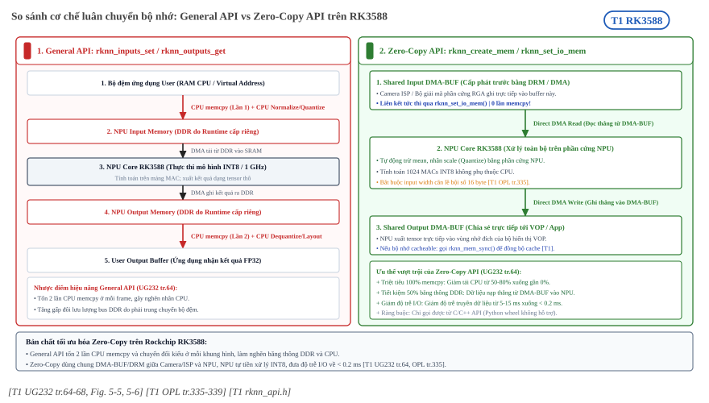
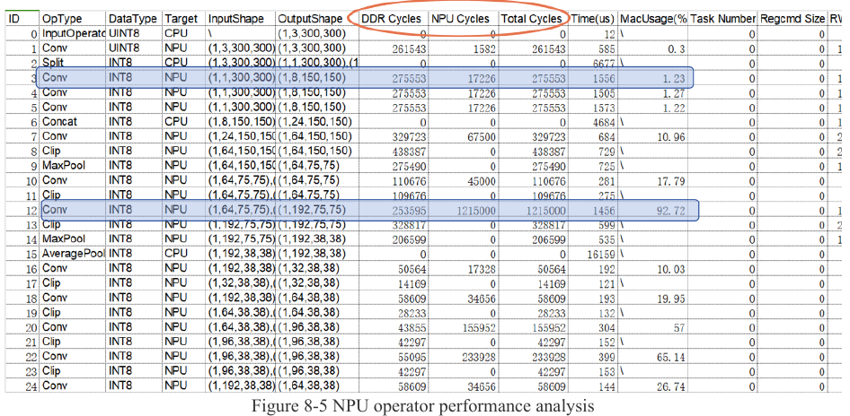

:tocdepth: 1

*********************************
Zero-copy căn lề và profiling API
*********************************

.. admonition:: Trang này trả lời

   - Zero-copy khác API thường ở đâu, và bộ nhớ cấp phát bằng cờ nào?
   - Dữ liệu vào phải căn lề thế nào để NPU nhận trực tiếp?
   - Đo thời gian từng lớp, bộ nhớ của model và phát hiện lớp nghẽn băng thông bằng API nào?

.. admonition:: Tóm tắt

   - API thường copy dữ liệu từ vùng nhớ ngoài vào vùng nhớ NPU ở mỗi frame. Zero-copy dùng thẳng vùng nhớ cấp trước nên giảm copy và băng thông [T1 UG232 tr.64].
   - Muốn tối ưu phải query bằng ``RKNN_QUERY_NATIVE_INPUT_ATTR``, không dùng ``RKNN_QUERY_INPUT_ATTR`` [T1 UG232 tr.69]. Ví dụ ``rknn_create_mem_demo.cpp`` dòng 205 lại dùng ``RKNN_QUERY_INPUT_ATTR`` (mâu thuẫn giữa hai nguồn, xem mục 1.6).
   - Điều kiện căn lề input cho RK3588: width căn 16 byte khi input 4 chiều có 1, 3 hoặc 4 kênh, ngược lại tổng kích thước căn 16 byte [T1 UG232 tr.65]. Ràng buộc này chỉ áp dụng cho zero-copy API [T1 OPL tr.335].
   - Bộ nhớ cacheable cần ``rknn_mem_sync`` theo đúng hướng để CPU và NPU thấy cùng dữ liệu [T1 UG232 tr.112] [T1 EX rknn_api.h:391-396].
   - Wheel RKNN-Toolkit2 và RKNN-Toolkit-Lite2 2.3.2 không có hàm cấp phát bộ nhớ hay đồng bộ cache cho Python. Zero-copy chỉ dùng được từ C API [T1 EX rknn_lite.py] [T1 EX rknn.py].
   - ``perf_debug=True`` cho thời gian từng lớp nhưng làm thời gian đo dài hơn [T1 API232 tr.16] [T1 UG232 tr.177]. ``eval_memory`` báo dung lượng bộ nhớ của model, không phải băng thông [T1 UG232 tr.33].
   - So ``DDR Cycles`` với ``NPU Cycles`` để biết lớp Conv nghẽn băng thông hay tính toán. Cột ``NPU Cycles`` hiện chỉ có cho Conv [T1 UG232 tr.140].

.. contents:: Trong trang này
   :local:
   :depth: 1

.. _zero-copy-co-bo-nho:

1. Zero-copy và cờ bộ nhớ
=========================

Nền. Khi suy luận một model RKNN, dữ liệu gốc đi qua ba bước: xử lý input, NPU chạy model, xử lý output [T1 UG232 tr.64]. Chi phí ẩn nằm ở bước đầu. Nếu buffer ảnh do ứng dụng cấp phát (ví dụ từ camera hoặc RGA), NPU không đọc thẳng được và runtime phải copy sang vùng nhớ riêng của NPU. Zero-copy loại bỏ lần copy này bằng cách để NPU đọc đúng vùng nhớ mà ứng dụng đã chuẩn bị.

1.1 Hai nhóm API
----------------

Trên RK3562, RK3566, RK3568, RK3576, RK3588 và RV1126B có hai nhóm API là general API (API thường) và zero-copy API. Dòng RV1103 và RV1106 chỉ có zero-copy [T1 UG232 tr.64]. Hai nhóm không gọi chung được [T1 UG232 tr.64].

   "...while the zero-copy interface uses preallocated memory directly (including memory created by NPU or other frame, such as DRM), reducing the cost of copying memory, better performance and less bandwidth." [T1 UG232 tr.64]

Điều kiện dùng: nếu dữ liệu của người dùng chỉ có địa chỉ ảo thì chỉ dùng được API thường. Nếu có địa chỉ vật lý hoặc fd thì dùng được cả hai [T1 UG232 tr.64].

.. _fig-zero-copy-fig5-5-5-6:

.. figure:: ../../../_assets/img/02-nen-tang-rk3588/04-bo-nho-hieu-nang/zero-copy-can-le-profiling-api/ug232-fig5-5-fig5-6-general-vs-zero-copy-api.png
   :align: center
   :alt: Luồng xử lý dữ liệu của general API và zero-copy API

   Luồng xử lý dữ liệu của general API (Figure 5-5) và zero-copy API (Figure 5-6). Nguồn: [T1 UG232 tr.65, Figure 5-5 và 5-6]

.. list-table:: Phân chia công việc giữa CPU và NPU. Nguồn: [T1 UG232 tr.65]
   :header-rows: 1
   :widths: 22 39 39

   * - Bước
     - General API
     - Zero-copy API
   * - Normalize, quantize input
     - Chạy trên CPU. Khi đủ điều kiện căn lề của zero-copy input thì chạy trên NPU, nhưng CPU vẫn phải copy input vào buffer input của model
     - Chạy trên NPU
   * - Suy luận
     - NPU
     - NPU
   * - Chuyển layout và dequantize output
     - CPU
     - CPU hoặc NPU

.. _fig-rknn-02-zero-copy-vs-general-api:

   So sánh cơ chế luân chuyển bộ nhớ: General API (2 lần CPU memcpy) vs Zero-Copy API (DMA-BUF trực tiếp) trên RK3588. Nguồn: [T1 UG232 tr.64-68] [T1 OPL tr.335-339]

1.2 Ba cách cấp phát
--------------------

Zero-copy API xoay quanh cấu trúc ``rknn_tensor_memory``. Người dùng tạo và gán cấu trúc này trước khi suy luận, rồi đọc thông tin bộ nhớ trong đó sau khi suy luận [T1 UG232 tr.66]. Có ba kiểu quy trình chuẩn (nguồn bảng: [T1 UG232 tr.66] [T1 UG232 tr.67] [T1 UG232 tr.68]).

.. list-table::
   :header-rows: 1
   :widths: 24 38 38

   * - Kiểu (Figure)
     - Hàm tạo bộ nhớ
     - Hàm gán vào model
   * - Input/output do runtime cấp (5-7)
     - ``rknn_create_mem()``
     - ``rknn_set_io_mem()``
   * - Input/output cấp từ ngoài (5-8)
     - ``rknn_create_mem_from_fd()`` hoặc ``rknn_create_mem_from_phys()``
     - ``rknn_set_io_mem()``. Người dùng tự flush cache của output theo loại bộ nhớ đã cấp
   * - Input/output/weight/internal cấp từ ngoài (5-9)
     - ``rknn_create_mem_from_fd()`` hoặc ``rknn_create_mem_from_phys()``
     - ``rknn_set_io_mem()``, ``rknn_set_weight_mem()``, ``rknn_set_internal_mem()``

Với kiểu đầu, bộ nhớ runtime cấp có sẵn fd và địa chỉ vật lý nên RGA dùng được thông tin bộ nhớ do NPU cấp [T1 UG232 tr.67]. ``rknn_set_io_mem`` chỉ cần gọi một lần đầu, sau đó gọi ``rknn_run()`` lặp lại [T1 UG232 tr.72]. Header còn có ``rknn_create_mem_from_mb_blk`` và ``rknn_create_mem2`` (cho phép truyền cờ cấp phát) [T1 EX rknn_api.h:682] [T1 EX rknn_api.h:708]. UG152 ghi hàm ``rknn_create_mem_from_mb_blk`` "has not been implemented Currently" [T1 UG152 tr.40].

1.3 Query thuộc tính native
---------------------------

Điểm dễ sai nhất là chọn loại query. Với zero-copy, UG232 yêu cầu:

   "Use RKNN_QUERY_NATIVE_INPUT_ATTR to query related attributes (note, not RKNN_QUERY_INPUT_ATTR)." [T1 UG232 tr.69]

Lý do là layout và kiểu trả về theo cách này là tối ưu về hiệu quả phần cứng [T1 UG232 tr.69]. Cách xử lý input phụ thuộc layout mà query trả về [T1 UG232 tr.69]. Layout NC1HWC2 được giải thích ở :ref:`layout-nc1hwc2`, trang này không lặp lại.

.. list-table::
   :header-rows: 1
   :widths: 24 42 34

   * - Layout query ra
     - Dữ liệu người dùng phải đưa vào
     - Nguồn
   * - ``RKNN_TENSOR_NHWC``
     - Input 4 chiều, 1/3/4 kênh. Xếp theo NHWC. Khi ``pass_through=1``, width có thể phải căn theo ``w_stride``
     - [T1 UG232 tr.69]
   * - ``RKNN_TENSOR_NC1HWC2``
     - Input 4 chiều, số kênh khác 1/3/4. Khi ``pass_through=0``, đưa NHWC và interface tự chuyển bằng CPU. Khi ``pass_through=1``, người dùng tự chuyển sang NC1HWC2
     - [T1 UG232 tr.69]
   * - ``RKNN_TENSOR_NCHW``
     - Input 4 chiều kiểu bool hoặc int64, xếp NCHW
     - [T1 UG232 tr.69]
   * - ``RKNN_TENSOR_UNDEFINED``
     - Input không phải 4 chiều. Đưa theo định dạng input của ONNX, NPU không làm mean/std hay đổi layout
     - [T1 UG232 tr.69]

Output làm tương tự với ``RKNN_QUERY_NATIVE_OUTPUT_ATTR``. Nếu cần output NHWC thì query bằng ``RKNN_QUERY_NATIVE_NHWC_OUTPUT_ATTR`` [T1 UG232 tr.70]. Header khai báo các mã query này ở dòng 149 đến 156 [T1 EX rknn_api.h:149-156].

Người dùng được sửa ``rknn_tensor_attr`` sau khi query để đổi kiểu (Table 5-3 đến 5-5 liệt kê các cặp đổi được) [T1 UG232 tr.69] [T1 UG232 tr.70] [T1 UG232 tr.71]. Cái giá của việc đổi nằm ở hai chỗ:

- Kiểu lớn hơn đòi hỏi vùng nhớ lớn hơn. Query ra uint8 mà muốn đưa float32 thì phải nhân kích thước ``rknn_tensor_attr`` lên bốn lần và đặt kiểu ``RKNN_TENSOR_FLOAT32`` [T1 UG232 tr.69]. Với input 1x3x640x640 uint8, vùng nhớ từ 1 228 800 byte (640 x 640 x 3, suy ra) thành 4 915 200 byte.
- Hiệu quả phần cứng không còn tối ưu và CPU được gọi bên trong interface để đổi kiểu [T1 UG232 tr.69]. Quy tắc này áp dụng tương tự cho output [T1 UG232 tr.70].

Kích thước vùng nhớ lấy mặc định từ ``size_with_stride`` khi không đổi layout hay kiểu. Nếu đổi thì phải tạo theo kích thước tương ứng [T1 UG232 tr.72]. Trường này là "the bytes size of tensor with stride" [T1 EX rknn_api.h:300].

1.4 Cờ cấp phát và đồng bộ cache
--------------------------------

Cờ cấp phát đi vào ``rknn_create_mem2``. Header khai báo ba cờ [T1 EX rknn_api.h:381-386]:

.. list-table::
   :header-rows: 1
   :widths: 40 14 46

   * - Cờ ``rknn_mem_alloc_flags``
     - Giá trị
     - Ý nghĩa theo chú thích header
   * - ``RKNN_FLAG_MEMORY_CACHEABLE``
     - ``1 << 0``
     - Tạo bộ nhớ cacheable. ``RKNN_FLAG_MEMORY_FLAGS_DEFAULT`` (giá trị 0) cùng nghĩa với cờ này
   * - ``RKNN_FLAG_MEMORY_NON_CACHEABLE``
     - ``1 << 1``
     - Tạo bộ nhớ non-cacheable
   * - ``RKNN_FLAG_MEMORY_TRY_ALLOC_SRAM``
     - ``1 << 2``
     - Thử cấp trong SRAM, thiếu thì phần còn lại cấp trong DRAM

``RKNN_FLAG_MEMORY_TRY_ALLOC_SRAM`` chỉ thấy ở header, không thấy trong UG232 hay API232 (tìm ở: UG232, API232, từ khóa ``TRY_ALLOC_SRAM``). Cách cấu hình SRAM cho NPU nằm ở :doc:`02-sram-cho-npu`.

Cacheable kéo theo vấn đề nhất quán dữ liệu. CPU ghi vào vùng cacheable thì dữ liệu có thể còn nằm trong cache CPU. UG232 nêu rõ:

   "When the CPU writes data to the cacheable memory, and then when the NPU accesses the memory, it must ensure that the data in the CPU cache is synchronized to the DDR." [T1 UG232 tr.112]

Chiều ngược lại cũng vậy: NPU ghi xong thì CPU chỉ đọc đúng khi dữ liệu DDR khớp với cache CPU [T1 UG232 tr.112]. API là ``rknn_mem_sync(context, mem, mode)`` [T1 UG232 tr.112] [T1 EX rknn_api.h:798].

Enum ``rknn_mem_sync_mode`` có ba giá trị: ``RKNN_MEMORY_SYNC_TO_DEVICE`` (0x1, CPU sang NPU, dùng sau khi CPU ghi), ``RKNN_MEMORY_SYNC_FROM_DEVICE`` (0x2, NPU sang CPU, dùng sau khi NPU ghi) và ``RKNN_MEMORY_SYNC_BIDIRECTIONAL`` (cả hai hướng, dùng khi không chắc hướng) [T1 UG232 tr.112] [T1 EX rknn_api.h:391-396]. UG232 khuyên khi đã rõ hướng thì dùng chế độ một chiều để tránh flush cache thừa [T1 UG232 tr.112].

Header có thêm hai cờ khởi tạo context liên quan đến cache: ``RKNN_FLAG_DISABLE_FLUSH_INPUT_MEM_CACHE`` và ``RKNN_FLAG_DISABLE_FLUSH_OUTPUT_MEM_CACHE``. Với cờ sau, CPU không được đọc trực tiếp ``output_mem->virt_addr`` mà phải gọi ``rknn_mem_sync(ctx, mem, RKNN_MEMORY_SYNC_FROM_DEVICE)``. Cờ này dùng khi output chỉ do GPU hoặc RGA truy cập, nhằm bớt thời gian flush cache [T1 EX rknn_api.h:79-89].

Ở phía driver, hai thao tác tương ứng tồn tại: cờ ``RKNPU_MEM_CACHEABLE`` (``1 << 1``) làm cấp phát DMA thêm thuộc tính ``DMA_ATTR_NON_CONSISTENT`` khi macro tồn tại [T1 DRV include/rknpu_ioctl.h:60] [T1 DRV rknpu_gem.c:165-171], và ioctl ``rknpu_gem_sync_ioctl`` gọi ``dma_sync_single_range_for_device`` hoặc ``dma_sync_single_range_for_cpu`` theo cờ ``RKNPU_MEM_SYNC_TO_DEVICE`` và ``RKNPU_MEM_SYNC_FROM_DEVICE`` [T1 DRV rknpu_gem.c:1667] [T1 DRV rknpu_gem.c:1694-1700]. Ba cờ ``RKNN_FLAG_MEMORY_CACHEABLE``, ``RKNN_FLAG_MEMORY_NON_CACHEABLE`` và ``RKNN_FLAG_MEMORY_TRY_ALLOC_SRAM`` của ``rknn_api.h`` đối ứng trực tiếp với các cờ ``RKNPU_MEM_CACHEABLE``, ``RKNPU_MEM_NON_CACHEABLE`` và ``RKNPU_MEM_TRY_ALLOC_SRAM`` trong ``rknpu_ioctl.h`` [T1 EX rknn_api.h:381-386] [T1 DRV include/rknpu_ioctl.h:60-74].

1.5 Python không có zero-copy
-----------------------------

Hàm công khai của lớp ``RKNNLite`` trong wheel 2.3.2 chỉ gồm ``load_rknn``, ``list_devices``, ``init_runtime``, ``inference``, ``get_sdk_version``, ``list_support_target_platform`` và ``release`` [T1 EX rknn_lite.py]. Lớp ``RKNN`` của RKNN-Toolkit2 cũng không có hàm tạo bộ nhớ, gán I/O hay đồng bộ cache [T1 EX rknn.py]. Vì vậy zero-copy với ``rknn_create_mem`` chỉ dùng được từ C API. Đường Python dùng API thường, có tham số ``inputs_pass_through`` để bỏ bước mean/std trong tool [T1 API232 tr.18].

1.6 Điểm khác biệt giữa hướng dẫn UG232 và mã demo
--------------------------------------------------

- UG232 yêu cầu query input zero-copy bằng ``RKNN_QUERY_NATIVE_INPUT_ATTR`` [T1 UG232 tr.69], trong khi tệp ví dụ ``rknn_create_mem_demo.cpp`` gọi ``RKNN_QUERY_INPUT_ATTR`` ở dòng 205 rồi tự gán lại ``type = RKNN_TENSOR_UINT8`` (dòng 251) và ``fmt = RKNN_TENSOR_NHWC`` (dòng 253) trước khi gọi ``rknn_create_mem`` ở dòng 255 (với input 4 chiều 3 kênh, native layout cũng là ``NHWC`` theo mục 1.3 nên ví dụ này vẫn khớp) [T1 EX rknn_create_mem_demo.cpp:205, 251-255].
- Với output, cả ví dụ trong UG152 lẫn UG232 đều dùng ``RKNN_QUERY_NATIVE_OUTPUT_ATTR`` rồi ``rknn_create_mem(ctx, size_with_stride)`` [T1 UG152 tr.44] [T1 UG232 tr.70].
- Bội số căn lề 16 byte trong Table 5-2 cho nhóm RK3588 khớp với kích thước một khối kênh ``C2`` (16 phần tử INT8 x 1 byte = 16 byte, hoặc 8 phần tử FP16 x 2 byte = 16 byte) của định dạng phần cứng ``NC1HWC2`` [T1 UG232 tr.61, tr.65] [T1 OPL tr.336].

--------------

.. _can-le-zero-copy:

2. Căn lề
=========

Nền. Căn lề (alignment) là yêu cầu một kích thước chia hết cho một giá trị để phần cứng đọc ghi đúng hoặc hiệu quả. Mỗi loại căn lề có lý do và mức bắt buộc khác nhau. Bảng so sánh bốn loại căn lề, kèm các bảng C2 và channel của output, đã có ở :ref:`layout-alignment`. Mục này chỉ bổ sung phần thuộc zero-copy và bộ nhớ.

2.1 Điều kiện zero-copy cho input
---------------------------------

.. list-table:: Table 5-2: yêu cầu căn lề input của zero-copy
   :header-rows: 1
   :widths: 30 35 35

   * - Input
     - RV1103B, RV1106B, RK3566, RK3568
     - RV1103, RV1106, RV1126B, RK3562, RK3576, RK3588
   * - 4 chiều, số kênh 1, 3 hoặc 4
     - Width căn 8 byte
     - Width căn 16 byte
   * - Không phải 4 chiều
     - Tổng kích thước căn 8 byte
     - Tổng kích thước căn 16 byte

Nguồn bảng: [T1 UG232 tr.65]. Ghi chú đi kèm trong OPL: ràng buộc này chỉ áp dụng cho zero-copy API, API thường không có ràng buộc căn lề này. Giá trị căn của width tra được từ thuộc tính ``w_stride`` và không đổi được [T1 OPL tr.335]. Header khẳng định ``w_stride`` là "read-only" và bằng 0 nghĩa là bằng width [T1 EX rknn_api.h:298-299]. Giá trị theo đơn vị phần tử cho từng kiểu dữ liệu của RK3588 nằm ở OPL tr.336 và đã được tổng hợp ở :ref:`layout-alignment`.

Ví dụ suy ra: ảnh 640x640x3 có width 640, chia hết cho 16, nên theo quy tắc trên không cần đệm (suy ra, đơn vị của "16 byte" so với "16 phần tử" cần đọc theo OPL tr.336 cho từng kiểu).

2.2 Cách sao chép khi có stride
-------------------------------

Khi ``w_stride`` khác width, mỗi hàng của ảnh phải đặt cách nhau ``w_stride`` thay vì ``width``. Ví dụ hãng làm đúng như vậy: nếu ``width == stride`` thì copy một lần bằng ``memcpy``, ngược lại copy từng hàng với bước nhảy ``stride * channel`` [T1 EX rknn_create_mem_demo.cpp:259-273]. Cùng ví dụ, output float32 được cấp ``n_elems * sizeof(float)`` byte [T1 EX rknn_create_mem_demo.cpp:284], khớp quy tắc nhân bốn ở mục 1.3.

2.3 Căn lề để chạy hiệu quả
---------------------------

UG232 mục 8.5.1 nói một số kích thước vừa tăng hiệu quả tính toán của NPU vừa thân thiện với đọc ghi DDR, và nhấn mạnh các quy tắc này không bắt buộc [T1 UG232 tr.144]. Số cụ thể cho RK3588 (Table 8-2) đã nằm ở :ref:`layout-alignment`. Hai điểm riêng của bộ nhớ:

- Cùng một số phần tử, op có Width lớn và Height nhỏ thân thiện với DDR hơn, convolution ở hình bên phải của Figure 8-11 hiệu quả hơn hình bên trái [T1 UG232 tr.145].
- Với multi-batch, hãng khuyên ``rknn_batch_size`` là bội số của 3 trên RK3588 (của 2 trên RK3576) và nên dùng zero-copy [T1 UG232 tr.105].

Căn lề 4K khi cấp SRAM cho NPU thuộc :doc:`02-sram-cho-npu`.

--------------

.. _profiling-rknn-api:

3. Profiling bằng RKNN API
==========================

Nền. Có ba thứ cần đo và mỗi thứ có công cụ riêng: thời gian (tổng và từng lớp), bộ nhớ của model, và mức bận của NPU. Chúng đo những đại lượng khác nhau nên không thay thế nhau được.

3.1 Các điểm vào
----------------

.. list-table::
   :header-rows: 1
   :widths: 24 28 48

   * - Công cụ
     - Chạy ở đâu
     - Cho biết gì
   * - ``init_runtime(perf_debug=True)`` rồi ``eval_perf()``
     - RKNN-Toolkit2, board nối với PC
     - Bảng từng lớp và tổng thời gian. Nếu ``perf_debug`` là False thì chỉ có tổng thời gian [T1 API232 tr.16] [T1 API232 tr.18]
   * - ``init_runtime(eval_mem=True)`` rồi ``eval_memory()``
     - RKNN-Toolkit2, board nối với PC
     - Dung lượng bộ nhớ của model [T1 API232 tr.19] [T1 UG232 tr.33]
   * - ``RKNN_LOG_LEVEL=4``, hoặc ``RKNNLite(verbose=True)``
     - Chạy trực tiếp trên board
     - Thông tin từng lớp in ra log [T1 UG232 tr.74] [T1 UG232 tr.138]
   * - Node ``load`` của driver
     - Board, đọc bằng ``cat``
     - Phần trăm thời gian NPU đang chạy tác vụ [T1 UG232 tr.137]
   * - ``RKNN_QUERY_MEM_SIZE``
     - C API
     - Cấu trúc ``rknn_mem_size`` gồm ``total_weight_size``, ``total_internal_size``, ``total_dma_allocated_size``, ``total_sram_size``, ``free_sram_size`` [T1 EX rknn_api.h:346-355]

``eval_perf`` yêu cầu thiết bị "connected to PC" [T1 API232 tr.18], và wheel RKNN-Toolkit-Lite2 không có ``eval_perf``, ``eval_memory`` hay tham số ``perf_debug`` [T1 EX rknn_lite.py]. Trên board muốn xem từng lớp thì dùng đường log. ``perf_debug`` không hỗ trợ ở RV1103, RV1103B, RV1106, RV1106B [T1 UG232 tr.31]. Hàm ``eval_perf`` ở 2.3.2 có tham số ``fix_freq`` mặc định True, nghĩa là cố định tần số CPU, NPU và DDR [T1 API232 tr.18] [T1 UG232 tr.31]. Tài liệu so sánh API với Toolkit1 chỉ ghi ``eval_perf(is_print=True)`` [T1 APIDIFF dòng 293], thiếu ``fix_freq`` so với API232 và wheel [T1 EX rknn.py].

Kết quả ``eval_perf`` mở đầu bằng danh sách tần số hiện tại, ví dụ của hãng cho RK3588 gồm NPU 1000000000 Hz và DDR 2112000000 Hz [T1 UG232 tr.31]. Tần số CPU in theo KHz, NPU và DDR in theo Hz [T1 UG232 tr.31]. Node ``load`` và cách driver tính được giải thích ở :ref:`sec-driver-rknpu-node`.

3.2 Đọc bảng từng lớp
---------------------

Các cột chính theo UG232 tr.32: ``DDRCycles`` (chu kỳ đọc ghi DDR), ``NPUCycles`` (chu kỳ NPU), ``MaxCycles`` (giá trị lớn hơn của hai cột trước), ``Time(us)`` (thời gian tính), ``MacUsage(%)`` (mức dùng MAC), ``WorkLoad(0/1/2)`` (tải core 0/1/2, chỉ RK3588, RK3576 chỉ có core 0/1), ``RW(KB)`` (tổng dữ liệu đọc ghi) và ``Total Memory Read/Write Per Frame Size(KB)`` ("Total bandwidth consumption of a single frame for model inference").

Bảng tổng hợp theo kiểu operator có thêm ``CallNumber``, ``CPUTime``, ``GPUTime``, ``NPUTime``, ``TotalTime`` và ``TimeRatio(%)`` [T1 UG232 tr.32] [T1 UG232 tr.33]. Cột ``Target`` cho biết operator chạy ở CPU, NPU hay GPU [T1 UG232 tr.32]. Hãng nhận xét phần lớn vấn đề hiệu năng được giải quyết khi chuyển operator CPU sang NPU [T1 UG232 tr.139]. Lý do chạy ngoài NPU gồm kích thước vượt giới hạn, operator chưa được hỗ trợ, hoặc phần cứng không làm được [T1 UG232 tr.139]. Chi tiết hơn về op rơi về CPU xem :doc:`../05-yolo-tren-rk3588/03-tieu-chi-than-thien-npu`.

Trên chip nhiều core, log có thêm cột ``WorkLoad(0/1/2)-ImproveTherical`` ghi cách chia việc cho từng core. Ví dụ ``50.0%/50.0%/0.0% - Up:50.0%`` nghĩa là Core0 và Core1 mỗi core làm một nửa, lý thuyết tăng 50% so với một core [T1 UG232 tr.75]. Giá trị ``100.0%/0.0%/0.0% - Up:0.0%`` có thể do lớp quá nhỏ hoặc driver chưa chia việc được cho loại operator đó. Các operator đã hỗ trợ chia: Conv, DepthwiseConvolution, Add, Concat, Relu, Clip, Relu6, ThresholdedRelu, PRelu, LeakyRelu [T1 UG232 tr.75].

3.3 Bộ nhớ model và băng thông
------------------------------

``eval_memory`` trả về bốn đại lượng: ``Weight Memory``, ``Internal Tensor Memory``, ``Other Memory`` (như cấu hình thanh ghi, tensor input/output) và ``Total Memory`` [T1 UG232 tr.33]. Tổng bằng ba phần cộng lại [T1 API232 tr.19]. Kiểm bằng số: ví dụ UG232 là 8,67 + 7,42 + 3,03 = 19,12 MiB [T1 UG232 tr.33]. Ví dụ API232 cho ``mobilenet_v2`` là 3 698 688 + 1 756 160 + 484 352 = 5 939 200 byte [T1 API232 tr.19].

Đại lượng này là dung lượng, không phải băng thông. Băng thông một frame nằm ở cột ``Total Memory Read/Write Per Frame Size(KB)`` của ``eval_perf``, tổng hợp từ lượng dữ liệu đọc ghi ``RW(KB)`` và số chu kỳ ``DDRCycles`` (quy đổi theo tần số NPU) của từng toán tử [T1 UG232 tr.32, tr.140].

3.4 Lớp Conv nghẽn băng thông hay tính toán
-------------------------------------------

``DDR Cycles`` là số chu kỳ operator cần để đọc ghi, đã quy đổi sang chu kỳ ở tần số NPU nên so trực tiếp với ``NPU Cycles`` được [T1 UG232 tr.140].

   So DDR Cycles với NPU Cycles theo từng lớp. Nguồn: [T1 UG232 tr.140, Figure 8-5]

.. list-table::
   :header-rows: 1
   :widths: 30 35 35

   * - Quan hệ
     - Kết luận của hãng
     - Nguồn
   * - Lớp 3: DDR Cycles lớn hơn nhiều NPU Cycles
     - Conv nghẽn ở băng thông
     - [T1 UG232 tr.140]
   * - Lớp 12: DDR Cycles nhỏ hơn nhiều NPU Cycles
     - Conv nghẽn ở tính toán
     - [T1 UG232 tr.140]

Cách phân loại này giống roofline ở mức từng lớp (suy ra, UG232 không dùng chữ roofline). Giới hạn đi kèm:

   "Currently, the NPU Cycles column only displays the Cycles required by Conv, and other operator types will be added later." [T1 UG232 tr.140]

Vậy với operator không phải Conv, không dùng cách này để kết luận. Hướng xử lý hãng nêu cho trường hợp nghẽn băng thông là lượng tử hóa: "Quantization can significantly reduce the calculation amount of the model and save bandwidth consumption." [T1 UG232 tr.140]

3.5 Đo có làm lệch kết quả
--------------------------

- ``perf_debug=True`` thêm mã debug và có thể tắt một số cơ chế song song, nên thời gian dài hơn khi ``perf_debug=False``:

   "When perf_debug=True , in order to collect the information of each layer, some debugging code will be added, and some parallel mechanisms may be disabled, so the time-consuming is more than when perf_debug=False." [T1 UG232 tr.177]

  Hãng ghi mục đích chính của chế độ này là tìm lớp tốn thời gian để thiết kế hướng tối ưu [T1 UG232 tr.177]. Dùng nó để xếp hạng lớp, không dùng để báo tốc độ cuối.
- Mức log làm đổi thời gian. Thời gian suy luận in ra khác nhau ở mỗi ``RKNN_LOG_LEVEL`` vì in log tốn thời gian. Hãng khuyên đo một frame ở mức 1 và lấy trung bình nhiều lần chạy [T1 UG232 tr.137].
- ``rknn.inference`` chậm hơn ``rknn.eval_perf`` vì chạy qua PC và adb nên có chi phí truyền cố định. Để có tốc độ khung hình thực tế hơn nên dùng RKNPU2 C API ngay trên board [T1 UG232 tr.175].
- Số đo chỉ có nghĩa khi cùng một môi trường chạy. Hãng yêu cầu thiết lập baseline gồm tần số CPU, DDR, NPU và phiên bản driver, khuyến nghị driver 0.8.8 trở lên [T1 UG232 tr.136] [T1 UG232 tr.137].
- Tải NPU thấp nghĩa là NPU phải chờ nhận tác vụ, cần xem thời gian copy I/O, tiền xử lý, hậu xử lý, hoặc dùng đa luồng [T1 UG232 tr.137]. Tải không đồng nghĩa với MAC utilization:

   "It is important to note that the NPU load does not directly represent the actual MAC utilization." [T1 UG232 tr.137]

- Khi dùng API thường, thời gian copy giữa vùng nhớ I/O và vùng nhớ NPU được in ra, và hãng khuyến nghị zero-copy khi dữ liệu lớn [T1 UG232 tr.137]. Đây là chỗ nối giữa mục 1 và mục 3: profiling thấy thời gian copy lớn thì mới đáng chuyển sang zero-copy.

3.6 Cơ chế cố định tần số khi đo
--------------------------------

- Khi gọi ``eval_perf(fix_freq=True)``, module ``rknn_platform`` trong wheel RKNN-Toolkit2 đặt governor ``userspace`` và ghi tần số cao nhất vào các node ``/sys/devices/system/cpu/cpufreq/policy{0,4,6}/scaling_governor``, ``/sys/class/devfreq/fdab0000.npu/governor`` kèm ``userspace/set_freq`` và ``/sys/class/devfreq/dmc/userspace/set_freq`` trên board RK3588 [T1 UG232 tr.31, tr.136] [T1 API232 tr.18].
- Chu kỳ lấy mẫu 1 giây của node ``load`` trong driver xem tại :ref:`sec-driver-rknpu-node`.

--------------

4. Hiểu sai thường gặp
======================

.. list-table::
   :header-rows: 1
   :widths: 28 50 22

   * - Hiểu sai
     - Thực tế theo nguồn
     - Nguồn
   * - Dùng zero-copy là tự động hết copy
     - Chỉ khi dữ liệu đã nằm trong vùng nhớ NPU truy cập được. Dữ liệu nhập kiểu khác kiểu query ra thì CPU vẫn đổi kiểu bên trong interface
     - [T1 UG232 tr.64] [T1 UG232 tr.69]
   * - Ràng buộc căn width áp dụng cho mọi API
     - Chỉ áp dụng cho zero-copy API
     - [T1 OPL tr.335]
   * - Python có zero-copy
     - Wheel 2.3.2 không có hàm cấp phát hay đồng bộ bộ nhớ
     - [T1 EX rknn_lite.py] [T1 EX rknn.py]
   * - Thời gian ``perf_debug`` là tốc độ thật
     - Chế độ này thêm mã debug và có thể tắt cơ chế song song
     - [T1 UG232 tr.177]
   * - ``NPUCycles`` có cho mọi operator
     - Hiện chỉ có cho Conv
     - [T1 UG232 tr.140]

Nguồn
=====

.. list-table::
   :header-rows: 1
   :widths: 14 8 68 10

   * - Nhãn
     - Tier
     - Tệp
     - Số lần
   * - ``UG232``
     - T1
     - ``3rdparty/rknn-toolkit2/doc/02_Rockchip_RKNPU_User_Guide_RKNN_SDK_V2.3.2_EN.pdf`` (SDK trong repo chính)
     - 86
   * - ``UG152``
     - T1
     - :download:`02_Rockchip_RKNPU_User_Guide_RKNN_API_V1.5.2_EN.pdf <../../../_assets/pdf/rknn/02_Rockchip_RKNPU_User_Guide_RKNN_API_V1.5.2_EN.pdf>`
     - 2
   * - ``API232``
     - T1
     - :download:`01_Rockchip_RKNPU_API_Reference_RKNN_Toolkit2_V2.3.2_EN.pdf <../../../_assets/pdf/rknn/01_Rockchip_RKNPU_API_Reference_RKNN_Toolkit2_V2.3.2_EN.pdf>`
     - 10
   * - ``OPL``
     - T1
     - :download:`03_RKNN_Compiler_Support_Operator_List_V2.3.2.pdf <../../../_assets/pdf/rknn/03_RKNN_Compiler_Support_Operator_List_V2.3.2.pdf>`
     - 5
   * - ``EX``
     - T1
     - Mã đi kèm SDK trong ``3rdparty/rknn-toolkit2/``: ``rknpu2/runtime/Linux/librknn_api/include/rknn_api.h``, ``rknpu2/examples/rknn_api_demo/src/rknn_create_mem_demo.cpp`` (số sau dấu hai chấm là số dòng), ``rknn-toolkit-lite2/packages/rknn_toolkit_lite2-2.3.2-*.whl`` (``rknn_lite.py``), ``rknn-toolkit2/packages/x86_64/rknn_toolkit2-2.3.2-*.whl`` (``rknn.py``). Không tải xuống
     - 23
   * - ``APIDIFF``
     - T1
     - ``3rdparty/rknn-toolkit2/doc/RKNNToolKit2_API_Difference_With_Toolkit1-2.3.2.md``
     - 1
   * - ``DRV``
     - T1
     - ``3rdparty/rknpu-driver-0.9.8/`` (commit f6eedab0 theo SOURCE.txt), không tải xuống
     - 5
