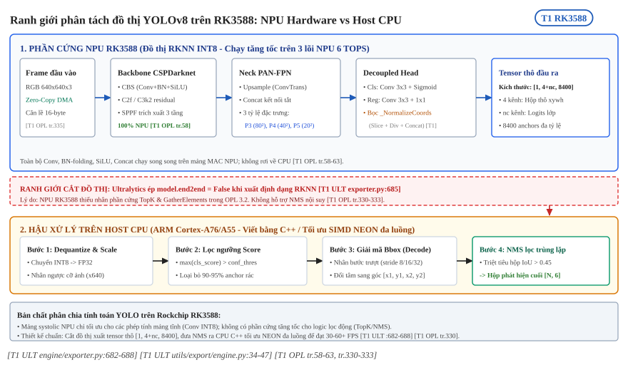

:tocdepth: 1

*************************
Đồ thị xuất và đường RKNN
*************************

.. admonition:: Trang này trả lời

   - Cơ chế xuất mô hình từ Ultralytics sang định dạng ONNX và RKNN hoạt động như thế nào?
   - Tại sao cờ end2end luôn bị vô hiệu hóa khi xuất sang định dạng RKNN?
   - Lớp _NormalizeCoords đóng vai trò gì và thay đổi đồ thị ONNX trung gian ra sao?
   - Các điểm khác biệt cốt lõi về danh sách toán tử giữa format="onnx", format="rknn" và giữa các phiên bản opset là gì?

.. admonition:: Tóm tắt

   - Trong tệp cấu hình mặc định của Ultralytics, tham số nms mang giá trị None [T1 ULT cfg/default.yaml:61], khiến thuộc tính model.end2end được gán giá trị False trên mọi định dạng [T1 ULT engine/exporter.py:682-683].
   - Khi người dùng cấu hình tường minh nms=False để bật chế độ end2end, hàm xuất RKNN lập tức tắt cờ này do nền tảng không hỗ trợ toán tử top-k trên NPU [T1 ULT engine/exporter.py:685-688].
   - Đầu ra của mô hình YOLOv8 trên RKNN luôn duy trì dạng tensor thô [1, 4 + nc, 8400], yêu cầu thực hiện khâu lọc hộp bằng thuật toán NMS trên CPU máy host ngoài đồ thị NPU [T1 ULT engine/exporter.py:682-688].
   - Đối với format="rknn" kết hợp lượng tử hóa INT8 (quantize=8), Ultralytics bọc mô hình qua khối _NormalizeCoords để chia tọa độ hộp cho kích thước ảnh đầu vào [T1 ULT engine/exporter.py:1100-1117] [T1 ULT utils/export/engine.py:17-48].
   - Khối _NormalizeCoords bổ sung thêm các node Slice, Div và Concat vào đồ thị ONNX trung gian trước khi nạp vào pipeline onnx2rknn [T1 ULT utils/export/engine.py:34-47].
   - Đường xuất rknn khống chế opset không vượt quá 19 [T1 ULT engine/exporter.py:1536-1538] và tự động chạy công cụ onnxslim để tối ưu hóa đồ thị nếu simplify=True [T1 ULT cfg/default.yaml:90] [T1 ULT engine/exporter.py:1134-1139].

.. contents:: Trong trang này
   :local:
   :depth: 1

1. Đường xuất ONNX và RKNN
==========================

Đường ống xuất mô hình từ framework huấn luyện (PyTorch) sang định dạng biên dịch RKNN đóng vai trò quyết định cấu trúc đồ thị tính toán cuối cùng trên phần cứng NPU Rockchip RK3588. Các thiết lập về cờ xuất, phiên bản toán tử (opset) và logic khử cực đại cục bộ (NMS) quy định ranh giới giữa phần tính toán tăng tốc trên NPU và phần hậu xử lý trên CPU máy host.

1.1 Ultralytics exporter và cờ end2end
--------------------------------------

Trong thư viện Ultralytics, lớp công cụ ``Exporter`` (tại ``engine/exporter.py``) quản lý quy trình chuyển đổi mạng nơ-ron từ PyTorch sang các định dạng trung gian và phần cứng mục tiêu.

Trạng thái của cờ ``end2end`` được quyết định bởi tham số ``nms``:

- Tham số ``nms`` trong cấu hình mặc định có giá trị là ``None`` [T1 ULT cfg/default.yaml:61].
- Khi khởi tạo quá trình xuất, logic kiểm tra được thực thi như sau [T1 ULT engine/exporter.py:682-683]:

.. code-block:: python

   if hasattr(model, "end2end"):
       model.end2end = self.args.nms is False

Do biểu thức ``None is False`` trả về ``False``, giá trị ``model.end2end`` mặc định luôn là ``False`` đối với mọi định dạng đích. Khi cờ này tắt, mô hình giữ nguyên cấu trúc nhánh one-to-many truyền thống. Đối với detector YOLOv8 tiêu chuẩn (với kích thước đầu vào 640x640 và số lớp đối tượng ``nc``), đầu ra mạng là một tensor đơn có kích thước ``[1, 4 + nc, 8400]``. Trong đó:

- 4 kênh đầu tiên đại diện cho tọa độ hộp bao (bounding box) theo định dạng center-x, center-y, width, height (xywh).
- ``nc`` kênh tiếp theo là điểm số xác suất phân loại (class confidence logits) của từng lớp tương ứng.
- Chiều không gian 8400 biểu diễn tổng số điểm neo (anchors) được sinh ra từ ba tầng đặc trưng của Feature Pyramid Network (80x80 + 40x40 + 20x20 = 6400 + 1600 + 400 = 8400).

Toàn bộ quá trình lọc ngưỡng điểm tin cậy (confidence thresholding) và thuật toán loại trừ các hộp trùng lặp (Non-Maximum Suppression - NMS) hoàn toàn không nằm trong đồ thị tính toán được nạp vào NPU. Người phát triển ứng dụng bắt buộc phải triển khai thuật toán NMS trên CPU của máy host sau khi NPU hoàn thành bước suy luận và trả về tensor thô.

1.2 Pipeline onnx2rknn và cấu hình
----------------------------------

Nếu người phát triển cố gắng bật chế độ end-to-end bằng cách truyền tham số tường minh ``nms=False`` (nhằm mục đích nhúng trực tiếp khối chọn lọc 300 hộp có điểm cao nhất vào đồ thị), Exporter của Ultralytics sẽ can thiệp thông qua đoạn mã kiểm tra định dạng [T1 ULT engine/exporter.py:684-688]:

.. code-block:: python

   if getattr(model, "end2end", False):
       if fmt in {"rknn", "ncnn", "executorch", "paddle", "imx", "edgetpu", "qnn"}:
           # Disable the end2end branch for formats without top-k support
           model.end2end = False
           LOGGER.warning("This export format does not support end2end models, disabling the end2end branch.")

Lý do kỹ thuật nằm ở việc phần cứng NPU của Rockchip không hỗ trợ toán tử sắp xếp và chọn lọc phần tử cực đại (TopK) ở cấp độ nhân tăng tốc. Bảng danh mục toán tử RKNN-Toolkit2 đánh dấu TopK là "Not Supported", và tài liệu OPL chỉ liệt kê TopK trong chương 4 CPU OPs [T1 OPL tr.333]. Do đó, Exporter chủ động tắt nhánh end-to-end đối với RKNN để ngăn chặn đồ thị bị phân rã nghiêm trọng.

.. _fig-yolo-04-rknn-graph-cut:

   Ranh giới phân tách đồ thị YOLOv8 trên RK3588: Đồ thị RKNN INT8 chạy trên NPU (Backbone, Neck, Head) và luồng hậu xử lý trên Host CPU (Dequantize, lọc ngưỡng, giải mã anchor, NMS). Nguồn: [T1 ULT engine/exporter.py:682-688] [T1 OPL tr.58-63, tr.330-333]

Quy trình xuất định dạng RKNN hoàn chỉnh diễn ra trong phương thức ``export_rknn`` [T1 ULT engine/exporter.py:1532-1563]:

1. Khống chế phiên bản ONNX opset: ``self.args.opset = min(self.args.opset or 19, 19)`` [T1 ULT engine/exporter.py:1538]. Toolkit RKNN-Toolkit2 phiên bản 2.3.2 yêu cầu opset không vượt quá 19.
2. Trích xuất một mẫu dữ liệu với kích thước batch bằng 1 (``self.im = self.im[:1]``).
3. Gọi phương thức ``export_onnx()`` để tạo tệp mô hình ONNX trung gian.
4. Nếu kích hoạt lượng tử hóa số nguyên 8-bit (``quantize=8``), hệ thống chuẩn bị bộ nạp dữ liệu (calibration dataloader) và xuất danh sách đường dẫn ảnh vào tệp văn bản ``dataset.txt`` [T1 ULT engine/exporter.py:1543-1552].
5. Chuyển giao tệp ONNX sang hàm ``onnx2rknn`` [T1 ULT utils/export/rknn.py:16-84].

Hàm ``onnx2rknn`` tiến hành khởi tạo đối tượng RKNN, cấu hình các tham số tiền xử lý chuẩn hóa bao gồm giá trị trung bình ``mean_values=[[0, 0, 0]]`` và độ lệch chuẩn ``std_values=[[255, 255, 255]]`` (tương đương phép chia giá trị pixel cho 255.0 để ánh xạ về đoạn [0.0, 1.0]) [T1 ULT utils/export/rknn.py:74]. Sau đó, toolkit thực hiện nạp mô hình qua ``load_onnx``, xây dựng đồ thị qua ``build`` (với cờ ``do_quantization=True`` khi có dữ liệu cân chỉnh), và xuất ra tệp nhị phân ``.rknn`` cùng tệp siêu dữ liệu ``metadata.yaml``.

Các bước convert và tham số của ``rknn.build`` nằm ở :doc:`../03-toolchain-runtime/01-luong-onnx-sang-rknn`.

2. Chuẩn hóa tọa độ với _NormalizeCoords
========================================

Một trong những can thiệp quan trọng nhất của Ultralytics khi xuất mô hình YOLOv8 sang định dạng RKNN là việc chèn lớp tiền xử lý đầu ra mang tên ``_NormalizeCoords``. Đây là cơ chế bắt buộc để giải quyết bài toán suy giảm độ chính xác khi lượng tử hóa số nguyên.

2.1 Lý do chuẩn hóa biên độ giá trị
-----------------------------------

Trong kiến trúc phần mềm RKNN-Toolkit2, thuật toán lượng tử hóa sau huấn luyện (Post-Training Quantization - PTQ) kiểu INT8 thường áp dụng thang đo theo từng tensor (per-tensor quantization) đối với các tensor kích hoạt ở tầng đầu ra [T1 ULT engine/exporter.py:1101-1107].

Tensor đầu ra cuối cùng của YOLOv8 chứa hai nhóm thông tin có bản chất vật lý hoàn toàn khác nhau:

- Phân phối điểm số phân loại của các lớp đối tượng: Sau khi đi qua hàm kích hoạt Sigmoid, toàn bộ giá trị xác suất đều nằm trong khoảng hẹp từ 0.0 đến 1.0.
- Tọa độ hình học của hộp bao: Ở đầu ra thô, các giá trị tâm và kích thước hộp được tính theo đơn vị pixel trên không gian ảnh đầu vào (ví dụ từ 0.0 đến 640.0 đối với ảnh 640x640).

Khi hai nhóm dữ liệu này được gộp chung trong cùng một tensor và lượng tử hóa theo cơ chế per-tensor với 256 mức giá trị rời rạc (-128 đến 127 hoặc 0 đến 255), giá trị cực đại của tensor sẽ bị chi phối bởi tọa độ pixel (đạt tới 640.0). Bước lượng tử (scale factor) sẽ được tính toán dựa trên biên độ 640.0:

.. math::

   \text{Scale} = \frac{640.0}{255} \approx 2.51

Với bước lượng tử xấp xỉ 2.51, mọi giá trị điểm xác suất phân loại (vốn chỉ dao động trong khoảng [0.0, 1.0]) khi chia cho Scale sẽ bị làm tròn về giá trị 0. Hiện tượng này khiến toàn bộ điểm tin cậy của các lớp bị triệt tiêu hoàn toàn, làm mô hình mất hoàn toàn khả năng phát hiện đối tượng sau khi lượng tử hóa INT8.

Để khắc phục hiện tượng trên, Exporter kiểm tra điều kiện: nếu định dạng là ``rknn``, cờ ``quantize`` bằng 8, tác vụ thuộc nhóm dự đoán vị trí (detect, segment, pose, obb), và cờ ``end2end`` đang tắt, mô hình PyTorch sẽ tự động được bọc bằng lớp ``_NormalizeCoords`` [T1 ULT engine/exporter.py:1100-1117].

2.2 Tác động lên cấu trúc đồ thị ONNX
-------------------------------------

Lớp ``_NormalizeCoords`` (được định nghĩa tại ``utils/export/engine.py:17-48``) can thiệp trực tiếp vào hàm chuyển tiếp ``forward`` của mô hình [T1 ULT utils/export/engine.py:30-48]:

.. code-block:: python

   def forward(self, x: torch.Tensor):
       y = self.model(x)
       det = y[0] if isinstance(y, (tuple, list)) else y
       box_wh = torch.tensor([self.w, self.h, self.w, self.h],
                              dtype=det.dtype, device=det.device).view(1, 4, 1)
       parts = [det[:, :4] / box_wh]
       parts.append(det[:, 4 : 4 + self.nc])
       if det.shape[1] > 4 + self.nc:
           parts.append(det[:, 4 + self.nc :])
       det = torch.cat(parts, dim=1)
       return (det, *y[1:]) if isinstance(y, (tuple, list)) else det

Khối này thực hiện các thao tác toán học sau:

1. Tạo tensor hằng số ``box_wh`` có kích thước ``[1, 4, 1]`` chứa các giá trị chiều rộng và chiều cao ``[w, h, w, h]`` (ví dụ ``[640, 640, 640, 640]``).
2. Tách 4 kênh tọa độ đầu tiên ``det[:, :4]`` bằng một phép trích xuất (Slice).
3. Thực hiện phép chia (Div) các kênh tọa độ này cho ``box_wh`` để chuẩn hóa tọa độ hộp về khoảng tỷ lệ [0.0, 1.0].
4. Trích xuất các kênh xác suất phân loại lớp ``det[:, 4 : 4 + nc]`` bằng phép Slice thứ hai.
5. Nối (Concat) các tọa độ đã chuẩn hóa cùng các điểm số phân loại lại với nhau theo trục kênh (dim=1).

Nhờ phép biến đổi này, toàn bộ dữ liệu trong tensor đầu ra đều có giá trị nằm trọn vẹn trong khoảng [0.0, 1.0]. Khi RKNN-Toolkit2 thực hiện lượng tử hóa per-tensor, bước lượng tử sẽ được tối ưu hóa cho biên độ 1.0, bảo toàn chính xác cả tọa độ không gian lẫn phân phối xác suất của các lớp đối tượng.

Tuy nhiên, việc chèn khối này làm thay đổi cấu trúc đồ thị ONNX trung gian: đồ thị nạp vào ``onnx2rknn`` sẽ có thêm 1 toán tử Div, 2 toán tử Slice, và 1 toán tử Concat so với đồ thị ONNX thông thường. Tại phía ứng dụng thực thi sau này, mã giải mã kết quả (post-processing) trên CPU host phải nhân ngược 4 kênh tọa độ đầu tiên với kích thước ảnh gốc ``[w, h, w, h]`` trước khi chuyển sang bước NMS.

3. Khác biệt giữa các đường xuất
================================

Sự kết hợp giữa các tham số dòng lệnh trong lệnh ``export`` của Ultralytics tạo ra các biến thể đồ thị ONNX khác nhau trước khi được chuyển tiếp cho compiler RKNN.

3.1 Xuất bằng format onnx và rknn
---------------------------------

Khi người dùng chạy lệnh ``yolo export format=onnx``, Exporter không bọc khối ``_NormalizeCoords`` vì định dạng ONNX tiêu chuẩn thường được thiết kế để chạy trực tiếp trên các runtime FP32/FP16 (như ONNX Runtime). Ngược lại, khi chạy ``yolo export format=rknn quantize=8``, khối chuẩn hóa tọa độ được kích hoạt.

Ngoài ra, trong Exporter có một phép gán phương thức quan trọng đối với các khối C2f [T1 ULT engine/exporter.py:908-910]:

.. code-block:: python

   elif isinstance(m, C2f) and not is_tf_format:
       m.forward = m.forward_split

Phép gán này thay thế phương thức chuyển tiếp mặc định của C2f bằng ``forward_split`` (sử dụng toán tử ``torch.split`` thay vì slicing tuần tự). Do đó, đồ thị xuất qua Exporter sẽ sinh ra các node ``Split`` thay vì một chuỗi các node ``Slice``.

Bảng dưới đây thống kê số lượng toán tử trong đồ thị ONNX sinh ra bởi Exporter của Ultralytics đối với mô hình YOLOv8n (kích thước đầu vào 640x640, số lớp ``nc=5``, opset 19 sau khi chạy ``onnxslim``):

.. list-table:: So sánh số lượng toán tử ONNX giữa các đường xuất của YOLOv8n (nc=5)
   :header-rows: 1
   :widths: 35 25 25 15

   * - Toán tử ONNX
     - Đường format="onnx"
     - Đường format="rknn" (quantize=8)
     - Chênh lệch
   * - Conv
     - 64
     - 64
     - 0
   * - Mul / Sigmoid
     - 58 / 58
     - 58 / 58
     - 0 / 0
   * - Add / Sub
     - 8 / 2
     - 8 / 2
     - 0 / 0
   * - Div
     - 1
     - 2
     - +1
   * - Concat
     - 17
     - 18
     - +1
   * - Slice
     - 2
     - 4
     - +2
   * - Split
     - 8
     - 8
     - 0
   * - Reshape / Transpose
     - 8 / 1
     - 8 / 1
     - 0 / 0
   * - MaxPool / Resize
     - 3 / 2
     - 3 / 2
     - 0 / 0
   * - Softmax
     - 1
     - 1
     - 0

Quan sát bảng trên cho thấy đường xuất RKNN lượng tử hóa hoàn toàn tương đồng với đường ONNX chuẩn ở toàn bộ các tầng trích xuất đặc trưng chính, và chỉ sai khác chính xác ở 3 loại toán tử phục vụ việc chuẩn hóa tọa độ đầu ra (thêm 1 Div, 1 Concat, và 2 Slice).

3.2 Opset 12 và 19 cùng onnxslim
--------------------------------

Phiên bản opset và cờ tối ưu hóa đồ thị ``simplify`` tạo ra sự phân hóa lớn về độ phức tạp của đồ thị tính toán:

1. Giới hạn phiên bản opset:
   Trong quá trình xuất RKNN, Ultralytics áp đặt ngưỡng trên ``opset <= 19`` [T1 ULT engine/exporter.py:1538]. Nếu xuất với opset quá cũ (ví dụ opset 12), đồ thị ONNX phải sử dụng nhiều cấu trúc toán tử phụ trợ để mô tả các phép biến đổi hình học tensor động. Trong opset 12, các node như ``Shape``, ``Gather``, ``Unsqueeze``, ``ConstantOfShape``, ``Cast``, ``Equal`` và ``Where`` thường xuyên xuất hiện ở các tầng giải mã tọa độ hộp.

2. Tối ưu hóa bằng onnxslim:
   Theo cấu hình mặc định ``simplify: True`` [T1 ULT cfg/default.yaml:90], Exporter nạp thư viện ``onnxslim`` để tinh gọn đồ thị ONNX [T1 ULT engine/exporter.py:1134-1139]. Công cụ này thực hiện các kỹ thuật tối ưu hóa then chốt:
   - Gộp hằng số (Constant Folding): Toàn bộ các nhánh tính toán kích thước tensor cố định dựa trên tham số ảnh đầu vào (640x640) được tính trước tại thời điểm xuất và thay thế bằng các giá trị hằng số cố định.
   - Loại bỏ node dư thừa: Triệt tiêu các cặp toán tử triệt tiêu lẫn nhau hoặc các node chuyển kiểu không cần thiết.
   - Đơn giản hóa cấu trúc: Biến đổi các biểu thức điều kiện phức tạp thành các phép toán ma trận trực tiếp.

Khi xuất với opset 19 và chạy qua ``onnxslim``, toàn bộ các node ``Shape``, ``Gather``, ``Equal``, ``Where`` và ``ConstantOfShape`` bị loại bỏ hoàn toàn khỏi đồ thị. Đồ thị trở nên tinh gọn và thuần nhất, giúp compiler của RKNN-Toolkit2 dễ dàng nhận diện các mẫu đồ thị (subgraph patterns) để thực hiện hợp nhất toán tử (operator fusion) và phân bổ bộ nhớ tối ưu cho NPU.

4. Hiểu sai thường gặp
======================

.. list-table:: Các hiểu sai phổ biến về đồ thị xuất và đường RKNN
   :header-rows: 1
   :widths: 28 44 28

   * - Hiểu sai
     - Thực tế theo nguồn
     - Nguồn
   * - Truyền cờ ``nms=False`` khi xuất sang định dạng RKNN sẽ tạo ra mô hình end-to-end hoàn chỉnh bao gồm NMS trên NPU.
     - Ultralytics exporter chủ động tắt cờ ``end2end`` khi định dạng là ``rknn`` vì phần cứng NPU không hỗ trợ toán tử TopK. Mô hình luôn xuất ra tensor thô.
     - [T1 ULT engine/exporter.py:685-688]
   * - Tệp đồ thị ONNX trung gian đưa vào toolkit RKNN hoàn toàn giống hệt tệp ONNX sinh ra khi chạy lệnh ``format="onnx"``.
     - Khi xuất ``format="rknn"`` với ``quantize=8``, Exporter bọc thêm lớp ``_NormalizeCoords``, bổ sung thêm các toán tử Div, Slice và Concat vào đồ thị.
     - [T1 ULT engine/exporter.py:1100-1117] [T1 ULT utils/export/engine.py:34-47]
   * - Lớp ``_NormalizeCoords`` được thêm vào là do sai sót trong quá trình chuyển đổi tensor của PyTorch.
     - Đây là giải pháp chủ động nhằm đồng nhất thang đo giữa tọa độ hộp và xác suất lớp, ngăn ngừa mất mát độ chính xác khi lượng tử hóa INT8 theo từng tensor.
     - [T1 ULT engine/exporter.py:1101-1107]
   * - Người dùng có thể chỉ định phiên bản ONNX opset bất kỳ tùy ý khi chuyển đổi sang mô hình RKNN.
     - Thư viện Ultralytics khống chế trần opset tối đa là 19 để đảm bảo tương thích với giới hạn xử lý của RKNN-Toolkit2.
     - [T1 ULT engine/exporter.py:1536-1538]
   * - Mô hình YOLOv8 xuất sang RKNN sử dụng toàn bộ toán tử Slice cho các nhánh tách luồng trong khối C2f.
     - Exporter thay thế hàm forward của C2f bằng ``forward_split``, do đó đồ thị ONNX sử dụng toán tử Split thay vì chuỗi các toán tử Slice tuần tự.
     - [T1 ULT engine/exporter.py:908-910]

Nguồn
=====

.. list-table:: Các nguồn tài liệu kỹ thuật được sử dụng trong trang
   :header-rows: 1
   :widths: 15 10 60 15

   * - Nhãn
     - Tier
     - Tệp / Tài liệu
     - Số lần trích
   * - ``ULT``
     - T1
     - Mã nguồn thư viện Ultralytics (engine/exporter.py, utils/export/engine.py, utils/export/rknn.py, cfg/default.yaml)
     - 32
   * - ``OPL``
     - T1
     - :download:`03_RKNN_Compiler_Support_Operator_List_V2.3.2.pdf <../../../_assets/pdf/rknn/03_RKNN_Compiler_Support_Operator_List_V2.3.2.pdf>`
     - 2
