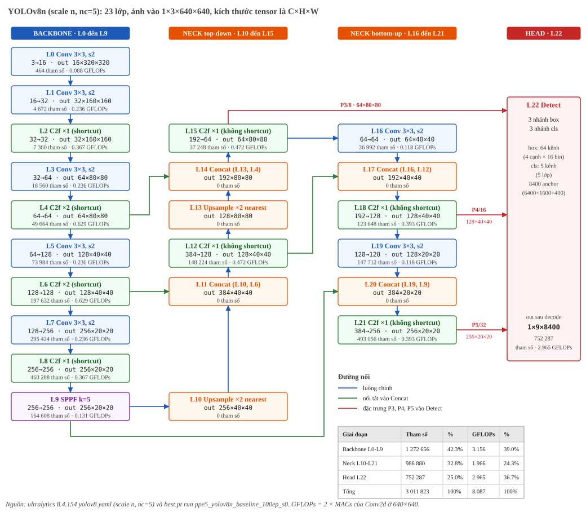
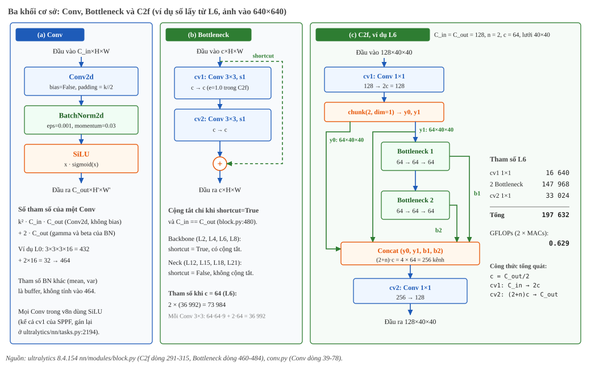
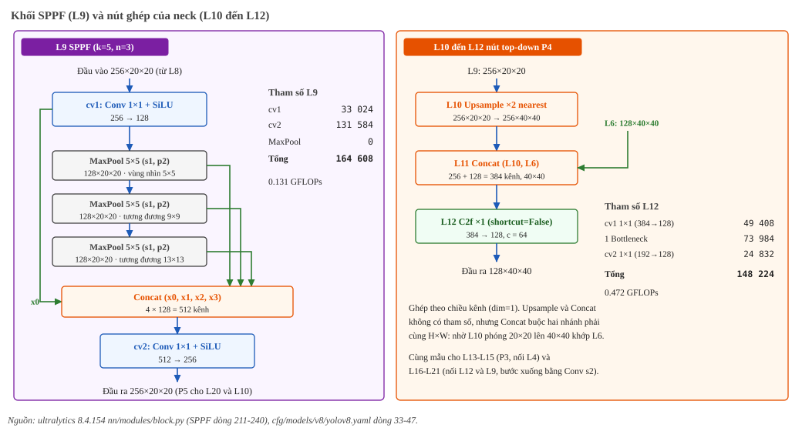
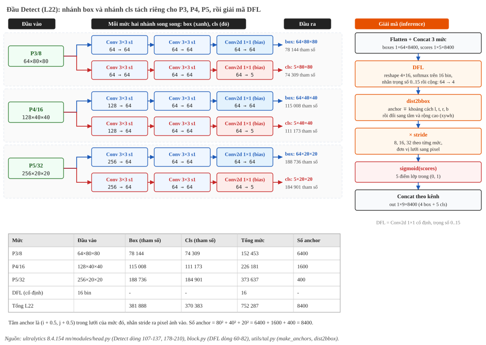

***************
Kiến trúc model
***************

.. admonition:: Trang này trả lời

   - YOLOv8n của đề xuất gồm những khối nào, nối với nhau ra sao, và tensor có kích thước gì ở từng lớp?
   - Tham số và khối lượng tính toán dồn vào đâu: backbone, neck hay head?
   - Điều gì đã đo trên model đã huấn luyện, điều gì chỉ lấy từ mã nguồn Ultralytics?

.. admonition:: Tóm tắt

   - Gốc của nghiên cứu là YOLOv8n chuẩn của Ultralytics: ``yolov8.yaml`` scale ``n`` (depth 0.33, width 0.25, max_channels 1024), không thêm hay sửa module nào. Khác biệt duy nhất so với bản COCO là ``nc`` từ 80 thành 5, ảnh vào 640×640 [T1 yolov8.yaml:8-11].
   - Mạng có 23 lớp (L0 đến L22): backbone L0-L9, neck L10-L21, head Detect L22. Ba đặc trưng P3, P4, P5 (stride 8, 16, 32) đi vào Detect, cho 80² + 40² + 20² = 8400 anchor.
   - Tổng 3,011,823 tham số và 8.087 GFLOPs (2 × MACs của Conv2d) [T3 ``measure.py``]. Backbone giữ 42.3% tham số, head chỉ 25.0% tham số nhưng chiếm 36.7% GFLOPs.
   - Bốn loại khối có tham số là ``Conv`` (Conv2d, BatchNorm, SiLU), ``C2f``, ``SPPF`` và ``Detect``, tất cả dựng từ Conv hoặc Conv2d. ``Upsample`` và ``Concat`` không có tham số.
   - Backbone dùng C2f có shortcut, neck dùng C2f không shortcut [T1 yolov8.yaml:17-47] [T1 block.py:480].
   - Đối chiếu với ``best.pt`` của run ``ppe5_yolov8n_baseline_100ep_s0``: cùng 355 tensor, cùng shape, cùng 3,011,823 tham số [T3 ``measure.py``].

.. contents:: Trong trang này
   :local:
   :depth: 1

1. Phạm vi và nguồn số liệu
===========================

Trang mô tả đúng một kiến trúc, và đó là **mô hình gốc để mọi biến thể về sau đối chiếu**: YOLOv8n chuẩn của Ultralytics, dựng từ ``yolov8.yaml`` scale ``n`` mà không sửa module nào. So với bản COCO chỉ ``nc`` đổi từ 80 thành 5, nên chỉ head thay đổi (mục 7). Biến thể nào sửa kiến trúc (như ``yolov8n_relu``, mục 8) phải nêu rõ phần khác so với gốc này. Kiến trúc là YOLOv8n với đầu ra 5 lớp (Helmet, NoHelmet, NoVest, Vest, Person) như trong ``data/ppe5/classes.txt``. So sánh YOLOv8n với YOLO26n và phân tích riêng từng thành phần của hai thế hệ nằm ở :doc:`../../01-kien-thuc-nen/07-yolo/01-kien-truc-va-khoi-cau-thanh-yolo`. Trang này không lặp lại phần so sánh đó.

.. list-table::
   :header-rows: 1
   :widths: 12 44 44

   * - Tier
     - Nguồn
     - Dùng cho
   * - T1
     - Mã nguồn và cấu hình ultralytics 8.4.154 (``cfg/models/v8/yolov8.yaml``, ``nn/tasks.py``, ``nn/modules/{block,conv,head}.py``, ``utils/tal.py``)
     - Cấu trúc khối, công thức scale, cách giải mã đầu ra
   * - T2
     - Chakrabarty 2026 (nhãn ``Y26A``), ``_assets/pdf/papers/09_yolo_architecture/yolo26_nmsfree_2026chakrabarty.pdf``
     - Chỉ dùng để nói YOLOv8 cần NMS
   * - T3
     - ``docs/tools/figure_gen/03-phuong-phap/02-kien-truc-model/measure.py``: dựng ``yolov8n.yaml`` với ``nc=5``, đếm tham số và MACs bằng forward hook, so với ``best.pt``
     - Số tham số, GFLOPs, kích thước tensor, đối chiếu với model đã huấn luyện

Mọi con số tham số và GFLOPs trong các hình được tính lại từ công thức rồi ``assert`` với số đo thật trong ``gen.py`` cùng thư mục. Gõ sai một hằng số thì script sinh hình dừng.

Quy ước: kích thước tensor viết ``C×H×W`` (bỏ chiều batch). "Tham số" là số phần tử của ``model.parameters()``, gồm gamma và beta của BatchNorm. Hai buffer ``running_mean`` và ``running_var`` không tính. GFLOPs bằng 2 × MACs của các lớp ``Conv2d``, đo ở ảnh 640×640. Công cụ ``get_flops`` của Ultralytics cho 8.196 GFLOPs ở ``nc=5`` (8.855 ở ``nc=80``) [T3 ``measure.py``]. Chênh 0.109 so với 8.087 ở trên chưa tách nguyên nhân, nên con số trong trang dùng cách đếm Conv2d để cộng được theo từng lớp.

2. Tổng quan 23 lớp
===================

   Toàn bộ YOLOv8n (nc=5). Mỗi khối ghi lớp, cấu hình, kích thước đầu ra, số tham số và GFLOPs. Đường xanh lá là các nối tắt vào Concat, đường đỏ là ba đặc trưng đưa vào Detect [T1 yolov8.yaml:17-49] [T3 ``measure.py``].

Đọc sơ đồ theo ba cụm:

- **Backbone (L0 đến L9)** hạ độ phân giải từ 640 xuống 20 qua năm bước stride 2. Ba mốc dùng lại ở phía sau là L4 (P3, 64×80×80), L6 (P4, 128×40×40) và L9 (P5, 256×20×20).
- **Neck (L10 đến L21)** có hai nhánh. Nhánh top-down phóng to P5 hai lần, ghép với P4 rồi P3. Nhánh bottom-up hạ xuống bằng Conv stride 2 và ghép lại với kết quả top-down. Ba đầu ra của neck là L15 (P3), L18 (P4) và L21 (P5).
- **Head (L22)** đọc ba đặc trưng đó và cho đầu ra 1×9×8400: 4 giá trị hộp cộng 5 điểm lớp trên mỗi anchor.

3. Cách yaml thành kênh và số lần lặp
=====================================

Ultralytics không lưu số kênh của scale ``n`` trong yaml. Hàm ``parse_model`` đọc cấu hình gốc (ghi theo scale ``x``) rồi nhân hệ số:

.. list-table::
   :header-rows: 1
   :widths: 24 46 30

   * - Đại lượng
     - Công thức
     - Ví dụ với scale n
   * - Số kênh ra
     - ``make_divisible(min(c, max_channels) × width, 8)`` [T1 tasks.py:2111]
     - 64 → 16, 128 → 32, 512 → 128, 1024 → 256
   * - Số lần lặp
     - ``max(round(n × depth), 1)`` nếu ``n > 1`` [T1 tasks.py:2107]
     - 3 → 1, 6 → 2 (round(1.98) = 2)
   * - Hệ số
     - ``scales[n] = [0.33, 0.25, 1024]`` [T1 yolov8.yaml:11]
     - depth 0.33, width 0.25

Bảng dưới liệt kê đủ 23 lớp. Cột "Từ" là chỉ số lớp nguồn đã giải ``-1`` thành số cụ thể. Cột tham số và GFLOPs lấy từ ``measure.py``.

.. list-table:: 23 lớp của YOLOv8n (scale n, nc=5), đầu vào 1×3×640×640
   :header-rows: 1
   :widths: 5 11 26 15 21 12 10

   * - L
     - Từ
     - Cấu hình yaml
     - Sau scale
     - Out (C×H×W)
     - Tham số
     - GFLOPs
   * - 0
     - -1
     - ``Conv [64, 3, 2]``
     - 3→16
     - 16×320×320
     - 464
     - 0.088
   * - 1
     - -1
     - ``Conv [128, 3, 2]``
     - 16→32
     - 32×160×160
     - 4 672
     - 0.236
   * - 2
     - -1
     - ``C2f ×3 [128, True]``
     - 32→32, n=1
     - 32×160×160
     - 7 360
     - 0.367
   * - 3
     - -1
     - ``Conv [256, 3, 2]``
     - 32→64
     - 64×80×80
     - 18 560
     - 0.236
   * - 4
     - -1
     - ``C2f ×6 [256, True]``
     - 64→64, n=2
     - 64×80×80
     - 49 664
     - 0.629
   * - 5
     - -1
     - ``Conv [512, 3, 2]``
     - 64→128
     - 128×40×40
     - 73 984
     - 0.236
   * - 6
     - -1
     - ``C2f ×6 [512, True]``
     - 128→128, n=2
     - 128×40×40
     - 197 632
     - 0.629
   * - 7
     - -1
     - ``Conv [1024, 3, 2]``
     - 128→256
     - 256×20×20
     - 295 424
     - 0.236
   * - 8
     - -1
     - ``C2f ×3 [1024, True]``
     - 256→256, n=1
     - 256×20×20
     - 460 288
     - 0.367
   * - 9
     - -1
     - ``SPPF [1024, 5]``
     - 256→256
     - 256×20×20
     - 164 608
     - 0.131
   * - 10
     - -1
     - ``Upsample [None, 2, nearest]``
     - ×2
     - 256×40×40
     - 0
     - 0
   * - 11
     - 10, 6
     - ``Concat [1]``
     - 384 kênh
     - 384×40×40
     - 0
     - 0
   * - 12
     - -1
     - ``C2f ×3 [512]``
     - 384→128, n=1
     - 128×40×40
     - 148 224
     - 0.472
   * - 13
     - -1
     - ``Upsample [None, 2, nearest]``
     - ×2
     - 128×80×80
     - 0
     - 0
   * - 14
     - 13, 4
     - ``Concat [1]``
     - 192 kênh
     - 192×80×80
     - 0
     - 0
   * - 15
     - -1
     - ``C2f ×3 [256]``
     - 192→64, n=1
     - 64×80×80
     - 37 248
     - 0.472
   * - 16
     - -1
     - ``Conv [256, 3, 2]``
     - 64→64
     - 64×40×40
     - 36 992
     - 0.118
   * - 17
     - 16, 12
     - ``Concat [1]``
     - 192 kênh
     - 192×40×40
     - 0
     - 0
   * - 18
     - -1
     - ``C2f ×3 [512]``
     - 192→128, n=1
     - 128×40×40
     - 123 648
     - 0.393
   * - 19
     - -1
     - ``Conv [512, 3, 2]``
     - 128→128
     - 128×20×20
     - 147 712
     - 0.118
   * - 20
     - 19, 9
     - ``Concat [1]``
     - 384 kênh
     - 384×20×20
     - 0
     - 0
   * - 21
     - -1
     - ``C2f ×3 [1024]``
     - 384→256, n=1
     - 256×20×20
     - 493 056
     - 0.393
   * - 22
     - 15, 18, 21
     - ``Detect [nc]``
     - 3 mức, 8400 anchor
     - 1×9×8400 (sau decode)
     - 752 287
     - 2.965
   * - 
     - 
     - **Tổng**
     - 
     - 
     - **3 011 823**
     - **8.087**

Hai quy tắc đáng nhớ khi đọc bảng. Một, mỗi ``Concat`` cộng số kênh của hai nguồn nên kênh vào C2f kế tiếp lớn hơn kênh ra của lớp ngay trước (ví dụ L12 nhận 384 kênh nhưng chỉ xuất 128). Hai, ``Upsample`` và ``Concat`` không có tham số nhưng tạo ra tensor mới (L11 ghi 384×40×40).

4. Khối cơ sở: Conv, Bottleneck, C2f
====================================

   Ba khối cơ sở. Ví dụ số ở panel (c) lấy từ L6 (C_in = C_out = 128, n = 2) [T1 block.py:291-315, 460-484] [T1 conv.py:39-78] [T3 ``measure.py``].

4.1. Conv
---------

``Conv`` là chuỗi ``Conv2d`` (không bias), ``BatchNorm2d`` (eps 0.001, momentum 0.03) và ``SiLU`` [T1 conv.py:65-78]. Số tham số của một Conv là :math:`k^2 C_{in} C_{out} + 2 C_{out}`. Ví dụ L0 (3→16, kernel 3×3) có :math:`9 \cdot 3 \cdot 16 + 2 \cdot 16 = 464`. Khi xuất cho suy luận, Ultralytics gộp BatchNorm vào Conv (``forward_fuse``, conv.py:80), nên model ``nc=5`` còn 3,006,623 tham số (mỗi Conv thay 2 tham số BN bằng 1 bias) [T3 ``measure.py``].

4.2. Bottleneck và shortcut
---------------------------

Bottleneck gồm hai Conv 3×3 stride 1, trong C2f giữ nguyên số kênh (``e=1.0``). Đầu vào chỉ được cộng vào đầu ra khi cờ ``shortcut`` bật và số kênh vào bằng số kênh ra [T1 block.py:480]. Cờ này đặt ở tham số thứ hai của C2f trong yaml:

- Backbone: ``C2f [128, True]``, ``[256, True]``, ``[512, True]``, ``[1024, True]`` nên có cộng tắt (L2, L4, L6, L8).
- Neck: ``C2f [512]``, ``[256]``, ``[512]``, ``[1024]`` dùng mặc định ``shortcut=False`` nên không cộng tắt (L12, L15, L18, L21) [T1 block.py:294, yolov8.yaml:31-47].

4.3. C2f
--------

C2f nhận C_in kênh, đặt :math:`c = C_{out}/2` [T1 block.py:306] và làm bốn việc:

1. ``cv1`` (Conv 1×1) đưa C_in kênh thành :math:`2c` kênh.
2. Cắt đôi theo kênh thành ``y0`` và ``y1`` (``chunk(2, 1)``).
3. Cho ``y1`` đi lần lượt qua :math:`n` Bottleneck. Kết quả của từng Bottleneck được giữ lại (b1, b2, ...) [T1 block.py:313-314].
4. Nối ``y0``, ``y1``, b1, ..., bn (tổng :math:`(2+n)c` kênh) rồi ``cv2`` (Conv 1×1) đưa về C_out.

C2f nối mọi đầu ra trung gian chứ không chỉ đầu ra cuối. Ở L6 (n=2) phép nối có :math:`4 \times 64 = 256` kênh. Tổng tham số L6 là 16,640 (cv1) + 147,968 (hai Bottleneck) + 33,024 (cv2) = 197,632, khớp số đo.

5. SPPF và nút ghép của neck
============================

   SPPF (L9) và nút ghép đầu tiên của neck (L10 Upsample, L11 Concat với L6, L12 C2f không shortcut) [T1 block.py:211-240] [T1 yolov8.yaml:31-35] [T3 ``measure.py``].

5.1. SPPF (L9)
--------------

SPPF giảm một nửa số kênh bằng Conv 1×1, rồi cho đặc trưng đi qua ba lớp ``MaxPool2d`` 5×5 (stride 1, padding 2) nối tiếp. Bốn tensor (đầu vào của pooling cùng ba đầu ra) được nối lại thành 512 kênh rồi ``cv2`` đưa về 256 [T1 block.py:228-240]. Docstring của lớp ghi "This module is equivalent to SPP(k=(5, 9, 13))" [T1 block.py:225]. Hai Conv trong SPPF đều dùng SiLU: ``cv1`` mặc định tắt activation trong định nghĩa lớp, nhưng ``parse_model`` gán lại SiLU cho các hàng yaml kiểu cũ như YOLOv8 [T1 tasks.py:2194-2196]. L9 có 164,608 tham số, MaxPool không có tham số.

5.2. Nút top-down (L10 đến L12)
-------------------------------

L10 phóng P5 lên gấp đôi (``nearest``, không tham số). L11 nối nó với đầu ra L6 theo chiều kênh: 256 + 128 = 384 kênh ở lưới 40×40, nên hai nguồn phải cùng H×W. L12 là C2f ``384→128`` với một Bottleneck không shortcut: 49,408 (cv1) + 73,984 + 24,832 (cv2) = 148,224 tham số. Nhánh P3 (L13 đến L15) lặp lại đúng mẫu này với L4. Nhánh bottom-up (L16 đến L21) xuống bậc bằng Conv 3×3 stride 2 rồi nối với L12 và L9.

6. Đầu Detect (L22)
===================

   Đầu Detect: hai nhánh song song cho mỗi mức, rồi giải mã dùng chung cho cả 8400 anchor [T1 head.py:107-137, 178-216] [T1 block.py:60-82] [T1 tal.py:422-448] [T3 ``measure.py``].

6.1. Cấu trúc nhánh
-------------------

Với mỗi mức, Detect có một nhánh hộp (``cv2``) và một nhánh lớp (``cv3``), mỗi nhánh gồm hai Conv 3×3 rồi một ``Conv2d`` 1×1 có bias. Số kênh trung gian là ``c2 = max(16, ch[0]//4, 4×reg_max) = 64`` cho hộp và ``c3 = max(ch[0], min(nc, 100)) = 64`` cho lớp [T1 head.py:122]. Nhánh hộp ra 64 kênh = 4 cạnh × 16 bin (``reg_max=16``). Nhánh lớp ra ``nc = 5`` kênh. Ba mức không chia sẻ trọng số.

Kênh vào của mức P3, P4, P5 là 64, 128, 256 nên Conv 3×3 đầu tiên của mức P5 nặng nhất (147,584 tham số). Tham số theo mức: P3 152,453, P4 226,181, P5 373,637, cộng 16 trọng số cố định của DFL ra 752,287. Số anchor mỗi mức là 6400, 1600, 400.

6.2. Giải mã khi suy luận
-------------------------

Hàm ``forward`` nối đầu ra ba mức thành ``boxes`` 1×64×8400 và ``scores`` 1×5×8400. Khi huấn luyện, Detect trả luôn các tensor thô này cho hàm loss. Khi suy luận nó giải mã tiếp [T1 head.py:178-192, 195-216]:

1. **DFL**: reshape 64 kênh thành 4×16, softmax theo 16 bin, rồi lấy kỳ vọng với trọng số cố định 0, 1, ..., 15 (một Conv 1×1 không huấn luyện). Kết quả là bốn khoảng cách l, t, r, b theo đơn vị ô lưới [T1 block.py:60-82].
2. **dist2bbox**: lấy điểm anchor (tâm ô lưới, offset 0.5) trừ l, t và cộng r, b, rồi đổi sang tâm và chiều rộng, cao [T1 tal.py:439-448, 422-436].
3. Nhân với stride của mức (8, 16, 32) để về pixel.
4. ``sigmoid`` trên ``scores`` để có xác suất lớp.
5. Nối theo kênh thành 1×9×8400.

``Detect.end2end`` là ``False`` ở YOLOv8n (đã kiểm tra trên model dựng từ yaml), nên không chạy bước ``postprocess`` top-k [T1 head.py:191-192]. Đầu ra 1×9×8400 vẫn là các hộp chồng lấn và việc lọc trùng (NMS) là bước riêng ngoài mạng, khác với YOLO26 [T2 Y26A tr.7]. Phân tích ảnh hưởng của DFL và NMS lên NPU nằm ở trang kiến thức YOLO đã link ở mục 1.

7. Tham số và khối lượng tính toán
==================================

.. list-table::
   :header-rows: 1
   :widths: 28 18 14 18 14

   * - Giai đoạn
     - Tham số
     - Tỉ lệ
     - GFLOPs
     - Tỉ lệ
   * - Backbone (L0-L9)
     - 1,272,656
     - 42.3%
     - 3.156
     - 39.0%
   * - Neck (L10-L21)
     - 986,880
     - 32.8%
     - 1.966
     - 24.3%
   * - Head (L22)
     - 752,287
     - 25.0%
     - 2.965
     - 36.7%
   * - **Tổng**
     - **3,011,823**
     - 100%
     - **8.087**
     - 100%

Nguồn: [T3 ``measure.py``], cộng theo lớp từ bảng ở mục 3.

Ba nhận xét rút ra từ số đo:

- Head có ít tham số hơn backbone gần một nửa nhưng chi phí tính toán gần bằng. Lý do là Conv 3×3 của head chạy trên lưới lớn: riêng mức P3 (80×80) chạy 6400 vị trí. Tính theo công thức, mức P3 của head tiêu tốn :math:`6400 \cdot (64 \cdot 64 \cdot 9 \cdot 4 + 64 \cdot 64 + 64 \cdot 5) = 0.972` GMACs hay 1.944 GFLOPs, khoảng hai phần ba (65.6%) GFLOPs của head. Đo bằng hook Conv2d trong ``measure.py`` (2 FLOP mỗi MAC), GFLOPs của head theo mức là: P3 1.944 (65.6%), P4 0.722 (24.3%), P5 0.298 (10.1%), Conv 1×1 của DFL 0.001 (0.04%), tổng 2.965; số P3 khớp phép tính theo công thức.
- Hai lớp C2f ×2 của backbone (L4, L6) mỗi lớp 0.629 GFLOPs, cao nhất trong các lớp backbone. L21 (neck, 493,056 tham số) là lớp nhiều tham số nhất ngoài head nhưng chỉ 0.393 GFLOPs vì chạy ở lưới 20×20.
- Đổi ``nc`` chỉ ảnh hưởng head. Backbone cộng neck có 2,259,536 tham số ở cả ``nc=5`` và ``nc=80``. Head là 752,287 (``nc=5``) và 897,664 (``nc=80``), tổng 3,157,200 khớp con số ghi trong yaml [T1 yolov8.yaml:11] [T3 ``measure.py``]. Ở ``nc=80``, ``c3`` lên 80 nên nhánh lớp rộng hơn.

8. Đối chiếu với model đã huấn luyện
====================================

Chạy ``measure.py`` nạp ``ai/automation/runs/ppe5_yolov8n_baseline_100ep_s0/weights/best.pt`` và so ``state_dict`` với model dựng từ ``yolov8n.yaml`` (``nc=5``): cùng 355 tensor, cùng shape từng tensor, cùng 3,011,823 tham số. Tên lớp trong checkpoint là Helmet, NoHelmet, NoVest, Vest, Person. Nghĩa là các hình trong trang vẽ đúng kiến trúc mà các run ``ppe5`` đã huấn luyện, chưa phải một biến thể.

Trọng số khởi tạo là ``yolov8n.pt`` (COCO), không phải kiến trúc khác: log huấn luyện ghi "Transferred 322/355 items from pretrained weights" [T3 ``ai/automation/runs/ppe5_yolov8n_baseline_100ep_s0/logs/train_20261026-004322.log``:38]. Kiểm trên model dựng từ yaml, các tensor không nạp được đều thuộc nhánh cls của head (``cv3``), vì checkpoint COCO có ``c3 = 80`` nên shape khác ``c3 = 64`` ở ``nc=5``. Log chỉ ghi tổng 322/355, nên danh sách chính xác của 33 tensor còn lại chưa đối chiếu từng cái.

Biến thể ``yolov8n_relu`` (``ai/models/yolov8n_relu.yaml``) thay SiLU bằng ReLU và giữ nguyên mọi shape. Tệp ghi rõ chỉ thêm ``scale`` và ``activation`` so với ``yolov8.yaml`` bản 8.4.154 [T1 ``ai/models/yolov8n_relu.yaml``]. Mọi số tham số và GFLOPs trong trang áp dụng cho cả hai. Kết quả so sánh độ chính xác và độ trễ nằm ở :doc:`../04-tang-npu-ket-qua/01-ket-qua-g4` và :doc:`../04-tang-npu-ket-qua/02-ket-qua-bien-the-activation`.

9. Liên kết sang tầng NPU và tái lập
====================================

- Số GFLOPs ở trang này chỉ là khối lượng tính toán lý thuyết (chỉ đếm Conv2d), không phải thời gian chạy. Latency từng khối đã được đo trên RK3588 (INT8, ``CORE_0``): kế hoạch đo ở :doc:`../02-tang-npu-nen-do/01-ke-hoach-do`, kết quả và độ tin cậy ở :doc:`../02-tang-npu-nen-do/02-ket-qua-latency-tung-khoi`, phân tích sâu ở :doc:`../02-tang-npu-nen-do/03-phan-tich-sau-latency-tung-khoi`, dao động latency ở :doc:`../02-tang-npu-nen-do/04-cac-muc-do-tre` và :doc:`../02-tang-npu-nen-do/05-thu-ghim-cpu-va-ngat`. Bảng hỗ trợ từng toán tử trên NPU nằm ở :doc:`../03-tang-npu-don-bay/01-operator-support`.
- Số liệu và hình trong trang chỉ tính cho ``nc=5``. Đổi ``nc`` chỉ làm đổi head: Conv 1×1 cuối của nhánh cls luôn đổi, và khi ``nc > 64`` thì ``c3 = max(64, min(nc, 100))`` tăng nên hai Conv 3×3 của nhánh đó cũng rộng ra (mục 6.1, 7). Muốn tái lập hình cho ``nc`` khác, sửa ``NC`` trong ``gen.py`` và ``nc=5`` trong ``measure.py``, chạy ``measure.py``, dán hai mảng ``MEASURED_*`` vào ``gen.py``, rồi chạy lại ``gen.py``.

10. Việc chưa làm
=================

- Các phép ngoài Conv2d mới được đếm số phần tử đầu ra (``measure.py``, ảnh 640×640): BatchNorm2d 13,619,200 (57 lớp), SiLU 13,619,200 (57 lớp), MaxPool2d 153,600 (3 lớp), Upsample 1,228,800 (2 lớp). Chưa quy ra FLOPs vì số FLOPs mỗi phần tử là quy ước chưa có nguồn. Add, Concat, Split và Mul chưa đếm. Chênh 0.109 giữa cách đếm này và ``get_flops`` chưa được giải thích.
- Chưa so yaml trong ultralytics 8.4.154 với bản YOLOv8n phát hành gốc năm 2023. "Chuẩn" ở đây nghĩa là chuẩn theo cấu hình hiện hành của Ultralytics, đã khớp con số 3,157,200 tham số ghi trong chính yaml đó [T1 yolov8.yaml:11].
