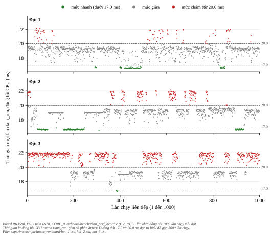
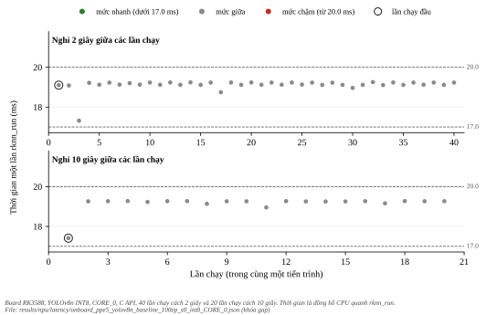
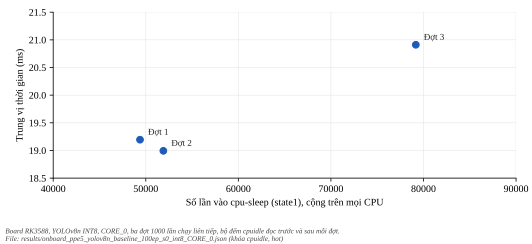
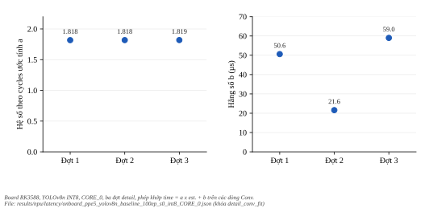
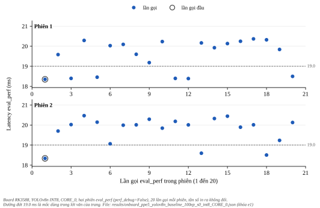
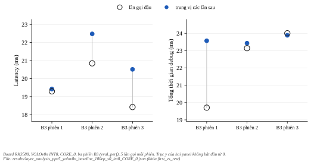

**************
Các mức độ trễ
**************

.. admonition:: Trang này trả lời

   - Vì sao latency NPU của cùng một model, cùng tần số khoá, lại dao động từ khoảng 16 đến 22 ms?
   - Các giả thuyết nào đã được kiểm bằng phép đo, kết quả (ủng hộ, không ủng hộ, chưa kết luận) và giới hạn ra sao?

.. admonition:: Tóm tắt

   - Dao động có cấu trúc: độ trễ tập trung ở ba mức chính (còn 248 lần chạy, 8%, nằm giữa mức nhanh và mức giữa), trung vị 16.62, 19.13 và 21.66 ms, cách nhau 2.50 ms và 2.53 ms. Mỗi lần chạy có 63 ngắt NPU, nên mỗi khoảng cách ứng với khoảng 40 µs mỗi ngắt (chỉ là kiểm tra nhất quán, không phải cơ chế).
   - NPU khởi động nguội: không ủng hộ (nghỉ 2 và 10 giây giữa các lần chạy cho trung vị 19.13 và 19.26 ms, không chạm mức chậm). Xung nhịp hoặc băng thông DDR đổi: không ủng hộ (hệ số theo cycles của Conv giữ ở 1.818 đến 1.819). Bộ đếm ``cpuidle``: chưa kết luận. Vị trí CPU và ngắt NPU được kiểm riêng ở :doc:`05-thu-ghim-cpu-va-ngat`.
   - Trong một phiên ``eval_perf`` (E1), trung vị hai phiên chỉ lệch 0.64% nhưng mỗi phiên trải 10% đến 11%. Lần gọi đầu thấp hơn các lần sau ở cả 5 phiên latency qua relay. Đính chính ngày 2026-10-31: trên LAN, 10 phiên mỗi giao thức cho kết quả "không ổn định" (:doc:`08-ket-qua-p2-va-do-mo-rong`, mục 3).

Kết quả latency và tỉ lệ từng khối nằm ở :doc:`02-ket-qua-latency-tung-khoi`. Phân tích sâu từng khối nằm ở :doc:`03-phan-tich-sau-latency-tung-khoi`. Thí nghiệm ghim CPU và ngắt NPU (E2 đến E2e) nằm ở :doc:`05-thu-ghim-cpu-va-ngat`. Quy ước nhãn, dùng cho trang này và :doc:`05-thu-ghim-cpu-va-ngat`: "ủng hộ", "không ủng hộ" hoặc "chưa kết luận". Không có nhãn nào ở đây là kết luận về cơ chế.

.. contents:: Trong trang này
   :local:
   :depth: 1

1. Ba mức độ trễ
================

Ba đợt 1000 lần chạy liên tiếp trên board cho ba mức chính cùng một số lần chạy ở giữa: 248 trên 3000 lần (8.3%) nằm trong khoảng 17.0 đến 18.5 ms, giữa mức nhanh và mức giữa. Ngưỡng mức đọc từ chỗ lõm của biểu đồ gộp 3000 lần chạy (khoảng 0.25 ms): dưới 17.0 ms là mức nhanh, từ 20.0 ms là mức chậm, ở giữa là mức giữa. Trung vị của từng mức trên toàn bộ 3000 lần chạy: nhanh 16.625, giữa 19.127, chậm 21.661 ms.

   Thời gian từng lần chạy ``rknn_run`` của ba đợt 1000 lần chạy liên tiếp trên board, tô màu theo mức. Hình sinh bằng ``docs/tools/figure_gen/03-phuong-phap/04-cac-muc-do-tre/gen.py``.

.. list-table::
   :header-rows: 1
   :widths: 8 12 10 8 11 11 11 17 12

   * - Đợt
     - Trung vị (ms)
     - p95 (ms)
     - CV
     - Mức nhanh
     - Mức giữa
     - Mức chậm
     - Đoạn dài nhất cùng mức (lần chạy)
     - Tự tương quan lần kề
   * - 1
     - 19.195
     - 21.144
     - 5.9%
     - 9.3%
     - 82.4%
     - 8.3%
     - 175
     - 0.72
   * - 2
     - 18.994
     - 21.799
     - 7.7%
     - 17.7%
     - 66.2%
     - 16.1%
     - 90
     - 0.91
   * - 3
     - 20.911
     - 21.935
     - 6.6%
     - 0.7%
     - 42.6%
     - 56.7%
     - 184
     - 0.88

Độ trễ giữ nguyên một mức trong hàng chục đến hàng trăm lần chạy liên tiếp rồi mới nhảy, nên dao động này không phải nhiễu độc lập giữa các lần. Do đó một phiên ``eval_perf`` 5 lần gọi chỉ lấy mẫu mức mà board đang ở lúc đó. Đó là một giải thích khả dĩ cho việc cổng A5 không đạt, chưa kiểm: các lần chạy liên tiếp trên board cách nhau khoảng 19 ms, còn các lần gọi ``eval_perf`` qua relay cách nhau khoảng 35 giây, E2 đến E2d chạy trên đường C API và E2e chạy trên đường ``eval_perf`` (:doc:`05-thu-ghim-cpu-va-ngat`), và ở E1 hai trung vị phiên chỉ lệch 0.64%.

2. NPU có bận khi đo trên board
===============================

Trong đợt 1, mỗi 0.1 giây đọc ``/sys/kernel/debug/rknpu/power`` và ``load``: 189 mẫu, nguồn NPU bật ở 188 mẫu (99.5%), tải ``Core0`` trung vị 88%, lớn nhất 94%. Theo mã driver ``rknpu`` 0.9.8, giá trị ``load`` là phần trăm thời gian NPU bận trong cửa sổ 1 giây gần nhất đã kết thúc: ``RKNPU_LOAD_INTERVAL`` là 1000000000 ns (``3rdparty/rknpu-driver-0.9.8/include/rknpu_drv.h:40``), một hrtimer cộng thời gian bận rồi chốt mỗi 1 giây (``rknpu_drv.c:747-787``), và giá trị in ra là thời gian bận chia 1e7, chặn ở 100 (``rknpu_debugger.c:60-66``) [T1 mã nguồn]. Vì vậy các mẫu 0.1 giây ở đây lặp lại cùng một giá trị trong mỗi giây, và ``load`` không dùng được cho tải ngắn hơn 1 giây. Ngược lại, ở E1 mỗi lần ``eval_perf`` qua PC mất trung vị 37.0 và 35.4 giây thực (``init_runtime`` 286 và 252 giây), trong khi NPU chạy một khung chỉ khoảng 19 ms. Lúc đo E1 (ngày 2026-10-30), đường PC đến board đi qua relay Tailscale với RTT 159 đến 269 ms và adb đẩy file 0.1 MB/s (``bench/extra_link_facts.txt``). Đo lại trên LAN trực tiếp với cùng board và cùng model (``bench/extra_tier1_lan_timing.txt``, chỉ ghi thời gian chờ): ``init_runtime`` 1.5 giây và mỗi lần ``eval_perf`` 0.21 đến 0.43 giây. Phép đo LAN chỉ ghi thời gian chờ, không ghi giá trị latency. Thời gian chờ mỗi lần gọi giảm từ khoảng 35 đến 57 giây xuống dưới 0.5 giây khi đổi đường truyền, trong khi số đo NPU của E2e (trung vị các khối 16.5 đến 20.4 ms) và của E1 (trung vị hai phiên 19.9 và 20.0 ms) cùng cỡ, nên phần lớn thời gian mỗi lần gọi qua relay là phần đường truyền và phía PC, đúng như suy luận trước đây. Số gói trao đổi vẫn chưa đếm.

3. Các giả thuyết đã kiểm
=========================

3.1. NPU khởi động nguội giữa các lần chạy
------------------------------------------

   Thời gian từng lần chạy khi nghỉ 2 giây (40 lần chạy) và 10 giây (20 lần chạy) giữa các lần chạy trong cùng một tiến trình. Vòng tròn đánh dấu lần chạy đầu. Hình sinh bằng ``docs/tools/figure_gen/03-phuong-phap/04-cac-muc-do-tre/gen.py``.

.. list-table::
   :header-rows: 1
   :widths: 14 12 14 12 12 16 10

   * - Điều kiện
     - Số lần chạy
     - Trung vị (ms)
     - Nhỏ nhất
     - Lớn nhất
     - Lần chạy đầu (µs)
     - CV
   * - gap2s
     - 40
     - 19.131
     - 17.316
     - 19.256
     - 19103
     - 1.6%
   * - gap10s
     - 20
     - 19.265
     - 17.413
     - 19.277
     - 17413
     - 2.2%

Nghỉ 2 và 10 giây giữa các lần chạy (trong cùng một tiến trình) không làm lần chạy chậm hơn: trung vị 19.13 và 19.26 ms, nằm trong mức giữa, và lần chạy đầu sau nghỉ 10 giây là 17.41 ms. Hai điều kiện này cũng không bao giờ chạm mức chậm. **Nhãn: không ủng hộ** giả thuyết khởi động nguội gây mức chậm (nghỉ lâu không chậm hơn).

3.2. Bộ đếm ``cpuidle`` trong ba đợt liên tiếp
----------------------------------------------

   Trung vị thời gian của ba đợt liên tiếp theo số lần vào ``cpu-sleep`` cộng trên mọi CPU. Chỉ có ba điểm. Hình sinh bằng ``docs/tools/figure_gen/03-phuong-phap/04-cac-muc-do-tre/gen.py``.

.. list-table::
   :header-rows: 1
   :widths: 8 16 20 24 24

   * - Đợt
     - Trung vị (ms)
     - Số lần vào state0 (WFI)
     - Số lần vào state1 (cpu-sleep)
     - Thời gian state1 (µs)
   * - 1
     - 19.195
     - 88781
     - 49377
     - 64803998
   * - 2
     - 18.994
     - 77871
     - 51900
     - 67529275
   * - 3
     - 20.911
     - 47427
     - 79173
     - 76624020

Đợt 3 (trung vị cao nhất) có số lần vào ``cpu-sleep`` nhiều hơn hai đợt kia. Bộ đếm cộng trên mọi CPU và chỉ có ba đợt, nên **nhãn: chưa kết luận**. Phép thử có đối chứng ở :doc:`05-thu-ghim-cpu-va-ngat` là bằng chứng mạnh hơn, và phép can thiệp X2 cho thấy tắt ``cpu-sleep`` riêng ở CPU nhận ngắt làm mất phần tăng ở N (:doc:`06-co-che-cac-muc-do-tre`, mục 3).

3.3. Xung nhịp hoặc băng thông DDR đổi
--------------------------------------

Hệ số theo cycles ước tính của phép khớp ``time = a x est. + b`` trên các dòng Conv giữ nguyên giữa ba đợt ``detail`` (1.818, 1.818, 1.819) trong khi hằng số b đổi (50.6, 21.6, 59.0 µs), và tổng thời gian mỗi lần chạy (trung vị) của ba đợt là 21.34, 18.59, 22.50 ms. Nếu xung nhịp NPU hoặc băng thông DDR đổi, phần tỉ lệ với kích thước phải đổi theo. Ở B2 so với B3 cũng vậy (:doc:`03-phan-tich-sau-latency-tung-khoi`, mục 5). **Nhãn: không ủng hộ.** Bộ lấy mẫu 1 Hz trong E1 (``bench/extra_e1_sampler.sh``) đọc các file sysfs ``cur_freq`` và ``governor`` của NPU và DDR, tần số của ba cụm CPU và nhiệt độ, không dùng bộ đếm xung nhịp. Các giá trị đó không đổi, nhưng không chứng minh xung nhịp thật ổn định.

   Hệ số theo cycles ước tính a (trái) và hằng số b (phải) của phép khớp trên các dòng Conv, ba đợt ``detail``. Hình sinh bằng ``docs/tools/figure_gen/03-phuong-phap/04-cac-muc-do-tre/gen.py``.

3.4. Vị trí CPU, ngắt NPU và trạng thái ngủ của CPU
---------------------------------------------------

Giả thuyết này được kiểm bằng năm thí nghiệm E2 đến E2e ở :doc:`05-thu-ghim-cpu-va-ngat`, và phần thời gian tăng được tách bằng trace ở :doc:`06-co-che-cac-muc-do-tre`.

4. Dao động trong một phiên ``eval_perf``
=========================================

4.1. E1: dao động ngay trong một phiên ``eval_perf``
----------------------------------------------------

   Latency từng lần gọi ``eval_perf`` của hai phiên E1, 20 lần gọi mỗi phiên. Vòng tròn đánh dấu lần gọi đầu. Hình sinh bằng ``docs/tools/figure_gen/03-phuong-phap/04-cac-muc-do-tre/gen.py``.

.. list-table::
   :header-rows: 1
   :widths: 8 12 10 10 10 8 12 16 16

   * - Phiên
     - Trung vị (ms)
     - Nhỏ nhất
     - Lớn nhất
     - Khoảng
     - CV
     - Lần gọi đầu
     - Trung vị các lần còn lại
     - Số báo cáo tần số khác nhau
   * - 1
     - 19.881
     - 18.349
     - 20.365
     - 10.1%
     - 4.1%
     - 18.349
     - 19.924
     - 1
   * - 2
     - 20.008
     - 18.337
     - 20.467
     - 10.6%
     - 3.3%
     - 18.337
     - 20.009
     - 1

Chênh trung vị giữa hai phiên chỉ 0.64% nhưng trong mỗi phiên giá trị trải 11%, và 22.5% trong 40 lần gọi nằm dưới 19.0 ms (trung vị 18.396 ms), phần còn lại có trung vị 20.028 ms. Tần số in ra ở mọi lần gọi giống nhau. Bộ lấy mẫu (2108 dòng trong 2134 giây) cho thấy tần số, governor và nhiệt độ (37.9 đến 39.8 °C) không đổi. Lần gọi đầu của hai phiên E1 là 18.35, 18.34 ms, thấp hơn trung vị các lần sau (19.92, 20.01 ms). Ở B3, latency của lần gọi đầu cũng thấp hơn trung vị các lần sau ở cả ba phiên (mục 4.2), nên lần gọi đầu thấp hơn ở cả 5 phiên latency qua relay. Điều này chưa giải thích được. Trên LAN (X4, ngày 2026-10-31) hiện tượng không lặp lại ổn định (:doc:`08-ket-qua-p2-va-do-mo-rong`, mục 3). Hãng không có khuyến nghị warm-up cho ``eval_perf`` (không tìm thấy trong UG232 và API232).

4.2. Lần gọi đầu và các lần sau trong một phiên
-----------------------------------------------

   Lần gọi đầu (vòng rỗng) so với trung vị các lần sau (chấm đặc) của ba phiên B3, theo latency (trái) và tổng thời gian debug (phải). Trục y không bắt đầu từ 0. Hình sinh bằng ``docs/tools/figure_gen/03-phuong-phap/04-cac-muc-do-tre/gen.py``.

.. list-table::
   :header-rows: 1
   :widths: 8 18 22 22 26

   * - Phiên
     - Latency lần gọi đầu (ms)
     - Latency trung vị các lần sau (ms)
     - Tổng debug lần đầu (ms)
     - Tổng debug trung vị các lần sau (ms)
   * - 1
     - 19.293
     - 19.422
     - 19.705
     - 23.572
   * - 2
     - 20.844
     - 22.477
     - 23.143
     - 23.431
   * - 3
     - 18.423
     - 20.512
     - 24.004
     - 23.887

Latency của lần gọi đầu thấp hơn trung vị các lần sau ở cả ba phiên B3 (và ở hai phiên E1, mục 4.1). Tổng debug thì không đồng nhất: lần đầu thấp hơn ở phiên 1 và 2, cao hơn một chút ở phiên 3. Chỉ năm phiên latency, nên không đủ dữ liệu để kết luận có hiệu ứng warm-up hay nguyên nhân của nó. Đính chính ngày 2026-10-31: X4 chạy 10 phiên mỗi giao thức trên LAN, lần gọi đầu thấp hơn các lần sau không ổn định ở cả hai giao thức (:doc:`08-ket-qua-p2-va-do-mo-rong`, mục 3). Hãng không có khuyến nghị warm-up trong tài liệu, chỉ ví dụ ``rknn_benchmark.cpp`` chạy 5 lần làm nóng trước khi đo (``3rdparty/rknn-toolkit2/rknpu2/examples/rknn_benchmark/src/rknn_benchmark.cpp:415-431``) [T1 mã nguồn].

5. Điều chưa biết và giới hạn
=============================

- Chu kỳ của ``rknpu/load`` đã trả lời bằng mã nguồn driver (mục 2): cửa sổ 1 giây.

6. Nguồn
========

- T3 board và PC: ``results/npu/latency/onboard_*``, ``results/npu/latency/layer_analysis_*``, ``experiments/npu/latency/onboard/``, ``bench/tier1_int8_CORE_0*``, ``bench/extra_e1_*``, ``bench/extra_link_facts.txt``. Mã: ``ai/board/rknn_perf_bench.c``, ``ai/npu/latency/analyze_onboard.py``, ``ai/npu/latency/analyze_layers.py``. Không có trích dẫn T1 trong trang này.

