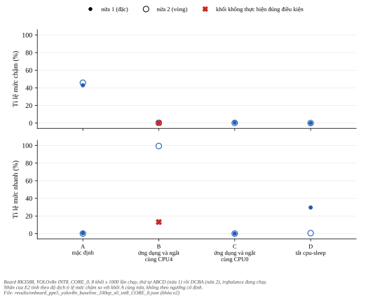
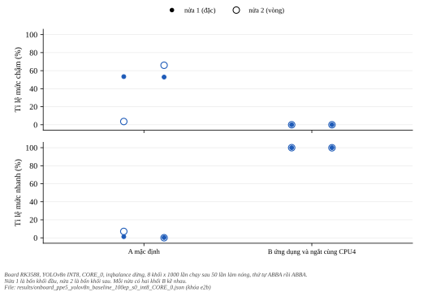
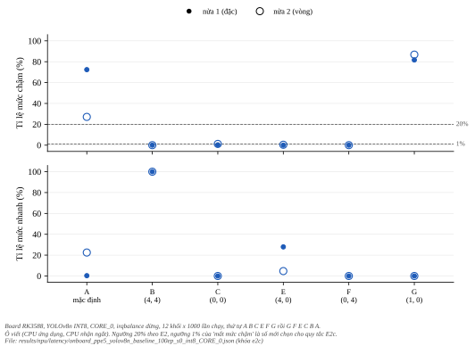
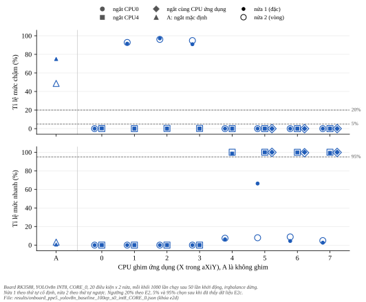
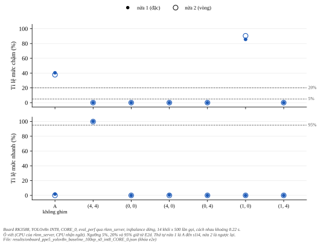
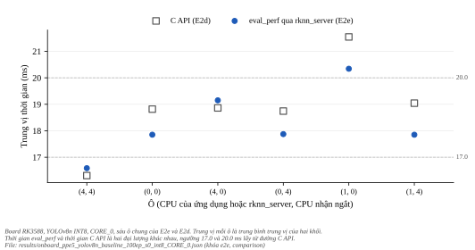
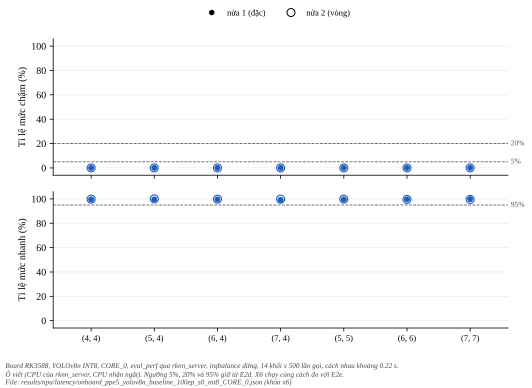

********************
Ghim CPU và ngắt NPU
********************

.. admonition:: Trang này trả lời

   - Ghim tiến trình đo và ngắt NPU vào CPU nào thì mức chậm biến mất, và ở đâu latency ổn định ở mức nhanh (E2 đến E2d, đường C API trên board)?
   - Khi ghim ``rknn_server`` và ngắt NPU vào các CPU, thời gian ``eval_perf`` qua ``rknn_server`` có cho cùng kết quả vị trí như đường C API trên board không?
   - Hai đường chênh nhau bao nhiêu ở cùng một ô (mô tả)?

.. admonition:: Tóm tắt

   - Mức chậm chiếm 43% và 46% số lần chạy ở điều kiện mặc định (tiến trình tự chuyển lõi) và không quá 0.4% ở cả sáu khối thử ghim lõi hoặc tắt ``cpu-sleep``.
   - E2b (chạy lại B với ``irqbalance`` dừng): cả 4 khối B không có lần chạy chậm, trung vị 16.29 đến 16.30 ms, độ lệch chuẩn tối đa 0.040 ms. Nhãn B là "ủng hộ", chỉ nghĩa là mức chậm biến mất: ba yếu tố đổi cùng lúc, cách ghép khối A được chọn sau khi có dữ liệu, còn cách ghép từng khối liền kề cho "chưa kết luận".
   - E2c tách vị trí ứng dụng và ngắt nhưng không đọc được yếu tố, vì kiểm tra hợp lệ viết trước không đạt.
   - E2d (bản đồ 20 điều kiện, kiểm tra hợp lệ đạt): với ngắt ở CPU0, mức chậm chỉ có khi ứng dụng ghim ở CPU1 đến CPU3. Với ngắt ở CPU4 không CPU ứng dụng nào có mức chậm. Mức nhanh ổn định (quanh 16.3 ms) đạt ở bảy ô: ứng dụng ở CPU4 đến CPU7 với ngắt ở CPU4, cùng (5, 5), (6, 6), (7, 7). Không ô nào có ngắt ở CPU0 hoặc ứng dụng ở CPU0 đến CPU3 đạt. Đây là phát biểu về vị trí trong các ô đã thử, cơ chế chưa kết luận.
   - E2e (đường ``eval_perf`` qua ``rknn_server``): sáu ô cho cùng kết quả vị trí với E2d. Ô (4, 4) mất mức chậm và đạt mức nhanh (trung vị 16.59 ms), ô (1, 0) còn mức chậm (85.6% đến 90.4%), bốn ô còn lại mất mức chậm nhưng không đạt mức nhanh. Hiệu trung vị (``eval_perf`` trừ C API) không cùng dấu ở sáu ô (+0.28, -0.97, +0.29, -0.87, -1.20, -1.19 ms). X6 thử thêm bảy ô CPU lớn: cả bảy cùng kết quả vị trí với đường C API (mục 6.4).

.. contents:: Trong trang này
   :local:
   :depth: 1

1. Cơ sở và cách đọc nhãn
=========================

Quy ước nhãn và ngưỡng ba mức độ trễ nằm ở :doc:`04-cac-muc-do-tre` (mục 1).

Cơ sở T1: mục "5.3.3 Multi-Core Performance Improvement Tips" của UG232 ghi để chạy đa nhân nhanh hơn có thể thử: "Bind the application to the CPU big core" và "Bind the NPU interrupt to the corresponding CPU big core above", kèm ví dụ ``taskset 10`` cho CPU4 [T1 UG232 tr.75]. Hướng dẫn này viết cho NPU đa nhân và lõi CPU lớn, còn E2 chạy ``CORE_0`` và thử cả lõi nhỏ CPU0. Ba dòng ngắt NPU (irq 36, 37 và 38) có affinity mặc định ``0-7``. Trong các khối của E2 chỉ irq 36 có đếm ngắt, và khi không ghim toàn bộ rơi vào CPU0 (một lõi nhỏ), còn tiến trình tự chuyển giữa nhiều lõi.

2. E2: bốn điều kiện
====================

E2 chạy bốn điều kiện dự định (A mặc định, B ứng dụng và ngắt NPU cùng CPU4, C cùng CPU0, D tắt trạng thái ``cpu-sleep``: script ghi 1 vào ``state1/disable`` của mọi CPU, và chỉ đọc lại CPU0), mỗi khối 1000 lần chạy, thứ tự ABCD rồi DCBA, và khôi phục ngắt và ``cpuidle`` sau cùng (đã đọc lại trên board xác nhận ngắt về ``0-7`` và ``cpu-sleep`` bật lại). Điều kiện B ở khối 2 **không thực hiện đúng**: 89% ngắt NPU vẫn rơi vào CPU0, chỉ 7030 ngắt rơi vào CPU4, khoảng 112 lần chạy với 63 ngắt mỗi lần chạy. Cửa sổ 100 lần chạy đầu của khối có trung vị 16.31 ms rồi chuyển sang 18.87 ms. Trên board có ``irqbalance`` đang chạy. Việc ``irqbalance`` trả ngắt về CPU0 là suy đoán nhất quán với dữ liệu, chưa kiểm. Đính chính ngày 2026-10-31: X9 lặp lại điều kiện B với ``irqbalance`` đang chạy, ba lần, mỗi lần 3000 lần chạy liên tiếp, log mỗi giây ghi được 49 đến 55 mẫu. Ở lần thứ nhất, trong khoảng 1 giây affinity của ngắt 36 bị đổi từ CPU4 về ``0-7`` và 98% ngắt rơi vào CPU0, hai lần sau giữ CPU4 (``experiments/npu/latency/onboard_x9/``, quy tắc viết trước). Vậy ``irqbalance`` có đổi affinity trong lúc chạy, đã quan sát ở 1 trên 3 lần. Vì vậy bảng dưới phân loại theo yếu tố thực tế.

   Tỉ lệ mức chậm (trên) và mức nhanh (dưới) của tám khối E2 theo bốn điều kiện. Điểm đặc là nửa 1 (thứ tự ABCD), vòng rỗng là nửa 2 (thứ tự DCBA), dấu X là khối không thực hiện đúng điều kiện. Hình sinh bằng ``docs/tools/figure_gen/03-phuong-phap/05-thu-ghim-cpu-va-ngat/gen.py``.

.. list-table::
   :header-rows: 1
   :widths: 6 8 8 10 9 7 9 9 9 12 14 9

   * - Khối
     - Dự định
     - Thứ tự
     - Trung vị (ms)
     - p95 (ms)
     - CV
     - Mức nhanh
     - Mức giữa
     - Mức chậm
     - CPU của ứng dụng
     - CPU nhận nhiều ngắt NPU nhất
     - Tắt cpu-sleep
   * - 1
     - A
     - ABCD
     - 19.323
     - 21.983
     - 6.8%
     - 0.4%
     - 56.7%
     - 42.9%
     - migrating
     - CPU0 (100%)
     - không
   * - 2
     - B
     - ABCD
     - 18.869
     - 18.880
     - 4.5%
     - 13.1%
     - 86.7%
     - 0.2%
     - CPU4
     - CPU0 (89%)
     - không
   * - 3
     - C
     - ABCD
     - 19.135
     - 19.382
     - 4.4%
     - 0.0%
     - 99.6%
     - 0.4%
     - CPU0
     - CPU0 (100%)
     - không
   * - 4
     - D
     - ABCD
     - 17.378
     - 17.454
     - 2.4%
     - 29.6%
     - 70.4%
     - 0.0%
     - migrating
     - CPU0 (100%)
     - có
   * - 5
     - D
     - DCBA
     - 17.408
     - 17.489
     - 0.5%
     - 0.5%
     - 99.5%
     - 0.0%
     - migrating
     - CPU0 (100%)
     - có
   * - 6
     - C
     - DCBA
     - 19.165
     - 19.371
     - 1.6%
     - 0.0%
     - 99.8%
     - 0.2%
     - CPU0
     - CPU0 (100%)
     - không
   * - 7
     - B
     - DCBA
     - 16.321
     - 16.373
     - 1.9%
     - 99.4%
     - 0.3%
     - 0.3%
     - CPU4
     - CPU4 (100%)
     - không
   * - 8
     - A
     - DCBA
     - 19.388
     - 21.908
     - 6.6%
     - 0.0%
     - 54.2%
     - 45.8%
     - migrating
     - CPU0 (100%)
     - không

Trung vị mỗi 100 lần chạy cho thấy mức đổi theo thời gian trong khối: khối 7 (B) giữ 16.32 ms ở cả 10 cửa sổ, khối 2 (B không thực hiện đúng) 16.31 ms ở cửa sổ đầu rồi 18.87 ms đến hết, hai khối C giữ 19.1 đến 19.2 ms, hai khối D dao động 16.5 đến 17.4 ms, các khối A dao động 18.95 đến 21.8 ms. Gom theo yếu tố thực tế: ứng dụng tự chuyển lõi cùng ngắt ở CPU0 (A) trung vị 19.32 và 19.39 ms, mức chậm 42.9% và 45.8%. Ứng dụng ở CPU0 cùng ngắt ở CPU0 (C) 19.14 và 19.16 ms, mức chậm 0.4% và 0.2%. Tắt ``cpu-sleep`` (D) 17.38 và 17.41 ms, mức chậm 0.0%. Ứng dụng ở CPU4 nhưng 89% ngắt vẫn ở CPU0 (khối 2) 18.87 ms. Ứng dụng và ngắt cùng CPU4 (khối 7) 16.32 ms.

Quan sát chính (n nhỏ, mỗi nhóm hai khối hoặc một khối, nên chỉ là liên hệ tạm):

- Mức chậm xuất hiện ở hai khối mặc định của E2 (43% và 46%, đã ghi vị trí thực tế: tiến trình chuyển lõi, ngắt ở CPU0, ``cpu-sleep`` bật) và ở cả ba đợt liên tiếp (:doc:`04-cac-muc-do-tre`, mục 1, 8% đến 57%, chạy không ghim nhưng chưa ghi vị trí CPU từng lần chạy). Nó gần như vắng mặt (không quá 0.4%) ở cả sáu khối can thiệp.
- Các nhóm có hai khối: mặc định (hai khối, mức chậm 43% và 46%), tắt ``cpu-sleep`` (D: 17.38, 17.41 ms) và ứng dụng ghim CPU0 cùng ngắt ở CPU0 (C: 19.14, 19.16 ms). Ứng dụng và ngắt cùng CPU4 chỉ có một khối (16.32 ms), không báo thành "latency" của điều kiện này.
- Ngưỡng 17.0 ms của mức nhanh nằm sát mức của D (17.41 ms), nên tỉ lệ nhanh và giữa của D chỉ là hệ quả của ngưỡng. Báo D bằng trung vị.
- Giữa các khối cùng nhóm thực tế vẫn còn khác biệt nhỏ (D chuyển giữa 16.5 và 17.4 ms), và mức giữa so với mức nhanh khi can thiệp chưa giải thích được.

Nhãn theo quy tắc cố định trước khi có dữ liệu E2 (không từ nguồn nào): "ủng hộ" khi tỉ lệ mức chậm đổi hơn 0.20 cùng chiều ở cả hai thứ tự, "không ủng hộ" khi đổi dưới 0.10 ở cả hai. "Ủng hộ" ở đây chỉ nghĩa là can thiệp đó làm mất mức chậm, không xác định cơ chế.

.. list-table::
   :header-rows: 1
   :widths: 24 34 14 28

   * - Điều kiện dự định
     - Đổi tỉ lệ mức chậm so với A (chỉ khối thực hiện đúng)
     - Khối bị loại
     - Nhãn
   * - B
     - DCBA: -0.46
     - 2
     - chưa kết luận (chỉ một khối thực hiện đúng điều kiện)
   * - C
     - ABCD: -0.42, DCBA: -0.46
     - không
     - ủng hộ
   * - D
     - ABCD: -0.43, DCBA: -0.46
     - không
     - ủng hộ

Khối bị loại là khối không thực hiện đúng điều kiện dự định (khối 2 của B). Điều kiện B vì vậy chỉ còn khối 7 (thứ tự DCBA) và không gán được nhãn ở E2. Phần E2b ngay bên dưới chạy lại B với ``irqbalance`` dừng và gán được nhãn.

Kiểm tra nhất quán, không phải cơ chế: mỗi lần chạy có 63 ngắt NPU, hai khoảng cách giữa ba mức là 2502 và 2535 µs, tức 40 và 40 µs mỗi ngắt. Cùng cỡ với chi phí cố định mỗi dòng ở :doc:`03-phan-tich-sau-latency-tung-khoi` (mục 5). Trên board, ``cpu-sleep`` có độ trễ thoát 220 µs và thời gian nằm tối thiểu 1000 µs, ``WFI`` có độ trễ 1 µs (``experiments/npu/latency/onboard_e2/board_facts.txt``). Con số 220 µs không bằng 40 µs, nên không dùng để khẳng định cơ chế.

**Nhãn cho các giả thuyết về CPU và ngắt: chưa kết luận về cơ chế.** Phép thử chỉ cho thấy liên hệ giữa mức chậm với việc CPU nhận ngắt NPU (CPU0) có thể vào ``cpu-sleep`` trong khi ứng dụng chạy ở lõi khác (E2d ngay bên dưới kiểm tra lại có đối chứng: ứng dụng ở CPU4 đến CPU7 với ngắt ở CPU0 không có mức chậm, nên kết quả đó không khớp với cách giải thích này). Chưa đo độ trễ từng ngắt. E2e (mục 6) chạy phép ghim cho đường ``eval_perf`` qua ``rknn_server`` và cho cùng kết quả vị trí trong sáu ô đã thử.

3. E2b: điều kiện B khi dừng ``irqbalance``
===========================================

Ở E2, khối 2 của B không thực hiện đúng vì 89% ngắt vẫn ở CPU0 trong khi ``irqbalance`` đang chạy, nên B không gán được nhãn. E2b chạy trên một lần khởi động khác của board (board được khởi động lại giữa hai lần, khóa tần số được áp lại bằng ``lock_freq.sh lock`` với governor ``performance``), dừng ``irqbalance`` suốt phép đo, rồi chạy tám khối thứ tự ABBA ABBA, mỗi khối 1000 lần sau 50 lần làm nóng. B so với các khối A của chính E2b, không so với E2. Quy tắc gán nhãn viết vào ``rule.txt`` trước khi có dữ liệu và dùng đúng điều kiện thực hiện đúng của E2 (ứng dụng chạy trên CPU4 và ít nhất 99% ngắt ở CPU4).

   Tỉ lệ mức chậm (trên) và mức nhanh (dưới) của tám khối E2b. Mỗi điều kiện có hai khối ở mỗi nửa, điểm đặc là nửa 1 và vòng rỗng là nửa 2. Hình sinh bằng ``docs/tools/figure_gen/03-phuong-phap/05-thu-ghim-cpu-va-ngat/gen.py``.

Bảng từng khối nằm trong ``experiments/npu/latency/onboard_e2b/`` và hình trên.

B thực hiện đúng ở cả 4 khối B (kiểm bằng ``effective_affinity_list`` đọc lại sau mỗi khối và bằng số ngắt: mỗi khối đếm 66150 ngắt NPU, bằng 1050 lần chạy nhân 63). Trong cả bốn khối B không có lần chạy nào ở mức chậm, trung vị 16.29 đến 16.30 ms và độ lệch chuẩn 0.009 đến 0.040 ms, so với 0.86 đến 1.52 ms ở các khối A. Các khối A vẫn dao động mạnh dù ``irqbalance`` đã dừng: mức chậm 53.4%, 52.9%, 3.6%, 66.0% ở bốn khối A.

Quy tắc ở ``rule.txt`` không nói cách ghép khối, và thứ tự ABBA lặp lại khiến mỗi nửa có hai khối A. Cách ghép được chọn **sau khi có dữ liệu** (``rule_note.txt``): trung bình hai khối A của mỗi nửa. Đổi tỉ lệ mức chậm của B so với A theo từng cách ghép:

.. list-table::
   :header-rows: 1
   :widths: 48 22 22

   * - Cách ghép
     - Nửa 1 (khối 1 đến 4)
     - Nửa 2 (khối 5 đến 8)
   * - half mean of the two A blocks
     - -0.532
     - -0.348
   * - last A block of each half
     - -0.529
     - -0.660
   * - adjacent A block (b2 and b3 vs b1, b6 and b7 vs b5)
     - -0.534
     - -0.036

Nhãn của B theo cách ghép trung bình: **ủng hộ**. Hai cách ghép đầu cho cùng nhãn. Cách ghép từng khối liền kề cho nửa 2 chỉ là -0.036, dưới ngưỡng 0.20, vì khối A số 5 chỉ có 3.6% lần chạy chậm (trung vị 18.93 ms, 89% ở mức giữa). Theo cách ghép đó nhãn sẽ là "chưa kết luận". Tỉ lệ nhanh và độ lệch chuẩn ở bảng trên chỉ là mô tả, không dùng để gán nhãn.

"Ủng hộ" ở đây chỉ nghĩa là đặt ứng dụng và ngắt NPU cùng CPU4 làm mất mức chậm và làm độ trễ gần như không đổi. B đổi ba thứ cùng lúc (vị trí ứng dụng, vị trí ngắt, hai thứ cùng lõi), và C (cùng CPU0) cũng làm mất mức chậm, nên E2b không tách được yếu tố nào gây ra. E2c ngay bên dưới là thí nghiệm tách.

Quan sát thăm dò sau khi có dữ liệu, không dùng để gán nhãn: ở các khối A, cột ``cpu`` ghi CPU mà tiến trình đứng sau mỗi lần chạy. Lần chạy chậm gần như chỉ xảy ra khi tiến trình kết thúc ở CPU1 đến CPU3 (CPU1: 1032/1096, CPU2: 378/428, CPU3: 343/360), còn ở CPU0: 6/764, CPU4: 0/571, CPU5: 0/749. Điều này không khớp với giả thuyết đơn giản "khác lõi với ngắt thì chậm" (CPU4 và CPU5 khác lõi với ngắt ở CPU0 mà không chậm). E2d ngay bên dưới kiểm tra mẫu này có đối chứng. Cơ chế vẫn chưa kết luận.

Cột CPU ở bảng thăm dò trên đọc bằng ``sched_getcpu()`` sau khi lần chạy kết thúc, nên chỉ cho biết tiến trình thức dậy ở đâu và không cho biết chiều nhân quả (lần chạy chậm có thể tự ảnh hưởng nơi tiến trình thức dậy). Phiên bản RKNN API 2.3.2 và driver 0.9.8 ở E2b giống E2 (``experiments/npu/latency/onboard_e2b/runtime_facts.txt``). Nhân của board ở E2b là 6.1.99-rockchip-rk3588, nhân ở E2 không được ghi lại nên chưa xác nhận giống nhau. Board được khởi động lại giữa hai lần.

Trạng thái board ghi trong ``experiments/npu/latency/onboard_e2b/progress.txt``: ``irqbalance`` dừng suốt phép đo, affinity ngắt về ``0-7`` và ``cpu-sleep`` bật lại được đọc lại trước khi ``irqbalance`` chạy lại.

4. E2c: tách vị trí ứng dụng và vị trí ngắt NPU
===============================================

Sáu điều kiện (CPU của ứng dụng, CPU nhận ngắt): A mặc định, B (4, 4), C (0, 0), E (4, 0), F (0, 4), G (1, 0). ``irqbalance`` dừng, mười hai khối thứ tự A B C E F G rồi G F E C B A (mỗi nửa đúng một khối A), mỗi khối 1000 lần chạy sau 50 lần làm nóng. Quy tắc ``rule.txt`` viết trước dữ liệu và không sửa sau đó. Ngưỡng 0.01 của "mất mức chậm" là ngưỡng mới do tôi chọn cho quy tắc này, không từ nguồn nào. Khác biệt trạng thái với E2b đã công bố: E2b chạy trước khi ``rknn_server`` và ``adbd`` được khởi động lại sau khi board khởi động lại, còn E2c chạy khi cả hai đã bật, nên E2c dùng các khối B và C của chính nó làm đối chứng. Trạng thái đầu lượt (nhân, uptime, tần số, ``rknn_server``, ``adbd``, md5 mô hình) ghi ở đầu ``experiments/npu/latency/onboard_e2c/progress.txt``.

   Tỉ lệ mức chậm (trên) và mức nhanh (dưới) của mười hai khối E2c theo sáu điều kiện. Đường đứt là ngưỡng 1% và 20% của quy tắc. Điểm đặc là nửa 1, vòng rỗng là nửa 2. Hình sinh bằng ``docs/tools/figure_gen/03-phuong-phap/05-thu-ghim-cpu-va-ngat/gen.py``.

Bảng từng khối nằm trong ``experiments/npu/latency/onboard_e2c/`` và hình trên.

Cả 12 khối thực hiện đúng điều kiện (mỗi khối đếm 66150 ngắt NPU, bằng 1050 lần chạy nhân 63, và ``effective_affinity_list`` đọc lại khớp CPU đích ở mọi khối). Kết quả theo quy tắc đã viết trước:

.. list-table::
   :header-rows: 1
   :widths: 14 28 44

   * - Điều kiện
     - Kết quả chính
     - Kết quả phụ (đổi so với A cùng nửa)
   * - A
     - còn mức chậm
     - không có
   * - B
     - mất mức chậm
     - -0.724, -0.271 (ủng hộ)
   * - C
     - lẫn lộn
     - -0.721, -0.259 (ủng hộ)
   * - E
     - mất mức chậm
     - -0.724, -0.267 (ủng hộ)
   * - F
     - mất mức chậm
     - -0.724, -0.271 (ủng hộ)
   * - G
     - còn mức chậm
     - +0.093, +0.597 (chưa kết luận)

Nhãn "ủng hộ" ở cột kết quả phụ chỉ nghĩa là tỉ lệ mức chậm của điều kiện thấp hơn A cùng nửa hơn 0.20 ở cả hai nửa. Nó không xác định cơ chế, không dùng để đọc yếu tố, và không thay kết quả chính ở bảng trên.

**Kiểm tra hợp lệ không đạt, nên theo quy tắc không đọc được yếu tố nào.** A có mức chậm ít nhất 0.20 ở một khối (72.4%) và B mất mức chậm (tái hiện E2 và E2b). Nhưng C (cả hai ở CPU0) có mức chậm 0.3%, 1.2% ở hai khối, khối thứ hai vượt ngưỡng 0.01 của quy tắc, nên C xếp "lẫn lộn" và điều kiện tái hiện của C không đạt. Cả ba phát biểu đọc yếu tố (E với F, E với G, và gợi ý của E2b) vì vậy là "không đọc được yếu tố". Ngưỡng không được sửa sau khi thấy dữ liệu.

Mô tả các số đo, không dùng để đọc yếu tố và không phải kết quả theo quy tắc:

- B (4, 4) ở trung vị 16.29 và 16.30 ms, độ lệch chuẩn 0.011 và 0.013 ms, như ở E2b.
- C (0, 0), E (4, 0) và F (0, 4) đều ở trung vị quanh 18.76 đến 18.86 ms, mức chậm tối đa 1.2%, tức không ở mức của B. Tỉ lệ lần chạy dưới 17.0 ms (mức nhanh theo ngưỡng của trang này) là 0.0% ở F và 0.0% ở C, còn ở E là 27.9% và 4.7%, so với 100% ở B.
- G (1, 0) giữ mức chậm ở cả hai khối (81.7%, 86.8%), trung vị 21.51, 21.57 ms.
- Khối A số 12 có tiến trình chuyển lõi (CPU6 chiếm 25%), mức chậm 27.1%, thấp hơn khối A số 1 (72.4%). Mức chậm của A đổi nhiều giữa các khối, như ở E2b.

Chưa kết luận được yếu tố nào gây ra mức chậm. E2d ngay bên dưới là phép đo mới với quy tắc khác viết trước, không phải sửa kết quả của E2c.

5. E2d: bản đồ vị trí ứng dụng và vị trí ngắt NPU
=================================================

Số đo mô tả của E2c (không phải kết quả theo quy tắc) gợi ý rằng mất mức chậm không đòi hỏi hai thứ cùng CPU4, nên E2d hỏi hai câu chỉ về vị trí: mức chậm xuất hiện khi ứng dụng ghim ở những CPU nào (với ngắt ở CPU0 và với ngắt ở CPU4), và mức nhanh ổn định (quanh 16.3 ms, độ lệch chuẩn nhỏ) xuất hiện ở những cặp (CPU ứng dụng, CPU ngắt) nào. Hai mươi điều kiện: A (không ghim, ngắt mặc định), 16 ô gồm CPU ứng dụng 0 đến 7 và CPU ngắt 0 hoặc 4, và ba ô cùng CPU lớn (5, 5), (6, 6), (7, 7). Mỗi điều kiện hai khối (một khối mỗi nửa, nửa 2 là thứ tự đảo ngược của nửa 1), mỗi khối 1000 lần chạy sau 50 lần làm nóng, ``irqbalance`` dừng. Quy tắc ``experiments/npu/latency/onboard_e2d/rule.txt`` được viết lúc 2026-10-31 00:00 theo giờ PC, trước khi có dữ liệu, và người dùng đã duyệt hai kiểm tra hợp lệ, các ngưỡng 0.05 và 0.95 và ba ô cùng CPU lớn. Hai ngưỡng 0.05 (mất mức chậm) và 0.95 (đạt mức nhanh) lấy từ dữ liệu E2c, nên là chọn sau khi đã thấy E2c. Ngưỡng 0.20 (còn mức chậm) giữ từ E2.

   Tỉ lệ mức chậm (trên) và mức nhanh (dưới) của 20 ô E2d theo CPU ghim ứng dụng. Kiểu điểm là CPU ngắt, điểm đặc là nửa 1 và vòng rỗng là nửa 2. Hình sinh bằng ``docs/tools/figure_gen/03-phuong-phap/05-thu-ghim-cpu-va-ngat/gen.py``.

.. list-table::
   :header-rows: 1
   :widths: 20 24 20 20 18 22

   * - Ô (aXiY: ứng dụng CPU X, ngắt CPU Y)
     - Trung vị (ms), nửa 1 và nửa 2
     - Mức chậm
     - Mức nhanh
     - Kết quả chính
     - Kết quả mức nhanh
   * - A
     - 21.50 và 19.51
     - 75.0% và 48.7%
     - 0.6% và 3.2%
     - còn mức chậm
     - không đạt mức nhanh
   * - a0i0
     - 18.82 và 18.81
     - 0.0% và 0.0%
     - 0.0% và 0.0%
     - mất mức chậm
     - không đạt mức nhanh
   * - a1i0
     - 21.51 và 21.58
     - 91.5% và 92.8%
     - 0.0% và 0.0%
     - còn mức chậm
     - không đạt mức nhanh
   * - a2i0
     - 21.60 và 21.60
     - 97.2% và 96.1%
     - 0.0% và 0.0%
     - còn mức chậm
     - không đạt mức nhanh
   * - a3i0
     - 21.76 và 21.77
     - 90.9% và 94.8%
     - 0.0% và 0.0%
     - còn mức chậm
     - không đạt mức nhanh
   * - a4i0
     - 18.86 và 18.87
     - 0.0% và 0.0%
     - 6.2% và 7.4%
     - mất mức chậm
     - không đạt mức nhanh
   * - a5i0
     - 16.61 và 18.87
     - 0.0% và 0.0%
     - 66.3% và 7.9%
     - mất mức chậm
     - không đạt mức nhanh
   * - a6i0
     - 18.87 và 18.86
     - 0.0% và 0.0%
     - 4.4% và 8.8%
     - mất mức chậm
     - không đạt mức nhanh
   * - a7i0
     - 18.87 và 18.88
     - 0.0% và 0.0%
     - 2.6% và 4.8%
     - mất mức chậm
     - không đạt mức nhanh
   * - a0i4
     - 18.71 và 18.78
     - 0.3% và 0.1%
     - 0.0% và 0.0%
     - mất mức chậm
     - không đạt mức nhanh
   * - a1i4
     - 19.04 và 19.05
     - 0.0% và 0.0%
     - 0.0% và 0.0%
     - mất mức chậm
     - không đạt mức nhanh
   * - a2i4
     - 19.07 và 19.08
     - 0.1% và 0.2%
     - 0.0% và 0.0%
     - mất mức chậm
     - không đạt mức nhanh
   * - a3i4
     - 19.19 và 19.38
     - 0.1% và 0.2%
     - 0.0% và 0.0%
     - mất mức chậm
     - không đạt mức nhanh
   * - a4i4
     - 16.29 và 16.32
     - 0.0% và 0.0%
     - 98.5% và 100.0%
     - mất mức chậm
     - đạt mức nhanh
   * - a5i4
     - 16.37 và 16.39
     - 0.0% và 0.0%
     - 99.9% và 100.0%
     - mất mức chậm
     - đạt mức nhanh
   * - a6i4
     - 16.38 và 16.38
     - 0.0% và 0.0%
     - 99.8% và 99.9%
     - mất mức chậm
     - đạt mức nhanh
   * - a7i4
     - 16.36 và 16.38
     - 0.0% và 0.0%
     - 99.3% và 100.0%
     - mất mức chậm
     - đạt mức nhanh
   * - a5i5
     - 16.31 và 16.32
     - 0.0% và 0.0%
     - 100.0% và 99.9%
     - mất mức chậm
     - đạt mức nhanh
   * - a6i6
     - 16.31 và 16.32
     - 0.0% và 0.0%
     - 100.0% và 99.5%
     - mất mức chậm
     - đạt mức nhanh
   * - a7i7
     - 16.32 và 16.31
     - 0.0% và 0.0%
     - 100.0% và 99.8%
     - mất mức chậm
     - đạt mức nhanh

Cả 40 khối thực hiện đúng điều kiện (mỗi khối 66150 ngắt NPU, bằng 1050 lần chạy nhân 63, và ``effective_affinity_list`` đọc lại khớp CPU đích ở mọi khối). Cả hai kiểm tra hợp lệ đạt: A có mức chậm từ 0.20 trở lên (75.0% ở một khối), và ô (4, 4) mất mức chậm và đạt mức nhanh. Hai ô (0, 0) và (1, 0) cho cùng kết quả với E2c (mất mức chậm và còn mức chậm), nên không có ô nào "không tái hiện E2c". Các phát biểu cho phép theo quy tắc:

- **Ngắt ở CPU0:** mức chậm chỉ có khi ứng dụng ghim ở CPU1, CPU2 hoặc CPU3, trong 8 CPU đã thử (tập S0 gồm CPU 1, 2, 3). Ở ba ô này trung vị 21.51 đến 21.77 ms. Ứng dụng ở CPU0 và CPU4 đến CPU7 không có mức chậm.
- **Ngắt ở CPU4:** không CPU ứng dụng nào trong 8 CPU còn mức chậm (tập S4 rỗng). Cả tám CPU đều có kết quả rõ ràng ở cả hai hàng. Theo quy tắc: không đổi trên các CPU 0, 4, 5, 6, 7, và khác nhau trên CPU 1, 2, 3 (có mức chậm với ngắt ở CPU0, không có với ngắt ở CPU4). CPU0 và CPU4 cũng khác cụm và khác xung nhịp, nên đây không phải kết luận về chính vai trò của ngắt.
- **Mức nhanh ổn định:** đạt ở bảy ô: ứng dụng ở CPU4 đến CPU7 với ngắt ở CPU4 (bốn ô), và ba ô cùng CPU lớn (5, 5), (6, 6), (7, 7). Trong các ô đã thử, mọi ô có ngắt ở CPU0 và mọi ô có ứng dụng ở CPU0 đến CPU3 đều không đạt. Với ngắt ở CPU0 và ứng dụng ở CPU4 đến CPU7, bảy trong tám khối có trung vị 18.86 đến 18.88 ms, ngoại lệ là khối 7 (ô (5, 0)) với trung vị 16.61 ms. Với ngắt ở CPU4 và ứng dụng ở CPU0 đến CPU3, trung vị 18.71 đến 19.38 ms.

Mô tả, không phải kết quả theo quy tắc: ô (5, 0) có hai khối không nhất quán (mức nhanh 66.3% ở khối 7 và 7.9% ở khối 34), nên kết quả mức nhanh là "không đạt". Khối A số 1 và số 40 có tỉ lệ mức chậm 75.0% và 48.7%, với tiến trình đứng ở CPU1 trong khoảng một nửa số lần.

Giới hạn theo quy tắc: mỗi ô chỉ có hai khối kề nhau theo thời gian, một board, một lần khởi động. Các phát biểu trên chỉ nói về vị trí. Không được đọc chúng như hiệu ứng của cụm CPU hay của tần số, vì CPU0 đến 3 chạy 1.8 GHz, CPU4 đến 5 chạy 2.256 GHz và CPU6 đến 7 chạy 2.304 GHz, nên mọi mẫu theo cụm cũng là mẫu theo xung nhịp. Cơ chế, lý do một CPU chậm, và ảnh hưởng của tải CPU khác nằm ngoài phạm vi và chưa biết.

6. E2e: đường ``eval_perf`` qua ``rknn_server``
===============================================

6.1. Thiết kế và quy tắc
------------------------

Câu hỏi mở (:doc:`02-ket-qua-latency-tung-khoi`, mục 2) là ``eval_perf`` qua ``rknn_server`` và ``rknn_run`` trên board cho hai mức khác nhau, và E2 chưa từng chạy cho đường ``eval_perf``. Trước đây mỗi phiên qua relay mất 15 đến 35 phút. Trên LAN trực tiếp, một phép đo chỉ ghi thời gian chờ (không ghi giá trị latency) cho ``init_runtime`` khoảng 1.5 giây và mỗi lần ``eval_perf`` khoảng 0.21 đến 0.23 giây (``bench/extra_tier1_lan_timing.txt``), nên E2e chạy được 500 lần gọi mỗi khối.

Việc đã làm trên board trước khi viết quy tắc (đều không ghi giá trị latency, công bố trong ``experiments/npu/latency/onboard_e2e/rule.txt``, và số lần xuất hiện của ``Total Time`` trong đầu ra của các phép thăm dò đã kiểm là 0): phép đo thời gian chờ nói trên, một phép đếm ngắt (một lần ``eval_perf`` cộng 63 ngắt trên ngắt 36, năm lần cộng 315, nên mỗi lần ``eval_perf`` là đúng một lần suy luận), và kiểm tra runtime (hai bản ``librknnrt.so`` cùng md5, ``rknn_server`` nạp ``/usr/lib/librknnrt.so``, phiên bản 2.3.2 giống bench C).

"Ứng dụng" ở đây là ``rknn_server`` trên board. Một tiến trình root phía board (chạy ở CPU7, danh sách trắng bảy điều kiện, khôi phục khi thoát) ghim mọi luồng của ``rknn_server`` bằng ``taskset -a -p`` và đặt ngắt NPU 36, 37, 38 về CPU đích. PC chạy ``load_rknn``, ``init_runtime`` (``CORE_0``), 50 lần ``eval_perf`` làm nóng rồi 500 lần đo, mỗi khối là một phiên mới, các lần gọi cách nhau khoảng 0.22 giây. Bảy điều kiện (CPU của ``rknn_server``, CPU ngắt): A (không ghim), (4, 4), (0, 0), (4, 0), (0, 4), (1, 0), (1, 4), mỗi điều kiện hai khối, nửa 2 là thứ tự đảo ngược của nửa 1, mười bốn khối. ``irqbalance`` dừng suốt phép đo.

Quy tắc ``rule.txt`` viết lúc 2026-10-31 00:43 theo giờ PC, trước khi có dữ liệu, và người dùng đã duyệt: các ngưỡng 0.05 (mất mức chậm), 0.20 (còn mức chậm), 0.95 (đạt mức nhanh) giữ từ E2d nhưng áp lên một đại lượng mới là thời gian ``eval_perf``, ngoại lệ lệch mức đồng đều với ngưỡng 1.25 ms (con số mới), 500 mẫu mỗi khối và sáu ô. Mức chậm là từ 20.0 ms, mức nhanh là dưới 17.0 ms, hai ngưỡng lấy từ biểu đồ của đường C API. Không có kiểm tra hợp lệ chặn kết quả: ô (4, 4) chỉ là một trong sáu ô so sánh với E2d, và điều kiện A chỉ để mô tả.

Một khác biệt trạng thái cần ghi: NPU và DDR đọc ra governor ``userspace`` trong E2e (ghi ở đầu mỗi khối), sau các lần gọi ``eval_perf`` ở các phép thăm dò trước quy tắc, còn E2d chạy ở ``performance``. Tần số vẫn là 1 GHz và 2.112 GHz. Nguyên nhân của việc đổi governor chưa được kiểm.

6.2. Kết quả mười bốn khối
--------------------------

   Tỉ lệ mức chậm (trên) và mức nhanh (dưới) của mười bốn khối E2e, đường ``eval_perf`` qua ``rknn_server``. Đường đứt là ngưỡng 5%, 20% và 95% của quy tắc. Hình sinh bằng ``docs/tools/figure_gen/03-phuong-phap/05-thu-ghim-cpu-va-ngat/gen.py``.

Bảng từng khối (trung vị, độ lệch chuẩn, tỉ lệ ba mức, CPU nhận ngắt) nằm trong dữ liệu gốc ``experiments/npu/latency/onboard_e2e/`` và hình trên.

Cả mười bốn khối thực hiện đúng điều kiện: ``Cpus_allowed_list`` của mọi luồng ``rknn_server`` bằng CPU đã ghim ở cả hai lần đọc, luồng bận có CPU cuối khối đúng CPU đó, và ngắt NPU rơi hết vào CPU đích. Một phiên làm ``rknn_server`` có 10 luồng (9 luồng trước phiên), nên mã đọc lại và ghim lại sau ``init_runtime``. Mỗi khối đếm đúng 34650 ngắt NPU, bằng 550 lần gọi nhân 63, nên chính lần chạy này cũng xác nhận mỗi lần ``eval_perf`` là một lần suy luận. Luồng bận là ``listener`` ở 8 khối và luồng chính ``rknn_server`` ở 6 khối. ``init_runtime`` mất 0.94 đến 4.64 giây mỗi khối (``experiments/npu/latency/onboard_e2e/driver.log``).

6.3. So sánh với đường C API (E2d)
----------------------------------

Mỗi ô được so với cùng ô của E2d theo cả kết quả chính (mất, còn mức chậm hoặc lẫn lộn) và kết quả mức nhanh.

   Trung vị thời gian của sáu ô chung giữa đường ``eval_perf`` (E2e) và đường C API (E2d). Đường đứt là ranh giới mức 17.0 và 20.0 ms của đường C API. Hình sinh bằng ``docs/tools/figure_gen/03-phuong-phap/05-thu-ghim-cpu-va-ngat/gen.py``.

.. list-table::
   :header-rows: 1
   :widths: 14 16 16 16 16 14 14 10 14

   * - Ô (ứng dụng, ngắt)
     - Kết quả chính ``eval_perf``
     - Mức nhanh ``eval_perf``
     - Kết quả chính C API
     - Mức nhanh C API
     - Trung vị ``eval_perf`` (ms)
     - Trung vị C API (ms)
     - Hiệu (ms)
     - Kết luận
   * - (4, 4)
     - mất mức chậm
     - đạt mức nhanh
     - mất mức chậm
     - đạt mức nhanh
     - 16.587
     - 16.309
     - +0.279
     - cùng kết quả
   * - (0, 0)
     - mất mức chậm
     - không đạt mức nhanh
     - mất mức chậm
     - không đạt mức nhanh
     - 17.852
     - 18.818
     - -0.966
     - cùng kết quả
   * - (4, 0)
     - mất mức chậm
     - không đạt mức nhanh
     - mất mức chậm
     - không đạt mức nhanh
     - 19.150
     - 18.863
     - +0.287
     - cùng kết quả
   * - (0, 4)
     - mất mức chậm
     - không đạt mức nhanh
     - mất mức chậm
     - không đạt mức nhanh
     - 17.874
     - 18.743
     - -0.869
     - cùng kết quả
   * - (1, 0)
     - còn mức chậm
     - không đạt mức nhanh
     - còn mức chậm
     - không đạt mức nhanh
     - 20.343
     - 21.544
     - -1.201
     - cùng kết quả
   * - (1, 4)
     - mất mức chậm
     - không đạt mức nhanh
     - mất mức chậm
     - không đạt mức nhanh
     - 17.851
     - 19.043
     - -1.191
     - cùng kết quả

Theo quy tắc: trong sáu ô đã thử, đường ``eval_perf`` cho cùng kết quả vị trí với đường C API. Ngoại lệ lệch mức đồng đều không áp dụng vì hiệu trung vị không cùng dấu và không phải cả sáu hiệu đều lớn hơn 1.25 ms.

Mô tả, không phải kết quả theo quy tắc:

- Hiệu trung vị (``eval_perf`` trừ C API) là 0.28 ms ở (4, 4) và 0.29 ms ở (4, 0), còn ở bốn ô có ``rknn_server`` ghim ở CPU0 hoặc CPU1 ((0, 0), (0, 4), (1, 0), (1, 4)) hiệu nằm trong -1.20 đến -0.87 ms. Chưa biết vì sao.
- Điều kiện A (không ghim) có mức chậm 40.4% và 37.8% ở hai khối, độ lệch chuẩn 1.54 và 1.35 ms, tức dao động mạnh như đường C API.
- Ba ô (0, 0), (0, 4), (1, 4) ở mức giữa với độ lệch chuẩn nhỏ (0.084 đến 0.135 ms). Ô (4, 0) cũng ở mức giữa (99.6% và 100%) nhưng độ lệch chuẩn lớn hơn (0.369 và 0.437 ms).

Giới hạn theo quy tắc: mỗi ô chỉ có hai khối kề nhau theo thời gian, một board, một lần khởi động. Tiến trình root phía board thăm dò tệp lệnh mỗi 0.2 giây trên CPU7 trong lúc đo, còn E2d không có tiến trình đó, và CPU7 không nằm trong các ô đã thử (chỉ điều kiện A, vốn chỉ để mô tả, có thể bị ảnh hưởng). Các lần gọi cách nhau khoảng 0.22 giây nên không so trực tiếp với đường C API chạy liên tiếp về thời gian nghỉ của CPU. Các phát biểu chỉ nói về vị trí và không được đọc thành hiệu ứng của cụm CPU hay của tần số, vì CPU0 đến 3 chạy 1.8 GHz, CPU4 đến 5 chạy 2.256 GHz và CPU6 đến 7 chạy 2.304 GHz.

6.4. Thêm ô CPU lớn (X6)
------------------------

X6 (ngày 2026-10-31, quy tắc ``experiments/npu/latency/onboard_x6/rule.txt`` viết trước dữ liệu) chạy cùng cách đo của E2e ở bảy ô CPU lớn: (4, 4) làm đối chứng, (5, 4), (6, 4), (7, 4), (5, 5), (6, 6), (7, 7). Tiến trình root chạy ở CPU3 (không thuộc ô nào). Cả 14 khối thực hiện đúng (mọi luồng ``rknn_server`` ở CPU đã ghim ở hai lần đọc, ngắt NPU ở CPU đích). Tiến trình root chỉ đọc danh sách CPU của các luồng ở hai thời điểm mỗi khối, nên vi phạm ngắn giữa hai lần đọc có thể không thấy.

   Tỉ lệ mức chậm (trên) và mức nhanh (dưới) của mười bốn khối X6 ở bảy ô CPU lớn, cùng cách đo với E2e. Đường đứt là ngưỡng 5%, 20% và 95%. Hình sinh bằng ``docs/tools/figure_gen/03-phuong-phap/05-thu-ghim-cpu-va-ngat/gen.py``.

.. list-table::
   :header-rows: 1
   :widths: 14 16 16 22 14 14 10 14

   * - Ô (rknn_server, ngắt)
     - Kết quả ``eval_perf``
     - Mức nhanh
     - Kết quả C API (E2d)
     - Trung vị ``eval_perf`` (ms)
     - Trung vị C API (ms)
     - Hiệu (ms)
     - Kết luận
   * - (4, 4)
     - mất mức chậm
     - đạt mức nhanh
     - mất mức chậm, đạt mức nhanh
     - 16.546
     - 16.309
     - +0.237
     - cùng kết quả
   * - (5, 4)
     - mất mức chậm
     - đạt mức nhanh
     - mất mức chậm, đạt mức nhanh
     - 16.629
     - 16.379
     - +0.250
     - cùng kết quả
   * - (6, 4)
     - mất mức chậm
     - đạt mức nhanh
     - mất mức chậm, đạt mức nhanh
     - 16.618
     - 16.376
     - +0.242
     - cùng kết quả
   * - (7, 4)
     - mất mức chậm
     - đạt mức nhanh
     - mất mức chậm, đạt mức nhanh
     - 16.627
     - 16.369
     - +0.259
     - cùng kết quả
   * - (5, 5)
     - mất mức chậm
     - đạt mức nhanh
     - mất mức chậm, đạt mức nhanh
     - 16.570
     - 16.311
     - +0.259
     - cùng kết quả
   * - (6, 6)
     - mất mức chậm
     - đạt mức nhanh
     - mất mức chậm, đạt mức nhanh
     - 16.563
     - 16.313
     - +0.250
     - cùng kết quả
   * - (7, 7)
     - mất mức chậm
     - đạt mức nhanh
     - mất mức chậm, đạt mức nhanh
     - 16.563
     - 16.312
     - +0.250
     - cùng kết quả

Theo quy tắc: trong bảy ô CPU lớn đã thử, đường ``eval_perf`` cho cùng kết quả vị trí với đường C API.

7. Kết luận chung
=================

Kết quả theo quy tắc của từng thí nghiệm nằm ở Tóm tắt và mục 2 đến 6 (bản đồ vị trí ở mục 5, đường ``eval_perf`` ở mục 6). Mục này chỉ gom những gì các thí nghiệm cùng cho thấy, vẫn là phát biểu về vị trí trong các ô đã thử:

- Mức nhanh ổn định đạt ở bảy ô đã thử của E2d, gồm ô (4, 4). Ở ô (4, 4), cả 10 khối của E2b, E2c, E2d và E2e không có lần chạy chậm nào. Trên đường C API, trung vị các khối của ô này từ 16.29 đến 16.32 ms, độ lệch chuẩn tối đa 0.040 ms trừ một khối của E2d (0.263 ms).

X4 về sau đo đúng điều kiện này trên đường ``eval_perf`` (giao thức P2): cổng A5 và A8 đạt, còn giao thức gốc chạy lại trên LAN thì không (:doc:`08-ket-qua-p2-va-do-mo-rong`, mục 2). Điều kiện đo đề xuất cho các phép so sánh sau này (đề xuất của người viết trang này, chưa phải giao thức đã duyệt): ghim tiến trình đo (hoặc ``rknn_server``) và cả ba ngắt NPU vào CPU4, dừng ``irqbalance`` trong lúc đo, rồi khôi phục. Căn cứ: ô (4, 4) không có lần chạy chậm ở cả bốn thí nghiệm E2b đến E2e và đạt mức nhanh ở cả hai đường đo. Điều này nhất quán với hướng dẫn của hãng gắn ứng dụng và ngắt NPU vào lõi CPU lớn [T1 UG232 tr.75], nhưng hướng dẫn đó viết cho chạy đa nhân (mục 1), còn mọi phép đo ở đây là ``CORE_0``, và nó không giải thích cơ chế. Giới hạn: một board, E2b đến E2e chạy trong cùng một lần khởi động (uptime ghi ở ``experiments/npu/latency/onboard_e2b/runtime_facts.txt`` và ở dòng trạng thái đầu ``progress.txt`` của E2c, E2d, E2e), governor của NPU và DDR ở E2e khác E2d (cùng tần số), và ở ô (4, 4) đường ``eval_perf`` lệch 0.28 ms so với đường C API. Dùng điều kiện này để đo lại A5 và A8 sẽ là một giao thức mới, không làm cổng A8 gốc đạt.

8. Điều chưa biết và giới hạn
=============================

- Cơ chế gây ba mức độ trễ. E2 cho thấy liên hệ với vị trí ngắt NPU, vị trí tiến trình và trạng thái ``cpu-sleep``, nhưng chưa đo độ trễ từng ngắt. E2b cho thấy khi dừng ``irqbalance`` thì B thực hiện đúng, nhưng B đổi ba yếu tố cùng lúc. E2c (thí nghiệm tách) không đọc được yếu tố vì kiểm tra hợp lệ viết trước không đạt (C còn 1.2% mức chậm ở một khối, quá ngưỡng 0.01). E2d (bản đồ 20 điều kiện) đã đọc được vị trí nhưng chưa nói được cơ chế, và mẫu theo cụm CPU cũng là mẫu theo xung nhịp (1.8, 2.256 và 2.304 GHz), nên chưa tách được cụm khỏi tần số. Mức nhanh và mức giữa sau can thiệp (16.3, 17.4, 18.9 và 19.2 ms) chưa giải thích được.
- Quan hệ giữa dao động của ``eval_perf`` qua ``rknn_server`` và dao động đo trên board. E2e (mục 6) ghim ``rknn_server`` và ngắt NPU trên đường ``eval_perf``: trong sáu ô đã thử cho cùng kết quả vị trí với đường C API, nhưng hiệu trung vị không đồng đều (từ -1.20 đến 0.29 ms) và lý do chưa biết.
- Đường ``eval_perf`` đã thử ở 12 ô khác nhau (sáu ô của E2e và sáu ô CPU lớn mới của X6, mục 6.4, ô (4, 4) có ở cả hai). Chưa thử ngắt ở CPU1 đến CPU3, hay ``rknn_server`` ở CPU2, CPU3.

9. Nguồn
========

- T1: ``3rdparty/rknn-toolkit2/doc/02_Rockchip_RKNPU_User_Guide_RKNN_SDK_V2.3.2_EN.pdf`` (UG232 tr.75, mục 5.3.3).
- T3 board và PC: ``results/npu/latency/onboard_*`` (mục 10 đến 14 của tệp ``.md``), ``experiments/npu/latency/onboard_e2/`` (gồm ``progress.txt``, ``board_facts.txt``, ``e2_run.sh``), ``experiments/npu/latency/onboard_e2b/`` (gồm ``progress.txt``, ``rule.txt``, ``rule_note.txt``, ``runtime_facts.txt``, ``e2b_run.sh``), ``experiments/npu/latency/onboard_e2c/`` (gồm ``progress.txt``, ``rule.txt``, ``e2c_run.sh``), ``experiments/npu/latency/onboard_e2d/`` (gồm ``progress.txt``, ``rule.txt``, ``e2d_run.sh``), ``experiments/npu/latency/onboard_e2e/`` (gồm ``rule.txt``, ``progress.txt``, ``driver.log``, ``e2e_daemon.sh``, ``e2e_driver.py``), ``bench/extra_tier1_lan_timing.txt``, ``bench/extra_link_facts.txt``. Mã: ``ai/board/bench/rknn_perf_bench.c``, ``ai/npu/latency/analyze_onboard.py``.

