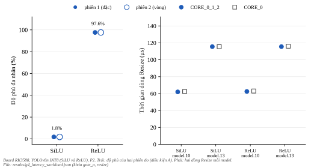
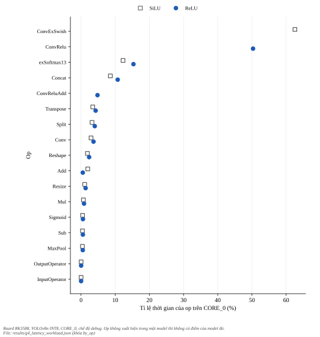
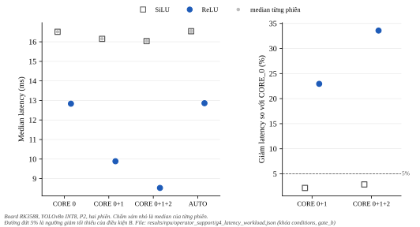
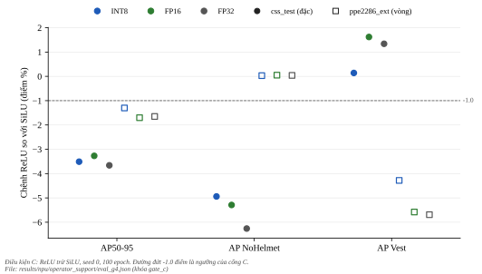
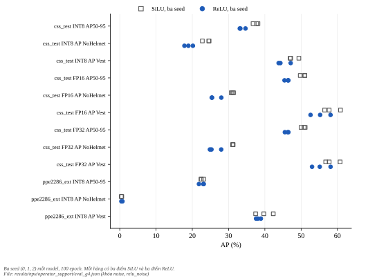
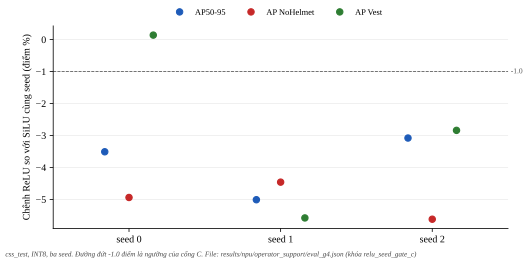

****************
Cổng G4 cho ReLU
****************

.. admonition:: Trang này trả lời

   - Đổi SiLU sang ReLU trên YOLOv8n ppe5 qua hay trượt từng điều kiện A (phủ đa nhân), B (latency) và C (mAP) của cổng G4, và nhãn kết luận là gì?
   - Các model so sánh có cùng danh sách hiệu chuẩn INT8 không, và độ nhiễu giữa các seed là bao nhiêu so với mức 1.0 điểm?
   - Workload đa nhân đo được của ``ConvReluAdd``, ``ConvExSwish``, ``Resize``, ``Concat``, ``Split``, ``MaxPool`` là gì?

.. admonition:: Tóm tắt

   - Nhãn của ứng viên ReLU (seed 0 theo chuẩn): **Loại**, vì điều kiện C trượt trên ``css_test`` ở INT8. AP50-95 chênh -3.51 điểm, AP NoHelmet chênh -4.94 điểm, AP Vest chênh +0.14 điểm (ngưỡng là giảm tối đa 1.0 điểm mỗi cột).
   - Điều kiện A đạt cho ReLU: các lớp chia từ hai nhân trở lên chiếm 97.6% cycles ước tính (SiLU: 1.8%).
   - Điều kiện B đạt cho ReLU: ``CORE_0_1_2`` nhanh hơn ``CORE_0`` 33.6% (12.834 xuống 8.524 ms), chênh hai phiên 0.011 ms. Với SiLU mức giảm chỉ 2.9%, không đạt ngưỡng 5%.
   - Mức giảm mAP 1.0 điểm nằm trong nhiễu giữa seed của baseline SiLU: AP50-95 INT8 của seed 0, 1, 2 trải 1.35 điểm trên ``css_test``. ReLU seed 0, 1, 2 (thêm ngày 2026-10-31 theo duyệt của người dùng) trải 1.57 điểm, AP50-95 trung bình của ReLU thấp hơn của SiLU 3.87 điểm, lớn hơn cả hai khoảng trải. Cả 3 seed ReLU đều trượt cổng C so với SiLU cùng số seed. Nhãn của cổng vẫn tính theo seed 0 so với seed 0 như đã duyệt.
   - Hai danh sách hiệu chuẩn INT8 cũ của seed 0 và seed 1 chỉ trùng 30 trên 300 ảnh vì sampler phụ thuộc ``PYTHONHASHSEED``. Mọi model INT8 so sánh ở trang này dùng đúng danh sách của seed 0.
   - Trong bảng WorkLoad: 6 trên 6 lớp ``ConvReluAdd`` chia ba nhân. Operator List không có mục cùng tên. 57 trên 57 lớp ``ConvExSwish`` chỉ chạy nhân 0. ``Resize``, ``Split`` và ``MaxPool`` chỉ chạy nhân 0.
   - Điều kiện chạy latency là giao thức P2 của nhóm Nền đo NPU, đã được người dùng duyệt nguyên trạng ngày 2026-11-01 (hạn chế ở :doc:`../02-tang-npu-nen-do/07-giao-thuc-p2-p3` mục 6). Mọi số là một board, một lần chạy xen kẽ, một seed.

Tiêu chuẩn của cổng ở :doc:`../03-tang-npu-don-bay/01-operator-support` (mục 2). Kết quả đa nhân S1, S2, S3 ở :doc:`03-ket-qua-da-nhan`. Mọi số INT8 ở trang này dùng công thức lượng tử hóa mặc định của Ultralytics. Trang :doc:`05-ket-qua-luong-tu-hoa` cho thấy công thức ``h5`` (giữ FP16 nhánh giải mã box) lấy lại gần hết mức rơi INT8 so với FP16 và không tốn latency (một lần đo dưới P2), cổng C của ReLU dưới ``h5`` vẫn không đạt.

.. contents:: Trong trang này
   :local:
   :depth: 1

1. Điều kiện chạy
=================

.. list-table::
   :header-rows: 1
   :widths: 22 40 20 20

   * - Model
     - Run
     - INT8 sha256 (8 ký tự đầu)
     - FP16 sha256 (8 ký tự đầu)
   * - SiLU baseline seed 0
     - ``ppe5_yolov8n_baseline_100ep_s0``
     - a501f94e
     - bd4a8c8a
   * - ReLU seed 0
     - ``ppe5_yolov8n_relu_100ep_s0``
     - c36458b7
     - 8b383930

ReLU huấn luyện 100 epoch trên ppe5 (``ai/automation/configs/ppe5_yolov8n_relu.yaml``, seed 0). So ``args.yaml`` của hai run, chỉ khác ``model`` (yaml ReLU thay ``yolov8n.pt``), ``pretrained`` (``yolov8n.pt`` nạp vào model yaml thay ``true``) và tên, đường dẫn run, mọi tham số huấn luyện khác giống nhau. Kiến trúc là ``ai/models/yolov8n_relu/yolov8n_relu.yaml`` (``activation: nn.ReLU()``) khởi tạo từ trọng số ``yolov8n.pt`` của SiLU, nhật ký ghi ``Transferred 322/355 items from pretrained weights``. Baseline cũng khởi tạo từ ``yolov8n.pt``. Kết quả của cổng ghi nhãn "1 seed" (seed 0), ReLU seed 1 và 2 chỉ để mô tả nhiễu (mục 5).

Đo latency chạy một lần xen kẽ 16 phiên dưới giao thức P2 (ghim ``rknn_server`` và ba ngắt NPU vào CPU4, dừng ``irqbalance``, tần số khóa), thứ tự SiLU, ReLU lần lượt ở ``CORE_0``, ``CORE_0_1``, ``CORE_0_1_2``, ``AUTO``, lặp lại hai vòng cùng thứ tự, nghỉ 45 giây. Mỗi phiên là 5 lần ``eval_perf`` không bật ``perf_debug`` (latency) rồi 5 lần với ``perf_debug=True`` (bảng từng lớp). Cả 16 phiên thực hiện đúng P2 theo tiêu chí viết trước (``experiments/npu/operator_support/onboard_g4b/ppe5_yolov8n_baseline_100ep_s0/rule.txt``). P2 đã được người dùng duyệt nguyên trạng ngày 2026-11-01. Các ngưỡng số mới của quy tắc này không được nêu riêng trong câu trả lời nên không coi là đã duyệt.

Hiệu chuẩn INT8: danh sách hiệu chuẩn của seed 0 (300 ảnh, mỗi class có mặt trong ít nhất 157 ảnh) được sao nguyên cho ReLU và cho baseline seed 1 và 2. Bằng chứng giống hệt là ``stems_md5`` ``11d6a5c69414a6eafd8b98f99724b0b2`` và ``png_md5`` ``6652576adb7608ddf8ff326c57851732`` (md5 của tên ảnh đã sắp và của sha256 các tệp PNG), cùng thứ tự tên ảnh trong ``dataset.txt`` khớp từng dòng. Không dùng md5 của ``dataset.txt`` vì tệp này chứa đường dẫn tuyệt đối có tên run.

Điều đã biết về sampler: ``ai/core/rknn/calibration.py`` cắt ``list(selected)[:n]`` trên tập chuỗi và xáo ``list(class_to_images[c] - selected)``, thứ tự phụ thuộc ``PYTHONHASHSEED``. Vì vậy hai export cũ của seed 0 và seed 1 dùng hai danh sách khác nhau, chỉ trùng 30 trên 300 ảnh. Export cũ của seed 1 được giữ với tên ``rknn_int8_ownlist``, kết quả X5 (dùng file này trên board) không đổi. Sampler đã sửa bằng ``sorted`` trong một thay đổi riêng (chưa commit), có ``tests/test_calibration.py``, export cũ của seed 0 không bị sửa.

2. G1 đến G3
============

2.1. G1 và G2: nguồn
--------------------

G1 chỉ tìm trong tài liệu T1 của repo (Operator List V2.3.2, SDK User Guide V2.3.2, API guide, toàn bộ PDF trong ``3rdparty/rknn-toolkit2/doc`` và mã, changelog trong ``3rdparty``). G2 tìm trong 46 PDF bài báo ``docs/_assets/pdf/papers``. Kết quả do subagent doc-reader trích, số trang là trang PDF.

.. list-table::
   :header-rows: 1
   :widths: 26 54 20

   * - Câu hỏi
     - Kết quả
     - Nhãn
   * - Operator List có mục tên ``ConvReluAdd``, ``ConvRelu``, ``ConvExSwish`` không
     - Không có mục nào. Mục gần nhất là ``ConvolutionRelu`` (3.2.7, tr.60), ``ConvolutionAddRelu`` (3.2.19, tr.63) và ``exSwish`` (3.2.69, tr.98) [T1 OPL]
     - NGUỒN
   * - ``ConvolutionAddRelu`` ghi gì
     - ``Output = Relu(Add(Conv(Input0), Input1))``, ``说明及规格限制同Convolution``, ``多核联合: 支持`` [T1 OPL tr.63]. Không có tài liệu nói ``ConvReluAdd`` là cùng op
     - NGUỒN
   * - ``ConvRelu`` có trong tài liệu T1 không
     - Có trong ví dụ log của SDK guide V2.3.2 tr.75, dòng ``6 ConvRelu INT8 NPU 48.1%/51.9%/0.0% - Up:48.1%``, và bảng layer tr.109 đến 110 [T1 UG232]. Đây là ví dụ, không phải mục op
     - NGUỒN
   * - ``ConvReluAdd`` có trong tài liệu T1 không
     - Không có trong PDF hay văn bản T1. Chuỗi chỉ xuất hiện trong các tệp nhị phân ``.rknn`` đi kèm (ví dụ ``yolov5s-640-640.rknn`` của ``rknn_yolov5_demo``), không phải tài liệu
     - CHƯA BIẾT theo T1
   * - ``ConvExSwish`` có trong tài liệu T1 không
     - Không thấy. ``exSwish`` có trong changelog 2.3.2 dòng 284 (``增加exSwish的beta属性支持``)
     - CHƯA BIẾT theo T1
   * - Bài báo nào đo activation SiLU so với ReLU trên NPU
     - Không bài nào trên RK3588. ActNAS đo trên NPU không nêu tên hãng, YOLOv5n SiLU 22.35 ms, ReLU 17.46 ms (Table 2, tr.6). Hai bài RK3588 (Kong 2026, DAHD-YOLO) không so activation
     - NGUỒN (G2: không có bằng chứng T2 cùng SoC)

Vì ``ConvReluAdd`` không có mục cùng tên trong T1, G1 vẫn ở trạng thái qua một phần. Theo tiêu chuẩn, nhãn "Giữ" cần G1 đến G4 đều qua, nên G1 chưa giải quyết thì nhãn không thể là "Giữ". Hành vi thực tế của ``ConvReluAdd`` đo ở mục 3 (bảng WorkLoad), đó là phép đo T3, không thay thế mục T1.

2.2. G3: bảng build INT8
------------------------

Bảng layer của build INT8 (rknn-toolkit2 2.3.2) của model ReLU đã huấn luyện có 113 dòng, các dòng có ``Target`` CPU chỉ gồm ``InputOperator``, ``Transpose`` và ``OutputOperator``. Build FP16 cũng 113 dòng với cùng ba op CPU. Model SiLU có 119 dòng với cùng ba op CPU. Hai model có cùng tổng cycles ước tính (5666717). Kết quả: **G3 qua** cho ReLU (không có op mới rơi về CPU). Danh sách op của ReLU khớp bảng đã ghi ở :doc:`../03-tang-npu-don-bay/01-operator-support` mục 3.2 (51 ``ConvRelu``, 6 ``ConvReluAdd``).

3. Điều kiện A: phủ đa nhân
===========================

Một dòng của bảng layer ở ``CORE_0_1_2`` được tính là chia khi ít nhất hai trong ba phần trăm WorkLoad lớn hơn 0.0%. Độ phủ là tổng cycles (cột ``Total``) của các dòng chia chia cho tổng cycles của mọi dòng có cycles. Tổng cycles của bảng board bằng tổng cycles của bảng build của cùng file ``.rknn`` (đã assert). Độ phủ lấy từ bảng ``perf_debug=True``, chỉ là chỉ báo vì ``perf_debug`` có thể tắt cơ chế song song [T1 UG232 tr.177].

   Độ phủ đa nhân của hai phiên đo (trái) và thời gian hai dòng Resize của mỗi model ở hai mặt nạ nhân (phải). Hình sinh bằng ``docs/tools/figure_gen/03-phuong-phap/04-tang-npu-ket-qua/gen.py``.

.. list-table::
   :header-rows: 1
   :widths: 16 20 20 20

   * - Model
     - Độ phủ phiên 1
     - Độ phủ phiên 2
     - Điều kiện A
   * - SiLU
     - 1.8%
     - 1.8%
     - không đạt
   * - ReLU
     - 97.6%
     - 97.6%
     - đạt

Bảng theo loại op ở ``CORE_0_1_2`` (phiên 1, từng model). Cột "Dòng chia" là số dòng có ít nhất hai phần trăm WorkLoad lớn hơn 0.0%. Cột "Tỉ lệ thời gian" là tỉ lệ tổng thời gian dòng ở ``CORE_0`` (trung vị hai phiên, chế độ ``perf_debug``).

   Tỉ lệ thời gian của từng op trên ``CORE_0`` cho hai model. Hình sinh bằng ``docs/tools/figure_gen/03-phuong-phap/04-tang-npu-ket-qua/gen.py``.

.. list-table::
   :header-rows: 1
   :widths: 14 8 8 8 12 12 38

   * - Op
     - Model
     - Số dòng
     - Dòng chia
     - Tỉ lệ cycles
     - Tỉ lệ thời gian
     - WorkLoad thường gặp
   * - ``ConvExSwish``
     - SiLU
     - 57
     - 0
     - 95.8%
     - 62.6%
     - ``100.0%/0.0%/0.0%``
   * - ``ConvRelu``
     - ReLU
     - 51
     - 51
     - 86.7%
     - 50.3%
     - ``35.0%/32.5%/32.5%``, ``33.8%/33.8%/32.5%``
   * - ``ConvReluAdd``
     - ReLU
     - 6
     - 6
     - 9.1%
     - 4.8%
     - ``35.0%/32.5%/32.5%``, ``33.7%/33.1%/33.1%``
   * - ``Conv``
     - SiLU
     - 7
     - 6
     - 4.2%
     - 2.9%
     - ``33.7%/33.7%/32.5%``, ``35.0%/32.5%/32.5%``
   * - ``Conv``
     - ReLU
     - 7
     - 6
     - 4.2%
     - 3.7%
     - ``33.8%/33.8%/32.5%``, ``35.0%/32.5%/32.5%``
   * - ``Add``
     - SiLU
     - 8
     - 8
     - 0.0%
     - 2.0%
     - ``33.7%/33.7%/32.5%``, ``35.0%/32.5%/32.5%``
   * - ``Add``
     - ReLU
     - 2
     - 2
     - 0.0%
     - 0.5%
     - ``33.3%/33.3%/33.3%``
   * - ``Concat``
     - SiLU
     - 17
     - 15
     - 0.0%
     - 8.6%
     - ``35.0%/32.5%/32.5%``, ``35.0%/35.0%/30.0%``
   * - ``Concat``
     - ReLU
     - 17
     - 15
     - 0.0%
     - 10.7%
     - ``35.0%/32.5%/32.5%``, ``35.0%/35.0%/30.0%``
   * - ``Split``
     - SiLU
     - 9
     - 0
     - 0.0%
     - 3.2%
     - ``100.0%/0.0%/0.0%``
   * - ``Split``
     - ReLU
     - 9
     - 0
     - 0.0%
     - 4.0%
     - ``100.0%/0.0%/0.0%``
   * - ``MaxPool``
     - SiLU
     - 3
     - 0
     - 0.0%
     - 0.4%
     - ``100.0%/0.0%/0.0%``
   * - ``MaxPool``
     - ReLU
     - 3
     - 0
     - 0.0%
     - 0.5%
     - ``100.0%/0.0%/0.0%``
   * - ``Resize``
     - SiLU
     - 2
     - 0
     - 0.0%
     - 1.1%
     - ``100.0%/0.0%/0.0%``
   * - ``Resize``
     - ReLU
     - 2
     - 0
     - 0.0%
     - 1.3%
     - ``100.0%/0.0%/0.0%``
   * - ``Reshape``
     - SiLU
     - 7
     - 0
     - 0.0%
     - 1.9%
     - ``100.0%/0.0%/0.0%``, ``0.0%/0.0%/0.0%``
   * - ``Reshape``
     - ReLU
     - 7
     - 0
     - 0.0%
     - 2.4%
     - ``100.0%/0.0%/0.0%``, ``0.0%/0.0%/0.0%``
   * - ``Sub``
     - SiLU
     - 2
     - 0
     - 0.0%
     - 0.4%
     - ``100.0%/0.0%/0.0%``
   * - ``Sub``
     - ReLU
     - 2
     - 0
     - 0.0%
     - 0.5%
     - ``100.0%/0.0%/0.0%``
   * - ``Mul``
     - SiLU
     - 2
     - 0
     - 0.0%
     - 0.7%
     - ``100.0%/0.0%/0.0%``
   * - ``Mul``
     - ReLU
     - 2
     - 0
     - 0.0%
     - 0.9%
     - ``100.0%/0.0%/0.0%``
   * - ``Sigmoid``
     - SiLU
     - 1
     - 0
     - 0.0%
     - 0.5%
     - ``100.0%/0.0%/0.0%``
   * - ``Sigmoid``
     - ReLU
     - 1
     - 0
     - 0.0%
     - 0.6%
     - ``100.0%/0.0%/0.0%``
   * - ``exSoftmax13``
     - SiLU
     - 1
     - 0
     - 0.0%
     - 12.3%
     - ``100.0%/0.0%/0.0%``
   * - ``exSoftmax13``
     - ReLU
     - 1
     - 0
     - 0.0%
     - 15.3%
     - ``100.0%/0.0%/0.0%``
   * - ``Transpose``
     - SiLU
     - 1
     - 0
     - 0.0%
     - 3.4%
     - ``0.0%/0.0%/0.0%``
   * - ``Transpose``
     - ReLU
     - 1
     - 0
     - 0.0%
     - 4.3%
     - ``0.0%/0.0%/0.0%``

Đọc từ bảng (đây là số đo, nguyên nhân chia hay không chia chưa biết):

- ``ConvRelu`` (51 trên 51 dòng) và ``ConvReluAdd`` (6 trên 6 dòng) đều chia ba nhân. ``ConvExSwish`` (0 trên 57 dòng) đều ``100.0%/0.0%/0.0%``.
- ``Concat``: 15 trên 17 dòng chia, 2 dòng chỉ nhân 0. Operator List không có dòng ``多核联合`` cho ``Concat`` [T1 OPL tr.58], hai guide liệt kê ``Concat`` là op đa nhân [T1 UG232 tr.75] [T1 UG152 tr.27]. Bảng đo cho thấy phần lớn ``Concat`` chia.
- ``Add``: 8 trên 8 dòng ở model SiLU và 2 trên 2 dòng ở model ReLU chia.
- ``Split`` (9 dòng), ``MaxPool`` (3 dòng), ``Resize`` (2 dòng) đều chỉ nhân 0 ở cả hai model.
- Trong bảng, ``Reshape``, ``Sub``, ``Mul``, ``Sigmoid``, ``exSoftmax13`` có WorkLoad ``100.0%/0.0%/0.0%`` (riêng 3 trên 7 dòng ``Reshape`` là ``0.0%/0.0%/0.0%``), ``Transpose``, ``InputOperator``, ``OutputOperator`` có ``0.0%/0.0%/0.0%``.

Hai dòng ``Resize`` chọn theo tên op: ở ``CORE_0_1_2`` WorkLoad ``100.0%/0.0%/0.0%``, thời gian dòng trong bảng ``perf_debug`` nằm trong vòng 0.5 µs so với ``CORE_0``.

.. list-table::
   :header-rows: 1
   :widths: 10 34 24 24

   * - Model
     - Dòng (ID)
     - Thời gian ``CORE_0_1_2`` (µs)
     - Thời gian ``CORE_0`` (µs)
   * - SiLU
     - ``/model/model.10/Resize`` (47)
     - 62.0
     - 62.5
   * - SiLU
     - ``/model/model.13/Resize`` (55)
     - 115.5
     - 115.5
   * - ReLU
     - ``/model/model.10/Resize`` (41)
     - 62.5
     - 63.0
   * - ReLU
     - ``/model/model.13/Resize`` (49)
     - 115.5
     - 116.0

Các số này là thời gian dòng trong chế độ ``perf_debug`` và không đo trực tiếp ảnh hưởng của ``Resize`` lên latency tổng. Hai dòng ``Resize`` cộng 178.0 µs ở model ReLU, so với latency 8524 µs của model này ở ``CORE_0_1_2``.

4. Điều kiện B: latency
=======================

Trung vị của hai trung vị phiên (mỗi phiên là trung vị 5 lần ``eval_perf``) cho mỗi tổ hợp, đơn vị ms. Chênh hai phiên là chênh giữa hai trung vị phiên của tổ hợp.

   Median latency theo mặt nạ nhân (trái) và mức giảm so với ``CORE_0`` (phải). Đường đứt 5% là ngưỡng giảm tối thiểu. Hình sinh bằng ``docs/tools/figure_gen/03-phuong-phap/04-tang-npu-ket-qua/gen.py``.

.. list-table::
   :header-rows: 1
   :widths: 10 16 28 18 18

   * - Model
     - Mask
     - Trung vị hai phiên (ms)
     - Trung vị chung (ms)
     - Chênh hai phiên (ms)
   * - SiLU
     - ``CORE_0``
     - 16.507, 16.516
     - 16.511
     - 0.009
   * - SiLU
     - ``CORE_0_1``
     - 16.141, 16.161
     - 16.151
     - 0.020
   * - SiLU
     - ``CORE_0_1_2``
     - 16.025, 16.047
     - 16.036
     - 0.022
   * - SiLU
     - ``AUTO``
     - 16.509, 16.575
     - 16.542
     - 0.066
   * - ReLU
     - ``CORE_0``
     - 12.839, 12.828
     - 12.834
     - 0.011
   * - ReLU
     - ``CORE_0_1``
     - 9.888, 9.889
     - 9.889
     - 0.001
   * - ReLU
     - ``CORE_0_1_2``
     - 8.524, 8.524
     - 8.524
     - 0.000
   * - ReLU
     - ``AUTO``
     - 12.861, 12.856
     - 12.858
     - 0.005

Quy tắc B (viết trước dữ liệu): giảm so với ``CORE_0`` tính bằng trung vị chung. Mask được coi là nhanh hơn khi giảm ít nhất 5% và mức giảm (ms) lớn hơn chênh hai phiên lớn nhất của hai tổ hợp so sánh. Cổng B là kết quả của ReLU ở ``CORE_0_1_2``, SiLU là đối chứng.

.. list-table::
   :header-rows: 1
   :widths: 10 16 12 12 26 18

   * - Model
     - Mask
     - Giảm (ms)
     - Giảm (%)
     - Chênh hai phiên lớn nhất (ms)
     - Kết quả
   * - SiLU
     - ``CORE_0_1``
     - 0.360
     - 2.18
     - 0.020
     - không nhanh hơn
   * - SiLU
     - ``CORE_0_1_2``
     - 0.475
     - 2.88
     - 0.022
     - không nhanh hơn
   * - ReLU
     - ``CORE_0_1``
     - 2.945
     - 22.95
     - 0.011
     - nhanh hơn
   * - ReLU
     - ``CORE_0_1_2``
     - 4.310
     - 33.58
     - 0.011
     - nhanh hơn

Điều kiện B đạt cho ReLU (33.6% lớn hơn 5%, 4.310 ms lớn hơn 0.011 ms). SiLU không đạt (2.9%). Mô tả chéo: ở ``CORE_0`` ReLU nhanh hơn SiLU 22.3% (16.511 so với 12.834 ms), ở ``CORE_0_1_2`` nhanh hơn 46.8% (16.036 so với 8.524 ms). Nguyên nhân của chênh lệch ở ``CORE_0`` giữa hai activation chưa biết, dữ liệu chỉ cho biết ``ConvExSwish`` chiếm 62.6% tổng thời gian dòng ở SiLU và ``ConvRelu`` cộng ``ConvReluAdd`` chiếm 55.1% ở ReLU.

``AUTO`` so với ``CORE_0``: SiLU +0.031 ms (chênh hai phiên lớn nhất 0.066 ms), ReLU +0.025 ms (0.011 ms).

5. Điều kiện C: mAP và nhiễu seed
=================================

Chấm bằng RKNNLite trên board, cùng mã và cùng ngưỡng tin cậy cho mọi model (``make evaluate BACKEND=rknn``). Tập cổng là ``css_test`` (82 ảnh, 41 instance ``NoHelmet``). Tập ``ppe2286_ext`` (180 ảnh) chỉ để mô tả. AP là AP50-95 của class, đơn vị điểm phần trăm.

   Chênh ReLU so với SiLU của ba chỉ số ở sáu tổ hợp tập và kiểu số. Đường đứt -1.0 điểm là ngưỡng cổng C. Hình sinh bằng ``docs/tools/figure_gen/03-phuong-phap/04-tang-npu-ket-qua/gen.py``.

.. list-table::
   :header-rows: 1
   :widths: 26 26 26 26 14

   * - Tập và dtype
     - AP50-95 (SiLU / ReLU / chênh)
     - AP NoHelmet
     - AP Vest
     - Cả ba chênh >= -1.0
   * - css_test INT8 (kết luận)
     - 36.75 / 33.24 / -3.51
     - 22.77 / 17.83 / -4.94
     - 46.98 / 47.12 / +0.14
     - không đạt
   * - css_test FP16 (tham chiếu)
     - 49.76 / 46.49 / -3.27
     - 30.74 / 25.45 / -5.29
     - 56.49 / 58.11 / +1.62
     - không đạt
   * - css_test FP32 PyTorch (mô tả)
     - 49.99 / 46.33 / -3.66
     - 31.11 / 24.85 / -6.26
     - 56.78 / 58.12 / +1.34
     - không đạt
   * - ppe2286_ext INT8 (mô tả)
     - 23.13 / 21.83 / -1.30
     - 0.55 / 0.58 / +0.03
     - 42.32 / 38.04 / -4.28
     - không đạt
   * - ppe2286_ext FP16 (mô tả)
     - 26.35 / 24.65 / -1.70
     - 0.90 / 0.95 / +0.05
     - 45.05 / 39.47 / -5.58
     - không đạt
   * - ppe2286_ext FP32 (mô tả)
     - 26.24 / 24.59 / -1.65
     - 0.89 / 0.93 / +0.04
     - 45.03 / 39.34 / -5.69
     - không đạt

Cổng C chỉ dùng hàng ``css_test`` INT8: AP50-95 -3.51 điểm và AP NoHelmet -4.94 điểm đều dưới -1.0, AP Vest +0.14 điểm. Kết quả: **C không đạt**. Ở FP16 (tham chiếu) và FP32 (mô tả) cũng thấp hơn SiLU ở AP50-95 trên ``css_test``.

Nhiễu giữa seed (chỉ mô tả, không phải cổng): baseline SiLU seed 0, 1, 2 chấm cùng đường, INT8 dùng cùng danh sách hiệu chuẩn. Khoảng trải là lớn nhất trừ nhỏ nhất. Quy tắc viết trước: mức 1.0 điểm "trong nhiễu seed" khi khoảng trải của cột đó từ 1.0 điểm trở lên, "ngoài nhiễu seed" khi dưới 1.0. Có ba seed nên độ lệch chuẩn mẫu chỉ đi kèm, không phải kết luận.

   Giá trị của ba seed cho SiLU và ReLU, mỗi hàng một chỉ số. Hình sinh bằng ``docs/tools/figure_gen/03-phuong-phap/04-tang-npu-ket-qua/gen.py``.

.. list-table::
   :header-rows: 1
   :widths: 20 14 26 14 18 18

   * - Tập và dtype
     - Cột
     - Seed 0 / 1 / 2
     - Khoảng trải
     - Độ lệch chuẩn mẫu
     - Mức 1.0 điểm
   * - css_test INT8
     - AP50-95
     - 36.75 / 38.10 / 37.74
     - 1.35
     - 0.70
     - trong nhiễu seed
   * - css_test INT8
     - AP NoHelmet
     - 22.77 / 24.62 / 24.54
     - 1.85
     - 1.05
     - trong nhiễu seed
   * - css_test INT8
     - AP Vest
     - 46.98 / 49.38 / 47.12
     - 2.40
     - 1.35
     - trong nhiễu seed
   * - css_test FP16
     - AP50-95
     - 49.76 / 51.01 / 51.00
     - 1.25
     - 0.72
     - trong nhiễu seed
   * - css_test FP16
     - AP NoHelmet
     - 30.74 / 31.13 / 31.36
     - 0.62
     - 0.31
     - ngoài nhiễu seed
   * - css_test FP16
     - AP Vest
     - 56.49 / 60.85 / 57.72
     - 4.36
     - 2.25
     - trong nhiễu seed
   * - css_test FP32
     - AP50-95
     - 49.99 / 51.11 / 50.82
     - 1.12
     - 0.58
     - trong nhiễu seed
   * - css_test FP32
     - AP NoHelmet
     - 31.11 / 31.25 / 31.20
     - 0.14
     - 0.07
     - ngoài nhiễu seed
   * - css_test FP32
     - AP Vest
     - 56.78 / 60.74 / 57.73
     - 3.96
     - 2.07
     - trong nhiễu seed
   * - ppe2286_ext INT8
     - AP50-95
     - 23.13 / 22.47 / 22.40
     - 0.73
     - 0.40
     - ngoài nhiễu seed
   * - ppe2286_ext INT8
     - AP NoHelmet
     - 0.55 / 0.50 / 0.44
     - 0.11
     - 0.06
     - ngoài nhiễu seed
   * - ppe2286_ext INT8
     - AP Vest
     - 42.32 / 39.71 / 37.46
     - 4.86
     - 2.43
     - trong nhiễu seed

Trên ``css_test`` INT8 mức giảm của ReLU ở AP50-95 (3.51 điểm) và ở AP NoHelmet (4.94 điểm) lớn hơn khoảng trải giữa ba seed SiLU (1.35 và 1.85 điểm). Nhiễu của chính ReLU xem ở bảng ngay dưới. Cổng C đọc theo ngưỡng 1.0 điểm đã duyệt, không phụ thuộc phần mô tả nhiễu này. AP Vest của riêng một class dao động 2.40 điểm giữa ba seed SiLU, lớn hơn ngưỡng 1.0 điểm.

Nhiễu seed của ReLU (thêm theo duyệt của người dùng ngày 2026-10-31, quy tắc viết trước ``experiments/npu/operator_support/eval_g4/rule_relu_seeds.txt``). ReLU seed 1 và 2 huấn luyện cùng cấu hình, INT8 dùng cùng danh sách hiệu chuẩn của seed 0. Cột "Chênh trung bình" là trung bình ba seed ReLU trừ trung bình ba seed SiLU. Chênh "lớn hơn nhiễu seed" khi giá trị tuyệt đối lớn hơn khoảng trải lớn hơn trong hai nhóm. Ba seed không đủ để kiểm định, đây là mô tả.

.. list-table::
   :header-rows: 1
   :widths: 18 14 24 12 12 12 18

   * - Tập và dtype
     - Cột
     - ReLU seed 0 / 1 / 2
     - Khoảng trải ReLU
     - Khoảng trải SiLU
     - Chênh trung bình
     - So với nhiễu
   * - css_test INT8
     - AP50-95
     - 33.24 / 33.09 / 34.66
     - 1.57
     - 1.35
     - -3.87
     - lớn hơn nhiễu seed
   * - css_test INT8
     - AP NoHelmet
     - 17.83 / 20.16 / 18.92
     - 2.33
     - 1.85
     - -5.01
     - lớn hơn nhiễu seed
   * - css_test INT8
     - AP Vest
     - 47.12 / 43.80 / 44.28
     - 3.32
     - 2.40
     - -2.76
     - trong nhiễu seed
   * - css_test FP16
     - AP50-95
     - 46.49 / 45.42 / 46.38
     - 1.07
     - 1.25
     - -4.49
     - lớn hơn nhiễu seed
   * - css_test FP16
     - AP NoHelmet
     - 25.45 / 28.00 / 25.36
     - 2.64
     - 0.62
     - -4.81
     - lớn hơn nhiễu seed
   * - css_test FP16
     - AP Vest
     - 58.11 / 52.60 / 55.24
     - 5.51
     - 4.36
     - -3.04
     - trong nhiễu seed
   * - css_test FP32
     - AP50-95
     - 46.33 / 45.52 / 46.49
     - 0.97
     - 1.12
     - -4.53
     - lớn hơn nhiễu seed
   * - css_test FP32
     - AP NoHelmet
     - 24.85 / 27.97 / 25.28
     - 3.12
     - 0.14
     - -5.15
     - lớn hơn nhiễu seed
   * - css_test FP32
     - AP Vest
     - 58.12 / 53.01 / 55.14
     - 5.11
     - 3.96
     - -2.99
     - trong nhiễu seed
   * - ppe2286_ext INT8
     - AP50-95
     - 21.83 / 23.04 / 23.15
     - 1.32
     - 0.73
     - +0.01
     - trong nhiễu seed
   * - ppe2286_ext INT8
     - AP NoHelmet
     - 0.58 / 0.74 / 0.45
     - 0.29
     - 0.11
     - +0.09
     - trong nhiễu seed
   * - ppe2286_ext INT8
     - AP Vest
     - 38.04 / 37.58 / 38.90
     - 1.32
     - 4.86
     - -1.66
     - trong nhiễu seed

Cổng C của từng seed ReLU so với SiLU cùng số seed (``css_test`` INT8, AP50-95 / AP NoHelmet / AP Vest, điểm):

   Chênh ReLU so với SiLU cùng seed của ba chỉ số. Đường đứt -1.0 điểm là ngưỡng cổng C. Hình sinh bằng ``docs/tools/figure_gen/03-phuong-phap/04-tang-npu-ket-qua/gen.py``.

.. list-table::
   :header-rows: 1
   :widths: 10 16 16 16 16

   * - Seed
     - AP50-95
     - AP NoHelmet
     - AP Vest
     - Cổng C
   * - 0
     - -3.51
     - -4.94
     - +0.14
     - không đạt
   * - 1
     - -5.01
     - -4.46
     - -5.58
     - không đạt
   * - 2
     - -3.08
     - -5.62
     - -2.84
     - không đạt

Trên ``css_test`` INT8 mức giảm trung bình của ReLU ở AP50-95 (3.87 điểm) và AP NoHelmet (5.01 điểm) lớn hơn khoảng trải của cả hai nhóm seed. AP Vest (-2.76 điểm) nằm trong nhiễu seed. Trên ``ppe2286_ext`` INT8 chênh AP50-95 là +0.01 điểm, trong nhiễu seed.

6. Nhãn của ứng viên
====================

.. list-table::
   :header-rows: 1
   :widths: 10 70 20

   * - Bước
     - Kết quả
     - Nhãn bước
   * - G1
     - ``ConvRelu`` ánh xạ được sang ``ConvolutionRelu`` theo tên, ``ConvReluAdd`` không có mục cùng tên (mục 2.1)
     - qua một phần
   * - G2
     - Không có bằng chứng T2 cùng SoC (mục 2.1)
     - ghi nhận
   * - G3
     - Ngoài ``InputOperator`` và ``OutputOperator``, chỉ ``Transpose`` ở CPU, như SiLU (mục 2.2)
     - qua
   * - G4 A
     - Độ phủ 97.6% (mục 3)
     - đạt
   * - G4 B
     - ``CORE_0_1_2`` nhanh hơn ``CORE_0`` 33.6% (mục 4)
     - đạt
   * - G4 C
     - AP50-95 -3.51, AP NoHelmet -4.94, AP Vest +0.14 điểm (mục 5)
     - không đạt

Nhãn: **Loại** (ReLU, seed 0 theo chuẩn, trượt ở điều kiện C của G4, cả 3 seed ReLU đều trượt khi so với SiLU cùng seed). Ứng viên dừng ở bước đầu tiên không qua theo tiêu chuẩn. Điều kiện A và B đạt cho thấy ReLU nhanh hơn rõ rệt, và đó là phép đo đúng như đã ghi, nhưng không thay đổi nhãn vì cổng yêu cầu cả ba điều kiện. Nhãn này không nói ReLU không bao giờ dùng được, chỉ nói bản huấn luyện này (100 epoch, khởi tạo từ trọng số SiLU, 1 seed) không đạt ngưỡng mAP đã duyệt. Các biến thể LeakyReLU, ReLU6 và ReLU 200 epoch đã chạy và ở :doc:`02-ket-qua-bien-the-activation`.

7. Điều chưa biết
=================

.. list-table::
   :header-rows: 1
   :widths: 34 18 48

   * - Việc
     - Trạng thái
     - Đã tìm hoặc đo gì
   * - ``ConvReluAdd`` có mục đa nhân trong T1
     - chưa biết theo T1
     - Operator List V2.3.2 và mọi văn bản T1 (mục 2.1). Hành vi đo: chia ba nhân
   * - Vì sao ``asymmetric`` với ``nearest_mode = floor`` vẫn lên NPU (G7)
     - chưa biết (đo thêm 2026-11-01: thuộc tính bị bỏ qua ở micro model, :doc:`08-so-muc-chua-biet` mục 2)
     - Operator List tr.86 đến 87 chỉ nêu giới hạn. Trong gói toolkit có chuỗi tên pass ``_p_convert_resize_to_deconv`` và thông báo ``Resize [{}] convert to Deconvolution for inference speedup, but may cause result driftting.``, chưa đọc logic nên chưa biết điều kiện kích hoạt
   * - Vì sao Reshape 8 nút ONNX thành 7 dòng RKNN và Slice thành Split (G10)
     - ĐO (mô tả, 2026-11-01, :doc:`08-so-muc-chua-biet` mục 3). Vì sao: chưa biết
     - Không có giải thích văn bản trong T1 hoặc T2. Chỉ thấy tên pass trong binary (``_p_remove_reshape_after_concat``, ``_p_replace_parallel_slice_by_split``)
   * - Mâu thuẫn Relu và Concat giữa Operator List và hai guide (G11)
     - ĐO ở micro model (2026-11-01, :doc:`08-so-muc-chua-biet` mục 4). Tài liệu nào đúng: chưa biết
     - Không tài liệu T1 nào khác giải quyết (changelog, header). Bảng đo cho thấy 15 trên 17 ``Concat`` chia
   * - Vì sao ``CORE_0`` của ReLU nhanh hơn SiLU
     - chưa biết
     - Mục 4 chỉ mô tả tỉ lệ thời gian dòng
   * - Nhiễu seed của ReLU
     - ĐO
     - Ba seed (mục 5): khoảng trải AP50-95 INT8 trên ``css_test`` là 1.57 điểm
   * - Kết quả của P2 so với giao thức chính
     - chưa biết
     - P2 đã được người dùng duyệt nguyên trạng ngày 2026-11-01, kết quả của P2 so với giao thức gốc chưa đo thêm

8. Nguồn
========

- T1: Operator List V2.3.2 (``docs/_assets/pdf/rknn/03_RKNN_Compiler_Support_Operator_List_V2.3.2.pdf``, tr.58 đến 63, 84, 86 đến 87, 98), SDK User Guide V2.3.2 (``3rdparty/rknn-toolkit2/doc/02_Rockchip_RKNPU_User_Guide_RKNN_SDK_V2.3.2_EN.pdf``, tr.75, 109 đến 110, 177), API guide V1.5.2 tr.27, ``3rdparty/rknn-toolkit2/rknn-toolkit2/doc/changelog-2.3.2.txt`` dòng 284.
- T2: ``edgesoc_benchmark_2026kong.pdf``, ``docs/_assets/pdf/papers/08_npu_friendly_arch/actnas_yolo_2025sah.pdf`` (ActNAS).
- T3 PC và board: ``results/npu/operator_support/g4_latency_workload.*``, ``results/npu/operator_support/eval_g4.*``, ``experiments/npu/operator_support/onboard_g4b/ppe5_yolov8n_baseline_100ep_s0/``, ``experiments/npu/operator_support/eval_g4/``, ``export_int8.json`` và ``export_fp16.json`` của các run, ``experiments/runs/ppe5_yolov8n_relu_100ep_s0/``.
- Quy tắc viết trước dữ liệu: ``experiments/npu/operator_support/onboard_g4b/ppe5_yolov8n_baseline_100ep_s0/rule.txt``, ``experiments/npu/operator_support/eval_g4/rule.txt``.
- Tổng hợp tìm nguồn: ``results/notes/phase2_source_facts.md``.

