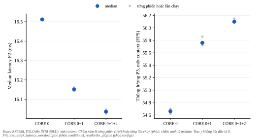
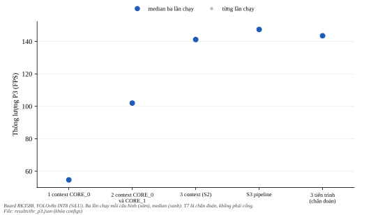
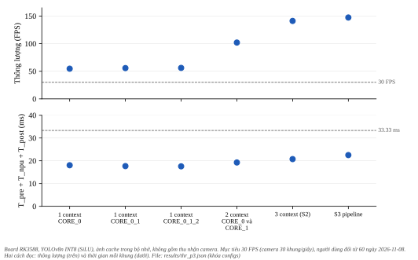

*******
Đa nhân
*******

.. admonition:: Trang này trả lời

   - S1 (một context chia nhiều nhân), S2 (ba context mỗi context một nhân) và S3 (pipeline pre, NPU, post) có đạt ngưỡng 5% của dự án không, trên model SiLU INT8?
   - Chạy ba tiến trình thay ba luồng có khác throughput không, và mỗi context thêm bao nhiêu bộ nhớ?
   - ``AUTO`` chọn nhân nào trong phép đo của dự án, và còn điều gì về đa nhân chưa biết?

.. admonition:: Tóm tắt

   - S1 trên SiLU: ``CORE_0_1_2`` nhanh hơn ``CORE_0`` chỉ 2.9% và ``CORE_0_1`` 2.2%, dưới ngưỡng 5%. Latency một frame dùng ``CORE_0``. Với ReLU mức giảm là 33.6% nhưng ReLU đã bị loại ở cổng G4 (:doc:`01-ket-qua-g4`).
   - S2 (ba context): 141.2 FPS, so với 56.1 FPS của cấu hình một context tốt nhất (T3), tăng 151.7%, lớn hơn khoảng trải 0.80 FPS. Kết quả: hơn.
   - S3 (pipeline): 147.4 FPS so với 141.2 FPS của S2, tăng 4.4%, dưới ngưỡng 5%. CPU trung bình của tiến trình 72.4% so với 67.5%. Kết quả: không đáng giữ (với 1 luồng pre và 1 luồng post theo công thức đã viết trước).
   - Ba tiến trình (143.5 FPS) so với ba luồng (141.2 FPS): khác +1.7%, không phân biệt được trong độ trải. Phép đo chẩn đoán này không nói vì sao.
   - Giao thức P3 của S2 và S3 là giao thức mới (ngắt NPU 36, 37, 38 lần lượt ở CPU4, CPU5, CPU6, tiến trình đo ở CPU4 đến CPU7, ``irqbalance`` dừng), đã được người dùng duyệt ngày 2026-11-01. S1 chạy dưới P2 của nhóm Nền đo NPU, cũng đã được người dùng duyệt ngày 2026-11-01. Mọi số là một board, một model, một seed.

Cổng G4 và workload từng loại op ở :doc:`01-ket-qua-g4`. Tiêu chí 5% và 3 lần chạy độc lập ở :doc:`../03-tang-npu-don-bay/02-multi-core` (mục 5.2).

.. contents:: Trong trang này
   :local:
   :depth: 1

1. Điều kiện chạy
=================

.. list-table::
   :header-rows: 1
   :widths: 18 22 36 44

   * - Phép đo
     - Giao thức
     - Model
     - Chi tiết
   * - S1 latency
     - P2 (như nhóm Nền đo NPU)
     - SiLU seed 0 INT8 (sha ``a501f94e``) và ReLU seed 0 INT8 (``c36458b7``)
     - 16 phiên xen kẽ, cùng lần chạy với cổng G4 (:doc:`01-ket-qua-g4` mục 1)
   * - S1 throughput, S2, S3, chẩn đoán
     - P3 (mới)
     - SiLU seed 0 INT8 (``a501f94e``)
     - ``bench_throughput_rep.py`` trên board, 3 lần chạy độc lập mỗi cấu hình, 1238 frame, 20 frame warm-up mỗi context

Chọn SiLU cho S2 và S3 vì mỗi context chạy một nhân, nên việc op activation có đa nhân hay không không tham gia. ReLU không đo ở S2 và S3 (chưa biết).

Về điều kiện chung ở :doc:`../03-tang-npu-don-bay/02-multi-core` mục 5.2: sổ tay SDK khuyên gắn ứng dụng và ngắt NPU vào cùng một lõi CPU lớn [T1 UG232 tr.75]. P3 không làm vậy: ba dòng ngắt ở ba lõi lớn khác nhau (CPU4, CPU5, CPU6) và ứng dụng chạy trên cả CPU4 đến CPU7, vì ba context chạy song song và dồn tất cả vào một CPU sẽ làm các context tranh nhau CPU, không đo được S2 và S3. Nên P3 lệch khỏi khuyến nghị đó, và nhãn S2, S3 mang điều kiện này. S1 dưới P2 theo khuyến nghị (ngắt và ``rknn_server`` cùng CPU4).

P3 vì sao tách khỏi P2: P2 dồn ``rknn_server`` và cả ba ngắt vào CPU4, dự kiến sẽ tuần tự hóa ba context và một pipeline vào một CPU (chưa đo). Harness cũ ``bench_throughput.py`` chạy ``RKNNLite`` trực tiếp trên board, không đi qua ``rknn_server``, nên tiến trình giữ P2 không bao phủ. P3 gồm: dừng ``irqbalance``, ngắt 36 vào CPU4, 37 vào CPU5, 38 vào CPU6 (đặt một lần bởi ``p3_hold.sh``, khôi phục và đọc lại cuối lần chạy), tiến trình đo chạy dưới ``taskset -c 4-7``, tần số khóa, ``rknn_server`` không đụng. Một run thực hiện đúng P3 khi mỗi dòng ngắt có ít nhất 99% số ngắt ở CPU được gán, affinity của tiến trình nằm trong CPU4 đến CPU7, tần số báo khóa và nhật ký helper ghi ``irqbalance`` không chạy cùng ba affinity không đổi. Cả 21 run thực hiện đúng. Ở các run ba context (T5, T6, T7) cả ba dòng ngắt 36, 37, 38 đều có số ngắt lớn hơn 0, ít nhất 26901 mỗi dòng, mỗi dòng ở CPU được gán.

Harness mới sửa các giới hạn của harness cũ ở :doc:`../03-tang-npu-don-bay/02-multi-core` mục 3.3: mỗi lần gọi là một tiến trình độc lập (khởi tạo lại context), lặp ba lần, ghi ``T_pre``, ``T_npu``, ``T_post`` từng frame, ghi RSS, nhiệt độ, tần số và ngắt theo CPU, và warm-up chạy qua 20 ảnh đầu thay vì một frame. Tập ảnh là ``data/ppe5/processed/images/test``, chỉ có 82 ảnh nên bộ nhớ đệm giữ 82 ảnh (không phải 200).

2. S1: một context chia nhân
============================

2.1. Latency dưới P2
--------------------

Số liệu và quy tắc ở :doc:`01-ket-qua-g4` mục 4. Với SiLU:

   Median latency P2 (trái) và thông lượng P3 (phải) của một context theo mặt nạ nhân. Hình sinh bằng ``docs/tools/figure_gen/03-phuong-phap/04-tang-npu-ket-qua/gen.py``.

.. list-table::
   :header-rows: 1
   :widths: 16 16 22 28 18

   * - Mask
     - Trung vị (ms)
     - Giảm so với CORE_0 (%)
     - Chênh hai phiên lớn nhất (ms)
     - Kết quả
   * - ``CORE_0``
     - 16.511
     - -
     - -
     - -
   * - ``CORE_0_1``
     - 16.151
     - 2.18
     - 0.020
     - không nhanh hơn
   * - ``CORE_0_1_2``
     - 16.036
     - 2.88
     - 0.022
     - không nhanh hơn

Cả hai mask đa nhân đều dưới ngưỡng 5%. Theo quy tắc ở :doc:`../03-tang-npu-don-bay/02-multi-core` (mục 5.3, bước 1) S1 bị loại cho trục latency của SiLU. Nhãn "Loại" chỉ nghĩa là không qua ngưỡng 5%, không phải cấm dùng. Ngày 2026-11-08 dự án vẫn chọn intra-frame làm kiểu chạy NPU (quyết định 7, :doc:`../../00-tong-quan/04-gioi-han-va-huong-phat-trien` mục 4.1). Độ phủ (điều kiện A) của SiLU là 1.8% (:doc:`01-ket-qua-g4` mục 3). Với ReLU, ``CORE_0_1`` giảm 22.9% và ``CORE_0_1_2`` giảm 33.6%, đạt B (ReLU bị loại ở C).

2.2. Throughput một context dưới P3
-----------------------------------

.. list-table::
   :header-rows: 1
   :widths: 26 30 14 14 18

   * - Cấu hình
     - FPS ba lần chạy
     - FPS trung vị
     - Khoảng trải
     - T_npu trung vị (ms)
   * - 1 context CORE_0
     - 54.70 / 54.66 / 54.62
     - 54.66
     - 0.08
     - 17.16
   * - 1 context CORE_0_1
     - 55.86 / 55.76 / 55.72
     - 55.76
     - 0.14
     - 16.79
   * - 1 context CORE_0_1_2
     - 56.09 / 56.10 / 56.15
     - 56.10
     - 0.06
     - 16.68

Throughput một context gần như không phụ thuộc mask (chênh 2.6% giữa ``CORE_0_1_2`` và ``CORE_0``). Tham chiếu của P2: một context ``CORE_0`` có latency 16.511 ms, tương đương 60.6 FPS nếu chỉ tính phần NPU. Harness đo cả pre và post và chạy dưới P3, được 54.7 FPS. Hai con số khác nhau về điều kiện và về vùng đo, nên không so trực tiếp.

3. S2: ba context mỗi context một nhân
======================================

Quy tắc viết trước: cấu hình một context tốt nhất là cấu hình có FPS trung vị cao nhất trong T1, T2, T3 (ở đây T3, mức chặt hơn cả ``CORE_0``). S2 hơn khi FPS ít nhất 1.05 lần và mức tăng lớn hơn khoảng trải lớn hơn trong hai cấu hình.

.. list-table::
   :header-rows: 1
   :widths: 28 30 14 14 24

   * - Cấu hình
     - FPS ba lần chạy
     - FPS trung vị
     - Khoảng trải
     - CPU trung bình của tiến trình (%)
   * - 1 context CORE_0
     - 54.70 / 54.66 / 54.62
     - 54.66
     - 0.08
     - 23.7
   * - 2 context CORE_0 và CORE_1
     - 102.09 / 101.62 / 102.00
     - 102.00
     - 0.47
     - 46.9
   * - 3 context (S2)
     - 140.67 / 141.47 / 141.18
     - 141.18
     - 0.80
     - 67.5

S2 (T5) so với cấu hình một context tốt nhất (T3): tăng 85.08 FPS (151.7%), lớn hơn khoảng trải 0.80 FPS. Kết quả: **hơn**. So với ``CORE_0`` (T1) tăng 158.3%. Hai context (T4) đạt 102.0 FPS. Đây là số đo T3 board, cơ chế (hàng đợi riêng từng nhân của driver, :doc:`../03-tang-npu-don-bay/02-multi-core` mục 3.1) là cơ sở đã ghi chưa phải kết quả đã chứng minh.

Bộ nhớ (mô tả): RSS của tiến trình sau khi khởi tạo context là 172.3 MiB với một context và 197.9 MiB với ba context, tức khoảng 12.8 MiB mỗi context thêm. Đây là RSS của tiến trình Python, không gồm bộ nhớ NPU do driver cấp.

4. S3: pipeline pre, NPU, post
==============================

S3 tách worker pre, một worker NPU mỗi context (ba context trên ``CORE_0``, ``CORE_1``, ``CORE_2``) và worker post, nối bằng hàng đợi 6 phần tử. Số worker lấy từ công thức viết trước từ lần chạy T5 đầu tiên: ``T_npu`` trung vị chia ba là thời gian NPU hiệu dụng mỗi frame, số worker pre và post là trần của ``T_pre`` hoặc ``T_post`` chia thời gian đó, tối thiểu 1 và tối đa 3. Kết quả: 1 worker pre và 1 worker post.

.. list-table::
   :header-rows: 1
   :widths: 20 28 12 12 20 30

   * - Cấu hình
     - FPS ba lần chạy
     - FPS trung vị
     - Khoảng trải
     - CPU trung bình của tiến trình (%)
     - T_pre / T_npu / T_post trung vị (ms)
   * - 3 context (S2)
     - 140.67 / 141.47 / 141.18
     - 141.18
     - 0.80
     - 67.5
     - 0.46 / 19.53 / 0.75
   * - S3 pipeline
     - 147.39 / 146.88 / 147.64
     - 147.39
     - 0.76
     - 72.4
     - 1.08 / 20.14 / 1.28

S3 hơn S2 6.21 FPS (4.4%), lớn hơn khoảng trải 0.80 FPS nhưng dưới ngưỡng 5%. CPU trung bình cao hơn 4.9 điểm so với S2 (khoảng trải 2.3). Nhánh CPU thấp hơn của quy tắc chỉ áp dụng khi mức tăng FPS nằm trong khoảng trải, nên không áp dụng ở đây. Kết quả: **không đáng giữ**. Giới hạn: một công thức chọn số worker, không tìm kiếm. S3 với số worker khác chưa biết. Trung vị ``T_pre``, ``T_npu``, ``T_post`` của S2 là 0.46, 19.5 và 0.75 ms. Nguyên nhân của mức tăng nhỏ của S3 chưa biết, vì phép đo không tách các yếu tố.

5. Chẩn đoán: ba tiến trình và ba luồng
=======================================

Cùng ba context trên ``CORE_0``, ``CORE_1``, ``CORE_2``, chạy bằng ba tiến trình (T7) so với ba luồng (T5). Đây là chẩn đoán, không phải chiến lược và không phải cổng.

   Thông lượng P3 của cấu hình một context (đối chiếu), hai context, ba context (S2), pipeline (S3) và ba tiến trình (chẩn đoán), ba lần chạy mỗi cấu hình. Hình sinh bằng ``docs/tools/figure_gen/03-phuong-phap/04-tang-npu-ket-qua/gen.py``.

.. list-table::
   :header-rows: 1
   :widths: 30 30 14 14

   * - Cấu hình
     - FPS ba lần chạy
     - FPS trung vị
     - Khoảng trải
   * - 3 context (S2)
     - 140.67 / 141.47 / 141.18
     - 141.18
     - 0.80
   * - 3 tiến trình (chẩn đoán)
     - 143.51 / 143.44 / 143.60
     - 143.51
     - 0.16

Chênh +2.33 FPS (+1.7%), dưới 5% nên kết quả là không phân biệt được. Hai điều rút ra và chỉ hai: ba tiến trình, mỗi tiến trình một context trên ``CORE_0``, ``CORE_1``, ``CORE_2``, chạy được đồng thời với RKNNLite và cả ba dòng ngắt đều có ngắt trong mọi run (mục 1), và throughput không khác ba luồng ở mức 5% trong điều kiện này. Chưa kết luận gì về việc ``RKNNLite.inference`` có nhả GIL không, vì thời gian trong hai chế độ có thể giống nhau do nguyên nhân khác. Cột CPU của T7 không dùng vì chỉ đo tiến trình cha.

6. AUTO chọn nhân nào
=====================

Trong lần đo P2 ở nhóm Nền đo NPU (``onboard_x4``), bốn phiên ``AUTO`` đều có số ngắt ``{36: 315, 37: 0, 38: 0}`` mỗi phiên, giống ``CORE_0``, còn ``CORE_0_1_2`` có ``{36: 385, 37: 145, 38: 145}``. Trong chuỗi một context chạy lần lượt, ``AUTO`` đã chạy trên cùng dòng ngắt với ``CORE_0`` ở cả 4 phiên. Driver chọn lõi có hàng đợi ngắn nhất và lấy chỉ số thấp nhất khi hòa [T1 DRV rknpu_job.c:508-538], sổ tay nói "idle core" [T1 UG232 tr.73]. Với mô tả của driver thì một job một lúc ra nhân 0. Sổ tay không nêu cách chọn khi mọi lõi đều rảnh, nên phép đo này không phân biệt được hai mô tả. Trong phép đo mới ở :doc:`01-ket-qua-g4`, ``AUTO`` so với ``CORE_0`` chênh +0.031 ms ở SiLU và +0.025 ms ở ReLU.

7. Nhãn và điều chưa biết
=========================

.. list-table::
   :header-rows: 1
   :widths: 24 32 50 36

   * - Chiến lược
     - Nhãn
     - Số liệu
     - Điều kiện
   * - S1 (SiLU, latency)
     - Loại
     - ``CORE_0_1_2`` giảm 2.9%, ``CORE_0_1`` giảm 2.2%
     - 1 seed, dưới P2
   * - S1 (ReLU, latency)
     - không áp dụng (ReLU bị loại ở G4 C)
     - ``CORE_0_1_2`` giảm 33.6%
     - 1 seed, dưới P2
   * - S2 (throughput)
     - Giữ
     - 141.2 FPS, tăng 151.7% so với một context tốt nhất
     - 1 seed, dưới P3 (đã duyệt ngày 2026-11-01), lệch khỏi khuyến nghị gắn ngắt NPU vào cùng một lõi lớn (UG232 tr.75), một model
   * - S3 (throughput)
     - Loại
     - 147.4 FPS, tăng 4.4% so với S2
     - 1 seed, dưới P3 (như S2), một công thức số worker

Các điểm đa nhân còn lại và trạng thái sau giai đoạn này:

.. list-table::
   :header-rows: 1
   :widths: 8 40 18 70

   * - Mã
     - Câu hỏi
     - Trạng thái
     - Đã tìm hoặc đo gì
   * - M1
     - Quy tắc chia job đa nhân của ``librknnrt``
     - chưa biết (mẫu chia mô tả 2026-11-01, :doc:`08-so-muc-chua-biet` mục 5)
     - Mã nguồn thư viện không có trong repo. Bảng WorkLoad cho thấy phần trăm chia từng lớp (ví dụ 35.0%/32.5%/32.5%) nhưng quy tắc chưa suy ra
   * - M2
     - ``ALL`` trong Table 4 của Kong 2026 là chế độ nào
     - ĐO một phần (2026-11-01, :doc:`08-so-muc-chua-biet` mục 6): ``NPU_CORE_ALL`` chia như ``CORE_0_1_2``. Nghĩa trong bài: chưa biết
     - Bài báo không định nghĩa ``ALL``, không nêu tên cờ ``core_mask``, dữ liệu theo yêu cầu từ tác giả (Data availability, tr.11). ``RKNN_NPU_CORE_ALL = 0xffff`` được header ghi là chọn nhân theo nền tảng [T1 rknn_api.h:253]. ``ALL`` đo ngày 2026-11-01 (:doc:`08-so-muc-chua-biet` mục 6)
   * - M3, M5
     - ``RKNNLite.inference`` có nhả GIL không, nhiều tiến trình dùng lõi khác nhau
     - ĐO một phần
     - Ba tiến trình chạy được trên ba nhân, throughput không khác ba luồng ở mức 5% (mục 5). GIL chưa kết luận
   * - M4
     - Một context dùng chung nhiều luồng
     - ĐO (2026-11-01, :doc:`08-so-muc-chua-biet` mục 7)
     - Ba luồng dùng chung một context cho đầu ra sai âm thầm, một luồng đúng. SDK guide tr.153 nói về việc dùng chung context giữa các luồng và ``rknn_dup_context`` nhưng không nêu tính an toàn khi gọi đồng thời [T1 UG232 tr.153]. Harness dùng một context mỗi luồng nên không cần
   * - M6
     - ``async_mode`` làm gì lúc chạy
     - ĐO một phần (:doc:`08-so-muc-chua-biet` mục 7)
     - API232 tr.16 ghi "Not Supported yet". Thăm dò: được chấp nhận, ``inference`` tuần tự vẫn trả đầu ra của ảnh vừa gửi
   * - M7
     - ``rknn_batch_size`` nhiều batch
     - ĐO (:doc:`08-so-muc-chua-biet` mục 7), khớp batch 1 không tái lập giữa hai lần chạy
     - Batch 4 chạy, đầu ra từng ảnh khớp batch 1 ở lần đầu, một ảnh lệch ở lần lặp. Ngoài phạm vi S1 đến S3
   * - M8
     - Mục tiêu FPS thời gian thực của dự án
     - người dùng chốt 60 FPS (2026-11-01), đổi thành 30 FPS (2026-11-08)
     - Mục 8: cả sáu cấu hình đạt, kể cả một context 54.7 FPS
   * - M9
     - Lợi ích đa nhân ReLU so với SiLU với model đã huấn luyện
     - ĐO
     - Mục 2.1 và :doc:`01-ket-qua-g4`: ReLU nhanh hơn, mAP thấp hơn, bị loại
   * - M10
     - ``AUTO`` chọn nhân thế nào
     - ĐO một phần
     - Mục 6: chạy trên dòng ngắt của nhân 0 khi một job một lúc. Hành vi khi nhiều context chưa đo
   * - M14
     - Bộ nhớ mỗi context
     - ĐO (RSS tiến trình)
     - Mục 3. Bộ nhớ NPU chưa đo
   * - M16
     - Số context tối đa
     - ĐO một phần (:doc:`08-so-muc-chua-biet` mục 7)
     - 32 context đều chạy đúng, dừng ở ngưỡng chặn. Giới hạn thật chưa biết. S2 chỉ dùng 1, 2, 3 context

8. Mục tiêu 30 FPS của người dùng
=================================

Ngày 2026-11-01 người dùng chốt mục tiêu 60 FPS. Ngày 2026-11-08 người dùng đổi thành 30 FPS vì camera chỉ có 30 khung/giây (cảm biến một chế độ 30 khung/giây, :doc:`../../10-luong-camera-den-phat-hien/01-buc-tranh-tong-the`). Mục tiêu là một luồng camera, nên ngân sách mỗi khung là 33.33 ms. Hai cách đọc cũ (thông lượng, thời gian mỗi khung) vẫn được tính cả hai. Đây là bước đạt hoặc không đạt mục tiêu tuyệt đối mà :doc:`../03-tang-npu-don-bay/02-multi-core` mục 5 dự kiến thêm sau các bước hiện có, không thay các bước hiện có. Các số dưới đây không đổi so với lần đo ngày 2026-11-01, chỉ đổi mốc so sánh.

FPS của harness tính cả tiền xử lý, NPU và hậu xử lý của từng khung (``T_pre``, ``T_npu``, ``T_post``), trên ảnh đã cache trong bộ nhớ. Không gồm thu nhận camera, giải mã video, vẽ và lưu kết quả. Mỗi dòng là trung vị của ba lần chạy.

   Thông lượng (trên) và thời gian mỗi khung (dưới) của sáu cấu hình so với mục tiêu 30 FPS và 33.33 ms. Hình sinh bằng ``docs/tools/figure_gen/03-phuong-phap/04-tang-npu-ket-qua/gen.py``.

.. list-table::
   :header-rows: 1
   :widths: 34 10 36 32 28

   * - Cấu hình
     - FPS
     - Đạt 30 FPS (thông lượng)
     - T_pre + T_npu + T_post (ms)
     - Đạt 33.33 ms mỗi khung
   * - 1 context CORE_0
     - 54.7
     - đạt, dư 24.7 FPS (1.82 lần)
     - 18.04
     - đạt, dư 15.29 ms
   * - 1 context CORE_0_1
     - 55.8
     - đạt, dư 25.8 FPS (1.86 lần)
     - 17.66
     - đạt, dư 15.67 ms
   * - 1 context CORE_0_1_2
     - 56.1
     - đạt, dư 26.1 FPS (1.87 lần)
     - 17.56
     - đạt, dư 15.77 ms
   * - 2 context CORE_0 và CORE_1
     - 102.0
     - đạt, 3.40 lần
     - 19.26
     - đạt, dư 14.07 ms
   * - 3 context (S2)
     - 141.2
     - đạt, 4.71 lần
     - 20.74
     - đạt, dư 12.59 ms
   * - S3 pipeline
     - 147.4
     - đạt, 4.91 lần
     - 22.50
     - đạt, dư 10.83 ms

Cả sáu cấu hình đạt theo cả hai cách đọc, kể cả một context ``CORE_0`` (54.7 FPS, tổng 18.04 ms). Với một camera 30 khung/giây, mục tiêu này không còn phân biệt được các cấu hình: việc thêm lõi, thêm context hoặc thêm pipeline nâng thông lượng nhưng không giúp thêm khung nào từ camera. Tổng ``T_pre`` cộng ``T_npu`` cộng ``T_post`` là tổng ba trung vị theo giai đoạn, không phải thời gian đầu cuối đo trực tiếp (ở cấu hình nhiều context các giai đoạn chạy dưới tranh chấp, ở S3 còn có thời gian chờ hàng đợi không nằm trong tổng). Thời gian đầu cuối đo trực tiếp trên camera ở một context ``CORE_0`` là 18.97 ms (:doc:`../../10-luong-camera-den-phat-hien/07-chay-lien-tuc-tren-board`).

Việc còn lại để chọn giữa các cấu hình do phần dư và các tiêu chí khác quyết định: cổng tương đối 5% (mục 7), phần dư mỗi khung để đổi lấy độ chính xác (model lớn hơn, input lớn hơn), CPU còn dư, và số camera chạy cùng lúc. Mức thông lượng 102.0 đến 147.4 FPS chỉ có giá trị khi có nhiều camera hoặc việc nặng khác dùng chung NPU, và yêu cầu này chưa có.

Nhãn S1, S2, S3 không đổi (cổng tương đối 5%, mục 7). Giới hạn: một seed, giao thức P3 đã duyệt, model INT8 mặc định của seed 0 (``int8h5`` đã đo ở :doc:`09-ket-qua-don-bay-fps` và không khác ``int8`` về thông lượng, ReLU chưa đo thông lượng), ảnh cache, bộ nhớ NPU chưa đo. Cách hiểu "một luồng" dựa trên việc camera chỉ có 30 khung/giây, nếu sau này có nhiều camera thì phải đọc lại.

9. Nguồn
========

- T1: SDK User Guide V2.3.2 tr.72 đến 75, 153 (``3rdparty/rknn-toolkit2/doc/02_Rockchip_RKNPU_User_Guide_RKNN_SDK_V2.3.2_EN.pdf``), ``3rdparty/rknn-toolkit2/rknpu2/runtime/Linux/librknn_api/include/rknn_api.h`` dòng 253, mã driver ``3rdparty/rknpu-driver-0.9.8`` (``rknpu_job.c``).
- T2: ``edgesoc_benchmark_2026kong.pdf`` (Table 4 tr.7, Data availability tr.11).
- T3 board: ``results/npu/throughput/thr_p3.*``, ``results/npu/operator_support/g4_latency_workload.*``, ``results/npu/latency/onboard_x4_*``, ``experiments/npu/throughput/onboard_thr/`` và ``experiments/npu/operator_support/onboard_g4b/ppe5_yolov8n_baseline_100ep_s0/``.
- Quy tắc viết trước dữ liệu: ``experiments/npu/throughput/onboard_thr/rule.txt``, ``experiments/npu/operator_support/onboard_g4b/ppe5_yolov8n_baseline_100ep_s0/rule.txt``.
- Mã đo: ``ai/board/bench/bench_throughput_rep.py``, ``ai/npu/throughput/analyze_thr.py``, ``ai/npu/operator_support/analyze_g4.py``.

