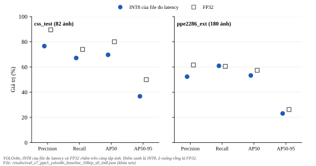

*****************************
Độ chính xác INT8 của file đo
*****************************

.. admonition:: Trang này trả lời

   - Độ chính xác của chính mô hình INT8 được đo latency là bao nhiêu, và mức giảm so với FP32 đi theo lượng tử hóa hay theo đường suy luận?

.. admonition:: Tóm tắt

   - Trên ``css_test`` (82 ảnh, một seed), mAP50-95 của INT8 thấp hơn FP32 13.24 điểm phần trăm.
   - X7b: FP16 qua RKNNLite chênh -0.23 điểm phần trăm so với FP32, INT8 chênh -13.24. Theo quy tắc: **mức giảm của INT8 chủ yếu đi theo lượng tử hóa** (các số 0.25 và 0.75 của quy tắc là số mới, chưa qua người dùng duyệt).
   - Nguyên nhân bên trong của mức giảm vẫn chưa biết (mục 2).

Latency của đúng file INT8 này ở :doc:`../02-tang-npu-nen-do/02-ket-qua-latency-tung-khoi`. Chẩn đoán lượng tử hóa ở :doc:`05-ket-qua-luong-tu-hoa`.

.. contents:: Trong trang này
   :local:
   :depth: 1

1. Kết quả chấm điểm
====================

X7 chấm chính file INT8 được đo latency (sha256 ``a501f94e``), suy luận bằng RKNNLite trên board, chấm điểm trên PC bằng cùng mã và cùng ngưỡng tin cậy với bản FP32 (Evaluation Protocol v1, ``ai/core/evaluator.py``). Quy tắc ``bench/eval_x7/rule.txt``: chỉ báo số, không áp ngưỡng nào (ngưỡng 1.0 pp mAP đã duyệt thuộc cổng G4, giai đoạn 2).

   INT8 của file đo latency so với FP32 theo bốn chỉ số trên hai tập. Hình sinh bằng ``docs/tools/figure_gen/03-phuong-phap/04-tang-npu-ket-qua/gen.py``.

.. list-table::
   :header-rows: 1
   :widths: 14 8 14 12 12 14

   * - Tập
     - Số ảnh
     - Chỉ số
     - INT8
     - FP32
     - Chênh (điểm %)
   * - css_test
     - 82
     - precision
     - 0.7660
     - 0.8950
     - -12.90
   * - css_test
     - 82
     - recall
     - 0.6713
     - 0.7396
     - -6.83
   * - css_test
     - 82
     - map50
     - 0.6965
     - 0.8006
     - -10.41
   * - css_test
     - 82
     - map50_95
     - 0.3675
     - 0.4999
     - -13.24
   * - ppe2286_ext
     - 180
     - precision
     - 0.5234
     - 0.6160
     - -9.26
   * - ppe2286_ext
     - 180
     - recall
     - 0.6092
     - 0.6051
     - +0.41
   * - ppe2286_ext
     - 180
     - map50
     - 0.5330
     - 0.5736
     - -4.06
   * - ppe2286_ext
     - 180
     - map50_95
     - 0.2313
     - 0.2624
     - -3.11

Trên ``css_test``, mAP50-95 của INT8 thấp hơn FP32 13.24 điểm phần trăm. Phép so này gộp cả hai khác biệt: lượng tử hóa và đường suy luận (RKNNLite trên board so với PyTorch trên PC). X7b tách chúng bằng cách chấm mô hình FP16 qua đúng đường RKNNLite (``bench/eval_x7b/rule.txt``, viết trước, các số 0.25 và 0.75 là số mới, chưa qua người dùng duyệt): trên ``css_test``, FP16 qua RKNNLite có mAP50-95 0.4976, chênh -0.23 điểm phần trăm so với FP32, còn INT8 chênh -13.24. Theo quy tắc: **mức giảm của INT8 chủ yếu đi theo lượng tử hóa**. Trên ``ppe2286_ext`` (mô tả) FP16 qua RKNNLite chênh 0.11 và INT8 chênh -3.11. ``css_test`` chỉ có 82 ảnh và một seed. Mức giảm do lượng tử hóa là phát biểu về kết quả đo, nguyên nhân bên trong lượng tử hóa (hiệu chuẩn hay lớp nhạy) chưa được kiểm. Từ khóa đề xuất: "RKNN INT8 accuracy drop YOLOv8 quantization calibration".

2. Điều chưa biết và giới hạn
=============================

- Nguyên nhân bên trong của mức giảm INT8 (hiệu chuẩn, lớp nhạy, hay phân phối dữ liệu hiệu chuẩn): X7b chỉ cho biết mức giảm đi theo lượng tử hóa, không đi theo đường suy luận RKNNLite (U28). Cập nhật 2026-10-31 (giai đoạn 2): chẩn đoán lượng tử hóa đã khoanh vùng công thức lấy lại gần hết mức rơi (giữ FP16 nhánh giải mã box), xem :doc:`05-ket-qua-luong-tu-hoa`. Nguyên nhân bên trong vẫn chưa biết.

3. Nguồn
========

- T3 board và PC: ``results/eval_x7_*``, ``ai/automation/runs/ppe5_yolov8n_baseline_100ep_s0/bench/eval_x7/``, ``ai/automation/runs/ppe5_yolov8n_baseline_100ep_s0/eval/``. Mã: ``ai/automation/analyze_x7.py``.

