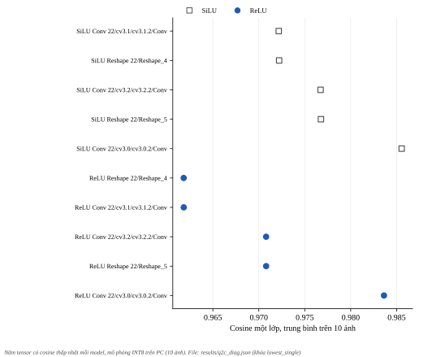
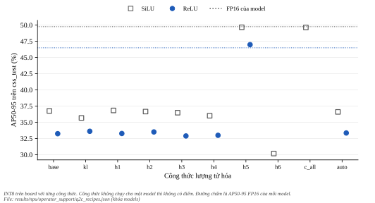
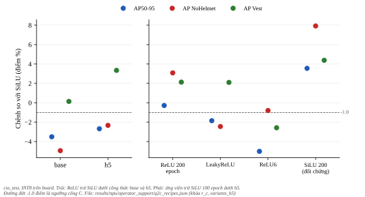
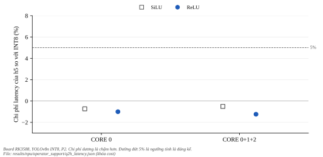

**********************
Chẩn đoán lượng tử hóa
**********************

.. admonition:: Trang này trả lời

   - Vì sao model INT8 mất khoảng 12 đến 13 điểm AP50-95 so với FP16 (SiLU và ReLU), và phần nào của mô hình gây mất mát?
   - Công thức lượng tử hóa nào lấy lại điểm (thuật toán ``kl_divergence``, lượng tử hóa lai theo vùng, ``auto_hybrid``), có tốn latency hay mất phủ đa nhân không?
   - Kết luận cổng G4 của ReLU có đổi không khi dùng công thức tốt nhất?

.. admonition:: Tóm tắt

   - Mức rơi INT8 so với FP16 trên ``css_test``: SiLU 13.01 điểm AP50-95 và 10.57 điểm AP50, ReLU 13.25 và 11.43 điểm. Mô hình dựng lại bằng ``build_recipe.py`` cho đúng kết quả của file đã triển khai (chênh 0.00 điểm).
   - Nhánh class, đuôi đầu ra, thuật toán ``kl_divergence`` và ``auto_hybrid`` không lấy lại điểm. Không công thức nào của thí nghiệm 1 làm AP50-95 của SiLU lệch quá 1.08 điểm so với base, ReLU lệch tối đa 0.37 điểm (khoảng trải giữa seed là 1.35 và 1.57).
   - Công thức ``h5`` (15 tensor của nhánh giải mã box giữ FP16, phần còn lại INT8) đưa AP50-95 của SiLU từ 36.75 lên 49.66 (FP16: 49.76) và của ReLU từ 33.24 lên 46.98 (FP16: 46.49). Phép kiểm tra hợp lệ ``c_all`` (mọi tensor INT8 trừ ngõ vào mạng, 183 tensor, đặt FP16) cho 49.64.
   - ``h5`` không tốn latency: thay đổi -0.121 ms ở SiLU ``CORE_0`` và -0.106 ms ở ReLU ``CORE_0_1_2`` (dưới 5%), độ phủ đa nhân của ReLU 98.8%, bảng build không có op CPU mới.
   - Cổng G4 của ReLU không đổi: dưới ``h5`` ReLU vẫn kém SiLU 2.68 điểm AP50-95 và 2.33 điểm AP NoHelmet, cổng C không đạt. Khoảng cách này đã có ở FP16.
   - Công thức ``h6`` (``h5`` cộng cả nhánh box ``cv2``) làm AP50-95 của SiLU thấp hơn base 6.57 điểm, nguyên nhân chưa biết. ``mmse`` không dựng được với 300 ảnh hiệu chuẩn (bị hệ điều hành dừng, mã 137, nghi thiếu bộ nhớ).
   - Một ứng viên mỗi công thức, một seed, giao thức đo latency P2 (đã duyệt ngày 2026-11-01). Bộ chấm đã nâng giới hạn thời gian NMS lên 60 giây mỗi ảnh (kết quả cũ không đổi, đã kiểm trên bốn dump).

Kết quả cổng G4 ở :doc:`01-ket-qua-g4`, biến thể activation ở :doc:`02-ket-qua-bien-the-activation`.

.. contents:: Trong trang này
   :local:
   :depth: 1

1. Bối cảnh và nguồn
====================

Hai nguồn T1 xác định cách model INT8 hiện được dựng. Mã xuất RKNN của Ultralytics 8.4.154 (``utils/export/rknn.py:74-80``) chỉ đặt ``mean_values``, ``std_values``, ``target_platform``, ``do_quantization``, ``dataset`` và ``rknn_batch_size``, nên mọi tham số lượng tử hóa khác dùng mặc định của toolkit: ``quantized_dtype`` ``w8a8``, ``quantized_algorithm`` ``normal``, ``quantized_method`` ``channel``, ``optimization_level`` 3 [T1 API232 tr.7 đến 8]. Tọa độ box được chia cho kích thước ảnh trước khi lượng tử hóa, với lý do ghi trong mã: "Normalize coordinates by input size so RKNN's per-tensor INT8 scale preserves class scores" (``engine/exporter.py:1101``). Toolkit có sẵn phân tích sai số từng lớp (``accuracy_analysis``, cosine ở API232 tr.22 và Euclidean ở UG232 tr.8), lượng tử hóa lai thủ công (``hybrid_quantization_step1`` và ``step2``, API232 tr.20 đến 21, tên tensor float16 trong ``custom_quantize_layers``, UG232 tr.124) và tự động (``auto_hybrid``, API232 tr.14).

Mốc từ T2, chỉ để định vị, không so trực tiếp vì khác bộ dữ liệu và bộ lượng tử hóa: bài Q-YOLO báo YOLOv5s, YOLOv5m, YOLOv7 và YOLOv7x ở W8A8 trên COCO val2017 giảm AP từ 0.0 đến 0.5 điểm so với bản FP32 (MinMax 37.2, Percentile 36.9, Q-YOLO 37.4 so với 37.4 của YOLOv5s) [T2 Q-YOLO tr.8 Table 1]. Ngược chiều, với YOLOv6s mang RepVGG: "YOLOv6s-RepVGG suffers a huge quantization degradation for about 7.4% mAP via PTQ" [T2 QARepVGG tr.7] (COCO). Hai bài báo nêu rằng Swish dễ gặp vấn đề hoặc lợi ích của nó có thể mất khi lượng tử hóa: "Swish-like activations are known to have quantization collapse ..." [T2 QARepVGG tr.10] và "Although newer activations like Swish functions provide accuracy improvement in floating-point, these may vanish after quantization ..." [T2 Nagel 2021 tr.7]. Trong các bài đã đọc (Q-YOLO, QARepVGG, Nagel 2021, YOLOv6, ActNAS) không bài nào đo SiLU, ReLU6 hay hard-swish lên mAP YOLO sau PTQ INT8 bằng số. Số liệu của dự án (``css_test``, AP50-95, điểm): mức rơi từ FP32 xuống INT8 của SiLU seed 0, 1, 2 là 13.24, 13.01, 13.08 và của ReLU seed 0, 1, 2 là 13.09, 12.43, 11.83, từ FP16 xuống INT8 là 13.01, 12.91, 13.26 (SiLU) và 13.25, 12.33, 11.72 (ReLU). Chênh giữa hai activation nằm trong nhiễu seed, không có xu hướng rõ.

Danh sách nguồn đầy đủ: ``results/notes/phase2c_source_facts.md``. Quy tắc viết trước dữ liệu: ``experiments/npu/operator_support/onboard_q2c/rule_diag.txt``, ``rule_recipes.txt`` (có phần thí nghiệm 2), ``experiments/npu/operator_support/onboard_q2h/ppe5_yolov8n_baseline_100ep_s0/rule.txt``.

2. Dựng lại và đối chứng
========================

``ai/npu/operator_support/diagnose_quant.py`` dựng INT8 đúng như đường xuất của Ultralytics (ONNX có chia tọa độ, cấu hình mặc định, danh sách hiệu chuẩn của seed 0) và giữ ONNX đó, ``build_recipe.py`` dựng lại từ ONNX này với từng công thức. Công thức ``base`` (mặc định) cho AP50-95 trên ``css_test`` chênh 0.00 điểm (SiLU) và 0.00 điểm (ReLU) so với file đã triển khai. File dựng lại có cùng kích thước nhưng sha256 khác file gốc, nên mọi công thức được đọc so với ``base`` dựng lại.

3. Chẩn đoán từng lớp (mô phỏng, 10 ảnh)
========================================

``accuracy_analysis`` trên bộ mô phỏng của toolkit (không dùng board), 5 ảnh trong danh sách hiệu chuẩn và 5 ảnh ``css_test``, so tensor của mỗi lớp với đồ thị float. Cosine của một lớp càng thấp thì sai số của riêng lớp đó càng lớn. Bảng ghi 5 dòng thấp nhất (trung bình 10 ảnh).

   Năm tensor có cosine một lớp thấp nhất của mỗi model. Hình sinh bằng ``docs/tools/figure_gen/03-phuong-phap/04-tang-npu-ket-qua/gen.py``.

.. list-table::
   :header-rows: 1
   :widths: 10 14 62 20

   * - Model
     - Op
     - Tensor
     - Cosine một lớp (trung bình)
   * - SiLU
     - ``Conv``
     - ``/model/model.22/cv3.1/cv3.1.2/Conv_output_0``
     - 0.97217
   * - SiLU
     - ``Reshape``
     - ``/model/model.22/Reshape_4_output_0``
     - 0.97221
   * - SiLU
     - ``Conv``
     - ``/model/model.22/cv3.2/cv3.2.2/Conv_output_0``
     - 0.97672
   * - SiLU
     - ``Reshape``
     - ``/model/model.22/Reshape_5_output_0``
     - 0.97676
   * - SiLU
     - ``Conv``
     - ``/model/model.22/cv3.0/cv3.0.2/Conv_output_0``
     - 0.98555
   * - ReLU
     - ``Reshape``
     - ``/model/model.22/Reshape_4_output_0``
     - 0.96182
   * - ReLU
     - ``Conv``
     - ``/model/model.22/cv3.1/cv3.1.2/Conv_output_0``
     - 0.96183
   * - ReLU
     - ``Conv``
     - ``/model/model.22/cv3.2/cv3.2.2/Conv_output_0``
     - 0.97079
   * - ReLU
     - ``Reshape``
     - ``/model/model.22/Reshape_5_output_0``
     - 0.97080
   * - ReLU
     - ``Conv``
     - ``/model/model.22/cv3.0/cv3.0.2/Conv_output_0``
     - 0.98362

Ở tensor ``output0`` (1 x 9 x 8400), so đồ thị float với mô phỏng: cosine trên các kênh class là 0.9909 (SiLU) và 0.9782 (ReLU), trên các kênh box là 0.9995 và 0.9996. Ở ngưỡng tin cậy 0.001 của bộ chấm, mô phỏng làm mất 63.9 trên 203.8 anchor mỗi ảnh (SiLU) và 87.7 trên 269.3 (ReLU), còn ở ngưỡng 0.25 chỉ mất 1.0 trên 47.9 và 2.7 trên 49.6. Theo quy tắc viết trước, ở cả hai model các kênh class mất nhiều cosine hơn các kênh box (lớp class mất nhiều hơn lớp box). Đây là sai số so với đồ thị float, không phải mAP, và cosine cao trên tensor đầu ra không loại trừ sai lệch tọa độ vài pixel (mục 5).

4. Công thức và kết quả mAP
===========================

Mọi công thức dựng từ cùng ONNX và cùng danh sách hiệu chuẩn, chấm bằng RKNNLite trên board (``css_test``, 82 ảnh). Công thức: ``kl`` là ``quantized_algorithm`` ``kl_divergence``, ``h1`` giữ FP16 ba Conv cuối của nhánh class, ``h2`` giữ FP16 cả nhánh class, ``h3`` giữ FP16 đuôi đầu ra (5 tensor ``Concat_1``, ``Sigmoid``, ``output0``), ``h4`` là ``h2`` cộng ``h3``, ``auto`` là ``auto_hybrid`` mặc định. Thí nghiệm 2 (thêm sau khi thấy dữ liệu thí nghiệm 1, theo ngân sách hai thí nghiệm cho việc này) gồm ``h5`` (đuôi giải mã box), ``h6`` (``h5`` cộng nhánh box ``cv2``) và ``c_all`` (kiểm tra hợp lệ), chỉ chạy SiLU, ``h5`` rồi chạy tiếp ReLU theo quy tắc.

   AP50-95 của INT8 theo từng công thức lượng tử hóa. Đường chấm là AP50-95 FP16 của mỗi model. Hình sinh bằng ``docs/tools/figure_gen/03-phuong-phap/04-tang-npu-ket-qua/gen.py``.

.. list-table::
   :header-rows: 1
   :widths: 8 20 10 10 12 10 18

   * - Model
     - Công thức
     - AP50-95
     - AP50
     - AP NoHelmet
     - AP Vest
     - Anchor giữ lại (``css_test``)
   * - SiLU
     - INT8 đã triển khai
     - 36.75
     - 69.65
     - 22.77
     - 46.98
     - -
   * - SiLU
     - FP16 (tham chiếu)
     - 49.76
     - 80.22
     - 30.74
     - 56.49
     - -
   * - SiLU
     - ``base``
     - 36.75
     - 69.65
     - 22.77
     - 46.98
     - 11255
   * - SiLU
     - ``kl``
     - 35.67
     - 70.09
     - 21.07
     - 43.89
     - 11889
   * - SiLU
     - ``h1``
     - 36.83
     - 69.58
     - 22.45
     - 47.36
     - 11257
   * - SiLU
     - ``h2``
     - 36.65
     - 69.62
     - 22.12
     - 48.35
     - 11390
   * - SiLU
     - ``h3``
     - 36.48
     - 69.99
     - 22.69
     - 46.55
     - 688800
   * - SiLU
     - ``h4``
     - 36.01
     - 69.97
     - 21.35
     - 47.60
     - 176488
   * - SiLU
     - ``h5``
     - 49.66
     - 79.52
     - 28.65
     - 56.45
     - 11255
   * - SiLU
     - ``h6``
     - 30.18
     - 48.93
     - 14.11
     - 34.22
     - 11255
   * - SiLU
     - ``c_all``
     - 49.64
     - 80.07
     - 30.78
     - 56.58
     - 27939
   * - SiLU
     - ``auto``
     - 36.60
     - 69.24
     - 22.34
     - 47.50
     - 11248
   * - ReLU
     - INT8 đã triển khai
     - 33.24
     - 66.19
     - 17.83
     - 47.12
     - -
   * - ReLU
     - FP16 (tham chiếu)
     - 46.49
     - 77.62
     - 25.45
     - 58.11
     - -
   * - ReLU
     - ``base``
     - 33.24
     - 66.19
     - 17.83
     - 47.12
     - 13726
   * - ReLU
     - ``kl``
     - 33.61
     - 66.86
     - 18.55
     - 46.46
     - 13950
   * - ReLU
     - ``h1``
     - 33.27
     - 66.16
     - 18.01
     - 46.89
     - 13725
   * - ReLU
     - ``h2``
     - 33.51
     - 66.61
     - 18.26
     - 47.24
     - 13694
   * - ReLU
     - ``h3``
     - 32.89
     - 66.31
     - 17.77
     - 46.55
     - 688800
   * - ReLU
     - ``h4``
     - 32.99
     - 66.24
     - 17.92
     - 46.04
     - 182361
   * - ReLU
     - ``h5``
     - 46.98
     - 77.36
     - 26.32
     - 59.79
     - 13726
   * - ReLU
     - ``auto``
     - 33.35
     - 66.30
     - 18.09
     - 46.82
     - 13697

Đọc bảng (số, không nêu nguyên nhân): ở SiLU, ``kl`` -1.08, ``h1`` +0.08, ``h2`` -0.10, ``h3`` -0.27, ``h4`` -0.74, ``auto`` -0.15 điểm AP50-95 so với ``base``, đều nằm trong khoảng trải giữa seed của SiLU (1.35 điểm) ở cột AP50-95 (các cột phụ của ``kl`` lệch hơn: AP NoHelmet -1.70, AP Vest -3.09), không công thức nào lấy lại điểm. ``h5`` cộng +12.91 điểm (lấy lại 99% khoảng cách tới FP16) và ``c_all`` cộng +12.89 điểm. ``h6`` đổi -6.57 điểm. Ở ReLU, ``h5`` cộng +13.74 điểm, các công thức còn lại từ -0.35 đến +0.37 điểm. Số anchor giữ lại ở ``h3``, ``h4`` và ``c_all`` khác hẳn ``base`` (``h3`` giữ lại 688800 anchor, đúng 82 x 8400, tức mọi anchor qua ngưỡng 0.001). Nguyên nhân của các mức khác nhau này chưa biết. ``h3`` chấm lần đầu bị giới hạn thời gian NMS của Ultralytics cắt (179 cảnh báo), chấm lại bằng giới hạn 60 giây mỗi ảnh cho cùng kết quả (36.48).

Quy tắc viết trước của thí nghiệm 2: ``c_all`` hợp lệ khi lệch FP16 không quá khoảng trải seed của SiLU (1.35 điểm), thực tế lệch 0.12 điểm nên quy trình dựng lai, siêu dữ liệu và dump hợp lệ để so sánh. Một công thức "lấy lại điểm" khi cả AP50-95 và AP50 cao hơn ``base`` quá 1.35 điểm: chỉ ``h5`` đạt ở cả hai model (``c_all`` cũng đạt ở SiLU, nó là phép kiểm hợp lệ và không chạy ở ReLU).

5. Công thức h5
===============

``h5`` giữ FP16 đúng 15 tensor: bốn tensor của ``dfl``, hai ``Slice``, ``Sub``, ``Add_1``, ``Sub_1``, ``Add_2``, ``Div_1``, ``Concat_2``, phép chia ``Div`` về tọa độ chuẩn hóa, ``output0-rs`` và ``output0_int8``. Phần còn lại, gồm toàn bộ backbone, neck, nhánh class và nhánh box trước phép giải mã, vẫn INT8. Số học từ cấu hình lượng tử hóa bước 1 (không phải số đo mAP): tensor ``output0`` INT8 có bước khoảng 0.0041 trên khoảng [0, 1.05], tương ứng khoảng 2.6 pixel trên ảnh 640, và các tensor giải mã tọa độ có bước từ 0.058 đến 0.63 đơn vị (``Slice`` 0.058, ``Sub_1`` 0.116, ``Div_1`` 0.313, ``Sub`` 0.350, ``Add_2`` 0.626). ``h5`` lấy lại điểm, nhưng phần nào của đuôi giải mã gây mất điểm thì chưa tách được: ``h5`` đổi cùng lúc DFL, các phép Slice, Sub, Add, Div, Concat và ``output0``, chưa đo sai số tọa độ box riêng, AP50 cũng rơi khoảng 10 đến 11 điểm nên mất mát không chỉ ở định vị, và ``h6`` (thêm nhánh box ``cv2`` ở FP16) lại làm tệ hơn. Nguyên nhân chưa biết.

.. list-table::
   :header-rows: 1
   :widths: 8 14 10 10 12 10 14 10

   * - Model
     - Công thức
     - AP50-95
     - AP50
     - Precision
     - Recall
     - AP NoHelmet
     - AP Vest
   * - SiLU
     - ``base``
     - 36.75
     - 69.65
     - 0.766
     - 0.671
     - 22.77
     - 46.98
   * - SiLU
     - ``h5``
     - 49.66
     - 79.52
     - 0.901
     - 0.730
     - 28.65
     - 56.45
   * - SiLU
     - FP16
     - 49.76
     - 80.22
     - -
     - -
     - 30.74
     - 56.49
   * - ReLU
     - ``base``
     - 33.24
     - 66.19
     - 0.726
     - 0.648
     - 17.83
     - 47.12
   * - ReLU
     - ``h5``
     - 46.98
     - 77.36
     - 0.873
     - 0.718
     - 26.32
     - 59.79
   * - ReLU
     - FP16
     - 46.49
     - 77.62
     - -
     - -
     - 25.45
     - 58.11

Cổng C dưới công thức (R-c, ghi nhãn riêng, không đổi nhãn G4 đã duyệt): ReLU trừ SiLU cùng công thức, ``css_test``, AP50-95 / AP NoHelmet / AP Vest.

   Chênh AP của ReLU so với SiLU dưới base và ``h5`` (trái), và của các ứng viên so với SiLU dưới ``h5`` (phải). Đường đứt -1.0 điểm là ngưỡng cổng C. Hình sinh bằng ``docs/tools/figure_gen/03-phuong-phap/04-tang-npu-ket-qua/gen.py``.

.. list-table::
   :header-rows: 1
   :widths: 16 40 14

   * - Công thức
     - Chênh (điểm)
     - Cổng C
   * - ``base``
     - -3.51 / -4.94 / +0.14
     - không đạt
   * - ``h5``
     - -2.68 / -2.33 / +3.34
     - không đạt

Dưới ``h5`` ReLU vẫn trượt cổng C (-2.68 điểm AP50-95, -2.33 điểm AP NoHelmet). Khoảng cách này đã có ở FP16 (-3.27 điểm AP50-95), nên phần chênh này không do lượng tử hóa (một seed, nhiễu seed 1.35 đến 1.57 điểm). Trên ``ppe2286_ext`` (mô tả) chênh dưới ``h5`` là -1.62 điểm AP50-95.

Cổng C dưới ``h5`` cho các biến thể activation (thêm theo quy tắc ADDENDUM 3 của ``rule_recipes.txt`` viết trước dữ liệu): mỗi ứng viên dựng lại bằng ``h5`` từ ONNX chuẩn hóa của chính nó, chấm trên board, so với SiLU seed 0 (100 epoch) cũng dưới ``h5``. Không đổi nhãn G4 đã duyệt (nhãn đó tính với INT8 mặc định, xem :doc:`02-ket-qua-bien-the-activation`).

.. list-table::
   :header-rows: 1
   :widths: 26 34 40 14

   * - Ứng viên dưới ``h5``
     - AP50-95 / AP NoHelmet / AP Vest
     - Chênh so với SiLU 100 epoch dưới ``h5``
     - Cổng C
   * - ReLU 200 epoch
     - 49.38 / 31.73 / 58.58
     - -0.28 / +3.08 / +2.13
     - đạt
   * - LeakyReLU (0.1)
     - 47.81 / 26.20 / 58.55
     - -1.85 / -2.45 / +2.10
     - không đạt
   * - ReLU6
     - 44.65 / 27.85 / 53.87
     - -5.01 / -0.80 / -2.58
     - không đạt
   * - SiLU 200 epoch (đối chứng)
     - 53.21 / 36.57 / 60.83
     - +3.55 / +7.92 / +4.38
     - không áp dụng

ReLU 200 epoch đạt cổng C dưới ``h5`` so với SiLU 100 epoch (-0.28 điểm AP50-95), LeakyReLU và ReLU6 không đạt. Đối chứng SiLU 200 epoch dưới ``h5`` đạt AP50-95 53.21, cao hơn ReLU 200 epoch 3.83 điểm AP50-95 và 4.84 điểm AP NoHelmet. Vì vậy câu đúng là ``ReLU 200 epoch đạt cổng C so với SiLU 100 epoch dưới h5``, không phải ``đổi activation đạt``. Nhãn của ReLU 200 epoch nếu dùng ``h5`` vẫn là "Chưa biết" theo quy tắc ánh xạ G1 (``ConvReluAdd`` không có mục T1), các điều kiện A (98.8% với ReLU ``h5``) và B (33.7%) đạt, nhưng hai số này đo trên ReLU 100 epoch seed 0 (cùng kiến trúc), chưa đo trực tiếp ReLU 200 epoch dưới ``h5``.

6. Chi phí latency và đa nhân của h5
====================================

Một lần chạy xen kẽ 16 phiên dưới P2 (``experiments/npu/operator_support/onboard_q2h/ppe5_yolov8n_baseline_100ep_s0``): SiLU và ReLU, INT8 đã triển khai và ``h5``, ``CORE_0`` và ``CORE_0_1_2``, hai vòng cùng thứ tự. Cả 16 phiên thực hiện đúng P2 theo tiêu chí viết trước. Chi phí là trung vị của hai trung vị phiên của ``h5`` trừ giá trị tương ứng của INT8 đã triển khai. Ở cả bốn điều kiện chênh lệch lớn hơn chênh hai phiên lớn nhất nhưng dưới 5%.

   Chi phí latency của ``h5`` so với INT8 theo mặt nạ nhân. Đường đứt 5% là ngưỡng đáng kể. Hình sinh bằng ``docs/tools/figure_gen/03-phuong-phap/04-tang-npu-ket-qua/gen.py``.

.. list-table::
   :header-rows: 1
   :widths: 8 14 12 12 14 12 24 8

   * - Model
     - Mask
     - INT8 (ms)
     - h5 (ms)
     - Chi phí (ms)
     - Chi phí (%)
     - Chênh hai phiên lớn nhất (ms)
     - Từ 5%
   * - SiLU
     - ``CORE_0``
     - 16.530
     - 16.410
     - -0.121
     - -0.73
     - 0.065
     - không
   * - SiLU
     - ``CORE_0_1_2``
     - 16.017
     - 15.937
     - -0.081
     - -0.51
     - 0.029
     - không
   * - ReLU
     - ``CORE_0``
     - 12.866
     - 12.736
     - -0.129
     - -1.00
     - 0.041
     - không
   * - ReLU
     - ``CORE_0_1_2``
     - 8.548
     - 8.442
     - -0.106
     - -1.24
     - 0.022
     - không

Ở cả hai model ``h5`` thấp hơn INT8 đã triển khai 0.081 đến 0.129 ms, không đạt mức 5% nên không đáng kể. Nguyên nhân của chênh lệch nhỏ này chưa biết. Điều kiện B của ReLU ``h5``: ``CORE_0_1_2`` nhanh hơn ``CORE_0`` 33.7% (INT8 đã triển khai: 33.6%), SiLU ``h5`` 2.9%. Điều kiện A của ``h5``: ReLU 98.8%, SiLU 1.8%. Bảng build ``h5`` có 121 dòng ở SiLU và 115 dòng ở ReLU, gồm 13 dòng NPU ở FLOAT16, và op CPU ngoài ``InputOperator`` và ``OutputOperator`` chỉ có ``Transpose`` (như INT8 đã triển khai).

7. Điều chưa biết và giới hạn
=============================

.. list-table::
   :header-rows: 1
   :widths: 44 20 60

   * - Việc
     - Trạng thái
     - Đã làm gì
   * - Vì sao giữ FP16 nhánh giải mã box lấy lại điểm (độ chính xác tọa độ, hay tương tác khác)
     - chưa biết
     - ``h5`` lấy lại gần hết khoảng cách FP16, ``h3`` và ``h4`` (đuôi class FP16) không. Chưa đo sai số tọa độ box riêng
   * - Vì sao ``h6`` (``h5`` cộng nhánh box ``cv2`` FP16) làm tệ hơn base
     - chưa biết (tái lập 2026-11-01)
     - Dựng lần hai cho file khác byte (dựng không tất định) nhưng cùng AP50-95 và AP50 trên ``css_test``, tức mức giảm tái lập qua hai lần dựng. Nguyên nhân vẫn chưa biết (:doc:`08-so-muc-chua-biet` mục 8)
   * - ``mmse``
     - không dựng được ở đây
     - Một lần dựng thử trên SiLU với 300 ảnh bị hệ điều hành dừng (mã 137 sau 401 giây, máy 15.6 GB, nghi thiếu bộ nhớ, log gốc không giữ trong repo). Không giảm số ảnh vì danh sách hiệu chuẩn phải giữ nguyên
   * - QAT và kiến trúc thân thiện lượng tử hóa
     - đã làm ở :doc:`07-ket-qua-qat-kien-truc`
     - Người dùng duyệt ngày 2026-10-31. Kết quả A1 tách đầu, B QAT và A2 bỏ DFL ở :doc:`07-ket-qua-qat-kien-truc` (một seed mỗi ứng viên, chỉ SiLU). Khoảng cách ReLU kém SiLU còn lại có ở FP16 nên lượng tử hóa không sửa được. Mỗi cái là phần bổ sung, không đổi nhãn G4
   * - Công thức ``h5`` với seed khác, model khác, tập ảnh khác
     - chưa biết
     - Một seed mỗi model, 82 ảnh ``css_test``, ``ppe2286_ext`` chỉ mô tả
   * - Latency ``h5`` ngoài P2
     - chưa biết
     - P2 đã được người dùng duyệt ngày 2026-11-01, số ngoài P2 chỉ có một phiên
   * - Triển khai ``h5`` trong ``ai/automation/pipeline/export_npu.py``
     - đã làm (cập nhật sau trang này)
     - Nhãn ``int8h5`` song song với ``int8`` mặc định, xem :doc:`06-quy-trinh-tai-lap`. ``pipeline.py`` chưa nối

Thay đổi bộ chấm: ``ai/core/evaluator.py`` truyền ``max_time_img=60`` cho NMS (``MAX_TIME_IMG``), vì các công thức giữ FP16 đuôi class cho hàng nghìn hộp trên ngưỡng 0.001 mỗi ảnh và giới hạn mặc định của Ultralytics (2 giây cộng 0.05 giây mỗi ảnh) cắt NMS sớm. Kết quả cũ không đổi: chấm lại bốn dump (INT8 ``css_test`` và ``ppe2286_ext``, FP16 ``css_test`` và ``ppe2286_ext``) của seed 0 cho số liệu y hệt.

8. Nguồn
========

- T1: API Reference Toolkit2 V2.3.2 (``3rdparty/rknn-toolkit2/doc/03_Rockchip_RKNPU_API_Reference_RKNN_Toolkit2_V2.3.2_EN.pdf``, tr.6 đến 10, 14, 20 đến 22), SDK User Guide V2.3.2 (tr.8, 120, 124), mã Ultralytics 8.4.154 (``utils/export/rknn.py``, ``engine/exporter.py:1101``).
- T2: ``docs/_assets/pdf/papers/02_quantization/qyolo_ptq_2023wang.pdf`` (tr.8 Table 1), ``docs/_assets/pdf/papers/08_npu_friendly_arch/qarepvgg_quant_2024chu.pdf`` (tr.10), ``docs/_assets/pdf/papers/02_quantization/quant_whitepaper_2021nagel.pdf`` (tr.7).
- T3: ``results/npu/operator_support/q2c_diag.*``, ``results/npu/operator_support/q2c_recipes.*``, ``results/npu/operator_support/q2h_latency.*``, ``experiments/npu/operator_support/onboard_q2c/`` (gồm ``step1_silu.quantization.cfg``, cấu hình lượng tử hóa bước 1 của SiLU nơi đọc các bước 0.0041 và 0.31 đến 0.63), ``experiments/npu/operator_support/onboard_q2h/ppe5_yolov8n_baseline_100ep_s0/``, ``ai/npu/operator_support/diagnose_quant.py``, ``build_recipe.py``, ``analyze_q2c_diag.py``, ``analyze_q2c_recipes.py``, ``analyze_q2h.py``.
- Tìm nguồn: ``results/notes/phase2c_source_facts.md``.

