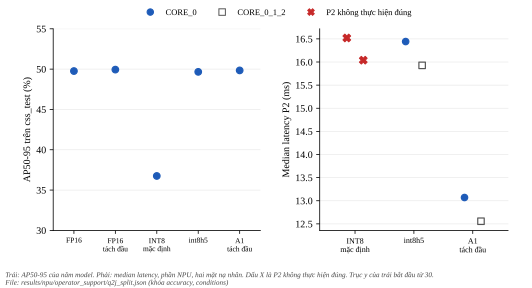
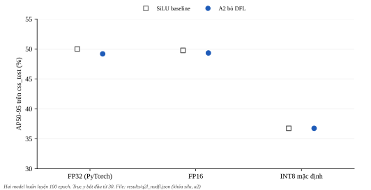
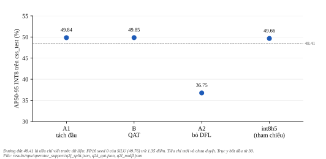

*******************
Ứng viên INT8 thuần
*******************

.. admonition:: Trang này trả lời

   - Có model INT8 thuần (không tensor FP16 nào trong đồ thị NPU) đạt độ chính xác của FP16 mà không cần công thức lai ``int8h5`` không?
   - Ba ứng viên đã thử: tách đầu (A1), tinh chỉnh có lượng tử hóa (QAT, B) và bỏ DFL (A2). Mỗi ứng viên cho biết gì về nguyên nhân mất điểm của INT8 mặc định?

.. admonition:: Tóm tắt

   - A1 tách đầu (PTQ, không huấn luyện lại, SiLU seed 0): AP50-95 trên ``css_test`` là 49.84 (FP16 49.76, ``int8h5`` 49.66, INT8 mặc định 36.75), đồ thị NPU toàn INT8, không op CPU. Phần NPU nhanh hơn ``int8h5`` khoảng 3.4 ms nhưng giải mã box trên CPU tốn 8.02 ms, nên tổng cộng chậm hơn khoảng 4.65 ms nếu không chồng lấp. Mọi so sánh thời gian mang nhãn "chưa kết luận" (hai phiên tham chiếu INT8 không thực hiện đúng dưới P2).
   - B QAT (6 epoch, 1 seed): AP50-95 49.85, hơn A1 0.01 điểm và hơn FP16 0.09 điểm, nằm trong nhiễu. Đồ thị RKNN của bản QAT không thuần INT8: có 8 hàng FLOAT16 trên NPU. Với câu hỏi như đã viết (model INT8 thuần), câu trả lời của QAT là không, và QAT không thêm gì so với PTQ tách đầu.
   - A2 bỏ DFL (``reg_max`` 1, huấn luyện lại từ ``yolov8n.pt``): FP16 49.33, INT8 mặc định 36.75, mức rơi 12.58 điểm so với 13.01 điểm của SiLU. Theo bảng đọc viết trước, mức rơi nằm trong 1.35 điểm quanh mức của SiLU, nghĩa là bỏ DFL mà giữ phép giải mã trong đồ thị INT8 không tránh được mất điểm. Đây không phải cơ chế.
   - Chưa biết: nguyên nhân chính xác (phép giải mã hay lượng tử hóa đầu ra của lớp tích chập hồi quy ltrb), vì A2 mặc định không tách được hai thành phần này. Một seed, một run mỗi ứng viên.

Kết quả chẩn đoán và công thức ``h5`` ở :doc:`05-ket-qua-luong-tu-hoa`, cách chạy lại ở :doc:`06-quy-trinh-tai-lap`.

.. contents:: Trong trang này
   :local:
   :depth: 1

1. Câu hỏi, tiêu chí và nguồn
===============================

Câu hỏi: model INT8 thuần có đạt độ chính xác của FP16 trên ``css_test`` không. Tiêu chí viết trước dữ liệu: AP50-95 từ 48.41 trở lên, tức không thấp hơn FP16 seed 0 (49.76) quá 1.35 điểm. Con số 1.35 là khoảng trải seed của INT8 SiLU ở :doc:`05-ket-qua-luong-tu-hoa`, đây là cách dùng mới và người dùng chưa duyệt. Nhãn cổng G4 đã duyệt không đổi, ba ứng viên này là phần bổ sung. Mốc tham chiếu: ``int8h5`` (49.66, lai, 15 tensor FP16) và INT8 mặc định (36.75).

Quy tắc viết trước dữ liệu nằm ở ``experiments/npu/operator_support/onboard_q2c/rule_split.txt`` (A1), ``rule_qat.txt`` (B) và ``rule_nodfl.txt`` (A2) của run ``ppe5_yolov8n_baseline_100ep_s0``. Nguồn T1:

- Tách hậu xử lý khỏi đồ thị NPU có tiền lệ trong SDK: "Due to hardware limitations, the demo model moves the post-processing part of the yolov5 model to the cpu implementation by default." (``3rdparty/rknn-toolkit2/rknpu2/examples/rknn_yolov5_demo/README.md:13``).
- QAT trên RKNN-Toolkit2 đi qua giao diện FX: "RKNN currently supports quantized models generated from the FX interface, specifically the prepare_qat_fx interface and its associated interfaces." [T1 UG232 tr.127]. Khi nạp model đã QAT, đặt ``do_quantization=False`` (``examples/pytorch/resnet18_qat/README.md:18``).
- Phiên bản torch: "we recommend using PyTorch 1.10~1.13.1 to export the model" [T1 UG232 tr.156]. Repo dùng torch 2.4.0 cho cả huấn luyện và toolkit, nên đây là một khác biệt với khuyến nghị (xem mục 3).

Nguồn T2, chỉ để định vị, khác bộ dữ liệu và khác bộ lượng tử hóa nên không so trực tiếp. Bài YOLO26 báo bỏ DFL một mình làm mất 0.6 AP: "removing DFL alone costs 0.6 AP on the YOLO11s baseline (47.0 to 46.4)" [T2 Jocher 2026 tr.11] (COCO, FP, không nói INT8). Bài QARepVGG báo YOLOv6s-RepVGG giảm từ 42.4 xuống 35.0 sau PTQ INT8 còn YOLOv6s-QARepVGG từ 42.3 xuống 41.0 [T2 QAREP tr.7 Table 8] (COCO). Không có bài đã đọc đo mAP INT8 của YOLO khi bỏ DFL.

Phần bỏ DFL dựa trên mã Ultralytics 8.4.154 đã cài: tham số ``reg_max: 1`` của yaml YOLO26 (``cfg/models/26/yolo26.yaml:10``), ``Detect.dfl`` là ``nn.Identity()`` khi ``reg_max`` bằng 1 (``nn/modules/head.py:138``), độ rộng nhánh box ``c2 = max(16, ch[0] // 4, reg_max * 4)`` (``nn/modules/head.py:122``), ``reg_max`` đọc từ yaml (``nn/tasks.py:2014``) và hàm mất mát đổi tên cột ``dfl_loss`` thành ``l1_loss`` (``utils/loss.py:357-358``). Chỉ ``reg_max`` được mượn của YOLO26, ``end2end`` không.

2. A1: tách đầu, PTQ, không huấn luyện lại
============================================

``ai/npu/operator_support/build_split.py`` xuất mô hình SiLU seed 0 đã fuse thành hai đầu ra thô qua ``forward_head`` của chính đầu Detect: ``boxes`` (1x64x8400, logit DFL) và ``scores`` (1x5x8400, logit class). Mô hình dựng bằng cấu hình INT8 của Ultralytics và danh sách hiệu chuẩn seed 0. Phần giải mã (kỳ vọng softmax DFL, xywh, nhân stride, sigmoid) chạy bằng numpy trên CPU (``ai/board/split_decode.py``). Hai kiểm tra hợp lệ viết trước khi đọc số INT8 đều qua: giải mã float của ONNX so với ``output0`` của ONNX chuẩn lệch tối đa 1.8e-04 (giới hạn 0.01), và model FP16 tách đầu cho 49.94 trên ``css_test`` so với 49.76 của FP16 chuẩn (giới hạn chênh 1.35).

Độ chính xác trên ``css_test`` (AP50-95, điểm):

   AP50-95 của năm model (trái) và median latency phần NPU (phải). Dấu X là P2 không thực hiện đúng. Hình sinh bằng ``docs/tools/figure_gen/03-phuong-phap/04-tang-npu-ket-qua/gen.py``.

.. list-table::
   :header-rows: 1
   :widths: 34 14 14 14 14

   * - Model
     - AP50-95
     - AP50
     - NoHelmet
     - Vest
   * - FP16 chuẩn
     - 49.76
     - 80.22
     - 30.74
     - 56.49
   * - FP16 tách đầu
     - 49.94
     - 80.06
     - 31.17
     - 56.60
   * - INT8 mặc định
     - 36.75
     - 69.65
     - 22.77
     - 46.98
   * - INT8 ``int8h5`` (lai)
     - 49.66
     - 79.52
     - 28.65
     - 56.45
   * - INT8 tách đầu (A1)
     - 49.84
     - 80.28
     - 29.51
     - 56.91

Đồ thị NPU của A1 có 106 hàng, toàn INT8 và không op CPU ngoài Input và Output. INT8 tách đầu hơn FP16 +0.08 điểm và hơn ``int8h5`` +0.18 điểm, đạt tiêu chí. Cách đọc viết trước: ``h5`` giữ logit DFL và phép tính giải mã ở FP16 cùng lúc, còn mô hình tách đầu đưa logit DFL về INT8 và chỉ chuyển phần tính toán sang float. Vì tách đầu đạt, theo cách đọc đó phần đuôi tính toán của giải mã được ủng hộ là nguồn mất điểm, còn việc lượng tử hóa logit DFL thì không được ủng hộ. Đây không phải cơ chế.

Thời gian (một lần chạy xen kẽ dưới P2, SiLU seed 0, ``experiments/npu/operator_support/onboard_q2j``). Hai phiên tham chiếu của model ``int8`` mặc định không thực hiện đúng P2 nên mọi hàng so với ``int8`` mang nhãn "chưa kết luận". Các phiên của ``int8h5`` và A1 thực hiện đúng:

.. list-table::
   :header-rows: 1
   :widths: 40 20 24 24

   * - Model
     - CORE_0 (ms)
     - CORE_0_1_2 (ms)
     - P2 thực hiện đúng
   * - INT8 mặc định
     - 16.520
     - 16.040
     - không
   * - ``int8h5``
     - 16.442
     - 15.928
     - có
   * - A1 tách đầu (chỉ phần NPU)
     - 13.070
     - 12.557
     - có

Giải mã CPU bằng numpy: trung vị 8.02 ms, p95 8.246 ms trên 200 lần (``ai/board/bench_decode.py``, ghim CPU4, tần số khóa). Tổng ở ``CORE_0`` là 13.07 + 8.02 = 21.09 ms so với 16.442 ms của ``int8h5``. Đây là tổng của hai trung vị đo riêng (NPU dưới P2, giải mã trên CPU), không phải phép đo từ đầu đến cuối. Nếu giải mã chồng lấp với suy luận ảnh kế tiếp thì thông lượng cao hơn: điều này đã đo sau đó ở :doc:`09-ket-qua-don-bay-fps` (một context đạt 65.99 FPS), còn thời gian mỗi khung thì không giảm. Bản giải mã C hay NEON có thể nhanh hơn numpy, cũng không được đo.

3. B: QAT
===========

Phương pháp (``ai/core/rknn/qat_split.py``, ``ai/npu/operator_support/qat_split.py``): mô hình tách đầu (hai đầu ra thô), đầu vào FX trace qua một lớp bọc tường minh (các phép cắt tĩnh của C2f, đầu trả hai tensor), ``prepare_qat_fx`` với qconfig của tr.127 (activation ``FakeQuantize`` ``MovingAverageMinMaxObserver`` từ 0 đến 255, trọng số per-channel affine int8), tinh chỉnh 6 epoch, batch 8 (batch 16 hết bộ nhớ GPU 4 GB), SGD lr 0.0001, tắt observer từ epoch 5, đóng băng thống kê BN từ epoch 6, hàm mất mát phát hiện của Ultralytics trên đầu ra thô. Sau đó ``convert_fx``, ``torch.jit.trace``, ``load_pytorch`` và ``build`` với ``do_quantization=False``. Siêu tham số không đổi sau khi thấy kết quả. Loss trung bình mỗi epoch: 2.586, 2.594, 2.565, 2.540, 2.542, 2.459.

Phiên bản torch 2.4.0 khác khuyến nghị 1.10 đến 1.13.1 của tr.156. Chuỗi trace, TorchScript, nạp và dựng chạy được trên torch 2.4.0 nên khác biệt này không gây lỗi. Ảnh hưởng của nó lên độ chính xác thì chưa biết.

Độ chính xác trên ``css_test``: AP50-95 49.85 (AP NoHelmet 30.38, AP Vest 57.21), hơn FP16 +0.09, hơn A1 PTQ tách đầu +0.01, hơn ``int8h5`` +0.19 và hơn INT8 mặc định +13.10 điểm. Đạt tiêu chí 48.41. Tiêu chí mới và chưa duyệt, và một run, một seed.

Câu hỏi của quy tắc gồm hai vế: đạt FP16 và đồ thị INT8 thuần. Vế độ chính xác đạt. Vế đồ thị không đạt: bảng layer của bản dựng có 114 hàng, 103 hàng NPU INT8, 8 hàng NPU FLOAT16 (2 ``exSwish``, 2 ``Resize``, 4 ``exDataConvert``) và 3 hàng CPU (Input và các hàng Output, A1 và QAT có hai đầu ra) so với 106 hàng toàn INT8 của A1. Nguyên nhân các hàng FP16 chưa biết, hướng dẫn nói op không đạt quy tắc lượng tử hóa giữ tính toán FP32 (tr.128) và ``exDataConvert`` được chèn quanh một số op (tr.130), không có danh sách op cụ thể. Thời gian NPU và độ phủ đa nhân của bản QAT đo sau đó ở :doc:`08-so-muc-chua-biet` mục 9 (ngoài ngân sách của quy tắc ban đầu). Kết luận: với câu hỏi như đã viết, QAT trả lời không, và độ chính xác ngang A1 nên QAT không thêm gì.

4. A2: bỏ DFL (reg_max 1)
===========================

A2 huấn luyện lại ``ai/models/yolov8n_nodfl.yaml`` (yaml gốc ``yolov8.yaml`` thêm ``scale: n`` và ``reg_max: 1``) từ ``yolov8n.pt``, cùng cấu hình với baseline (``ppe5``, 100 epoch, seed 0, SiLU), xuất mặc định của Ultralytics (giải mã trong đồ thị, không công thức lai, vì ``h5`` cần 4 tensor DFL không còn) với danh sách hiệu chuẩn seed 0 (``stems_md5`` ``11d6a5c69414a6eafd8b98f99724b0b2``, ``png_md5`` ``6652576adb7608ddf8ff326c57851732``). Kiểm tra trước trên model chưa huấn luyện: đầu ra 1x9x8400, 116 hàng toàn INT8, không op CPU.

Yếu tố gây nhiễu cần biết: với ``reg_max`` 1, cả nhánh box ``cv2`` thu từ 64 xuống 16 kênh (``head.py:122``), nên toàn bộ nhánh box khởi tạo ngẫu nhiên, chỉ 285/354 items (nc 5 training log) chuyển từ ``yolov8n.pt``. A2 là một model khác chứ không chỉ khác ở phép giải mã. Số liệu: FP16 của A2 là 49.33, thấp hơn FP16 SiLU seed 0 0.43 điểm, trong khi khoảng trải seed của FP16 SiLU là 1.25 điểm. mAP50-95 trên tập validation ở epoch cuối là 0.5240 (A2) và 0.5223 (SiLU).

Độ chính xác trên ``css_test`` (AP50-95, điểm), cùng đường đo trên board:

   AP50-95 của SiLU baseline và A2 bỏ DFL ở ba kiểu số. Hình sinh bằng ``docs/tools/figure_gen/03-phuong-phap/04-tang-npu-ket-qua/gen.py``.

.. list-table::
   :header-rows: 1
   :widths: 30 18 14 18 28

   * - Model
     - FP32 (PyTorch)
     - FP16
     - INT8 mặc định
     - Mức rơi FP16 xuống INT8
   * - SiLU baseline seed 0
     - 49.99
     - 49.76
     - 36.75
     - 13.01
   * - A2 bỏ DFL
     - 49.18
     - 49.33
     - 36.75
     - 12.58

Hai số INT8 trùng nhau đến hai chữ số thập phân (36.75) là trùng nhau, không có liên hệ nào được đo. Hai file khác nhau (sha256 khác), AP50 khác (70.61 và 69.65) và AP từng lớp khác. Đồ thị INT8 của A2 có 116 hàng, 114 hàng NPU INT8, không op CPU ngoài Input và Output.

Bảng đọc viết trước: mức rơi nhỏ hơn hoặc bằng 1.35 thì phần DFL bị liên quan. Mức rơi trong 1.35 quanh 13.01 (từ 11.66 đến 14.36) thì phép giải mã trong INT8 đủ để gây mất điểm kể cả khi không có DFL, phù hợp với cách đọc của A1. Mức rơi giữa hai khoảng là một phần, không gán nhãn. Mức rơi 12.58 nằm trong khoảng thứ hai. Tiêu chí tuyệt đối 48.41 không đạt (INT8 36.75), tiêu chí này phụ thuộc cả mức FP16 của A2.

Giới hạn của cách đọc: A2 mặc định không tách được lượng tử hóa đầu ra của lớp tích chập hồi quy ltrb khỏi các phép tính của phần đuôi giải mã. Lần chạy A2 tách đầu (quy tắc mới, :doc:`08-so-muc-chua-biet` mục 9) tách được hai thành phần này và cho kết quả đạt tiêu chí.

5. Tổng hợp ba ứng viên
=========================

   AP50-95 INT8 của bốn ứng viên so với tiêu chí 48.41. Hình sinh bằng ``docs/tools/figure_gen/03-phuong-phap/04-tang-npu-ket-qua/gen.py``.

.. list-table::
   :header-rows: 1
   :widths: 24 16 24 60

   * - Ứng viên
     - AP50-95 INT8
     - Đồ thị INT8 thuần
     - Chi phí và điều kiện
   * - A1 tách đầu (PTQ)
     - 49.84
     - có (106 hàng INT8)
     - NPU nhanh hơn ``int8h5`` 3.4 ms, giải mã CPU 8.02 ms, tổng chậm hơn 4.65 ms nếu không chồng lấp. Không cần huấn luyện
   * - B QAT
     - 49.85
     - không (8 hàng FP16)
     - 6 epoch huấn luyện (9.7 phút). Thời gian NPU ở :doc:`08-so-muc-chua-biet` mục 9. Không hơn A1
   * - A2 bỏ DFL
     - 36.75
     - có (114 hàng INT8)
     - Huấn luyện lại 100 epoch. Không giảm mức rơi INT8 mặc định
   * - ``int8h5`` (tham chiếu)
     - 49.66
     - không (15 tensor FP16)
     - Không tốn latency đo được (:doc:`05-ket-qua-luong-tu-hoa`)

Đọc chung, trong giới hạn của mỗi ứng viên một seed: trong các ứng viên đã thử, chỉ A1 cho model INT8 thuần đạt FP16, và đó là bản có phần đuôi giải mã nằm ngoài đồ thị NPU (không có phép đo nào kiểm điều kiện cần). Giải mã chuyển sang CPU làm tổng thời gian dài hơn ``int8h5`` ở phép đo này. Công thức lai ``int8h5`` vẫn là cách đạt độ chính xác FP16 mà đồ thị còn trên NPU, với 15 tensor FP16 ở phần đuôi. QAT 6 epoch không thêm gì so với PTQ ở cấu hình đã thử. Bỏ DFL không giảm mức rơi.

6. Chưa biết và giới hạn
==========================

- Nguyên nhân chính xác của mức rơi INT8 mặc định: chưa biết. A2 mặc định không tách được các thành phần của phần đuôi giải mã (phép trừ, cộng, chia, nối với điểm class, nhân stride) khỏi lượng tử hóa đầu ra của lớp hồi quy.
- QAT với torch 1.10 đến 1.13.1 (khuyến nghị tr.156): không chạy, cần bộ công cụ thứ hai (:doc:`08-so-muc-chua-biet` mục 8). Nguyên nhân 8 hàng FP16 của bản QAT: vẫn chưa biết (vị trí đã mô tả ở :doc:`08-so-muc-chua-biet` mục 9). Thời gian NPU và độ phủ của bản QAT đã đo ở :doc:`08-so-muc-chua-biet` mục 9.
- Giải mã chồng lấp với suy luận kế tiếp đã đo ở :doc:`09-ket-qua-don-bay-fps`. Giải mã bằng C hay NEON không chạy vì điều kiện kích hoạt viết trước không xảy ra, nên chưa đo.
- Một seed, một run mỗi ứng viên, chỉ SiLU, một board, giao thức đo thời gian P2 (đã duyệt ngày 2026-11-01). Tiêu chí 48.41 mới và chưa duyệt.
- A2 là model khác (nhánh box khởi tạo ngẫu nhiên). A2 tách đầu đã chạy sau đó (:doc:`08-so-muc-chua-biet` mục 9): INT8 đạt FP16, ủng hộ cách đọc phép giải mã.

7. Tái lập
============

Mọi lệnh chạy từ gốc repo chính, board đã khóa tần số và có ``rknn_server`` (:doc:`06-quy-trinh-tai-lap`). Quy tắc viết trước nằm ở ``experiments/npu/operator_support/onboard_q2c/`` (``rule_split.txt``, ``rule_qat.txt``, ``rule_nodfl.txt``).

.. code-block:: bash

   # A1: xuất tách đầu (int8 và fp16), chấm mAP trên board (FP16 tách đầu là kiểm tra hợp lệ V-board, chấm trước số INT8)
   .venv/bin/python -m ai.npu.operator_support.build_split ppe5_yolov8n_baseline_100ep_s0 int8
   .venv/bin/python -m ai.npu.operator_support.build_split ppe5_yolov8n_baseline_100ep_s0 fp16
   .venv/bin/python -m ai.automation.evaluate ppe5_yolov8n_baseline_100ep_s0 --backend rknn --precision fp16 --variant split --board minhnhat@192.168.137.49 --board-repo rk3588
   .venv/bin/python -m ai.automation.evaluate ppe5_yolov8n_baseline_100ep_s0 --backend rknn --precision int8 --variant split --board minhnhat@192.168.137.49 --board-repo rk3588
   # A1: thời gian. Phần NPU dưới P2 (benchmark_npu --variant split, xen kẽ với int8 và int8h5, theo quy tắc rule_split.txt mục S-3),
   # giải mã CPU ghim CPU4 (ai/board/bench_decode.py chạy trên board), rồi phân tích
   .venv/bin/python -m ai.npu.operator_support.analyze_q2j
   # B: QAT rồi chấm mAP
   RKNN_LOG_LEVEL=3 .venv/bin/python -m ai.npu.operator_support.qat_split ppe5_yolov8n_baseline_100ep_s0 --epochs 6 --batch 8
   .venv/bin/python -m ai.automation.evaluate ppe5_yolov8n_baseline_100ep_s0 --backend rknn --precision int8 --variant qat --board minhnhat@192.168.137.49 --board-repo rk3588
   # A2: huấn luyện, xuất (INT8 dùng danh sách hiệu chuẩn của seed 0), chấm mAP
   make train CONFIG=ai/automation/configs/ppe5_yolov8n_nodfl.yaml
   .venv/bin/python -m ai.automation.export_npu ppe5_yolov8n_nodfl_100ep_s0 --quantize 16
   .venv/bin/python -m ai.automation.export_npu ppe5_yolov8n_nodfl_100ep_s0 --quantize 8 --calib-from ppe5_yolov8n_baseline_100ep_s0
   .venv/bin/python -m ai.automation.evaluate ppe5_yolov8n_nodfl_100ep_s0 --backend rknn --precision fp16 --board minhnhat@192.168.137.49 --board-repo rk3588
   .venv/bin/python -m ai.automation.evaluate ppe5_yolov8n_nodfl_100ep_s0 --backend rknn --precision int8 --board minhnhat@192.168.137.49 --board-repo rk3588
   # QAT và A2: bảng số liệu (đọc các file eval và log xuất trong repo)
   .venv/bin/python -m ai.npu.operator_support.analyze_q2kl

``make export-npu PREC=int8`` chỉ truyền ``--calib-from`` khi có ``CALIB_FROM=<run>`` (từ 2026-11-01, ``pipeline.py`` luôn truyền). Không có biến này, với run A2 nó sẽ lấy mẫu một danh sách hiệu chuẩn mới. Dùng lệnh ``export_npu`` ở trên, hoặc ``make export-npu RUN=ppe5_yolov8n_nodfl_100ep_s0 PREC=int8 CALIB_FROM=ppe5_yolov8n_baseline_100ep_s0``, để giữ danh sách của seed 0.

Số liệu: ``results/npu/operator_support/q2j_split.json`` (A1, ``analyze_q2j.py``), ``results/npu/operator_support/q2k_qat.json`` và ``results/npu/operator_support/q2k_qat_layers.json`` (QAT, ``analyze_q2kl.py``), ``results/npu/operator_support/q2l_nodfl.json`` (A2, ``analyze_q2kl.py``). Log: ``experiments/npu/operator_support/onboard_q2c/logs/`` (``qat_train.log``, ``evaluate_qat_int8.log``, ``a2_precheck_untrained_export.log``) và ``runs/ppe5_yolov8n_nodfl_100ep_s0/logs/``. Thiết kế: ``results/notes/phase2d_design.md``, nguồn: ``results/notes/phase2d_source_facts.md``.
