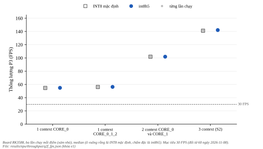
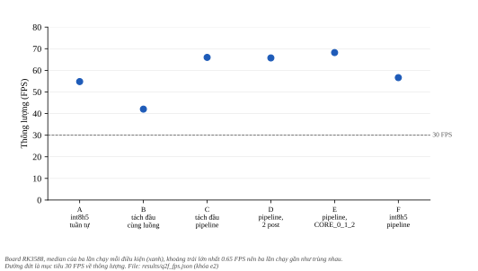
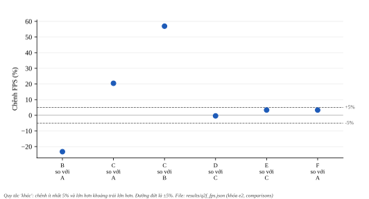

***********
Đòn bẩy FPS
***********

.. admonition:: Trang này trả lời

   - Model INT8 chuẩn (``int8h5``) có khác INT8 mặc định về thông lượng không, khi mục tiêu là 30 FPS?
   - Một context của model tách đầu (``A1``) với giải mã CPU chồng lấp cùng NPU nhanh hơn bao nhiêu về thông lượng, và đổi lại điều gì? Mục tiêu 30 FPS cần việc này không?
   - Có cần giải mã bằng C hoặc NEON không?

.. admonition:: Tóm tắt

   - E1: ``int8h5`` và ``int8`` không phân biệt được về thông lượng theo quy tắc 5% ở cả bốn cấu hình (một context ``CORE_0`` 54.86 so với 54.69 FPS, ba context 142.09 so với 141.13 FPS). Cả hai model đạt 30 FPS ở mọi cấu hình, kể cả một context (54.7 đến 56.3 FPS). Mốc 60 FPS cũ chỉ đạt từ hai context (101.89 FPS).
   - E2: model tách đầu một context ``CORE_0`` với giải mã chồng lấp bằng pipeline (điều kiện C) đạt 65.99 FPS, so với 54.79 FPS của ``int8h5`` một context chạy tuần tự và 42.05 FPS của chính model tách đầu khi giải mã nằm trong cùng luồng (điều kiện B). Thêm một luồng giải mã (D, 65.74 FPS) hay dùng ba lõi cho một context (E, 68.21 FPS) không phân biệt được với C.
   - Độ chính xác của model tách đầu đã chấm ở :doc:`07-ket-qua-qat-kien-truc` (49.84 AP50-95 của ``A1`` so với 49.66 của ``int8h5`` trên ``css_test``). Pipeline chỉ đổi cách xếp luồng, và cổng đúng đắn của E2 trên 20 ảnh qua (F1 0.978, ngưỡng 0.85).
   - Pipeline tăng thông lượng chứ không giảm thời gian mỗi khung. Với mục tiêu 30 FPS, một context ``int8h5`` tuần tự (A, 54.79 FPS, tổng ba giai đoạn 18.08 ms) đã đạt cả thông lượng lẫn 33.33 ms mỗi khung, nên pipeline và model tách đầu không cần để đạt mục tiêu (xem mục 5). Pipeline đổi lấy CPU tiến trình 100% so với 24% của A.
   - E3 (giải mã bằng C hoặc NEON) không chạy: điều kiện kích hoạt viết trước (C dưới 60 FPS và giai đoạn post chậm hơn NPU) không xảy ra. Quy tắc này viết lúc mục tiêu còn là 60 FPS. Với mốc 30 FPS, kết quả vẫn là không chạy, vì C đạt 65.99 FPS.
   - Một seed, một board, ảnh cache, không camera, giao thức P3 (đã duyệt), các số ngưỡng mới của hai thí nghiệm chưa duyệt.

Mốc 60 FPS ghi lúc đo, mục tiêu hiện hành là 30 FPS (đổi ngày 2026-11-08). Tiêu chí và hai cách đọc ở :doc:`03-ket-qua-da-nhan` mục 8. Quy tắc viết trước dữ liệu: ``bench/onboard_q2f_thr/rule.txt`` (E1) và ``bench/onboard_q2f_split/rule.txt`` (E2) trong thư mục run ``ppe5_yolov8n_baseline_100ep_s0``.

.. contents:: Trong trang này
   :local:
   :depth: 1

1. Câu hỏi, giao thức và nguồn
================================

Cả hai thí nghiệm chạy ``ai/board/bench_throughput_rep.py`` dưới taskset ``-c 4-7`` với helper P3 (``p3_hold.sh``, giao thức đã duyệt ngày 2026-11-01, hạn chế ở :doc:`../02-tang-npu-nen-do/07-giao-thuc-p2-p3` mục 6), 1238 khung, nghỉ 20 giây giữa các lần chạy, ba lần lặp theo cùng thứ tự, ảnh test ``ppe5`` đã decode sẵn trong bộ nhớ (không camera, không giải mã video, không vẽ hay lưu kết quả). FPS là số khung chia cho thời gian tường, đã tính tiền xử lý, NPU và hậu xử lý (kể cả giải mã box của model tách đầu). Mỗi con số là trung vị của ba lần chạy, chênh lệch tối đa là khoảng trải. Một lần chạy chỉ được tính khi thực hiện đúng P3 (ngắt NPU đúng lõi, tiến trình trong CPU4 đến CPU7, tần số khóa, ``irqbalance`` dừng). Cả hai thí nghiệm đều có mọi lần chạy thực hiện đúng.

Quy tắc "khác" viết trước dữ liệu: chênh ít nhất 5% và lớn hơn khoảng trải lớn hơn của hai điều kiện, nếu không thì "không phân biệt được". Đây là quy tắc của M12 (trường ``rule`` của ``results/thr_p3.json``, kết quả ở :doc:`03-ket-qua-da-nhan`), dùng lại cho các so sánh mới của trang này (các so sánh mới chưa duyệt).

2. E1: int8h5 so với int8
===========================

``int8h5`` là INT8 chuẩn (:doc:`05-ket-qua-luong-tu-hoa`) nhưng mục 8 của :doc:`03-ket-qua-da-nhan` đo bằng ``int8`` mặc định. E1 đo lại cả hai trong cùng một phiên.

   Thông lượng P3 của INT8 mặc định và ``int8h5`` ở bốn cấu hình. Đường đứt 30 FPS là mục tiêu hiện hành. Hình sinh bằng ``docs/tools/figure_gen/03-phuong-phap/04-tang-npu-ket-qua/gen.py``.

.. list-table::
   :header-rows: 1
   :widths: 28 22 22 10 22 22

   * - Cấu hình
     - ``int8`` FPS (khoảng trải)
     - ``int8h5`` FPS (khoảng trải)
     - Chênh
     - Kết luận
     - ``int8h5`` so với 30 FPS
   * - 1 context ``CORE_0``
     - 54.69 (0.07)
     - 54.86 (0.09)
     - +0.31%
     - không phân biệt được
     - đạt
   * - 1 context ``CORE_0_1_2``
     - 56.17 (0.06)
     - 56.30 (0.06)
     - +0.23%
     - không phân biệt được
     - đạt
   * - 2 context ``CORE_0`` và ``CORE_1``
     - 101.90 (0.57)
     - 101.89 (0.29)
     - -0.01%
     - không phân biệt được
     - đạt
   * - 3 context (S2)
     - 141.13 (0.45)
     - 142.09 (0.73)
     - +0.68%
     - không phân biệt được
     - đạt

Chênh chỉ từ 0.01% đến 0.68%, dưới ngưỡng 5% của quy tắc (ở ba cấu hình chênh FPS còn lớn hơn khoảng trải nhưng vẫn dưới 5%), nên theo quy tắc là không phân biệt được và số của :doc:`03-ket-qua-da-nhan` mục 8 áp dụng cho ``int8h5`` ở mức đo này. Phần đã biết về latency NPU của ``int8h5`` ở :doc:`05-ket-qua-luong-tu-hoa` mục 6 phù hợp: cùng cỡ.

Ghi chú về mã đo: E1 chạy với harness trước khi thêm hỗ trợ model tách đầu, mã được đồng bộ lên board sau khi E1 xong nên E2 chạy với harness mới. Điều kiện A của E2 (``int8h5``, một context ``CORE_0``, tuần tự) và ``int8h5`` T1 của E1 đo cùng một việc trên hai bản harness: 54.79 và 54.86 FPS, chênh 0.13%, nên đổi harness không làm đổi đường chuẩn. Các bản ghi chỉ đánh dấu ``git_dirty``, không phân biệt được hai bản.

3. Cổng đúng đắn của E2
=========================

Model tách đầu trả hai đầu ra thô, CPU giải mã bằng numpy rồi mới chạy hậu xử lý chung. Trước khi đọc thời gian, ``ai/board/split_gate.py`` so các phát hiện (ngưỡng 0.25) của hai model trên 20 ảnh test qua cùng đường harness: 136 phát hiện của ``int8h5``, 140 của model tách đầu, 135 cặp khớp (cùng lớp, IoU ít nhất 0.5), F1 bằng 0.978. Ngưỡng viết trước là 0.85 (số mới, chưa duyệt), nên cổng qua.

4. E2: giải mã chồng lấp với NPU
==================================

Model tách đầu có phần NPU nhanh hơn (13.07 ms ở ``CORE_0`` dưới P2, :doc:`07-ket-qua-qat-kien-truc` mục 2) nhưng giải mã numpy tốn 8.02 ms trên CPU. Nếu giải mã nằm trong cùng luồng thì tổng dài hơn ``int8h5``. E2 hỏi: nếu giải mã chạy ở luồng khác trong khi NPU xử lý khung kế tiếp thì thông lượng ra sao. Sáu điều kiện (số luồng tiền xử lý và hậu xử lý trong ngoặc):

   Thông lượng của sáu điều kiện E2 so với mục tiêu 30 FPS. Hình sinh bằng ``docs/tools/figure_gen/03-phuong-phap/04-tang-npu-ket-qua/gen.py``.

.. list-table::
   :header-rows: 1
   :widths: 44 20 16 34 14

   * - Điều kiện
     - FPS (khoảng trải)
     - So với 30 FPS
     - T_pre / T_npu / T_post (ms, trung vị)
     - CPU tiến trình
   * - A: ``int8h5``, tuần tự, ``CORE_0``
     - 54.79 (0.09)
     - đạt
     - 0.23 / 17.19 / 0.66
     - 24%
   * - B: tách đầu, giải mã cùng luồng, ``CORE_0``
     - 42.05 (0.05)
     - đạt
     - 0.29 / 14.30 / 8.94
     - 54%
   * - C: tách đầu, pipeline (1 pre, 1 post), ``CORE_0``
     - 65.99 (0.03)
     - đạt
     - 0.87 / 15.04 / 11.61
     - 100%
   * - D: tách đầu, pipeline (1 pre, 2 post), ``CORE_0``
     - 65.74 (0.21)
     - đạt
     - 0.71 / 15.09 / 11.70
     - 100%
   * - E: tách đầu, pipeline (1 pre, 1 post), ``CORE_0_1_2``
     - 68.21 (0.65)
     - đạt
     - 0.94 / 14.61 / 11.81
     - 105%
   * - F: ``int8h5``, pipeline (1 pre, 1 post), ``CORE_0``
     - 56.62 (0.21)
     - đạt
     - 0.46 / 17.42 / 0.85
     - 28%

So sánh theo quy tắc "khác":

   Chênh FPS giữa sáu cặp điều kiện E2. Đường đứt ±5% là ngưỡng của quy tắc 'khác'. Hình sinh bằng ``docs/tools/figure_gen/03-phuong-phap/04-tang-npu-ket-qua/gen.py``.

.. list-table::
   :header-rows: 1
   :widths: 52 14 12 20 24

   * - So sánh
     - Chênh FPS
     - Chênh %
     - Khoảng trải lớn hơn
     - Kết luận
   * - B so với A (giải mã cùng luồng so với ``int8h5``)
     - -12.74
     - -23.3%
     - 0.09
     - khác
   * - C so với A (pipeline tách đầu so với ``int8h5`` tuần tự)
     - +11.20
     - +20.4%
     - 0.09
     - khác
   * - C so với B (chồng lấp so với cùng luồng)
     - +23.94
     - +56.9%
     - 0.05
     - khác
   * - D so với C (thêm một luồng post)
     - -0.25
     - -0.4%
     - 0.21
     - không phân biệt được
   * - E so với C (một context trên ba lõi)
     - +2.22
     - +3.4%
     - 0.65
     - không phân biệt được
   * - F so với A (pipeline so với tuần tự, cùng ``int8h5``)
     - +1.83
     - +3.3%
     - 0.21
     - không phân biệt được

Đọc: chồng lấp tăng thông lượng của model tách đầu +56.9% so với giải mã cùng luồng và đưa nó lên 65.99 FPS, hơn ``int8h5`` tuần tự +20.4%. Một luồng giải mã đủ (D không khác C, thời gian post 11.61 ms nhỏ hơn thời gian NPU 15.04 ms). Dùng ba lõi cho một context (E) không phân biệt được với C (+3.4%, dưới 5%). Pipeline một mình không giúp ``int8h5`` (+3.3%, không phân biệt được), phép đo không nói vì sao. Đây là mô tả của phép đo, không phải cơ chế.

5. Hai cách đọc mục tiêu 30 FPS
=================================

Mốc 60 FPS cũ làm một context ``int8h5`` (54.8 FPS) chưa đạt, nên model tách đầu với pipeline là cách duy nhất đưa một context qua 60. Mốc 30 FPS (camera chỉ có 30 khung/giây) đổi kết luận này.

**Đọc theo thông lượng** (mặc định của :doc:`03-ket-qua-da-nhan` mục 8): mọi điều kiện đạt 30 FPS, từ B (42.05, thấp nhất) đến E (68.21). Một context ``int8h5`` tuần tự (A, 54.79) đã dư 24.8 FPS. Model tách đầu và pipeline nâng thông lượng lên 65.99 FPS (C) nhưng không cần cho mục tiêu. Thứ tự đầu ra: ở C mỗi giai đoạn chỉ một luồng nối bằng hàng đợi FIFO nên thứ tự được giữ theo cách xây dựng, harness không kiểm điều này (chưa kiểm), còn D có hai luồng post nên có thể đảo thứ tự.

**Đọc theo thời gian mỗi khung** (mỗi khung phải xong trong 33.33 ms): tổng ba giai đoạn của A là 18.08 ms (0.23 + 17.19 + 0.66), của B là 23.53 ms (0.29 + 14.30 + 8.94), của C là 27.55 ms (``stage_sum`` trong ``results/q2f_fps.json``), đều dưới 33.33 ms. Đây là tổng trung vị từng giai đoạn, không phải đo đầu cuối trực tiếp và không phải cực tiểu, và ở C các giai đoạn chạy dưới tranh chấp. Trường ``e2e_latency_ms`` của harness cho trung vị 132.6 ms ở C và 141.6 ms ở F. Theo mã, harness có hàng đợi 6 chỗ (``bench_throughput_rep.py``, ``--queue-size`` mặc định 6) và đẩy khung liên tục, nên hai số này có khả năng gồm thời gian chờ hàng đợi (mức đầy của hàng đợi không đo). Chúng không phải thời gian của một khung riêng lẻ. Thời gian mỗi khung khi cấp khung theo nhịp 30 FPS của camera: chưa đo trong harness này. C dư 5.78 ms so với 33.33 ms, ít hơn nhiều so với A (15.25 ms), nên đây là chỗ cần đo trước khi dùng pipeline.

**Hệ quả với mục tiêu 30 FPS.** Pipeline, model tách đầu và nhiều context không cần cho thông lượng. Giá trị còn lại của chúng là phần dư thời gian (dùng cho model lớn hơn hay input lớn hơn), và độ chính xác của model tách đầu (49.84 so với 36.75 của ``int8`` mặc định, ``h5`` cũng đạt 49.66 mà không cần pipeline). Nếu mục tiêu chỉ là độ chính xác ở 30 FPS, ``int8h5`` một context là cấu hình đơn giản nhất đã đo.

6. E3: giải mã bằng C hoặc NEON
=================================

Điều kiện kích hoạt viết trước (lúc mục tiêu còn là 60 FPS): E3 chỉ chạy nếu điều kiện C dưới 60 FPS và trung vị ``t_post_ms`` của C không nhỏ hơn trung vị ``t_npu_ms``. C đạt 65.99 FPS và ``t_post`` (11.61 ms) nhỏ hơn ``t_npu`` (15.04 ms), nên E3 không chạy. Kết quả ghi nhận: không cần theo cách đọc thông lượng của mục tiêu ở cấu hình này (C đạt 65.99 FPS, trên cả mốc 60 cũ và mốc 30 hiện hành). Theo cách đọc thời gian mỗi khung chưa xét. Giải mã C hoặc NEON vẫn có thể hữu ích nếu cần giảm CPU hoặc nâng FPS vượt mức này: chưa đo. Trong các tài liệu T1 đã tìm không có chữ NEON (:doc:`../03-tang-npu-don-bay/09-pre-post-processing`).

7. Điều chưa biết và giới hạn
===============================

- Thời gian mỗi khung khi cấp khung theo nhịp 30 FPS và thứ tự đầu ra của pipeline: chưa đo.
- Camera thật, giải mã video, vẽ và lưu kết quả không nằm trong đo. Thông lượng thực của ứng dụng có thể thấp hơn.
- Model tách đầu chưa được nối vào các script demo của repo, E2 dùng harness đo. Chi phí tích hợp và CPU thêm (100% so với 24% của A) cần xem khi triển khai.
- Độ chính xác của đường tách đầu trên ảnh đã chấm ở :doc:`07-ket-qua-qat-kien-truc` (một seed). Cổng E2 chỉ so các phát hiện trên 20 ảnh.
- Một board, một seed, P3 không so được với số P2 của :doc:`07-ket-qua-qat-kien-truc`. Ngưỡng F1 0.85 và quy tắc "khác" cho các so sánh mới chưa duyệt.
- Đòn bẩy chưa đo: tách đầu với nhiều context, giải mã bằng C hoặc NEON, RGA cho tiền xử lý, ``int8h5`` kết hợp bộ nhớ SRAM.

8. Tái lập
============

.. code-block:: bash

   # E1 và E2: board đã khóa tần số, p3_hold.sh chạy bằng sudo -n, model đã rsync lên board
   .venv/bin/python ai/automation/runs/ppe5_yolov8n_baseline_100ep_s0/bench/onboard_q2f_thr/q2f_thr_driver.py
   # cổng E2 (chạy trên board)
   .venv-board/bin/python -m ai.board.split_gate --standard <rknn_int8h5> --split <rknn_int8_split> --images data/ppe5/processed/images/test --out <json>
   .venv/bin/python ai/automation/runs/ppe5_yolov8n_baseline_100ep_s0/bench/onboard_q2f_split/q2f_split_driver.py
   .venv/bin/python -m ai.automation.analyze_q2f

Số liệu: ``results/q2f_fps.json``. Mã: ``ai/board/bench_throughput_rep.py`` (hỗ trợ model tách đầu qua ``postprocess_raw`` của ``ai/board/common.py``), ``ai/board/split_gate.py``, ``tests/test_split_harness.py``.
