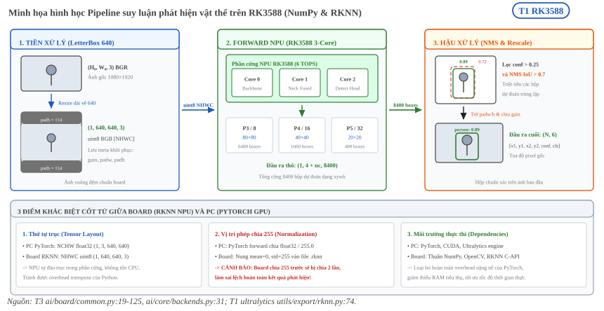
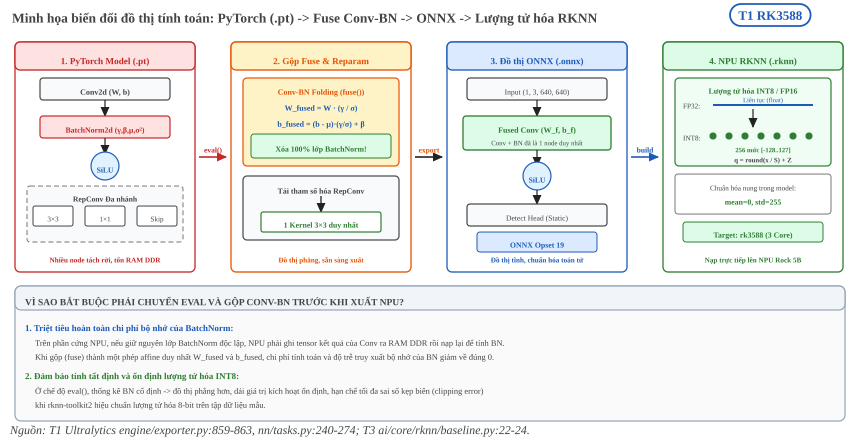

:tocdepth: 1

***********
Bản đồ code
***********

.. admonition:: Tóm tắt

   - Bảng liệt kê từng file code của pipeline, việc nó làm và lệnh make gọi nó, ví dụ ai/automation/pipeline/pipeline.py chạy cả phase qua make phase2/3/4.
   - ai/core/evaluator.py thực hiện protocol v1 gồm LetterBox, NMS, AP và dấu vân tay dataset, được evaluate, run và check dùng.
   - Với .rknn, ai/automation/pipeline/evaluate.py điều phối chạy trên board qua ssh, còn ai/board/probe/infer_dump.py lưu output thô và md5 input.
   - Đo hiệu năng chia hai tầng: tầng 1 là benchmark_npu.py với 3 phiên eval_perf, tầng 2 là các script trong ai/board/ chạy trên board.
   - start_rknn_server.sh và lock_freq.sh là lệnh sudo trên board, chạy tay.
   - Pipeline suy luận trên board dùng LetterBox 640, đầu vào RGB uint8 ``(1, 640, 640, 3)``, ngưỡng conf 0.25, IoU 0.7, tối đa 300 box [T3 ai/board/common.py:19 đến 26, 62 đến 77].

.. _8a1-bản-đồ-code:

Bản đồ code
===========

.. list-table::
   :header-rows: 1

   * - File
     - Làm gì
     - Gọi bởi
   * - ``ai/automation/pipeline/pipeline.py``
     - Chạy cả phase, bỏ qua bước đã xong
     - ``make phase2/3/4``
   * - ``ai/automation/pipeline/run.py``, ``ai/core/trainer.py``
     - Train, evaluator v1 trên ``best.pt``, ghi leaderboard
     - ``make train``
   * - ``ai/core/evaluator.py``
     - Protocol v1: LetterBox, NMS, AP, dấu vân tay dataset
     - evaluate, run, check
   * - ``ai/core/backends.py``
     - PyTorch/ONNX trên PC. Với ``.rknn``: đọc output board, kiểm md5 input
     - evaluator
   * - ``ai/core/provenance.py``
     - git commit, git_dirty, sha256, thời điểm
     - mọi file kết quả
   * - ``ai/automation/pipeline/evaluate.py``
     - AI Quality 1 run × 1 backend, với ``.rknn`` điều phối chạy trên board qua ssh
     - ``make evaluate``
   * - ``ai/board/probe/infer_dump.py``
     - Inference ``.rknn`` trên board, lưu output thô + md5 input
     - ``evaluate.py`` qua ssh
   * - ``ai/automation/pipeline/check_evaluator.py``
     - Golden test, kiểm chéo
     - ``make golden-test``, ``make crosscheck``
   * - ``ai/automation/pipeline/export_npu.py``, ``ai/core/rknn/baseline.py``, ``calibration.py``
     - Calibration, export ``.rknn``, ``.onnx``
     - ``make export-npu``
   * - ``ai/automation/pipeline/complexity.py``
     - Params, GFLOPs, MACs, kích thước
     - ``make complexity``
   * - ``ai/automation/bench/benchmark_npu.py``, ``ai/core/rknn/benchmark.py``
     - Tầng 1: 3 phiên ``eval_perf`` / layer / ``eval_memory``
     - ``make benchmark-npu``
   * - ``ai/automation/bench/bench_gpu.py``
     - Latency GPU PC (tham chiếu)
     - ``make bench-gpu``
   * - ``ai/automation/bench/board_check.py``
     - Kiểm adb, ``rknn_server``, khoá tần số
     - ``make board-check``
   * - ``ai/automation/report/tables.py``
     - Sinh bảng A–L, kiểm nhất quán
     - ``make tables``
   * - ``ai/board/common.py``
     - Pre/post giống evaluator, đo RAM/CPU/nhiệt độ, đọc governor
     - 3 script board
   * - ``ai/board/bench/bench_npu.py``, ``bench_cpu_onnx.py``, ``bench_throughput.py``
     - Tầng 2 trên board
     - ``make bench-board*``
   * - ``ai/board/sh/start_rknn_server.sh``, ``lock_freq.sh``
     - Lệnh sudo trên board
     - chạy tay
   * - ``scripts/logtee.py``
     - Chạy lệnh, lưu log đã làm gọn + header
     - mọi target sinh kết quả
   * - ``tests/test_parsers.py``, ``tests/fixtures/``
     - Kiểm parser với output thật RKNN 2.3.2
     - ``make test-parsers``

Pipeline suy luận trên board
============================

Lý thuyết về ba chặng của pipeline suy luận nằm ở :doc:`/contents/01-kien-thuc-nen/01-nen-tang-ai/06-huan-luyen-va-suy-luan` mục 3.

Mã trên board chỉ dùng numpy, opencv, psutil và pyyaml, không có torch hay ultralytics. Tiền xử lý và hậu xử lý được viết lại bằng numpy để khớp với bộ đánh giá. [T3 ai/board/common.py:1 đến 5] Bảng dưới liệt kê các giá trị đọc từ mã.

.. list-table::
   :header-rows: 1
   :widths: 26 34 40

   * - Tham số
     - Giá trị
     - Vị trí
   * - Kích thước đầu vào
     - 640 (``IMGSZ``)
     - ``ai/board/common.py:19``
   * - Resize và LetterBox
     - Resize cạnh dài về 640 giữ tỷ lệ (chạy cả khi ảnh nhỏ hơn 640, vì điều kiện là ``r != 1``), rồi đệm căn giữa bằng giá trị 114. Chú thích mã ghi ``LetterBox(scaleup=False, center=True)``
     - ``ai/board/common.py:62 đến 77``
   * - Thứ tự kênh và kiểu
     - BGR sang RGB, uint8, shape ``(1, 640, 640, 3)``
     - ``ai/board/common.py:62 đến 77``
   * - Ngưỡng conf
     - 0.25 (``CONF``)
     - ``ai/board/common.py:22``
   * - Ngưỡng IoU của NMS
     - 0.7 (``IOU``)
     - ``ai/board/common.py:23``
   * - Số box tối đa
     - 300 (``MAX_DET``), 30000 box trước NMS (``MAX_NMS``)
     - ``ai/board/common.py:24, 25``
   * - Đầu ra thô
     - ``(1, 4 + nc, anchors)``, box dạng xywh theo pixel đầu vào
     - ``ai/board/common.py:98, 111 đến 114`` và ``ai/core/backends.py:4, 5``
   * - Quy đổi về ảnh gốc
     - Trừ phần đệm, chia hệ số tỷ lệ, cắt vào biên ảnh
     - ``ai/board/common.py:118 đến 120``

Giá trị chuẩn hóa pixel nằm ở hai chỗ khác nhau trên hai đường chạy. Backend PyTorch trên PC chia ``float32`` cho 255 trong ``forward`` [T3 ai/core/backends.py:31]. Với RKNN, bộ xuất của Ultralytics cấu hình ``mean_values=[[0, 0, 0]]``, ``std_values=[[255, 255, 255]]`` lúc chuyển ONNX sang RKNN, nên phép chia 255 nằm trong model ``.rknn`` còn board đưa vào uint8 [T1 ultralytics 8.4.154 utils/export/rknn.py:74]. Suy ra: nếu đưa ảnh đã chia 255 vào model ``.rknn`` thì bị chia hai lần. Đây là suy luận từ hai dòng mã, chưa kiểm bằng chạy thực.

NMS trên board tách theo lớp bằng cách cộng vào tọa độ hộp một độ lệch tỉ lệ với chỉ số lớp (``MAX_WH``) trước khi tính IoU, nên hai hộp khác lớp không bao giờ bị loại nhau. [T3 ai/board/common.py:115]

Layout cũng khác giữa hai đường: backend PC nhận uint8 RGB NCHW ``(1, 3, 640, 640)`` [T3 ai/core/backends.py:3 đến 5], còn ``preprocess`` trên board trả NHWC ``(1, 640, 640, 3)`` [T3 ai/board/common.py:62 đến 77].

Các giá trị 0.25, 0.7 và 300 trùng cấu hình mặc định của Ultralytics 8.4.154: ngưỡng conf khi dự đoán 0.25 (khi đánh giá 0.001), IoU của NMS 0.7, tối đa 300 phát hiện mỗi ảnh. [T1 ultralytics 8.4.154 cfg/default.yaml:55 đến 57] Mặc định tham số của hàm ``non_max_suppression`` lại là ``iou_thres=0.45`` [T1 ultralytics 8.4.154 utils/nms.py:13 đến 16], nên một con số "IoU của NMS" cần xét xem nó đến từ cấu hình hay từ hàm. Thuật toán NMS và ý nghĩa các ngưỡng nằm ở :doc:`/contents/01-kien-thuc-nen/01-nen-tang-ai/07-bai-toan-phat-hien-vat-the` mục 7.

Ngưỡng ``conf`` khi đánh giá AP trên PC (0.001 theo cấu hình mặc định ở trên) khác ngưỡng triển khai 0.25. Phân tích chênh lệch kết quả giữa hai chế độ không nằm trong trang này, xem phần kết quả và :doc:`/contents/01-kien-thuc-nen/01-nen-tang-ai/08-evaluation-metrics`.

.. _fig-hl-2-pipeline-suy-luan-rk3588:

   Pipeline suy luận phát hiện vật thể đầu-cuối trên board RK3588 (NumPy & RKNN Runtime) và 3 điểm khác biệt cốt tử so với đường chạy PyTorch trên PC [T3 ai/board/common.py:19 đến 125, T3 ai/core/backends.py:31, T1 ultralytics utils/export/rknn.py:74].

Môi trường PyTorch của dự án
============================

Chữ ký torch.onnx.export
------------------------

Docs trong repo là bản 2.14. Chữ ký ``torch.onnx.export`` kiểm trên môi trường dự án (torch 2.4.0) cho: ``training=TrainingMode.EVAL``, ``dynamo=False``. [T1 torch 2.4.0] Trong khi đó chữ ký trong docs 2.14 có ``dynamo=True``. [T1 PTONNX] Vì vậy các mô tả "mặc định" của docs 2.14 không áp dụng nguyên cho môi trường dự án.

Mặc định của torch.optim
------------------------

Kiểm trên môi trường dự án (torch 2.4.0 trong ``.venv``) cho chữ ký hàm như bảng sau. [T3 torch 2.4.0]

.. list-table::
   :header-rows: 1
   :widths: 24 22 22 32

   * - Tham số
     - D2L (Adam)
     - ``torch.optim.Adam``
     - ``torch.optim.SGD``
   * - Learning rate
     - Không nêu mặc định, ví dụ :math:`0.01` [T2 D2L tr.534]
     - ``lr=0.001``
     - ``lr=0.001``
   * - :math:`\beta_1, \beta_2`
     - :math:`0.9,\ 0.999`
     - ``betas=(0.9, 0.999)``
     - Không có
   * - :math:`\epsilon`
     - :math:`10^{-6}`
     - ``eps=1e-08``
     - Không có
   * - Momentum
     - Không nêu mặc định
     - Không có
     - ``momentum=0``

Điểm khác về :math:`\epsilon` giữa sách và thư viện là lý do không nên chép giá trị từ một nguồn sang nguồn khác mà không kiểm.

So với sách D2L, :math:`\epsilon` của Adam khác nhau: sách chọn :math:`10^{-6}`, torch mặc định :math:`10^{-8}` (xem :doc:`/contents/01-kien-thuc-nen/01-nen-tang-ai/05-loss-va-backpropagation` mục 6).

Đường xuất ONNX của dự án
=========================

Phần chuẩn bị chung khi xuất ONNX nằm ở :doc:`/contents/01-kien-thuc-nen/01-nen-tang-ai/06-huan-luyen-va-suy-luan` mục 4.

Xuất qua Ultralytics
--------------------

Dự án không gọi ``torch.onnx.export`` trực tiếp. Hàm ``export_onnx`` gọi ``YOLO(weights).export(format="onnx", imgsz=imgsz, opset=19)`` với ``imgsz`` mặc định 640. [T3 ai/core/rknn/baseline.py:22 đến 24] Tài liệu Ultralytics về xuất RKNN ghi ``imgsz`` mặc định 640, ``batch`` mặc định 1, ``simplify`` mặc định True. Mặc định của ``opset`` trong bảng là None, và mô tả ghi "Defaults to 19 if unset, and values above 19 are reduced to 19". [T1 Ultralytics RKNN doc]

Bên trong bộ xuất của Ultralytics 8.4.154 cài trong ``.venv``, mạng được đặt ``requires_grad=False`` cho mọi tham số, gọi ``model.eval()`` rồi ``model.fuse()`` trước khi xuất. [T1 ultralytics 8.4.154 engine/exporter.py:859 đến 863] ``fuse`` gộp lớp Conv và BatchNorm, xóa nhánh BN và đổi ``forward`` sang bản đã gộp (dòng 252 đến 263). Hàm cũng tái tham số hóa RepConv và RepVGGDW (dòng 264 đến 269) và bỏ nhánh phát hiện không dùng của ``Detect`` (dòng 270, 271). [T1 ultralytics 8.4.154 nn/tasks.py:240 đến 274] Điều này khớp với kỹ thuật Conv-BN folding ở :doc:`/contents/01-kien-thuc-nen/01-nen-tang-ai/04-chuan-hoa-va-activation` mục 5.

.. _fig-hl-3-luong-xuat-model-pytorch-sang-rknn:

   Quy trình tối ưu và chuyển đổi mô hình từ PyTorch checkpoint (.pt) qua bước gộp Conv-BN folding, xuất ONNX và biên dịch sang RKNN NPU (.rknn) [T1 engine/exporter.py:859 đến 863, T1 nn/tasks.py:240 đến 274, T3 ai/core/rknn/baseline.py:22 đến 24].

**unknown:** phép gộp ``fuse()`` của Ultralytics có cho kết quả số học đồng nhất với Conv-BN folding trong ``rknn-toolkit2`` không. Truy vấn tìm nguồn: so sánh đầu ra ``best.onnx`` với đầu ra của model PyTorch đã ``fuse()`` trên cùng ảnh (T3).

Nhãn T3 trong ba mục trên dẫn ``file:dòng`` trong repo hoặc trong ``.venv`` của dự án.
