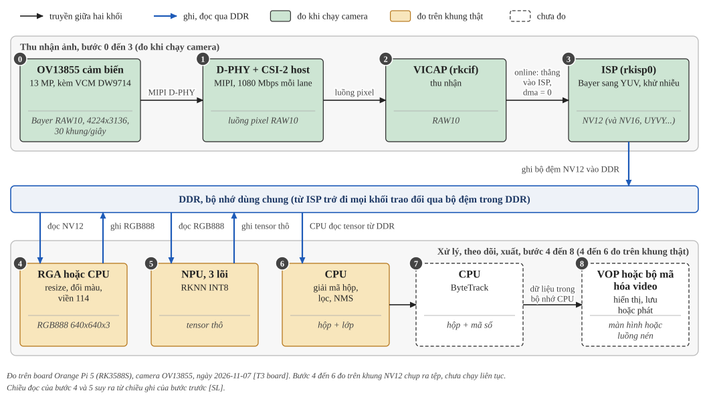
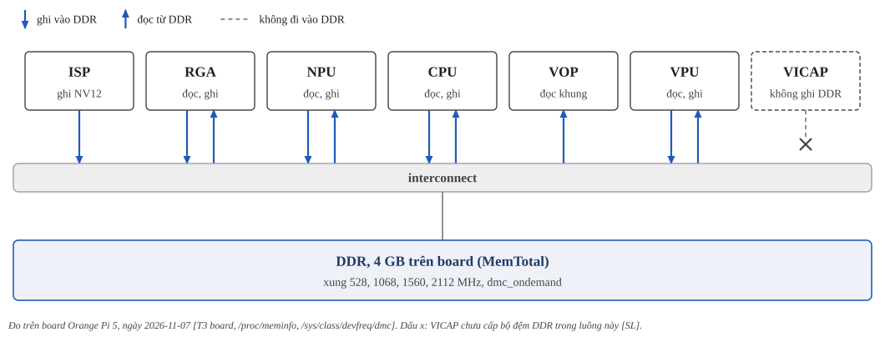
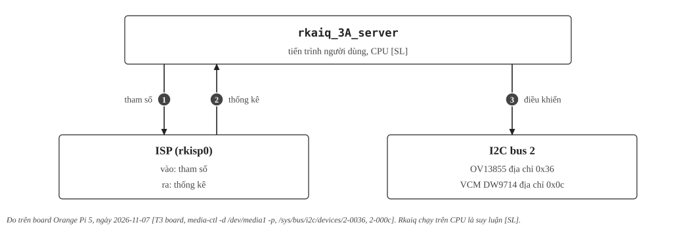

:tocdepth: 1

****************************
Tổng quan đường đi của ảnh
****************************

.. admonition:: Trang này trả lời

   - Ảnh đi từ cảm biến đến hộp phát hiện qua những khối phần cứng nào, theo thứ tự nào?
   - Dữ liệu nằm ở đâu giữa các khối (đi thẳng hay qua DDR), và ai điều khiển ai?
   - Khối nào đã đo trên board, khối nào chỉ có tài liệu hoặc mã nguồn?

.. admonition:: Tóm tắt

   1. Luồng gồm chín bước, đánh số 0 đến 8: cảm biến, đường truyền MIPI, VICAP, ISP, tiền xử lý, NPU, hậu xử lý, theo dõi, đầu ra. Bước 0 đến 3 đã đo khi chạy camera. Bước 4 đến 6 đã đo trên khung NV12 thật (mục 5) và chạy liên tục bằng ``ai/board/app/camera.py`` ở :doc:`07-chay-lien-tuc-tren-board`: 29.95 khung/giây, không mất khung, độ trễ phần mềm đầu cuối 19.0 ms khi khóa xung [T3 board, ``camera.py``]. Bước 7 đo riêng bằng hộp giả, bước 8 chưa đo.
   2. Raw của cảm biến là Bayer RAW10 (``SBGGR10_1X10``) 4224x3136, một chế độ duy nhất ở 30 khung/giây [T3 board, ``media-ctl -p``, ``v4l2-ctl --list-subdev-framesizes``]. Mục tiêu 30 FPS của dự án khớp với tốc độ camera, nên FPS cao hơn của NPU không tạo thêm khung.
   3. VICAP đưa RAW thẳng vào ISP (``rdbk_mode: online``) và chưa cấp bộ đệm DDR (``dma enable: 0x0``), suy ra không ghi DDR [SL] [T3 board, ``/proc/rkcif-mipi-lvds1``]. Từ ISP trở đi mọi khối trao đổi qua bộ đệm trong DDR.
   4. Có hai mặt phẳng: dữ liệu (hình 1) và điều khiển (hình 3). Điều khiển gồm vòng 3A trên CPU và I2C tới cảm biến, VCM.
   5. VPU không nằm trên đường vào của camera MIPI, chỉ cần khi nguồn là luồng nén, và dùng được ở đầu ra để mã hóa. GPU không hoạt động khi chụp camera và khi chạy bước 4 đến 6 [T3 board, ``/sys/class/devfreq/fb000000.gpu/load``].
   6. Chạy tuần tự bước 4 đến 6 trên khung 1080p thật: 20.2 ms trung vị khi khóa xung và ghim lõi lớn (NPU 17.4 ms, ``preprocess`` 1.2 ms), còn 31.8 ms khi không khóa và không ghim (mục 5) [T3 board, ``board_pipeline_test.py``, ``board_pipeline_test2.py``].

.. contents:: Trong trang này
   :local:
   :depth: 1

1. Phạm vi và cách đọc nhãn
===========================

Trang vẽ đường đi của ảnh trên Orange Pi 5 (SoC RK3588S) với camera OV13855 và model YOLOv8n của dự án. Mỗi bước có một trang riêng (bảng ở mục 2). Số đo hiệu năng model ở :doc:`../03-phuong-phap/index`.

Ngoài ba tier T1, T2, T3 của site (:doc:`../../index`), trang này dùng hai nhãn riêng. ``[SL]`` là suy luận của dự án từ các nguồn, chưa có câu nào trong nguồn nói thẳng. ``unknown`` là chưa có nguồn, gom ở :doc:`../09-tien-do/03-khoang-trong/07-luong-camera`. ``[T3 board, <lệnh>]`` là quan sát trên board bằng lệnh đã ghi, ngày 2026-11-07, qua LAN.

Trong các hình, ``đo`` là khối đã hoạt động khi chụp camera, ``đo trên khung thật`` là chạy trên khung NV12 chụp ra tệp, ``chưa đo`` là chưa chạy.

Phần cứng đo [T3 board]:

- Board ``Orange Pi 5``, kernel 6.1.99-rockchip-rk3588, Ubuntu 22.04, overlay ``ov13855-c3`` (``/proc/device-tree/model``, ``uname -r``, ``/boot/orangepiEnv.txt``).
- CPU: 4 lõi Cortex-A55 (cpu0 đến 3, tối đa 1.8 GHz), 2 lõi A76 (cpu4, 5, 2.256 GHz), 2 lõi A76 (cpu6, 7, 2.304 GHz), governor ``ondemand`` (``lscpu``).
- DDR: MemTotal 4010180 kB, bốn mức xung 528, 1068, 1560, 2112 MHz, governor ``dmc_ondemand``. NPU: driver rknpu 0.9.8, xung 300 đến 1000 MHz, ``rknpu_ondemand``, IOMMU bật (``dmesg``, ``/sys/class/devfreq``).
- Camera: driver ``ov13855`` 00.01.04, cảm biến ``OV00d855`` revision 0xb0 (``dmesg``). Các khối còn lại ở :doc:`08-phan-cung-tang-toc` mục 2.

TRM1 và TRM2 trong repo là của RK3588, datasheet là của RK3588S V1.7. Chỗ nào chỉ có trích dẫn TRM thì chưa xác minh riêng cho RK3588S.

2. Hình 1: đường đi của ảnh
===========================

.. _fig-duong-di-cua-anh:

   Hình 1. Đường đi của ảnh qua chín bước (0 đến 8), lấy DDR làm trục. Bước 0 đến 3 truyền trực tiếp, từ ISP trở đi các khối trao đổi qua bộ đệm trong DDR (mũi tên xanh dương). Màu nền hộp cho biết trạng thái đo: xanh lá là đo khi chạy camera, vàng là đo trên khung NV12 thật, nét đứt là chưa đo.

.. list-table::
   :header-rows: 1
   :widths: 10 40 50

   * - Bước
     - Phần cứng
     - Trang chi tiết
   * - 0, 1, 2
     - Cảm biến OV13855, D-PHY và CSI-2, VICAP
     - :doc:`02-camera-duong-truyen-thu-nhan`
   * - 3
     - ISP và vòng 3A
     - :doc:`03-isp-va-vong-3a`
   * - 4
     - RGA hoặc CPU
     - :doc:`04-tien-xu-ly`
   * - 5
     - NPU, 3 lõi
     - :doc:`05-ben-trong-npu`
   * - 6, 7, 8
     - CPU, ByteTrack, VOP hoặc bộ mã hóa video
     - :doc:`06-sau-npu`

2.1 Chú giải các khối trong hình 1
-----------------------------------

Cảm biến (bước 0)
^^^^^^^^^^^^^^^^^

- **VCM DW9714**: bộ truyền động dịch chuyển thấu kính để lấy nét, nhận lệnh qua I2C, không nằm trên đường đi của ảnh [T1 DW9714V tr.1]. Trên board: I2C bus 2, địa chỉ ``0x0c`` [T3 board, ``/sys/bus/i2c/devices/2-000c/name``]. Tài liệu là bản ``DW9714V`` (:ref:`24-camera-vcm-driver`), board báo ``dw9714``, chưa biết có trùng không.
- **Bayer RAW10**: ảnh thô chưa xử lý màu, mỗi điểm ảnh chỉ đo một màu xếp xen kẽ theo hàng, 10 bit mỗi điểm [Mã nguồn Linux, `pixfmt-bayer <https://docs.kernel.org/userspace-api/media/v4l/pixfmt-bayer.html>`__]. Trên board chỉ có ``SBGGR10_1X10`` [T3 board, ``media-ctl -p``]. Ảnh đủ ba màu chỉ có sau khối ``DEBAYER`` của ISP [T3 board, ``/proc/rkisp0-vir1``].
- **4224x3136**: khoảng 13,2 triệu điểm ảnh [SL, phép nhân]. YOLOv8n nhận 640x640, nên bước 4 phải thu nhỏ ảnh này.

Đường truyền (bước 1, 2)
^^^^^^^^^^^^^^^^^^^^^^^^

- **D-PHY**: lớp vật lý của MIPI, tối đa 2.5 Gbps mỗi lane [T1 TRM2 tr.2379, tr.2390]. Trên board 1080 Mbps mỗi lane, 4 lane hiệu dụng [T3 board, ``/proc/rkcif-mipi-lvds1``, ``dmesg``].
- **CSI-2 host**: nhận luồng CSI-2 từ D-PHY, gom dữ liệu các lane rồi giải mã gói tin [T1 TRM2 tr.2379]. Trên board overlay nhắm nút ``mipi1_csi2``, vai trò suy theo tên nút [T3 board, ``dtc`` trên ``rk3588-ov13855-c3.dtbo``].
- **VICAP**: nhận dữ liệu camera và chuyển vào bộ nhớ chính qua AXI, RAW đi thẳng sang ISP [T1 TRM1 tr.2058]. Trên board RAW vào ISP trực tiếp, chưa qua DDR (tóm tắt số 3, [SL]).

ISP và định dạng ảnh (bước 3)
^^^^^^^^^^^^^^^^^^^^^^^^^^^^^

- **ISP**: nhận RAW Bayer và trả ảnh YUV [T1 DS V1.7 tr.7] [T3 board, ``media-ctl -d /dev/media1 -p``]. Trên board đang bật DEBAYER, các khối khử nhiễu (BAYNR, BAY3D, YNR, CNR), GAMMA_OUT, SHARP và vài khối khác [T3 board, ``/proc/rkisp0-vir1``]. ISP ghi NV12 qua ``rkisp_mainpath`` (tối đa 4224x3136) hoặc ``rkisp_selfpath`` (rộng tối đa 1920), cả hai xuất thẳng NV12 640x360 ở 29.95 fps [T3 board, ``v4l2-ctl --stream-mmap``].
- **YUV**: Y là độ sáng, Cb (U) và Cr (V) là hai thành phần màu [Mã nguồn Linux, `pixfmt-packed-yuv <https://docs.kernel.org/userspace-api/media/v4l/pixfmt-packed-yuv.html>`__].
- **NV12**: hai vùng, vùng Y rồi vùng Cb, Cr xen kẽ, giảm mẫu màu cả ngang và dọc (4:2:0), 1,5 byte mỗi điểm ảnh. **NV16**: như NV12 nhưng chỉ giảm mẫu ngang (4:2:2), 2 byte. **UYVY**: xếp liền Cb, Y0, Cr, Y1 (4:2:2), 2 byte [Mã nguồn Linux, `pixfmt-yuv-planar <https://docs.kernel.org/userspace-api/media/v4l/pixfmt-yuv-planar.html>`__]. Số byte mỗi điểm ảnh là tôi suy từ mô tả của kernel [SL]. Ảnh 4224x3136 ở NV12 nặng khoảng 19,9 MB [SL]. ISP ra được cả ba, bước 4 đến 6 mới đo với NV12.

Tiền xử lý (bước 4)
^^^^^^^^^^^^^^^^^^^

- **RGA**: bộ tăng tốc đồ họa 2D riêng, làm xoay, lật, đổi kích thước và đổi định dạng ảnh [T1 TRM2 tr.701]. Trên board hai lõi RGA3 và một lõi RGA2 [T3 board, ``dmesg``]. Đổi NV12 1080p sang RGB888 640x640 có viền mất khoảng 2,2 ms (bộ đệm dma-buf) [T3 board, ``rga_bench.c``].
- **Resize, đổi màu, viền 114** (letterbox): thu nhỏ cho cạnh dài bằng 640 và giữ tỉ lệ, đổi sang RGB, thêm viền xám (114, 114, 114) cho đủ 640x640 [Mã nguồn repo, ``ai/board/common.py:64-79``].
- **RGB888**: 3 byte mỗi điểm ảnh. Đầu vào model là ảnh uint8 RGB 640x640x3, 1.228.800 byte [Mã nguồn repo, ``ai/board/common.py:64-79``] [SL, phép nhân].

NPU (bước 5)
^^^^^^^^^^^^

- **NPU, 3 lõi**: mỗi lõi làm 1024 phép MAC INT8 mỗi chu kỳ, ba lõi chạy độc lập hoặc cùng làm [T1 TRM1 tr.1984]. **RKNN INT8**: model đã chuyển sang định dạng RKNN và lượng tử hóa 8 bit. Chi tiết ở :doc:`05-ben-trong-npu`.
- **Tensor thô**: kết quả NPU trả về, chưa phải hộp. Dạng ``(1, 4 + số lớp, số anchor)``: mỗi anchor có 4 số mô tả hộp (tâm x, tâm y, rộng, cao) và điểm từng lớp [Mã nguồn repo, ``ai/board/common.py:84-123``]. Với 5 lớp và ảnh 640x640: 9 số mỗi anchor, 8400 anchor (80x80 + 40x40 + 20x20) [SL].

Hậu xử lý và đầu ra (bước 6 đến 8)
^^^^^^^^^^^^^^^^^^^^^^^^^^^^^^^^^^

- **Giải mã hộp, lọc, NMS**: mỗi anchor lấy lớp có điểm cao nhất, giữ điểm trên 0.25, đổi hộp sang tọa độ góc, rồi NMS theo từng lớp với IoU 0.7, tối đa 300 hộp [Mã nguồn repo, ``ai/board/common.py:24-27, 84-123``]. Trên board 0.662 ms, trung vị, INT8 mặc định, một context, khóa xung [T3 board, ``results/npu/throughput/thr_p3.json``].
- **ByteTrack**: gán mã số cho hộp qua các khung. Repo dùng ``BYTETracker`` của Ultralytics, hiện chạy offline [Mã nguồn repo, ``scripts/demo/common.py:28``, ``scripts/demo/video/track.py``].
- **VOP**: đọc khung ảnh từ bộ nhớ hệ thống rồi đưa ra cổng hiển thị [T1 TRM2 tr.784]. **Bộ mã hóa video** (trong VPU): H.264 và H.265, repo chưa dùng [T1 DS V1.7 tr.10].

3. Hình 2: ai đọc ghi DDR
=========================

DDR là bộ nhớ chính (DRAM) của board, nằm ngoài SoC và dùng chung cho các khối trong hình. Ảnh giữa các bước để trong DDR, khối sau đọc lại từ đó. SoC hỗ trợ 4 kênh 16 bit, chuẩn LPDDR4, LPDDR4X, LPDDR5 [T1 DS V1.7 tr.8]. Board: 4 GB LPDDR4X [T1 Orange Pi 5], xung dmc tối đa 2112 MHz [T3 board, ``/sys/class/devfreq/dmc/cur_freq``]. Mã chip cụ thể phụ thuộc từng lô phần cứng. Chi tiết ở :doc:`../02-nen-tang-rk3588/04-bo-nho-hieu-nang/01-ddr-tren-rk3588`.

.. _fig-ai-doc-ghi-ddr:

   Hình 2. Các khối đọc ghi DDR qua interconnect. Mũi tên xuống là ghi vào DDR, mũi tên lên là đọc từ DDR. VICAP có khung nét đứt và dấu x vì chưa ghi DDR (``dma enable: 0x0``, suy ra không ghi DDR [SL]).

.. list-table::
   :header-rows: 1
   :widths: 9 26 37 28

   * - Khối
     - Dùng để làm gì
     - Điều đã biết
     - Nguồn
   * - ISP
     - Biến ảnh RAW thành ảnh YUV (NV12)
     - Ghi khung NV12 ra bộ đệm qua ``rkisp_mainpath`` hoặc ``rkisp_selfpath``
     - [T3 board, ``media-ctl``, ``v4l2-ctl --stream-mmap``]
   * - VICAP
     - Nhận dữ liệu camera, chuyển sang ISP
     - ``dma enable: 0x0 0x0 0x0 0x0``, ``total buf_cnt: 0 0 0 0`` khi đang chụp
     - [T3 board, ``/proc/rkcif-mipi-lvds1``]
   * - NPU
     - Chạy model YOLOv8n ra tensor thô
     - AXI master đọc từ bộ nhớ hệ thống, IOMMU bật
     - [T1 TRM1 tr.1985] [T3 board, ``dmesg``]
   * - RGA
     - Đổi kích thước và định dạng ảnh
     - RGA3 hỗ trợ chế độ raster vào và ra, nằm trong DDR
     - [T1 TRM2 tr.703]
   * - VOP
     - Xuất ảnh ra màn hình
     - Đọc khung ảnh từ bộ nhớ hệ thống
     - [T1 TRM2 tr.784]
   * - VPU
     - Giải mã và mã hóa video nén
     - Giải mã ghi khung vào DDR qua kênh AXI write
     - [T1 TRM1 tr.368]

Interconnect có bốn bộ lập lịch DDR:

   "Four embedded DDR schedulers for transaction reorder to maximum DDR efficiency" [T1 TRM2 tr.16]

Dmesg ghi các khối sau nằm trong nhóm IOMMU: NPU nhóm 0, hai lõi RGA3 nhóm 2 và 3, hai nút ISP nhóm 15 và 16, VICAP nhóm 17, VOP nhóm 18 [T3 board, ``dmesg``]. Loại DRAM thực của board: unknown.

4. Hình 3: mặt phẳng điều khiển
===============================

.. _fig-mat-phang-dieu-khien:

   Hình 3. Mặt phẳng điều khiển. Số trên mũi tên khớp với bảng chú thích bên dưới.

Chú thích mũi tên:

.. list-table::
   :header-rows: 1
   :widths: 8 62 30

   * - Số
     - Nội dung
     - Nguồn
   * - 1
     - ``rkaiq`` gửi tham số cho ISP qua nút ``rkisp-input-params`` (video19)
     - [T3 board, ``media-ctl -d /dev/media1 -p``]
   * - 2
     - ISP trả thống kê qua nút ``rkisp-statistics`` (video18)
     - [T3 board, ``media-ctl -d /dev/media1 -p``]
   * - 3
     - Điều khiển cảm biến và VCM qua I2C bus 2. Cảm biến ở địa chỉ 0x36, VCM ở 0x0c
     - [T3 board, ``/sys/bus/i2c/devices/2-0036``, ``2-000c``]

Việc ``rkaiq`` đặt exposure, gain và focus qua I2C là suy luận [SL]. Dấu hiệu: control ``exposure`` của cảm biến đổi giữa các lần đọc (289, rồi 2893, mặc định 2048) [T3 board, ``v4l2-ctl -d /dev/v4l-subdev2 --list-ctrls``]. ``rkaiq_3A_server`` là tiến trình người dùng đang chạy [T3 board, ``pgrep``]. Nó chạy trên CPU là suy luận [SL]: ``librkaiq.so`` chỉ liên kết libdl, libdrm, libpthread, libstdc++, libm, libgcc_s, libc, và ``strings`` không thấy OpenCL, Mali, GLES, EGL. Chưa loại trừ thư viện nạp lúc chạy vì ``/proc/<pid>/maps`` bị chặn quyền root. Có chuỗi ``librga.so`` trong tệp [T3 board, ``ldd``, ``readelf -d``, ``strings``]. ``librkaiq`` dùng RGA vào việc gì: unknown.

5. Thời gian một khung 1080p
============================

Chạy tuần tự trên khung NV12 1920x1080 thật chụp từ ``rkisp_selfpath``, 220 vòng bỏ 20 vòng đầu, model ``best-rk3588.rknn`` bằng RKNNLite ở ``NPU_CORE_0``, đầu ra ``(1, 9, 8400)``. Governor CPU ``ondemand``, xung không khóa [T3 board, ``board_pipeline_test.py``]:

.. list-table::
   :header-rows: 1
   :widths: 10 40 25 25

   * - Bước
     - Việc
     - Trung vị (ms)
     - p95 (ms)
   * - 4
     - NV12 sang BGR (``cv2.cvtColor``, 8 luồng)
     - 1.842
     - 2.631
   * - 4
     - ``preprocess`` (resize, viền 114, BGR sang RGB)
     - 5.154
     - 5.482
   * - 5
     - Suy luận NPU
     - 23.359
     - 24.470
   * - 6
     - ``postprocess`` (0 hộp)
     - 1.501
     - 1.603
   * - 4 đến 6
     - Tổng
     - 31.791
     - 34.123

Số đo khóa xung của dự án có NPU 17.161 ms ở ``CORE_0`` [T3 board, ``results/npu/throughput/thr_p3.json``].

Đo lại ngày 2026-11-07 với CPU, NPU và DDR khóa ``performance`` bằng ``lock_freq.sh`` (CPU 1800, 2256 và 2304 MHz, NPU 1000 MHz, DDR 2112 MHz), 300 vòng sau 30 vòng khởi động, cùng model ở ``NPU_CORE_0`` [T3 board, ``board_pipeline_test2.py``]. Ảnh có người là ảnh test của ppe5 phóng lên 1920x1080, nên ``postprocess`` có 34 hộp trung bình:

.. list-table::
   :header-rows: 1
   :widths: 30 17 17 17 19

   * - Việc, trung vị (ms)
     - Khung camera, không ghim
     - Khung camera, ghim lõi 4 đến 7
     - Ảnh có người, ghim lõi 4 đến 7
     - Ghi chú
   * - NV12 sang BGR
     - 1.071
     - 1.181
     - không có
     - ``cv2``, 8 luồng và 4 luồng
   * - ``preprocess``
     - 3.961
     - 1.199
     - 1.181
     -
   * - Suy luận NPU
     - 17.387
     - 17.384
     - 17.351
     - khớp 17.161 ms của dự án
   * - ``postprocess``
     - 0.475 (0 hộp)
     - 0.476 (0 hộp)
     - 2.043 (34 hộp)
     -
   * - Tổng
     - 22.910
     - 20.248
     - 20.574
     -

Ở cột ghim lõi, p95 chỉ hơn trung vị tối đa 1.06 ms. Không ghim thì ``preprocess`` chậm hơn 3.3 lần (3.961 so với 1.199 ms) trên cùng khung. ``cv2`` dùng 8 luồng gồm cả lõi A55, ghim vào lõi 4 đến 7 dùng 4 luồng trên A76. Nguyên nhân do luồng ``cv2`` rơi vào lõi nhỏ là suy luận [SL], chưa tách riêng. Khi chưa khóa xung, ``preprocess`` đo 5.154 ms trong pipeline và 1.124 ms riêng lẻ. Tổng ghim lõi lớn 20.2 ms ứng với khoảng 49 khung/giây tuần tự, thấp hơn chu kỳ 33.3 ms của camera [SL, phép tính]. GPU đọc ``0@300000000Hz`` ở mọi mẫu [T3 board]. Sau khi đo đã trả governor về ``ondemand``, ``rknpu_ondemand``, ``dmc_ondemand`` và đọc lại xác nhận [T3 board, ``lock_freq.sh status``]. Chi tiết các bước ở :doc:`04-tien-xu-ly`, :doc:`05-ben-trong-npu`, :doc:`06-sau-npu`.

Bước 7 (ByteTrack) đo riêng bằng hộp giả khi khóa xung: tracker cộng lớp hiển thị mất 5.6 ms cho 34 người trên lõi A76, 51.2 ms trên lõi A55, và 447 ms nếu để số luồng BLAS mặc định thay vì ``OPENBLAS_NUM_THREADS=1``. Chưa đo cùng lúc với NPU và RGA, chưa đo với hộp thật (:doc:`06-sau-npu` mục 2) [T3 board, ``track_bench.py``].
