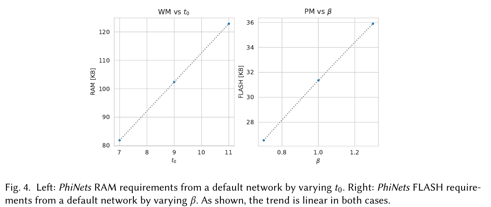

:tocdepth: 1

*********************
Mạng nhận biết bộ nhớ
*********************

.. admonition:: Trang này trả lời

   - các bài về thiết bị biên đo và ràng buộc gì về bộ nhớ?

.. admonition:: Tóm tắt

   - MCUNet nêu SRAM giới hạn kích thước activation còn Flash giới hạn kích thước model [T2 MCU tr.3].
   - Cả MCUNet và PhiNets đều tách bộ nhớ làm việc (activation) khỏi bộ nhớ tham số (weight) và tối ưu từng loại riêng.
   - Detector đa tỉ lệ như YOLOv3 phải giữ activation trung gian nên peak memory tăng mạnh [T2 MCU tr.9]; đây là nhận xét về MCU, không phải bằng chứng cho RK3588.
   - In-place depthwise đưa peak memory từ 2N xuống N+1 [T2 MCU tr.6]; compiler của Rockchip có làm tương tự hay không là `unknown`.
   - MCUNet đo trên STM32 và PhiNets cũng trên MCU, không bài nào đo băng thông DDR hay NPU, nên T2 cho thiết bị có DRAM và NPU còn thiếu.

.. _75-thiết-kế-mạng-nhận-biết-bộ-nhớ-t2:

Thiết kế mạng nhận biết bộ nhớ (T2)
===================================

**Câu hỏi:** các bài về thiết bị biên đo và ràng buộc gì về bộ nhớ?

**Nguồn nói gì**

   "In deep learning scenarios, SRAM constrains the activation size (read&write); Flash constrains the model size (read-only)." [T2 MCU tr.3]

..

   "Microcontrollers are bare-metal devices that do not have an operating system, nor do they have DRAM." [T2 MCU tr.1]

   "reduces the memory of depth-wise convolutions to N+1" [T2 MCU tr.6]

..

   "use multi-scale feature maps to generate the final prediction, which has to keep intermediate activations in the SRAM, increasing the peak memory by a large margin" [T2 MCU tr.9] (Câu nói về "other more advanced detectors like YOLOv3".)

   "the dynamic memory (working memory - WM)." [T2 PHI tr.6]

..

   "decouple the computational cost, working memory, and parameter memory" [T2 PHI tr.1]

|MCUNet Figure 7| *Hình 7.5a. In-place depth-wise convolution của TinyEngine: peak memory giảm từ 2N xuống N+1 nhờ ghi đè activation của channel trước. Nguồn: [T2 MCU tr.6, Figure 7]*

|PhiNets Figure 4| *Hình 7.5b. PhiNets: RAM (WM, đồ thị trái) thay đổi tuyến tính theo ``t0``, FLASH (PM, đồ thị phải) thay đổi tuyến tính theo ``β`` (mỗi đồ thị 3 điểm). Nguồn: [T2 PHI tr.8, Fig. 4]*

**Ý chính**

- Hai bài đều tách rõ bộ nhớ làm việc (activation, trong SRAM hoặc RAM) với bộ nhớ tham số (weight, trong Flash) và tối ưu từng loại riêng.
- MCUNet nêu detector đa tỉ lệ như YOLOv3 phải giữ activation trung gian nên peak memory tăng mạnh (MCU tr.9). Tổng hợp của file này: đây là nhận xét về MCU, không phải bằng chứng cho hành vi của RK3588.
- In-place depthwise (MCU tr.6) là kỹ thuật cho MCU có SRAM nhỏ; compiler của Rockchip có làm tương tự hay không là ``unknown``.

**Giới hạn.** MCUNet đo trên STM32 và PhiNets cũng trên MCU. Không bài nào đo băng thông DDR hay NPU. T2 về thiết kế mạng cho thiết bị có DRAM và NPU còn thiếu (xem truy vấn dưới).

--------------

.. |MCUNet Figure 7| image:: ../../_assets/img/npu/07_memory_performance/mcunet_p6_fig7.png

Nguồn
=====

Các nhãn nguồn dùng trong trang này (tier, tệp, số lần trích).

.. list-table::
   :header-rows: 1
   :widths: 12 8 70 10

   * - Nhãn
     - Tier
     - Nguồn
     - Số lần
   * - ``MCU``
     - T2
     - :download:`mcunet_2020lin.pdf <../../_assets/pdf/papers/04_memory/mcunet_2020lin.pdf>`
     - 5
   * - ``PHI``
     - T2
     - :download:`phinets_edge_2021paissan.pdf <../../_assets/pdf/papers/04_memory/phinets_edge_2021paissan.pdf>`
     - 3
