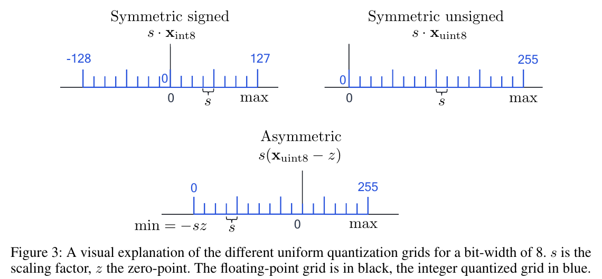
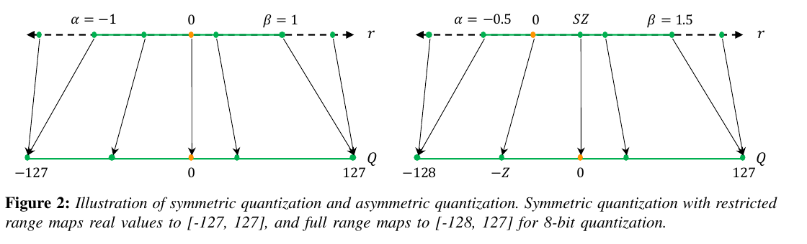
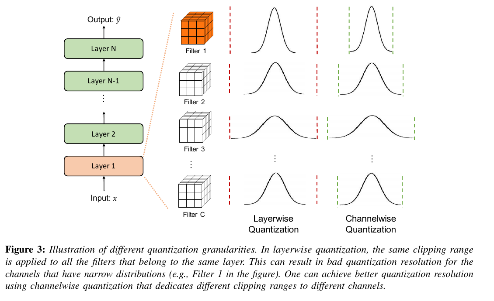
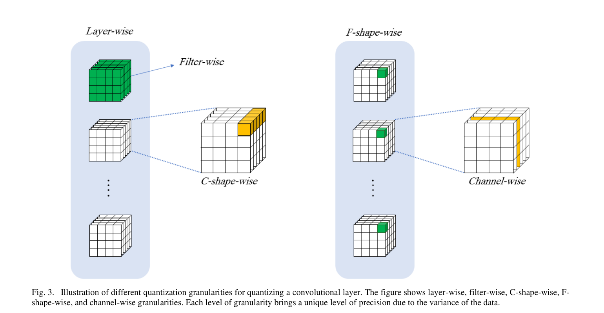

:tocdepth: 1

*******************
Lượng tử hóa cơ bản
*******************

.. admonition:: Trang này trả lời

   - một số thực được ánh xạ sang số nguyên thế nào?
   - dùng một bộ tham số cho cả tensor hay nhiều bộ?

.. admonition:: Tóm tắt

   - Uniform affine quantization có ba tham số: scale factor s, zero-point z và bit-width b, symmetric quantizer đặt zero-point bằng 0 [T2 NAGEL tr.4].
   - Hai nguồn ký hiệu zero-point ngược dấu (NAGEL Eq. 4, 6 so với GHOLAMI Eq. 2, 3), và trang chọn NAGEL làm chuẩn khi viết công thức.
   - Cách chọn thường gặp là asymmetric activation quantization và symmetric weight quantization, để tránh số hạng phụ thuộc dữ liệu [T2 NAGEL tr.8].
   - Per-channel hầu như không cải thiện ở W8 nhưng cải thiện nhiều ở W4: ResNet18 Min-Max từ 0.12 lên 44.49 (NAGEL Table 1, tr.9).
   - Per-channel cho activation khó thực hiện vì phải rescale accumulator, và không phải phần cứng thương mại nào cũng hỗ trợ per-channel weights [T2 NAGEL tr.8].
   - "Channel-wise" có hai nghĩa giữa các nguồn (NAGEL, GHOLAMI so với Y7Q), và các nguồn không nói gì về RK3588.

.. _31-affine-quantization-scale-zero-point-symmetric-và-asymmetric:

Affine quantization: scale, zero-point, symmetric và asymmetric
===============================================================

**Câu hỏi:** một số thực được ánh xạ sang số nguyên thế nào?

**Nguồn nói gì**

   "Uniform affine quantization, also known as asymmetric quantization, is defined by three quantization parameters: the scale factor s, the zero-point z and the bit-width b." [T2 NAGEL tr.4]

..

   "The zero-point is an integer that ensures that real zero is quantized without error. This is important to ensure that common operations like zero padding or ReLU do not induce quantization error." [T2 NAGEL tr.4]

   "The symmetric quantizer restricts the zero-point to 0." [T2 NAGEL tr.4]

..

   "S is a real valued scaling factor, and Z is an integer zero point." [T2 GHOLAMI tr.5]

   "Asymmetric quantization often results in a tighter clipping range as compared to symmetric quantization." [T2 GHOLAMI tr.5]

..

   "it is a common approach to use asymmetric activation quantization and symmetric weight quantization that avoids the additional data-dependent term." [T2 NAGEL tr.8]

Công thức (đọc từ ảnh trang):

.. list-table::
   :header-rows: 1

   * - Nguồn
     - Lượng tử hóa
     - Giải lượng tử hóa
     - Dấu zero-point
   * - NAGEL Eq. 4 và 6 (tr.4)
     - ``x_int = clamp(round(x/s) + z; 0, 2^b - 1)``
     - ``x ≈ x^ = s (x_int - z)``
     - cộng khi lượng tử hóa
   * - GHOLAMI Eq. 2 và 3 (tr.5)
     - ``Q(r) = Int(r/S) - Z``
     - ``r~ = S (Q(r) + Z)``
     - trừ khi lượng tử hóa

GHOLAMI Eq. 4 (tr.5): ``S = (β - α) / (2^b - 1)``, trong đó ``[α, β]`` là clipping range. GHOLAMI Eq. 5: bản symmetric thay ``Z = 0``, ``Q(r) = Int(r/S)``.

|NAGEL Figure 3| *Hình 3.1a. Các lưới lượng tử hóa đều với 8 bit: symmetric signed, symmetric unsigned và asymmetric. Nguồn: [T2 NAGEL tr.5, Figure 3]*

|GHOLAMI Figure 2| *Hình 3.1b. Symmetric (restricted range [-127, 127]) so với asymmetric. Nguồn: [T2 GHOLAMI tr.5, Figure 2]*

**Ý chính**

- Lượng tử hóa affine có ba tham số: scale, zero-point, bit-width (NAGEL tr.4). Zero-point đảm bảo số 0 thực được lượng tử hóa không sai số.
- Symmetric là trường hợp đặc biệt của cùng công thức với ``z = 0``. Tổng hợp của file này: "affine so với symmetric" không phải hai họ đối lập, và NAGEL gọi affine cũng là asymmetric.
- Cách chọn thường gặp: weight symmetric, activation asymmetric. Lý do trong NAGEL tr.8 là tránh số hạng phụ thuộc dữ liệu.

**Giới hạn.** Hai nguồn ký hiệu zero-point ngược dấu (bảng trên). Y7Q tr.2 và QYOLO tr.6 theo ký hiệu của NAGEL. Dùng NAGEL làm chuẩn khi viết công thức. Cũng cần lưu ý NAGEL dùng lưới unsigned ``{0, ..., 2^b - 1}`` cho dạng asymmetric, còn GHOLAMI dùng lưới có dấu (Figure 2).

--------------

.. _32-per-tensor-per-channel-và-các-kiểu-granularity-khác:

Per-tensor, per-channel và các kiểu granularity khác
====================================================

**Câu hỏi:** dùng một bộ tham số cho cả tensor hay nhiều bộ?

**Nguồn nói gì**

   "This is called per-tensor quantization." [T2 NAGEL tr.5]

..

   "For example, for weight tensors, we can specify a different quantizer per output channel. This is known as per-channel quantization" [T2 NAGEL tr.5]

   "Per-channel quantization of activations is much harder to implement because we cannot factor the scale factor out of the summation and would, therefore, require rescaling the accumulator for each input channel." [T2 NAGEL tr.8]

..

   "Whereas per-channel quantization of weights is increasingly becoming common practice, not all commercial hardware supports it. Therefore, it is important to check if it is possible in your intended target device." [T2 NAGEL tr.8]

   "Channelwise quantization is currently the standard method used for quantizing convolutional kernels." [T2 GHOLAMI tr.7]

..

   "In our experiments, unless otherwise noted, we employed symmetric channel-wise quantization for weights and asymmetric layer-wise quantization for activations." [T2 QYOLO tr.9]

|GHOLAMI Figure 3| *Hình 3.2a. Layerwise so với channelwise: cùng một clipping range cho mọi filter của lớp, hoặc mỗi filter một range. Nguồn: [T2 GHOLAMI tr.6, Figure 3]*

|Y7Q Figure 3| *Hình 3.2b. Các granularity trong bài YOLOv7: layer-wise, filter-wise, C-shape-wise, F-shape-wise, channel-wise. Nguồn: [T2 Y7Q tr.3, Figure 3]*

**Số đo**

NAGEL Table 1 (tr.9): chỉ lượng tử hóa weight (symmetric), activation giữ FP32, độ chính xác ImageNet (%), trung bình 5 lần chạy.

.. list-table::
   :header-rows: 1

   * - Phương pháp
     - ResNet18 W8
     - W6
     - W4
     - MobileNetV2 W8
     - W6
     - W4
   * - Min-Max (per-tensor)
     - 69.57
     - 63.90
     - 0.12
     - 71.16
     - 64.48
     - 0.59
   * - MSE (per-tensor)
     - 69.45
     - 64.64
     - 18.82
     - 71.15
     - 65.43
     - 13.77
   * - Min-Max (per-channel)
     - 69.60
     - 69.08
     - 44.49
     - 71.21
     - 68.52
     - 18.40
   * - MSE (per-channel)
     - 69.66
     - 69.24
     - 54.67
     - 71.46
     - 68.89
     - 27.17

FP32: ResNet18 69.68, MobileNetV2 71.72. Bài ghi hai hàng đầu là "Min-Max" và "MSE" và hai hàng sau là "(Per-channel)", nhãn "(per-tensor)" ở hai hàng đầu do file này thêm để đối chiếu.

NAGEL Table 6 (tr.17), một phần: EfficientDet-D1 trên COCO (mean average precision), FP32 40.08.

.. list-table::
   :header-rows: 1

   * - Cấu hình
     - Per-tensor
     - Per-channel
   * - W8A8
     - 38.29
     - 38.67
   * - W4A8
     - 0.31
     - 35.08

Y7Q Table I (tr.4), 4-bit, chỉ weight, quantize đều (Uniform), mAP, FP16 baseline 0.691: filter-wise 0.491, channel-wise 0.621, C-shape-wise 0.657, F-shape-wise 0.635.

**Ý chính**

- Per-channel nghĩa là mỗi output channel của weight một quantizer (NAGEL tr.5). Nó hầu như không cải thiện ở W8 nhưng cải thiện nhiều ở W4: ResNet18 Min-Max 0.12 lên 44.49 (+44.4) và MobileNetV2 Min-Max 0.59 lên 18.40 (+17.8) ở Table 1. EfficientDet-D1 W4A8 0.31 lên 35.08 ở Table 6. NAGEL tr.17 nêu mức giảm accuracy của per-tensor tăng lên 2.5% (MobileNetV2) và 4.2% (EfficientNet lite), và viết: "This is likely due to the quantization of the depth-wise separable convolutions." Cùng đoạn: per-channel tăng accuracy của EfficientNet lite thêm 2.8% so với per-tensor, và hiệu ứng tương tự ở EfficientDet-D1 và DeeplabV3 (cùng dùng depth-wise separable convolution). Đoạn này không nói về cấu hình W4A8 của Table 6 [T2 NAGEL tr.17].
- Per-channel cho activation khó thực hiện vì phải rescale accumulator (NAGEL tr.8). Tổng hợp của file này: khi viết "per-channel" phải nói rõ là của weight.
- Hỗ trợ phần cứng là điều kiện cần kiểm tra (NAGEL tr.8).

**Giới hạn**

- "Channel-wise" có hai nghĩa. NAGEL tr.5 và GHOLAMI tr.7 dùng nó cho "mỗi output filter một quantizer". Y7Q gọi cách đó là "filter-wise" và dùng "channel-wise" cho mức mịn hơn (Figure 3 của Y7Q). Vì vậy kết quả 4-bit của Y7Q (filter-wise 0.491) không dùng để bác bỏ per-channel kiểu NAGEL ở INT8: Y7Q chỉ lượng tử hóa weight ở 4-bit.
- Nguồn không nói gì về RK3588. RKNN-Toolkit2 dùng per-layer hay per-channel xem file ``04_``.

--------------

Nguồn
=====

Các nhãn nguồn dùng trong trang này (tier, tệp, số lần trích).

.. list-table::
   :header-rows: 1
   :widths: 12 8 70 10

   * - Nhãn
     - Tier
     - Nguồn
     - Số lần
   * - ``NAGEL``
     - T2
     - :download:`quant_whitepaper_2021nagel.pdf <../../_assets/pdf/papers/02_quantization/quant_whitepaper_2021nagel.pdf>`
     - 10
   * - ``GHOLAMI``
     - T2
     - :download:`quantization_survey_2021gholami.pdf <../../_assets/pdf/papers/02_quantization/quantization_survey_2021gholami.pdf>`
     - 5
   * - ``QYOLO``
     - T2
     - :download:`qyolo_ptq_2023wang.pdf <../../_assets/pdf/papers/02_quantization/qyolo_ptq_2023wang.pdf>`
     - 1
   * - ``Y7Q``
     - T2
     - :download:`quant_yolov7_2024.pdf <../../_assets/pdf/papers/02_quantization/quant_yolov7_2024.pdf>`
     - 1
